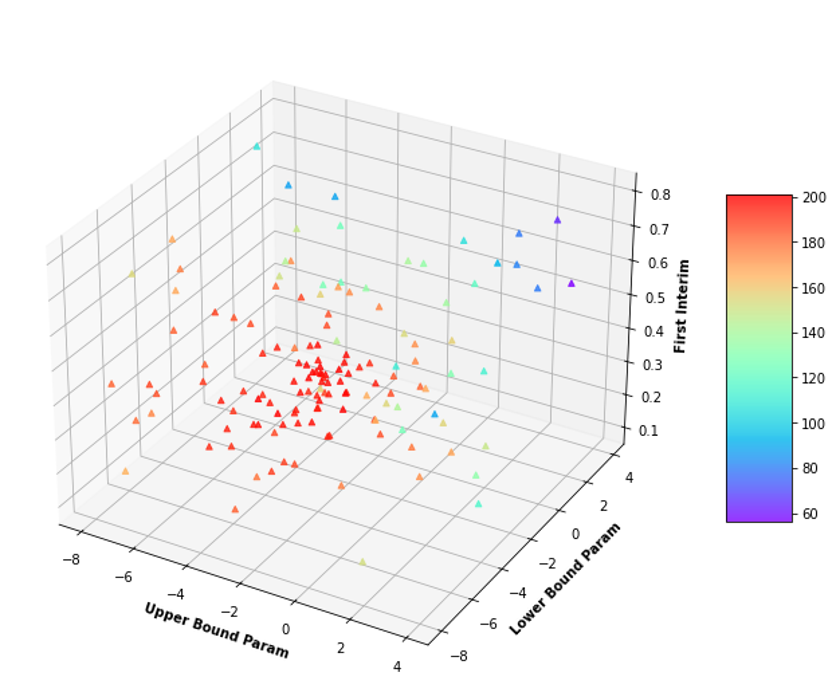
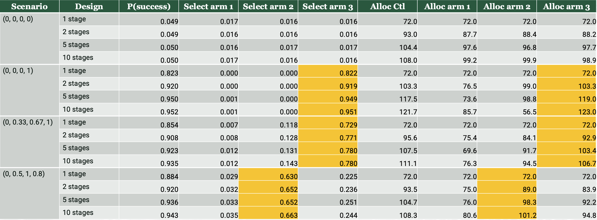
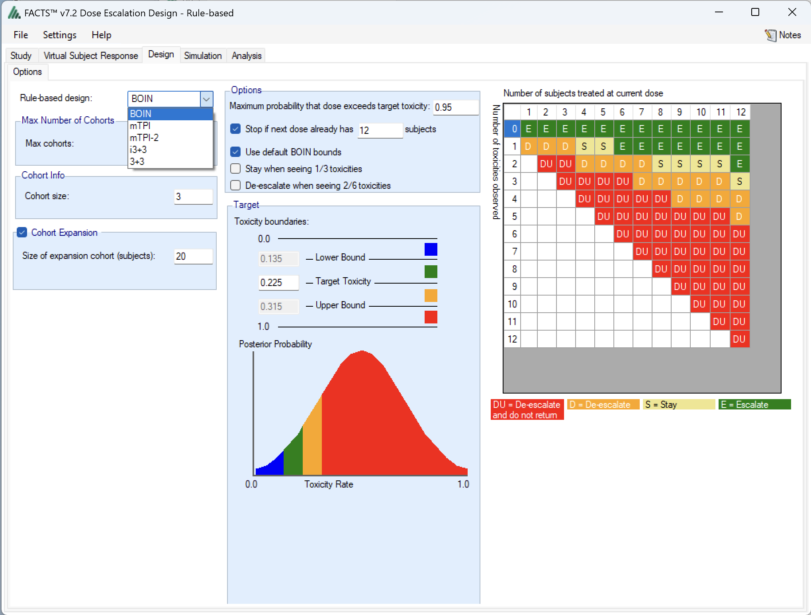

# Tom Parke

##### ADMTP 2025 Conference Presentation

Optimizing Group Sequential Designs using Machine Learning

Tom Parke

Mar 4, 2025

##### ADMTP 2025 Conference Presentation

The Properties of Multi-Arm Response Adaptive Designs

Tom Parke

Mar 5, 2025

##### FACTS 7.2 News

FACTS 7.2 Adds New Dose Escalation Methods in Latest Update.

Tom Parke

Jun 27, 2025
