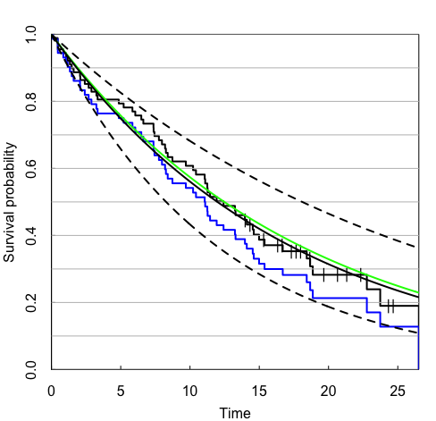
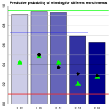
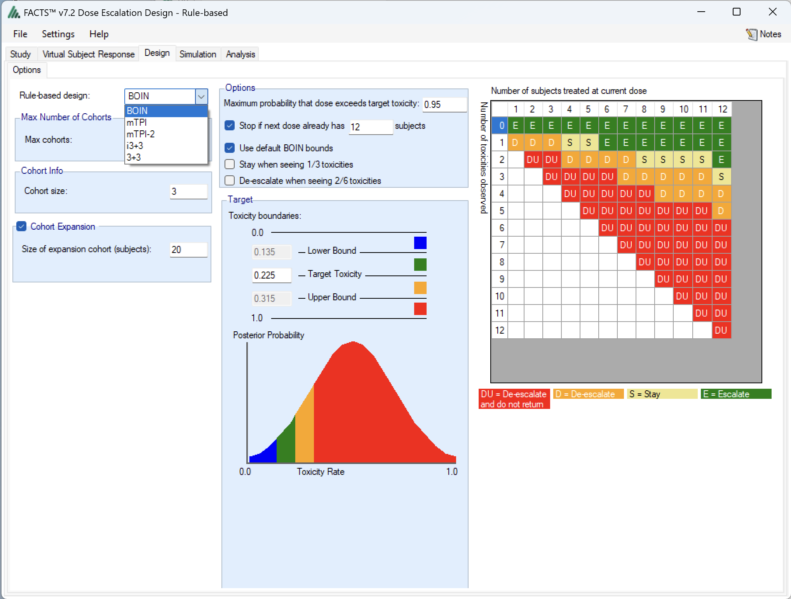
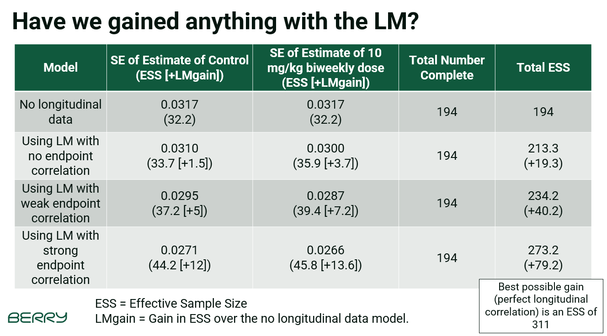
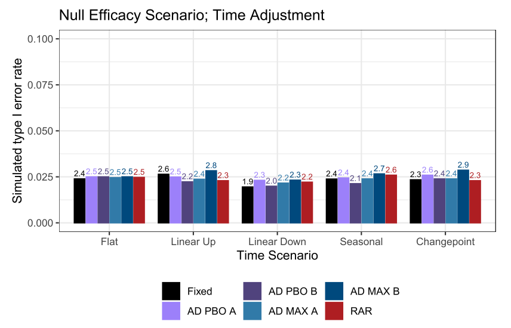
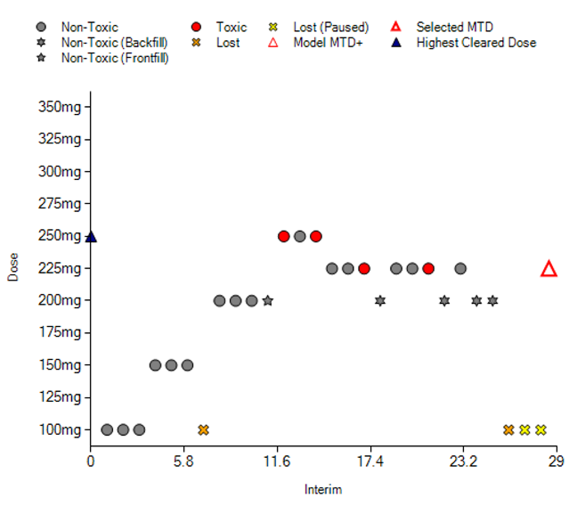
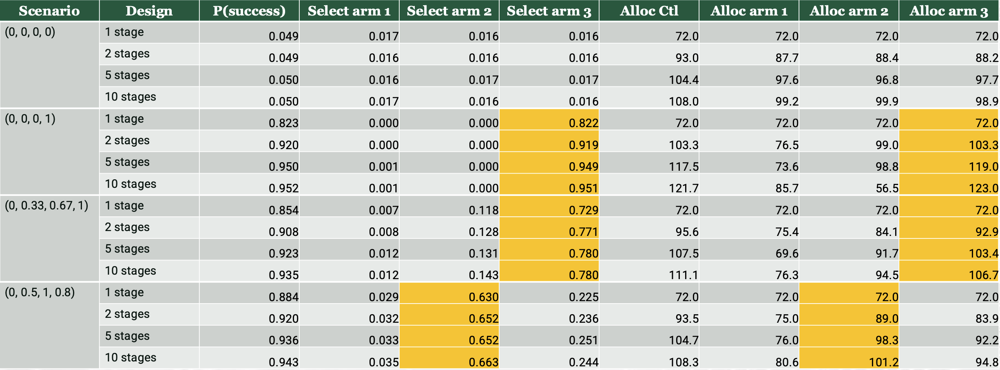
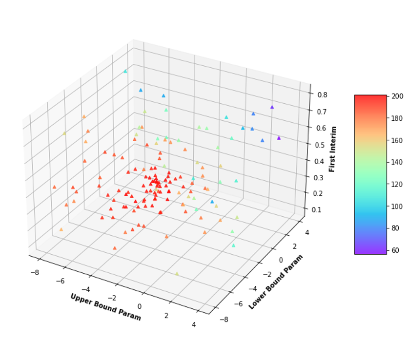

Welcome to our blog — your resource for timely product news, upcoming features, expert opinions on everything clinical trials and conference and webinar materials.

### [Kaplan-Meier Estimates and Plots in the Context of the Bayesian Time Machine](../blog/posts/2026-02-04.llms.md)

Kaplan-Meier estimates when modeling the change in the population over time

Feb 4, 2026

Todd Graves

### [A Formula to Aid in Enrichment Decisions in Seamless Phase II-III Clinical Trials](../blog/posts/2026-02-02.llms.md)

A suggested approach to help guide enrichment designs

Feb 2, 2026

Todd Graves

### [FACTS 7.2 News](../blog/posts/2025-06-27.llms.md)

FACTS 7.2 Adds New Dose Escalation Methods in Latest Update.

Jun 27, 2025

Tom Parke

### [April’s FACTS Webinar - Longitudinal Models](../blog/posts/2025-04-25.llms.md)

An example of the use of a longitudinal model in FACTS focusing on the statistical efficiencies gained.

Apr 25, 2025

Nick Berry

### [Response-Adaptive Randomization in Clinical Trials](../blog/posts/2025-04-22.llms.md)

Current opinion considering recent publications

Apr 22, 2025

Kert Viele

### [ADMTP 2025 Conference Presentation](../blog/posts/2025-03-06.llms.md)

Designing a seamless P1/P2a open enrollment CRM dose escalation study

Mar 6, 2025

Elias Laurin Meyer

### [ADMTP 2025 Conference Presentation](../blog/posts/2025-03-05.llms.md)

The Properties of Multi-Arm Response Adaptive Designs

Mar 5, 2025

Tom Parke

### [ADMTP 2025 Conference Presentation](../blog/posts/2025-03-04.llms.md)

Optimizing Group Sequential Designs using Machine Learning

Mar 4, 2025

Tom Parke
