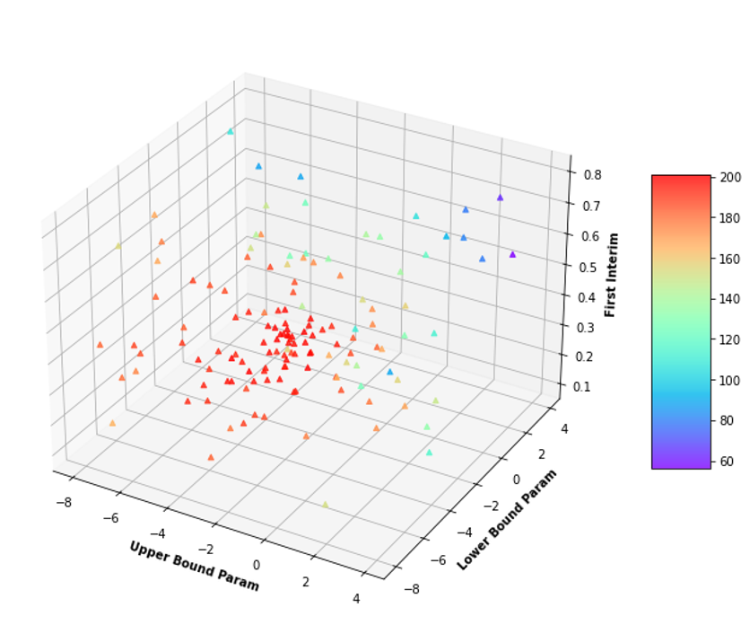

I gave a talk at [ADMTP 2025](https://admtp.github.io/ADMTP2025/) on using Machine Learning to optimize a trial design. Click [here](attachments/2025-03-04-SlidesTP.pdf) to download the slides. As trials get more complex, they acquire more design parameters that need setting. For many of these there are no obvious values that should be used, and there is a considerable parameter space to be explored, using simulations if we are to find the best. Can this be done for us automatically using the latest Machine Learning (ML) software?

Using a simple group sequential design as an example, we find that it can. Using the python “botorch” package we can efficiently find when the first interim should be, along with the shape of both the success and futility boundaries, in order to optimize a weighted combination of the expected sample size and maximum sample size over a range of scenarios. Once found, we look at whether this is a maximum by manually running situations at neighboring parameter values and find that actually the maximum area is relatively flat. I think this is encouraging - optimization is going to be easier of we have a big fat (and flat) target to hit!

We then looked at how the location of the maximum changes as we changed the weight coefficient in the utility function, and found that it was relatively insensitive to these changes. I think this is also relatively encouraging for the idea of optimization, as different stakeholders may differ in their utility weighting, and this says that as long as they are not too far apart, the same choice of maximizing parameters will satisfy them all.

With Thanks to: Dr Matthew Darlington, Dr Luke Rhodes-Leader and Dr Peter Jacko (Lancaster University)!

Figure 1: Scatterplot of simulated parameter sets
