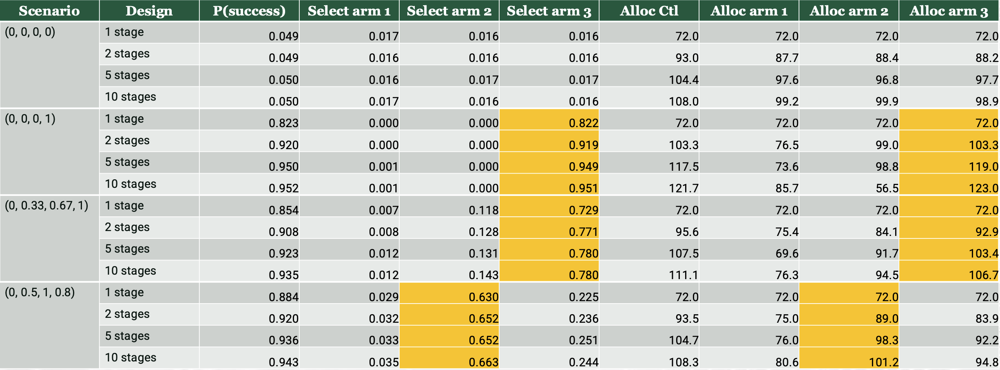

In addition to [this one](../../blog/posts/2025-03-04.llms.md), I also gave a talk at ADMTP 2025 on Response Adaptive Randomization (RAR). Click [here](attachments/2025-03-05-SlidesTP.pdf) to download the slides. I continue to be surprised how much is written about RAR in the two-arm setting compared to the multi-arm setting, when the benefits in the latter case are so much clearer. There has also been, over the years, a number talks and papers warning of the risks of RAR. So, I wanted to produce a talk that looked at the simulation results of a straightforward application of RAR when we are testing 3 arms against control and selecting the best one.

From the first interim onwards, the randomization between the treatment arms was in proportion to the probability that the arm had the maximum response. The proportion allocated to the control arm was set to match the arm with the highest allocation. Thus, there is some insurance against time trends. Trial success was based on the Bayesian posterior probability that the response on the selected arm was greater than that of the control arm, calibrated to control the type-1 error at 0.05 (this was imagined in a phase 2 setting).

We found that, compared to a fixed trial with equal allocation, there was:

- an increase in power,
- an increase in the probability of selecting the right arm,
- a reduction in bias and MSE in the estimate of the response on the selected arm,
- an increase in the expected allocation to the selected arm,
- and a 5-7% risk of allocating fewer subjects to the selected arm than would have been the case in the fixed trial.

Surprisingly, these benefits were all observed even with a single interim at the midpoint of the trial to adjust the randomization ratios just once. The benefits all increased with more interims, though with diminishing returns.

Figure 1: Power, correct arm selection, E(n) on selected arm when successful. Power, selection of correct arm, and allocation to selected arm increases with increased number of interims, but there are diminishing returns.
