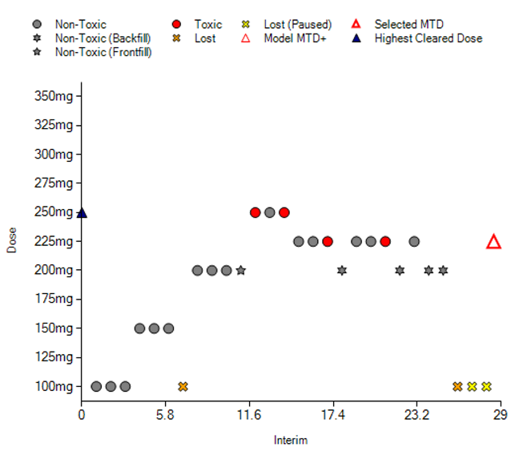

Traditionally, phase I dose escalation designs aim to find the maximum tolerated dose (MTD), usually the highest dose whose probability to cause dose-limiting toxicities (DLTs) stays below a certain target toxicity level (TTL), and an adequate dosing scheme. In practice, however, this focus on the MTD when selecting doses to take into registration trials often leads to exposing many trial participants to doses that either produce more toxicity without increased efficacy or severe toxicities that could both limit the options for receiving benefits or lead to premature discontinuation and missed opportunity for continued benefit. Recently, FDA launched [Project Optimus](https://www.fda.gov/about-fda/oncology-center-excellence/project-optimus) with the aim of educating and innovating all stakeholders to, among other goals, move towards designing dose escalation trials that attempt to find “optimal” doses, where optimality comprises safety, tolerability and efficacy.

In this talk, we draw from our in-house experiences of designing first-in-human oncology trials to present a seamless phase 1 / phase 2a dose escalation design using open enrollment guided by the continual reassessment method (CRM) that evaluates both safety and efficacy. We introduce advanced CRM adaptations such as open enrollment, target toxicity intervals and escalation with overdose control (EWOC), early stopping rules, backfilling and frontfilling, ad-hoc rules, etc., that not only vastly improve the performance and customizability of CRM, but also help identify “optimal” doses to take forward into registration trials.

Click [here](attachments/2025-03-06-SlidesELM.pdf) to download the slides. Below is a suggested reading list to get started with dose escalation designs and CRM:

- ([Le Tourneau et al. 2009](#ref-le2009dose))
- ([O’Quigley et al. 1990](#ref-o1990continual))
- ([O’Quigley et al. 1999](#ref-o1999two))
- ([Neuenschwander et al. 2008](#ref-neuenschwander2008critical))
- ([Broglio et al. 2015](#ref-broglio2015bayesian))
- ([Dehbi et al. 2021](#ref-dehbi2021controlled))

Figure 1: Exemplary individual simulation run illustrating the behavior of the Phase I part of the CRM dose escalation design from inception to the declaration of an MTD based on the selected stopping rules.

## References

Broglio, Kristine R, Larissa Sandalic, Tina Albertson, and Scott M Berry. 2015. “Bayesian Dose Escalation in Oncology with Sharing of Information Between Patient Populations.” *Contemporary Clinical Trials* 44: 56–63.

Dehbi, Hakim-Moulay, John O’Quigley, and Alexia Iasonos. 2021. “Controlled Backfill in Oncology Dose-Finding Trials.” *Contemporary Clinical Trials* 111: 106605.

Le Tourneau, Christophe, J Jack Lee, and Lillian L Siu. 2009. “Dose Escalation Methods in Phase i Cancer Clinical Trials.” *JNCI: Journal of the National Cancer Institute* 101 (10): 708–20.

Neuenschwander, Beat, Michael Branson, and Thomas Gsponer. 2008. “Critical Aspects of the Bayesian Approach to Phase i Cancer Trials.” *Statistics in Medicine* 27 (13): 2420–39.

O’Quigley, John, Margaret Pepe, and Lloyd Fisher. 1990. “Continual Reassessment Method: A Practical Design for Phase 1 Clinical Trials in Cancer.” *Biometrics*, 33–48.

O’Quigley, John, Larry Z Shen, and Anthony Gamst. 1999. “Two-Sample Continual Reassessment Method.” *Journal of Biopharmaceutical Statistics* 9 (1): 17–44.
