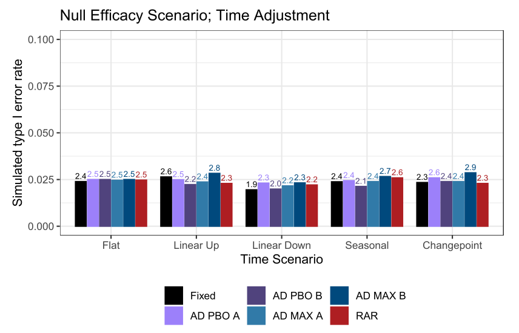

Response adaptive randomization adjusts allocation probabilities over the course of a trial, based on accumulating data. RAR increases allocation to arms performing well, and decreases allocation to arms performing poorly. In multiple arm trials, this has advantages over fixed randomization.

Imagine you have 4 arms, and in truth 2 are pretty bad, one is good, one is great. Ideally you might start allocating equally, with RAR eventually focusing on the good and great arms, and finally determining the great one is the best. Most patients get treated on the good or great arms. Ideally. A typical implementation is to compute the probability each arm is the best at each interim, and assign patients in proportion to that probability (this dates to the 1930s!). You can add bells and whistles like being more or less aggressive, completely eliminating arms with low probabilities, etc. Thus, if you have 4 arms at a interim, with their probability of being the best at 2%, 5%, 70%, and 23%, you would allocate about 70% to the third arm and so on. These probabilities change over time as data accumulates, with the true best arm eventually getting more and more probability.

If done correctly, patients within the trial are, on average, treated better (more of them are allocated to the better arms). If your endpoint is mortality, more patients will live in an RAR trial, on average, than live in a trial with fixed randomization. An RAR trial is more likely to correctly identify the best arm, and to correctly determine whether that best arm beats control. The reason is increased sample sizes on the good arms, allowing more accurate comparisons among the good arms and to control ([Viele et al. 2020](#ref-viele2020comparison)).

Correctly is important. There are many papers pointing out pitfalls. You can’t be too aggressive, for example. That could cause you to overreact to a good arm having early bad luck… you lower its allocation too much early and the arm never recovers during the trial. Don’t do this. If you want comparisons to a control arm, you need to maintain enrollment to control throughout the trial (estimating a treatment effect requires estimating control parameters, so you need control data). You need to do this even if early results indicate the treatment beats control. RAR creates different allocation ratios at different times in the trial. If there are time trends in your data, you need to model these time trends correctly (the reference below is for platform trials, but RAR has qualitatively similar issues) ([Bofill Roig et al. 2022](#ref-bofill2022model)).

I’m a little down on RAR right now due to one of our recent papers. To be clear, RAR works well, but some arm dropping designs work equivalently well, and those designs are simpler. Note this paper doesn’t cover platform trials, where the results COULD differ ([Berry et al. 2024](#ref-berry2024effects)). RAR has been done in practice, successfully, in a number of settings. Multiple indications, multiple funding mechanisms, multiple regulatory settings ([Berry and Viele 2023](#ref-berry2023comment)). A pet peeve… a lot of papers CORRECTLY show variants of RAR that perform poorly, but then generalize those results to all RAR, in my opinion incorrectly. RAR is a nuanced methodology. Definitely read what doesn’t work, but beware of overly broad conclusions. Just avoid the pitfalls!

Obviously this is a complex topic, and I haven’t done it justice, but I do love talking about such things if anyone has comments!

Figure 1: Figure 2 from ([Berry et al. 2024](#ref-berry2024effects)). Simulated Type I error rates in the null scenario without covariate adjustment for time. The five time trend scenarios are shown on the x-axis.

## References

Berry, Lindsay R, Elizabeth Lorenzi, Nicholas S Berry, Amy M Crawford, Peter Jacko, and Kert Viele. 2024. “Effects of Allocation Method and Time Trends on Identification of the Best Arm in Multi-Arm Trials.” *Statistics in Biopharmaceutical Research* 16 (4): 512–25.

Berry, Scott M, and Kert Viele. 2023. “Comment: Response Adaptive Randomization in Practice.” *Statistical Science* 38 (2): 229–32.

Bofill Roig, Marta, Pavla Krotka, Carl-Fredrik Burman, et al. 2022. “On Model-Based Time Trend Adjustments in Platform Trials with Non-Concurrent Controls.” *BMC Medical Research Methodology* 22 (1): 228.

Viele, Kert, Kristine Broglio, Anna McGlothlin, and Benjamin R Saville. 2020. “Comparison of Methods for Control Allocation in Multiple Arm Studies Using Response Adaptive Randomization.” *Clinical Trials* 17 (1): 52–60.
