# Graphs of Simulation Results

To enable swift visualization and analysis of the simulation results, FACTS has a number of pre-defined graphs it can display. Full and detailed simulation results are available in ‘csv’ format files that can be loaded into other analysis tools allowing any aspect of the simulation to be explored. These files are described [below](#output-files).

To view the graphs, select a row of scenario results by clicking on it and then click on the ‘View Graph’ button.

Below we have often shown full screen shots of the graphs in the graph manager, but the graph display supports copying just the graph to the clipboard to facilitate pasting them into documents and presentations. Right clicking on a graph brings up a short menu that allows the image of the graph to be copied to the clipboard or saved in ‘png’ format to a file.

To view the graphs of the results of the simulations of a particular design variant in a particular scenario, select that row of scenario results by clicking on it and then click on the ‘View Graph’ button and select “Show Per Scenario Graphs”.

To view multiple graphs showing the results of the simulations of possibly all the design variants and all the scenarios click on the ‘View Graph’ button and select “Show Across Scenario Graphs”. This launches a graph display that displays multiple graphs in a trellis plot. You can select the graph type, filter the design variants and filter which scenarios displayed:

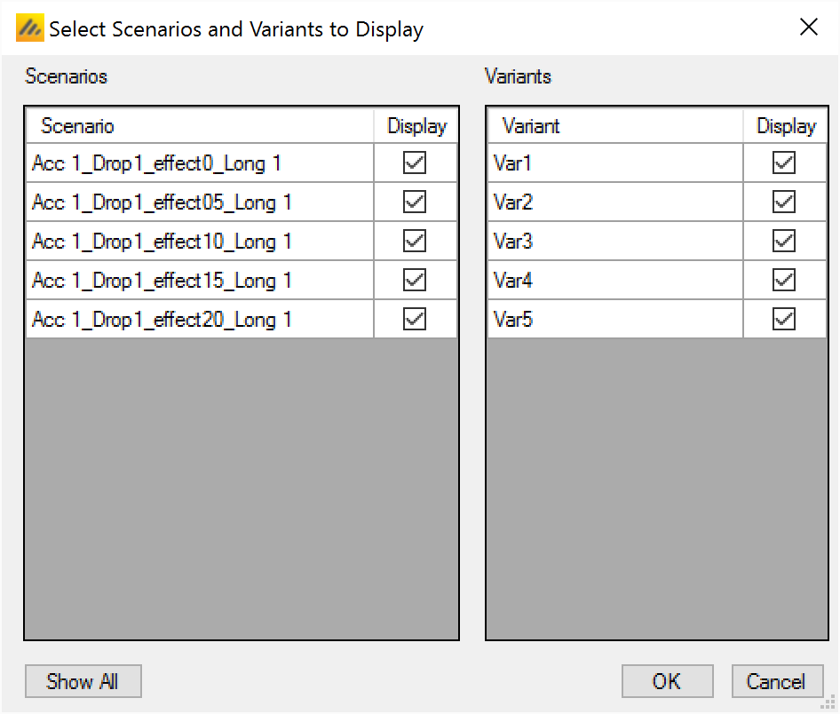

Figure 1: Pop up to select scenarios and variants to display.

The graph display supports copying an image of the graph to the clipboard, to facilitate pasting them into documents and presentations. Right clicking on a graph brings up a short menu that allows the image of the graph to be copied to the clipboard or saved in ‘.png’ format to a file.

Many graphs have a number of controls to allow the graph to be tailored, standard graph controls available on most graphs are:

- Set Y axis – this displays a dialog boxing allowing the user to fix the minimum and maximum of each of the Y axes and the number of ‘tick’ marks (Not displayed if the ‘y’ value must lie in the interval 0-1.)

- Space doses evenly – if the x-value is ‘dose’, then data for each dose can either be spaced equally or proportionate to the doses’ effective dose strength.

- If using a 2D treatment arm model then it is possible to display graphs where the different doses (or “arms”) form the x-axis, then there is an option to show the row factors as separate series – otherwise the different combinations are displayed in effective strength order

## Continuous

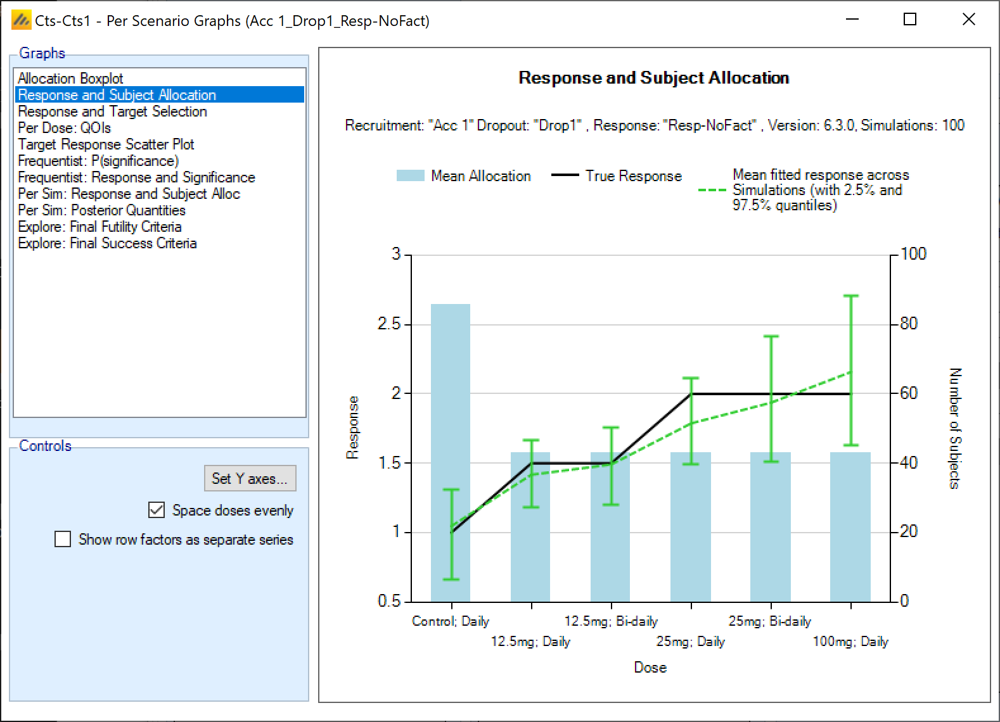

\(a\) Arms shown in effective strength order

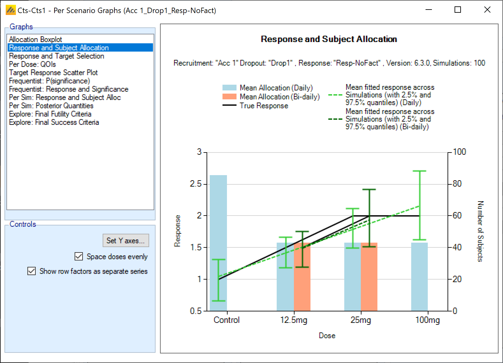

\(b\) Arms shown with row factors as a separate series

Figure 2

## Dichotomous

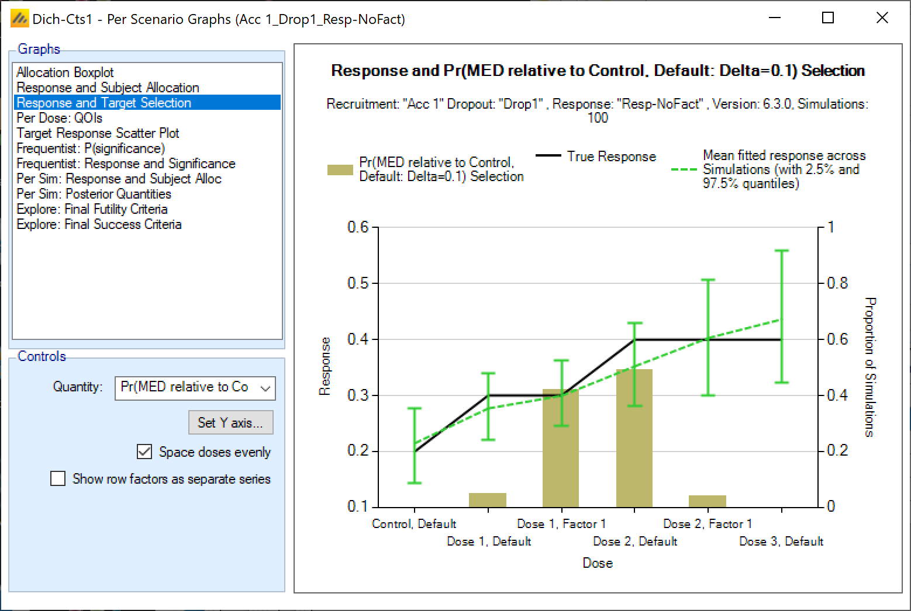

\(a\) Arms shown in effective strength order

\(b\) Arms shown with row factors as a separate series

Figure 3

#### Box and whisker plot conventions

- The mean probability is plotted as a large dot.

- The median value is plotted as a dashed line.

- The 25-75^(th) quantile range is plotted as the “box” portion of each point.

- The “whiskers” extend to the largest and smallest values within 1 ½ times the interquartile range from either end of the box.

- Points outside the whisker range are considered outliers, and are plotted as small blue dots. Note that it may be difficult to see all of these symbols if they are plotted at the same value.

## Per Scenario Graphs

### Allocation Box and Whisker Plot

## Continuous

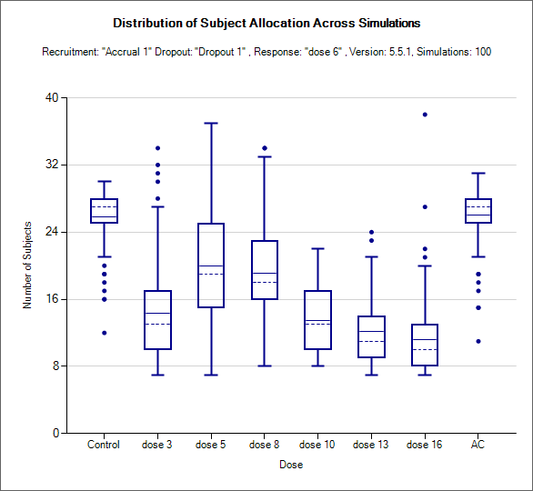

Figure 4: Distribution of Subject Allocation Across Simulations.

## Dichotomous

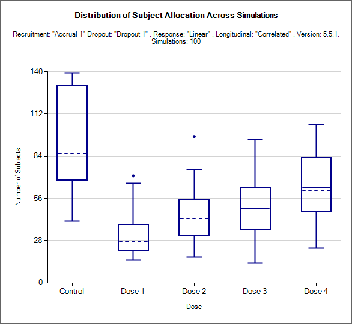

Figure 5: Distribution of Subject Allocation Across Simulations.

This graph displays a box and whisker plot of the number of subjects recruited into each arm. These plots show:

The distribution over all simulations of the number of subjects allocated to each arm shown as a box and whisker plot. If the design is not adaptive, the number allocated will be the same in every simulation and the box and whiskers collapse to a single line.

### Response and Subject Allocation

## Continuous

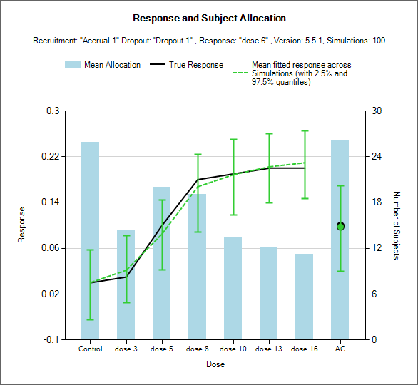

Figure 6: Response and Subject Allocation.

## Dichotomous

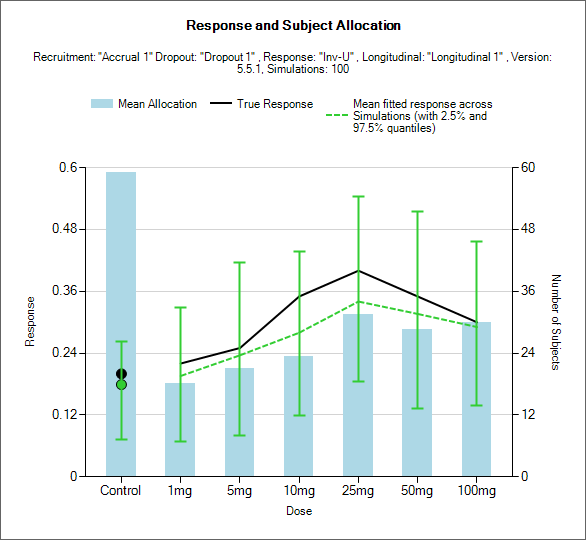

Figure 7: Response and Subject Allocation.

This graph shows for each treatment arm, the mean subject allocation, mean response and the 2.5%-97.5% boundaries of the estimated means over the simulations.

- The blue bars show the mean number of subjects allocated.

- The black line shows the true mean response being simulated.

- The green dashed line shows the mean of the estimated response across the simulations

- The green ‘error bars’ show the spread of the central 95% of the estimated mean response across the simulations (if less than 20 simulations have been run it simply shows the full spread).

### Response and Target Selection graphs

## Continuous

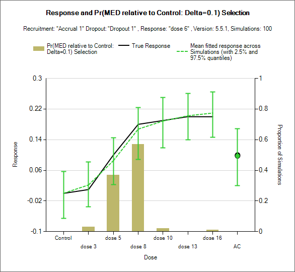

Figure 8: Response and QOI Selection.

## Dichotomous

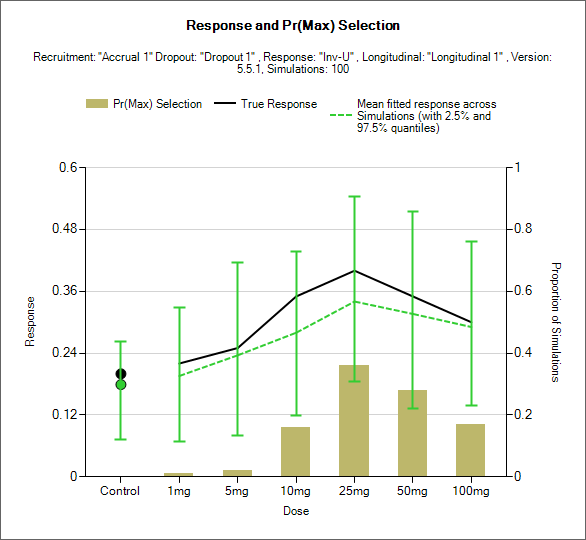

Figure 9: Response and QOI Selection.

These plots show the true simulated mean response and the mean and 95% spread of the mean fitted mean responses along with bars showing the proportion of simulations the different treatment arms are the selected target arm for each of the “Probability of being target” QOIs, such as Pr(Max), Pr(EDq relative to ..: Quantile=q) and Pr(MED relative to…: Delta=$\delta$).

### Per Dose QOIs (Box and Whisker Plots)

This set of graphs show the distribution over the simulations of the posterior probability estimates of quantities of interest for each dose. All the Posterior Probability, Predictive Probability, P-value and Probability of being Target QOIs that have been defined are available for plotting, via a drop down list.

Note that in any one analysis the Probability of being Target will sum to 1 across the doses (and can sum to less than one in the case of the MED target if none of the doses look likely to be better than the CSD), whereas all the other QOIs are assessed individually for each dose.

## Continuous

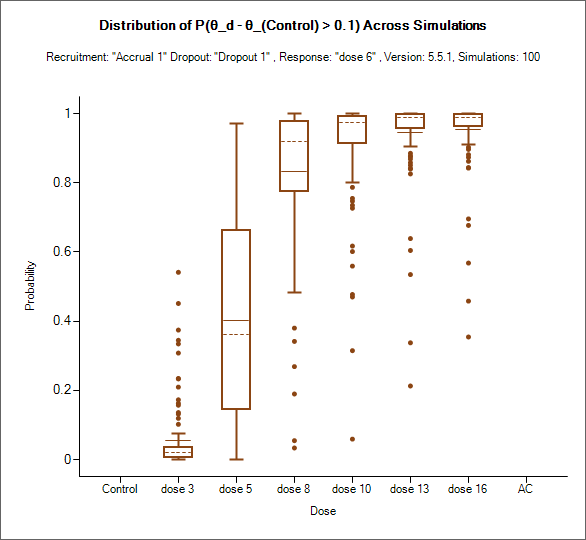

\(a\) Distribution of $P$($\theta_d$ - $\theta_{Control}$ \> 0.1) Across Simulations.

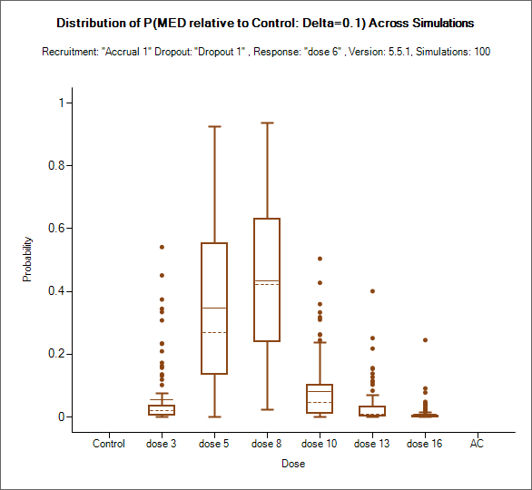

\(b\) Distribution of $P$(MED relative to Control: Delta}=0.1) Across Simulations.

Figure 10

## Dichotomous

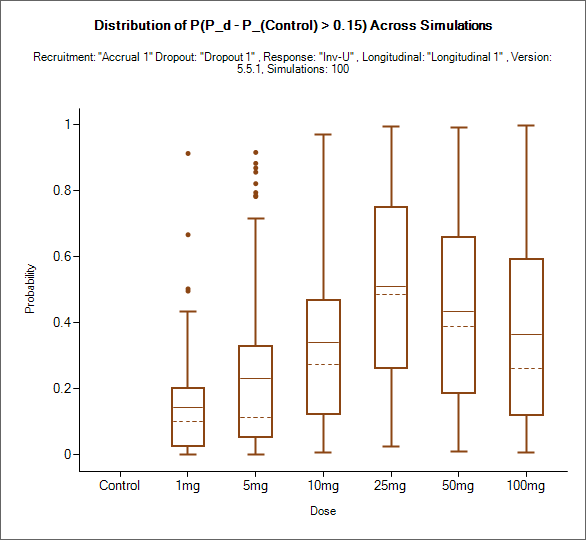

\(a\) Distribution of $P$($P_d$ - $P_{Control}$ \> 0.15) Across Simulations.

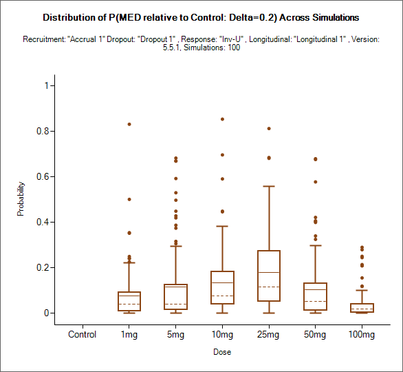

\(b\) Distribution of $P$(MED relative to Control: Delta}=0.2) Across Simulations.

Figure 11

### Target Response by Sample Size Scatter Plot

## Continuous

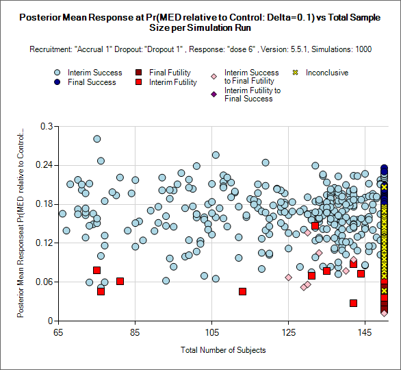

Figure 12: Posterior Mean Response at P(MED relative to Control: Delta}=0.1) vs. Total Sample Size per Simulation Run

## Dichotomous

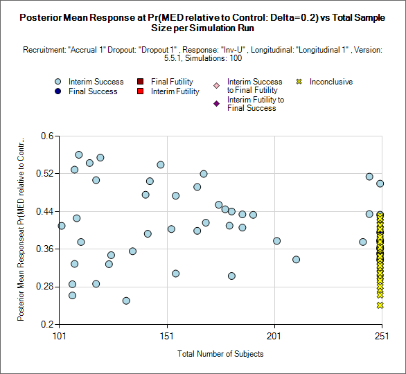

Figure 13: Posterior Mean Response at P(MED relative to Control: Delta}=0.2) vs. Total Sample Size per Simulation Run

This graph shows a scatter plot of trial outcomes with the selected Target QOI as the y-axis and total number of subjects recruited as the x-axis. The trials are plotted with a symbol that indicated the final outcome:

- A light blue circle indicates a trial that stopped early for success

- A dark blue circle indicates a trial that was a late success

- A dark red square indicates a trial that was a late futility

- A light red square indicates a trial that stopped early for futility

- A light pink diamond indicates a trial that stopped early for success but where the final analysis was futility

- A dark pink diamond indicates a trial that stopped early for futility but where the final analysis was success

- A yellow cross indicates a trial that completed full enrolment but was inconclusive at the end.

These graphs are not particularly useful if there is no early stopping.

If the design does allow early stopping this graph shows

- The overall distribution of sample sizes – in particular is stopping evenly distributed from the moment stopping is possible, or is there are large cohort of trials that stop as soon as it is possible?

- When and with what mean response trials stop incorrectly, in particular having trials stopping and the decision being reversed suggests stopping is allowed to soon or the criteria is not conservative enough.

### Cumulative Operating Characteristics Plot

## Continuous

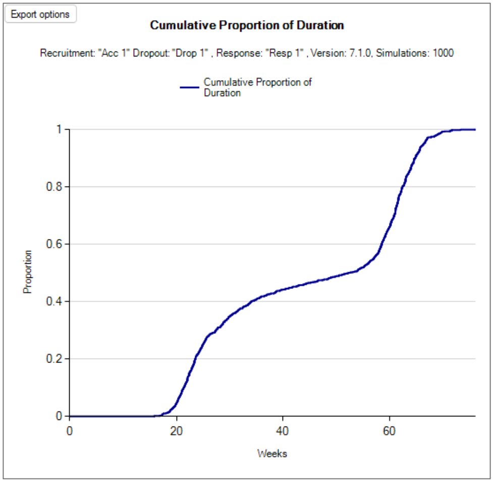

\(a\) Cumulative Proportion of Duration

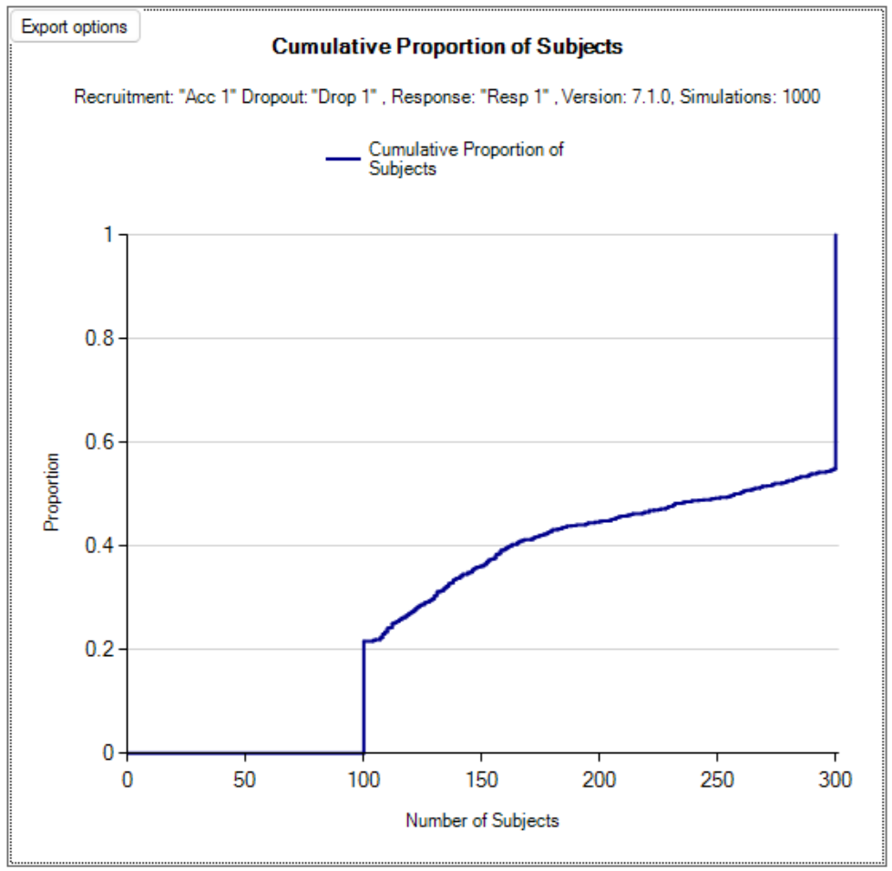

\(b\) Cumulative Proportion of Subjects

Figure 14

## Dichotomous

\(a\) Cumulative Proportion of Duration

\(b\) Cumulative Proportion of Subjects

Figure 15

There are two graphs, one that shows the cumulative proportion of durations across all simulations, and the other shows the cumulative proportion of subjects across all simulations.

### Time course for stopping

There are two graphs, one that shows the distribution over time for stopping for futility and one for stopping for success.

## Continuous

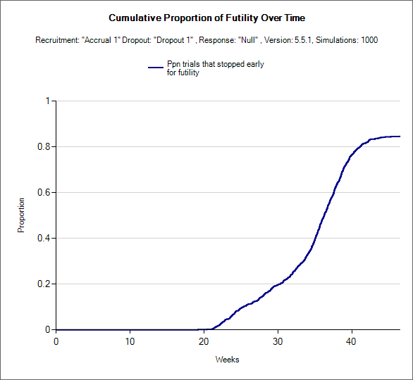

\(a\) Cumulative Proportion of Futility Over Time

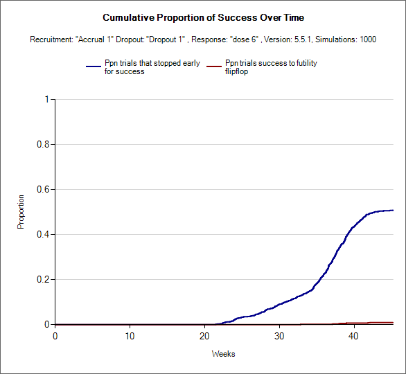

\(b\) Cumulative Proportion of Success Over Time

Figure 16

## Dichotomous

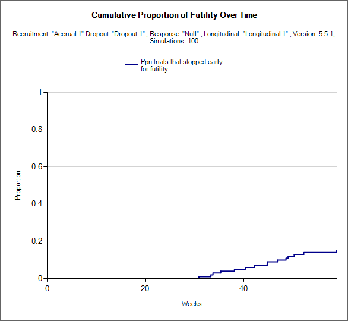

\(a\) Cumulative Proportion of Futility Over Time

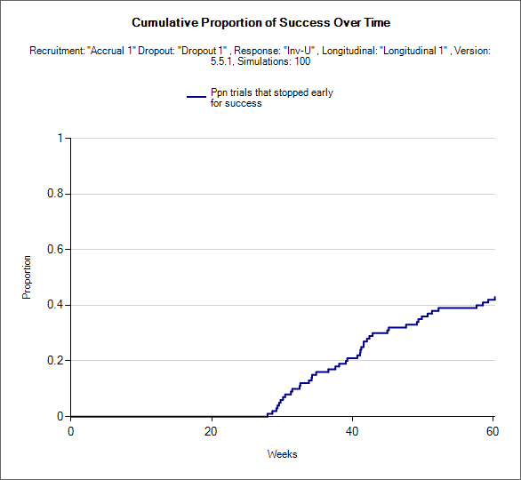

\(b\) Cumulative Proportion of Success Over Time

Figure 17

These plots show as cumulative curves the proportion of the simulations that stopped at different time points from the start of the trial. The user can select whether time or subject enrollment is used as the x-axis.

### Arm Dropping Graphs

If the design has used arm dropping, the following graphs are available.

#### Response and Ppn Arms Dropped

## Continuous

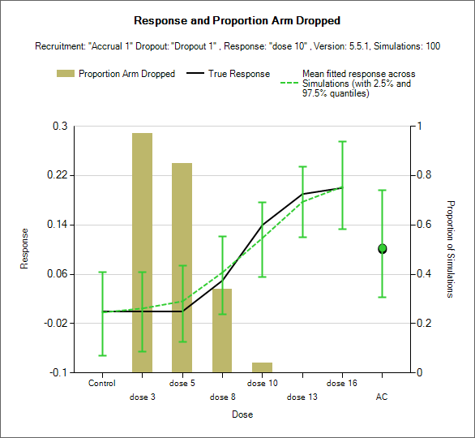

Figure 18: Response and Proportion Arm Dropped

## Dichotomous

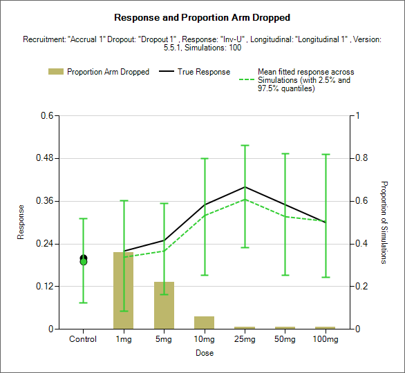

Figure 19: Response and Proportion Arm Dropped

This graph shows the true (simulated) mean response and the average fitted response with 2.5% & 97.5% quantiles.

The histogram bars show for each arm the proportion of simulations for which the arm was dropped.

#### Time Course for Arm Dropping

This graph shows, for each arm, the cumulative proportion of simulations when it was dropped. The user can select whether time or number of subjects allocated to the arm is used as the x-axis.

## Continuous

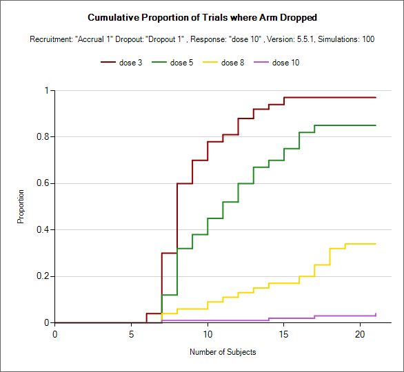

Figure 20: Cumulative Proportion of Trials where Arm Dropped

## Dichotomous

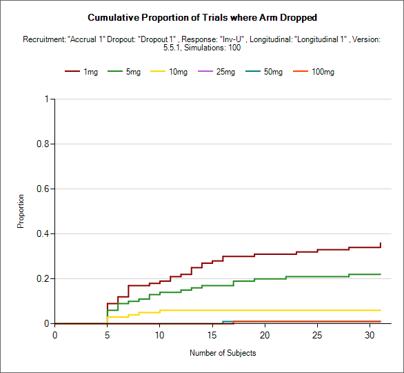

Figure 21: Cumulative Proportion of Trials where Arm Dropped

#### Time Course for Arm retention

This graph shows, for each arm, the cumulative proportion of simulations when the arm was retained. The user can select whether time or number of subjects allocated to the arm is used as the x-axis. This is simply the inverse of the arm dropping graph above.

## Continuous

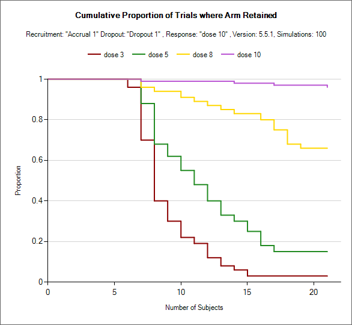

Figure 22: Cumulative Proportion of Trials where Arm Retained

## Dichotomous

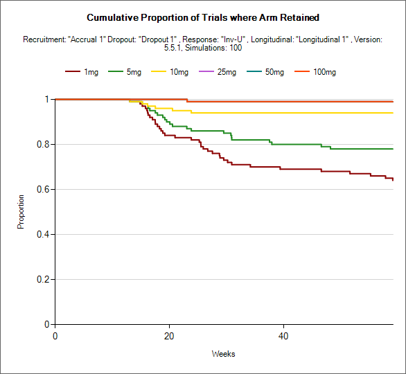

Figure 23: Cumulative Proportion of Trials where Arm Retained

#### Arm Retention Proportion

This graph shows, for each arm, the simple proportion of simulations where the arm was retained.

## Continuous

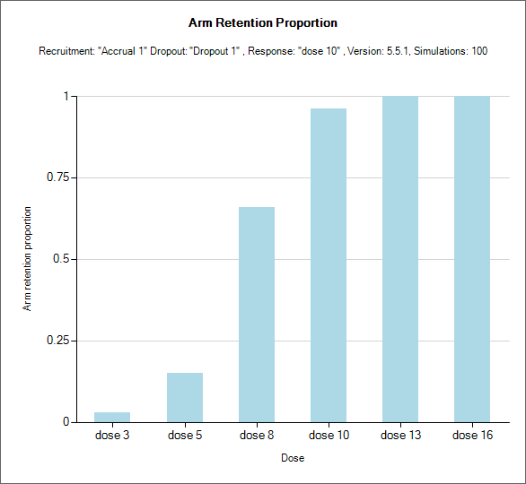

Figure 24: Arm Retention Proportion

## Dichotomous

Figure 25: Arm Retention Proportion

### Frequentist

These graphs are available if frequentist analysis is enabled.

#### Frequentist P(significance)

These graphs are the box and whisker plots of various p-values that are automatically calculated (that is to say they do not need to be defined as QOIs for them to be calculated) for the final analysis. The user can select from Unadjusted, Bonferroni and Dunnett's and LOCF, BOCF (if baseline is simulated) or PP (per-protocol) treatment of missing values.

## Continuous

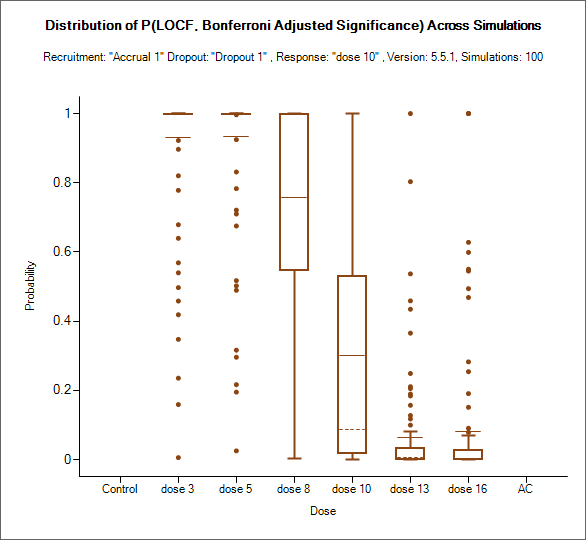

Figure 26: Distribution of P(LOCF. Bonferroni Adjusted Significance) Across Simulations

## Dichotomous

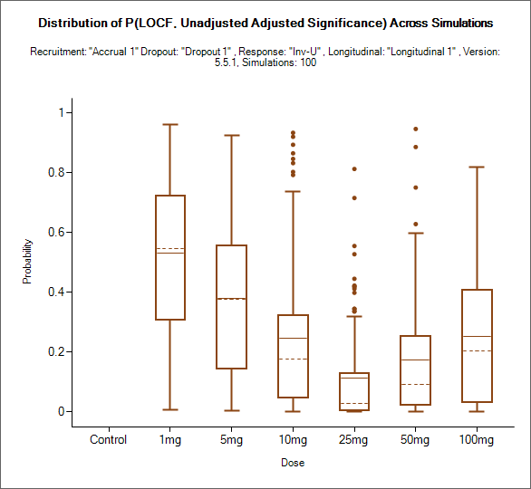

Figure 27: Distribution of P(LOCF. Unadjusted Adjusted Significance) Across Simulations

#### Frequentist: Response and Significance

This graph plots the mean and 2.5-97.5 percentile of the mean across the simulations or the simple frequentist estimate of the response for each arm, along with a histogram plot of the ppn of times the response on each arm was significant. The user can select from Unadjusted, Bonferroni or Dunnett’s and LOCF, BOCF (if baseline is simulated) or PP (per-protocol) treatment of missing values.

## Continuous

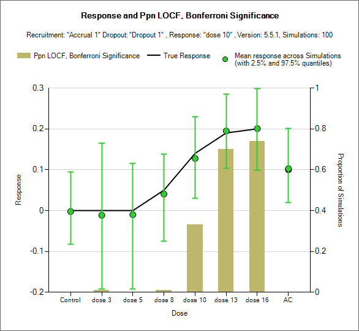

Figure 28: Response and Ppn LOCF. Bonferroni Significance

## Dichotomous

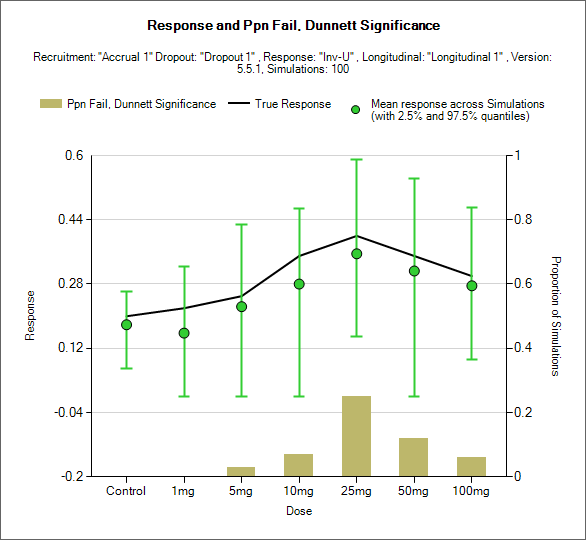

Figure 29: Response and Ppn Fail. Dunnett Significance

### Per Sim: Response and Subject Alloc

This graph shows the final analysis at the end of individual simulations.

## Continuous

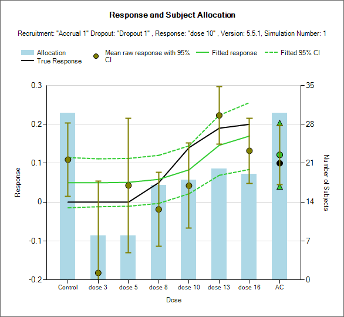

Figure 30: Response and Subject Allocation

## Dichotomous

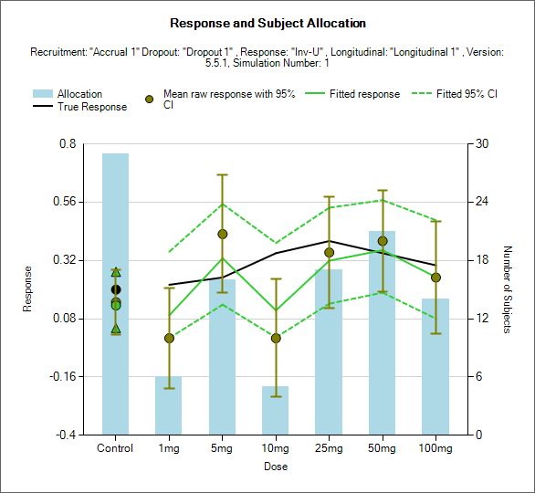

Figure 31: Response and Subject Allocation

This graph includes a control that allows the user to select which simulation to graph the results from. On each graph

- The black line shows the ‘True’ mean response being simulated.

- The brown circles and arms show the mean raw data and its 95% CI for each arm.

- The green solid line shows the estimate of the mean response.

- The green dashed lines show the boundaries of the 95% credible interval for the estimate of the response.

- Blue bars showing the number of subjects allocated on each treatment arm.

## Continuous

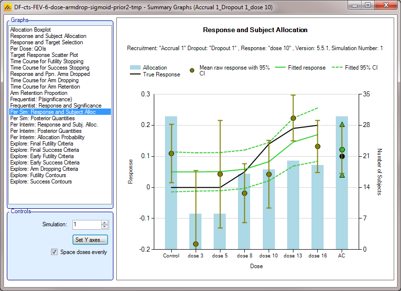

Figure 32: Response and Subject Allocation with the side panel that allows for specification of the simulation for which the plot should be shown.

## Dichotomous

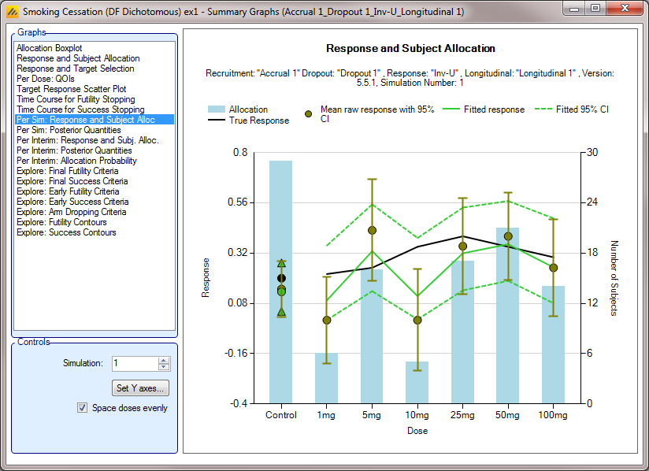

Figure 33: Response and Subject Allocation with the side panel that allows for specification of the simulation for which the plot should be shown.

Control to select the individual simulation results to be displayed

### Per Sim: Posterior Quantities

This graph shows the final analysis at the end of individual simulations, including the distribution of a selected QOI.

## Continuous

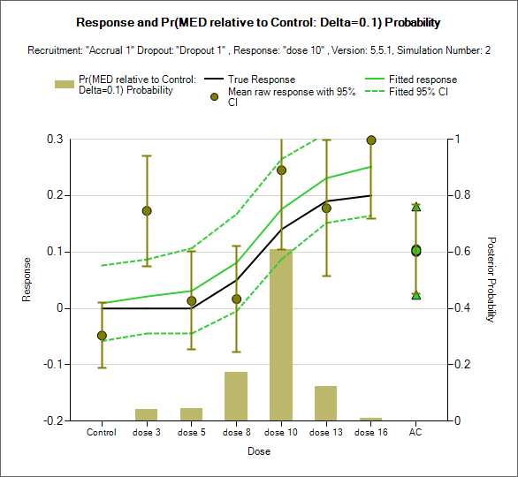

Figure 34: Response and Pr(MED relative to Control: Delta = 0.1) Probability

## Dichotomous

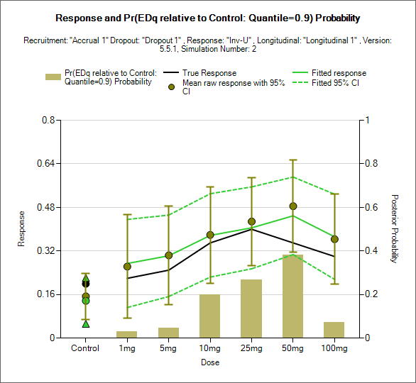

Figure 35: Response and Pr(EDq relative to Control: Quantile = 0.9) Probability

This graph includes a control that allows the user to select which simulation to graph the results from. On each graph

- The black line shows the ‘True’ mean response being simulated.

- The brown circles and arms show the mean raw data and its 95% CI for each arm.

- The green solid line shows the estimate of the mean response.

- The green dashed lines show the boundaries of the 95% credible interval for the estimate of the response.

- Brown bars showing the final value of the selected QOI for each arm at the end of the simulated trial.

The user can select from any of the Posterior Probability, Predictive Probability or Target Probability QOIs to plot.

### Per Interim Response Graphs

This is an identical set of graphs to the Per Sim graphs, the difference is that in addition to a control to select which simulation to graph the results from, there is a control to select which interim within the simulation to graph the results from. These graphs are only available for those simulations for which ‘weeks’ files have been output (by default the first 100).

Note the ‘Interim’ control in both of the below figures.

## Continuous

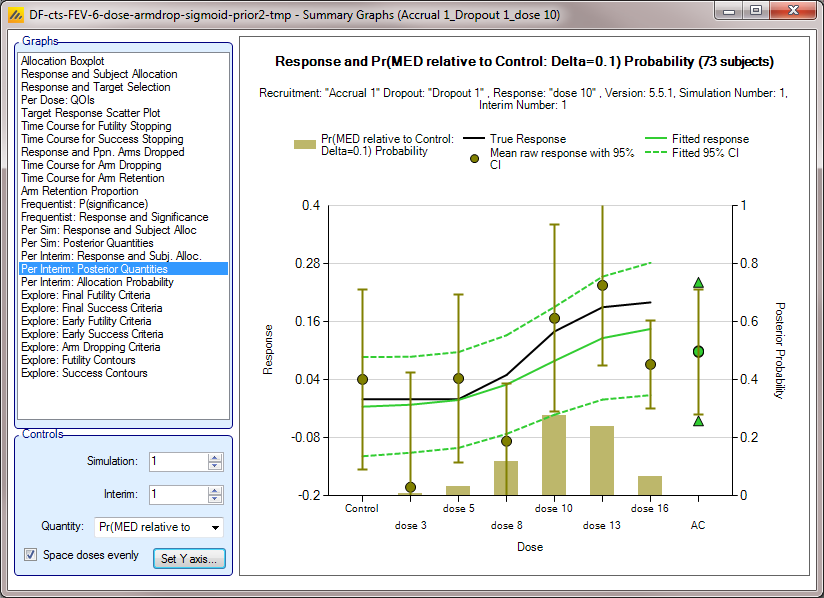

Figure 36: Response and Pr(MED relative to Control: Delta = 0.1) Probability with side panel allowing for selection of simulation, interim, and quantity of interest.

## Dichotomous

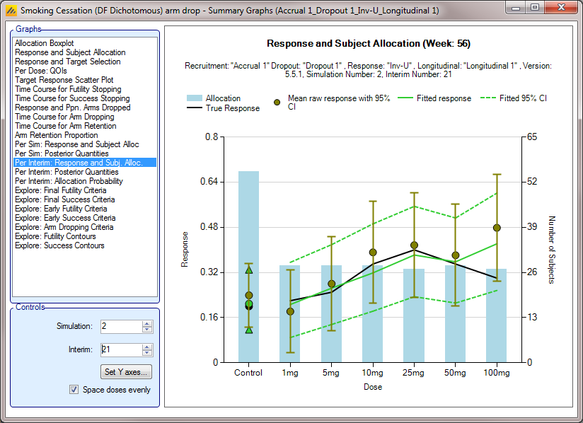

Figure 37: Response and Subject Allocation with side panel allowing for selection of simulation and interim number.

## Post Simulation Boundary Finding Graphs

### Explore Success/Futility Criteria

## Continuous

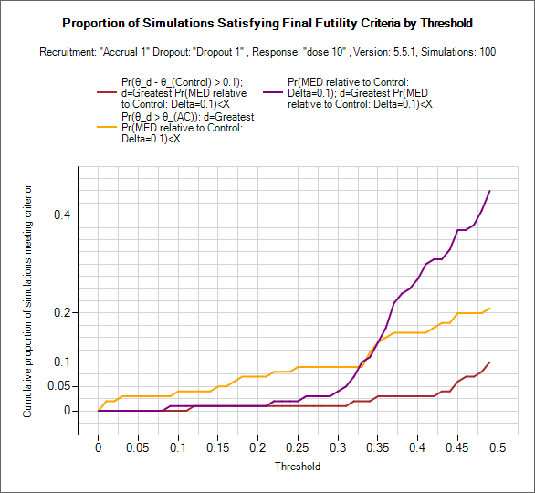

\(a\) Proportion of Simulations Satisfying Final Futility Criteria by Threshold

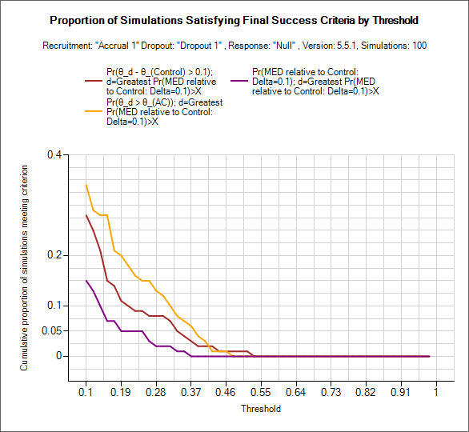

\(b\) Proportion of Simulations Satisfying Final Success Criteria by Threshold

Figure 38

## Dichotomous

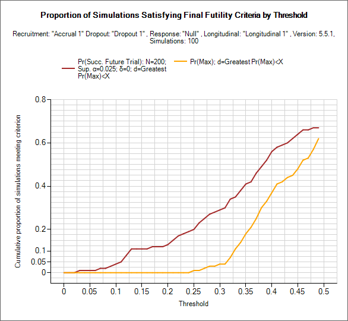

\(a\) Proportion of Simulations Satisfying Final Futility Criteria by Threshold

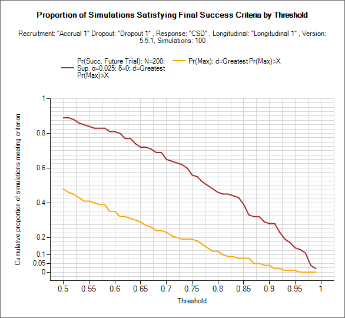

\(b\) Proportion of Simulations Satisfying Final Success Criteria by Threshold

Figure 39

These graphs can be used to explore what proportion of simulated trials of a particular scenario would have been a success/failure at final evaluation. Using the two drop down controls the user can select the target dose to use: e.g. Pr(Max), and set and lower/upper limits to explore for the threshold (setting the range used on the x-axis). The graphs show for all the decision QOIs defined for the selected Target Dose the proportion of simulations that would have met the threshold values.

As in the examples above, the plots will be somewhat jagged if only a small number of simulations have been run. These graphs can be used to select thresholds that can be expected to yield a certain level of type-1 or power, but the user must remember these will only be approximate (depending on the number of simulations) but can be useful to understand the designs sensitivity to the thresholds and to set initial thresholds early on in the design / simulation process that will get close to the desired type-1 error and power from the outset.

### Explore Early Success/Futility Criteria

## Continuous

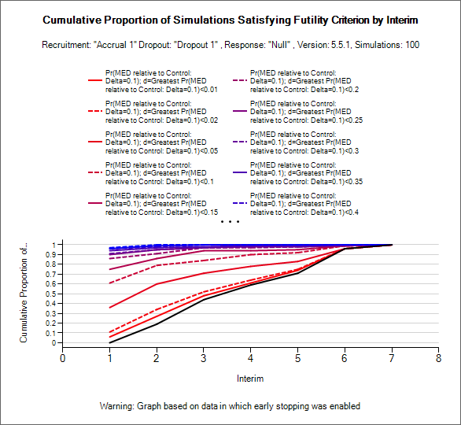

\(a\) Cumulative Proportion of Simulations Satisfying Futility Criterion by Interim

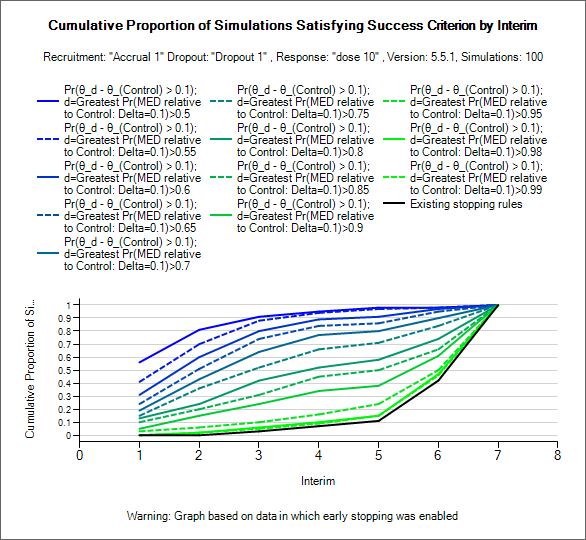

\(b\) Cumulative Proportion of Simulations Satisfying Success Criterion by Interim

Figure 40

## Dichotomous

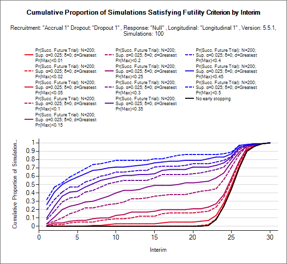

\(a\) Cumulative Proportion of Simulations Satisfying Futility Criterion by Interim

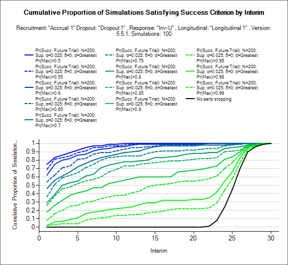

\(b\) Cumulative Proportion of Simulations Satisfying Success Criterion by Interim

Figure 41

These graphs can be used to explore what proportion of simulated trials of a particular scenario would have stopped early for success/futility. NOTE these graphs require weeks files to have been output, they are also most use where the design has been simulated with interims but no early stopping (unlike the examples above where the shape of the “existing stopping rules” line indicates that early stopping occurred in these simulations).

Using the two drop down controls, the user can select which decision QOI is evaluated and from which interim onwards stopping will be permitted. Lines are then displayed for the proportion of simulations that would have stopped by each interim for a fixed set of thresholds.

Typically these can be used to see at what threshold (and starting at what interim) stopping for success or futility introduces an unacceptably level of ‘incorrect’ early stopping – stopping for futility in successful scenarios and stopping for success in futile scenarios and whether at below/above these levels there may be a useful probability of correct stopping.

### Explore Arm Dropping Criteria

## Continuous

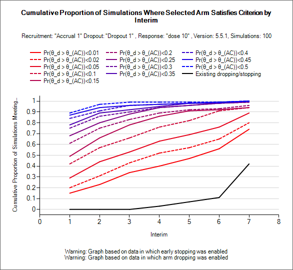

Figure 42: Cumulative Proportion of Simulations Where Selected Arm Satisfies Criterion by Interim

## Dichotomous

Figure 43: Cumulative Proportion of Simulations Where Selected Arm Satisfies Criterion by Interim

This graph is similar to the Explore Early Success/Futility Criteria graph but for arm dropping criteria. The user has an additional control to select which dose the proportion of trials in which the arm would be dropped is displayed.

### Success/Futility Stopping Contours

## Continuous

\(a\) Proportion of Simulations Reaching Futility for Early/Late Criterion Thresholds

\(b\) Proportion of Simulations Reaching Success for Early/Late Criterion Thresholds

Figure 44

## Dichotomous

\(a\) Proportion of Simulations Reaching Futility for Early/Late Criterion Thresholds

\(b\) Proportion of Simulations Reaching Success for Early/Late Criterion Thresholds

Figure 45

These graphs allow early stopping and final evaluation criteria to be considered jointly. Like the explore early stopping criteria plots, these graphs require weeks files to have been output and will work best if interims were evaluated but no trials actually stopped early.

The user selects the decision QOI to plot, the first interim at which early stopping is allowed, and the upper/lower limit of the threshold to consider.

FACTS will then plot contours where (final evaluation threshold, early stopping threshold) yield the same proportion of trials that are successful/futile. Contours are only plotted where final evaluation threshold \< early stopping threshold for success and vice versa for futility. Early stopping criteria should not be less strict than final criteria.

Again the example graphs shown are based on only 100 simulations with weeks files, so any threshold derived will only very approximately yield these success/futility rates.

## MCMC Trace plots

## Dichotomous

Figure 46: Trace plot of an MCMC parameter.

If an MCMC sample file has been output for one or more simulations (the default is to not output MCMC sample files due to their size), then for each of those simulations it is possible to view the MCMC trace of the sampled values for each of the parameters sampled in the MCMC.

If the design is adaptive, the user can select which interim (“update”) the samples are from, as well as which parameter’s samples to plot.

## Across Scenario Graphs

### Selected Arms

This graph shows a bar chart for each scenario and variant selected. Each chart shows how often each arm was ‘selected’ by the target QOI specified on the Study \> Variants tab. Each bar uses a stacked bar to show the proportion of times that arm was:

- “Successful” –the arm was correctly selected (marked as “Should succeed” on the VSR tab) and the trial was successful.

- “Should not succeed” – the arm was incorrectly selected (not marked as “Should succeed” on the VSR tab) and the trial was successful.

- Unsuccessful – the arm was selected and the trial failed.

## Continuous

Figure 47: Across scenario graph for selected arms with 5 scenarios and 5 design variants.

## Dichotomous

Figure 48: Across scenario graph for selected arms with 3 scenarios and 3 design variants.

### QOI Box Plots

This graph shows a box and whisker plot for each scenario and variant selected. Each plot shows the distribution of the values of a selected QOI for each arm. There is a drop down control to allow the selection of the QOI to be displayed. Any Posterior probability, Predictive probability, p-value or target QOI can be selected.

## Continuous

Figure 49: Across scenario graph for showing QOIs per arm with 5 scenarios and 5 design variants.

## Dichotomous

Figure 50: Across scenario graph for showing QOIs per arm with 3 scenarios and 3 design variants.

### Ppn Success

This grouped bar chart shows a bar for the proportion of successful simulations for each variant, grouped by scenario.

## Continuous

Figure 51: Across scenario graph for showing the proportion of trials that result in success with 5 scenarios and 5 design variants.

## Dichotomous

Figure 52: Across scenario graph for showing the proportion of trials that result in success with 3 scenarios and 3 design variants.

### Response

This graph shows a dose response plot for each scenario and variant selected. Each plot shows the mean estimate over the simulations and the 95%-ile interval of the mean estimates over the simulations. The graph also shoes the “true response” i.e. the mean response being simulated.

## Continuous

Figure 53: Across scenario graph for showing the average estimated dose response model vs. the true dose responses with 5 scenarios and 5 design variants.

## Dichotomous

Figure 54: Across scenario graph for showing the average estimated dose response model vs. the true dose responses with 5 scenarios and 5 design variants.

### Allocation

This graph shows a box and whisker plot for each scenario and variant selected. Each plot shows the distribution of the number of subjects allocated to each arm over the simulations.

## Continuous

Figure 55: Across scenario graph for showing the distribution of allocation per arm with 5 scenarios and 5 design variants.

## Dichotomous

Figure 56: Across scenario graph for showing the distribution of allocation per arm with 3 scenarios and 3 design variants.

### Sample Size

This graph shows the mean sample size for each scenario at different maximum sample sizes (the different variants).

## Continuous

Figure 57: Across scenario graph for showing the mean sample size of the study with 5 scenarios and 5 design variants.

## Dichotomous

Figure 58: Across scenario graph for showing the mean sample size of the study with 3 scenarios and 3 design variants.

### Interim vs Final Scatter Plot

This is an interactive plot that shows the outcome of each simulation over all the scenarios of a selected variant.

The x-axis shows the value of the selected decision QOI at the specified interim, and the y-axis shows the final value of a (possibly different) selected decision QOI. As well as selecting a decision QOI for the final decision, the graph can use the actual final decision in the simulations – the value of the QOI used in the first criteria is used for the decision is used for the y-axis.

Note the graph is based just on the values at the selected interim, what might happen at other interims is ignored.

Thresholds can be set to specify early and late success/futility. Each scenario is then coloured to show its outcome – and stacked bar graphs are displayed to show the proportion of each outcome for each scenario. The thresholds can be changed and the graph re-drawn. If the selected QOI uses a p-value the checks for success are that it is “\<” than the threshold, (and vice-versa for futility), otherwise the checks for success are that it is “\>” the threshold (and vice-versa for futility).

The graph can only display the results for simulations for which cohorts files have been output, and for simulations that reached the specified interim. Thus the graph works best if interims have been specified, but the simulations run without any early stopping enabled – so each simulation has the results for every interim.

With 1,000 simulations per scenario and cohorts files for each simulation, the graph will take several seconds to re-draw. To allow several parameters to be set before redrawing (rather than having to wait for the redraw after each change) the graph is only redrawn after the ‘Redraw’ button is clicked.

## Continuous

Figure 59: Across scenario graph showing an interim QOI plotted against a final analysis QOI with the decision dictating the point color. Additionally, the bars on the right hand side represent the proportion of trials that made each decision based on the decision rules specified in the plot controls.

## Dichotomous

Figure 60: Across scenario graph showing an interim QOI plotted against a final analysis QOI with the decision dictating the point color. Additionally, the bars on the right hand side represent the proportion of trials that made each decision based on the decision rules specified in the plot controls.

### Receiver Operating Characteristics

This graph plots the relative proportion of successful simulations in the scenarios compared to the proportion of successes in one specific scenario. The intended use of this is to yield a “Receiver Operating Characteristics” (ROC) curve. This is done as follows:

- Select the decision QoI that is to be used to determine final success/futility. (The graph only supports the simple case where just one is being used).

- Select a scenario that represents the ‘Null’ case – where determining success is a type-1 error.

- If multiple variants have been simulated, select which variant to plot.

FACTS computes for the null scenario, for a range of decision threshold values, what proportion of the ‘Null’ scenario sims would have been successful (giving the estimated type-1 error rate), these proportions form the x-values for each point. The corresponding threshold values are shown on the x-axis at the top of the graph, the type-1 error rate on the x-axis at the bottom of the graph.

FACTS then computes for each of the other scenarios in turn the proportion of sims that would have been successful **and selected a “should succeed” dose** so it is necessary for doses to have been specified as “should succeed” on the Virtual Subject Response profiles (giving the estimate of power for that scenario – where ‘power’ also requires correct dose selection), at each of the threshold values, these proportions are then shown on the y-axis of the graph.

Thus for each scenario we can see the estimated power of the design to determine success for a given type-1 error rate in the specified Null scenario.

## Continuous

Figure 61: Across scenario graph showing ROC curves of the power of one selected design variant under different scenarios as a function of the type I error in the selected null scenario.

## Dichotomous

Figure 62: Across scenario graph showing ROC curves of the power of one selected design variant under different scenarios as a function of the type I error in the selected null scenario.

# Viewing Simulation Results in the Simulations Tab

After simulations have been run, FACTS provides a table for assessing the output from the simulations. While everything that FACTS displays in the table on the Simulation tab is available in output files, FACTS does a substantial amount of “beautifying” of results in its built-in table. This entails changes like converting numeric outcome scores to readable text and using descriptive names for QOI columns.

The main table has 1 line per scenario, and shows the summary of all simulations run for each scenario. These lines show values that are stored in the summary.csv file.

More detailed simulation output, providing a row per simulation run, is accessibile by double clicking on any row of the output table. This row-per-simulation output is what is stored in the simulations.csv files.

Additional detail is available for simulations that have a weeks file by right clicking on a simulation in the simulation summary window and selecting “Weeks Results”. See the Results Output section of the Simulation tab to specify the number of weeks files to be output.

## Summary per Scenario

By default, only a subset of all columns of output are provided when simulations are complete. This set of columns is called “Highlights.” To get access to further columns, you can right click anywhere on the simulation output table and click “Summary Results: ….” for whichever set of columns you would like to see. There is a “Summary Results: All” option that will provide a pop up containing every column available for summary results.

The following sections break down which columns are available by sorting to which column subset.

### Highlights

These are the columns displayed on the simulations tab after simulations are completed, the can also be displayed in the separate “Highlights” results window.

[TABLE]

The columns that are displayed by default in the simulations tab after continuous or dichotomous simulations have been run. {.caption-top .table}

### Allocation

By right clicking and selecting the allocation columns, a pop-out will appear that provides the following columns.

[TABLE]

The allocation columns provided in FACTS output for continuous or dichotomous trials. {.caption-top .table}

### Response

## Continuous

[TABLE]

Response columns available in FACTS output for continuous simulations. {.caption-top .table}

## Dichotomous

[TABLE]

Response columns available in FACTS output for dichotomous simulations. {.caption-top .table}

### Observed

[TABLE]

Observed columns available in FACTS output for continuous or dichotomous simulations. {.caption-top .table}

### Probabilities

[TABLE]

Probabilities columns available in FACTS output for continuous or dichotomous simulations. {.caption-top .table}

### Model Parameters

## Continuous

[TABLE]

Model Parameters columns available in FACTS output for continuous simulations. {.caption-top .table}

## Dichotomous

[TABLE]

Model Parameters columns available in FACTS output for dichotomous simulations. {.caption-top .table}

## Detailed Per Simulation Results

After simulation has completed and simulation results have been loaded, the user may examine detailed results for any scenario with simulations output in the table by double-clicking on the appropriate row. A separate window pops up and displays the results for each individual simulation. This is a “prettier” view of the contents of the “simulations.csv” file, which is described below. The simulations results are partitioned into the same results groupings as the summary results. These can be accessed from the “right click” menu, along with opening the results folder, opening the weeks file for a particular simulation and opening the simulated patients file for a particular simulation (where a “weeks” file or a “patients” file has been output).

Figure 63: The simulation results pop out viewer showing simulation highlights.

# Output Files

Instead of viewing simulation output on the Simulation tab within FACTS, the output is all contained within easily accessible files saved on the user’s local machine. FACTS stores the results of simulations as ‘.csv’ files under a Results folder. For each row in the simulations table, there is a folder named by the profiles that make up the scenario, which contains the corresponding ‘.csv’ files.

Figure 64: The windows file explorer when opened to the directory containing simulation output.

These files can be opened using Microsoft Excel or any text editor. Excel, and many other apps, takes out a file lock on any file it has open, while a FACTS results file is open in another piece of software it cannot be deleted or modified by FACTS. The most common cause for an error to be reported when simulating trials in FACTS is because the user has one of the previous results files is still open in Excel.

In the scenario directory there are the following types of results file:

**Summary.csv** Contains a single row of data that summarizes the simulation results. This is the source of the shown on the simulations tab.

**Summary_freq_bocf_NNNNN.csv,** Continuous only. **Summary_freq_locf_NNNN.csv,** **Summary_freq_ignore_NNNN.csv,** **Summary_freq_fail_NNNNN.csv,** Dichotomous only. Contains a single row of data that that summarizes the frequentist analysis of the simulations. A file is output for each of the different methods for dealing with missing data that are selected on the Frequentist Analysis tab: BOCF if the baseline score is being simulated, LOCF and “ignore” (referred to as PP (Per-Protocol) in the GUI).

**Simulations.csv** Contains one row per simulation describing the final state of each simulation for every trial simulated.

**Simulations_freq.csv** Contains one row per simulation describing the frequentist analysis of the final state of each simulation for every trial simulated.

**PatientsNNNNN.csv** Contains one row per patient in a simulation, where NNNNN is the number of the simulation. By default this file is written out only for the first simulation, but this can be changed on the simulations tab.

**WeeksNNNNN.csv** Contains one row for each cohort during a simulation where NNN is the number of the simulation. By default this file is written only for the first 100 simulations, but this can be changed via the simulation tab. The values in the last row of the cohorts file will be the same as the final values for that simulation in the simulations file.

**weeks_freq_bocf_NNNNN.csv,** Continuous only. **weeks_freq_locf_NNNN.csv,** **weeks_freq_ignore_NNNN.csv,** **weeks_freq_fail_NNNNN.csv,** Dichotomous only. Contains one row for each interim during a simulation where NNNNN is the number of the simulation. A file is output for each simulation for which a frequentist “weeks file” is to be output, and for each of the different methods for dealing with missing data that are applicable.

## Contents of summary.csv

The first line is a header line, starting with a ‘#’, containing the FACTS GUI version number, the name of the FACTS file, the name of the scenario, and the time stamp of the start of the simulation.

The second line is a header line, starting with a ‘#’, containing the following column headings.

## Continuous

[TABLE]

Contents of the summary.csv file for continuous simulations. {.caption-top .table}

## Dichotomous

[TABLE]

Contents of the summary.csv file for dichotomous simulations. {.caption-top .table}

### QOI Columns

The QOI columns depend on the QOIs that have been defined for this design. The columns in the following order:

| Statistic | Description |
|----|----|
| Posterior Probabilities | The summary file contains the mean (over the simulations) of the posterior probability for each dose. |
| Predictive Probabilities | The summary file contains the mean (over the simulations) of the predictive probability for each dose. |
| P-Values | The summary file contains the mean (over the simulations) of the p-value for each dose. |
| Target Probabilities | The summary file contains the proportion of times (over the simulations) each dose had the greatest probability of being the target. |
| Decision QOIs | The summary file contains the mean (over the simulations) of the final value of the decision QOI at the target. |

## Contents of Summary_freq\_{missingnessType}.csv

There is a frequentist summary file for each type of treatment of missing values.

The first line is a header line, starting with a ‘#’, containing the FACTS GUI version number, the name of the FACTS file, the name of the scenario, and the time stamp of the start of the simulation.

The second line is a header line, starting with a ‘#’, containing the following column headings.

## Continuous

[TABLE]

Contents of the summary_freq\_{missingnessType}.csv file for continuous simulations. {.caption-top .table}

## Dichotomous

| Column Title | Number of columns | Description |  |
|----|----|----|----|
| Mean Theta \<Dose\> | D | The mean response per dose. |  |
| SE Theta \<Dose\> | D | The standard error of the response per dose |  |
| Ppn Signif | 1 | The proportion of simulations where at least one of the unadjusted p-values is less than the user specified one-sided alpha. |  |
| Ppn Signif \<Dose\> | D | For each treatment arm, the proportion of \| simulations where the unadjusted p-value is \| less than the user specified one-sided alpha. \| \| The marginal probability of significance per \| dose (using unadjusted p-values). |  |
| Bias \<Dose\> | D | The difference between the estimated mean response and the true (simulated) mean response per dose |  |
| Coverage \<Dose\> | D | The proportion of simulations where the unadjusted confidence interval for the response contains the true mean response used to simulate subject responses. |  |
| Ppn Signif Dunnett | 1 | The proportion of simulations where at least one of the Dunnett adjusted p-values is less than the user specified one-sided alpha. |  |
| Ppn Signif Dunnett \<Dose\> | D | For each treatment arm, the proportion of simulations where the Dunnett adjusted p-value is less than the user specified one-sided alpha. |  |
| Coverage Dunnett \<Dose\> | D | The proportion of simulations where the Dunnett adjusted confidence interval contains the true mean response used to simulate subjects responses. |  |
| Ppn Signif Bonf | 1 | The proportion of simulations where at least one of the Bonferroni adjusted p-values is less than the user specified one-sided alpha. |  |
| Ppn Signif Bonf \<Dose\> | D | For each treatment arm, the proportion of simulations where the Bonferroni adjusted p-value is less than the user specified one-sided alpha. |  |
| Coverage Bonf \<Dose\> | D | The proportion of simulations where the Bonferroni adjusted confidence interval contains the true mean response used to simulate subjects responses. |  |
| Ppn Signif Trend | 1 | The proportion of simulations where the trend test p-value is less than the user specified one-sided alpha. |  |

Contents of the summary_freq\_{missingnessType}.csv file for dichotomous simulations. {.caption-top .table}

## Contents of simulations.csv and weeksNNNNN.csv

The simulations.csv file holds the FACTS summary of the final analysis for each simulation (one per row).

The weeksNNNNN.csv file holds the FACTS summary of every analysis for the NNNNN^(th) simulation. It contains a row for each interim in the trial and a row for the final analysis (Interim number 999).

The final analysis occurs after all the planned data is collected. If the trial does not stop early, the final analysis occurs after full follow-up for all subjects. If the trial does stop early at an interim analysis, then the timing of the final analysis depends on the status of the check boxes on the [Interims tab](../../../../../documentation/v81/userguides/core/design/interims.llms.md#subject-follow-up-options). If follow-up is collected after the particular interim decision, then an analysis after full follow-up of the subjects recruited up to the point of the interim when the stopping decision was taken. If there is no follow-up intended after the interim analysis decision, then the final analysis occurs immediately (at the same time as the interim analysis), and the final analysis criteria are checked.

The first line is a header line, starting with a ‘#’, containing the FACTS GUI version number, the name of the FACTS file, the name of the scenario, and the time stamp of the start of the simulation.

The second line is a header line, starting with a ‘#’, containing the following column headings.

Most of the columns are common to the two file types, but the weeks file does not contain columns for the ‘final’ values of the evaluation criteria.

## Continuous

[TABLE]

## Dichotomous

[TABLE]

### QOI Columns

The QOI columns depend on the QOIs that have been defined for this design. The columns are grouped in the following order:

| QOI Type | Description |
|----|----|
| Posterior Probabilities | The posterior probability for each QOI for each dose. |
| Predictive Probabilities | The predictive probability for each QOI for each dose. |
| P-Values | The p-value for each QOI for each dose. |
| Target Probabilities | The probability of being the target for each QOI for each dose. |
| Decision QOIs | The value of the decision QOI at the target. |
| Success Futile | A flag for each QOI decision criteria indicating if the decision QOI was evaluated and compared to a threshold at the interim (weeks file) or final analysis (simulation file). The flag value is -1 if the decision QOI was not evaluated, 0 if it did not meet the threshold and 1 if it did. |
| Success / Futile Combined | Flags indicating if the interim or final analysis determined success or futility taking all the factors defined for Success/Futility into account: 0 if the conditions were not met, 1 it the conditions were met. If success and futility conditions have been defined that are not mutually exclusive and both sets of combined conditions are met, FACTS will pick one of the outcomes as met but not the other. In order to discourage defining Success and Futility rules that can both be true FACTS does not guarantee which outcome will be selected. |

## Contents of Simulations_freq\_{missingnessType}.csv, Weeks_freq\_{missingnessType}.csv

These file contain the frequentist results after an interim analysis (weeks file) or final analysis (simulations file), apart for the first column, the columns are the same in the two types of file, and the same across the different methods for treating missing data.

| Column | Number of columns | Description |
|----|----|----|
| \# Trial | 1 | The number of the simulation (simulations_freq\_…csv only) |
| \# Weeks | 1 | The week of the interim (weeks_freq\_…csv only) |
| Theta | D | Unadjusted estimate of response per treatment arm |
| Theta SD | D | The SD of the estimate of response per treatment arm |
| Trt Effect | D | The relative size of the treatment effect compared to control per arm (treatment effect for control is always 0). The direction of the comparison takes into account whether a response represents a subject’s condition improving or worsening, so that a positive treatment effect shows the response on the dose is better than on control. |
| t-Stat | D | The t-test statistic per treatment arm (for control this is always 0) |
| p-Value | D | The unadjusted t-test p-value per arm (for control this is always 0) |
| lower CI | D | The unadjusted lower bound of the alpha confidence interval of the estimated treatment effect per treatment arm (for control this is always 0). |
| upper CI | D | The unadjusted upper bound of the alpha confidence interval of the estimated treatment effect per treatment arm (for control this is always 0). |
| Min p-Value | 1 | The smallest of the t-test p-values |
| p-Value Dunnett | D | The Dunnett adjusted t-test p-value per arm (for control this is always 0). |
| lower CI Dunnett | D | The Dunnett adjusted lower bound of the alpha confidence interval of the estimated treatment effect (for control this is always 0). |
| upper CI Dunnett | D | The Dunnett adjusted upper bound of the alpha confidence interval of the estimated treatment effect (for control this is always 0). |
| Min p-Value Dunnett | 1 | The smallest of the Dunnett adjusted p-values. |
| p-Value Bonf | D | The Bonferroni adjusted t-test p-value per arm. |
| lower-CI Bonf | D | The Bonferroni adjusted lower bound of the alpha confidence interval of the estimated treatment effect (for control this is always 0). |
| upper-CI Bonf | D | The Bonferroni adjusted upper bound of the alpha confidence interval of the estimated treatment effect (for control this is always 0). |
| Min p-Value Bonf | 1 | The smallest of the Bonferroni adjusted t-test value per arm. |
| t-Stat trend | 1 | The t statistic from the trend test. |
| p-Value trend | 1 | The p-value from the trend test. |

## Contents of PatientsNNNNN.csv

## Continuous

| Column | Number of columns | Description |
|----|----|----|
| Subject | 1 | The subject id number, starting at 1. |
| Region | 1 | Which region the subject was recruited in. |
| Date | 1 | The date, in weeks from the start of the trial, of the subject’s baseline visit and randomization. |
| Dose | 1 | The index number (1, …) of the treatment arm the subject belongs to. |
| LastVisit# | 1 | The index of the last visit for which the subjects data was collected, if the subject did not complete all of its visits it could be because they dropped-out, the subject’s treatment arm was dropped (and there was no follow-up), or the study stopped early (and there was no follow-up). |
| Dropout | 1 | Whether the subject dropped out of the trial (1) or not (0) before reaching their final visit. |
| Baseline | 1 | Subject baseline response, if simulated. If not simulated, then fixed at -9999. |
| Visit \<Visit\> | V | Subject’s response at each visit. |

## Dichotomous

| Column | Number of columns | Description |
|----|----|----|
| Subject | 1 | The subject id number, starting at 1. |
| Region | 1 | Which region the subject was recruited in. |
| Date | 1 | The date, in weeks from the start of the trial, of the subject’s baseline visit and randomization. |
| Dose | 1 | The index number (1, …) of the treatment arm the subject belongs to. |
| LastVisit# | 1 | The index of the last visit for which the subjects data was collected, if the subject did not complete all of its visits it could be because they dropped-out, the subject’s treatment arm was dropped (and there was no follow-up), or the study stopped early (and there was no follow-up). |
| Dropout | 1 | Whether the subject dropped out of the trial (1) or not (0) before reaching their final visit. |
| Baseline | 1 | Always -9999 since there’s no baseline in dichotomous response trials. |
| Visit \<Visit\> | V | Subject’s response at each visit. |

## Contents of MCMCNNNNN.csv

The MCMC file if requested for output by the user, contains all the MCMC samples for the fitted parameters in the design. There is one row per sample (including the burnin) and the samples from all the analyses in the simulation are included. The first two columns are the analysis index and the sample (within analysis) index. The remaining columns are the parameters whose sample values are being reported, the number and constituents of these columns are highly variable depending on design of the statistical analysis.

## Continuous

| Column | Number of columns | Description |
|----|----|----|
| Analysis | 1 | The index of the analysis (interim) in the simulation. |
| Sample | 1 | The index of the sample within the analysis. |
| Theta \<Dose\> | D | The estimate of the mean response for each dose, based on the dose response model fitted. |
| Sigma | 1 | The estimate of the SD of the endpoint. |
| Beta | 1 | If baseline is included in the simulated data and using the “Baseline Adjusted Model”, this is the value of “Beta”, the baseline coefficient. |
| A \<1-8\> / Tau | P | If the dose response model estimates parameters then the samples of these are listed next. The number and name of the parameters will vary depending on the model being fitted. Check the Design \> Dose Response tab for a listing of the parameters. |
| Longmod \<Model\> \<Param\> \<Visit\> | L\*P\*V | If the analysis includes longitudinal modelling then the samples of the parameters of the longitudinal models are output. The number of models depends on the number of different longitudinal fits the user has specified (one over all arms, one for control and one for all treatment arms, model all arms separately, etc.), the number of parameters the model has, and if these are fitted per visit (which depends on the model being fitted), then the number of visits. |

## Dichotomous

If using a dichotomized continuous variable, then the parameters for the LM are the same as for the continuous model MCMC output listed in the Continuous tab.

If using a dichotomous longitudinal model, then the following parameters are output in the MCMC file.

| Column | Number of columns | Description |
|----|----|----|
| Analysis | 1 | The index of the analysis (interim) in the simulation. |
| Sample | 1 | The index of the sample within the analysis. |
| Pi \<Dose\> | D | The estimate of the response rate for each dose, based on the dose response model fitted. |
| A \<1-8\> / Tau | P | If the dose response model estimates parameters then the samples of these are listed next. The number and name of the parameters will vary depending on the model being fitted. Check the Design \> Dose Response tab for a listing of the parameters. |
| Longmod \<Model\> \<Param\> \<Visit\> | L\*P\*V | If the analysis includes longitudinal modelling then the samples of the parameters of the longitudinal models are output. The number of models depends on the number of different longitudinal fits the user has specified (one over all arms, one for control and one for all treatment arms, model all arms separately, etc.), the number of parameters the model has, and if these are fitted per visit (which depends on the model being fitted), then the number of visits. |

If using a restricted markov model, then the following parameters are output in the MCMC file.

| Column | Number of columns | Description |
|----|----|----|
| Analysis | 1 | The index of the analysis (interim) in the simulation. |
| Sample | 1 | The index of the sample within the analysis. |
| Pi \<Dose\> | D | The estimate of the response rate for each dose, based on the dose response model fitted. |
| A \<1-8\> / Tau | P | If the dose response model estimates parameters then the samples of these are listed next. The number and name of the parameters will vary depending on the model being fitted. Check the Design \> Dose Response tab for a listing of the parameters. |
| Longmod \<Model\> \<Param\> \<Visit\> | L\*P\*V | Currently the values of Alpha0, Alpha1, AlphaS (the parameters to the Dirichlet distribution) are (unnecessarily – these values are not sampled) output, along with the values for P0, P1 and PS the transition probabilities of each model at each visit. |
