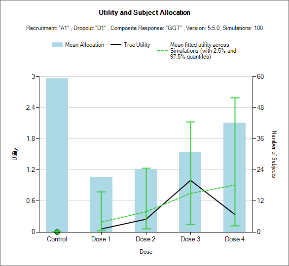
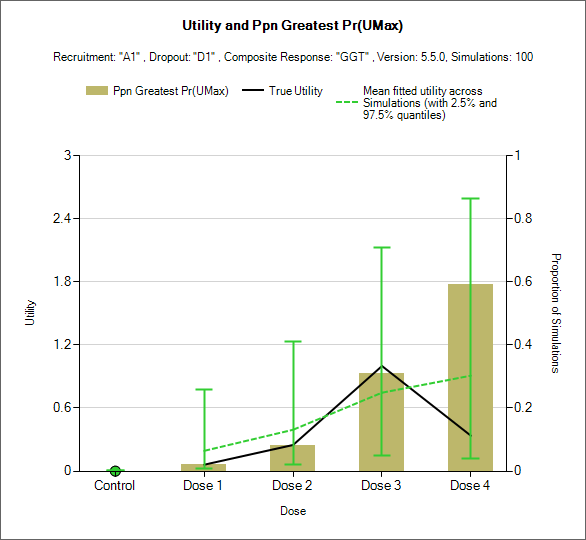
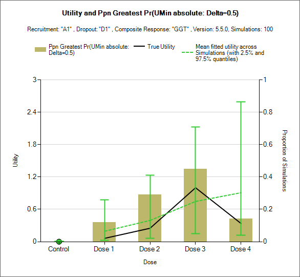
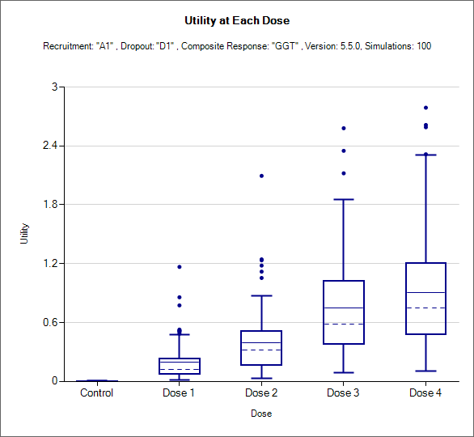
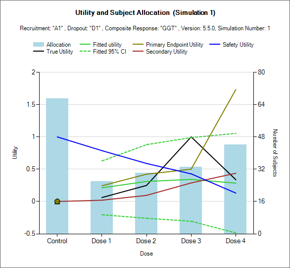
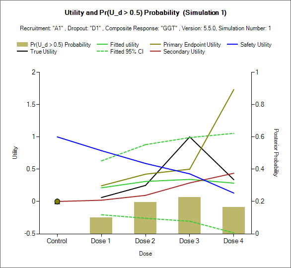
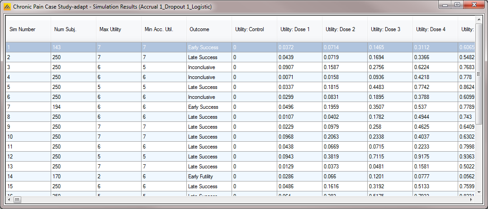
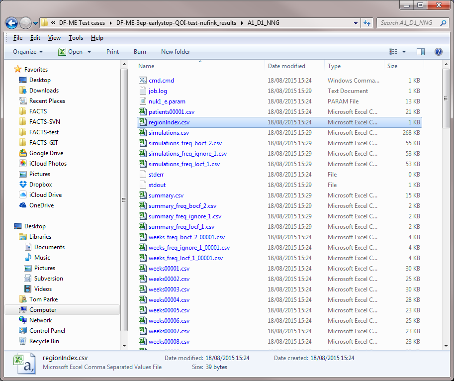

# Graphs of Simulation Results

To enable swift visualization and analysis of the simulation results, FACTS has a number of pre-defined graphs it can display. Full and detailed simulation results are available in ‘.csv’ format files that can be loaded into other analysis tools allowing any aspect of the simulation to be explored. These files are described [below](#output-files).

The graphs in the multiple endpoint engine are largely the same as the graphs in the single endpoint engine, except that the graphs from the single endpoint core engines that show responses for an endpoint now have a control allowing for the selection of which endpoint the plot should be made for.

This page will attempt to highlight differences between the single endpoint and the multiple endpoint engines, largely focusing on plots that do not exist in the single endpoint output. See [Continuous/Dichotomous Simulation Output](../../../../../documentation/v81/userguides/core/simulation/contanddichot.llms.md#graphs-of-simulation-results) for full details about the single endpoint graphs in FACTS.

## Per Scenario Graphs

Many of the multiple endpoint graphs are repeated from single endpoint, potentially with the ability to view for any of the simulated endpoints. When the endpoint to use can be selected in the controls for a plot, it is common that the utility can also be selected instead of an endpoint. This will allow for assessment of the distribution of the combined utility in addition to the response estimates for the individual endpoints. The repeated graphs are listed here:

- [Allocation Box and Whisker Plot](../../../../../documentation/v81/userguides/core/simulation/contanddichot.llms.md#allocation-box-and-whisker-plot)

- [\<Endpoint\> Response and Subject Allocation](../../../../../documentation/v81/userguides/core/simulation/contanddichot.llms.md#response-and-subject-allocation)

- [\<Endpoint\> Response and Target Selection](../../../../../documentation/v81/userguides/core/simulation/contanddichot.llms.md#response-and-target-selection-graphs)

- [Per Dose: QOI Box and Whisker Plots](../../../../../documentation/v81/userguides/core/simulation/contanddichot.llms.md#per-dose-qois-box-and-whisker-plots)

- [Target Response by Sample Size Scatter Plot](../../../../../documentation/v81/userguides/core/simulation/contanddichot.llms.md#target-response-by-sample-size-scatter-plot)

- [Cumulative Operating Characteristics Plot](../../../../../documentation/v81/userguides/core/simulation/contanddichot.llms.md#cumulative-operating-characteristics-plot)

- [Time Course for Stopping](../../../../../documentation/v81/userguides/core/simulation/contanddichot.llms.md#time-course-for-stopping)

- [Time Course for Arm Dropping/Retention](../../../../../documentation/v81/userguides/core/simulation/contanddichot.llms.md#time-course-for-arm-dropping)

- [Arm Retention Proportion](../../../../../documentation/v81/userguides/core/simulation/contanddichot.llms.md#arm-retention-proportion)

- [Frequentist P(significance)](../../../../../documentation/v81/userguides/core/simulation/contanddichot.llms.md#freq-psignificance)

- [Frequentist Response and Significance](../../../../../documentation/v81/userguides/core/simulation/contanddichot.llms.md#frequentist-response-and-significance)

- [Per Sim: \<Endpoint\> Response Alloc](../../../../../documentation/v81/userguides/core/simulation/contanddichot.llms.md#per-sim-response-and-subject-alloc)

- [Per Sim: \<Endpoint\> Response Dist](../../../../../documentation/v81/userguides/core/simulation/contanddichot.llms.md#per-sim-posterior-quantities)

- [Per Interim: \<Endpoint\> Response Alloc](../../../../../documentation/v81/userguides/core/simulation/contanddichot.llms.md#per-interim-response-graphs)

- [Per Interim: \<Endpoint\> Response Dist](../../../../../documentation/v81/userguides/core/simulation/contanddichot.llms.md#per-interim-response-graphs)

- [Explore Final Success/Futility Criteria](../../../../../documentation/v81/userguides/core/simulation/contanddichot.llms.md#explore-successfutility-criteria)

- [Explore Early Success/Futility Criteria](../../../../../documentation/v81/userguides/core/simulation/contanddichot.llms.md#explore-early-successfutility-criteria)

- [Explore Arm Dropping Criteria](../../../../../documentation/v81/userguides/core/simulation/contanddichot.llms.md#explore-arm-dropping-criteria)

- [Explore Success/Futility Contours](../../../../../documentation/v81/userguides/core/simulation/contanddichot.llms.md#successfutility-stopping-contours)

### Utility and Subjects Allocation

Figure 1: Utility and Subject Allocation.

This graph displays a histogram of the mean subject allocation and a line graph of the mean estimated utility. These plots show:

- The blue bars show the mean number of subjects allocated to each arm over the simulations.

- The green dashed line is the average of the mean estimate of utility over the simulations

- The black line is the true utility of the combination of the underlying response profiles being simulated for all the endpoints.

- The green vertical lines around the green dashed line shows the range of the central 95% of mean estimates of utility over the simulations.

### Estimated utility and Target Selection graphs

\(a\) Utility and Ppn Greatest Pr(UMax)

\(b\) Utility and Ppn Greatest Pr(UMin absolute: Delta=0.5)

Figure 2

These plots show the utility of the true simulated response profiles and the mean and 95% spread of the mean estimate of utility ratios along with bars showing the proportion of simulations the different treatment arms are the finally selected target:

- The dose with the maximum utility (left)

- The Minimum Acceptable Utility Dose (Umin), the dose most likely to be the minimum dose that exceeds the Clinically Significant Minimum Utility (CSMU) of 0.5 (right)

### Utility Boxplot

This box and whisker plot shows the distribution of the estimate of utility for each dose:

Figure 3: Utility Boxplot

### Per Sim: Utility and Subject Allocation

This set of graphs show the final utility analysis at the end of individual simulations.

Figure 4: Estimated Utility for all endpoints and overall, as well as the number of subjects allocated to each arm.

These graphs includes a control that allows the user to select which simulation to graph the results from.

On each graph

- The black line shows the ‘True’ overall utility of the response profiles being simulated.

- The green solid line shows the estimate of overall utility

- The green dashed lines show the boundaries of the 95% credible interval for the estimate of utility.

- The additional lines (here khaki, blue and brown) show the estimates of utility of the individual endpoints.

- The blue bars show the number of subjects finally allocated to each arm.

### Per Sim: Utility and QOI

This set of graphs show the final utility analysis at the end of individual simulations. This is the graph that’s shown when the Endpoint control is chosen to be “Utility” in the “Per Sim: Utility/Response Dist” plotting controls.

Figure 5: Estimated Utility for all endpoints and overall, as well as the estimate of a chosen QOI

On each graph

- The black line shows the ‘True’ overall utility of the response profiles being simulated.

- The green solid line shows the estimate of overall utility

- The green dashed lines show the boundaries of the 95% credible interval for the estimate of utility.

- The additional lines (here khaki, blue and brown) show the estimates of utility of the individual endpoints.

- The blue bars show the final values of a selected Utility QOI.

### Per interim: Utility Alloc, Utility Dist

This is an identical set of graphs to the [Per Sim: Utility and Subject Allocation](#per-sim-utility-and-subject-allocation) and [Per Sim: Utility and QOI](#per-sim-utility-and-qoi) plots, except that in addition to the control to select which simulation to graph the results from, there is a control to select which interim within the simulation to graph the results from. These graphs are only available for those simulations for which ‘weeks’ files have been output (by default the first 100). number of files to be read and subsequent processing of the data.

## Across Scenario Graphs

The Across Scenario graphs for the multiple endpoint engine are the same as the graphs available in the individual continuous and dichotomous engines.

For reference, these are:

- [Selected Arms](../../../../../documentation/v81/userguides/core/simulation/contanddichot.llms.md#selected-arms)

- [QOI Box Plots](../../../../../documentation/v81/userguides/core/simulation/contanddichot.llms.md#qoi-box-plots)

- [Ppn Success](../../../../../documentation/v81/userguides/core/simulation/contanddichot.llms.md#ppn-success)

- [Response/Utility](../../../../../documentation/v81/userguides/core/simulation/contanddichot.llms.md#response)

- [Allocation](../../../../../documentation/v81/userguides/core/simulation/contanddichot.llms.md#allocation)

- [Interim vs Final Scatter Plot](../../../../../documentation/v81/userguides/core/simulation/contanddichot.llms.md#interim-vs-final-scatter-plot)

- [Receiver Operating Characteristics](../../../../../documentation/v81/userguides/core/simulation/contanddichot.llms.md#receiver-operating-characteristics)

The only differences from the single endpoint across scenario graphs are:

- QOI Box Plots graph now has Utility as a selectable endpoint and the utility QOIs are available to be plotted

- Respnnse/Utility is the same as the single endpoint Response graph, except that Utility is a selectable endpoint

- Interim vs Final Scatter Plot now has utility QOIs

- Receiver Operating Characteristics plots now have utility QOIs.

# Viewing Simulation Results in the Simulations Tab

After simulations have been run, FACTS provides a table for assessing the output from the simulations. While everything that FACTS displays in the table on the Simulation tab is available in output files, FACTS does a substantial amount of “beautifying” of results in its built-in table. This entails changes like converting numeric outcome scores to readable text and using descriptive names for QOI columns.

The main table has 1 line per scenario, and shows the summary of all simulations run for each scenario. These lines show values that are stored in the summary.csv file.

More detailed simulation output, providing a row per simulation run, is accessibile by double clicking on any row of the output table. This row-per-simulation output is what is stored in the simulations.csv files.

Additional detail is available for simulations that have a weeks file by right clicking on a simulation in the simulation summary window and selecting “Weeks Results”. See the Results Output section of the Simulation tab to specify the number of weeks files to be output.

## Summary per Scenario

By default, only a subset of all columns of output are provided when simulations are complete. This set of columns is called “Highlights.” To get access to further columns, you can right click anywhere on the simulation output table and click “Summary Results: ….” for whichever set of columns you would like to see. There is a “Summary Results: All” option that will provide a pop up containing every column available for summary results.

The following sections break down which columns are available by sorting to which column subset.

### Highlights

These are the columns displayed on the simulations tab after simulations are completed, the can also be displayed in the separate “Highlights” results window.

[TABLE]

The columns that are displayed by default in the simulations tab after multiple endpoint simulations have been run. {.caption-top .table}

### Allocation

By right clicking and selecting the allocation columns, a pop-out will appear that provides the following columns.

[TABLE]

The allocation columns provided in FACTS output for multiple endpoint trials. {.caption-top .table}

### Utility

[TABLE]

The utility columns provided in FACTS output for multiple endpoint trials. {.caption-top .table}

### Probabilities

[TABLE]

The Utility QOIs, which are visible when Probabilities columns are selected in simulation output for multiple endpoint trials. {.caption-top .table}

### \<Endpoint\> Response

The columns that appear when selecting \<Endpoint\> Response vary depending on whether the selected endpoint is continuous or dichotomous.

## Continuous

[TABLE]

The columns provided if selecting endpoint specific response for a continuous endpoint. {.caption-top .table}

## Dichotomous

[TABLE]

The columns provided if selecting endpoint specific response for a dichotomous endpoint. {.caption-top .table}

### \<Endpoint\> Probabilities

[TABLE]

The endpoint specific QOI columns for simulation output in the multiple endpoint engine. {.caption-top .table}

### \<Endpoint\> Baseline – Continuous Endpoints Only

[TABLE]

The baseline columns shown when \<Endpoint\> Baseline is selected. Only available for continuous endpoints. {.caption-top .table}

### \<Endpoint\> Observed

[TABLE]

The columns shown when \<Endpoint\> Observed is selected. {.caption-top .table}

### \<Endpoint\> Model Params

[TABLE]

The columns shown when \<Endpoint\> Model Params is selected for a specific endpoint. {.caption-top .table}

### Frequentist Results (\<Missingness\> \<Endpoint\>)

[TABLE]

The columns available when selecting Frequentist results for a specific endpoint and missingness handling method. {.caption-top .table}

## Detailed Per Simulation Results

After simulation has completed and simulation results have been loaded, the user may examine detailed results for any scenario with simulations output in the table by double-clicking on the appropriate row. A separate window pops up and displays the results for each individual simulation. This is a “prettier” view of the contents of the “simulations.csv” file, which is described below. The simulations results are partitioned into the same results groupings as the summary results. These can be accessed from the “right click” menu, along with opening the results folder, opening the weeks file for a particular simulation and opening the simulated patients file for a particular simulation (where a “weeks” file or a “patients” file has been output).

Figure 6: The simulation results pop out viewer showing simulation highlights.

# Output Files

Instead of viewing simulation output on the Simulation tab within FACTS, the output is all contained within easily accessible files saved the the user’s local machine. FACTS stores the results of simulations as ‘.csv’ files under a Results folder. For each row in the simulations table, there is a folder named by the profiles that make up the scenario, which contains the corresponding ‘.csv’ files.

Figure 7: The windows file explorer when opened to the directory containing simulation output.

These files can be opened using Microsoft Excel or any text editor. Excel, and many other apps, takes out a file lock on any file it has open, while a FACTS results file is open in another piece of software it cannot be deleted or modified by FACTS. The most common cause for an error to be reported when simulating trials in FACTS is because the user has one of the previous results files is still open in Excel.

In the scenario directory there are the following types of results file:

**Summary.csv** Contains a single row of data that summarizes the simulation results. This is the source of the shown on the simulations tab.

**Summary_freq_bocf\_\<Endpoint\>.csv,** Continuous only. **Summary_freq_locf\_\<Endpoint\>.csv,** **Summary_freq_ignore\_\<Endpoint\>.csv,** **Summary_freq_fail\_\<Endpoint\>.csv,** Dichotomous only. Contains a single row of data that summarizes the frequentist results. A file is output for each endpoint for which frequentist analysis is enabled, and for each of the different method for dealing with missing data that are selected on the Frequentist Analysis tab: BOCF if the endpoint is continuous and the baseline score is being simulated, “fail” for dichotomous, LOCF and “ignore” (referred to as PP (Per-Protocol) in the GUI).

**Simulations.csv** Contains one row per simulation describing the final state of each simulation for every trial simulated.

**Simulations_freq_bocf\_\<Endpoint\>.csv,** Continuous only. **Simulations_freq_locf\_\<Endpoint\>.csv,** **Simulations_freq_ignore\_\<Endpoint\>.csv,** **Simulations_freq_fail\_\<Endpoint\>.csv,** Dichotomous only. Contains one row per simulation describing the final frequentist analysis of each simulation for every trial simulated. A file is output for each endpoint for which frequentist analysis is enabled, and for each of the different methods for dealing with missing data that are applicable

**PatientsNNNNN.csv** Contains one row per patient in a simulation, where NNNNN is the number of the simulation. By default this file is written out only for the first simulation, but this can be changed on the simulations tab.

**WeeksNNNNN.csv** Contains one row for each cohort during a simulation where NNN is the number of the simulation. By default this file is written only for the first 100 simulations, but this can be changed via the simulation tab. The values in the last row of the cohorts file will be the same as the final values for that simulation in the simulations file.

**weeks_freq_bocf\_\<Endpoint\>\_NNNNN.csv,** Continuous only. **weeks_freq_locf\_\<Endpoint\>\_NNNN.csv,** **weeks_freq_ignore\_\<Endpoint\>\_NNNN.csv,** **weeks_freq_fail\_\<Endpoint\>\_NNNNN.csv,** Dichotomous only. Contains one row for each interim during a simulation where NNNNN is the number of the simulation. A file is output for each endpoint for which frequentist analysis is enabled, for each simulation for which a frequentist “weeks file” is to be output, and for each of the different methods for dealing with missing data that are applicable.

## Contents of summary.csv

The first two lines are header lines, starting with a ‘#’, containing the column headings. The first line contains the lengthy “human readable” form of the QOI names, the second line contains the shorter “computer readable” alternate QOI names. For columns that are not QOI values, the column names are the same in the two rows.

[TABLE]

Contents of the summary.csv file for the multiple endpoint engine. {.caption-top .table}

The **QOI Columns** depend on the QOIs that have been defined for this design. The columns are grouped, so that first all of the Utility QOIs are listed, then all of the Endpoint 1 QOIs are listed, and so on. Within the utility or an endpoint group, the QOIs are arranged in the following order:

| Statistic | Description |
|----|----|
| Posterior Probabilities | The summary file contains the mean (over the simulations) of the posterior probability for each dose. |
| Predictive Probabilities | The summary file contains the mean (over the simulations) of the predictive probability for each dose. |
| P-Values | The summary file contains the mean (over the simulations) of the p-value for each dose. |
| Target Probabilities | The summary file contains the proportion of times (over the simulations) each dose had the greatest probability of being the target. |
| Decision QOIs | The summary file contains the mean (over the simulations) of the final value of the decision QOI at the target. |

## Contents of Summary_freq\_\<missing\>\_\<Endpoint\>.csv

There is a frequentist summary file for each type of treatment of missing values for each endpoint.

The first line is a header line, starting with a ‘#’, containing the FACTS GUI version number, the name of the FACTS file, the name of the scenario, and the time stamp of the start of the simulation.

The second line is a header line, starting with a ‘#’, containing the following column headings.

[TABLE]

The contents of the Summary_freq\_\<missing\>\_\<Endpoint\>.csv file. {.caption-top .table}

## Contents of simulations.csv and weeksNNNNN.csv

The simulations.csv file holds the FACTS summary of the final analysis for each simulation (one per row).

The weeksNNNNN.csv file holds the FACTS summary of every analysis for the NNNNN^(th) simulation. It contains a row for each interim in the trial and a row for the final analysis (Interim number 999).

The final analysis occurs after all the planned data is collected. If the trial does not stop early, the final analysis occurs after full follow-up for all subjects. If the trial does stop early at an interim analysis, then the timing of the final analysis depends on the status of the check boxes on the [Interims tab](../../../../../documentation/v81/userguides/core/design/interims.llms.md#subject-follow-up-options). If follow-up is collected after the particular interim decision, then an analysis after full follow-up of the subjects recruited up to the point of the interim when the stopping decision was taken. If there is no follow-up intended after the interim analysis decision, then the final analysis occurs immediately (at the same time as the interim analysis), and the final analysis criteria are checked.

The first line is a header line, starting with a ‘#’, containing the FACTS GUI version number, the name of the FACTS file, the name of the scenario, and the time stamp of the start of the simulation.

The second line is a header line, starting with a ‘#’, containing the following column headings.

Most of the columns are common to the two file types, but the weeks file does not contain columns for the ‘final’ values of the evaluation criteria.

[TABLE]

The contents of the simulations.csv file and the weeksNNNNN.csv file for the multiple endpoint engine. {.caption-top .table}

The **QOI Columns** depend on the QOIs that have been defined for this design. The columns are grouped, so that first all of the Utility QOIs are listed, then all of the Endpoint 1 QOIs are listed, and so on. Within the utility or an endpoint group, the QOIs are arranged in the following order:

| QOI Type | Description |
|----|----|
| Posterior Probabilities | The posterior probability for each QOI for each dose. |
| Predictive Probabilities | The predictive probability for each QOI for each dose. |
| P-Values | The p-value for each QOI for each dose. |
| Target Probabilities | The probability of being the target for each QOI for each dose. |
| Decision QOIs | The value of the decision QOI at the target. |
| Success Futile | A flag for each QOI decision criteria indicating if the decision QOI was evaluated and compared to a threshold at the interim (weeks file) or final analysis (simulation file). The flag value is -1 if the decision QOI was not evaluated, 0 if it did not meet the threshold and 1 if it did. |
| Success / Futile Combined | Flags indicating if the interim or final analysis determined success or futility taking all the factors defined for Success/Futility into account: 0 if the conditions were not met, 1 it the conditions were met. If success and futility conditions have been defined that are not mutually exclusive and both sets of combined conditions are met, FACTS will pick one of the outcomes as met but not the other. In order to discourage defining Success and Futility rules that can both be true FACTS does not guarantee which outcome will be selected. |

## Contents of Simulations_freq\_\<missingness\>\_\<Endpoint\>.csv, Weeks_freq\_\<missingness\>\_\<Endpoint\>.csv

These file contain the frequentist results after an interim analysis (weeks file) or final analysis (simulations file), apart for the first column, the columns are the same in the two types of file, and the same across the different methods for treating missing data and different endpoints.

| Column | Number of columns | Description |
|----|----|----|
| \# Trial | 1 | The number of the simulation (simulations_freq\_…csv only) |
| \# Weeks | 1 | The week of the interim (weeks_freq\_ only) |
| Theta | D | Unadjusted estimate of response per treatment arm |
| Theta SD | D | The SD of the estimate of response per treatment arm |
| Trt Effect | D | The relative size of the treatment effect compared to control per arm (treatment effect for control is always 0). The direction of the comparison takes into account whether a response represents a subject’s condition improving or worsening, so that a positive treatment effect shows the response on the dose is better than on control. |
| t-Stat | D | The t-test statistic per treatment arm (for control this is always 0) |
| p-Value | D | The unadjusted t-test p-value per arm (for control this is always 0) |
| lower CI | D | The unadjusted lower bound of the alpha confidence interval of the estimated treatment effect per treatment arm (for control this is always 0). |
| upper CI | D | The unadjusted upper bound of the alpha confidence interval of the estimated treatment effect per treatment arm (for control this is always 0). |
| Min p-Value | 1 | The smallest of the t-test p-values |
| p-Value Dunnett | D | The Dunnett adjusted t-test p-value per arm (for control this is always 0). |
| lower CI Dunnett | D | The Dunnett adjusted lower bound of the alpha confidence interval of the estimated treatment effect (for control this is always 0). |
| upper CI Dunnett | D | The Dunnett adjusted upper bound of the alpha confidence interval of the estimated treatment effect (for control this is always 0). |
| Min p-Value Dunnett | 1 | The smallest of the Dunnett adjusted p-values. |
| p-Value Bonf | D | The Bonferroni adjusted t-test p-value per arm. |
| lower-CI Bonf | D | The Bonferroni adjusted lower bound of the alpha confidence interval of the estimated treatment effect (for control this is always 0). |
| upper-CI Bonf | D | The Bonferroni adjusted upper bound of the alpha confidence interval of the estimated treatment effect (for control this is always 0). |
| Min p-Value Bonf | 1 | The smallest of the Bonferroni adjusted t-test value per arm. |
| t-Stat trend | 1 | The t statistic from the trend test. |
| p-Value trend | 1 | The p-value from the trend test. |

## Contents of PatientsNNNNN.csv

| Column Title | Number of columns | Description |
|:---|:---|:---|
| \#Subject | 1 | The subject id number, starting at 1. |
| Region | 1 | Which region the subject was recruited in |
| DateInWeeks | 1 | The date, in weeks, from the start of the trial, of the subject’s baseline visit and randomization. |
| Dose | 1 | The index number (1, …) of the treatment arm the subject belongs to. |
| LastVisit Overall | 1 | The time of the last observation of the subject – the index of the visit of the observation from the overall visit list. NOTE this is the index of the last visit using the overall visit index (index of all visits). E.g. for a patient with 6 visits (index: 1, 2, …6), and an endpoint observed on 3 visits: visits 2, 4 and 6 of the overall schedule, if that patients last observed data was the second time this endpoint was observed (last visit for that endpoint will be “2”), the last visit overall will be “4”. |
| Dropout | 1 | Whether the subject dropped out of the trial (1) or not (0) before reaching their final visit. |
| LastVisit \<Endpoint\> | 1 | The time of the last observation of this endpoint – the index of the visit of the observation from the visit list for the endpoint |
| Baseline \<Endpoint\> | 1 | The baseline score for the subject, if baseline is simulated. If no baseline, or the endpoint is dichotomous, then this column is -9999. |
| Response \<Endpoint\> \<Visit\> | V | One column per visit from the visit list from the endpoint, recording the observed endpoint value at that visit. |

## Contents of MCMCNNNNN.csv

The MCMC file, if requested for output by the user, contains all the MCMC samples for the estimated responses for each arm on each endpoint. There is one row per sample (including the burnin) and the samples from all the analyses in the simulation are included. The first two columns are the analysis index and the sample (within analysis) index. The next set of columns are the MCMC samples for the first endpoint. This includes response rate estimates and, if the endpoint is continuous, a sigma. Then, various longitudinal model parameters are reported if used for that endpoint.

Then second endpoint’s MCMC columns begin, again providing response estimates with or without sigma and longitudinal model parameters (if used). The other endpoints proceed in kind.

The first two columns are:

| Column | Number of columns | Description |
|----|----|----|
| Analysis | 1 | The index of the analysis (interim) in the simulation. |
| Sample | 1 | The index of the sample within the analysis. |

Then, the endpoint specific output is provided for each endpoint. For a particular endpoint index, \<Endpoint\>, the columns output are:

## Continuous

| Column | Number of columns | Description |
|----|----|----|
| Theta\_\<Endpoint\> \<Dose\> | D | The estimate of the mean response for each dose, based on the dose response model fitted. |
| Sigma\_\<Endpoint\> | 1 | The estimate of the SD of the endpoint. |
| Beta\_\<Endpoint\> | 1 | If baseline is included in the simulated data and using the “Baseline Adjusted Model”, this is the value of “Beta”, the baseline coefficient. |
| A\<1-8\>\_\<Endpoint\> / Tau\_\<Endpoint\> | P | If the dose response model estimates parameters then the samples of these are listed next. The number and name of the parameters will vary depending on the model being fitted. Check the Design \> Dose Response tab for a listing of the parameters. |
| Longmod\_\<Endpoint\> \<model\> \<Param\> \<Visit\> | L\*P\*V | If the analysis includes longitudinal modelling then the samples of the parameters of the longitudinal models are output. The number of models depends on the number of different longitudinal fits the user has specified (one over all arms, one for control and one for all treatment arms, model all arms separately, etc.), the number of parameters the model has, and if these are fitted per visit (which depends on the model being fitted), then the number of visits. |

## Dichotomous

If using a dichotomized continuous variable, then the parameters for the LM are the same as for the continuous model MCMC output listed in the Continuous tab.

If using a dichotomous longitudinal model, then the following parameters are output in the MCMC file.

| Column | Number of columns | Description |
|----|----|----|
| Pi\_\<Endpoint\> \<Dose\> | D | The estimate of the response rate for each dose, based on the dose response model fitted. |
| A\<1-8\>\_\<Endpoint\> / Tau\_\<Endpoint\> | P | If the dose response model estimates parameters then the samples of these are listed next. The number and name of the parameters will vary depending on the model being fitted. Check the Design \> Dose Response tab for a listing of the parameters. |
| Longmod\_\<Endpoint\> \<model\> \<Param\> \<Visit\> | L\*P\*V | If the analysis includes longitudinal modelling then the samples of the parameters of the longitudinal models are output. The number of models depends on the number of different longitudinal fits the user has specified (one over all arms, one for control and one for all treatment arms, model all arms separately, etc.), the number of parameters the model has, and if these are fitted per visit (which depends on the model being fitted), then the number of visits. |

If using a restricted markov model for the endpoint, then the following columns are output in the MCMC file for that endpoint.

| Column | Number of columns | Description |
|----|----|----|
| Pi\_\<Endpoint\> \<Dose\> | D | The estimate of the response rate for each dose, based on the dose response model fitted. |
| A\<1-8\>*\<Endpoint\> / Tau*\<Endpoint\> | P | If the dose response model estimates parameters then the samples of these are listed next. The number and name of the parameters will vary depending on the model being fitted. Check the Design \> Dose Response tab for a listing of the parameters. |
| Longmod\_\<Endpoint\> \<model\> \<Param\> \<Visit\> | L\*P\*V | Currently the values of Alpha0, Alpha1, AlphaS (the parameters to the Dirichlet distribution) are (unnecessarily – these values are not sampled) output, along with the values for P0, P1 and PS the transition probabilities of each model at each visit. |
