# Graphs of Simulation Results

To enable swift visualization and analysis of the simulation results, FACTS has a number of pre-defined graphs it can display. Full and detailed simulation results are available in ‘csv’ format files that can be loaded into other analysis tools allowing any aspect of the simulation to be explored. These files are described in Section 16, below.

To view the graphs of the results of the simulations of a particular design variant in a particular scenario, select a row of scenario results by clicking on it and then click on the ‘View Graph’ button and select “Show Per Scenario Graphs”.

To view graphs showing the results of the simulations of possibly all the design variants and all the scenarios click on the ‘View Graph’ button and select “Show Across Scenario Graphs”. This launches a graph display that displays multiple graphs in a trellis plot.

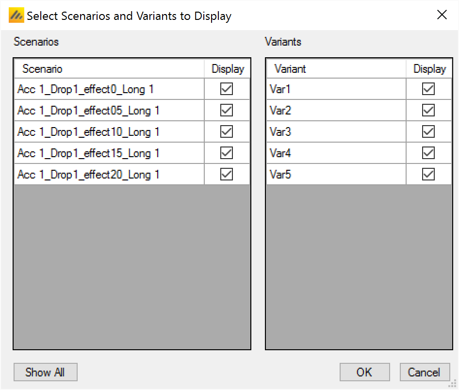

Figure 1: Select the scenarios to include in Across Scenario graphs.

The graph display supports copying an image of the graph to the clipboard, to facilitate pasting them into documents and presentations. Right clicking on a graph brings up a short menu that allows the image of the graph to be copied to the clipboard or saved in ‘.png’ format to a file.

Many graphs have a number of controls to allow the graph to be tailored, standard graph controls available on most graphs are:

- Set Y axis – this displays a dialog boxing allowing the user to fix the minimum and maximum of each of the Y axes and the number of ‘tick’ marks. (Not displayed if the ‘y’ value must lie in the interval 0-1.

- Space doses evenly – if the x-value is ‘dose’, then data for each dose can either be spaced equally or proportionate to the doses’ effective dose strength.

#### Box and whisker plot conventions

- The mean probability is plotted as a large dot.

- The median value is plotted as a dashed line.

- The 25-75^(th) quantile range is plotted as the “box” portion of each point.

- The “whiskers” extend to the largest and smallest values within 1 ½ times the interquartile range from either end of the box.

- Points outside the whisker range are considered outliers, and are plotted as small blue dots. Note that it may be difficult to see all of these symbols if they are plotted at the same value.

# Per Scenario Graphs

## Allocation Box and Whisker Plot

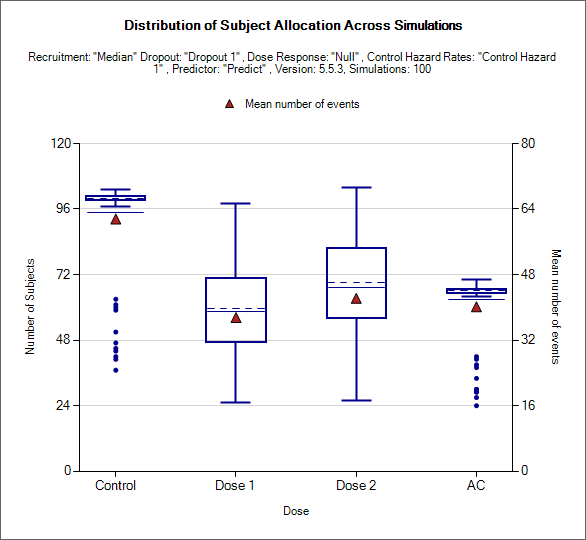

Figure 2: Distribution of Subject Allocation Across Simulations.

This graph displays a box and whisker plot of the number of subjects recruited into each arm. These plots show:

- The distribution over all simulations of the number of subjects allocated to each arm shown as a box and whisker plot. If the design is not adaptive, the number allocated will be the same in every simulation and the box and whiskers collapse to a single line.

- The mean number of events observed in each arm across the simulations shown as a red triangle.

## Events Boxplot

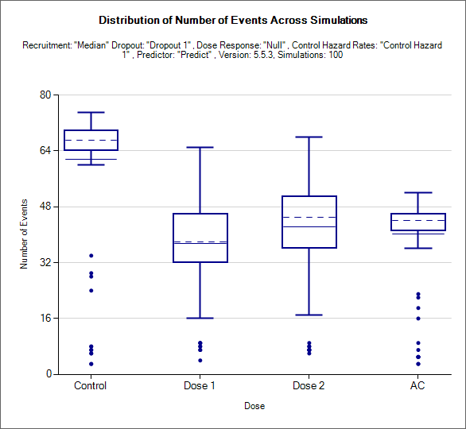

Figure 3: Distribution of Number of Events Across Simulations

This graph displays a box and whisker plot of the number of events observed in each arm. These plots show:

- The distribution over all simulations of the number of events observed in each arm shown as a box and whisker plot.

## Hazard Ratio and Subject Allocation

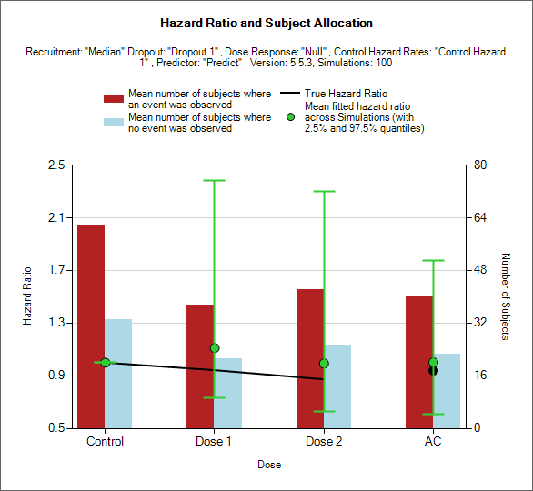

Figure 4: Hazard Ratio and Subject Allocation

This graph shows for each treatment arm, the mean subject allocation, mean number of events observed and the mean estimated hazard ratio. Specifically:

- The blue bars show the mean number of subjects without events and the brown bars mean number of subjects who had events.

- The black line shows the true Hazard Ratio being simulated (but without allowing for any effect of the predictor)

- The green dashed line (drawn if a response model is fitted), shows the mean of the estimated hazard ratios across the simulations

- The green ‘error bars’ show the spread of the central 95% of the estimated hazard ratios (if less than 20 simulations have been run it simply shows the full spread).

## Hazard Ratio and Target Selection graphs

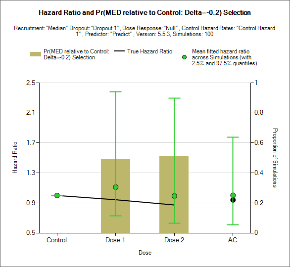

Figure 5: Hazard Ratio and $Pr$(MED relative to Control: Delta=-0.2) Selection

These plots show the true simulated hazard ratio (without allowance for the effect of the predictor) and the mean and 95% spread of the mean fitted hazard ratios along with bars showing the proportion of simulations the different treatment arms are the finally selected target. The target displayed is selected by a control on the graph, from any of the defined Target QOIs.:

## Predictor: Response and Allocation

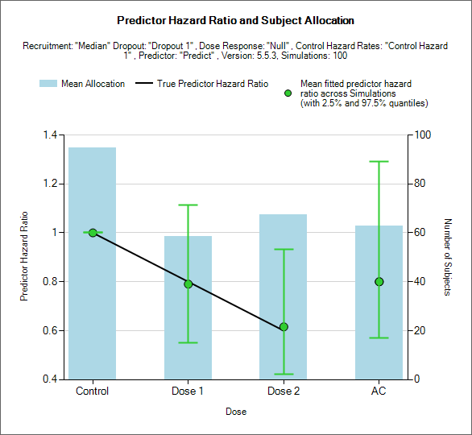

Figure 6: Predictor Hazard Ratio and Subject Allocation

These plots show the true simulated predictor response and the mean and 95% spread of the mean fitted predictor response model, with the blue bars showing the mean number of subjects allocated to each arm across the simulations.

## Per Dose: QOIs

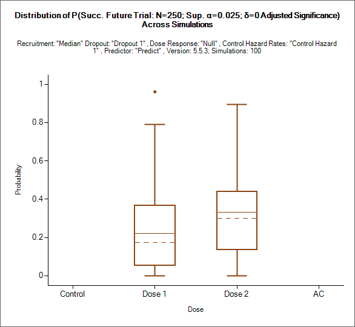

Figure 7: Distribution of P(Succ. Future Trial: N=250; Sup. $\alpha=0.025$, $\delta=0$ Adjusted Significance) Across Simulations

These plots show a box plot showing the distribution of the values for any of the defined QOIs for each dose.

Which QOI is displayed can be selected by the user from a drop down list on the graph. Any of the Posterior Probability, Predictive Probability, P-value and Target QOI’s can be selected.

## Target Hazard Ratio Scatter Plot

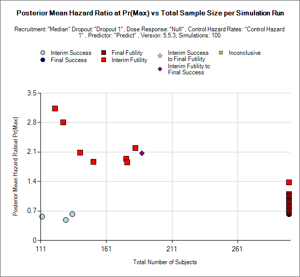

Figure 8: Posterior Mean Hazard Ratio at Pr(Max) vs Total Sample Size per Simulation Run

This graph shows a scatter plot of trial outcomes with the estimate hazard ratio as the y-axis and total number of subjects recruited as the x-axis. A drop down list on the graph allows the user to select which target QOI is used to supply the hazard ratio:

The trials are plotted with a symbol that indicated the final outcome:

- A light blue circle indicates a trial that stopped early for success

- A dark blue circle indicates a trial that was a late success

- A dark red square indicates a trial that was a late futility

- A light red square indicates a trial that stopped early for futility

- A light pink diamond indicates a trial that stopped early for success but where the final analysis was futility

- A dark pink diamond indicates a trial that stopped early for futility but where the final analysis was success

- A yellow cross indicates a trial that completed full enrolment but was inconclusive at the end.

These graphs are not particularly useful if there is no early stopping.

If the design does allow early stopping this graph shows

- The overall distribution of sample sizes – in particular is stopping evenly distributed from the moment stopping is possible, or is there are large cohort of trials that stop as soon as its possible?

- When and with what response rate trials stop incorrectly, in particular having trials stopping and the decision being reversed suggests stopping is allowed to soon or the criteria is not conservative enough.

There are two further variants of this graph, these have alternative y-axes: the hazard ratio at the EDx or at the MED.

## Cumulative Operating Characteristics Plot

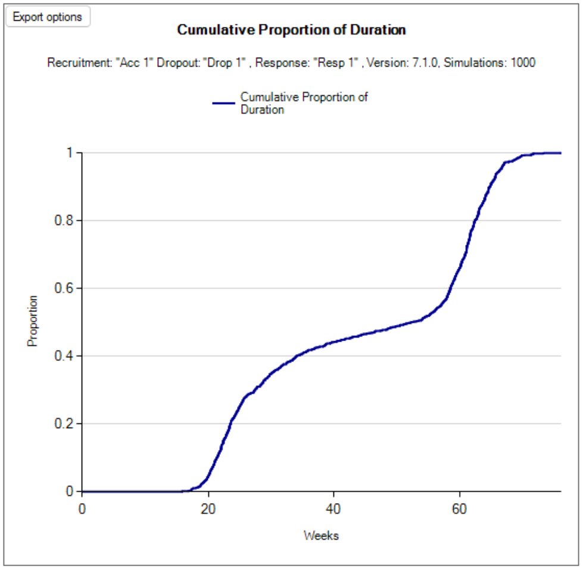

\(a\) Cumulative Proportion of Duration

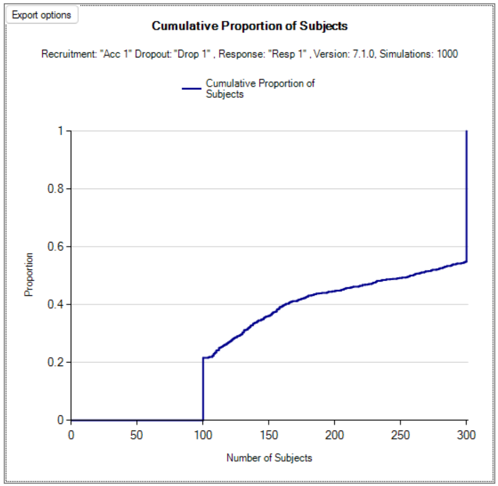

\(b\) Cumulative Proportion of Subjects

Figure 9

There are two graphs, one that shows the cumulative proportion of durations across all simulations, and the other shows the cumulative proportion of subjects across all simulations.

## Time course for stopping

There are two graphs, one that shows the distribution over time for stopping for futility and one for stopping for success.

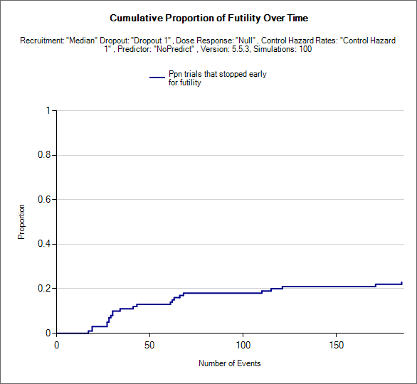

\(a\) Cumulative Proportion of Futility Over Time

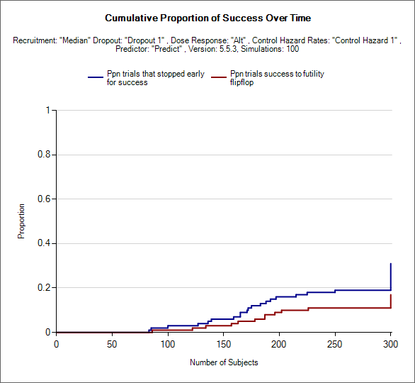

\(b\) Cumulative Proportion of Success Over Time

Figure 10

These plots show as cumulative curves the proportion of the simulations that stopped at different time points from the start of the trial.

The x-axis is configurable, the user can select cumulative stopping to be plotted relative to time, sample size or number of events observed.

## Arm Dropping Graphs

If the design has used arm dropping, the following graphs are available.

### Hazard ratio and Ppn Arms Dropped

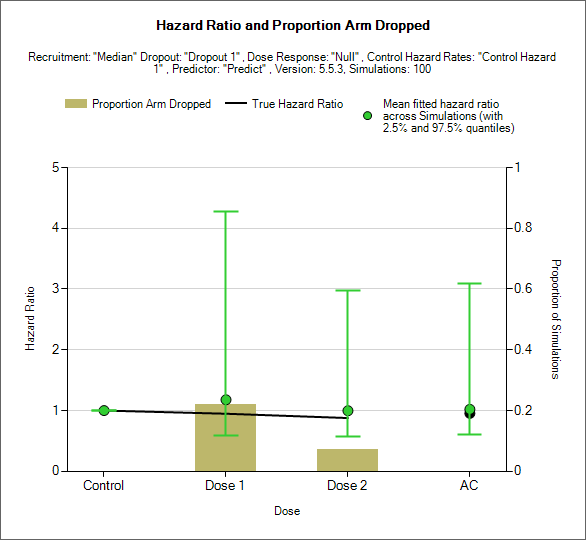

Figure 11: Hazard Ratio and Proportion Arm Dropped

This graph shows the true (simulated) mean response and the average fitted response with 2.5% & 97.5% quantiles.

The histogram bars show for each arm the proportion of simulations for which the arm was dropped.

### Time Course for Arm Dropping

This graph shows, for each arm, the cumulative proportion of simulations when it was dropped. The user can select whether time or number of subjects allocated to the arm is used as the x-axis.

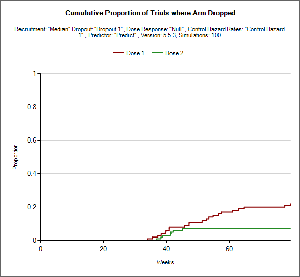

Figure 12: Cumulative Proportion of Trials where Arm Dropped

### Time Course for Arm retention

This graph shows, for each arm, the cumulative proportion of simulations when the arm was retained. The user can select whether time or number of subjects allocated to the arm is used as the x-axis. This is simply the inverse of the arm dropping graph above.

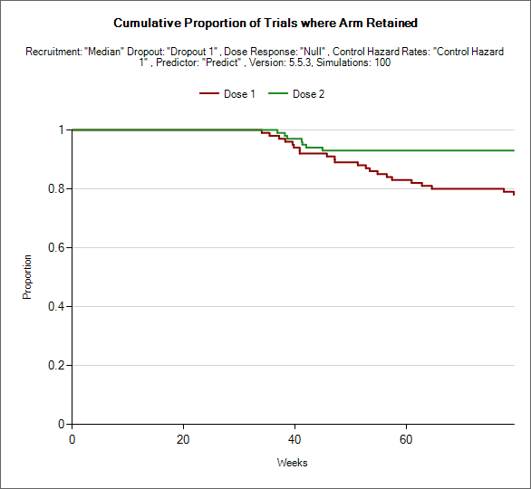

Figure 13: Cumulative Proportion of Trials Where Arm Retained

### Arm Retention Proportion

This graph shows, for each arm, the simple proportion of simulations where the arm was retained.

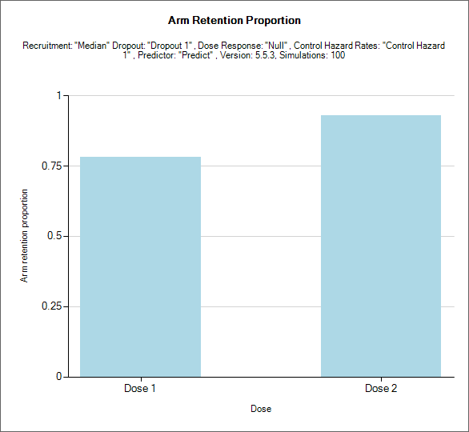

Figure 14: Arm Retention Proportion

## Frequentist

These graphs are available if frequentist analysis is enabled.

### Frequentist P(significance)

These graphs are the box and whisker plots of various p-values that are automatically calculated (that is to say they do not need to be defined as QOIs for them to be calculated) for the final analysis. The user can select from Unadjusted, Bonferroni and Dunnett's and LOCF, BOCF (if baseline is simulated) or PP (per-protocol) treatment of missing values.

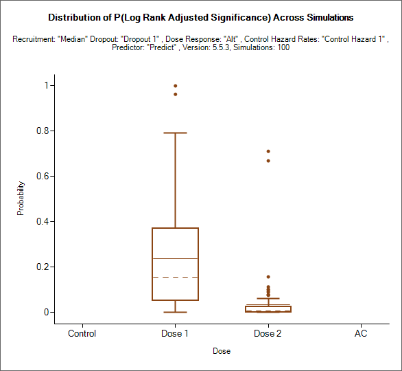

Figure 15: Distribution of $P$(Log Rand Adjusted Significance) Across Simulations

### Frequentist: Response and Significance

This graph plots the mean and 2.5-97.5 percentile of the mean across the simulations or the simple frequentist estimate of the response for each arm, along with a histogram plot of the ppn of times the response on each arm was significant. The user can select from the Unadjusted, Bonferroni or Log Rank, Log Rank Bonferroni, Wilcox and Wilcox Bonferroni p-values.

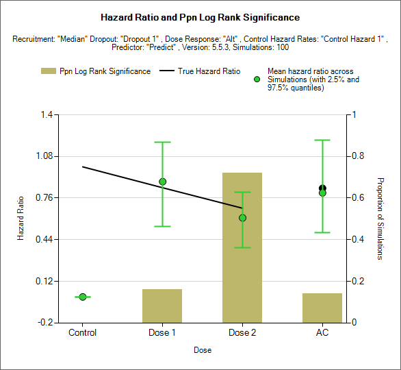

Figure 16: Hazard Ratio and Ppn Log Rank Significance

## Per Sim Graphs

This set of graphs includes a control that allows the user to select which simulation to graph the results from. Each graph shows the output from only 1 simulated trial.

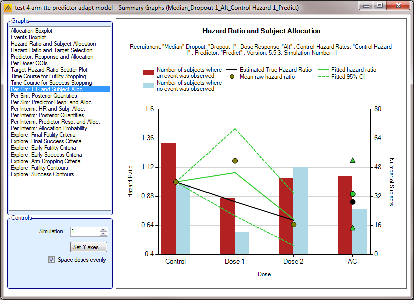

Figure 17: The plot window when selecting a Per Sim graph. Note the Simulation control in the bottom left allowing for the selection of which simulated trial the graph should be made for.

### Hazard Ratio and Subject Allocation

This graph shows the final analysis at the end of individual simulations.

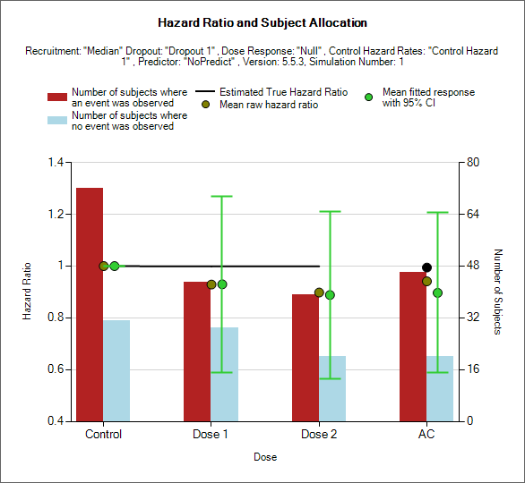

Figure 18: Hazard Ratio and Subject Allocation

On each graph

- The black line shows the ‘True’ Hazard Ratio being simulated, (not adjusted to include any predictor effects)

- The blue bars show the mean number of subjects without events and the brown bars mean number of subjects who had events.

- If a response model has been fitted:

  - The green solid line shows the estimate of the mean hazard ratio

  - The green dashed lines show the boundaries of the 95% credible interval for the estimate of the hazard ratio.

- Otherwise if the Independent Dose model has been fitted:

  - The light green circle shows the mean estimate of the hazard ratio for each arm

  - The vertical green arms show the extent of the 95% credible interval for the estimate of the hazard ratio for each arm.

### Posterior Quantities

This graph shows the final analysis at the end of individual simulations, including the distribution of a selected QOI.

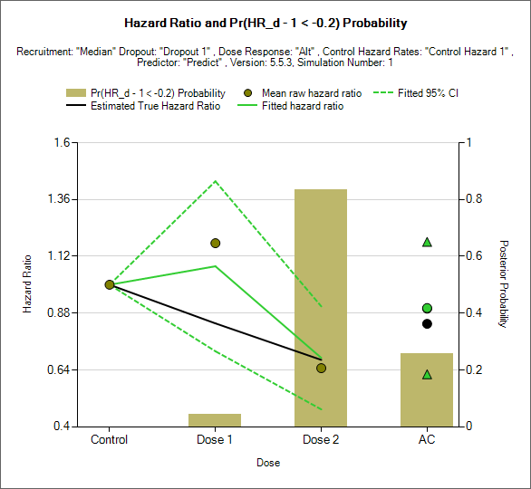

Figure 19: Hazard Ratio and $Pr$($HR_d$ - 1 \< -0.2) Probability

This graph includes a control that allows the user to select which simulation to graph the results from and which QOI to plot. On each graph

- The black line shows the ‘True’ mean response being simulated.

- The brown circles and arms show the mean raw data and its 95% CI for each arm.

- If a response model has been fitted:

  - The green solid line shows the estimate of the mean hazard ratio

  - The green dashed lines show the boundaries of the 95% credible interval for the estimate of the hazard ratio.

- Otherwise if the Independent Dose model has been fitted:

  - The light green circle shows the mean estimate of the hazard ratio for each arm

  - The vertical green arms show the extent of the 95% credible interval for the estimate of the hazard ratio for each arm.

- Brown bars showing the final value of the selected QOI for each arm at the end of the simulated trial.

The user can select from any of the Posterior Probability, Predictive Probability or Target Probability QOIs to plot, including QOI’s based on the predictor.

### Predictor Response and Allocation

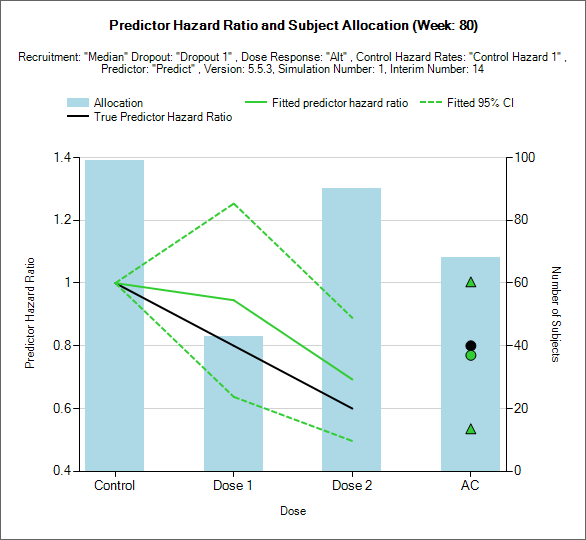

Figure 20: Predictor Hazard Ratio and Subject Allocation (Week: 80)

If the simulations include a predictor this graph is available.

This graph includes a control that allows the user to select which simulation to graph the results from. On each graph

- The black line shows the ‘True’ Predictor response being simulated

- If a response model has been fitted:

  - The green solid line shows the estimate of the mean hazard ratio

  - The green dashed lines show the boundaries of the 95% credible interval for the estimate of the hazard ratio.

- Otherwise if the Independent Dose model has been fitted:

  - The light green circle shows the mean estimate of the hazard ratio for each arm

  - The vertical green arms show the extent of the 95% credible interval for the estimate of the hazard ratio for each arm.

- Blue Bars showing number of subjects allocated to each treatment arm.

## Per Interim Graphs

This is an identical set of graphs to the Per Sim graphs, the difference is that in addition to a control to select which simulation to graph the results from, there is a control to select which interim within the simulation to graph the results from. These graphs are only available for those simulations for which ‘weeks’ files have been output (by default the first 100). Note the control in the bottom left that allows for specification of Simulation number as well as Interim number.

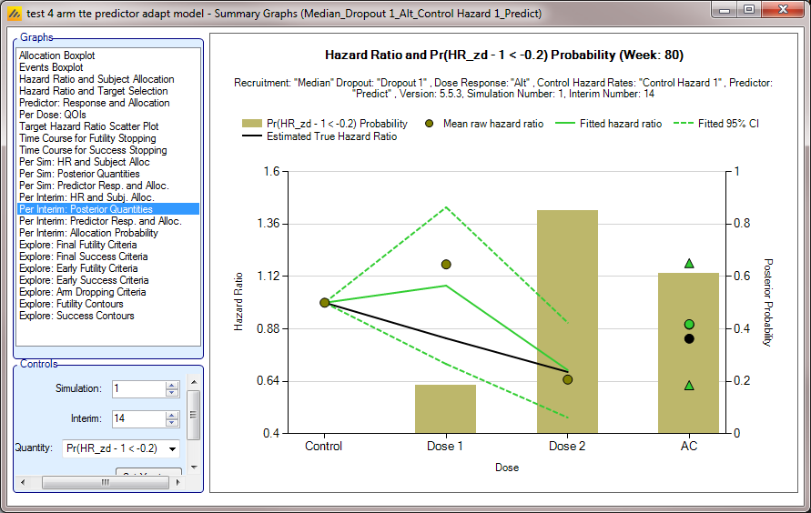

Figure 21: The plot window when selecting a Per Interim graph. Note the Simulation control in the bottom left allowing for the selection of which simulated trial and which interim analysis the graph should be made for.

## Post Simulation Boundary Finding Graphs

### Explore Success/Futility Eval Criteria

These graphs can be used to explore what proportion of simulated trials of a particular scenario would have been a success/failure at final evaluation. Using the two drop down controls the user can select the target dose to use: Max, EDx or MED, and set and lower/upper limits to explore for the threshold (setting the range used on the x-axis).

For the given target the proportion of trials that would meet each of the criteria over the range of threshold values is plotted. As in the examples above, the plots will be somewhat jagged if only a small number of simulations have been run. These graphs can be used to select thresholds that can be expected to yield a certain level of type-1 or power, but the user must remember these will only be approximate (depending on the number of simulations) but can be useful to understand the designs sensitivity to the thresholds and to set initial thresholds early on in the design / simulation process that will get close to the desired type-1 error and power from the outset.

### Explore Early Success/Futility Eval Criteria

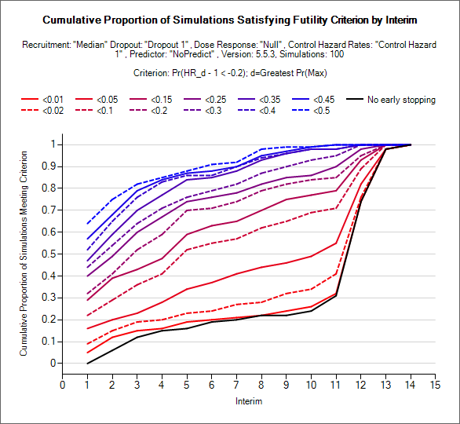

\(a\) Cumulative Proportion of Simulations Satisfying Futility Criterion by Interim

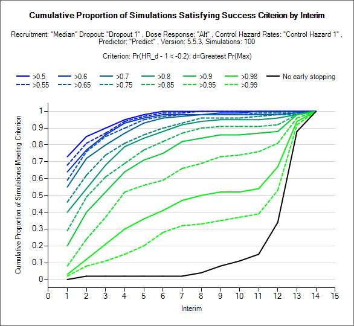

\(b\) Cumulative Proportion of Simulations Satisfying Success Criterion by Interim

Figure 22

These graphs can be used to explore what proportion of simulated trials of a particular scenario would have stopped early for success/futility. NOTE these graphs require weeks files to have been output, they are also most use where the design has been simulated with interims but no early stopping (as in the examples above where the shape of the “existing stopping rules” line indicates that no early stopping occurred in these simulations).

Using the two drop down controls, the user can select which stopping criteria is evaluated and from which interim stopping will be permitted. Lines are then displayed for the proportion of simulations that would have stopped by each interim for a fixed set of thresholds.

Typically these can be used to see at what threshold (and starting at what interim) stopping for success or futility introduces an unacceptably level of ‘incorrect’ early stopping – stopping for futility in successful scenarios and stopping for success in futile scenarios and whether at below/above these levels there may be a useful probability of correct stopping.

### Explore Arm Dropping Criteria

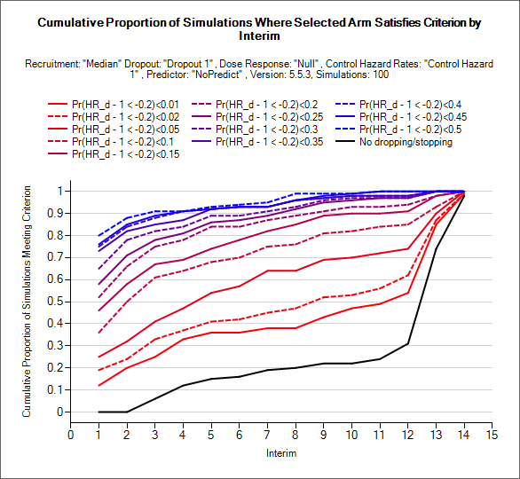

Figure 23: Cumulative Proportion of Simulations Where Selected Arm Satisfies Criterion by Interim

This graph is similar to the Explore Early Success/Futility Criteria graph but for arm dropping criteria. The user has an additional control to select which dose the proportion of trials in which the arm would be dropped is displayed.

### Success/Futility Stopping Contours

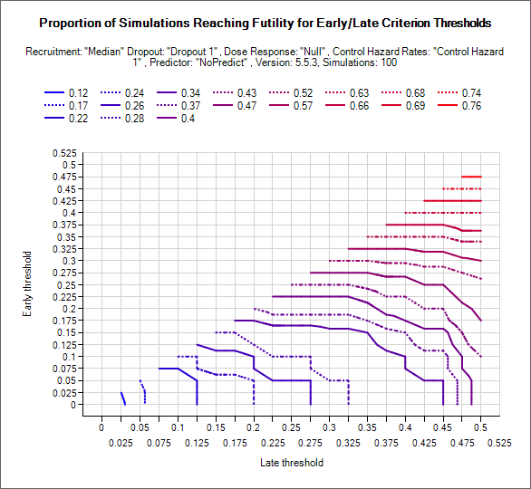

Figure 24

These graphs allow early stopping and final evaluation criteria to be considered jointly. Like the explore early stopping criteria plots, these graphs require weeks files to have been output and will work best if interims were evaluated but no trials actually stopped early.

The user selects the criterion to plot, the first interim at which early stopping is allowed, and the upper/lower limit of the threshold to consider.

FACTS will then plot contours where (final evaluation threshold, early stopping threshold) yield the same proportion of trials that are a success/futile. Contours are only plotted where final evaluation threshold \< early stopping threshold for success and vice versa for futility. Early stopping criteria should not be less strict than final criteria.

Again the example graphs shown are based on only 100 simulations with weeks files, so any threshold derived will only very approximately yield these success/futility rates.

# Across Scenario Graphs

## Selected Arms

This graph shows a bar chart for each scenario and variant selected. Each chart shows how often each arm was ‘selected’ by the target QOI specified on the Study \> Variants tab. Each bar uses a stacked bar to show the proportion of times that arm was:

- “Successful” –the arm was correctly selected (marked as “Should succeed” on the VSR tab) and the trial was successful.

- “Should not succeed” – the arm was incorrectly selected (not marked as “Should succeed” on the VSR tab) and the trial was successful.

- Unsuccessful – the arm was selected and the trial failed.

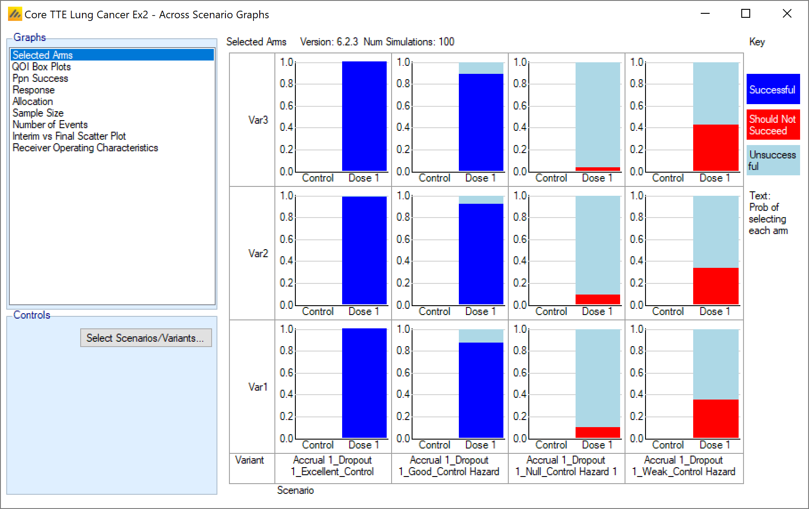

Figure 25: Across scenario graph for selected arms with 4 scenarios and 3 design variants.

## QOI Box Plots

This graph shows a box and whisker plot for each scenario and variant selected. Each plot shows the distribution of the values of a selected QOI for each arm. There is a drop down control to allow the selection of the QOI to be displayed. Any Posterior probability, Predictive probability, p-value or target QOI can be selected.

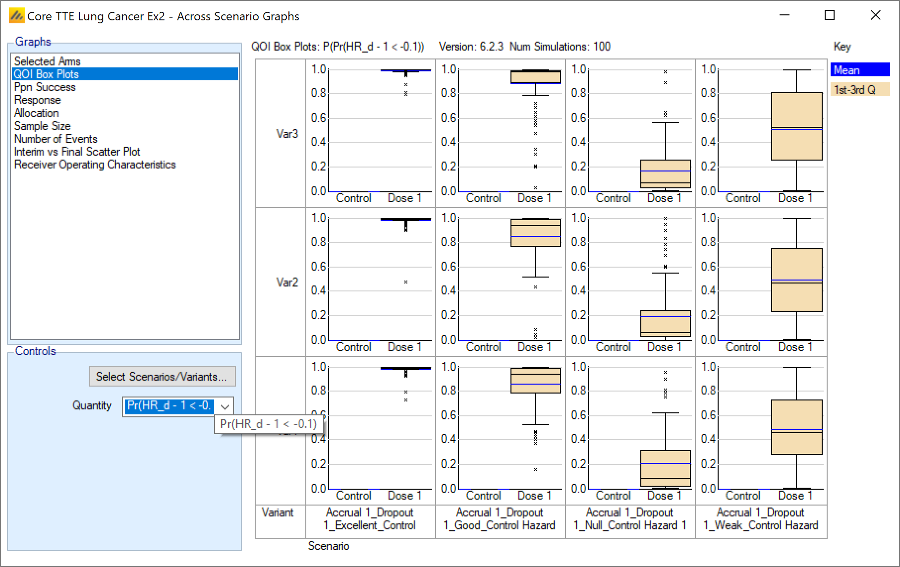

Figure 26: Across scenario graph showing QOIs per arm with 4 scenarios and 3 design variants.

## Ppn Success

This grouped bar chart shows a bar for the proportion of successful simulations for each variant, grouped by scenario.

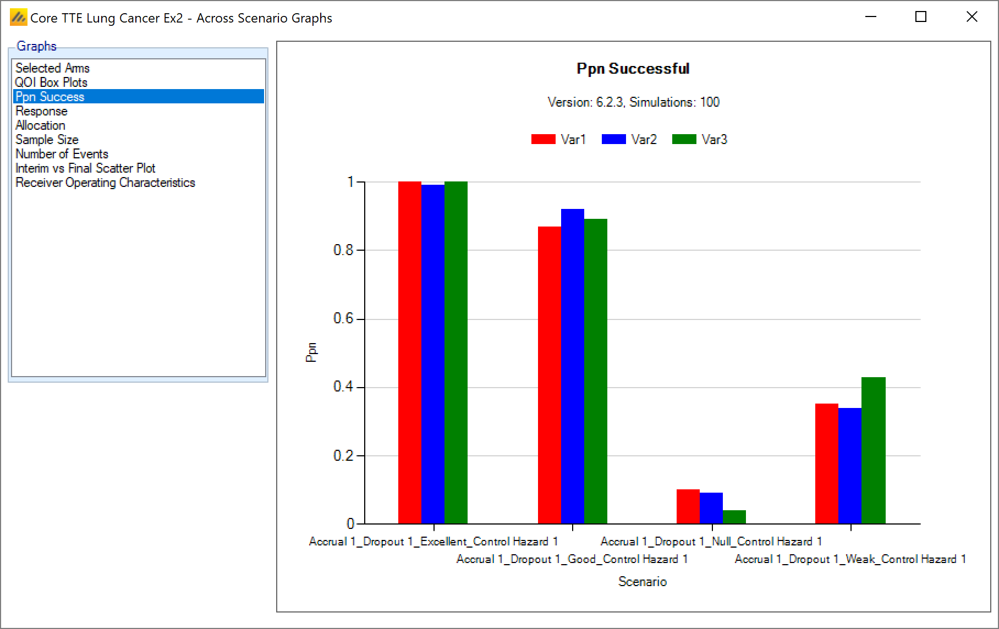

Figure 27: Across scenario graph for showing the proportion of trials that result in success with 4 scenarios and 3 design variants.

## Response

This graph shows a dose response plot for each scenario and variant selected. Each plot shows the mean estimate over the simulations and the 95%-ile interval of the mean estimates over the simulations. The graph also shoes the “true response” i.e. the mean response being simulated.

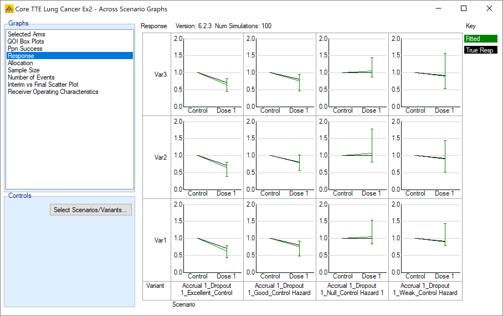

Figure 28: Across scenario graph for showing the average estimated dose response model vs. the true dose responses with 4 scenarios and 3 design variants.

## Allocation

This graph shows a box and whisker plot for each scenario and variant selected. Each plot shows the distribution of the number of subjects allocated to each arm over the simulations.

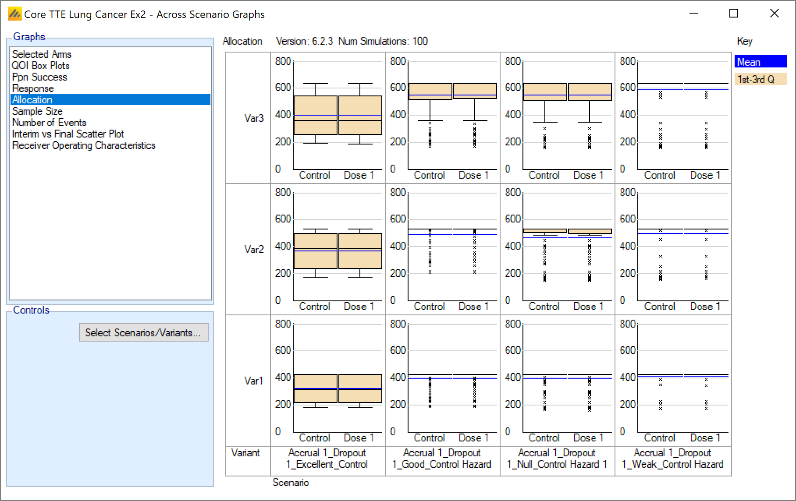

Figure 29: Across scenario graph for showing the distribution of allocation per arm with 4 scenarios and 3 design variants.

## Sample Size

This graph shows the mean sample size for each scenario at different maximum sample sizes (the different variants).

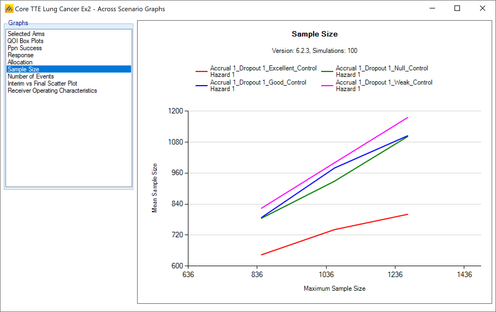

Figure 30: Across scenario graph for showing the mean sample size of the study with 4 scenarios and 3 design variants.

## Interim vs Final Scatter Plot

This is an interactive plot that shows the outcome of each simulation over all the scenarios of a selected variant.

The x-axis shows the value of the selected decision QOI at the specified interim, and the y-axis shows the final value of a (possibly different) selected decision QOI. As well as selecting a decision QOI for the final decision, the graph can use the actual final decision in the simulations – the value of the QOI used in the first criteria is used for the decision is used for the y-axis.

Note the graph is based just on the values at the selected interim, what might happen at other interims is ignored.

Thresholds can be set to specify early and late success/futility. Each scenario is then coloured to show its outcome – and stacked bar graphs are displayed to show the proportion of each outcome for each scenario. The thresholds can be changed and the graph re-drawn. If the selected QOI uses a p-value the checks for success are that it is “\<” than the threshold, (and vice-versa for futility), otherwise the checks for success are that it is “\>” the threshold (and vice-versa for futility).

The graph can only display the results for simulations for which cohorts files have been output, and for simulations that reached the specified interim. Thus the graph works best if interims have been specified, but the simulations run without any early stopping enabled – so each simulation has the results for every interim.

With 1,000 simulations per scenario and cohorts files for each simulation, the graph will take several seconds to re-draw. To allow several parameters to be set before redrawing (rather than having to wait for the redraw after each change) the graph is only redrawn after the ‘Redraw’ button is clicked.

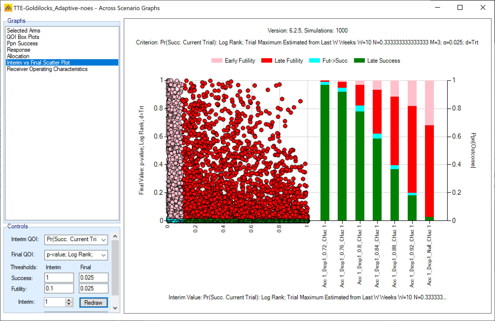

Figure 31: Across scenario graph showing an interim QOI plotted against a final analysis QOI with the decision dictating the point color. Additionally, the bars on the right hand side represent the proportion of trials that made each decision based on the decision rules specified in the plot controls.

## Receiver Operating Characteristics

This graph plots the relative proportion of successful simulations in the scenarios compared to the proportion of successes in one specific scenario. The intended use of this is to yield a “Receiver Operating Characteristics” (ROC) curve. This is done as follows:

- Select the decision QoI that is to be used to determine final success/futility. (The graph only supports the simple case where just one is being used).

- Select a scenario that represents the ‘Null’ case – where determining success is a type-1 error.

- If multiple variants have been simulated, select which variant to plot.

FACTS computes for the null scenario, for a range of decision threshold values, what proportion of the ‘Null’ scenario sims would have been successful (giving the estimated type-1 error rate), these proportions form the x-values for each point. The corresponding threshold values are shown on the x-axis at the top of the graph, the type-1 error rate on the x-axis at the bottom of the graph.

FACTS then computes for each of the other scenarios in turn the proportion of sims that would have been successful **and selected a “should succeed” dose** so it is necessary for doses to have been specified as “should succeed” on the Virtual Subject Response profiles (giving the estimate of power for that scenario – where ‘power’ also requires correct dose selection), at each of the threshold values, these proportions are then shown on the y-axis of the graph.

Thus for each scenario we can see the estimated power of the design to determine success for a given type-1 error rate in the specified Null scenario.

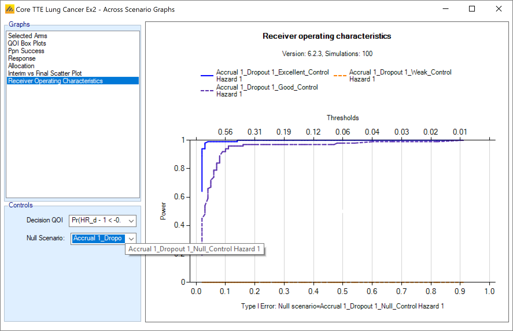

Figure 32: Across scenario graph showing ROC curves of the power of one selected design variant under different scenarios as a function of the type I error in the selected null scenario.

# Viewing Simulation Results in the Simulations Tab

After simulations have been run, FACTS provides a table for assessing the output from the simulations. While everything that FACTS displays in the table on the SImulation tab is available in output files, FACTS does a substantial amount of “beautifying” of results in its built-in table. This entails changes like converting numeric outcome scores to readable text and using descriptive names for QOI columns.

The main table has 1 line per scenario, and shows the summary of all simulations run for each scenario. These lines show values that are stored in the summary.csv file.

More detailed simulation output, providing a row per simulation run, is accessbile by double clicking on any row of the output table. This row-per-simulation output is what is stored in the simulations.csv files.

Additional detail is available for simulations that have a weeks file by right clicking on a simulation in the simulation summary window and selecting “Weeks Results”. See the Results Output section of the Simulation tab to specify the number of weeks files to be output.

## Summary per Scenario

By default, only a subset of all columns of output are provided when simulations are complete. This set of columns is called “Highlights.” To get access to further columns, you can right click anywhere on the simulation output table and click “Summary Results: ….” for whichever set of columns you would like to see. There is a “Summary Results: All” option that will provide a pop up containing every column available for summary results.

The following sections break down which columns are available by sorting to which column subset.

### Highlights

These are the columns displayed on the simulations tab after simulations are completed, the can also be displayed in the separate “Highlights” results window.

| Column Title | Number of columns | Description |
|----|----|----|
| Select | 1 | Not an output column, this column contains check box to allow the user to select which scenario to simulate. The ‘Select All’ button causes them all to be checked. |
| Status | 1 | This column reports on the current status of simulations: Completed, Running, No Results, Out of date, Error. It is updated automatically. |
| Scenario | 1 | This column gives the name of the scenario, concatenating together the profile names from the following tabs: · ‘Execution \> Accrual’, · ‘Execution \> Dropout Rate’, · ‘Virtual Subject Response \> Explicitly Defined \> Arm Response’, · ’Virtual Subject Response \> Explicitly Defined \> Control Hazard rates, · ‘Virtual Subject Response \> Explicitly Defined \> Predictor’, · This is the same name as used for the results directory |
| Random Number Seed | 1 | Base random number seed used to perform the simulations. |
| Num Sims | 1 | The number of simulations that were run to produce the displayed results. |
| Mean Subj. | 1 | This is the mean (over the simulations) of the number of subjects recruited in this scenario. |
| Ppn Overall Success | 1 | This is the proportion of simulations that stopped for success, either early success or late success (as defined below). |
| Ppn Early Success | 1 | This is the proportion of simulations that stopped early for success (and did not regress to futility in the final analysis – though they might have regressed to ‘inconclusive’). |
| Ppn Late Success | 1 | This is the proportion of simulations that did not stop early but were successful in the final analysis. |
| Ppn Overall Futility | 1 | This is the proportion of simulations that stopped for futility, either early futility or late futility (as defined below). |
| Ppn Late Futility | 1 | This is the proportion of simulations that did not stop early but were futile in the final analysis. |
| Ppn Early Futility | 1 | This is the proportion of simulations that stopped early for futility (and did not regress to success in the final analysis – though they might have regressed to ‘inconclusive’). |
| Ppn S uc-\>Fut Flipflop | 1 | This is the proportion of simulations that stopped early for success but regressed to futility in the final analysis. |
| Ppn F ut-\>Suc Flipflop | 1 | This is the proportion of simulations that stopped early for futility but regressed to success in the final analysis. |
| Ppn Inco nclusive | 1 | This is the proportion of simulations that did not stop early and were neither successful nor futile in the final analysis. |
| Early Success Time | 1 | This is the average time to an early decision to stop for success (i.e. the time excluding final follow up) over those simulations that did decide early to stop for success. |
| Mean Trt. \<Dose\> | One per arm | This is the mean (over the simulations) of the hazard ratio of the treatment arms to control. The HZ for the control arm is always 1. |
| Mean Duration | 1 | The mean over the simulations of the total duration from the start of enrolment to end of follow up. |
| PPn Arms Drop: \< Dose\>\> | One per arm | This is the number of times (over the simulations) that each arm was dropped. |
| Mean LP Enrolled | 1 | This is the mean, in weeks (over the simulations) of the duration of the trial from first patient first visit to Last Patient First Visit (i.e. the duration of accrual). |
| Ppn Correct Arm | 1 | The proportion of simulations that met the success criteria and selected (by the target QOI specified on the Study \> Variant tab) one of the arms marked as “should succeed” on the Virtual Subject Response \> Explicitly Defined \> Arm Response tab |
| Ppn Incorrect Arm | 1 | The proportion of simulations that met the success criteria and selected (by the target QOI specified on the Study \> Variant tab) one of the arms **not** marked as “should succeed” on the Virtual Subject Response \> Explicitly Defined \> Arm Response tab |
| Version | 1 | The FACTS version number at the time the simulations were run. |

The columns that are displayed by default in the simulations tab after time-to-event simulations have been run. {.caption-top .table}

### Allocation

By right clicking and selecting the allocation columns, a pop-out will appear that provides the following columns.

| Column Title | Number of columns | Description |
|----|----|----|
| Status | 1 | This column reports on the current status of simulations: Completed, Running, No Results, Out of date, Error. It is updated automatically. |
| Scenario | 1 | This column gives the name of the scenario, concatenating together the profile names from the following tabs: · ‘Execution \> Accrual’, · ‘Execution \> Dropout Rate’, · ‘Virtual Subject Response \> Explicitly Defined \> Arm Response’, · ’Virtual Subject Response \> Explicitly Defined \> Control Hazard rates, · ‘Virtual Subject Response \> Explicitly Defined \> Predictor’, · This is the same name as used for the results directory |
| Mean Subj. | 1 | This is the mean (over the simulations) of the number of subjects recruited in this scenario. |
| SD Mean Subj. | 1 | This is the standard deviation across the simulations of the number of subjects recruited. |
| 80%-ile Subj | 1 | This is the eightieth percentile across the simulations of the number of subjects recruited into the trial. |
| Mean Alloc.: \<Dose\> | One per arm | This is the mean (over the simulations) of the number of subjects recruited into each arm in this scenario. |
| SD Alloc.: \<Dose\> | One per arm | This is the SD of the means (over the simulations) of the number of subjects allocated to each treatment arm. |

The allocation tabs provided in FACTS output for time-to-event trials. {.caption-top .table}

### Response

The following columns provide summaries of the estimated hazard ratios based on the bayesian model incorporating the dose response model and the predictor model, if one is specified.

| Column Title | Number of columns | Description |
|----|----|----|
| Status | 1 | This column reports on the current status of simulations: Completed, Running, No Results, Out of date, Error. It is updated automatically. |
| Scenario | 1 | This column gives the name of the scenario, concatenating together the profile names from the following tabs: · ‘Execution \> Accrual’, · ‘Execution \> Dropout Rate’, · ‘Virtual Subject Response \> Explicitly Defined \> Arm Response’, · ’Virtual Subject Response \> Explicitly Defined \> Control Hazard rates, · ‘Virtual Subject Response \> Explicitly Defined \> Predictor’, · This is the same name as used for the results directory |
| Mean Trt. \<Dose\> | One per arm | This is the mean (over the simulations) of the hazard ratio of the treatment arms to control. The HZ for the control arm is always 1. |
| SD Trt .: \<Dose\> | One per arm | This is the standard deviation (over the simulations) of the estimate of the treatment hazard ratio for each arm. The SD of the treatment response for the control arm is always 0. |
| True Resp: \<Dose\> | One per arm | This is the true Hazard Ratio from which the simulation data was sampled. When using VSR with Event Rate \| Predictor, these rates will not be the same as the Arm Response HRs entered on the VSR \> Explicitly Defined (ER \| P) \> Arm Response tab. |

Response columns available in FACTS output for time-to-event simulations. {.caption-top .table}

### Observed

By right clicking and selecting the Observed columns, a pop-out will appear that provides the following columns. These columns relate to the raw data observed in the trial.

| Column Title | Number of columns | Description |
|----|----|----|
| Status | 1 | This column reports on the current status of simulations: Completed, Running, No Results, Out of date, Error. It is updated automatically. |
| Scenario | 1 | This column gives the name of the scenario, concatenating together the profile names from the following tabs: · ‘Execution \> Accrual’, · ‘Execution \> Dropout Rate’, · ‘Virtual Subject Response \> Explicitly Defined \> Arm Response’, · ’Virtual Subject Response \> Explicitly Defined \> Control Hazard rates, · ‘Virtual Subject Response \> Explicitly Defined \> Predictor’, · This is the same name as used for the results directory |
| Mean Total Events | 1 | The mean (over the simulations) of the number of events observed in each trial. |
| Mean Events \<Dose\> | One per arm | The mean (over the simulations) of the number of events observer in each arm in each trial. |
| Mean Events \<Dose\> \<Segment\> | One per arm per segment | The mean (over the simulations) of the number of events observer in each arm and segment in each trial. |
| Mean Complete Info \<Dose\> | One per arm | This is the mean (over the simulations) of information observed per arm as defined on the Interims tab (Subjects enrolled, Complete Predictor Data, Opportunity to Complete Predictor, Events, Predictor Events) in this scenario. |
| Mean Dropouts \<Dose\> | One per arm | If dropouts are simulated this is the mean (over the simulations) of the number of subjects in each arm that dropout before an event is observed. |
| Mean Exposure \<Dose\> \<Segment\> | One per arm | The mean (over the simulations), of the total exposure of the subjects observed on each arm and segment. |

Observed columns available in FACTS output for time-to-event simulations. {.caption-top .table}

### Probabilities

By right clicking and selecting the allocation columns, a pop-out will appear that provides the following columns. These columns provide summaries of the Quantities of Interest values.

| Column Title | Number of columns | Description |
|----|----|----|
| Status | 1 | This column reports on the current status of simulations: Completed, Running, No Results, Out of date, Error. It is updated automatically. |
| Scenario | 1 | This column gives the name of the scenario, concatenating together the profile names from the following tabs: · ‘Execution \> Accrual’, · ‘Execution \> Dropout Rate’, · ‘Virtual Subject Response \> Explicitly Defined \> Arm Response’, · ’Virtual Subject Response \> Explicitly Defined \> Control Hazard rates, · ‘Virtual Subject Response \> Explicitly Defined \> Predictor’, · This is the same name as used for the results directory |
| \<QOI\> \<Dose\> | One per arm per QOI | For each Posterior Probability and Predictive Probability QOI defined on this endpoint, this is the mean over the simulations of the estimate of the probability of the QOI for each dose. (P-value QOIs are reported in the frequentist results table). · For each Target QOI this is the proportion of simulations where this dose was selected at the end of the trial as the dose with the greatest probability of meeting the target condition. · The probability that each dose is the target at the end of a simulated trial is its marginal probability (the number of times it was the dose closest to the target in the MCMC sampling of the analysis at the end of the trial). The target of having the Max response on this endpoint, or some fraction of it (EDq) is always identifiable, so the Ppn(target) for these QOIs will sum to 1 across the doses. · An MED target is not guaranteed to be identifiable, if no dose meets the CSD criteria in any MCMC sample so all doses have a 0 probability of having a response greater than Control (or AC) by the CSD then no dose is the MED. So the sum of each Ppn(target) QOI across the doses should sum to between 0 and 1 inclusive. · Decision QOI’s are not reported here separately, but their component QOIs – the vector of values and target QOI used to select from them are. |

Probabilities columns available in FACTS output for time-to-event simulations. {.caption-top .table}

### Hierarchical Prior Parameters

By right clicking and selecting the Hierarchical Prior Parameters columns, a pop-out will appear that provides the following columns.

| Column Title | Number of columns | Description |
|----|----|----|
| Status | 1 | This column reports on the current status of simulations: Completed, Running, No Results, Out of date, Error. It is updated automatically. |
| Scenario | 1 | This column gives the name of the scenario, concatenating together the profile names from the following tabs: · ‘Execution \> Accrual’, · ‘Execution \> Dropout Rate’, · ‘Virtual Subject Response \> Explicitly Defined \> Arm Response’, · ’Virtual Subject Response \> Explicitly Defined \> Control Hazard rates, · ‘Virtual Subject Response \> Explicitly Defined \> Predictor’, · This is the same name as used for the results directory |
| Mean BAC Mu | 1 | The average (over the simulation) of the posterior estimate of the mean of the Bayesian Augmented Control (Hierarchical Prior) distribution of mean Control responses, if a Hierarchical Prior is being used for Control is being used, otherwise the column contains -9999. |
| SD BAC Mu | 1 | The average (over the simulations) of the standard deviation of the posterior estimate of the mean of the Bayesian Augmented Control (Hierarchical Prior) distribution of mean Control responses, if a Hierarchical Prior is being used for Control is being used, otherwise the column contains -9999. |
| Mean BAC Tau | 1 | The average (over the simulations) of the posterior estimate of the standard deviation of the Bayesian Augmented Control (Hierarchical Prior) distribution of mean Control responses, if a Hierarchical Prior is being used for Control is being used, otherwise the column contains -9999. |
| SD BAC Tau | 1 | The standard deviation (over the simulations) of the posterior estimate of the standard deviation of the Bayesian Augmented Control (hierarchical Prior) distribution of mean Control responses, if a Hierarchical Prior is being used for Control is being used, otherwise the column contains -9999. |
| Mean BAAC Mu | 1 | The average (over the simulation) of the posterior estimate of the mean of the Bayesian Augmented Active Comparator (Hierarchical Prior) distribution of mean Active Comparator responses, if a Hierarchical Prior is being used for Active Comparator is being used, otherwise the column contains -9999. |
| SD BAAC Mu | 1 | The average (over the simulations) of the standard deviation of the posterior estimate of the mean of the Bayesian Augmented Active Comparator (Hierarchical Prior) distribution of mean Active Comparator responses, if a Hierarchical Prior is being used for Active Comparator is being used, otherwise the column contains -9999. |
| Mean BAAC Tau | 1 | The average (over the simulations) of the posterior estimate of the standard deviation of the Bayesian Augmented Active Comparator (Hierarchical Prior) distribution of mean Active Comparator responses, if a Hierarchical Prior is being used for Active Comparator is being used, otherwise the column contains -9999. |
| SD BAAC Tau | 1 | The standard deviation (over the simulations) of the posterior estimate of the standard deviation of the Bayesian Augmented Active Comparator (hierarchical Prior) distribution of mean Active Comparator responses, if a Hierarchical Prior is being used for Active Comparator, otherwise the column contains -9999. |

Hierarchical Prior Parameters columns available in FACTS output for time-to-event simulations. {.caption-top .table}

### Predictor

By right clicking and selecting the Predictor columns, a pop-out will appear that provides the following columns. These colums provide summaries of the bayesian model estimates relating to the predictor endpoint.

| Column Title | Number of columns | Description |
|----|----|----|
| Status | 1 | This column reports on the current status of simulations: Completed, Running, No Results, Out of date, Error. It is updated automatically. |
| Scenario | 1 | This column gives the name of the scenario, concatenating together the profile names from the following tabs: · ‘Execution \> Accrual’, · ‘Execution \> Dropout Rate’, · ‘Virtual Subject Response \> Explicitly Defined \> Arm Response’, · ’Virtual Subject Response \> Explicitly Defined \> Control Hazard rates, · ‘Virtual Subject Response \> Explicitly Defined \> Predictor’, · This is the same name as used for the results directory |
| Mean Pred. Resp.: \<Dose\> | One per arm | The mean (over the simulations) of the mean estimate of the predictor response for each arm. The response reported is: · Continuous predictor: The mean change from baseline · Dichotomous predictor: The response rate · TTE predictor: The hazard ratio · No predictor: 0 |
| SD Pred. Resp.: \<Dose\> | One per arm | The SD (over the simulations) of the mean estimate of the predictor response for each arm. |
| Mean Pred. Sigma | 1 | This is the average (over the simulations) of the estimate of sigma (SD of response) of a continuous predictor, if one was being used. Otherwise the column contains -9999. |
| SD Pred Sigma | 1 | This is the standard deviation (over the simulations) of the estimate of the sigma (SD of the response) of a continuous predictor, if one was being used. Otherwise the column contains -9999. |
| True Predictor · Resp: \<Dose\> | One per arm | This is the true predictor response from which the simulated subject predictor responses were sampled. For a continuous predictor this is the mean of the response, for a dichotomous predictor it is the predictor response rate and for a time-to-event predictor it is the hazard ratio of the predictor, otherwise the column contain -9999. |
| True Predictor · Sigma: \<Dose\> | One per arm | This is the true standard deviation of the predictor response from which the simulated subject predictor responses were sampled when the predictor is a continuous measure, otherwise the column contains -9999 |
| Mean Pred. Lambda: \<Dose\> | One per arm | This is the average (over the simulations) of the estimate of Lambda for each dose in the endpoint predictor model – the estimated mean time to the final event for each dose either where the predictor is zero for a continuous or dichotomous predictor, or for the time after observing the event of time-to-event predictor. Otherwise the column contains 0. |
| SD Pred. Lambda: \<Dose\> | One per arm | This is the standard deviation (over the simulations) of the estimate of Lambda for each dose (see above). Otherwise the column contains 0. |
| Mean Pred. Beta | 1 | This is the average (over the simulations) of the estimate of Beta – the coefficient that relates the predictor to the endpoint for a continuous or dichotomous predictor. Otherwise the column contains -9999. |
| SD Pred. Beta | 1 | This is the standard deviations (over the simulations) of the estimate of Beta – the coefficient that relates the predictor to the endpoint for a continuous or dichotomous predictor. Otherwise the column contains -9999. |

Predictor columns available in FACTS output for time-to-event simulations. {.caption-top .table}

### Model Parameters

By right clicking and selecting the Model Parameters columns, a pop-out will appear that provides the following columns.

| Column Title | Number of columns | Description |
|----|----|----|
| Status | 1 | This column reports on the current status of simulations: Completed, Running, No Results, Out of date, Error. It is updated automatically. |
| Scenario | 1 | This column gives the name of the scenario, concatenating together the profile names from the following tabs: · ‘Execution \> Accrual’, · ‘Execution \> Dropout Rate’, · ‘Virtual Subject Response \> Explicitly Defined \> Arm Response’, · ’Virtual Subject Response \> Explicitly Defined \> Control Hazard rates, · ‘Virtual Subject Response \> Explicitly Defined \> Predictor’, · This is the same name as used for the results directory |
| True Predictor · Baseline Hazard Lambda: \<segment\> | One per VSR pr edictor hazard rate segment | The true hazard rate for the predictor (if the predictor is itself an event), in each of the predictor VSR time segments. |
| Lambda: \<segment\> | One per Design, Hazard Model segment | The mean (over the simulations) of the mean estimate of lambda – the event rate (events per week) in each time segment of the hazard model. |
| SE Lambda: \<segment\> | One per Design, Hazard Model segment | The standard error (over the simulations) of the mean estimate of lambda for each time segment of the hazard model. |
| True Lambda: \<segment\> | One per VSR control hazard segment | The true hazard rate for each segment of the virtual subject response hazard rate profile. |

Model Parameters columns available in FACTS output for time-to-event simulations. {.caption-top .table}

## Detailed Simulation Results

After simulation has completed and simulation results have been loaded, the user may examine detailed results for any scenario with simulation data in the table by double-clicking on the row. A separate window (as in Figure 15‑1) displays the individual results for each simulation. This is the contents of the “simulations.csv” file, which is described below.

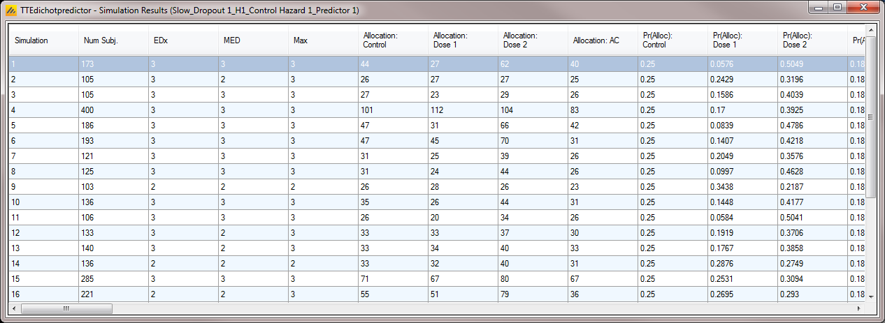

Figure 33: The simulation results pop out viewer showing simulation highlights.

# Output Files

Instead of viewing simulation output on the Simulation tab within FACTS, the output is all contained within easily accessible files saved the the user’s local machine. FACTS stores the results of simulations as ‘.csv’ files under a Results folder. For each row in the simulations table, there is a folder named by the profiles that make up the scenario, which contains the corresponding ‘.csv’ files.

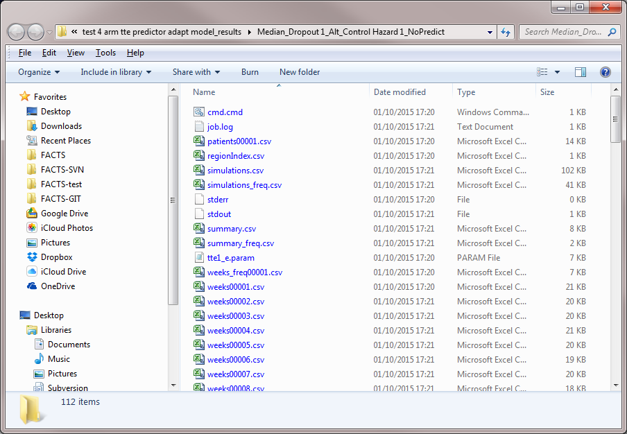

Figure 34: The windows file explorer when opened to the directory containing simulation output.

These files can be opened using Microsoft Excel or any text editor. Excel, and many other apps, takes out a file lock on any file it has open, while a FACTS results file is open in another piece of software it cannot be deleted or modified by FACTS. The most common cause for an error to be reported when simulating trials in FACTS is because the user has one of the previous results files is still open in Excel.

In the scenario directory there are the following types of results file:

**Summary.csv** Contains a single row of data that summarizes the simulation results. This is the source of the shown on the simulations tab.

**Summary_freq.csv** Contains a single row of data that that summarizes the frequentist analysis of the simulations.

**Simulations.csv** Contains one row per simulation describing the final state of each simulation for every trial simulated.

**Simulations_freq.csv** Contains one row per simulation describing the frequentist analysis of the final state of each simulation for every trial simulated.

**PatientsNNNNN.csv** Contains one row per patient in simulation, where NNNNN is the number of the simulation. By default this file is written out only for the first simulation, but this can be changed via the ‘Advanced’ button on the simulations tab.

**WeeksNNNNN.csv** contains one row for each cohort during a simulation where NNN is the number of the simulation. By default this file is written only for the first 100 simulations, but this can be changed via the advanced button on the simulation tab. The values in the last row of the cohorts file will be the same as the final values for that simulation in the simulations file.

**Weeks_freqNNNNN.csv** Contains the frequentist analysis of every analysis during a simulation, one row for each interim and one for the final analysis, where NNNNN is the number of the simulation. It is written only if frequentist analysis is enabled, and by default only for the first simulation; this can be changed via the ‘Advanced’ button on the simulation tab.

In the tables below, D is the number of arms (including control), S is the number of time segments in the control hazard of the analysis model, and Sp is the number of time segments in the hazard model of a time-to-event predictor.

## Contents of summary.csv

The first two lines are header lines, starting with a ‘#’, and both contain the following column headings. The third line holds the data. The two header lines list the same columns but name some of them differently: the first line uses the full QOI names (for example “Pr(HR_d \< 1)”) and “Mean LP Enrolled time”, and the second line uses the QOI short names (for example “Pr(PBO)”) and “Mean LPFV time”. The FACTS version, the FACTS file name, the scenario and the time stamp are given in the Version, Project, Scenario and Timestamp columns.

| Column Title | Number of columns | Description |
|----|----|----|
| Project | 1 | The name of the facts file |
| Scenario | 1 | The name of the scenario |
| Timestamp | 1 | The time the simulations were run |
| Version | 1 | The version of FACTC that was used to run the simulations |
| NSim | 1 | The number of simulation runs. |
| Random Number Seed | 1 | The random number seed used for the simulations. |
| No. Subj | 1 | The mean, over the simulations, of the total number of subjects recruited in the trial. |
| SE Subj. | 1 | The standard error of the total number of subjects recruited into the trials. |
| No.subj 80-ile | 1 | The 80^(th) percentile, over the simulations, of the total number of subjects recruited in the trial. |
| Ppn Overall Success | 1 | The proportion of simulations that were successful, either early success or late success. |
| Ppn Overall Futility | 1 | The proportion of simulations that were futile, either early futility or late futility. |
| P(ES) | 1 | The proportion of simulations that stopped early for success. |
| P(LS) | 1 | The proportion of simulations that did not stop early, and were successful on final evaluation. |
| P(LF) | 1 | The proportion of simulations that did not stop early, and were futile on final evaluation. |
| P(EF) | 1 | The proportion of simulations that stopped early for futility. |
| SFFF | 1 | The proportion of simulations that stopped early for success, but at final analysis were futile (Success-Futility ‘flip-flops’). |
| FSFF | 1 | The proportion of simulations that stopped early for futility, but at final analysis were successful (Futility- Success ‘flip-flops’). |
| Undec. | 1 | The proportion of simulations that did not stop early, and met neither the success or futility final evaluation criteria and hence are counted as ‘undecided’. |
| Unused | 3 | Three unused columns for other outcome types. |
| Early Success Time | 1 | This is the mean early decision time (over the simulations stopped early for success), it is the time from the start of the trial to the interim where early success was declared. It does not include the subsequent follow up time. |
| Mean Alloc \<dose\> | D | The mean (over the simulations) of the number of subjects allocated to each treatment arm. |
| SE Alloc \<dose\> | D | The standard error (over the simulations) of the number of subjects allocated to each treatment arm. |
| Mean Resp \<dose\> | D | The mean of the estimates of hazard ratio of each treatment arm. (This is always 1 for the control arm) |
| SE Resp \<dose\> | D | The standard error, over the simulations, of the estimate of hazard ratio of each treatment arm. (This is always 0 for the control arm). |
| True Mean resp \<dose\> | D | The true hazard ratio for each treatment arm used to derive the simulated subject event times (the HR for the control arm is always 1). If the hazard ratio is specified over several time segments, this is the mean of the segment hazard ratios, weighted by the length of follow-up each segment covers. |
| Mean predictor resp \<dose\> | D | The mean (over the simulations) of the estimated predictor response per arm – this is the estimated mean response for a continuous predictor, the estimated response rate for a dichotomous predictor and the estimated hazard ratio for a time to event predictor. |
| SE predictor resp \<dose\> | D | The standard error (over the simulations) of the estimated predictor response per arm. |
| Mean Predictor Sigma | 1 | The mean (over the simulation) of the estimated standard deviation in the predictor response when modeling a continuous predictor. |
| SE Predictor Sigma | 1 | The standard error (over the simulations) of the estimated standard deviation in the predictor response when modeling a continuous predictor. |
| True Mean predictor resp \<dose\> | D | The true predictor response rate used to drive the simulation of the subjects’ predictor outcomes – this is the mean of the response for a continuous predictor, the response rate for a dichotomous predictor and the hazard ratio for a time to event predictor. |
| True SD predictor \<dose\> | D | The true sigma used to drive the simulation of the subjects’ predictor outcomes when the predictor is a continuous measure. |
| Mean Predictor Lambda \<dose\> | D | The mean (over the simulations) of the estimate of lambda – the estimated mean time to the final event in the endpoint predictor model – the estimated mean time to the final event for each dose when the predictor is zero (continuous or dichotomous) or for the time after observing the predictor event. |
| SE Predictor Lambda \<dose\> | D | This is the standard error (over the simulations) of the estimate of lambda for each dose. |
| Mean Predictor Beta | 1 | This is the mean (over the simulations) of the estimate of Beta – the coefficient that relates the predictor to the endpoint for a continuous or dichotomous predictor. |
| SE Predictor Beta | 1 | This is the standard error (over the simulations) of the estimate of Beta. |
| Mean TTE Predictor Baseline Hazard Lambda \<seg\> | Sp | This is the mean (over the simulations) of the estimate of the predictor event rate on the control arm in each time segment of the predictor hazard model, when using a time-to-event predictor. |
| SE TTE Predictor Baseline Hazard Lambda \<seg\> | Sp | This is the standard error (over the simulations) of the estimate of the predictor event rate on the control arm in each time segment of the predictor hazard model. |
| True TTE Predictor Baseline Hazard Lambda \<seg\> | 1 per segment | The true predictor event rate on the control arm used to simulate the predictor events, for each segment of the simulated predictor hazard (1 column, -9999, if there is no time-to-event predictor). |
| Mean Total Predictor Events | 1 | The mean, over the simulations, of the total number of predictor events observed (only with a time-to-event predictor). |
| SE Total Predictor Events | 1 | The standard error, over the simulations, of the total number of predictor events observed (only with a time-to-event predictor). |
| Mean No. Predictor Events \<dose\> \<seg\> | D \* Sp | The mean, over the simulations, of the number of predictor events observed on each arm in each segment of the predictor hazard model (only with a time-to-event predictor). |
| SE No. Predictor Events \<dose\> \<seg\> | D \* Sp | The standard error, over the simulations, of the number of predictor events observed on each arm in each segment of the predictor hazard model (only with a time-to-event predictor). |
| Predictor Exposure \<dose\> \<seg\> | D \* Sp | The mean, over the simulations, of the total exposure (time at risk of the predictor event) on each arm in each segment of the predictor hazard model (only with a time-to-event predictor). |
| Predictor SE Exposure \<dose\> \<seg\> | D \* Sp | The standard error, over the simulations, of the predictor exposure on each arm in each segment of the predictor hazard model (only with a time-to-event predictor). |
| BAC Mean | 1 | If a hierarchical prior for Control is being used this is the mean (over the simulations) of the posterior estimate of the mean of the Bayesian Augmented Control (Hierarchical Prior) distribution of mean control responses. |
| SE of BAC Mean | 1 | If a hierarchical prior for Control is being used this is the standard error (over the simulations) of the posterior estimate of the mean of the Bayesian Augmented Control (Hierarchical Prior) distribution of mean control responses. |
| BAC Tau | 1 | If a hierarchical prior for Control is being used this is the mean (over the simulations) of the posterior estimate of the SD of the Bayesian Augmented Control (Hierarchical Prior) distribution of mean control responses. |
| SE of BAC Tau | 1 | If a hierarchical prior for Control is being used this is the standard error (over the simulations) of the posterior estimate of the SD of the Bayesian Augmented Control (Hierarchical Prior) distribution of mean control responses. |
| BAAC Mean | 1 | If a hierarchical prior for Active Comparator is being used this is the mean (over the simulations) of the posterior estimate of the mean of the Bayesian Augmented Active Comparator (Hierarchical Prior) distribution of mean active comparator responses. |
| SE of BAAC Mean | 1 | If a hierarchical prior for Active Comparator is being used this is the standard error (over the simulations) of the posterior estimate of the mean of the Bayesian Augmented Active Comparator (Hierarchical Prior) distribution of mean control responses. |
| BAAC Tau | 1 | If a hierarchical prior for Active Comparator is being used this is the mean (over the simulations) of the posterior estimate of the SD of the Bayesian Augmented Active Comparator (Hierarchical Prior) distribution of mean active comparator responses. |
| SE of BAAC Tau | 1 | If a hierarchical prior for Active Comparator is being used this is the standard error (over the simulations) of the posterior estimate of the SD of the Bayesian Augmented Active Comparator (Hierarchical Prior) distribution of mean active comparator responses. |
| Est. Lambda \<seg\> | S | The mean, over the simulations, of the estimate of the event rate on the control arm in each time segment of the hazard model. |
| Est. Event Rate \<dose\> \<seg\> | (D-1) \* S | The mean, over the simulations, of the estimate of the event rate on each treatment arm (excluding control) in each time segment of the hazard model (the control event rate multiplied by the arm’s hazard ratio). |
| SE Lambda \<seg\> | S | The standard error, over the simulations, of the estimate of the event rate on the control arm in each time segment of the hazard model. |
| SE Event Rate \<dose\> \<seg\> | (D-1) \* S | The standard error, over the simulations, of the estimate of the event rate on each treatment arm (excluding control) in each time segment of the hazard model. |
| True Lambda \<seg\> | 1 per segment | The true event rate on the control arm used to simulate the subjects’ event times, for each segment of the simulated control hazard. The number of columns is set by the Virtual Subject Response profile, not the analysis model. |
| Mean Total Events | 1 | The mean, over the simulations of the total number of events observed in the trials. |
| SE Total Events | 1 | The standard error, over the simulations, of the total number of events observed in the trials. |
| Mean No. Events \<dose\> | D | The mean, over the simulations, of the number of events observed on each arm. |
| SE No. Events \<dose\> | D | The standard error, over the simulations, of the number of events observed on each arm. |
| Mean No. Events \<dose\> \<seg\> | D \* S | The mean, over the simulations, of the number of events observed on each arm in each time segment of the hazard model. |
| SE No. Events \<dose\> \<seg\> | D \* S | The standard error, over the simulations, of the number of events observed on each arm in each time segment of the hazard model. |
| Mean Complete Info \<dose\> | D | The mean, over the simulations, of the information on each arm that counts towards the timing of interims as defined on the Interims tab: subjects enrolled, events observed, or subjects with (or with the opportunity for) a predictor observation. |
| No. Dropouts \<dose\> | D | The mean, over the simulations, of the number of subjects on each arm who dropped out. |
| Mean Exposure \<dose\> \<seg\> | D \* S | The mean, over the simulations, of the total exposure of the subjects observed on each arm in each time segment of the hazard model. |
| SE Exposure \<dose\> \<seg\> | D \* S | The standard error, over the simulations, of the total exposure of the subjects observed on each arm in each time segment of the hazard model. |
| Mean Duration | 1 | The mean, over the simulations, of the overall duration of the trials, from first person first visit, to last person last visit. |
| Ppn Arm Dropped \<dose\> | D | The proportion of the simulations in which each arm was dropped. These will be zero if arm dropping is not selected as the means of adaptive allocation. |
| Mean LPFV time | 1 | The mean, over the simulations, of the accrual period of the trials, from first person first visit, to last person first visit (LPFV). Headed “Mean LP Enrolled time” on the first header line. |
| Ppn Correct Arm | 1 | The proportion of simulations that met the success criteria and selected (by the target QOI specified on the Study \> Variant tab) one of the arms marked as “should succeed” on the Virtual Subject Response \> Explicitly Defined \> Arm Response tab. |
| Ppn Incorrect Arm | 1 | The proportion of simulations that met the success criteria and selected (by the target QOI specified on the Study \> Variant tab) one of the arms **not** marked as “should succeed” on the Virtual Subject Response \> Explicitly Defined \> Arm Response tab. |
| QOI Columns |  |  |

Contents of the summary.csv file for time-to-event simulations. {.caption-top .table}

### QOI Columns

The QOI columns depend on the QOIs that have been defined for this design. On the first header line each QOI column is headed with the full QOI name, and on the second with the QOI short name. Unlike the simulations and weeks files, summary.csv has no “Dose” column after each QOI. The columns in the following order:

| Statistic | Description |
|----|----|
| Posterior Probabilities | The summary file contains the mean (over the simulations) of the posterior probability for each dose. |
| Predictive Probabilities | The summary file contains the mean (over the simulations) of the predictive probability for each dose. |
| P-Values | The summary file contains the mean (over the simulations) of the p-value for each dose. |
| Target Probabilities | The summary file contains the proportion of times (over the simulations) each dose had the greatest probability of being the target. These columns are headed “Ppn” followed by the QOI name and the dose. |
| Operational QOIs | The summary file contains the mean (over the simulations) of the operational QOI: one column per dose, or a single column for trial-level QOIs such as “Still Accruing” or “Reached Max Sample Size”. |
| Decision QOIs | The summary file contains the mean (over the simulations) of the final value of the decision QOI at the target. |

## Contents of Summary_freq.csv

The first line is a header line, starting with a ‘#’, containing the FACTS GUI version number, the name of the FACTS file, the name of the scenario, and the time stamp of the start of the simulation.

The second line is a header line, starting with a ‘#’, containing the following column headings.

| Column Title | Number of columns | Description |
|----|----|----|
| Ppn LR Signif | 1 | The proportion of simulations where at least one of the unadjusted p-values (from the Log Rank test) is less than the user specified one-sided alpha. |
| Ppn LR Signif \<dose\> | D | For each treatment arm, the proportion of simulations where the unadjusted p-value (from the Log Rank test) is less than the user specified one-sided alpha. · The marginal probability of significance per dose (using unadjusted p-values. |
| Ppn LR Signif Bonf | 1 | The proportion of simulations where at least one of the unadjusted p-values (from the Log Rank test) is less than the Bonferroni corrected user specified one-sided alpha. |
| Ppn LR Signif Bonf \<dose\> | D | For each treatment arm, the proportion of simulations where the unadjusted p-value (from the Log Rank test) is less than the Bonferroni corrected user specified one-sided alpha. |
| Ppn Wilcox Signif | 1 | The proportion of simulations where at least one of the unadjusted p-values (from the Wilcoxon test) is less than the user specified one-sided alpha. |
| Ppn Wilcox Signif \<dose\> | D | For each treatment arm, the proportion of simulations where the unadjusted p-value (from the Wilcoxon test) is less than the user specified one-sided alpha. · The marginal probability of significance per dose (using unadjusted p-values. |
| Ppn Wilcox Signif Bonf | 1 | The proportion of simulations where at least one of the unadjusted p-values (from the Wilcoxon test) is less than the Bonferroni corrected user specified one-sided alpha. |
| Ppn Wilcox Signif Bonf \<dose\> | D | For each treatment arm, the proportion of simulations where the unadjusted p-value (from the Wilcoxon test) is less than the Bonferroni correct user specified one-sided alpha. |
| Mean HR \<dose\> | D | The mean Hazard Ratio per dose. |
| SE HR \<dose\> | D | The standard error of the Hazard Ratio per dose |
| Ppn HR Signif | 1 | The proportion of simulations where at least one of the unadjusted p-values (from the Cox model) is less than the user specified one-sided alpha. |
| Ppn HR Signif \<dose\> | D | For each treatment arm, the proportion of simulations where the unadjusted p-value (from the Cox model) is less than the user specified one-sided alpha. · The marginal probability of significance per dose (using unadjusted p-values. |
| Ppn HR Signif Bonf | 1 | The proportion of simulations where at least one of the unadjusted p-values (from the Cox model) is less than the Bonferroni corrected user specified one-sided alpha. |
| Ppn HR Signif Bonf \<dose\> | D | For each treatment arm, the proportion of simulations where the unadjusted p-value (from the Cox model) is less than the Bonferroni correct user specified one-sided alpha. |
| Bias \<dose\> | D | The mean, over the simulations, of the difference between the estimated hazard ratio (treatment effect vs control) and the true (simulated) hazard ratio per dose. |
| Coverage \<dose\> | D | The proportion of simulations where the unadjusted confidence interval for the hazard ratio (treatment effect vs control) contains the true hazard ratio used to simulate subject responses. |
| Mean KM med \<dose\> | D | The mean Kaplan-Meier estimate of the median survival time per dose |
| SE KM med \<dose\> | D | The standard error of the Kaplan-Meier estimate of the median survival time per dose |
| Predictor Cols |  | The appropriate output columns for the chosen type of predictor. See next tables for specifics of columns provided for each predictor type. |

Contents of the summary_freq.csv file for time-to-event simulations. {.caption-top .table}

#### Continuous Predictor:

| Column Title | Number of columns | Description |
|:---|:---|:---|
| Predictor Cox Mean HR \<dose\> | D | The mean value of the cox model coefficient – the predictor as a covariate predicting final endpoint per dose. |
| Predictor Cox Mean HR pred | 1 | The mean value of the cox model coefficient of the predictor. |
| Predictor Cox SE HR \<dose\> | D | The standard error of the cox model coefficient – the predictor as a covariate predicting final endpoint per dose. |
| Predictor Cox SE HR pred | 1 | The standard error of the cox model coefficient of the predictor. |
| Predictor Avg. Min \<dose\> | D | The average of the minimum value for the predictor per dose. |
| Predictor Avg. 10-percentile \<dose\> | D | The average of the 10^(th) percentile values for the predictor per dose. |
| Predictor Avg. 25-percentile \<dose\> | D | The average of the 25^(th) percentile values for the predictor per dose. |
| Predictor Avg. Median \<dose\> | D | The average of the median values for the predictor per dose. |
| Predictor Avg. 75-percentile \<dose\> | D | The average of the 75^(th) percentile values for the predictor per dose. |
| Predictor Avg. 90-percentile \<dose\> | D | The average of the 90^(th) percentile values for the predictor per dose. |
| Predictor Avg. Max \<dose\> | D | The average of the maximum value for the predictor per dose. |
| Predictor Mean \<dose\> | D | The mean of the mean value of the predictor per dose. |
| Predictor SE \<dose\> | D | The standard error of the mean value of the predictor per dose. |

Extra columns on the summary_freq.csv file when using a continuous predictor. {.caption-top .table}

#### Dichotomous Predictor:

| Column Title | Number of columns | Description |
|:---|:---|:---|
| Predictor Cox Mean HR \<dose\> | D | The mean value of the cox model coefficient – the predictor as a covariate predicting final endpoint per dose. |
| Predictor Cox Mean HR pred | 1 | The mean value of the cox model coefficient of the predictor. |
| Predictor Cox SE HR \<dose\> | D | The standard error of the cox model coefficient – the predictor as a covariate predicting final endpoint per dose. |
| Predictor Cox SE HR pred | 1 | The standard error of the cox model coefficient of the predictor. |
| Predictor Mean Response Rate \<dose\> | D | The mean of the predictor response rate per dose. |
| Predictor SE Response Rate \<dose\> | D | The standard error of the predictor response rate per dose. |

Extra columns on the summary_freq.csv file when using a dichotomous predictor. {.caption-top .table}

#### Time-to-Event Predictor

| Column Title | Number of columns | Description |
|:---|:---|:---|
| Predictor Mean KM Median \<dose\> | D | The mean of the Kaplan-Meier estimate of the median time to the predictor event per dose. |
| Predictor SE KM Median \<dose\> | D | The standard error of the Kaplan-Meier estimate of the median time to the predictor event per dose. |

Extra columns on the summary_freq.csv file when using a time-to-event predictor. {.caption-top .table}

## Contents of simulations.csv and weeksNNNNN.csv

The simulations.csv file holds the FACTS summary of the final analysis for each simulation (one per row).

The weeksNNNNN.csv file holds the FACTS summary of every analysis for the NNNNN^(th) simulation. It contains a row for each interim in the trial and a row for the final analysis (Interim number 999).

The final analysis occurs after all the planned data is collected. If the trial does not stop early, the final analysis occurs after full follow-up for all subjects. If the trial does stop early at an interim analysis, then the timing of the final analysis depends on the status of the check boxes on the [Interims tab](../../../../../documentation/v82/userguides/core/design/interims.llms.md#subject-follow-up-options). If follow-up is collected after the particular interim decision, then an analysis after full follow-up of the subjects recruited up to the point of the interim when the stopping decision was taken. If there is no follow-up intended after the interim analysis decision, then the final analysis occurs immediately (at the same time as the interim analysis), and the final analysis criteria are checked.

The first line is a header line, starting with a ‘#’, containing the FACTS GUI version number, the name of the FACTS file, the name of the scenario, and the time stamp of the start of the simulation.

The second and third lines are header lines, starting with a ‘#’, and both contain the following column headings. The two header lines list the same columns but name some of them differently: the second line uses the full QOI names (for example “Pr(HR_d \< 1)”) and “LP Enrolled”, and the third line uses the QOI short names (for example “Pr(PBO)”) and “LPFV”.

The two file types have the same columns, except for the first few columns that identify the simulation or analysis, as shown in the table. Both files include the success and futility evaluation columns.

| Column Title | No. of cols | In sims file | In wk | Description |
|----|----|----|----|----|
| \# Weeks (Duration) | 1 |  | ✔ | The week of the analysis |
| \#Sim | 1 | ✔ |  | The number of the simulation. |
| Random Number Seed | 1 | ✔ |  | The random number seed used for the simulations. |
| Interim Number | 1 |  | ✔ | Headed “InterimNumber”. The index of the analysis: the interim number, or 999 for the final analysis. |
| Last Interim Number | 1 | ✔ |  | Headed “LastInterimNumber”. The index of the last interim performed the index of the interim immediately before the final interim (index ‘999’). Note this is not necessarily the interim when the trial stopped if the design includes follow-up after stopping. |
| \#Subjects | 1 | ✔ | ✔ | The number of subjects recruited in the simulation. |
| Outcome | 1 | ✔ | ✔ | A flag categorizing final study outcome: · 1. = Early success 2. = Late success 3. = Late futility 4. = Early futility 5. = Success to futility flip-flop 6. = Futility to success flip-flop 7. = Inconclusive |
| Early Success | 1 | ✔ | ✔ | This is the time to the early success decision (-9999 if there was no early success decision). The from the start of the trial to the interim where the early success conditions were first met. It does not include the subsequent follow up time. |
| Alloc \<dose\> | D | ✔ | ✔ | The number of subjects allocated to each arm. |
| Pr(Alloc) \<dose\> | D | ✔ | ✔ | The probability of allocation to the different arms following the interim. |
| Mean resp \<dose\> | D | ✔ | ✔ | The estimated hazard ratio of each treatment arm. |
| SD Mean resp \<dose\> | D | ✔ | ✔ | The standard deviation of the estimate of the hazard ratio of each treatment arm. |
| Resp (lower CI) \<dose\> | D | ✔ | ✔ | The lower bound of the 95% credible interval of the hazard ratio of each treatment arm. |
| Resp (upper CI) \<dose\> | D | ✔ | ✔ | The upper bound of the 95% credible interval of the hazard ratio of each treatment arm. |
| True Mean resp \<dose\> | D | ✔ | ✔ | The true mean response (hazard ratio) of each treatment arm for this simulation. · If the hazard ratio is specified over several time segments, this is the mean of the segment hazard ratios, weighted by the length of follow-up each segment covers. |
| Mean Predictor Resp \<dose\> | D | ✔ | ✔ | The estimated response of the predictor at each treatment arm. · Cts: mean change from baseline · Dich: response rate · TTE: hazard ratio with control |
| SD Predictor Resp \<dose\> | D | ✔ | ✔ | The standard deviation of the estimate of the predictor response. |
| Mean Predictor Sigma | 1 | ✔ | ✔ | The mean of the estimate of the sigma of the predictor response (the sd of the response of a continuous predictor) |
| SD Predictor Sigma | 1 | ✔ | ✔ | The SD of the estimate of the sigma of the predictor response (the sd of the response of a continuous predictor) |
| TTE Predictor Resp (lower CI) \<dose\> | D | ✔ | ✔ | The lower bound of the 95% credible interval of the predictor hazard ratio of each treatment arm. Only present with a time-to-event predictor. |
| TTE Predictor Resp (upper CI) \<dose\> | D | ✔ | ✔ | The upper bound of the 95% credible interval of the predictor hazard ratio of each treatment arm. Only present with a time-to-event predictor. |
| True Predictor Mean resp \<dose\> | D | ✔ | ✔ | The true mean predictor response being simulated for each treatment arm (mean of a continuous predictor, response rate of a dichotomous predictor and the hazard ratio of a time-to-event predictor) |
| True Predictor Sigma \<dose\> | D | ✔ | ✔ | The true sigma of the predictor response of each treatment arm, if the predictor is a continuous endpoint |
| Mean Predictor Lambda \<dose\> | D | ✔ | ✔ | The mean of the estimate of Lambda for each dose in the endpoint predictor model – the estimated mean time to the final event for each dose where the predictor is zero for a continuous or dichotomous predictor or the time after observing the event of a time-to-event predictor. |
| SD Predictor Lambda \<dose\> | D | ✔ | ✔ | The standard deviation of the estimate of Lambda for each dose in the endpoint predictor model (see above). |
| Mean Predictor Beta | 1 | ✔ | ✔ | The mean of the estimate of the Beta coefficient in the endpoint predictor model. |
| SD Predictor Beta | 1 | ✔ | ✔ | The standard deviation of the estimate of the Beta coefficient in the endpoint predictor model. |
| Mean TTE Predictor Baseline Hazard Lambda \<seg\> | Sp | ✔ | ✔ | The mean estimate of the hazard rate of the predictor event on the control arm, when using a time-to-event predictor, for each time segment of the predictor control hazard model. |
| SD TTE Predictor Baseline Hazard Lambda \<seg\> | Sp | ✔ | ✔ | The standard deviation of the estimate of the hazard rate of the predictor event on the control arm, when using a time-to-event predictor, for each time segment of the predictor control hazard model. |
| True TTE Predictor Baseline Hazard Lambda \<seg\> | 1 per seg | ✔ | ✔ | The true hazard rate of the predictor event on the control arm used in the simulation, for each segment of the simulated predictor hazard (1 column, -9999, if there is no time-to-event predictor). |
| Predictor Num Events \<dose\> \<seg\> | D \* Sp | ✔ | ✔ | The number of predictor events observed on each arm in each segment of the predictor hazard model. Only present with a time-to-event predictor. |
| Predictor Exposure \<dose\> \<seg\> | D \* Sp | ✔ | ✔ | The total exposure (in weeks) to the predictor event of the subjects on each arm in each segment of the predictor hazard model. Only present with a time-to-event predictor. |
| Predictor Mean Raw resp \<dose\> | D | ✔ | ✔ | The observed (raw) mean of the predictor on each arm: the mean value of a continuous predictor, or the response rate of a dichotomous predictor. Present unless the predictor is time-to-event; -9999 if there is no predictor. |
| Predictor SE Mean Raw resp \<dose\> | D | ✔ | ✔ | The standard error of the observed mean of the predictor on each arm. Present unless the predictor is time-to-event; -9999 if there is no predictor. |
| Predictor Observed \<dose\> | D | ✔ | ✔ | The number of subjects on each arm with an observed predictor value. Present unless the predictor is time-to-event; 0 if there is no predictor. |
| Num Events \<dose\> \<seg\> | S \* D | ✔ | ✔ | The number of events observed on each arm in each control hazard model time segment. |
| Total Exposure \<dose\> \<seg\> | S \* D | ✔ | ✔ | The total exposure (in weeks) of the subjects on each arm in each control hazard model time segment. |
| Complete Info \<dose\> | D | ✔ | ✔ | Headed “Complete Information \<dose\>”. The information on each arm that counts towards the timing of interims as defined on the Interims tab: subjects enrolled, events observed, or subjects with (or with the opportunity for) a predictor observation. |
| Num Dropouts \<dose\> | D | ✔ | ✔ | The number of subjects on each arm who have dropped out. |
| DR Param \<param\> | 10 | ✔ | ✔ | The estimate of the mean value of each of the response model parameters. Ten columns are always written; columns a model does not use are 0. The model parameters are labeled α₁, α₂, .. the subscripts corresponding to the column their value appears in here. For the NDLM models and the hierarchical and hierarchical linear models, the tau or hierarchical SD parameter is in the last column. |
| Sd DR Param \<param\> | 10 | ✔ | ✔ | The standard deviation of the estimate of the mean value of the corresponding response model parameter. |
| Mean Lambda \<seg\> | S | ✔ | ✔ | The mean estimate of the hazard rate on the control arm, for each time segment of the analysis model. |
| Mean Event Rate \<dose\> \<seg\> | S per trt arm | ✔ | ✔ | The mean estimate of the hazard rate on each treatment arm (excluding control), for each time segment of the analysis model: the control hazard rate multiplied by the arm’s hazard ratio. |
| Sd Lambda \<seg\> | S | ✔ | ✔ | The standard deviation of the estimate of the hazard rate on the control arm, for each time segment of the analysis model. |
| Sd Event Rate \<dose\> \<seg\> | S per trt arm | ✔ | ✔ | The standard deviation of the estimate of the hazard rate on each treatment arm (excluding control), for each time segment of the analysis model. |
| True Lambda \<seg\> | 1 per seg | ✔ | ✔ | The true hazard rate on the control arm used to simulate the subjects’ event times, for each segment of the simulated control hazard. The number of columns is set by the Virtual Subject Response profile, not the analysis model. |
| Num Events \<dose\> | D | ✔ | ✔ | The number of events observed on each treatment arm. |
| BAC Mean | 1 | ✔ | ✔ | This is the posterior estimate of the mean of the Bayesian Augmented Control (Hierarchical Prior) distribution of mean control responses. |
| BAC Mean SD | 1 | ✔ | ✔ | This is the SD of the posterior estimate of the mean of the Bayesian Augmented Control (Hierarchical Prior) distribution of mean control responses. |
| BAC Tau | 1 | ✔ | ✔ | This is the posterior estimate of the SD of the Bayesian Augmented Control (Hierarchical Prior) distribution of mean control responses. |
| BAC Tau SD | 1 | ✔ | ✔ | This is the SD of the posterior estimate of the SD of the Bayesian Augmented Control (Hierarchical Prior) distribution of mean control responses. |
| BAAC Mean | 1 | ✔ | ✔ | This is the posterior estimate of the mean of the Bayesian Augmented Active Comparator (Hierarchical Prior) distribution of mean active comparator responses. |
| BAAC Mean SD | 1 | ✔ | ✔ | This is the SD of the posterior estimate of the mean of the Bayesian Augmented Active Comparator (Hierarchical Prior) distribution of mean active comparator responses. |
| BAAC Tau | 1 | ✔ | ✔ | This is the posterior estimate of the SD of the Bayesian Augmented Active Comparator (Hierarchical Prior) distribution of mean active comparator responses. |
| BAAC Tau SD | 1 | ✔ | ✔ | This is the SD of the posterior estimate of the SD of the Bayesian Augmented Active Comparator (Hierarchical Prior) distribution of mean active comparator responses. |
| Duration | 1 | ✔ | ✔ | The time in weeks to the analysis shown. |
| Arm Drop Time \<dose\> | D | ✔ | ✔ | For each treatment arm, the time in weeks when it was decided to drop the arm. |
| LPFV | 1 | ✔ | ✔ | The time in weeks to the last patient first visit. Headed “LP Enrolled” on the first column header line. |
| QOI Columns |  |  |  |  |

Simulations and weeks file column names for a time-to-event endpoint. {.caption-top .table}

### QOI Columns

The QOI columns depend on the QOIs that have been defined for this design. On the first column header line each QOI column is headed with the full QOI name, and on the second with the QOI short name.

Each QOI that has a value per dose (posterior probability, predictive probability, p-value, target and per-dose operational QOIs) is followed by one extra column, headed with the QOI name followed by “Dose”, so it takes D+1 columns. This column holds the index (starting from 1) of the dose with the highest value: the lowest p-value for p-value QOIs, and the target dose for target QOIs.

The columns are grouped in the following order:

| QOI Type | Description |
|----|----|
| Posterior Probabilities | The posterior probability for each QOI for each dose. |
| Predictive Probabilities | The predictive probability for each QOI for each dose. |
| P-Values | The p-value for each QOI for each dose. |
| Target Probabilities | The probability of being the target for each QOI for each dose. |
| Operational QOIs | The value of each operational QOI: one column per dose (plus the “Dose” column), or a single column for trial-level QOIs such as “Still Accruing” or “Reached Max Sample Size”. |
| Decision QOIs | The value of the decision QOI at the target. |
| Success Futile | A flag for each QOI decision criteria indicating if the decision QOI was evaluated and compared to a threshold at the interim (weeks file) or final analysis (simulation file). The flag value is -1 if the decision QOI was not evaluated, 0 if it did not meet the threshold and 1 if it did. |
| Success / Futile Combined | Flags indicating if the interim or final analysis determined success or futility taking all the factors defined for Success/Futility into account: 0 if the conditions were not met, 1 it the conditions were met. If success and futility conditions have been defined that are not mutually exclusive and both sets of combined conditions are met, FACTS will pick one of the outcomes as met but not the other. In order to discourage defining Success and Futility rules that can both be true FACTS does not guarantee which outcome will be selected. |

## Contents of Simulations_freq.csv and Weeks_freqNNNNN.csv

The simulations_freq.csv file holds the frequentist analysis of the final analysis of each simulation (one per row). Its first line is a header line, starting with a ‘#’, containing the FACTS GUI version number, the name of the FACTS file, the name of the scenario, and the time stamp of the start of the simulation. The second line holds the column headings, starting with “#Trial”.

The weeks_freqNNNNN.csv file holds the frequentist analysis of every analysis of the NNNNN^(th) simulation: a row for each interim and a row for the final analysis. It has no version line; its single header line holds the column headings, starting with “#Weeks”, the week of the analysis (rounded up to a whole week). The other columns are the same as in simulations_freq.csv.

| Column Title | Number of columns | Description |
|:---|:---|:---|
| \# Trial | 1 | The number of the simulation (simulations_freq.csv only). |
| \# Weeks | 1 | The week of the analysis (weeks_freqNNNNN.csv only). |
| LR stat \<dose\> | D | Unadjusted log-rank test statistic per arm |
| LR pval \<dose\> | D | The unadjusted log-rank p-value per arm |
| LR adj_pval \<dose\> | D | The Bonferroni adjusted log-rank p-value per arm |
| Wilcoxon stat \<dose\> | D | The Wilcoxon test statistic per arm |
| Wilcoxon pval \<dose\> | D | The unadjusted Wilcoxon p-value per arm |
| Wilcoxon adj_pval \<dose\> | D | The Bonferroni adjusted Wilcoxon p-value per arm |
| HR \<dose\> | D | The Cox model hazard ratio per arm |
| HR pval \<dose\> | D | The unadjusted Cox model p-value per arm |
| HR lowerCI \<dose\> | D | The unadjusted lower bound of the alpha confidence interval of the hazard ratio estimate. |
| HR upperCI \<dose\> | D | The unadjusted upper bound of the alpha confidence interval of the hazard ratio estimate. |
| HR adj pval \<dose\> | D | The Bonferroni adjusted Cox model p-value per arm |
| HR adj lowerCI \<dose\> | D | The Bonferroni adjusted lower bound of the alpha confidence interval of the hazard ratio estimate. |
| HR adj upperCI \<dose\> | D | The Bonferroni adjusted upper bound of the alpha confidence interval of the hazard ratio estimate. |
| KM med \<dose\> | D | The Kaplan Meier estimates of the median survival time per arm. |
| Predictor Cols | D | The appropriate output columns for the chosen type of predictor. See next tables for specifics of columns provided for each predictor type. |
| OK KM \<dose\> | D | Flags (1 = valid, 0 = not valid) indicating whether the Kaplan-Meier estimate for each arm could be calculated. FACTS uses the OK flags to leave invalid analyses out of the summary_freq.csv statistics. |
| OK Pred \<dose\> | D | Flags indicating whether the predictor analysis for each arm is valid. Only present if a predictor is used. |
| OK HR Pred \<dose\>, OK HR Pred pred | D + 1 | Flags indicating whether the Cox model with the predictor as a covariate is valid for each arm, and for the predictor coefficient. Only present with a continuous or dichotomous predictor. |
| OK HR \<dose\> | D | Flags indicating whether the Cox model hazard ratio for each arm is valid. |
| OK Tests \<dose\> | D | Flags indicating whether the log-rank and Wilcoxon tests for each arm are valid. |

Contents of the simulations_freq.csv and weeks_freqNNNNN.csv files for a time-to-event simulation. {.caption-top .table}

#### Continuous predictor

| Column Title | Number of columns | Description |
|:---|:---|:---|
| Predictor Cox HR \<dose\> | D | The Cox model Hazard Ratio per arm (where the model includes the predictor as a covariate predicting final endpoint). |
| Predictor Cox HR pred | 1 | The Cox model predictor coefficient |
| Predictor Cox HR pval \<dose\> | D | The Cox model p-value per arm (where the model includes the predictor as a covariate predicting final endpoint). |
| Predictor Cox HR pval pred | 1 | The Cox model predictor p-value |
| Predictor Cox HR lower CI \<dose\> | D | The Cox model lower bound of the alpha confidence interval of the hazard ratio estimate per arm (where the model includes the predictor as a covariate predicting final endpoint). |
| Predictor Cox HR lower CI pred | 1 | The Cox model lower bound of the alpha confidence interval of the predictor coefficient. |
| Predictor Cox HR upper CI \<dose\> | D | The Cox model upper bound of the alpha confidence interval of the hazard ratio estimate per arm (where the model includes the predictor as a covariate predicting final endpoint). |
| Predictor Cox HR upper CI pred | 1 | The Cox model upper bound of the alpha confidence interval of the predictor coefficient. |
| Predictor Min \<dose\> | D | The minimum value of the predictor value for each treatment arm. |
| Predictor 10-percentile \<dose\> | D | The 10^(th) percentile value of the predictor value for each treatment arm. |
| Predictor 25-percentile \<dose\> | D | The 25^(th) percentile value of the predictor value for each treatment arm. |
| Predictor Median \<dose\> | D | The mediam value of the predictor value for each treatment arm. |
| Predictor 75-percentile \<dose\> | D | The 75^(th) percentile value of the predictor value for each treatment arm. |
| Predictor 90-percentile \<dose\> | D | The 90^(th) percentile value of the predictor value for each treatment arm. |
| Predictor Max \<dose\> | D | The maximum value of the predictor value for each treatment arm. |
| Predictor Mean \<dose\> | D | The mean of the predictor value for each treatment arm |
| Predictor SD \<dose\> | D | The SD of the mean of the predictor value for each arm |

Extra columns on the simulations_freq.csv file when using a continuous predictor. {.caption-top .table}

#### Dichotomous predictor

| Column Title | Number of columns | Description |
|:---|:---|:---|
| Predictor Cox HR \<dose\> | D | The Cox model Hazard Ratio per arm (where the model includes the predictor as a covariate predicting final endpoint). |
| Predictor Cox HR pred | 1 | The Cox model predictor coefficient |
| Predictor Cox HR pval \<dose\> | D | The Cox model p-value per arm (where the model includes the predictor as a covariate predicting final endpoint). |
| Predictor Cox HR pval pred | 1 | The Cox model predictor p-value |
| Predictor Cox HR lower CI \<dose\> | D | The Cox model lower bound of the alpha confidence interval of the hazard ratio estimate per arm (where the model includes the predictor as a covariate predicting final endpoint). |
| Predictor Cox HR lower CI pred | 1 | The Cox model lower bound of the alpha confidence interval of the predictor coefficient. |
| Predictor Cox HR upper CI \<dose\> | D | The Cox model upper bound of the alpha confidence interval of the hazard ratio estimate per arm (where the model includes the predictor as a covariate predicting final endpoint). |
| Predictor Cox HR upper CI pred | 1 | The Cox model upper bound of the alpha confidence interval of the predictor coefficient. |
| Predictor Response Rate \<dose\> | D | The predictor response rate per arm. |

Extra columns on the simulations_freq.csv file when using a dichotomous predictor. {.caption-top .table}

#### Time-to-event Predictor

| Column Title | Number of columns | Description |
|:---|:---|:---|
| Predictor KM Median \<dose\> | D | The Kaplan Meier estimate of the median time to the predictor event per arm |

Extra columns on the simulations_freq.csv file when using a time-to-event predictor. {.caption-top .table}

## Contents of PatientsNNNNN.csv

The first line is a header line, starting with a ‘#’, containing the FACTS GUI version number, the name of the FACTS file, the name of the scenario, and the time stamp of the start of the simulation. The second line holds the following column headings.

| Column Title | Number of columns | Description |
|:---|:---|:---|
| \#Subject | 1 | The subject id number, starting at 1. |
| Region | 1 | Which region the subject was recruited in |
| DateInWeeks | 1 | The date, in weeks from the start of the trial, of the subject’s baseline visit and randomization. |
| Dose | 1 | The index number (1, …) of the treatment arm the subject belongs to. |
| Dropout | 1 | A flag indicating whether the subject dropped out (1) or not (0). |
| Duration | 1 | The time of observation of the subject (in weeks) |
| Outcome | 1 | Whether an event was observed (1) or not (0) |
| Predictor | 1 | The value of the observed predictor (the time of the predictor event for a time-to-event predictor). -9999 if there is no predictor, or if a continuous or dichotomous predictor has not been observed. |
| Pred Outcome | 1 | A flag indicating whether the predictor was observed (1) or not (0). -9999 if there is no predictor. |
| External subject ID | 1 | Headed “externalFileSubjectID”. The subject’s ID from the external data file. Only present if “Include Patient ID as ‘external subject ID’ column in results” is selected when importing external subject data. |

The patients file output when simulating a time-to-event trial. {.caption-top .table}

## Contents of MCMCNNNNN.csv

The MCMC file if requested for output by the user, contains all the MCMC samples for the fitted parameters in the design. There is one row per sample (including the burnin) and the samples from all the analyses in the simulation are included. The first two columns are the analysis index and the sample (within analysis) index. The remaining columns are the parameters whose sample values are being reported, the number and constituents of these columns are highly variable depending on design of the statistical analysis.

| Column Title | Number of columns | Description |
|:---|:---|:---|
| Analysis | 1 | The index of the analysis (interim) in the simulation |
| Sample | 1 | The index of the sample within the analysis |
| HR \<dose\> | D | The estimate of the hazard ratio for each dose, based on the dose response model fitted. |
| Lambda \<seg\> | S | The estimate of the control hazard rate in each segment of the control hazard rate model |
| A \<1-8\> / Tau | P | If the dose response model estimates parameters then the samples of these are listed next. The number and name of the parameters will vary depending on the model being fitted. Check the Design \> Dose Response tab for a listing of the parameters. |
| Predictor … |  | The parameters of the predictor endpoint, these vary by the type of endpoint that the predictor has – they will be consistent with the parameters that would be output if the predictor was the only endpoint in a single endpoint design. |

MCMC file format for a time-to-event simulation. {.caption-top .table}
