The analysis tab allows the user to supply a specific data set for analysis by the design specified in the Design tab of the “.facts” file.

## Continuous

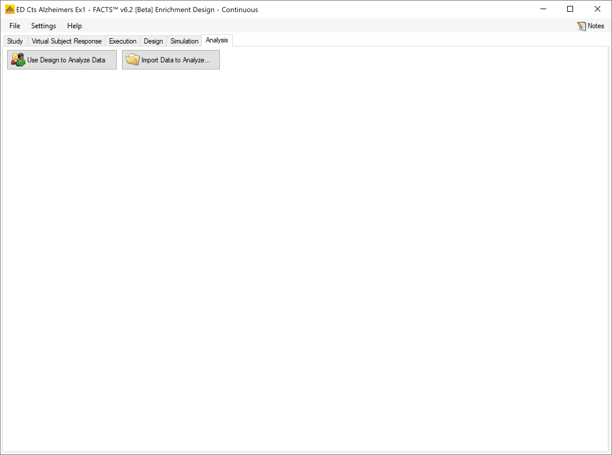

Figure 1: The blank analysis tab.

## Dichotomous

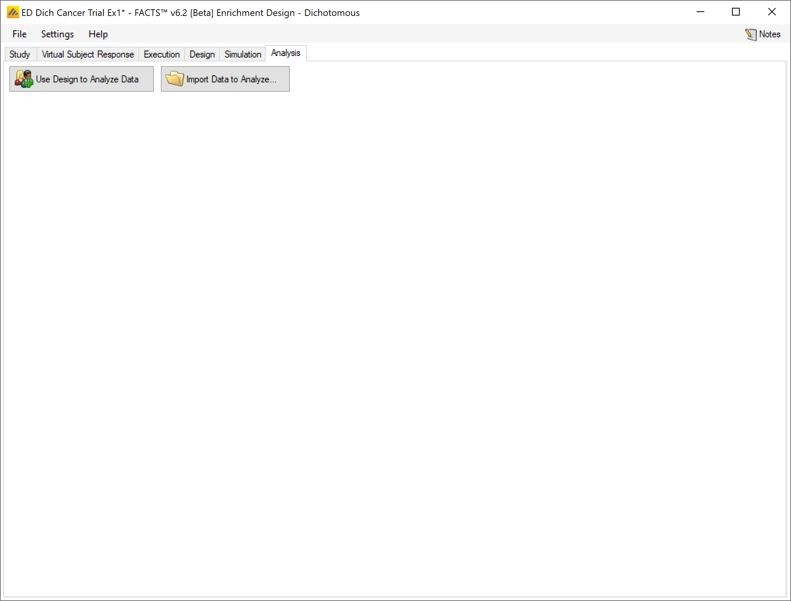

Figure 2: The blank analysis tab.

## Time-to-Event

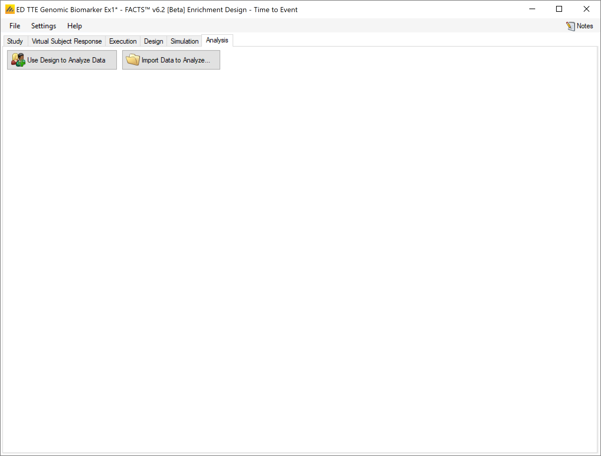

Figure 3: The blank analysis tab.

Clicking on the “Use Design to Analyze Data” button, will create an empty “subject.csv” file in the main simulation results directory and an ‘Analysis’ sub-directory there for running the analysis and saving the outputs.

Alternatively, clicking on the “Import Data to Analyze” launches a file browser, allowing the user to select a ‘.csv’ file to load as the data to analyze. This is a shortcut for first clicking on the “Use Design to Analyze Data” button, and then clicking on the “Select File to Create New Analysis” button on the subject data tab.

## Continuous

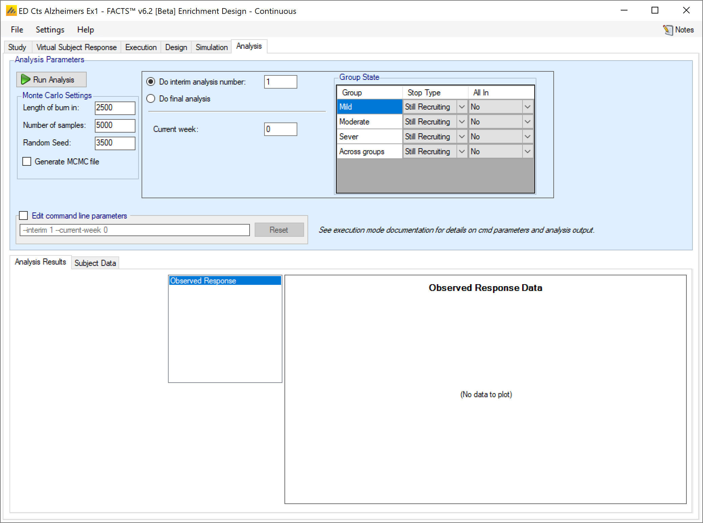

Figure 4: The analysis tab after clicking “Use Design to Analyze Data”.

## Dichotomous

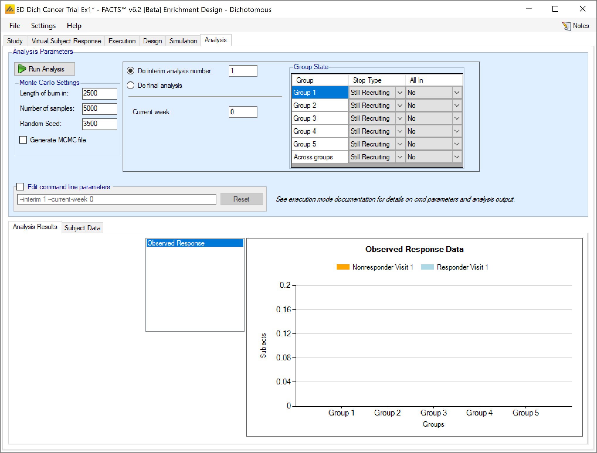

Figure 5: The analysis tab after clicking “Use Design to Analyze Data”.

## Time-to-Event

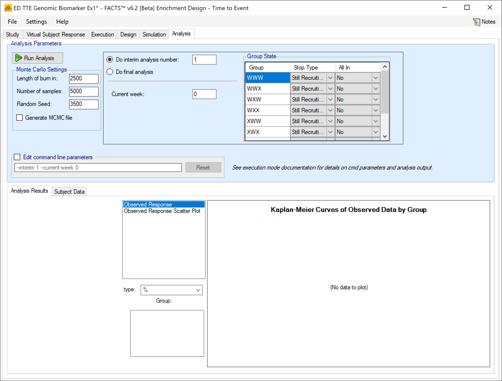

Figure 6: The analysis tab after clicking “Use Design to Analyze Data”.

After enabling data analysis, the analysis screen is shown with no data loaded. By clicking on the “Subject Data” tab the user is now able to enter data values directly, or to load a ‘.csv’ file already containing data:

## Continuous

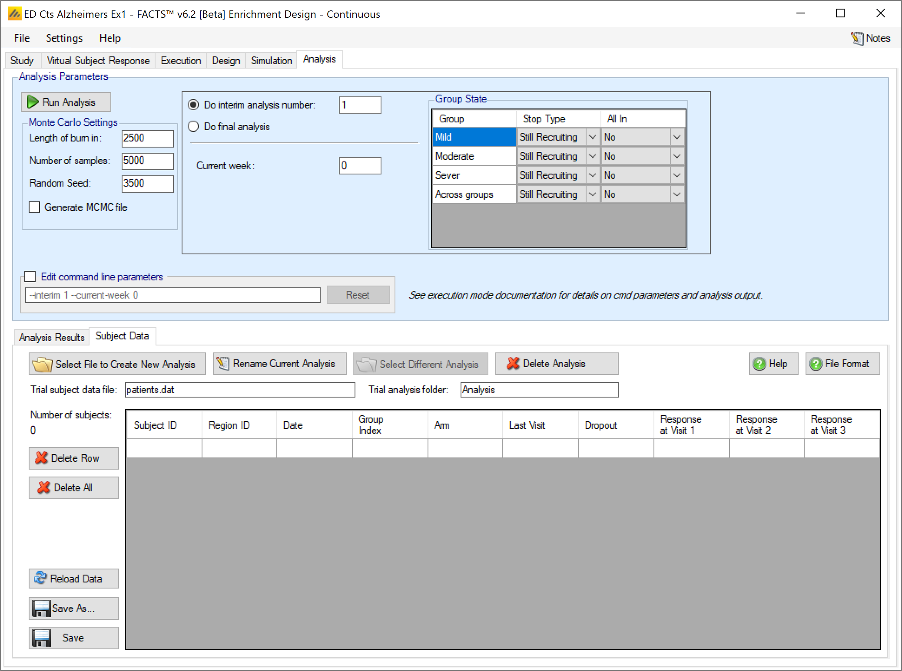

Figure 7: The analysis tab when selecting a file to use in the analysis.

## Dichotomous

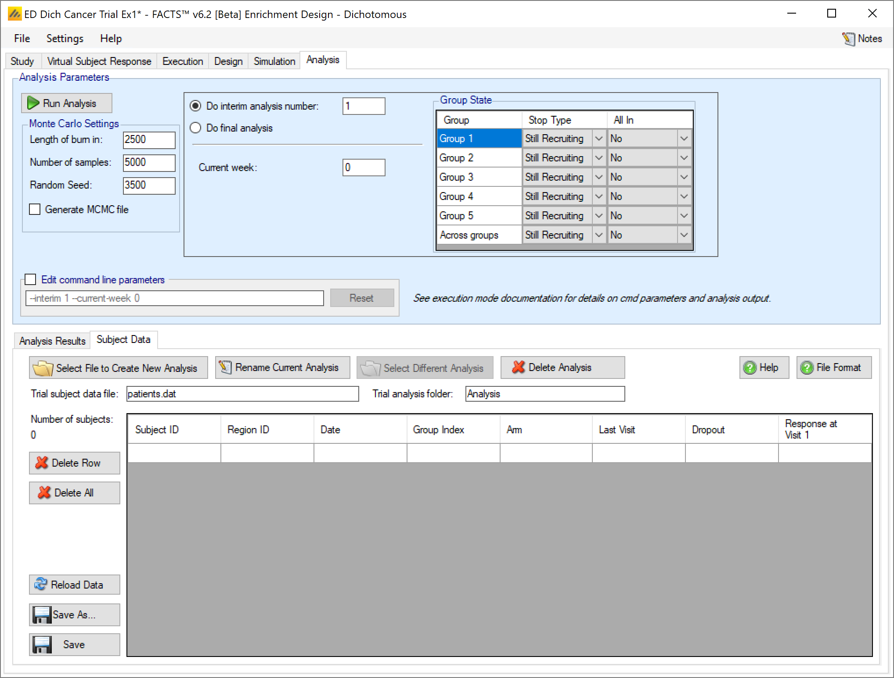

Figure 8: The analysis tab when selecting a file to use in the analysis.

## Time-to-Event

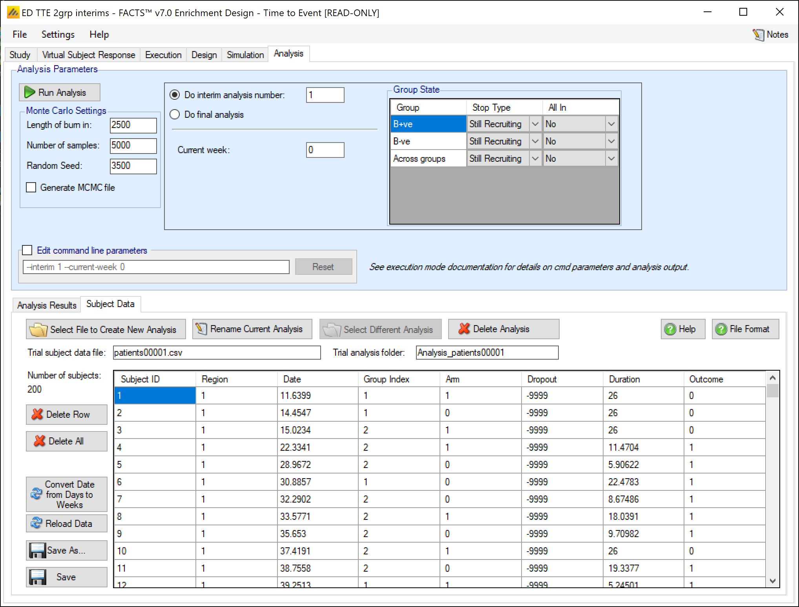

Figure 9: The analysis tab when selecting a file to use in the analysis.

# Entering the data directly

For a typical FACTS Core trial, there are normally too many subjects to want to enter the data directly, but it is possible. Also if data is first loaded from an external file, it is presented in the same grid as that used for data entry and additional data can be added or existing data modified.

The data format is the same as the ‘patientsNNNN.csv’ output file from simulations, so it is easy to use these as the basis for a trial analysis.

## Continuous

Subject ID  
FACTS does not use this value, it is there to allow the data to be cross-referenced to an external data source. If not required there is no harm simply entering ‘1’ on each row.

Region ID  
Region ID is a value output from FACTS simulation, reflecting the recruiting region the simulated subject was recruited in. It is not used in analysis, if a region ID is not available there is no harm simply entering ‘1’ for each subject.

Date  
Date is a real number indicating when the subject was recruited in weeks This value is in weeks from FACTS 7.0 onwards - before that it was in days. from the start of the trial. It is output from FACTS simulation, it is not used in analysis. If a date is not available there is no harm simply entering ‘1’ for each subject.

Arm  
Arm indicates which arm the subject was randomized to: ‘0’ indicates Control, ‘1’ indicates Treatment.

Group Index  
Group Index indicates which group the subject presented in. The index of each arm is visible on the Study \> Study Info tab.

Last Visit#  
Last Visit# is the index of last visit for which there is data for the subject. Previously FACTS could not process data with data missing from visits before the last visit. From FACTS 6.2 this is now possible. Visits for which no data is available should be given the value “-9999”. Data supplied for a subject’s visits after ‘Last Visit#’ is ignored.

Dropout  
Dropout is a flag, value ‘0’ (not dropped out) or ‘1’ (dropped out). For a subject that has dropped out, FACTS will apply the defined value for the subject from the ‘Last Visit#’.

Visit1, …  
These are the subjects response values at the defined visits (on the Study tab), up to and including the final visit. -9999 should be entered to indicate missing data – values for visits after a subjects ‘Last Visit’ are ignored and entering -9999 is not essential – but it is clearer.

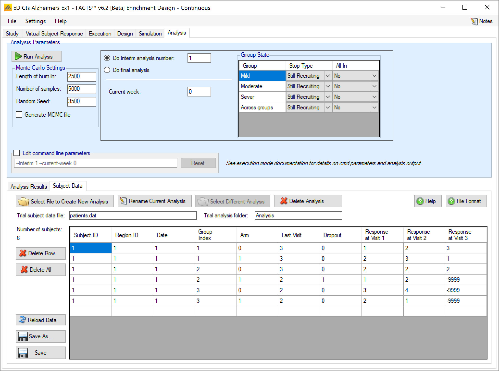

Figure 10: Manually entered subject data, ready for analysis.

## Dichotomous

Subject ID  
FACTS does not use this value, it is there to allow the data to be cross-referenced to an external data source. If not required there is no harm simply entering ‘1’ on each row.

Region ID  
Region ID is a value output from FACTS simulation, reflecting the recruiting region the simulated subject was recruited in. It is not used in analysis, if a region ID is not available there is no harm simply entering ‘1’ for each subject.

Date  
Date is a real number indicating when the subject was recruited in weeks This value is in weeks from FACTS 7.0 onwards - before that it was in days. from the start of the trial. It is output from FACTS simulation, it is not used in analysis. If a date is not available there is no harm simply entering ‘1’ for each subject.

Arm  
Arm indicates which arm the subject was randomized to: ‘0’ indicates Control, ‘1’ indicates Treatment.

Group Index  
Group Index indicates which group the subject presented in. The index of each arm is visible on the Study \> Study Info tab.

Last Visit#  
Last Visit# is the index of last visit for which there is data for the subject. Previously FACTS could not process data with data missing from visits before the last visit. From FACTS 6.2 this is now possible. Visits for which no data is available should be given the value “-9999”. Data supplied for a subject’s visits after ‘Last Visit#’ is ignored.

Dropout  
Dropout is a flag, value ‘0’ (not dropped out) or ‘1’ (dropped out). For a subject that has dropped out, FACTS will apply the defined value for the subject from the ‘Last Visit#’.

Response at Visit1, …  
These are the subjects response: ‘0’ for no response, ‘1’ for a response, at the defined visits (on the Study tab), up to and including the final visit. -9999 should be entered to indicate missing data – values for visits after a subjects ‘Last Visit’ are ignored and entering -9999 is not essential – but it is clearer.

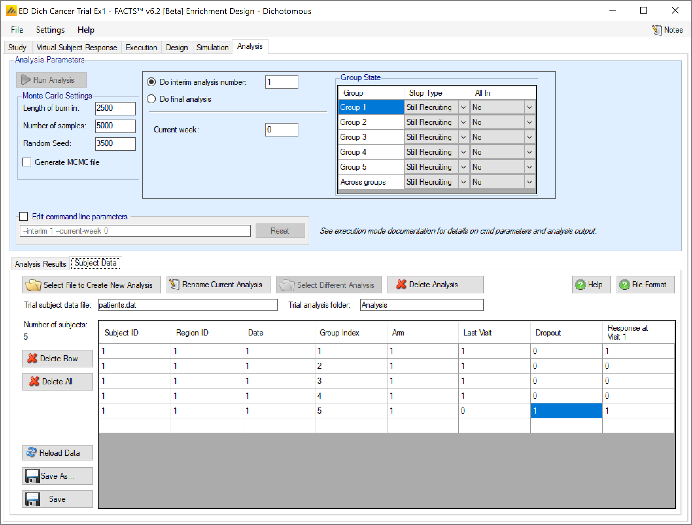

Figure 11: Manually entered subject data, ready for analysis.

## Time-to-Event

Subject ID  
FACTS does not use this value, it is there to allow the data to be cross-referenced to an external data source. If not required there is no harm simply entering ‘1’ on each row.

Region ID  
Region ID is a value output from FACTS simulation, reflecting the recruiting region the simulated subject was recruited in. It is not used in analysis, if a region ID is not available there is no harm simply entering ‘1’ for each subject.

Enrollment time  
Enrollment time, is a real number indicating when the subject was recruited in weeks This value is in weeks from FACTS 7.0 onwards - before that it was in days. from the start of the trial. It is output from FACTS simulation, it is not used in analysis. If a date is not available there is no harm simply entering ‘1’ for each subject.

Date  
Date is a real number indicating when the subject was recruited in weeks This value is in weeks from FACTS 7.0 onwards - before that it was in days. from the start of the trial. It is output from FACTS simulation, it is not used in analysis. If a date is not available there is no harm simply entering ‘1’ for each subject.

Arm  
Arm indicates which arm the subject was randomized to: ‘0’ indicates Control, ‘1’ indicates Treatment.

Group Index  
Group Index indicates which group the subject presented in. The index of each arm is visible on the Study \> Study Info tab.

Unused  
Unused. This value is unused, but a value must be supplied.

Duration  
Duration, is the current time for which the subject has been observed, in weeks.

Outcome  
Outcome, is whether an event has been observed or not for this subject. If the primary event has been observed, then ‘Duration’ should be the time to that event from the start of observation of the subject.

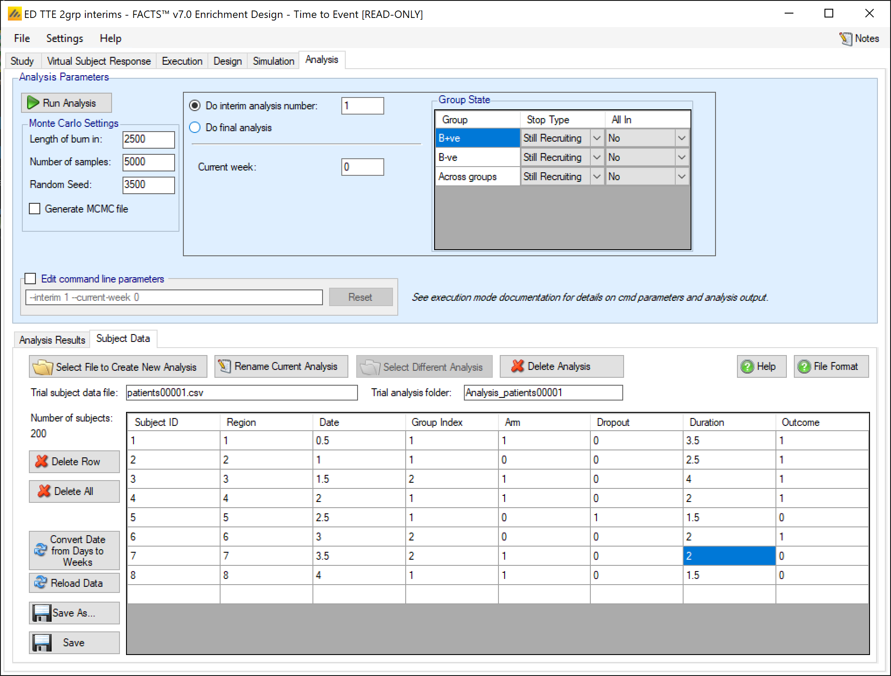

Figure 12: Manually entered subject data, ready for analysis.

If data is entered and then ‘Run Analysis’ clicked, the data is saved to a file called ‘patients.dat’ and the analysis results saved to a folder called ‘Analysis’ within the “\_results” folder of the design.

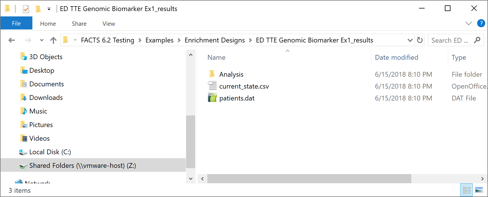

Figure 13: Windows file explorer showing the results folder when doing and analysis.

The ‘Save As’ button can be used to save the file with a different name, but it will still be saved within the \_Results folder.

A specific results folder is also created, called ‘Analysis\_\<file name\>’.

# Loading Data From a File

As well as entering the data via FACTS its possible to load the data from a ‘subject.csv’ file. These can be created within FACTS or outside of FACTS and once created can be edited FACTS or outside of FACTS.

## The subject.csv file format

The file is a simple ascii file with the different data items separated by commas. Any line starting with ‘#’’ is ignored, here we use that to include a header row. The data may also include spaces to aid readability (but **not**, currently, tabs). Each line defines the dose given to a single subject and that subject’s response.

The format of the file is the same as the ‘patientsNNNN.csv’ output file ([continuous](../../../../documentation/v82/userguides/enrichment/simulation/continuous.llms.md#contents-of-patientsnnnnn.csv), [dichotomous](../../../../documentation/v82/userguides/enrichment/simulation/dichotomous.llms.md#contents-of-patientsnnnnn.csv)), or [time-to-event](../../../../documentation/v82/userguides/enrichment/simulation/tte.llms.md#contents-of-patientsnnnnn.csv)) and the column values described above.

## Converting arrival date value from days to weeks

From FACTS 7.0 the value in the Date field is interpreted as being in weeks (rather than days as in previous versions). If you have existing data, a simple conversion tool is provided “Convert Date from Days to Weeks” that simply divides all of thete values by 7. Having run the conversion, you then need to save the modified data. The values of the Date field will only make a difference to TTE analyses.

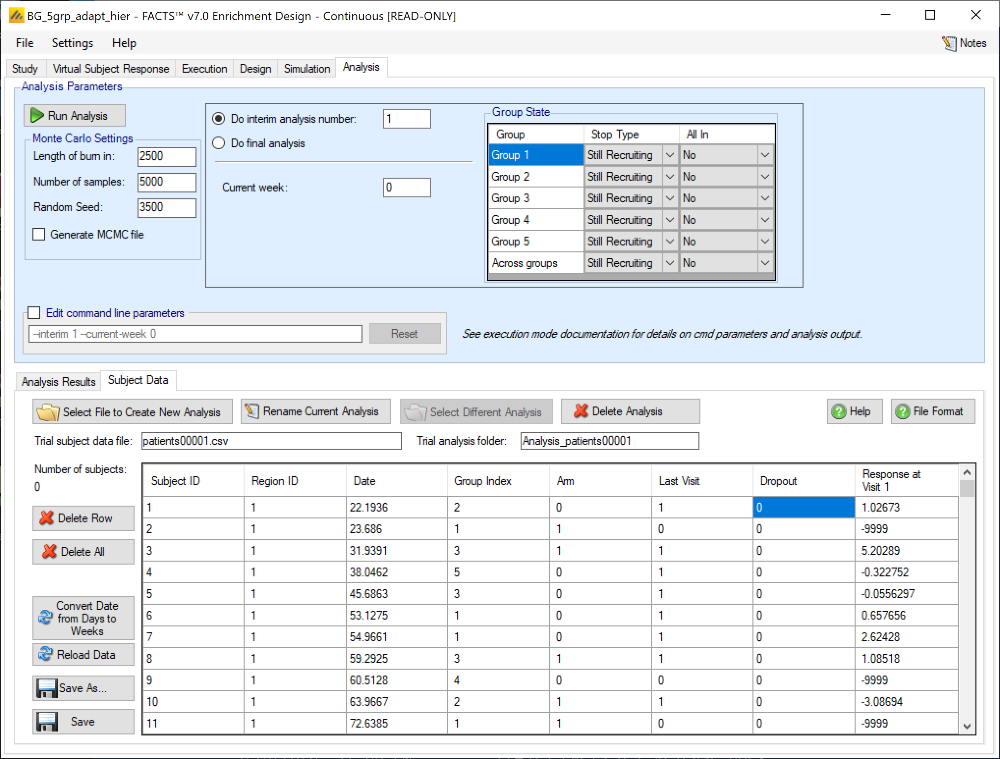

Figure 14: The data as provided to the analysis tab with dates in days.

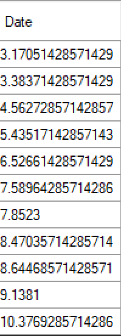

Figure 15: The same dates, but converted to weeks.

# Data file management on the Analysis tab

From FACTS 6.2 onwards FACTS now supports multiple subject data files and analysis folders.

Buttons that allow the subject data file to be changed:

- ’Select File to Create New Analysis: launches a file browser that allows the user to select a new “.csv” file from any location. The selected file is copied to the “\_Results” folder (retaining its current name) and made the current subject data file.

- ‘Rename Current Analysis’ allows the name of the current subject data file to be changed.

- ‘Select Difference Analysis’ allows a different subject data file that is in the “\_Results” folder to be made the current subject data file.

- ‘Delete Analysis’ allows any of the subject data files that are in the “\_Results” folder to be deleted.

The name of the current subject data file and the name of the corresponding analysis folder are shown below the subject data file buttons.

There are five buttons that allow the currently loaded subject data file to be modified:

- ‘Delete Row’ deletes the currently selected row in the data grid. The data in the current subject file is not updated unless the current data is saved.

- ‘Delete All’ clears all the data in the data grid. The data in the current subject file is not updated unless the current data is saved.

- ‘Reload data’ replaces the data in the data grid with the data that is still in the current subject data file.

- ‘Save As’ saves the current data in the data grid to a new subject data file in the “\_Results” folder, and makes that the current subject data file.

- “Save” saves the current data in the data grid to the current subject data file.

Running an analysis performs a ‘Save’ before running the analysis.

# Running an Analysis

Once data has been loaded or entered, the user can click the ‘Run Analysis’ button.

Once the analysis has run, FACTS displays the recommendation, and a graph showing the data.

## Continuous

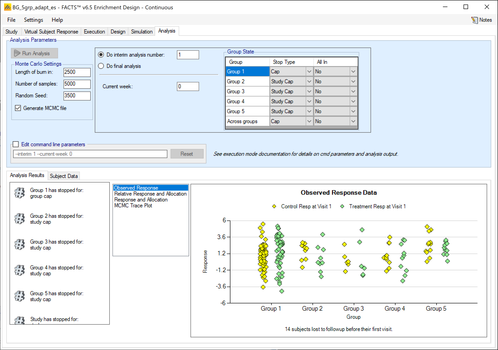

Figure 16: The Analysis tab after running the analysis. The trial result is in the box to the left - the success criteria have been met. The observed response distributions are shown in the plot on the right.

## Dichotomous

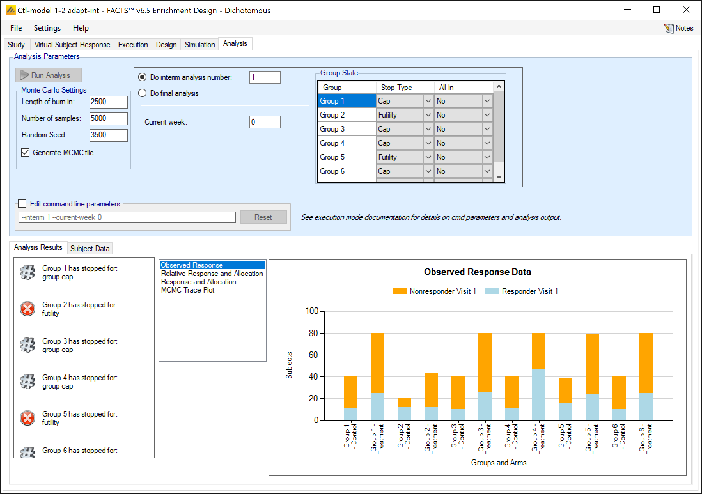

Figure 17: The Analysis tab after running the analysis. The trial result is in the box to the left - no interim stopping criteria have been met. The observed response rates are shown in the plot on the right.

## Time-to-Event

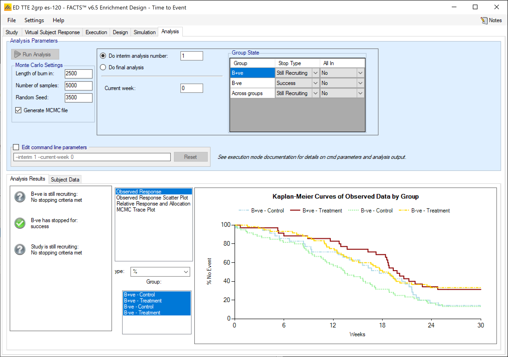

Figure 18: The Analysis tab after running the analysis. The trial result is in the box to the left - no interim stopping criteria have been met. The kaplan-meier curves show the observed data on the right side of the tab.

# Analysis Options

At the top of the analysis tab there are various parameters that can be set to control the analysis performed:

## Continuous

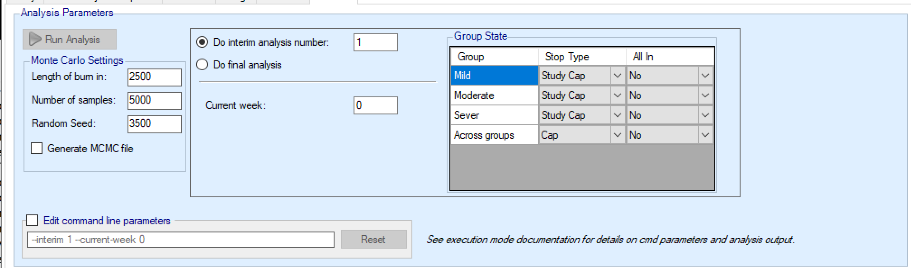

Figure 19: The Analysis options section of the Analysis tab. This is an arm dropping design, so there is an option to choose which arms are still active in the trial.

## Dichotomous

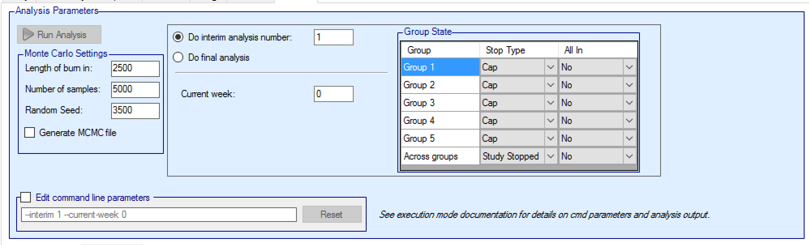

Figure 20: The Analysis options section of the Analysis tab.

## Time-to-Event

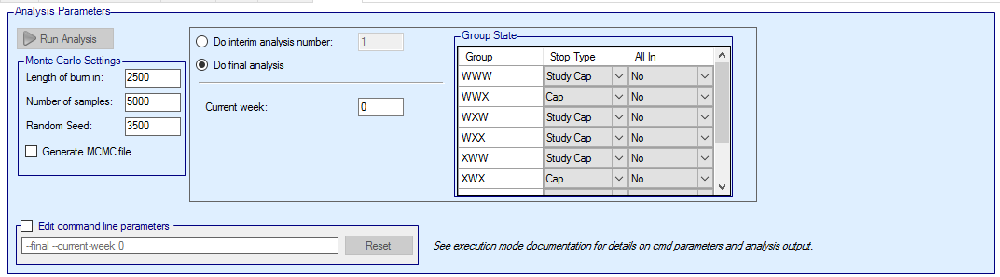

Figure 21: The Analysis options section of the Analysis tab.

- The MCMC parameters

  - “Burn-in” for the number of initial samples that are discarded

  - “Length” for the number of samples drawn to form the posterior distributions

  - Random number seed that can be set to generate a different sampling sequence

  - Generate MCMC file causes FACTS to write out the full record of the MCMC samples of the analysis (which enables the ability to view sample history graphs for the model parameters).

  - Edit command line parameters allows expert users to enter command line parameters to be passed to the design engine that are not settable through this panel.

  - The user specifies which interim the analysis is for and hence which decision criteria to be applied

    - The user supplied the interim analysis number or

    - Selects “Do Final Analysis” which causes the analysis to use the final evaluation success/futility criteria.

  - The user specifies the current week of the trial if the amount if information defined by “opportunity to complete” – otherwise the control is disabled.

  - It is possible to flag which if any, groups have stopped and hence to be excluded from future adaptation decisions, but included in the analysis and which groups have all their information (every subject in the group has had their final visit, has dropped out or is no longer being followed up).
