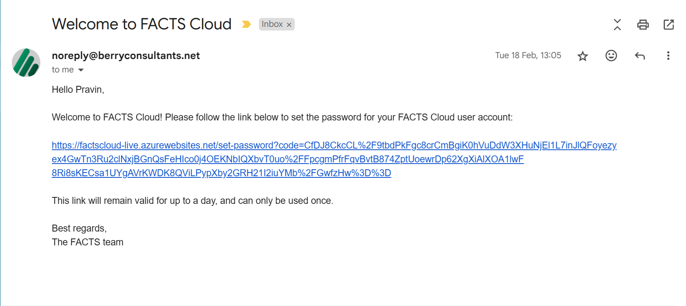
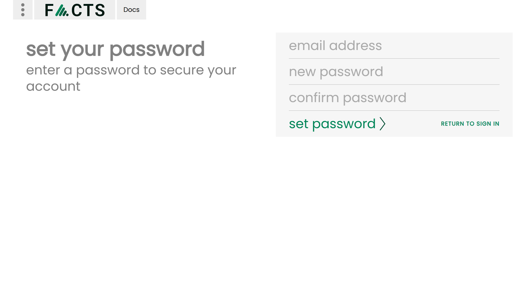
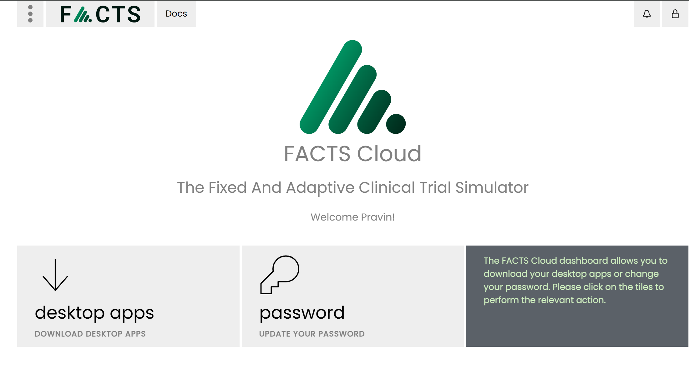
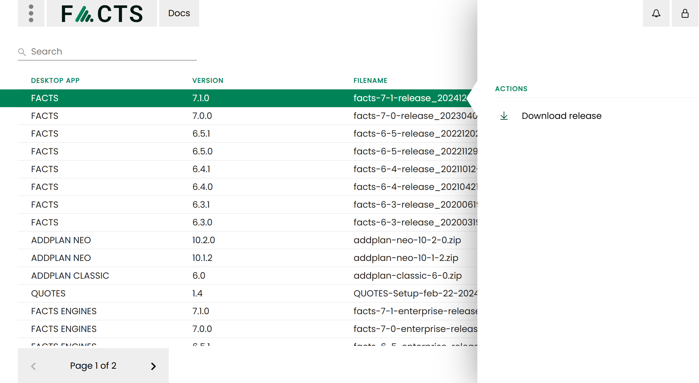

# Introduction

## Purpose and Scope of this document

This document provides download instructions for all new releases of Berry software; including, the FACTS desktop app installer, FACTS engine executable, FACTS HPC app, ADDPLAN Classic, ADDPLAN Neo and QUOTES. This assumes that you currently have a software license agreement with Berry Consultants, or that you have already gotten in touch with Berry Consultants for a software evaluation. If this is not the case, please get in touch with us by clicking [here](../../contact/index.llms.md). Details about all the software we provide can be found [here](https://www.berryconsultants.com/software/).

# Registration with FACTS Cloud

## Registration email

All Berry software releases are hosted on FACTS Cloud, our cloud-hosted web application. The URL for FACTS Cloud can be found [here](https://facts.berryconsultants.com). You will first be receiving an email from noreply@berryconsultants.net to register with FACTS Cloud as shown below.

Figure 1

The link in the email will remain valid for up to a day, and can only be used once. Note that this is a one time operation: once registered with FACTS Cloud, you will never need to re-register again. Please do not reply to this registration email, as replies are not tracked.

## Set password

When clicking on the registration email link, you will be navigated to the FACTS Cloud password setting screen as shown below.

Figure 2

Within the email address field, as an additional security measure, you will need to re-enter exactly the same email address that the FACTS Cloud registration email was sent to. The password will need to be at least 8 characters long, contain lower and upper case characters, contain digits and non-alphanumeric characters.

# Desktop app download

Once a valid password has been entered, click on “set password” and you will then be navigated to the FACTS Cloud Dashboard as shown below. On the dashboard you can, as the tiles indicate, change your password associated with FACTS Cloud or view the list of all desktop app releases available to you.

Figure 3

Figure 4

Clicking on the “desktop apps” tile will navigate you to the listing of desktop app releases. Click on the relevant desktop app release and select “Download release” on the right-hand panel as shown below. Note that it may take a minute or so for the desktop app to finish downloading. Unzip the resulting download onto your desktop, say, and proceed with its installation. For FACTS installations, please see [here](../../introduction/gettingStarted/installation.llms.md).
