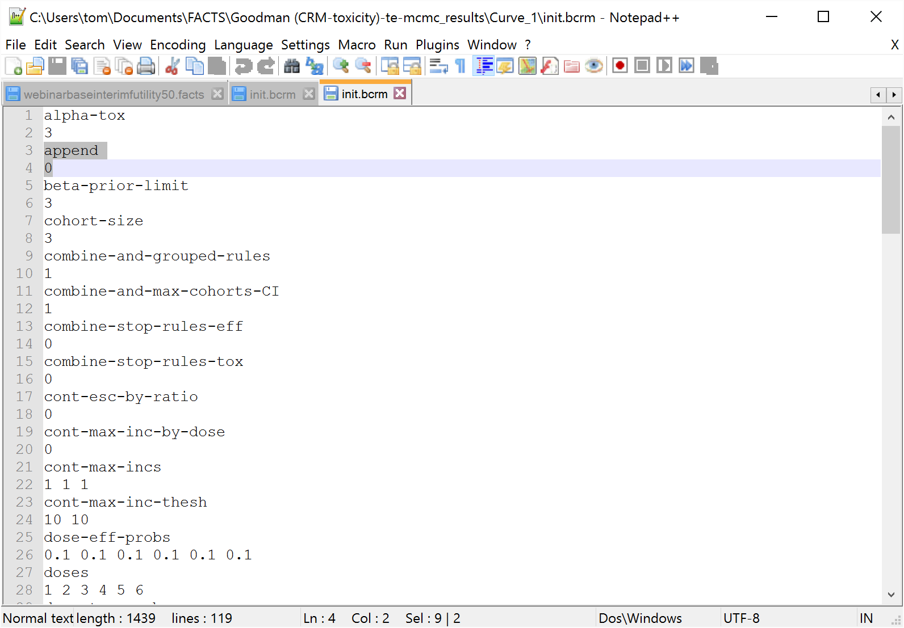
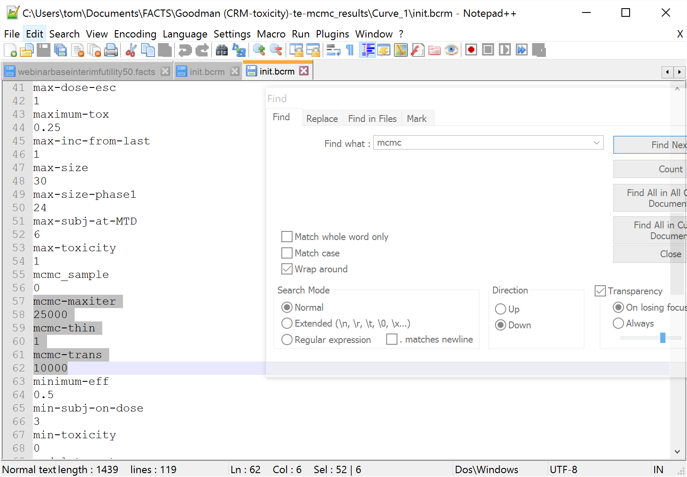
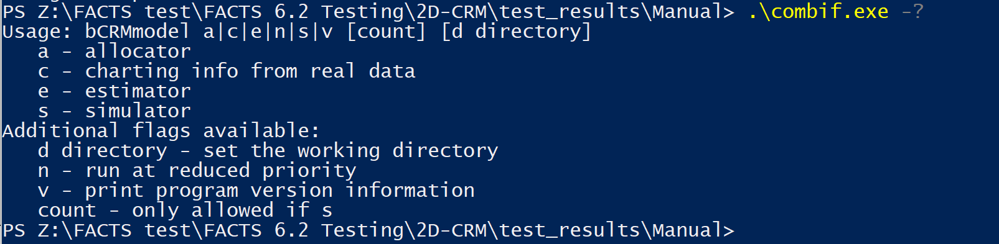

#  Introduction

## Purpose of this document

This document describes how to use the FACTS Dose Escalation design engine to analyze a supplied data set. It describes how to run the design engine so that it analyzes the current trial data and outputs the recommended dose for the next cohort.

## Scope of this document

This document covers the Dose Escalation Fixed and Adaptive Clinical Trial Simulator design engine software by describing its use in support of an actual trial. It does not cover any use of the FACTS GUI, which is described elsewhere \[SUG\]. It does not describe the algorithms or explain the meaning of all parameters, both of which are addressed in the Design Engine Specification (SPEC).

## Context of this issue

This document is a guide to the FACTS V7 release of Dose Escalation, which includes 3+3, mTPI, CRM (Toxicity), CRM (Ordinal), CRM (Efficacy), bCRM (Bivariate -- both efficacy and toxicity), N-CRM ("New CRM", based on Beat Neuenschwander's paper using toxicity intervals) and 2D-CRM (dose escalation in 2 drugs) Design Engines.

## Conventions

Throughout this document, commands to be issued at the command prompt, and paths to folder locations will be written in bold Courier font ( eg. **cd C:\\Documents And Settings** )

## Definition of Terms

The following acronyms and abbreviations are used in this document.

+--------+-------------------------------------------------------------------------------------------------------------------------------------+
| UG     | The User Guide, describes how to use the system.                                                                                    |
+--------+-------------------------------------------------------------------------------------------------------------------------------------+
| SPEC   | The Design Engine Specification document, describes the system software requirements, system algorithms, and meaning of parameters. |
+--------+-------------------------------------------------------------------------------------------------------------------------------------+
| FACTS | Fixed and Adaptive Clinical Trial Simulator                                                                                         |
+--------+-------------------------------------------------------------------------------------------------------------------------------------+
| DF     | Dose Finding, one of the three modes of FACTS                                                                                       |
+--------+-------------------------------------------------------------------------------------------------------------------------------------+
| DE     | Dose Escalation, one of the three modes of FACTS                                                                                    |
+--------+-------------------------------------------------------------------------------------------------------------------------------------+

# Installation/uninstall

The design engine is a simple command line program that requires no complex installation. It is supplied in a simple 'Zip' archive from which it should be simply extracted to an easy to locate directory.

For example:

**C:\\Program Files\\Berry Consultants\\FACTS 7.1.0\\bin**

This places it in a subdirectory ('**bin**') in the standard FACTS install directory.

For the different dose escalation types, just 2 files are required, called 'combiF.exe' for the 2D-CRM and 'bCRM.exe' for all the others.

There are no complex uninstall instructions. To remove the engine from the system, simply delete the engine executable.

# Installation Verification Procedure

## bCRM.exe

The outputs from a simulation can be used to run the design engine in 'simulator' and 'allocator' modes. The simulator mode is run as a simple check of the installation.

- Create a new, empty directory to carry out the installation verification.

- Open Windows Explorer and navigate to the location of a FACTS project using the Dose Escalation design engine that has some simulation results. If you do not have such a directory, run FACTS and follow the Dose Escalation tutorial for a simple toxicity example up to the point that the first simulations have been run, and use the directory you have created.

Only a single simulation is required.

In the projects 'data' directory, there is a directory called 'Results', and within that there is a directory for every scenario simulated:

Figure 1 - FACTS project folder structure

- From one of those directories, copy the init.bcrm file and paste it into the installation verification directory.

- Open a command prompt window (Choose **Start \> All Programs \> Accessories \> Command Prompt**) and change the current working directory so that it is the installation verification directory.

- Enter the command: **bcrm.exe s 1**

This assumes a copy of the design engine has been placed in the directory, alternatively the design engine can be invoked from the directory where you extracted it, for instance:

- **C:\\Program Files\\Berry Consultants\\FACTS 7.1.0\\bin\\bcrm.exe s 1**

This command should cause a single simulation to be run and if it runs successfully it will create the following files in the installation verification directory:

``` text
cohorts001.csv
doses.csv
rvseed.upd
simulations.csv
summary.csv
```

## combiF.exe

The outputs from a simulation can be used to run the design engine in 'simulator' and 'allocator' modes. The simulator mode is run as a simple check of the installation.

- Create a new, empty directory to carry out the installation verification.

- Open Windows Explorer and navigate to the location of a FACTS project using the Dose Escalation design engine that has some simulation results. If you do not have such a directory, run FACTS and follow the Dose Escalation tutorial for a simple toxicity example up to the point that the first simulations have been run, and use the directory you have created.

Only a single simulation is required.

In the projects 'data' directory, there is a directory called 'Results', and within that there is a directory for every scenario simulated:

Figure 2 - FACTS project folder structure

- From one of those directories, copy the init.combi file and paste it into the installation verification directory.

- Open a command prompt window (Choose **Start \> All Programs \> Accessories \> Command Prompt**) and change the current working directory so that it is the installation verification directory.

- Enter the command: **combiF.exe s 10**

This assumes a copy of the design engine has been placed in the directory, alternatively the design engine can be invoked from the directory where you extracted it, for instance:

- **C:\\Program Files\\Berry Consultants\\FACTS 7.1.0\\bin\\combiF.exe s 10**

This command should cause a single simulation to be run and if it runs successfully it will create the following files in the installation verification directory:

``` text
cohorts001.csv
simulations.csv
summary.csv
rvseed.upd
```

# Choosing the dose for the next Cohort using 'bcrm.exe'

For any of the 'single drug' designs, the actual dosing recommendations during the trial can be computed using 'bcrm.exe'.

## Input files

init.bcrm Parameter input file containing all design parameters for the trial execution

subject.csv Comma separated data file containing subject response data for the trial

subject2.csv Only required for 2 group designs, similar to subject.csv but for second group

lastMTD.txt Only required for designs with both toxicity and efficacy and only after the first cohort has been randomized; used to store dose index of last MTD allocation between executions. NB The value is a zero based index,

lastMTD2.txt As for lastMTD.txt but for the second group.

state33.txt Only required in 3+3

To be able to perform a run with the dose escalation design engine, a subject.csv file is required in addition to the init.bcrm file. The init.bcrm file should come from a FACTS simulation directory where the design for the trial was simulated. It does not matter what the scenarios were that were being simulated, these parameters will be ignored because there is actual data to be used. Typically, the Monte Carlo parameters "mcmc-trans" (the MCMC burnin), and "mcmc-maxiter" (number of MCMC samples) should be adjusted when executing an actual trial. Smaller default values are used during trial design to limit simulation times, but should be increased for improved statistics during trial execution. Monte Carlo parameters do not apply to 3+3 designs.

The MCMC parameters can be modified on the Simulations tab on the dialog that is displayed when "MCMC Settings" is clicked.

For efficacy only trials where extra subjects are being allocated to the maximum and minimum doses, init.bcrm must be edited to ensure that append is set to 1, i.e. it contains the line:

- **append 1**

This will ensure that each randomization uses the random seeds updated by the previous run and so allocation to the maximum and minimum doses are truly random. When append=0, the rv-seed parameters from the init.bcrm parameter file are used as the starting point for each execution.





**N.B. -- With the exception of "mcmc-trans", "mcmc-maxiter" and "append", no other parameters in the init.bcrm file should be modified during execution of the design engine. Some parameter validation from the FACTS GUI is not repeated in the design engine, and changing parameters could produce misleading results.**

The subject.csv file is a comma separated text file, which for purely historical reasons has (for our purposes) a number of redundant fields. The values in columns 2-6 should be left blank.

| `#Patient ID,` | `Patient Initials,` | `Year,` | `Month,` | `Day,` | `Time,` | `Cohort,` | `Dose,` | `Tox,` | `Eff` |
|-----------|---------------|-----|------|-----|-----|-------|-----|-----|------------|

``` text
1, , , , , , 1, 1, 0, 0
2, , , , , , 2, 2, 0, 0
3, , , , , , 3, 3, 0, 0
4, , , , , , 4, 4, 1, 0
5, , , , , , 5, 3, 0, 0
6, , , , , , 5, 3, 0, 0
7, , , , , , 5, 3, 0, 0
8, , , , , , 6, 4, 0, 0
9, , , , , , 6, 4, 0, 0
10, , , , , , 6, 4, 0, 0
11, , , , , , 7, 4, 0, 0
12, , , , , , 7, 4, 0, 0
13, , , , , , 7, 4, 0, 0
```

(The file above has had a 'tab' inserted before each value to aid readability. This is not required in the actual file. It is recommended that Excel be used to create the file, saving it as 'csv'.)

**N.B. The "Dose" is the index of the treatment arm (see the Study \> Treatment Arms tab) allocated to each subject, except in N-CRM where "Dose" is the Dose Strength which replaces "Dose Index" -- (again see the Study \> Treatment Arm tab).**

Efficacy and toxicity data is not used for all design types. When one of these response columns is not used, the values for that column may all be set to 0, but still must be supplied. Responses used for each design are:

3+3 Tox only

CRM (Toxicity) Tox only

N-CRM Tox. If using ordinal toxicity, the value must be the category (i.e. 1, 2, 3 or 4) rather than the normal 0 or 1.

If efficacy is included, it must also be set.

bCRM Tox & Eff

CRM (Efficacy) Eff only

Ordinal Tox only. NB Tox must contain the toxicity category (i.e. 1, 2, 3 or 4) rather than the 0 or 1 used by the other versions.

The 'subject2.csv' file has identical formatting and supplies the response data for the second group.

### lastMTD.txt and lastMTD2.txt

Finally, in addition to 'subject.csv', a **'lastMTD.txt**' file is required when running a bCRM trial. This file is needed when fitting toxicity and efficacy because the last cohort may have been allocated to the MED and therefore cannot be used in determining the maximum allowed dose for MTD. The file will be created automatically when the engine is run in 'allocator' mode with an empty subject.csv file at the start of a trial. From then on, the file must be present and must contain a valid dose index. The file is not necessary and will not be created when running toxicity or efficacy only trials. To create the file manually, right-click in the execution directory and select '**New \> Text Document'**. Rename the new file 'lastMTD.txt'. Then edit the file to contain the zero based index of the last cohort targeted at the MTD. Thus if the doses are 10, 15, 20, 30, 50 and the last cohort allocated to MTD was at dose 20, the file should contain 2. However, in general this file should not be altered outside of engine execution.

lastMTD2.txt is identical to lastMTD.txt except that it is used for group 2. It is therefore only required in N-CRM with both efficacy and two groups enabled.

### state33.txt

If running 3+3, state33.txt is used to keep track of what happened last.

If starting 3+3 with zero subjects, state33.txt will be created automatically. It only needs to be created manually, if starting part way through the trial. Once it exists, it will be updated automatically.

It contains a single number:

- 0=No cohorts yet (assumed if state33.txt is missing);

- 1=Normal allocation;

- 2=Last cohort was a confirmation cohort (i.e. the dose was repeated);

- 3=Last cohort was a validation cohort (i.e. it de-escalated)

## Running the design engine

The available command line options can be displayed by running the command:

> **D:\\My FACTS\\EngineTesting\>bcrm -?**

> **Usage: bCRMmodel a\|c\|e\|f\|n\|s\|v \[count\] \[d directory\]**

> **a - allocator**

> **c - charting info from real data**

> **e - estimator**

> **s - simulator**

> **Additional flags available:**

> **d directory - set the working directory**

> **f -- force small cohort run-in to end**

> **n - run at reduced priority**

> **v - print program version information**

> **count - only allowed if s**

+-------------------------+----------------------------------------------------------------------------------------------------------------------------------------------------+
| Command line argument   | Description                                                                                                                                        |
+=========================+====================================================================================================================================================+
| s \[count\]             | Simulate mode -- simulate the trial, with the optional argument specifying the number of simulations.                                              |
+-------------------------+----------------------------------------------------------------------------------------------------------------------------------------------------+
| d *dir*                 | Set the working directory to *dir.* Without this option, the default is to use the current directory for the working directory                     |
+-------------------------+----------------------------------------------------------------------------------------------------------------------------------------------------+
| n                       | Run at reduced priority. Simulations can be compute intensive, and running at reduced priority can increase the performance of other applications. |
+-------------------------+----------------------------------------------------------------------------------------------------------------------------------------------------+
| v                       | Print the version number.                                                                                                                          |
+-------------------------+----------------------------------------------------------------------------------------------------------------------------------------------------+
| a                       | Allocate (Trial execution or recommender) mode -- parse subject data file, generate dose.reco file with the next recommended dose.                 |
+-------------------------+----------------------------------------------------------------------------------------------------------------------------------------------------+
| e                       | Estimate mode -- parse subject data file and fit the model, used for validation purposes only                                                      |
+-------------------------+----------------------------------------------------------------------------------------------------------------------------------------------------+
| c                       | Unused                                                                                                                                             |
+-------------------------+----------------------------------------------------------------------------------------------------------------------------------------------------+
| f                       | Force the small cohort run-in to end                                                                                                               |
+-------------------------+----------------------------------------------------------------------------------------------------------------------------------------------------+

## The output files

dose.reco The recommended dose for the next cohort. When run in allocation mode, this file contains the randomized dose for the next cohort, output as the ***0 based index*** of the dose. If an appropriate dose cannot be recommended or the trial should stop, the "Next dose" will be reported as --1.

doses.csv The dose to x-hat mapping.

alloc_out.txt Same output as dose.reco.

rvseed.upd Contains the random number seeds at the end of the run.

The random seeds work as a chain. The initial values are used to generate the next values, which are then used to generate another set, and so on. At the end of the execution, regardless of the value of append, the ending values of the seeds will be written to rvseed.upd. Because the values are updated after each run, this file should be backed up to a safe location following each allocation execution so that your actions can be repeated. Final seed values are also reported in the simulations.csv results file.

At the start of the run, if init.bcrm contains "append 1" and this file exists, it will be read by the program and the seeds used as the starting point for the next run.

If the file does not exist, or "append 0" is set, the rv_seeds in the init.bcrm parameter file will be used as the starting point for the next run.

simulations.csv This has the same format as the simulations file written by FACTS and contains a single row of data representing the current state of the trial.

lastMTD.txt This output file is generated only when both toxicity and efficacy are used and stores the (zero based) index of the last cohort targeted at the MTD.

lastMTD2.txt As lastMTD.txt but for group 2 if it is included.

state33.txt This output file is generated only when executing a 3+3 trial and is used to store a status flag between executions.

# Choosing the dose for the next Cohort using 'combiF.exe'

For a 'two drug' design using 2D-CRM, the actual dosing recommendations during the trial can be computed using 'combiF.exe'.

## Input files

init.combi Parameter input file containing all design parameters for the trial execution

subject.csv Comma separated data file containing subject response data for the trial

To be able to perform a run with the dose escalation design engine, a subject.csv file is required in addition to the init.combi file. The init.combi file should come from a FACTS simulation directory where the design for the trial was simulated. It does not matter what the scenarios were that were being simulated, these parameters will be ignored because there is actual data to be used. Typically, the Monte Carlo parameters "mcmc-trans" (the MCMC burnin), and "mcmc-maxiter" (number of MCMC samples) should be adjusted when executing an actual trial. Smaller default values are used during trial design to limit simulation times, but should be increased for improved statistics during trial execution.

The MCMC parameters can be modified on the Simulations tab on the dialog that is displayed when "MCMC Settings" is clicked.

**N.B. -- With the exception of "mcmc-trans", "mcmc-maxiter", no other parameters in the init.combi file should be modified during execution of the design engine. Some parameter validation from the FACTS GUI is not repeated in the design engine, and changing parameters could produce misleading results.**

The subject.csv file is a comma separated text file, with a line of data per subject, with the following columns:

Subject ID A simple ascending number

Cohort ID The index of the cohort. During the run-in each individual subject/small cohort should have a new index

Dose 1 The index of the dose from the first drug. The doses are indexed from 1.

Dose 2 The index of the dose from the first drug. The doses are indexed from 1.

Toxicity Whether a toxicity was observed for that subject ('1') or not ('0').

Efficacy Unused, set to 0.

An example file:

``` text
#Subject ID,Cohort ID,Dose 1,Dose 2,Toxicity,Efficacy,
1, 1, 1, 1, 0, 0
2, 2, 1, 2, 0, 0
3, 3, 2, 1, 0, 0
4, 4, 1, 3, 1, 0
5, 5, 2, 2, 0, 0
6, 6, 3, 1, 1, 0
7, 7, 2, 2, 0, 0
8, 7, 2, 2, 0, 0
9, 7, 2, 2, 0, 0
10, 8, 2, 2, 0, 0
11, 8, 2, 2, 0, 0
12, 8, 2, 2, 0, 0
13, 9, 1, 3, 0, 0
14, 9, 1, 3, 0, 0
15, 9, 1, 3, 0, 0
16, 10, 1, 4, 1, 0
17, 10, 1, 4, 0, 0
18, 10, 1, 4, 0, 0
19, 11, 1, 4, 1, 0
20, 11, 1, 4, 0, 0
21, 11, 1, 4, 0, 0
22, 12, 2, 3, 1, 0
23, 12, 2, 3, 0, 0
24, 12, 2, 3, 0, 0
26, 13, 2, 3, 0, 0
27, 13, 2, 3, 0, 0
30, 14, 3, 2, 1, 0
31, 14, 3, 2, 1, 0
32, 14, 3, 2, 0, 0
```

(The file above has had a 'tab' inserted before each value to aid readability. This is not required in the actual file. It is recommended that Excel be used to create the file, saving it as 'csv'.)

**N.B. The "Dose" is the index of the treatment arm (see the Study \> Treatment Arms tab) allocated to each subject, except in N-CRM where "Dose" is the Dose Strength which replaces "Dose Index" -- (again see the Study \> Treatment Arm tab).**

Efficacy and toxicity data is not used for all design types. When one of these response columns is not used, the values for that column may all be set to 0, but still must be supplied. Responses used for each design are:

## Running the design engine

The available command line options can be displayed by running the command:



+-------------------------+---------------------------------------------------------------------------------------------------------------------------------------------------------------------------------------+
| Command line argument   | Description                                                                                                                                                                           |
+=========================+=======================================================================================================================================================================================+
| s \[count\]             | Simulate mode -- simulate the trial, with the optional argument specifying the number of simulations.                                                                                 |
+-------------------------+---------------------------------------------------------------------------------------------------------------------------------------------------------------------------------------+
| n                       | Run at reduced priority. Simulations can be compute intensive, and running at reduced priority can increase the performance of other applications.                                    |
+-------------------------+---------------------------------------------------------------------------------------------------------------------------------------------------------------------------------------+
| v                       | Print the version number.                                                                                                                                                             |
+-------------------------+---------------------------------------------------------------------------------------------------------------------------------------------------------------------------------------+
| a                       | Allocate (Trial execution or recommender) mode -- parse subject data file, generate dose.reco file with the next recommended dose and other trial execution output files (see below). |
+-------------------------+---------------------------------------------------------------------------------------------------------------------------------------------------------------------------------------+
| e                       | Estimate mode -- parse subject data file and fit the model, used for validation purposes only (produces the simulations.csv file only)                                                |
+-------------------------+---------------------------------------------------------------------------------------------------------------------------------------------------------------------------------------+
| c                       | unused                                                                                                                                                                                |
+-------------------------+---------------------------------------------------------------------------------------------------------------------------------------------------------------------------------------+
| d \[dir\]               | Set the working directory to dir. Without this option, the default is to use the current directory for the working directory                                                          |
+-------------------------+---------------------------------------------------------------------------------------------------------------------------------------------------------------------------------------+
| \--o \[output-dir\]     | Specify the output directory to place all output files generated from the engine run.                                                                                                 |
+-------------------------+---------------------------------------------------------------------------------------------------------------------------------------------------------------------------------------+

## The output files

dose.reco The recommended dose for the next cohort. When run in allocation mode, this file contains the recommended dose combinations for the next cohort, output as the ***1 based index*** of the dose. There will be an entry for each subject in the next cohort. If an appropriate dose cannot be recommended or the trial should stop, the file will be empty.

rvseed.upd Contains the random number seeds at the end of the run.

The random seeds work as a chain. The initial values are used to generate the next values, which are then used to generate another set, and so on. At the end of the execution, regardless of the value of append, the ending values of the seeds will be written to rvseed.upd. Because the values are updated after each run, this file should be backed up to a safe location following each allocation execution so that your actions can be repeated. Final seed values are also reported in the simulations.csv results file.

At the start of the run, if init.bcrm contains "append 1" and this file exists, it will be read by the program and the seeds used as the starting point for the next run.

If the file does not exist, or "append 0" is set, the rv_seeds in the init.bcrm parameter file will be used as the starting point for the next run.

simulations.csv This has the same format as the simulations file written by FACTS and contains a single row of data representing the current state of the trial, and reports all of the analysis results.

phase.txt This output file reports the phase of the trial going forward:

0 -- run-in

1 -- dose escalation

2 -- trial stopped / complete
