#  Introduction

This tutorial describes an example trial design for an asthma treatment using the FACTS Core Design Engine for a Continuous Endpoint.

For this version of the document, the screenshots are from the 6.3 release of FACTS.

The screenshots provided are approximate and may not reflect the exact layout of the information. The contents of each tab, however, will be consistent with the software.

The designs presented are examples and may not be optimally calibrated.

# Design Features

In this tutorial we create the following designs:

- Design 1: Example file "FEV-fixed (Core Continuous).facts"

  - Fixed design with no adaptations

  - Include 3 doses, a control arm, and an additional comparator arm

  - No dose response modelling; use an independent dose model

  - Combine multiple criteria for the final success and futility evaluation

- Design 2: Example file "FEV-adapt (Core Continuous).facts")

  - Increase to 16 dosing arms from 3 with the fixed design.

  - Dose response modelling using a Sigmoidal Model

  - Longitudinal modelling using data from earlier time points

  - Response adaptive randomization using two equally weighted criteria

  - Possible early stopping for futility using multiple criteria

  - Combine multiple criteria for the final success and futility evaluation

  - Multiple Quantities of Interest (QoIs) to evaluate which to use for dose selection

- Design 3: Example file "FEV-adapt-MED02 (Core Continuous).facts"

  - Change target to the Med with a delta of 0.2

  - Adjust the QoIs

  - Change the adaptive target to the MED with delta 0.2

  - Change the Success/Fuitlity Criteria to use the new target, and adjust thresholds and minimum required information accordingly.

# Case Study: Asthma Treatment

The endpoint is change from baseline in Forced Expiratory Volume in one second (FEV1) after 8-weeks, with intermediate visits observed weekly.

The study treatment can use an adjustable inhaler and so can be set to a wide range of effective strengths. The strength will be set by the unblinded pharmacy before issue, it will not be adjustable by the subject. The adjustable inhaler is only for study purposes, it is not intended as the final product, it is too expensive and carries too greater risk of being incorrectly set or abused.

The 8 week endpoint is sufficient to show efficacy, but not long term safety / tolerability. Thus the aim of the Phase II study is to first make the go / no-go decision to proceed to phase III trials and then to select the effective dosage to test in Phase III. For commercial development the internal goals are that there is a dosage that can demonstrate:

- a 90% probability of being better than the Control by a clinically significant difference (CSD) is 0.10 L in one second FEV,

- and a 90% probability of being better than an Active Comparator.

There is a desire for the effective dosage selected to be the lowest that can achieve these goals.

The treatment arms are: Control, Additional Comparator and 16 active doses to study (assume dose units are 1,2,3,...,16). \[The use of 16 doses does not reflect an actual trial[^1] or a recommendation, but is used in this example to show that, contrary to what might be expected, many doses can be studied effectively and efficiently\].

We will develop 2 designs -- the first a conventional fixed Phase II with a small number of study arms, the second will test a much larger number of study arms using dose response modelling to help manage the multiplicity and response adaptive randomization to ensure we collect enough data at, or close to, the dosage selected.

# Fixed Design -- No Modeling

Start FACTS. Double Click: Core Design: Continuous on the opening screen:

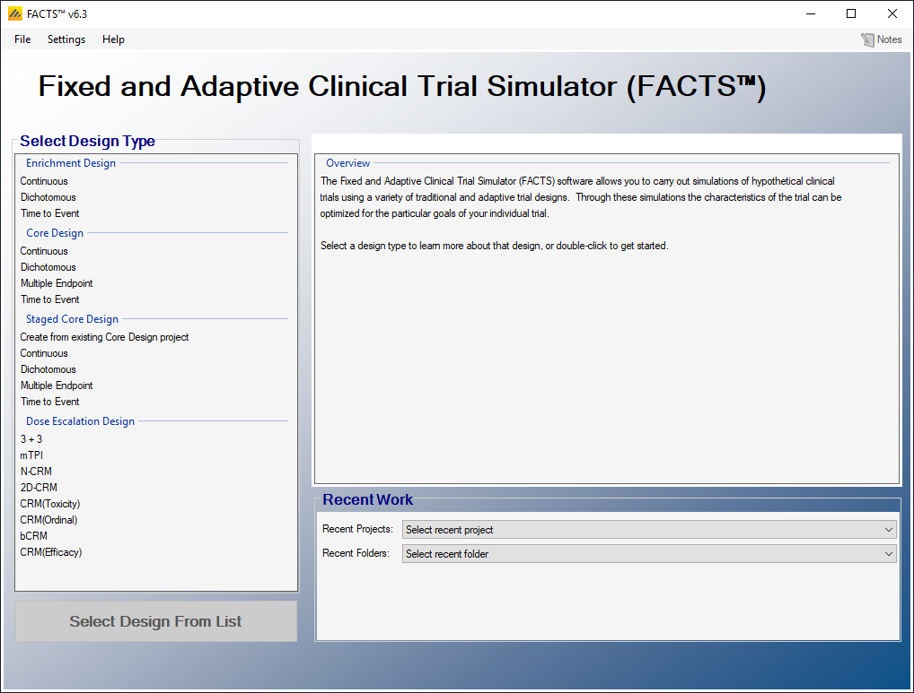

Using the menu option File \> Save As, save this design as FEV-Fixed in a convenient location (e.g. in a folder called FACTS\\FEV-example in your 'My Documents' folder).

We will begin by simulating a Fixed Design, a non-adaptive design, with no dose-response or longitudinal modeling. We will then add modeling and adaptive design elements. The Fixed Design will be a 'straw man' design for comparison to the adaptive design. The Fixed Design will only include 3 of the 16 doses.

## Study

### Study Info

The Study tab captures basic information about the trial. Set the following parameters:

- Select the Non-adaptive option

- Clear the "Use longitudinal model" check box. There will be no adaptation and we assume no dropouts so there is nothing to be gained from having a longitudinal model.

- Set the time to final endpoint to 8 weeks.

- Set the accrual to sequential.

- Set the maximum number of subjects to 360.

- Higher response is subject improvement, indicating that higher change from baseline values are good.

- Select a Superiority Trial type.

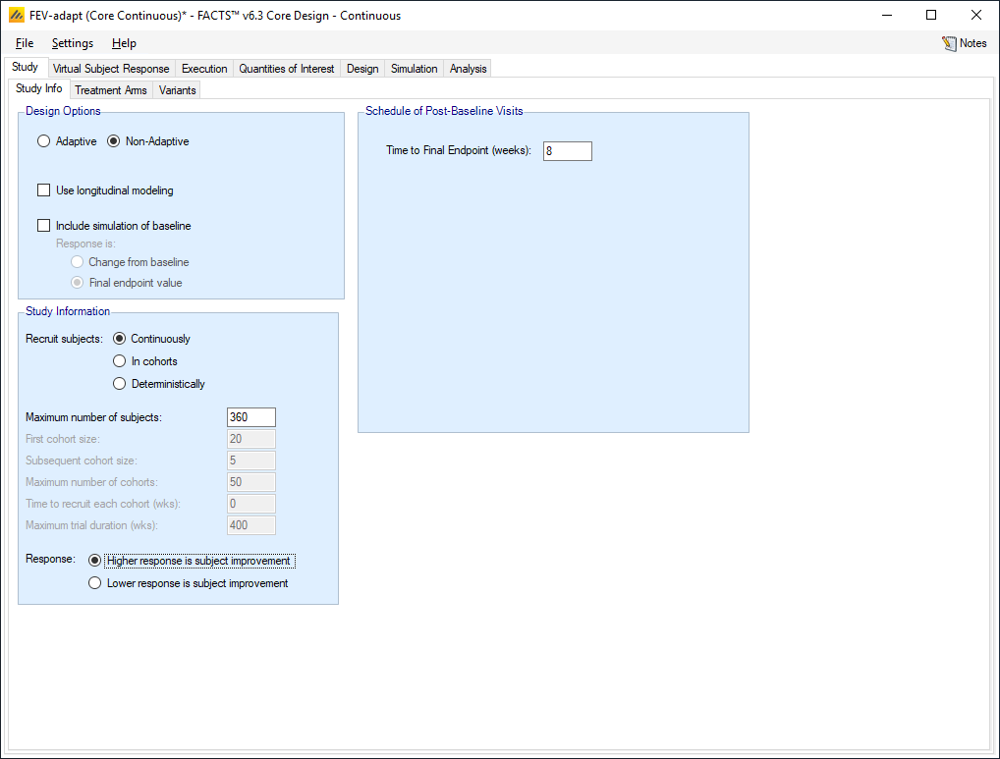

### Treatment Arms

Set the following parameters:

- Select the boxes to include both a control arm and an additional comparator arm

- Add 3 study doses with strengths 5, 10 and 16. (the strengths don't actually matter in this version of the design -- this is just for consistency with the next design)

- Change the dose names to Dose 5, Dose 10, and Dose 16.

The Dose Name may be changed by double-clicking on the relevant cell in the table. While these names are simply labels for the treatment arms, the Effective Dose Strength (v~d~) is the dose value that will be used in dose-response modeling.

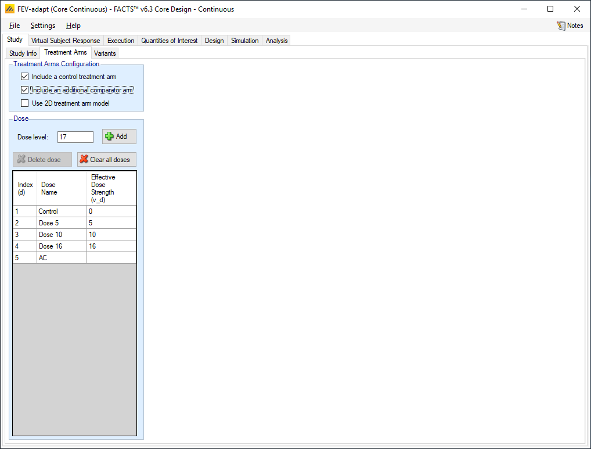

## Virtual Subject Response -- Explicitly Defined

### Dose Response

The Virtual Subject Response tab describes how subject-level data will be generated for the simulations. Add three response scenarios by clicking the Add button. For each scenario, set the underlying mean response for each dose from the corresponding row in the following table:

- Add the following 3 profiles:

+-------+:-----:+:----:+:------:+:-----:+:-----:+:------------------:+
|       | Dose  |      |        |       |       |                    |
+-------+-------+------+--------+-------+-------+--------------------+
| \#    | Ctrl  | 5    | 10     | 16    | AC    | Should succeed     |
+-------+-------+------+--------+-------+-------+--------------------+
| flat  | 0     | 0    | 0      | 0     | 0.1   | None               |
+-------+-------+------+--------+-------+-------+--------------------+
| early | 0     | 0    | 0.17   | 0.2   | 0.1   | Dose 10            |
+-------+-------+------+--------+-------+-------+--------------------+
| late  | 0     | 0    | 0      | 0.2   | 0.1   | Dose 16            |
+-------+-------+------+--------+-------+-------+--------------------+

- Set the SD response to 0.2 **for all the profiles**

The Profiles can be named by double clicking on the default name, e.g. "Response 1" and renaming. A wide range of profiles should be chosen so that you can examine the strengths and weakness of a design.

We select the "should succeed" check box so that FACTS will report statistics on how often the desired doses are selected at the end of simulations. We will need to define the target Quantity of Interest (QoI) to use to select the target dose on the Study \> Variants tab, but need to define the QoIs first.

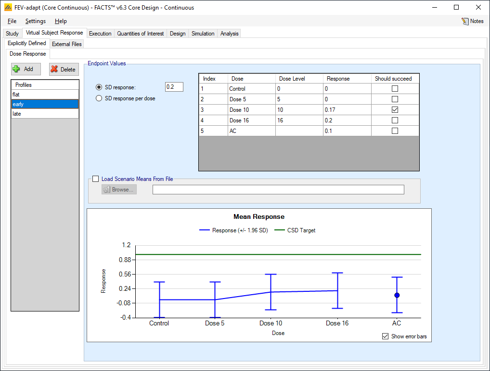

## External Files

There are no externally generated data for this example.

## Execution

### Accrual

Add an accrual scenario by clicking the Add button on the far left. Add 4 regions to this profile by clicking the Add button above the table, and set the following parameters:

- region 1 peak accrual rate 1.25 subjects per week starting week 0

- region 2 peak accrual rate 1.25 subjects per week starting week 4

- region 3 peak accrual rate 1.25 subjects per week starting week 12

- region 4 peak accrual rate 1.25 subjects per week starting week 20

This gives the desired monthly recruitment profile.

The names of the accrual profile and the region may be renamed by double-clicking on them.

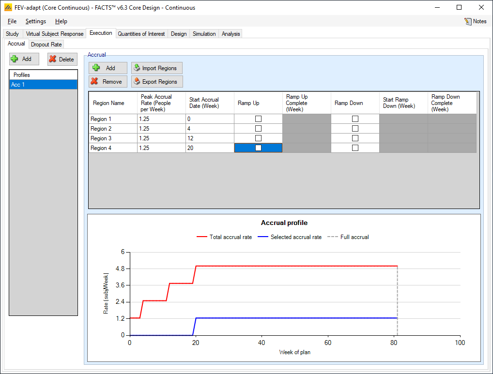

###  Dropout Rate

No drop-outs were specified, select "No Dropouts".

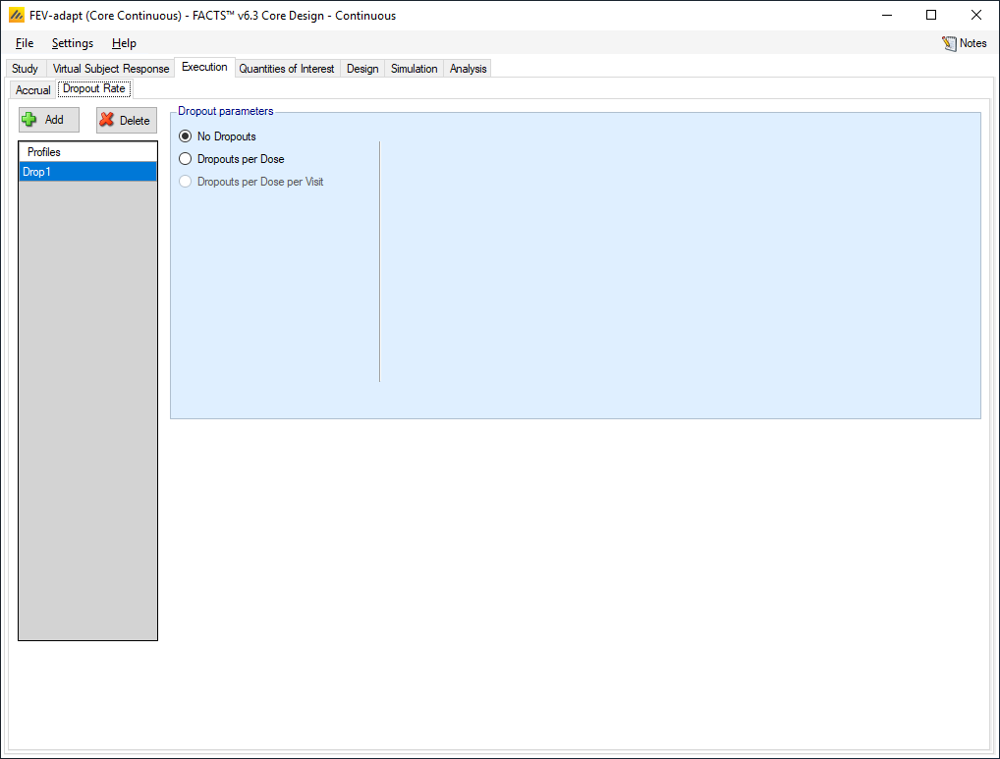

## Quantities of Interest

The Quantities of Interest (QOIs) are the criteria on which decisions, interim or final analyses, will be made. Numerous QOIs are available and you may select multiple quantities for evaluation. A basic set of QOIs is provided by default. Additional QOIs may be added by clicking the Add row in the table. A QOI can be removed by clicking the X on the right side of the cell. Each QOI may be edited by clicking on it, which opens a pop-up box.

Recall that one of the aims of the trial is to select an effective dose, but not a dose that is higher in strength than necessary. We will attempt to achieve this by selecting the dose that has 90% of the maximum treatment effect -- the ED90.

Thus the trial will be judged a success if at the end of the trial if:

- the dose most likely to be ED90 has a greater than 90% posterior probability that its mean improvement is better than Control by at least 0.1 (the clinically significant difference).

- and the dose most likely to be ED90 has a greater than 90% posterior probability that its mean improvement better than the Active Comparator.

We set the default Clinically Significant Difference to 0.1. This is then applied to the default QoI that tests dose response against Control with a CSD and it is used for the delta in the definition of the MED target QOI.

We will be using the target QoI: Pr(EDq relative to Control: Quantile=0.9), this is present by default.

These two default QoIs can be deleted:

- Pr(θ_d \> θ\_(Control))

- Pr(Succ. Future Trial)

We now to create two "Decision" QoI's. The Posterior Probability QoI's are evaluated for each arm, (as would be any predictive probability or p-value QoIs, to use these in a decision we need to pick one, to do this we use a Target QoI. Thus, to enable us to implement the two success criteria above we define two decision QoIs:

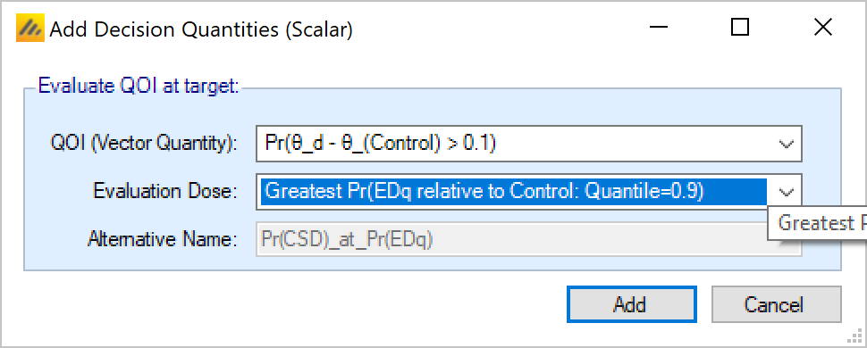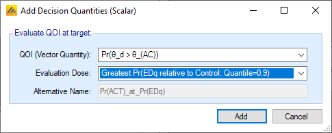

Both using the dose with the greatest probability of being the ED90, one using its posterior probability of beating Control by the CSD, the other using it posterior probability of beating the Active Comparator.

The finished QoI tab looks like this:

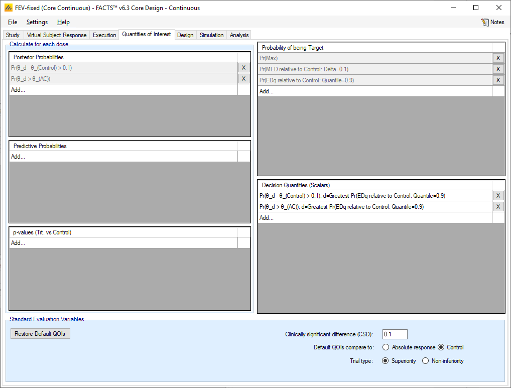

## Design

### On Setting Priors

On setting priors -- as a rule it is recommended that the user specifies weakly informative priors rather than non-informative ones. There are a number of reasons for this:

1.  In a few circumstances non-informative priors can end up being informative.

2.  What values make a prior non-informative vary depending on the range of the value being estimated, a measure with a SD of 1000 requires quite a different value for a prior to be non-informative than one with an SD of 1.

3.  Measures that are log-odds or log hazard ratios can have parameters that are then exponentiated and used as parameters to other distributions as a maximum these values should have range of (-10,10) and (-5,5). Greater than this and numeric overflows can occur.

4.  Using a "non-informative" prior can sometimes be used as an excuse for not thinking about the prior. Not thinking about a prior is never a good idea.

5.  There are some priors, particularly for the variance parameters of hierarchical models where (as we use inverse Gamma distributions for the priors, weakly informative priors are preferred to uninformative ones \[Gelman 2006, "Prior distributions for variance parameters in hierarchical models" *Bayesian Analysis Vol 1 Number 3*\]

6.  When simulating clinical trial designs there is a balance to be struck between the MCMC sample length used in the within-trial analyses and the number of simulations run. Weakly informative priors can help the MCMC to converge and allow us to use shorter sample lengths.

For many priors the weakly informative is easily judged where the priors directly correspond to values that we are simulating. Others are not so easily judged, for these we used "non-informative" priors ran some simulations and looked at the means and SDs of the posterior estimates of the parameters over all the scenarios and then based a weakly informative prior on these. You will see these priors below being described as having an "initial un-informative" prior and then a weakly informative one. Care must be taken with this approach to not over specify a prior based on the selection of scenarios, and it must be borne in mind that the scenarios may not capture the full potential variability in what the "truth value in nature" might actually be.

### Dose Response

For the fixed design we do not want a dose response model; that is, we model each arm independently. Select the 'Independent Dose Model' option, this option does not do dose response modeling.

- Select the same prior for all doses and set the prior mean to 0 (the expected response on the control arm -- so the prior is conservative) and the standard deviation of the prior to 1 (5 times the expected SD of the response -- so the prior is very weak) .

- For the Active Comparator, set the prior mean to 0.1 (the expected response of the Active Comparator) and the standard deviation to 1 (5 times the expected SD of the response -- so the prior is very weak).

- Set the prior mean for sigma to 0.2 (the expected SD of the response) and the number of observations weight for the prior to 1 (so the prior is weak, equivalent to a singe subject's responses and the impact of the prior on the final posterior will be negligible). Note that the inverse-gamma distribution is parameterized in terms of mean and weight. If you prefer to see the standard alpha and beta parameters, click the Settings menu at the top of the screen. Select Options and a pop-up window appears. Navigate to the tab for Gamma Distribution Parameters, and toggle the radio button to Show Alpha and Beta.

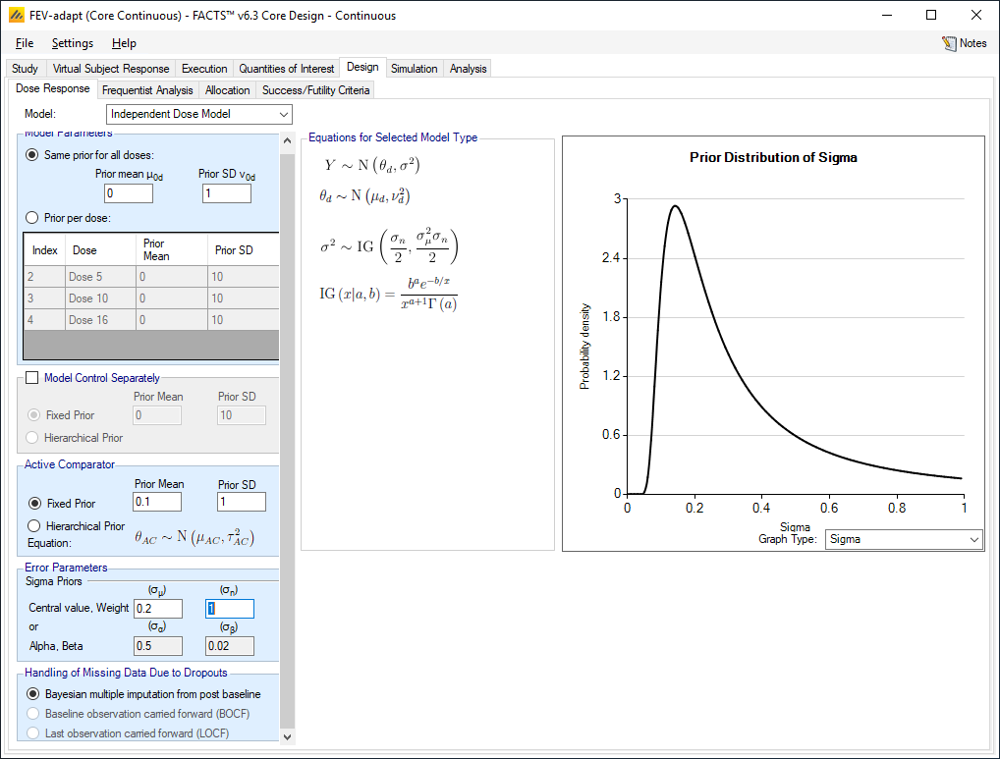

### Frequentist Analysis

We do not require a frequentist analysis, to save run-time we ensure that all the options for handling missingness are de-selected. In particular we ensure that the option to calculate Dunnetts adjusted p-values is de-selected (this has a particularly high runtime overhead and should only be selected if required).

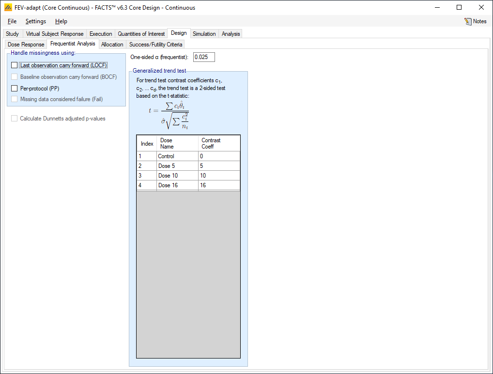

### Allocation

Set all the allocation ratios to 1 for all doses. (We could marginally increase the power of the trial by allocating more to the Control and Active Comparator -- the rule of thumb is that if there are N treatment arms then the highest power occurs at an allocation ratio of √N:1:1:... with 3 arms study arms this can be approximated by 5:3:3:3:5. However this means we'd allocate less than half the study subjects to the study arms reducing the other data that we might wish to analyze post trial).

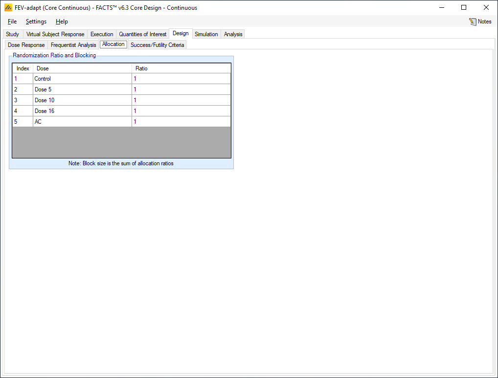

### Success/Futility Criteria

As stated above, the trial will be judged a success if at the end of the trial:

- the dose most likely to be ED90 has a greater than 90% posterior probability that its mean improvement is better than Control plus the clinically significant difference of 0.1.

- and the dose most likely to be ED90 has a greater than 90% posterior probability that its mean improvement is better than Active Comparator.

Set the following parameters for Success Criteria:

1^st^ Criteria

Click the Add row, then:

- Select the QOI: Pr(θ_d - θ\_(Control)\>0.1); d=Greatest Pr(EDq relative to Control: Quantile=0.9)

- Select a Condition of \>

- Enter a threshold of 0.90

2^nd^ Criteria

Cick the Add row, then:

- Select the QOI: Pr(θ_d \> θ\_(AC)); d=Greatest Pr(EDq relative to Control: Quantile=0.9)

- Select a Condition of \>

- Enter a threshold of 0.90

Select: Combine criteria using: AND

We could define the futility criteria as the exact compliment of these, but instead we'll use more stringent futility criteria and leave a possible band of "inconclusive" outcome.

We will define the trial as futile if:

- the dose most likely to be ED90 has a less than 50% posterior probability that its mean improvement is better than Control plus the clinically significant difference of 0.1.

- OR the dose most likely to be ED90 has a less than 50% posterior probability that its mean improvement is better than Active Comparator.

Set the following parameters for Futility Criteria:

1^st^ Criteria

Click the Add row, then:

- Select the QOI: Pr(θ_d - θ\_(Control)\>0.1); d=Greatest Pr(EDq relative to Control: Quantile=0.9)

- Select a Condition of \<

- Enter a threshold of 0.50

2^nd^ Criteria

Click the Add row, then:

- Select the QOI: Pr(θ_d \> θ\_(AC)); d=Greatest Pr(EDq relative to Control: Quantile=0.9)

- Select a Condition of \<

- Enter a threshold of 0.50

Select: Combine criteria using: OR

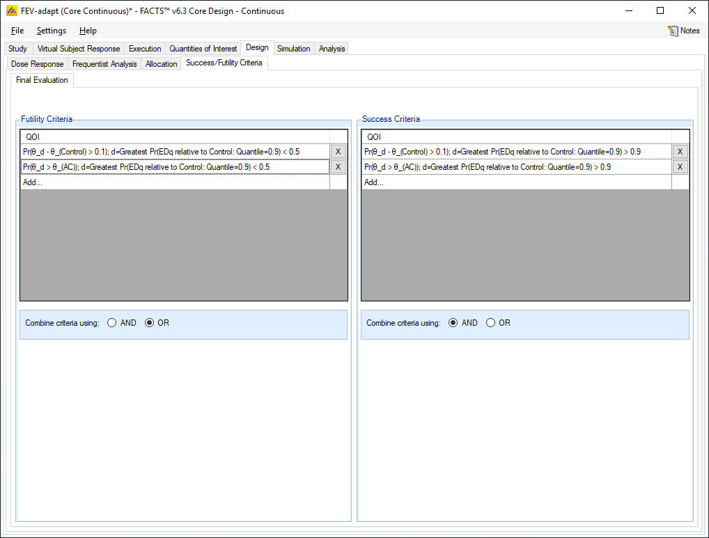

Thus, either criteria need to be met for the trial to be deemed a failure, and both criteria need to be met for the trial to be declared a success. Anything in between and we will deem the trial is inconclusive.

## Setting the dose selection criteria

As we have indicated on the Virtual Subject Response profiles which doses "should succeed", FACTs will summarize for us how often one of these doses is actually selected. In order to do this correctly, we need to indicate to FACTS which Target QoI we will be using to select the dose to go forward. Here it is the ED90. This is specified on the Study \> Variants tab (even though we are not defining any variants).

> 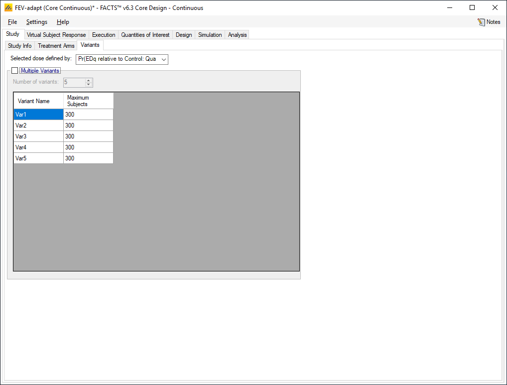

## Simulation

To get an initial check on the design set up, set the number of simulations to run to 100, Select All, then press Simulate.

If the results look reasonable, increase the number of simulations to run to 1000. Select All and then press Simulate again.

To achieve more precise estimates of the operating characteristics, we will need to run 1,000 or 10,000 (or more) simulations of a scenario. By default, FACTS simulations run locally on your computer, which for this simple fixed design is likely to take \~10 seconds to run 100 simulations, and running 1,000s will take proportionately longer. If you have access to a computer grid and your FACTS installation has been correctly configured to use it, you may use the grid's parallel computing capabilities to improve computation speed. To do so, select "on Grid."

> 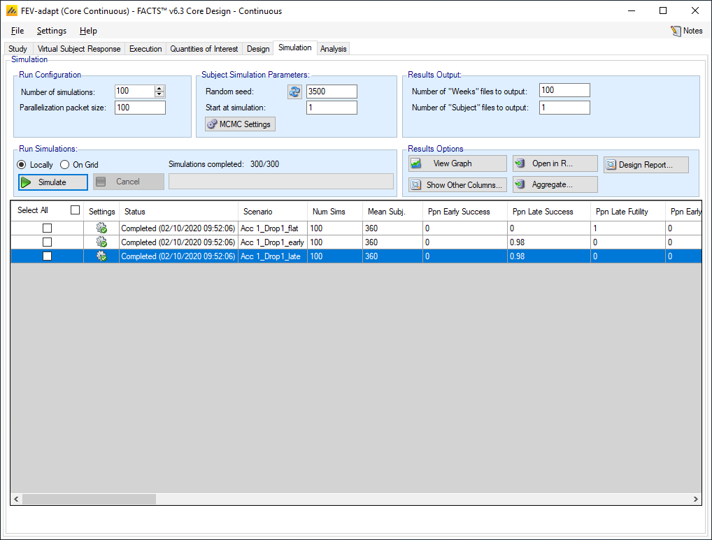

### Results

Results can be compared between the designs in terms of

- Type 1 and type 2 errors.

- Correct selection of the ED90

- Trial size.

The type-1 and type-2 errors seem well controlled:

- On the ineffective, flat scenario there are no type 1 errors (trials that end up successful): out of the 100 simulated trials, there are 0 successes, and the Ppn Late Futility=1. Note, however, that more simulations would be required to precisely estimate this small proportion.

- On the effective scenarios, how many trials are successful (power). Here the power is very high, the Ppn Late Success is 0.98 for both the early and late scenarios. Again more simulations would be required to estimate the power accurately but even with just 100 sims given that success rate we'd be confident the design has good power.

How well do we select the correct dose? As we checked the "Should Succeed" boxes on the Virtual Subject Response tab, and specified the dose selection QoI on the Variant tab, the simulation result columns "Ppn Correct Arm" and "Ppn Incorrect Arm" will tell us how often the dose we would have liked to be selected, was selected. These columns are far over on the right of the results columns.

> 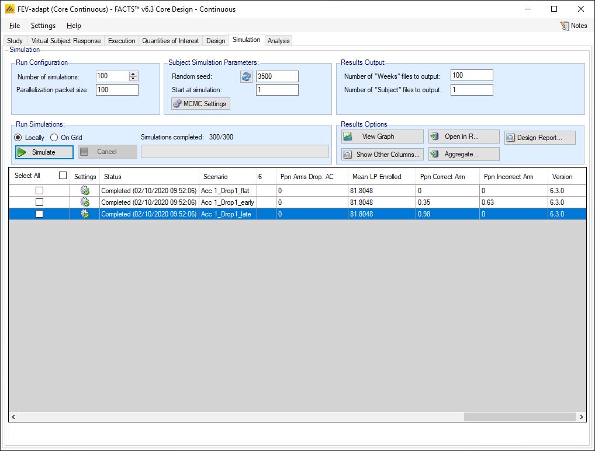

We can also see the distribution of the ED90 selection numerically and graphically.

The results are availably numerically by clicking on "Show Other Columns" and selecting "Probabilities", on the new table of results displayed, scroll to find the columns for the proportion (Ppn) of simulations a dose is the ED90 relative to Control. Here we see that for the flat scenarios the probabilities are similar because the doses are similar. For the "early" scenario, our preferred dose, Dose 10, is only selected as the ED90 at about 35% of the time. For the "late "scenario, our preferred dose, Dose 16, is selected with near certainty.

> 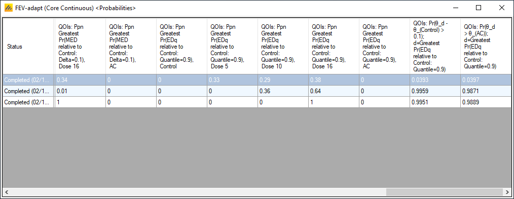

Graphically these can be seen by clicking on "View Graph", selecting "Show per Scenario Graphs", then selecting the "Response and Target Selection" graph, and set the "Quantity" displayed to the ED90 QoI.

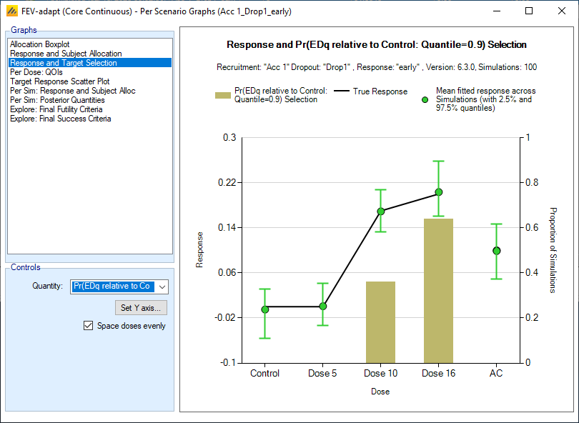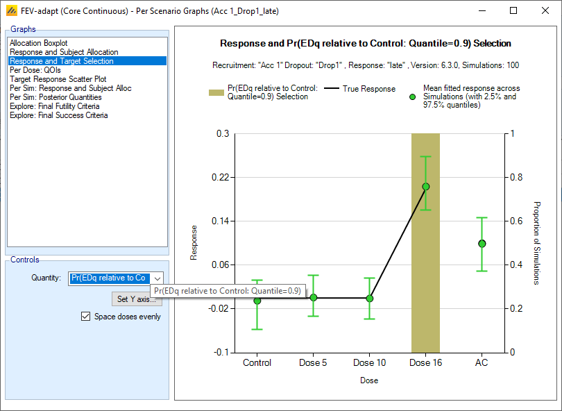

Thus, though the design has good overall power, it is doing a poor job of dose selection, with a high probability of selecting the highest dose, even when there is reasonable dose response at the middle dose.

It may be possible to improve this design by modifying the selection criteria (the target QoI), but for brevity we'll do that in the context of the more complex design.

# Adaptive Design with Modeling

We now would like to create an adaptive design with modeling. This design will include a dose-response model, longitudinal modeling of the outcome, and response adaptive randomization. We also will add additional doses to the design as the adaptive features and modeling allow for examination of a larger number of doses.

With the Fixed design above open, use the File \> Save As menu command to create a copy of the design to be edited and modeling and adaptive features added. Here we have called it FEV-adapt

The steps below will go through the portions of the design to be changed. If a feature is not discussed it is assumed to remain the same as the fixed design.

Note, the adaptive design below is an example, the design is not necessarily optimized, nd additional iterations would be required.

## Study 

### Study Info

We select the following options:

- Adaptive

- Use longitudinal modelling

- With longitudinal modelling added we need to Set Visits Explicitly:

  - Auto generate 8 visits, starting at 1 with a spacing of 1

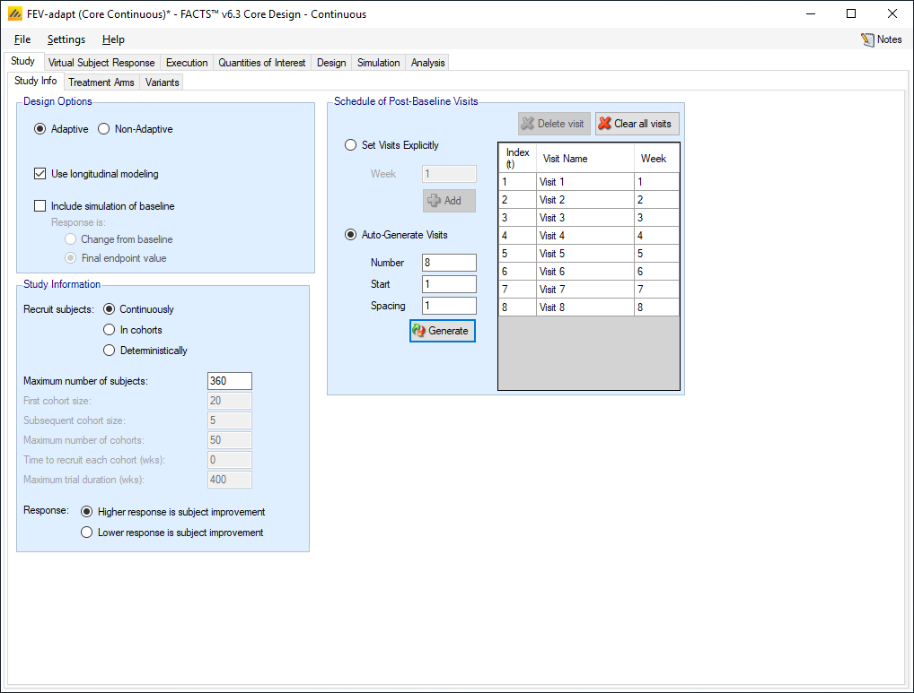

### Treatment Arms

We add additional doses to the study. We now will have 16 doses, a control dose, and an Active Comparator. We add Dose Level 1-4, 6-9, and 11-15, or Clear all doses, then Add to add 16 doses, then click checkboxes to add control and AC

> 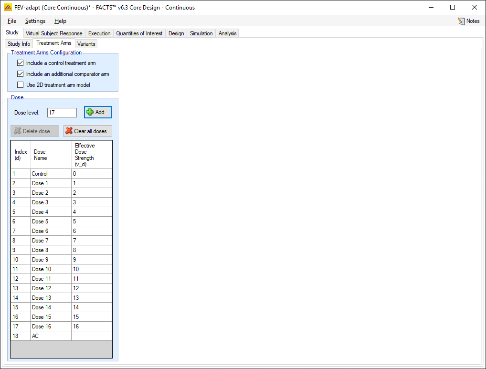AC.

## Virtual Subject Response -- Explicitly Defined

We next need to modify the virtual subject response scenarios to account for the additional doses. We update the existing profiles to match those shown in the table below.

### Dose Response

- **For each one** set the SD response (SD of 'error' in the endpoint) to 0.2

- Set the response for each dose from the corresponding row in the following table:

|       |            |     |     |     |     |     |      |      |     |      |      |     |     |      |     |      |     |     |
|-----|:---:|:-:|:-:|:-:|:-:|:-:|:---:|:---:|:--:|:---:|:---:|:--:|:--:|:---:|:--:|:---:|:--:|:--:|
|       | Dose Level |     |     |     |     |     |      |      |     |      |      |     |     |      |     |      |     |     |
| \#    |    Ctrl    |  1  |  2  |  3  |  4  |  5  |  6   |  7   |  8  |  9   |  10  | 11  | 12  |  13  | 14  |  15  | 16  | AC  |
| flat  |     0      |  0  |  0  |  0  |  0  |  0  |  0   |  0   |  0  |  0   |  0   |  0  |  0  |  0   |  0  |  0   |  0  | 0.1 |
| early |     0      |  0  |  0  |  0  |  0  |  0  | 0.03 | 0.07 | 0.1 | 0.13 | 0.17 | 0.2 | 0.2 | 0.2  | 0.2 | 0.2  | 0.2 | 0.1 |
| late  |     0      |  0  |  0  |  0  |  0  |  0  |  0   |  0   |  0  |  0   |  0   |  0  |  0  | 0.05 | 0.1 | 0.15 | 0.2 | 0.1 |

The "should succeed' doses are doses 10, 11 and 12 in the "early" profile and dose 16 in "late" profile.

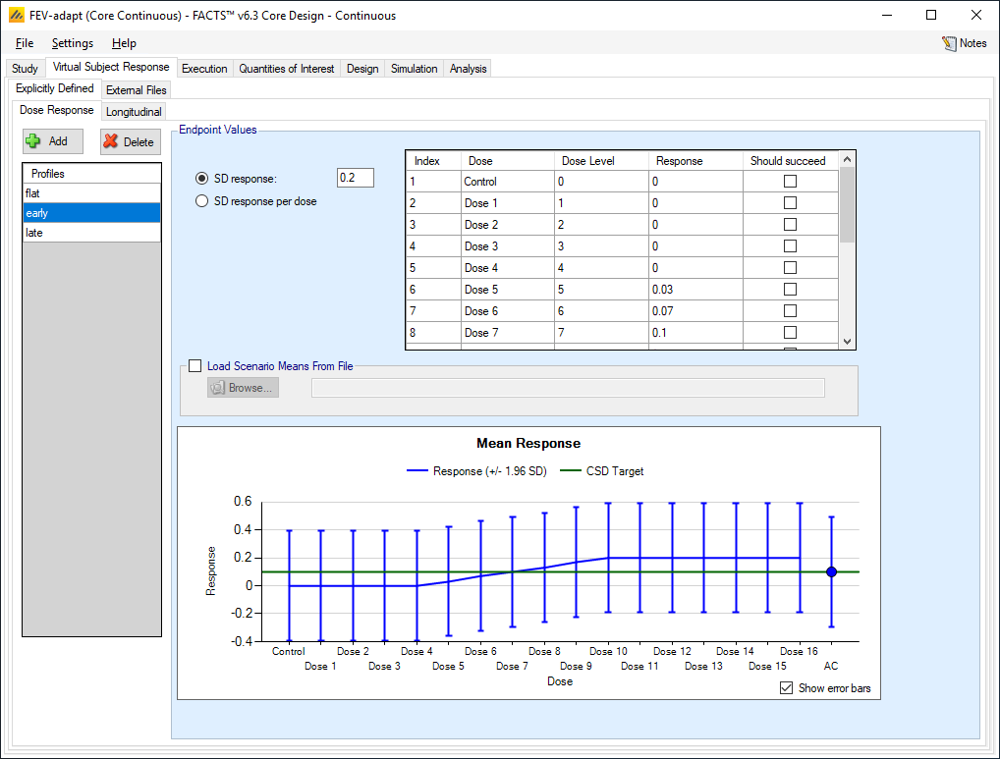

### Simulating Subjects Longitudinal Data

Because we are including longitudinal modelling, we now also have a Longitudinal tab under the Explicitly Defined Virtual Subject Response. We use this tab to specify how subjects' responses at the intermediate visits are to be simulated.

Add a longitudinal profile, and set the following parameters:

- Use the Correlated model to simulate longitudinal data

- For all visits set the True Rho (week to week correlation) to 0.8

- For all visits set the Response Fraction to 1 (full response seen straight away)

- Select the fraction distribution of True Sigma to be "Per Visit"

- For all weeks set the fraction of True Sigma to 1

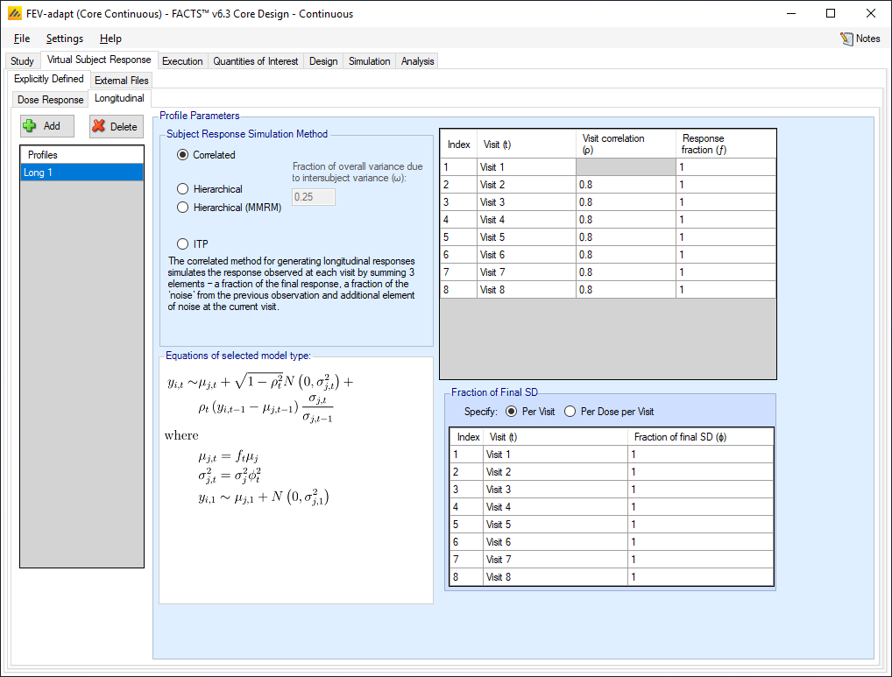

## Quantities of Interest

We will need to evaluate how well a range of target QoIs perform at selecting the correct doses.

To the Pr(EDq relative to Control: Quantile=0.9) we EDq targets with quantiles of 0.925 and 0.95.

To the Pr(MED relative to Control: Delta 0.1) we add MED target QOIs with deltas of 0.125, 0.15, 0.175 and 0.2.

For example, need to add to the Probability of being Target window:

- Target Type: MED

- Response Relation: Relative to:

  - Control

- Delta: 0.125. The delta quantity is the amount better than the control that is defined as effective.

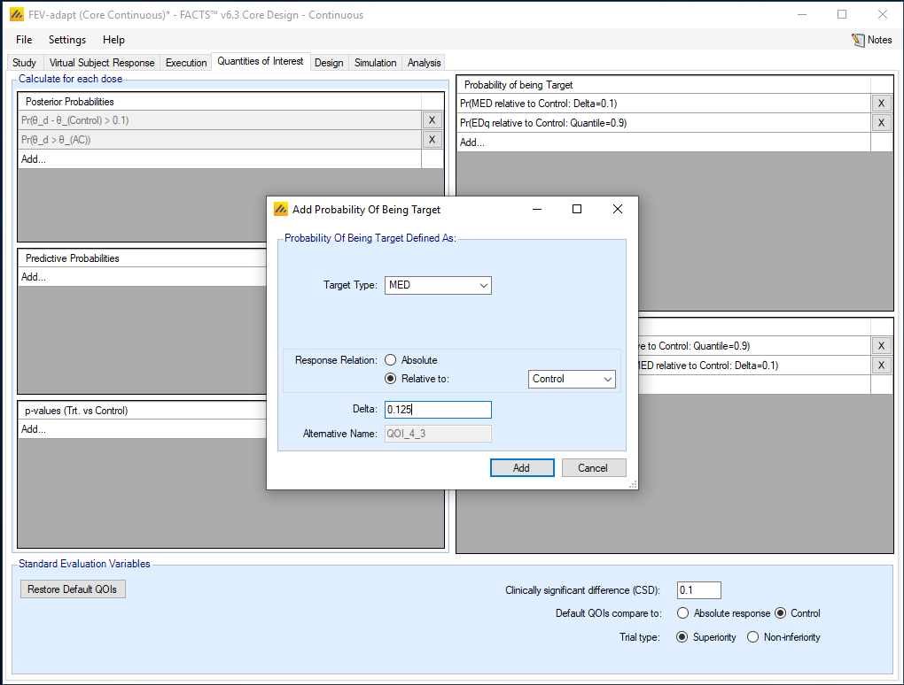

For each of these new target QoI's we want to add decision QoIs that use them to select from the Pr(θ_d - θ\_(Control) \> 0.1) posterior probabilities and the Pr(θ_d \> θ\_(AC)) posterior probabilities.

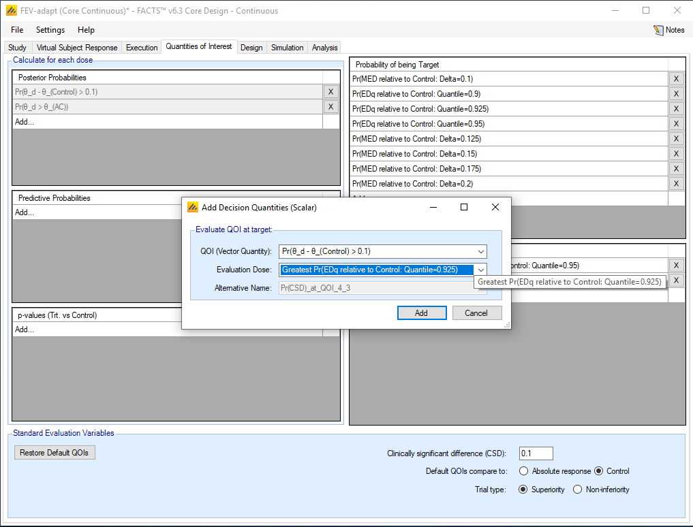

This results in a large number of Decision QoIs

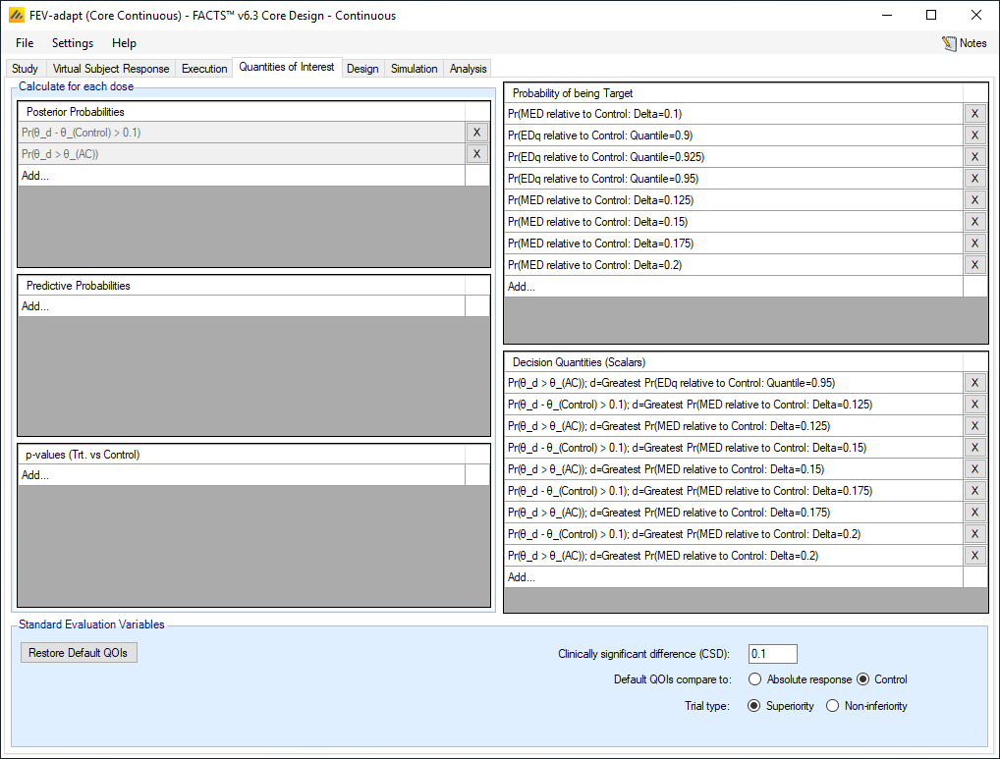

But apart from generating a lot of data columns in the output files there is no appreciable cost to this, and upon running the simulations, we will be able to evaluate a lot of target QoI options.

## Dose Response Model

If the response for the *i^th^* subject given dose *d* at week 8 is *Y~8i~*:

$$Y_{8i} \sim N\left(\theta_d, \sigma^2\right) \text{ for } d = 0,1,\ldots,17$$

We will model the mean response using a sigmoid (Emax) model:

$$\theta_d = a_1 + \left(\frac{\left(a_2 - a_1\right) v_d^{a_4}}{v_d^{a_4} + a_3^{a_4}}\right) \text{ for } d = 0,\ldots,16$$

Where a~1~ is the response at the lowest modeled dose, a~2~ some maximal response that is approached asymptotically, a~3~ is the dose level at which half the increase from a~1~ to a~2~ is observed, and a~4~ is a parameter defining the slope.

Bearing in mind this interpretation of the parameters, the priors for the model parameters are set to:

$$a_1 \sim N(0,1),\ a_2 \sim N(0.1,1)$$

$a_{3}\sim N^{+}(8,8)$,

$$a_4 \sim N^{+}\left(10,10\right)$$

The priors for a~1~ and a~2~ (the min and the max of the sigmoid) are set to weak priors (SD=1) centered on the expected response of the Control and Active Comparator respectively.

The prior for a~3~ (the ED~50~ dose) is centered on the middle of the dose range (0-16) with SD=\<half the dose range\> so that the bulk of the prior mass lies within the dose range. If the prior for this parameter is set too broadly relative to the dose range being explored, then there can be a tendency for the posterior to contain a significant mass outside the dose range.

The prior for a~4~ is allowed to take a wide range of values relative to the expected change in response relative to the dose values to allow steep gradients at high doses to be within the prior.

And prior for the response on the Active Comparator (which is excluded from the model):

$$\theta_{AC} \sim N\left(0.10,1\right)$$

This is the same prior for the AC as used in the initial design.

And prior for the error variance:

$$\sigma_\mu = 0.2,\ \sigma_n = 1$$

This is the same prior for the estimate of the SD of the response as used in the initial design.

## Design

To add the dose response model, we make changes to the Design, Dose Response tab.

### Dose Response

Set the following parameters:

- Select the Sigmoidal model

- For the prior distributions for the 4 parameters a1-a4 set

  - Λ~1~ = 0, λ~1~ = 1

  - Λ~2~ = 0.1, λ~2~ = 1

  - Λ~3~ = 8, λ~3~ = 8

  - Λ~4~ = 10, λ~4~ = 10

- Control is NOT modeled separately; it is part of the dose response curve. We assume it is a dose of 0.

- For the Comparator, the prior mean Is 0.1, the Std Dev of the prior mean is 1

- Sigma prior mean = 0.2, and prior weight in terms of number of observations = 1.

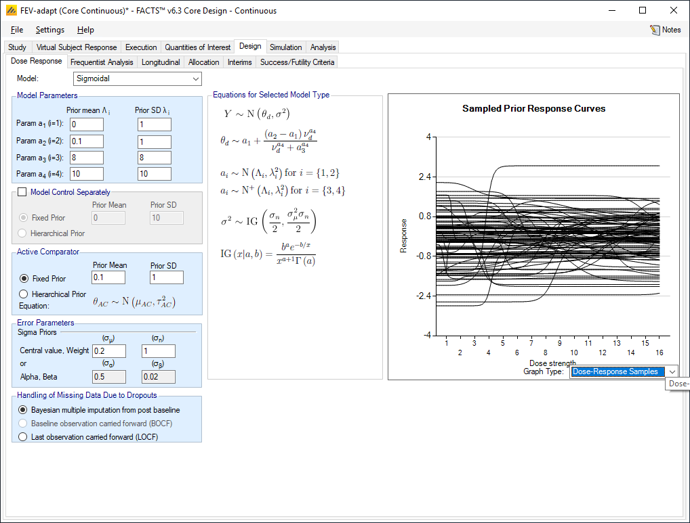

### Frequentist Analysis

Frequentist analysis is left disabled with no "handle missingness" options enabled.

### Fitting a Longitudinal Model

The relationship between a subject's final response and their intermediate responses is modeled using a simple linear regression model. During the course of the trial we fit three separate model instances, one for control treated patients, one for those on Active Comparator and one for all those on a dose of the study drug.

Using *m* to indicate the model (m=1,2,3: Control, Study Drug, Active Comparator) and *t* to indicate the visits before the final (t = weeks 1-7), we assume that the expected response at the final visit is linearly related to the response at visit t:

$$Y_8 \sim N\left(\alpha_{mt} + \beta_{mt} Y_t, \lambda_t^2\right) \quad m = 1,2,3;\ t = 1,\ldots,7$$

$$\alpha_{mt} \sim N(0,1) \quad m = 1,2,3;\ t = 1,\ldots,7$$

$$\beta_{mt} \sim N\left(0,1\right) \quad m = 1,2,3;\ t = 1,\ldots,7$$

$$\lambda_{mt}\ \sim IG(0.2,1)m = 1,2,3;t = 1,\ldots,7$$

$$IG\ parameters\ are\ mean\ and\ weight\ $$

Set the following parameters:

- Select the Model: Linear Regression

- Select to model Control and Active Comparator separately

- Set the prior mean for the alphas (the fixed change from the response at the visit to final response) α~μ~ = 0, with an SD = 1 (the prior centered on no change, but with an SD 5 times the expected response, so a very weak prior).

- Set the prior mean for the Betas (the proportionate change in the response at the visit to the final response) β~μ~ = 0 with an SD = 1, (the prior centered on no change, but with an SD 5 times the expected response, so a very weak prior).

- Set the prior for the Lambdas (the residual error) to a mean = 0.2, and weight in terms of equivalent number of observations = 1 (the prior for the estimate of the SD of the final response).

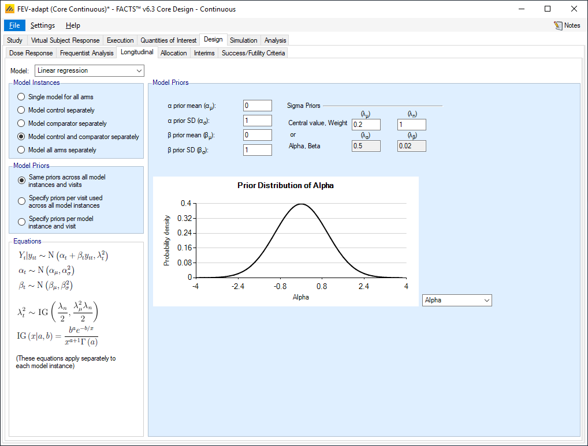

### Allocation

We will initially allocate 20 subjects each onto Control, dose 5, 10, 16 and Active Comparator. Then adaptive allocate to the doses closest to being the MED (delta of 0.1) and the ED90.

On the allocation tab we select "Adaptive Allocation".

To do this we put the allocation ratio at 1 for each of the 5 arms we want to allocate to initially, and 0 for the rest. (The fact that it's the first 100 subjects that will follow this fixed assignment will be set on the next tab -- "Interims").

After the first interim allocation will be adaptive across the study doses biased towards those that are most likely to be the desired targets. We will also allocate adaptively to Control -- after each interim this will set the proportion to allocate to Control to be equal to the study drug with the highest proportion of allocation. Thus at the end of the trial the allocation to Control and the target dose will be roughly equal. In FACTS currently there is no such option for the Active Comparator, so we fix the allocation to this at 1 in 10.

Our Adaptive Allocation Targets will be the MED and ED90. We will adjust the randomization probabilities every four weeks allocating to the study drug doses in proportion to the information gained about the MED and ED90, and allocating adaptively to Control and 10% to the Active Comparator. To fix allocation to AC at 10% we select *Fix Alloc.* and for Post First Interim Alloc. per Block enter 1 and we set the post first interim block size to 10, and 1/10 is 10%. Thus, for each block, 1 subject will be allocated to the AC, and the remainder of the block allocated adaptively.

Set additional parameters:

- Add Adaptive Allocation Targets QOI: Pr(EDq relative to Control: Quantile=0.9)

  - Weight For: Information

    - We chose to weight for information because it is less aggressive on the adjusting of the randomization probabilities compared to weighting for probability. Either may be used.

  - Relative weight: 1 because we want to target the ED90 and MED equally.

- Add Adaptive Allocation Targets QOI: Pr(MED relative to Control: Delta=0.1)

  - Weight For: Information

    - We chose to weight for information because it is less aggressive on the adjusting of the randomization probabilities compared to weighting for probability. Either may be used.

  - Relative weight: 1 because we want to target the ED90 and MED equally.

<!-- -->

- As there are a lot of doses, set the Allocation probability set to zero for values less than: 0

<!-- -->

- Set Raise allocation to power: 1

  - If you choose a power less than 1 the adaptive randomization will be less aggressive. Different options could be examined.

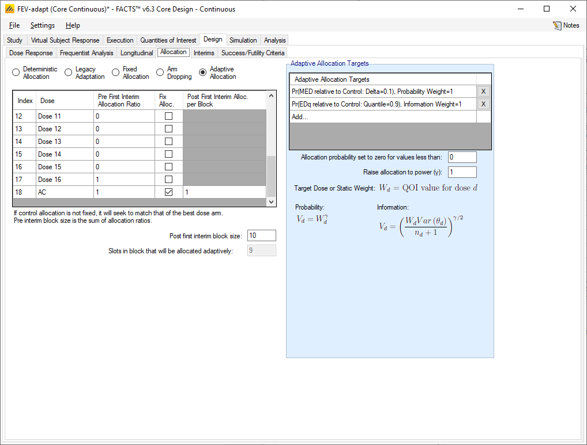

### Interims

On the Design-Interims tab we specify the timing and frequency of the interim analyses.

Select the following parameters:

- Set the Subject Information Defined By to Subjects Enrolled

- Set the Specify Interims By: to Time

  - Set the Time to every 4 weeks

  - Set First interim at 100 subjects

- Ensure that "Follow-up if study stopped for futility" is de-selected -- we won't be specifying early success stopping so it is immaterial how the follow up if stopped for success is set.

> 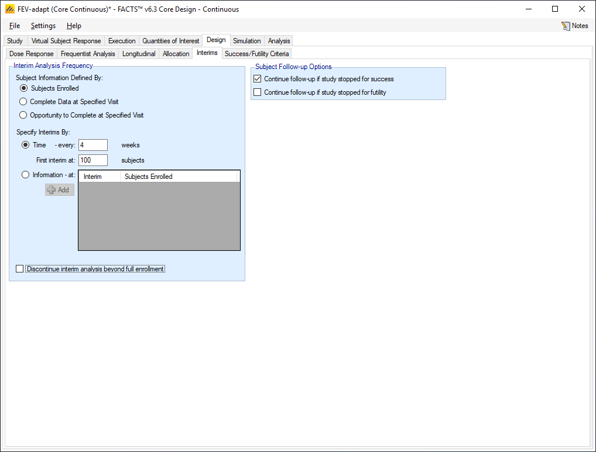

## Success/Futility Criteria

Under Design-Success/Futility Criteria we specify the criteria for early stopping for futility as well as the final evaluation criteria.

### Interim 1 Criteria

On this tab we specify the interim analyses criteria for early stopping of accrual. In this example we keep the same criteria across all interims. If we wanted to have different criteria for different interims we would select Create new interim criteria at interim and specify the interim where criteria changes.

Stop accrual early for futility if there are at least 100 subjects randomized and

- the dose most likely to be ED90 has a less than 10% posterior probability that its mean improvement is better than Control plus 0.1, the clinically significant difference

- OR the dose most likely to be ED90 has a less than 10% posterior probability that its mean improvement is better than Active Comparator.

Select the following parameters

- Select Futility Criteria

- Add a QOI:

  - Select Pr(θ_d - θ\_(Control)\>0.1); d=Greatest Pr(EDq relative to Control: Quantile=0.9)

  - Select a Condition of \<

  - Enter a threshold of 0.10

<!-- -->

- Add a second QOI:

  - Select the QOI: Pr(θ_d \> θ\_(AC)\>0.05); d=Greatest Pr(EDq relative to Control: Quantile=0.9)

  - Set Condition \<

  - Set Threshold 0.10

<!-- -->

- Select Combine criteria using: OR. The trial will only stop if either criteria is met.

- Set Minimum Information Required to be 100 total subjects enrolled (this is not strictly necessary as the first interim is not until 100 subjects are enrolled).

- Set the Evaluation Dose to be Greatest Pr(EDq relative to Control: Quantile=90)

  - Set the Minimum Number of Subjects Enrolled to be 20, this is the minimum number of subjects on the arm with the greatest probability of being the ED90.

We will not stop accrual early for success.

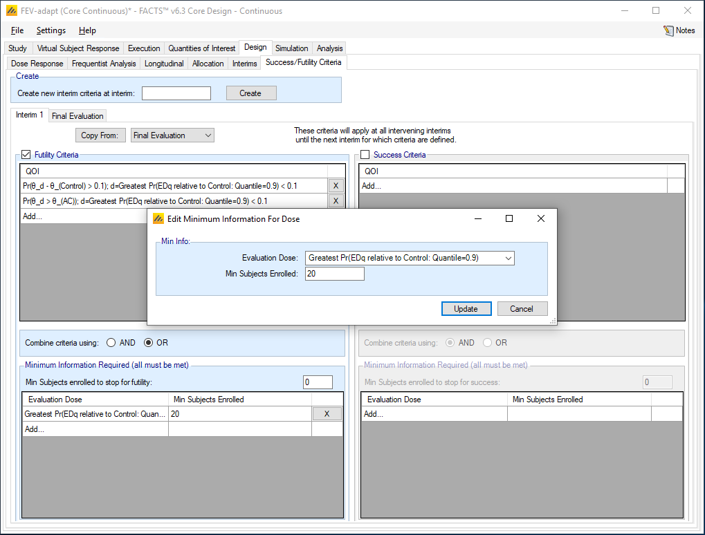

### Final Evaluation

The Final Evaluation has not changed from the fixed design. The same criteria, restated below, will be used to determine success and futility.

The trial will be judged a success if at the end of the trial:

- the dose most likely to be ED90 has a greater than 90% posterior probability that its mean improvement is better than Control plus 0.1, the clinically significant difference.

- AND the dose most likely to be ED90 has a greater than 90% posterior probability that its mean improvement is better than Active Comparator.

We will define the trial as futile if:

- the dose most likely to be ED90 has a less than 50% posterior probability that its mean improvement better than Control plus 0.1, the clinically significant difference.

- OR the dose most likely to be ED90 has a less than 50% posterior probability that its mean improvement is better than Active Comparator.

## Simulation

Similar to the fixed design, we set the number of simulations to run to 100 for an initial check, Select All, the press Simulate.

If the results look reasonable (the design has been entered correctly), increase the number of simulations to run to 1,000 or more. Select All and then press Simulate again. The criteria for reasonable is the same as stated above in 4.7.

## Results

Review the following to see if the design is successful

1.  On the ineffective scenario all the simulations should end early for futility.

2.  On the effective scenarios that there are a sufficient number of successful trials (sufficient power). The power for the 'early' scenario is \~0.9 and the power for the 'late' scenario is \~0.95.

3.  That the targets (ED90) are correctly identified given the data observed. For the 'early scenario, the proportion of simulations with a correct selection of target arm is \~0.5 and for the 'late' scenario is 0.95.

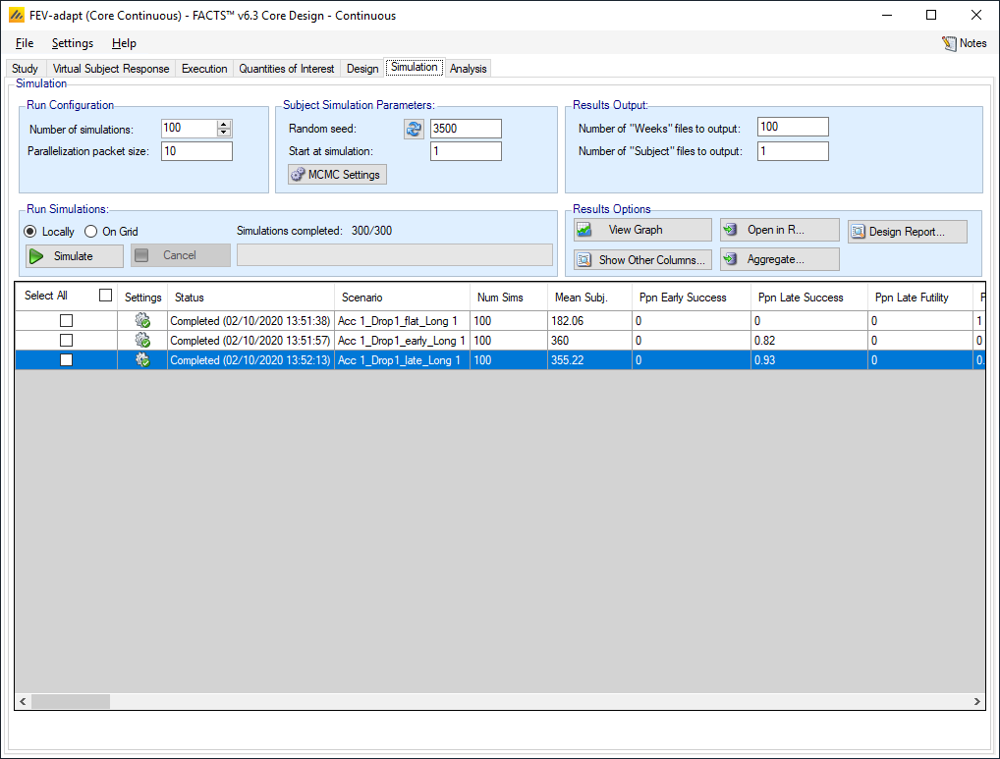

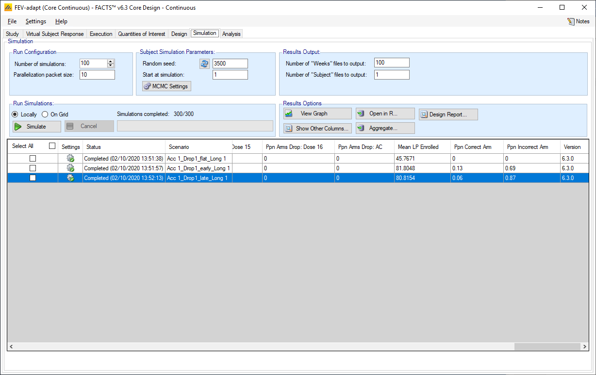

The dose response model fit should also be checked using the View Graph button. We can select Response and Target Selection, and then select quantity, here we chose ED90, to see the fit over all the simulations. In the "early" scenario, we observed that the dose-response model tends to smooth out the sharp edges of the curve. This graph also illustrates that dose 10 and 11 are selected most often as the ED90. For the 'late' scenario there is a slight smoothing of the sharp angle in the dose response, and dose 16 is selected as ED90 100% of the time.

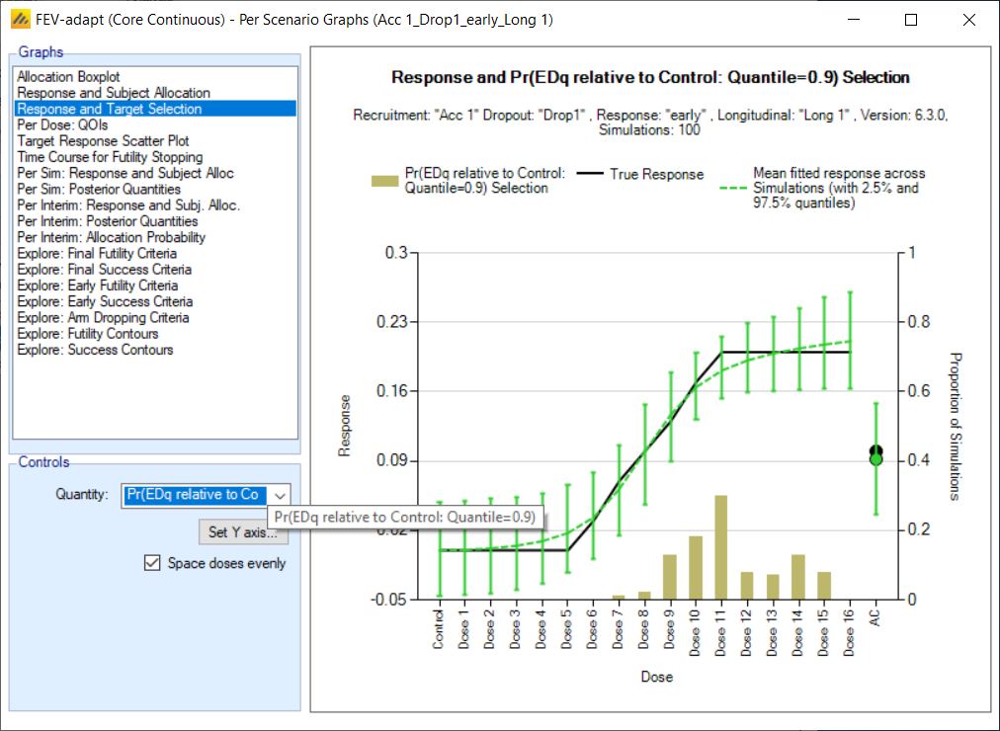

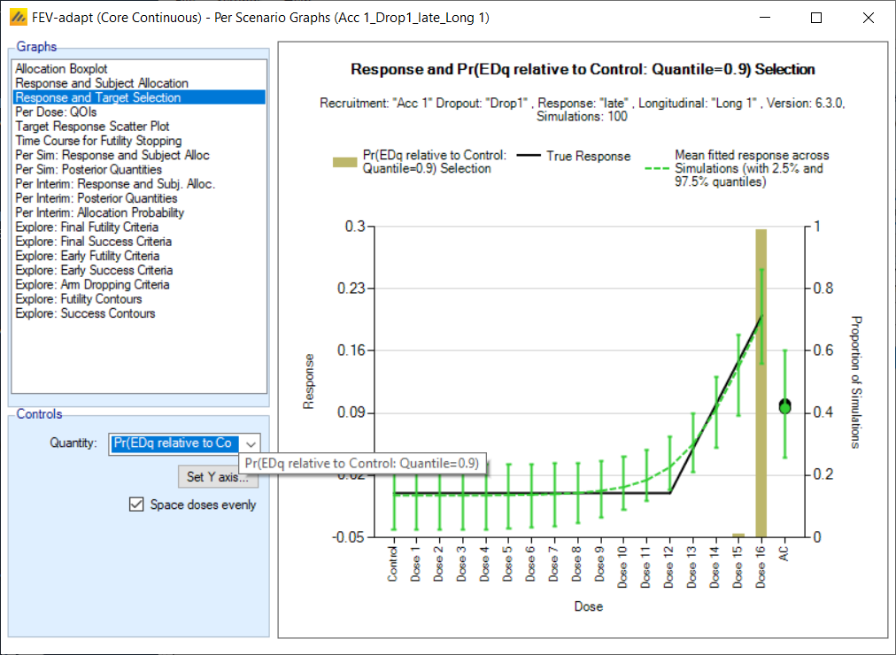

# Comparing Targets

+-----------+-------------------------------------------------+-------------------------------------------------+-------------------------------------------------+-------------------------------------------------+
|           | Final Success Criteria -- 'flat'                | Final Success Criteria -- 'early'               | Response and Target Selection -- 'early'        | Response and Target Selection -- 'late'         |
+===========+=================================================+=================================================+=================================================+=================================================+
| ED90      | 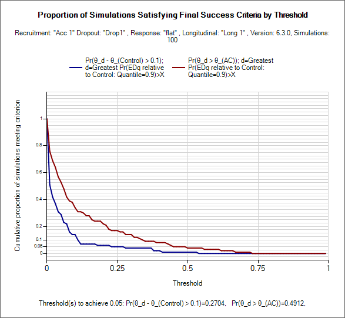 | 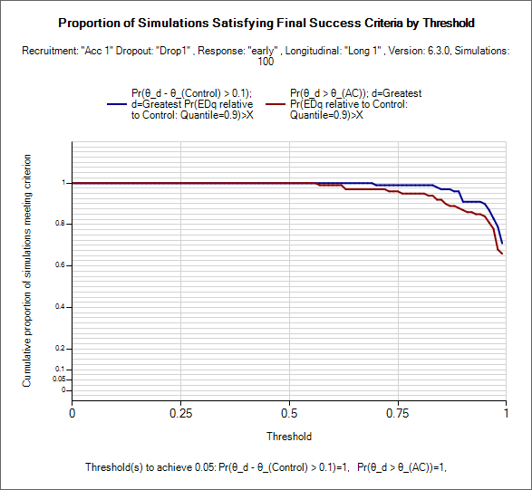 | 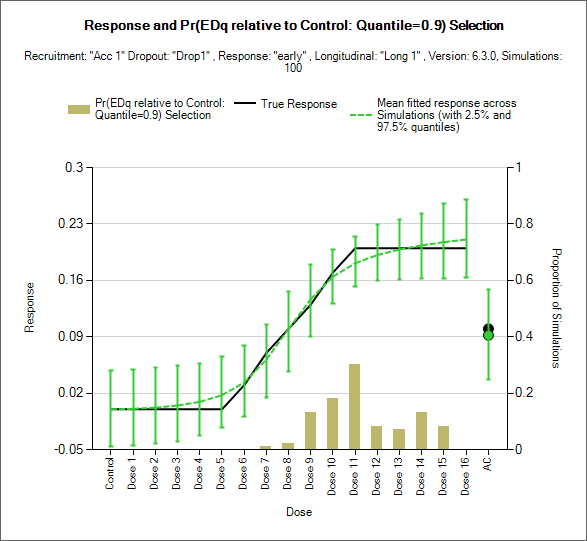 |  |
+-----------+-------------------------------------------------+-------------------------------------------------+-------------------------------------------------+-------------------------------------------------+
| ED925     | 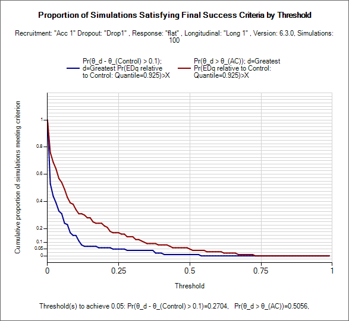 | 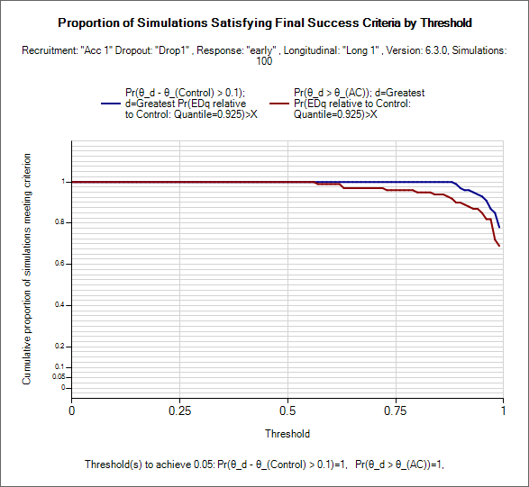 | 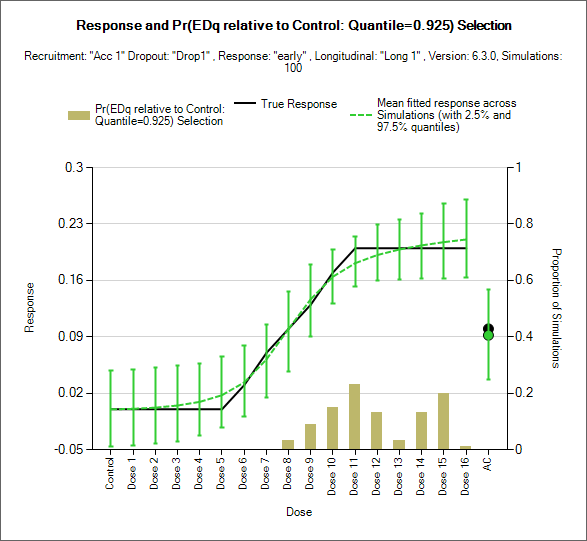 | 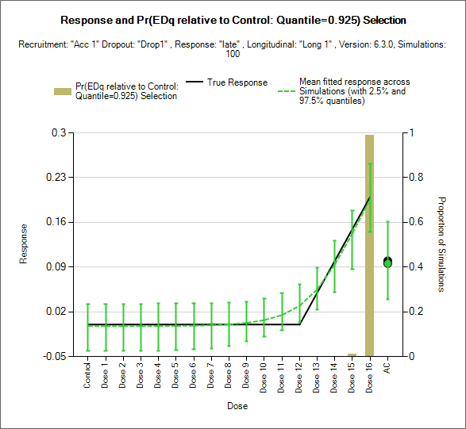 |
+-----------+-------------------------------------------------+-------------------------------------------------+-------------------------------------------------+-------------------------------------------------+
| ED95      |  | 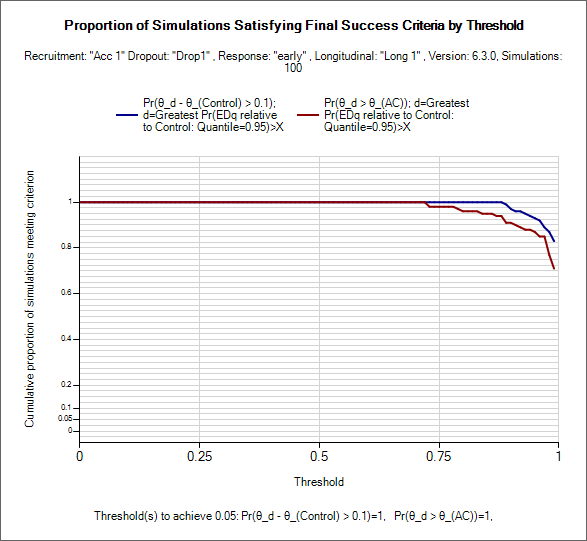 | 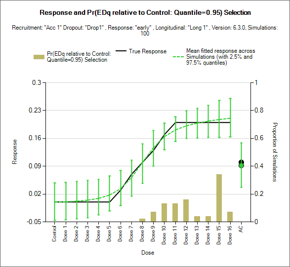 | 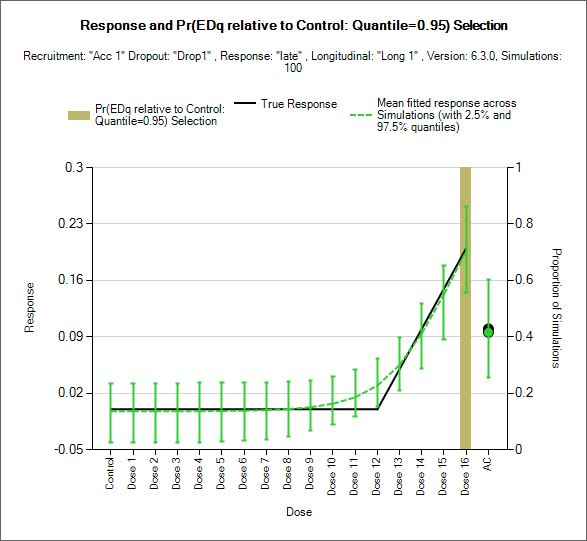 |
+-----------+-------------------------------------------------+-------------------------------------------------+-------------------------------------------------+-------------------------------------------------+
| MED 0.125 | 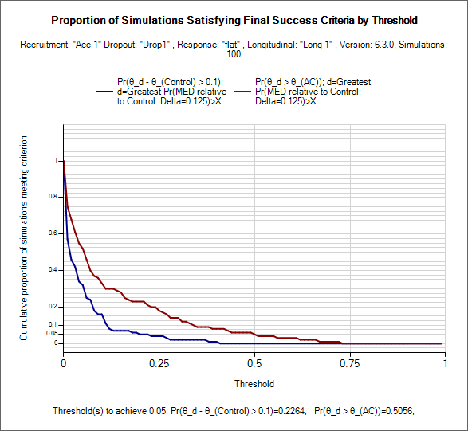 | 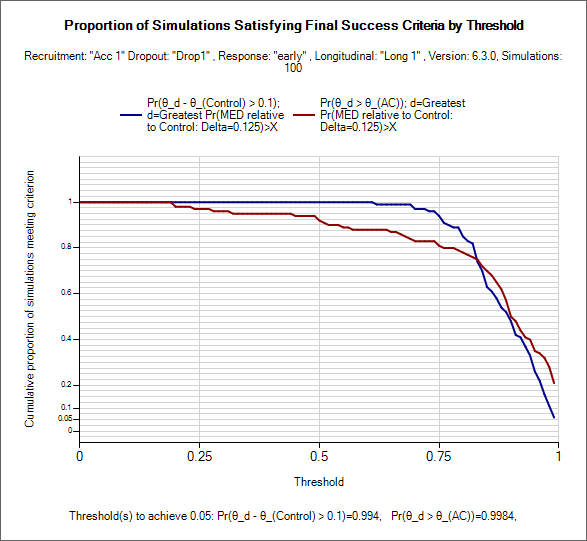 | 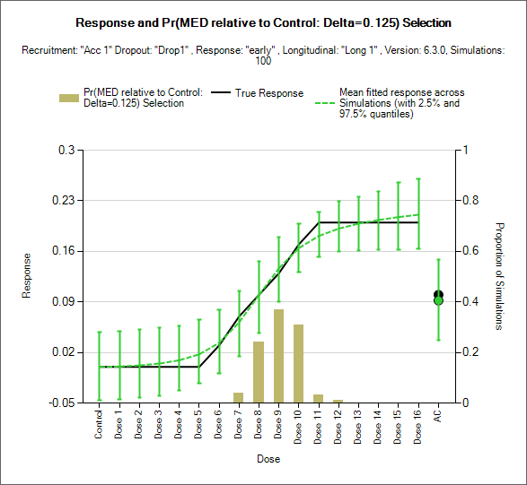 | 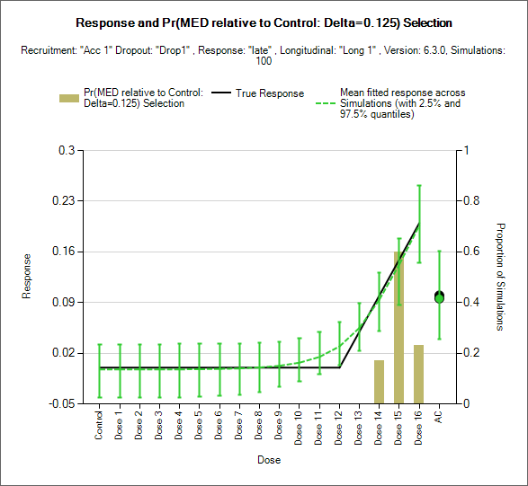 |
+-----------+-------------------------------------------------+-------------------------------------------------+-------------------------------------------------+-------------------------------------------------+
| MED 0.15  | 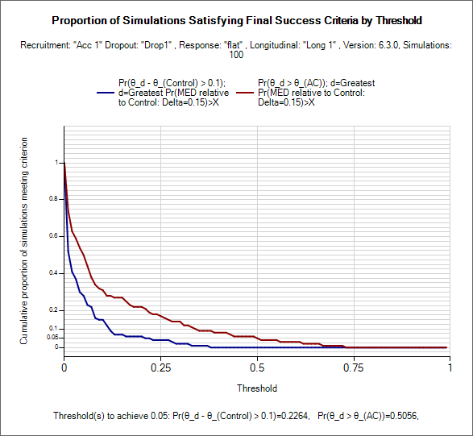 |  |  |  |
+-----------+-------------------------------------------------+-------------------------------------------------+-------------------------------------------------+-------------------------------------------------+
| MED 0.175 |  |  |  |  |
+-----------+-------------------------------------------------+-------------------------------------------------+-------------------------------------------------+-------------------------------------------------+
| MED 0.2   |  |  |  |  |
+-----------+-------------------------------------------------+-------------------------------------------------+-------------------------------------------------+-------------------------------------------------+

All the target criteria delivered good type-1 error control. None showed any successful simulations even if the success criteria threshold were lowered to 0.5.

The ED90, ED925 and ED95 had good power and consistently correctly selected Dose 16 in the 'late' scenario 100% of the time, but tended to select too high a dose in the 'early' scenario with combined power to both determine success and select one of Dose 10, 11 or 12 of less than 60%.

The MED targets with deltas of 0.125, 0.15, 0.175 had poorer power in the 'early' scenario, and selected Dose 16 in the 'late' scenario less than 80%.

The MED target with a delta of 0.2 however had reasonable power in the early scenario, selecting Dose 10, 11 or 12 of more than 60% of the time whilst still selecting Dose 16 more than 95% of the time in the 'late' scenario.

\[Looking at the performance of the ED QoIs it looks as though perhaps quantiles below 90 should have be explored, this is left as an exercise for the reader!\]

In practice of course it is likely that there are more possible scenarios that should be explored -- with different ED50s, different slopes and different maximum responses.

It is also interesting to explore the difference between an MED and an ED target. For instance if the maximum response is greater, the MED will tend to pick doses on the slope and not go as high as doses at the start of the plateau of response, but if the maximum response is less, the MEd target will tend to pick the top dose. The ED target will continue to pick doses at the top of the slope. But the ED does a worse job as it's location depends on the response on Control, the top dose and the doses in the region of the required ED quantile. \[Perhaps the adaptive allocation should be modified to put a fixed allocation on the top dose?\], whereas the location of the MED only depends on the response on Control and the doses of the MED at the required delta -- hence it tends to be selected more accurately.

# An Adaptive Design targeting the selected target

Lastly we modify the adaptive design to use the target we selected above of the MED with a delta of 0.2, in order to confirm our selection.

Firstly we open the FEV adaptive design and save it with a new name. Here we call it FEV-adapti-MED02.

## Quantities of Interest

We simply delete all the target QOIs except the two: Pr(MED relative to Control: Delta 0.1) and Pr(MED relative to Control: Delta 0.2).

FACTS automatically deletes the decision QoIs that used the other target QoIs, and removes them from the Adaptive Allocation and Success/Futility criteria.

We create the two decision QoIs of the posterior probability of beating Control by the CSD and of beating the AC at the MED with delta 0.2.

We also create two decision QoIs of the posterior probability of beating Control by the CSD and of beating the AC at the doses with the greatest values of the QoIs. We'll see why we need these below.

## Design \> Allocation

Having changed the target QoIs we need to update the Allocation rules to add in the Pr(MED relative to Control: Delta 0.2), to replace the now deleted Pr(EDq relative to Control: Quantile=0.9) that we used before. Once again we weight for information and use a relative weight of 1.

## Design \> Success/Futility Criteria

We also need to update the Success/Futilty rules to use the Pr(MED relative to Control: Delta 0.2) target in place of the now deleted Pr(EDq relative to Control: Quantile=0.9) target. BUT the selection of the MED is different from the selection of the ED. No matter what the data there is always an ED (whatever the quartile), but it is possible (especially when using a parametric response model) in a Null scenario that no dose meets the MED criteria -- and there is a risk that randomly one dose will randomly have a very small probability. So when stopping for futility when targeting an MED it is best to test whether the dose with the maximum probability of beating Control or AC is below a threshold -- not the probability at the MED.

### Interim 1 Criteria

Once again we keep the same criteria across all interims.

We allow stopping early for futility if there are at least 140 subjects randomized (allowing stopping after only 100 enrolled causes a few random stops for futility in the 'late' scenario) and

- The posterior probability of being better than Control plus 0.1, at the dose with the greatest probability, is less than 10%.

- OR the posterior probability of being better than Active Comparator, at the dose with the greatest probability is less than 2.5%. (This probability tends to be lower than the probability of beating Control, and the threshold needs to be reduced to prevent early stopping for futility in the 'early' and 'late' scenarios.

Select the following parameters:

- Select Futility Criteria

- Add a QOI:

  - Select Pr(θ_d - θ\_(Control)\>0.1); d=Greatest probability over all doses

  - Select a Condition of \<

  - Enter a threshold of 0.10

<!-- -->

- Add a second QOI:

  - Select the QOI: Pr(θ_d \> θ\_(AC)\>0.05); d=Greatest probability over all doses

  - Set Condition \<

  - Set Threshold 0.025

<!-- -->

- Select Combine criteria using: OR. The trial will only stop if either criteria is met.

- Set Minimum Information Required to be 140 total subjects enrolled.

Unlike when targeting the ED we do not we do not set a minimum subjects to be on the Pr(MED relative to Control: Delta=0.2) -- because as noted above, in the Null scenario its very likely there will be no MED dose identified, in which case the minimum subjects criteria would not be met.

We will not stop accrual early for success.

The Final Success/Futility criteria are as before but at the dose with the Greatest Pr(MED relative to Control: Delta 0.2). This may not be a great choice for the futility rule as noted above -- but as in the Null scenario this design stops for futility close to 100% of the time, and in the other scenarios the MED is identified and we only look at the proportion of successful outcomes, this doesn't really matter.

## Specifying the target dose

On the Study \> Variants tab, it is necessary to set the definition of the selected dose to be the MED with a Delta of 0.2.

## Simulation Results

This design (after 1,000 simulations) still avoids any type-1 error, and has power of \> 0.85 and \> 0.9 in the 'early' and 'late' scenarios respectively. Furthermore the probability of being successful AND selecting a dose (by selecting the MED with Delta 0.2) that "should succeed" is \> 0.6 and \> 0.85 in the 'early' and 'late' scenarios respectively. Whilst this is a slight drop in the 'late' scenario, it is a considerable improvement in the 'early' scenario, and the design has shown that it is possible to test a much larger set of doses to give a much higher chance of selecting the correct dose, while still controlling type-1 error.

> 

[^1]:  Though the ASTIN Stroke trial had 15 doses of the study drug.
