# Introduction

In this example, we investigate whether a novel medical device is superior to standard of care. The primary endpoint is dichotomous, and defined as freedom from negative outcome within 12 months. After complete follow-up, the final analysis based on a pre-determined p-value controlling the overall type I error below 0.025 will be performed.

This is a confirmatory Phase 3 trial where an adaptive design will be used to select the trial's final sample size based on the accruing data. Prior to full accrual, several pre-specified interim sample size looks are conducted. At each interim, predictive probabilities are used to determine whether to stop accrual at the current sample size for either expected success or futility or to continue accrual further. This has been referred to in the literature as a "Goldilocks" trial. The design's goal is to select a sample size not too big, not too small, but just right.

To improve interim decision-making, interim predictive probabilities will incorporate partial data from subjects who have not yet reached their 12-month endpoint through a longitudinal model.

The design is presented in an iterative fashion. Three designs are described:

1)  Fixed Design

2)  Adaptive Design

3)  Adaptive Design with Longitudinal Modeling

Additional FACTS features are incorporated with each successive design. The third design (Adaptive Design with Longitudinal Modeling) represents the complete example.

# Design 1: Fixed Design

We start with a fixed design.

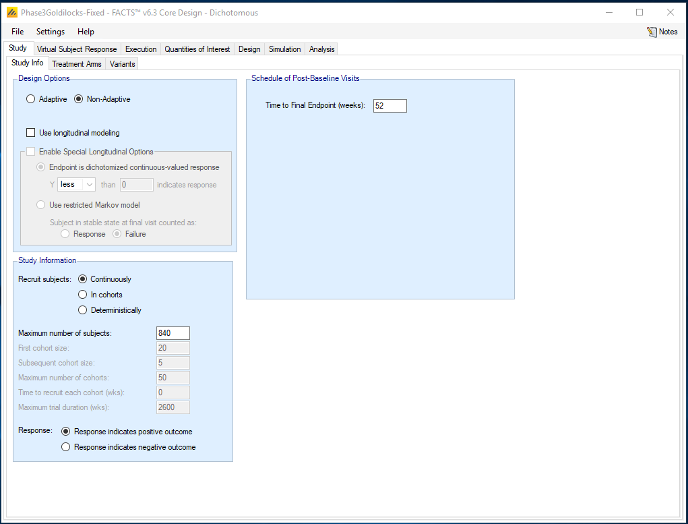

Study/Study Info: The trial enrolls 840 subjects. A response is a positive outcome and is observed 52 weeks (12 months) from baseline.

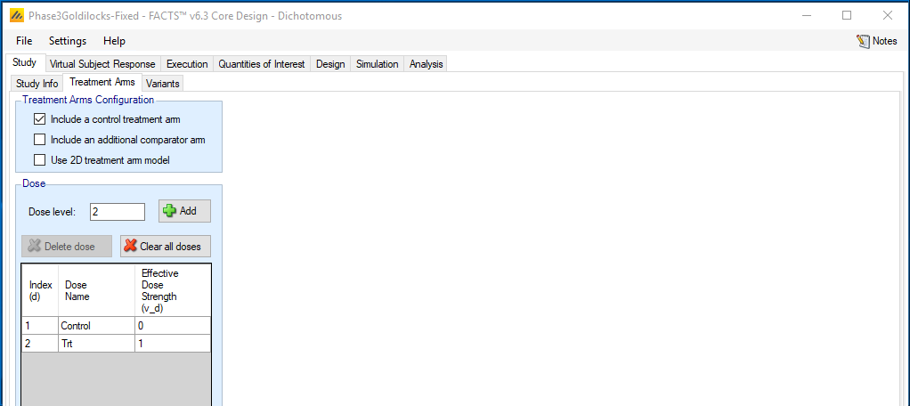

Study/Treatment Arms: We include two arms: treatment and control.

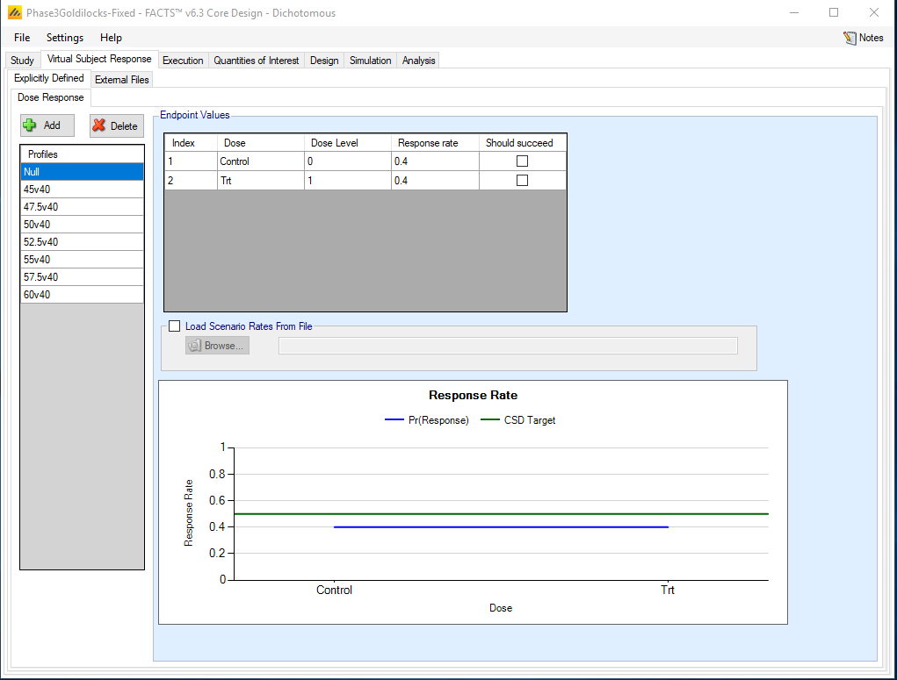

Virtual Subject Response/Explicitly Defined: 8 scenarios for the underlying true control and treatment failure-free rates are considered. The below table outlines all 8 scenarios. All 8 scenarios assume a 40% failure-free rate for control. The Null scenario assumes no improvement in the treatment failure-free rate relative to control. All other scenarios represent varying treatment improvements in the failure-free rate relative to control.

+------------------------+----------------------+----------------------+
| Scenario               | Control              | Trt                  |
+========================+:====================:+:====================:+
| Null                   | 0.4                  | 0.4                  |
+------------------------+----------------------+----------------------+
| 45v40                  | 0.4                  | 0.45                 |
+------------------------+----------------------+----------------------+
| 47.5v40                | 0.4                  | 0.475                |
+------------------------+----------------------+----------------------+
| 50v40                  | 0.4                  | 0.5                  |
+------------------------+----------------------+----------------------+
| 52.5v40                | 0.4                  | 0.525                |
+------------------------+----------------------+----------------------+
| 55v40                  | 0.4                  | 0.55                 |
+------------------------+----------------------+----------------------+
| 57.5v40                | 0.4                  | 0.575                |
+------------------------+----------------------+----------------------+
| 60v40                  | 0.4                  | 0.60                 |
+------------------------+----------------------+----------------------+

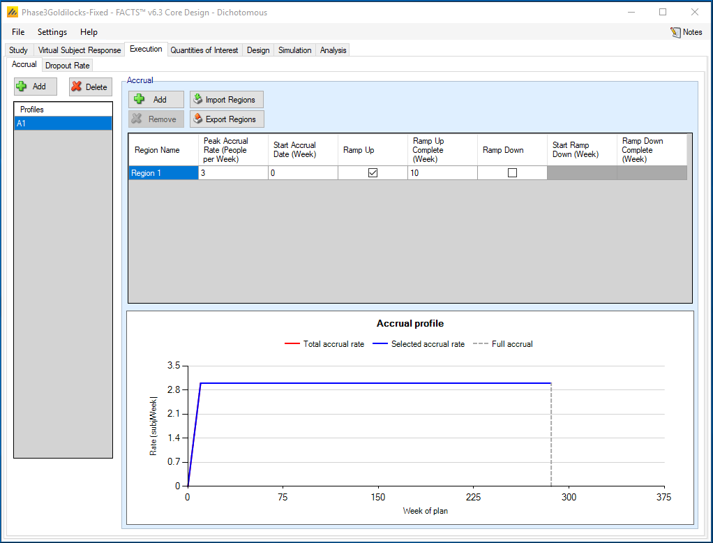

Execution/Accrual: Accrual is simulated from a Poisson process with a mean rate of 3 subjects per week, with a 10-week ramp up with linearly increasing accrual rates.

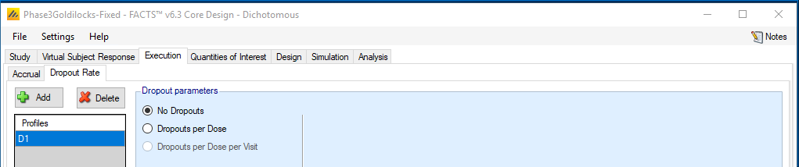

Execution/Dropout Rate: No drop-outs are assumed.

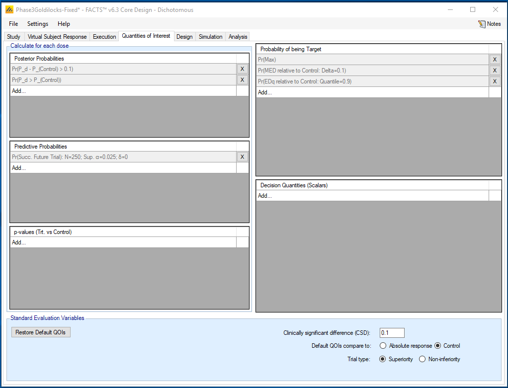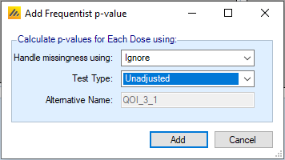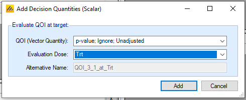

Quantities of Interest (QOI): With a fixed trial design, a single calculation based on a Frequentist p-value will be performed for the final analysis. The following two steps are required to define this calculation.

1)  Select the type of probability that is needed. Here, a p-value on the bottom left portion of the QOI tab is needed. Select 'Add...' to create the p-value. Missing data will be ignored and no adjustment for multiple testing will be incorporated. FACTS will now compute this p-value for every treatment included within the Study tab (in this example, there is only one treatment arm).

2)  For a Success/Futility decision to be taken, as well as the quantity to be tested, it is necessary to first specify the treatment arm whose value is to be used in conjunction with the above probability measure. Select the decision quantity associated with the particular treatment that will be used at the final analysis. On the bottom right select 'Add...'. In the first drop-down menu, having selected the required p-value in the previous step, 'p-value, Ignore, Unadjusted' will now be available. The evaluation dose is 'Trt', previously defined on the Study Tab.

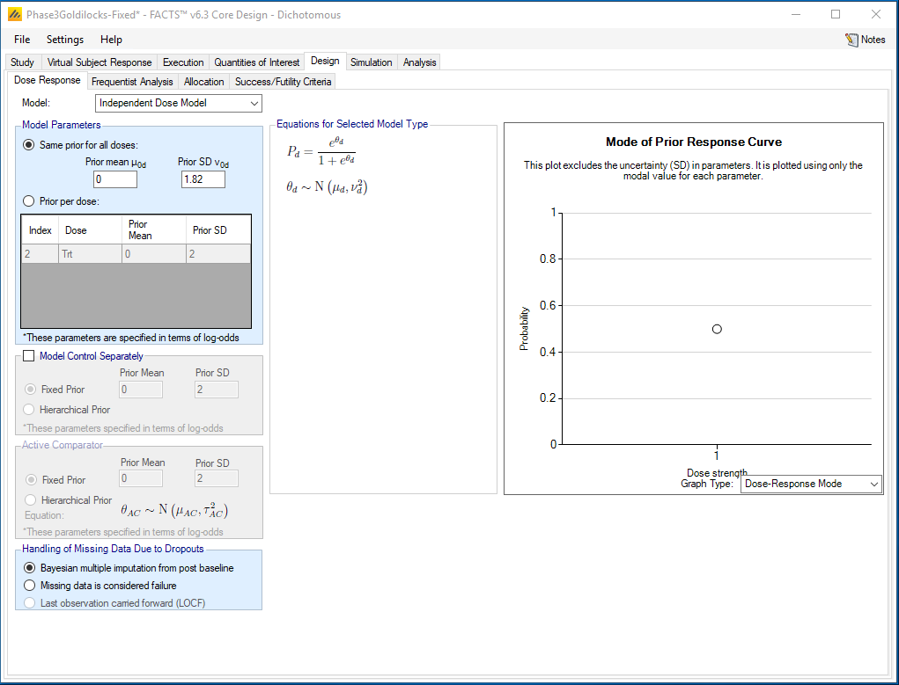

Design/Dose Response: We have no dose-response model. Each study arm (d= treatment or control) is modeled independently:

Pr(failure-free \| dose *d*) = *p~d~*

The prior is specified in terms of the log-odds:

θ*~d~* = logit(*p~d~*)


π*~d~* \~ N(0,1.822).

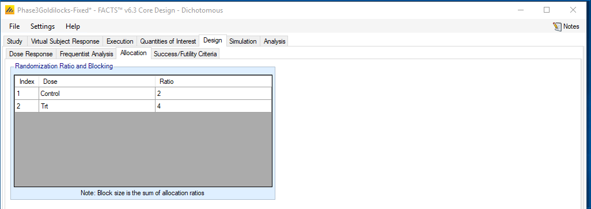

Design/Allocation: The 840 subjects are randomized to treatment or control in a 2:1 fashion. Blocks of size 2+4=6 will be used.

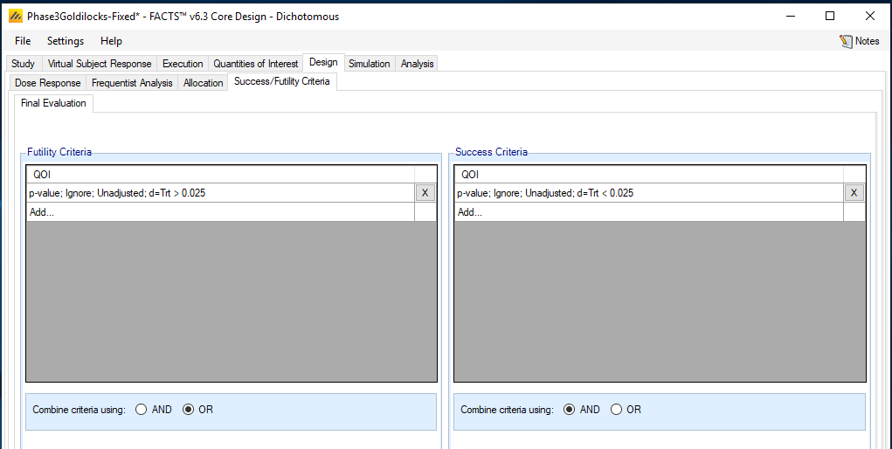

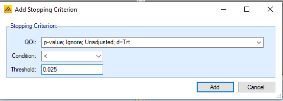

Design/Success/Futility Criteria: The trial is declared a success if the final p-value for a test of superiority is less than 0.025. With only a single test being performed at the final analysis, the overall type I error is maintained at 0.025. Select 'Add...' to select the p-value decision quantity previously defined.

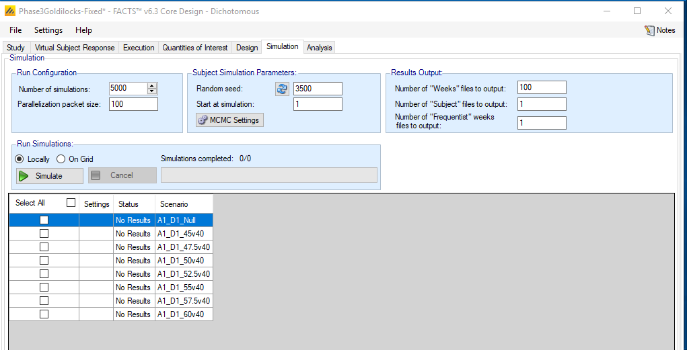

Simulation: We simulate 5000 trials from each scenario. The key operating characteristic is the probability of trial success (Ppn Late Success). This is provided in the below table.

**Operating Characteristics: Fixed**

+----------------------------+------------------------------------------+
| Scenario                   | Pr(Trial Success)                        |
+============================+:========================================:+
| Null                       | 0.024                                    |
+----------------------------+------------------------------------------+
| 45vs40                     | 0.271                                    |
+----------------------------+------------------------------------------+
| 47.5vs40                   | 0.523                                    |
+----------------------------+------------------------------------------+
| 50vs40                     | 0.776                                    |
+----------------------------+------------------------------------------+
| 52.5vs40                   | 0.925                                    |
+----------------------------+------------------------------------------+
| 55vs40                     | 0.983                                    |
+----------------------------+------------------------------------------+
| 57.5vs40                   | 0.997                                    |
+----------------------------+------------------------------------------+
| 60vs40                     | 1.000                                    |
+----------------------------+------------------------------------------+

The design requires 840 subjects. The type I error rate is less than 2.5% and high power is maintained at the high effect sizes.

# Design 2: Adaptive Design

In this design, we build upon the fixed design described above and add adaptive features. In particular, we incorporate adaptive sample size looks by allowing the trial to stop early for either expected success or futility.

Interim looks are made at the data when 300, 400, 500, 600, and 700 subjects have been accrued. Interim decisions are based on the following two predictive probabilities:

- *PP~n~*: the predictive probability of superiority for a trial with the currently enrolled sample size of *n*.

- *PP~cap~*: the predictive probability of success if the full sample size of 840 were enrolled.

The following adaptive decisions will be made:

- At 300, 400, 500, 600, and 700 subjects, if trial success is highly likely with the current sample size accrual will be stopped. The current sample size will be followed through 12 months when a single final analysis is conducted.

  - More specifically if *PP~n~* \> 0.90 then accrual will be stopped.

<!-- -->

- At 500, 600, and 700 subjects, if trial success by the maximum sample size of 840 is small the trial will be stopped for futility.

  - More specifically if *PP~Cap~* \< *0.01* then the trial will be stopped for futility.

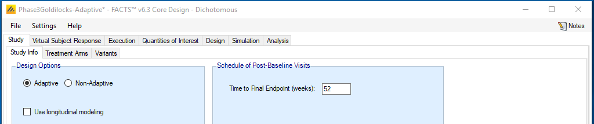

Study/Study Info: We indicate the design is now adaptive.

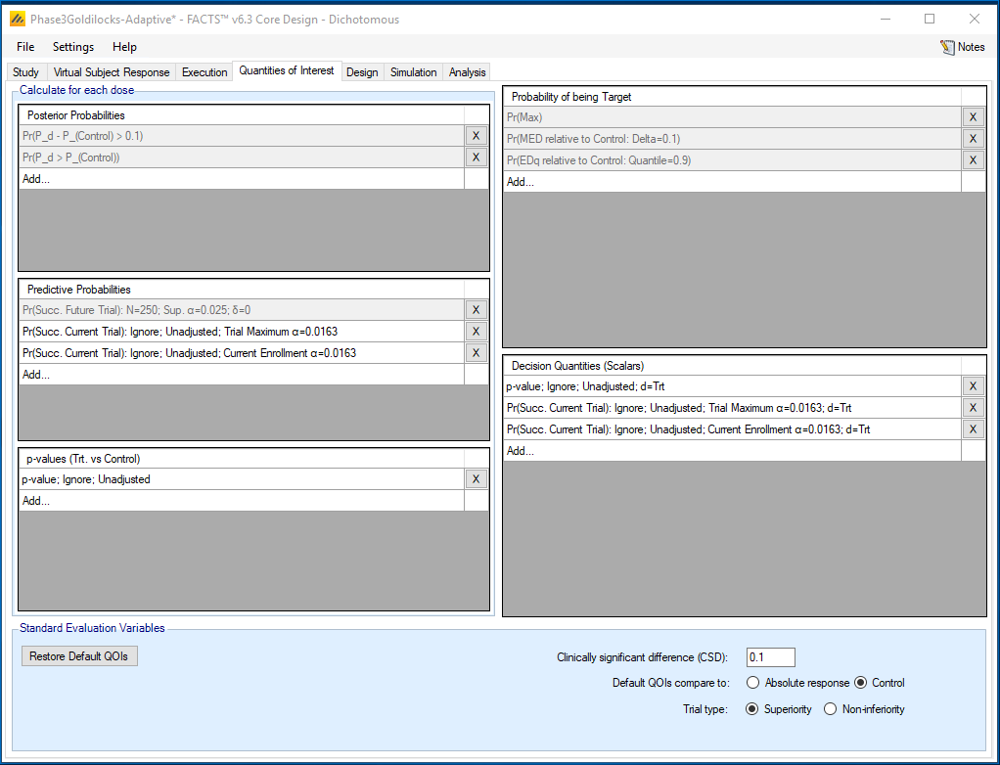

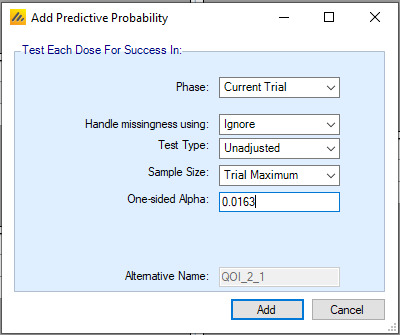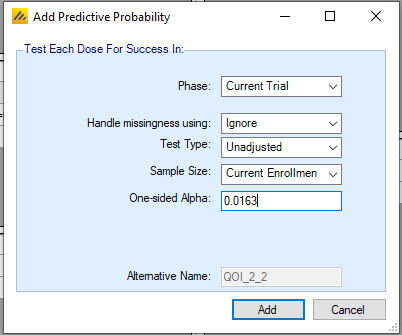

Quantities of Interest: The following two steps are needed to define the predictive probability calculations used for interim decision-making.

1)  Create the probabilities that will be used. Select 'Add...' on the middle left portion of the QOI tab to create these predictive probabilities. Both are based on predicting the outcome of the current trial, ignore missing data, and make no pre-defined adjustment for multiple testing. One is based on the probability of success with the full trial maximum sample size (840 subjects) while the second is based on the probability of success with the currently enrolled sample size. In each case, success is based on a final p-value for a test of superiority at the 0.0163 level. This p-value cut-off was selected to control the type I error of the adaptive design below 0.025 under the trial's design assumptions as well as planned sensitivities to those assumptions.

> 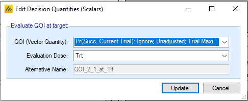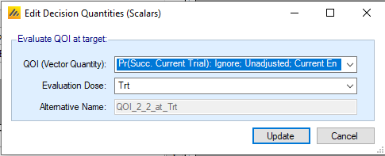

2)  For the interim Success/Futility decisions to be taken, as well as the quantities to be tested, it is necessary to first specify the treatment arm whose value is to be used for each predictive probability calculation. On the bottom right select 'Add...'. Select each of the predictive probability calculations now defined. For both, the evaluation dose is 'Trt', previously defined on the Study Tab.

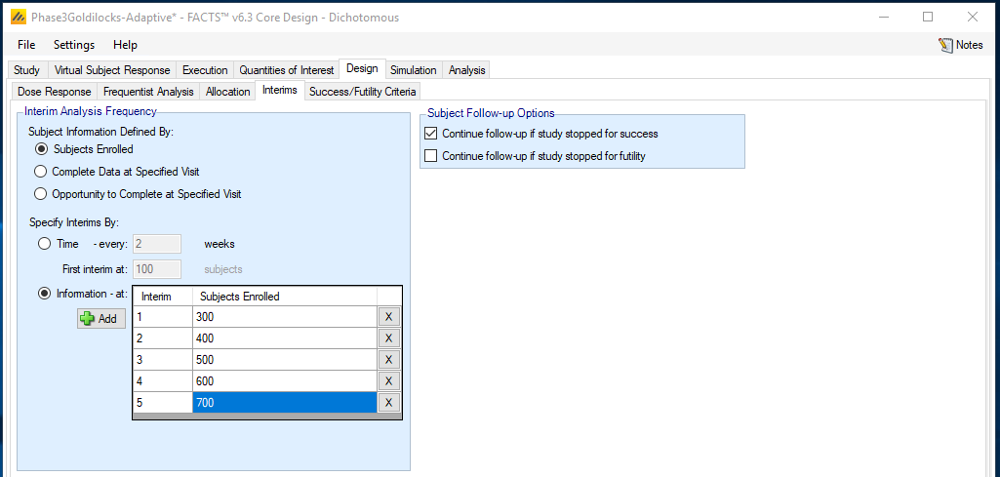

Design/Interims: Interims are triggered based on the number of subjects enrolled and will occur when 300, 400, 500, 600, and 700 subjects enter the study.

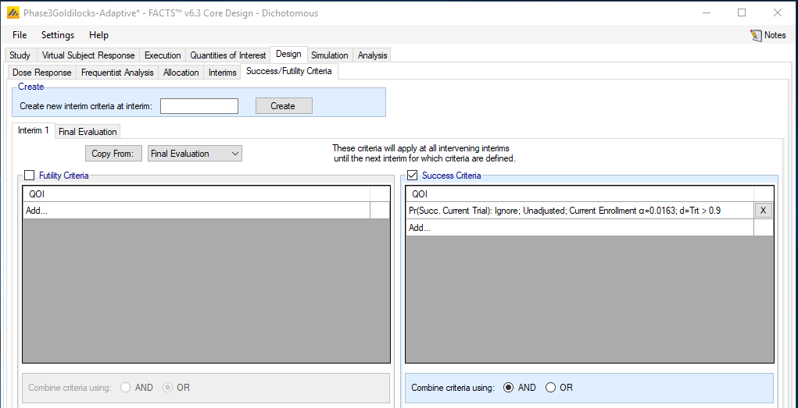

Design/Success/Futility Criteria: Interims 1-2 (when 300 and 400 subjects are enrolled) may stop for expected success only while the remaining interims 3-5 (when 500, 600, and 700 subjects are enrolled) may stop for either expected success or futility. Hence, two interim tabs will be defined. The first tab ('Interim 1') applies to Interims 1 and 2. The second tab ('Interim 3') applies to all subsequent interims, i.e., Interims 3, 4, and 5.

At Interims 1 and 2, the study will stop accrual for expected success if there is a high predictive probability (\>90%) of reaching trial success with the current sample size once follow-up is complete.

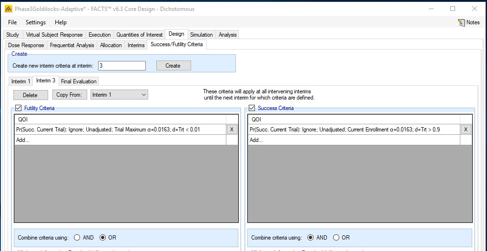

At Interims 3, 4, and 5, the study will stop accrual for expected success if there is a high predictive probability (\>90%) of reaching trial success with the current sample size once follow-up is complete. The study will stop for futility if there is a low predictive probability (\<1%) of reaching trial success with the maximum sample size of 840 subjects once follow-up is complete.

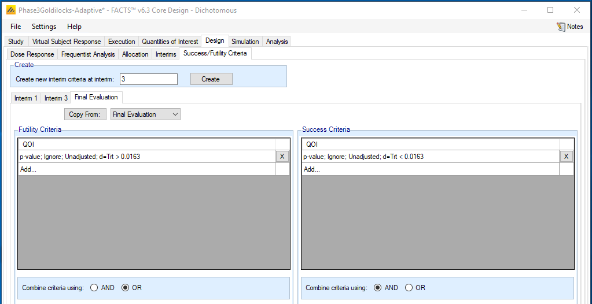

At the final analysis, the study will be declared a success if the final p-value for a test of superiority is less than 0.0163.

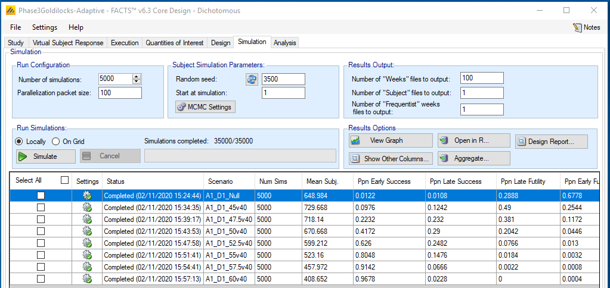

Simulation: We simulate 5000 trials from each scenario. We summarize key operating characteristics, including the overall probability of trial success (Ppn Early Success + Ppn Late Success), the probability of stopping early for futility (Ppn Early Futility), and the average sample size (Mean Subj.). For comparison, the table below includes simulations results for both the adaptive and fixed designs.

**Operating Characteristics: Fixed / Adaptive**

+------------+-------------------+---------------------------------+---------------------+
| Scenario   | Pr(Trial Success) | Pr(Stopping Early for Futility) | Average Sample Size |
+============+:=================:+:===============================:+:===================:+
| Null       | 0.024 / 0.023     | 0 / 0.6778                      | 840 / 649.0         |
+------------+-------------------+---------------------------------+---------------------+
| 45vs40     | 0.271 / 0.222     | 0 / 0.2544                      | 840 / 729.7         |
+------------+-------------------+---------------------------------+---------------------+
| 47.5vs40   | 0.523 / 0.455     | 0 / 0.1172                      | 840 / 718.1         |
+------------+-------------------+---------------------------------+---------------------+
| 50vs40     | 0.776 / 0.707     | 0 / 0.0446                      | 840 / 670.7         |
+------------+-------------------+---------------------------------+---------------------+
| 52.5vs40   | 0.925 / 0.874     | 0 / 0.0130                      | 840 / 599.2         |
+------------+-------------------+---------------------------------+---------------------+
| 55vs40     | 0.983 / 0.952     | 0 / 0.0032                      | 840 / 523.2         |
+------------+-------------------+---------------------------------+---------------------+
| 57.5vs40   | 0.997 / 0.981     | 0 / 0.0008                      | 840 / 458.0         |
+------------+-------------------+---------------------------------+---------------------+
| 60vs40     | 1.000 / 0.991     | 0 / 0.0004                      | 840 / 408.7         |
+------------+-------------------+---------------------------------+---------------------+

The design's ability to stop for futility and success allows the average sample size to be considerably reduced below 840 subjects when the treatment effect is null or effective. It's only in moderate effect cases that the maximum sample size is commonly required. In the null scenario, the study has a 67.78% chance of stopping for futility ahead of full enrollment of 840 subjects.

Due to the use of a smaller nominal p-value to control the type I error below 2.5% under the design's adaptive framework, assumptions, and planned sensitivities to those assumptions, though adequately powered, there are some reductions in power relative to a fixed trial design.

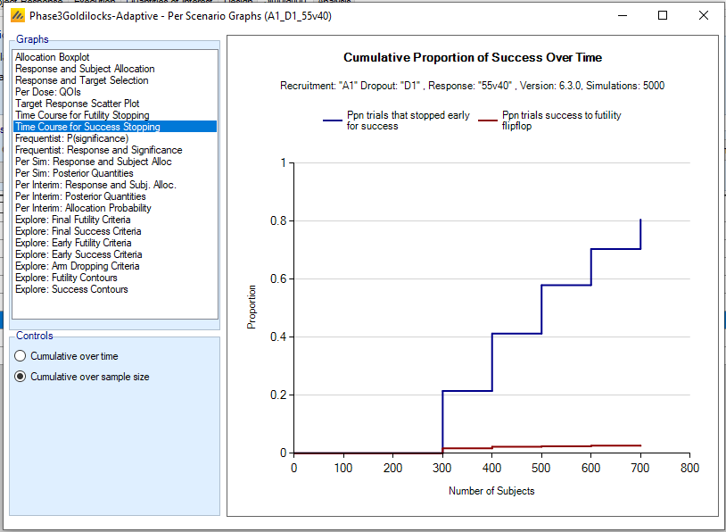

View Graphs/Time Course for Success Stopping: This plot shows the cumulative probability of stopping accrual early for expected success across the sample size range (which coincides with each interim because in this example interim timing is based on number of subjects enrolled). Interim analyses for expected success occur when 300, 400, 500, 600, and 700 subjects are enrolled. In the 55%vs40% scenario, there is roughly a 20% chance of stopping for expected success with 300 subjects while there is roughly an 80% chance of stopping for expected success at some point between 300-700 subjects enrolled.

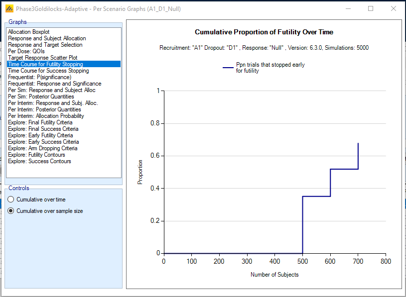

View Graphs/Time Course for Futility Stopping: This plot shows the cumulative probability of stopping early for futility across the sample size range (which coincides with each interim because in this example interim timing is based on number of subjects enrolled). Interim analyses for futility occur when 500, 600, and 700 subjects are enrolled. In the Null 40%vs40% scenario, there is roughly a 35% chance of stopping for futility with 500 subjects while there is roughly a 68% chance of stopping for futility at some point between 500-700 subjects enrolled (this latter number is also in the above table of operating characteristics).

# Design 3: Adaptive Design with Longitudinal Modeling

We can use interim data to predict the outcome of subjects with an unobserved final endpoint. In this example, preliminary data is collected at 1-month (Week 4) and 6-months (Week 26) post-baseline. At the time of each interim analysis, there will be patients who have completed Week 4 and Week 26 failure free and patients that have failed before their Week 52 follow-up. These data are incorporated to the predictive probability calculation through a longitudinal model. Bayesian Multiple imputation is used for calculating the predictive probability.

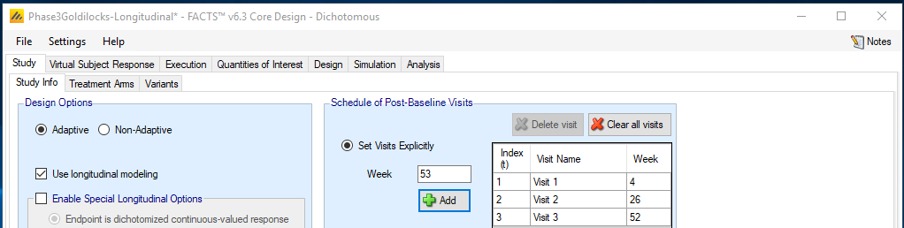Study/Study Info: The initial study tab is updated to indicate multiple visits within the visit schedule; at Weeks 4, 26, and 52.

Design/Longitudinal:

For patients with interim data, model the likelihood that a patient that is failure-free at Week 4 and Week 26 will be failure free at Week 52.

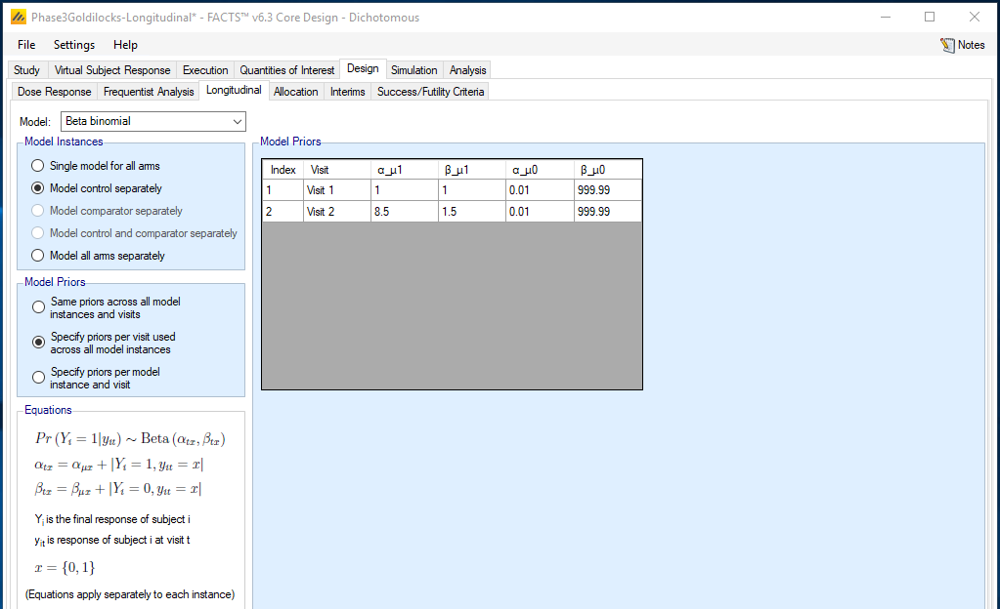

Let the probability of a patient that is failure free by week *j* being failure free at Week 52 (*j* = 1 is Week 4 and *j*=2 is Week 26) for treatment group t (*t* = 1 is treatment and *t* = 2 is control) be *P~tj~*. The prior distribution for each of these probabilities is a beta($\mathbf{\alpha}_{\mathbf{j}}\mathbf{,}\mathbf{\beta}_{\mathbf{j}}$) distribution. We use the following prior distributions:

+:------------------------------------:+:---------------------------------------------------------------------:+
| Time interval                        | $$\mathbf{\alpha}_{\mathbf{j}}\mathbf{,}\mathbf{\beta}_{\mathbf{j}}$$ |
+--------------------------------------+-----------------------------------------------------------------------+
| *j* = 1 (Week 4)                     | 1,1                                                                   |
+--------------------------------------+-----------------------------------------------------------------------+
| *j* = 2 (Week 26)                    | 8.5,1.5                                                               |
+--------------------------------------+-----------------------------------------------------------------------+

These prior distributions are symmetric in the treatments to be conservative, and are quite weak.

If a patient has a failure by any interim visit (Week 4 or Week 26, or between) then that subject is known to be a failure. No modeling is required for these subjects and the Beta-binomial priors associated with early failures are defined to reflect this assumption.

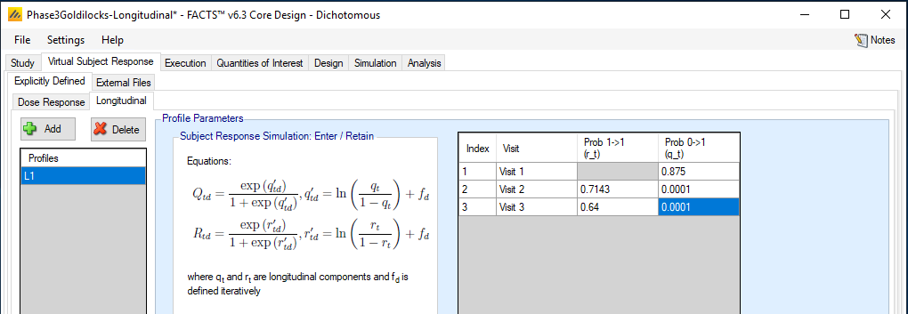

Virtual Subject Response/Explicitly Defined/Longitudinal: A single scenario for the timing of failures across Weeks 4, 26, and 52 are considered. The above inputs reflect the following assumptions:

- If a patient has a failure by any interim visit (at Week 4 or Week 26) then that subject is known to be a failure at subsequent visits with probability 1.

- 5/8 of the total failures will be observed by Week 26. 1/3 of these early failures are observed by Week 4 while 2/3 of these early failures are observed by Week 26. This assumption was based on preliminary data from a separate study.

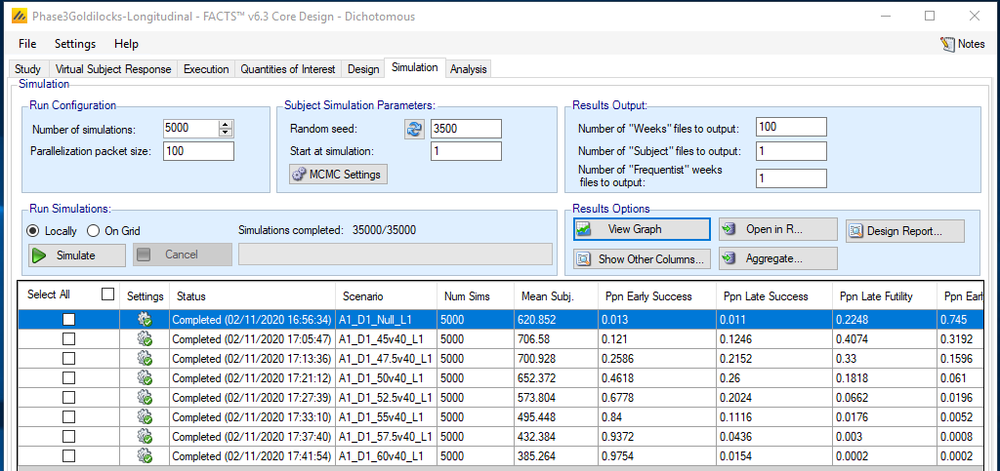

Simulation: We simulate 5000 trials from each scenario and the same key operating characteristics are provided. For comparison, the table below includes simulations results for all 3 design approaches.

**Operating Characteristics: Fixed / Adaptive / Adaptive with Longitudinal Modeling**

+----------+-----------------------+---------------------------------+---------------------+
| Scenario | Pr(Trial Success)     | Pr(Stopping Early for Futility) | Average Sample Size |
+==========+:=====================:+:===============================:+:===================:+
| Null     | 0.024 / 0.023 / 0.024 | 0 / 0.678 / 0.745               | 840 / 649.0 / 620.9 |
+----------+-----------------------+---------------------------------+---------------------+
| 45vs40   | 0.271 / 0.222 / 0.246 | 0 / 0.254 / 0.319               | 840 / 729.7 / 706.6 |
+----------+-----------------------+---------------------------------+---------------------+
| 47.5vs40 | 0.523 / 0.455 / 0.474 | 0 / 0.117 / 0.160               | 840 / 718.1 / 700.9 |
+----------+-----------------------+---------------------------------+---------------------+
| 50vs40   | 0.776 / 0.707 / 0.722 | 0 / 0.045 / 0.061               | 840 / 670.7 / 652.4 |
+----------+-----------------------+---------------------------------+---------------------+
| 52.5vs40 | 0.925 / 0.874 / 0.880 | 0 / 0.013 / 0.020               | 840 / 599.2 / 573.8 |
+----------+-----------------------+---------------------------------+---------------------+
| 55vs40   | 0.983 / 0.952 / 0.952 | 0 / 0.003 / 0.005               | 840 / 523.2 / 485.4 |
+----------+-----------------------+---------------------------------+---------------------+
| 57.5vs40 | 0.997 / 0.981 / 0.981 | 0 / 0.001 / 0.001               | 840 / 458.0 / 432.4 |
+----------+-----------------------+---------------------------------+---------------------+
| 60vs40   | 1.000 / 0.991 / 0.991 | 0 / 0.000 / 0.000               | 840 / 408.7 / 385.3 |
+----------+-----------------------+---------------------------------+---------------------+

The probability of trial success is relatively similar across the two adaptive designs. Incorporating the longitudinal model into interim analyses increases the probabilities of stopping ahead of 840 subjects and average sample sizes are further reduced.
