# Introduction

This tutorial describes an example trial design for a study in HIV using the FACTS Core Design Engine for a Dichotomous Endpoint.

For this version of the document, the screenshots are from the 5.5 release of FACTS and later.

The screenshots provided are approximate and may not reflect the exact layout of the information. The contents of each tab, however, will be consistent with the software.

The designs presented are examples and may not be optimally calibrated.

# Designs Featured

In this tutorial we begin with a fixed design with no adaptations and no dose response modelling (i.e. modelling each arm independently). We then create an adaptive design with the following features:

- Dose response modelling using a Normal Dynamic Linear Model

- Longitudinal modelling using data from earlier time points

- Response adaptive randomization

- Possible early stopping for success or futility

Finally, we modify the adaptive design to remove the response adaptive randomization, and instead allow for arm dropping at the interim analyses.

# Case Study: HIV viral load

The primary endpoint is 3-month undetectable level of HIV viral load with additional measurements of HIV viral load at 1 and 2 months (Dichotomous endpoints Y~1~, Y~2~, Y~3~). Thus a subject with an undetectable level of HIV viral load is considered a responder, Y = 1.

The treatment arms are: Control, and 4 active doses (assume dose units are 1, 2, 4 and 8 mg/kg).

The goal of the study is to find the maximum effective dose. Side effects are incorporated into the primary endpoint such that a subject who experiences adverse effects is not counted as a responder.

The study will be a success if a dose can be found that can be successful (statistically significant at 0.025 1-sided level) in a future 250 subjects per arm phase 3 study.

The expected underlying control response rate is 60% after 3 months. A fixed design would be 80 subjects/arm, giving a total of 400 subjects. This would give a power of 79.4% per arm for a rate of 80% versus the 60% control rate using a one-sided alpha test at 0.025 without adjusting for multiple tests.

# Fixed Design -- No Modeling

Start FACTS. Double Click: Core Design: Dichotomous.

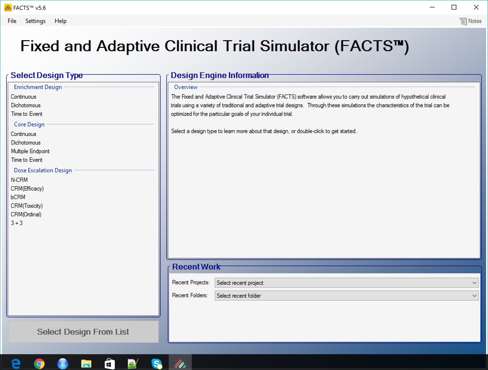

Use the menu option File \> Save As to create a location for saving this design. Save it as "HIV-fixed" in a convenient location (e.g. in a folder called FACTS\\HIV-examples in your 'My Documents' folder).

We will begin by simulating a Fixed Design, a non-adaptive design, with no dose-response or longitudinal modeling. We will then add modeling and adaptive design elements. The Fixed Design will be a 'straw man' design for comparison to the adaptive design.

## Study

### Study Info

The Study tab captures basic information about the trial. Set the following parameters:

- Specify Non-Adaptive

- Clear the Use longitudinal modeling option

- Specify that the maximum number of subjects that can be used is 400 and will be recruited Continuously

- Specify that a response indicates positive outcome

- Enter the Time to Final Endpoint as 12 weeks

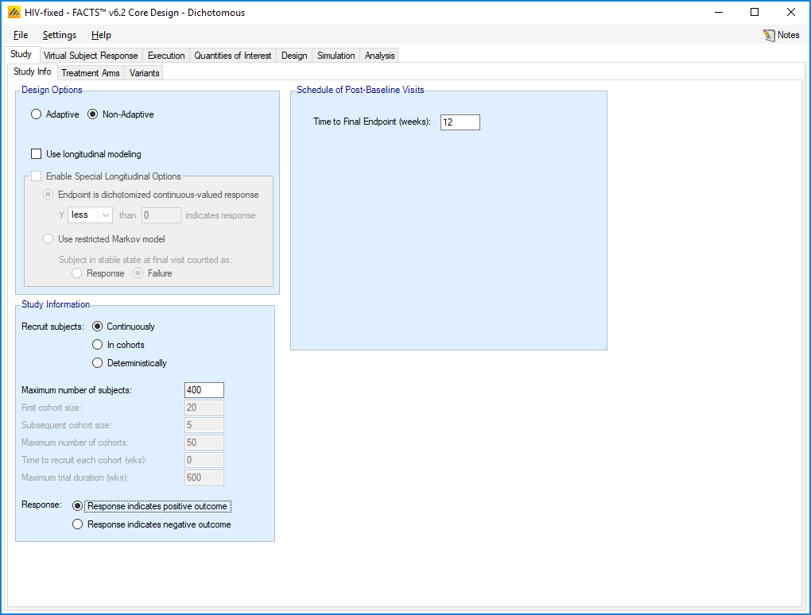

### Treatment Arms

Set the following parameters:

- Include a control treatment arm

- Create 4 additional doses, with Dose Strengths of 1, 2, 3, and 4.

The Dose Name may be changed by double-clicking on the relevant cell in the table. While these names are simply labels for the treatment arms, the Effective Dose Strength (v~d~) is the dose value that will be used in dose-response modeling. Here we assume the dose strengths give a linear range of doses in terms of the expected change in dose effect and considered the dose strengths be 0-4. However, if more appropriate for the study question, the effective dose strengths could be the actual dosing levels, 0, 1, 2, 4 and 8 mg/kg.

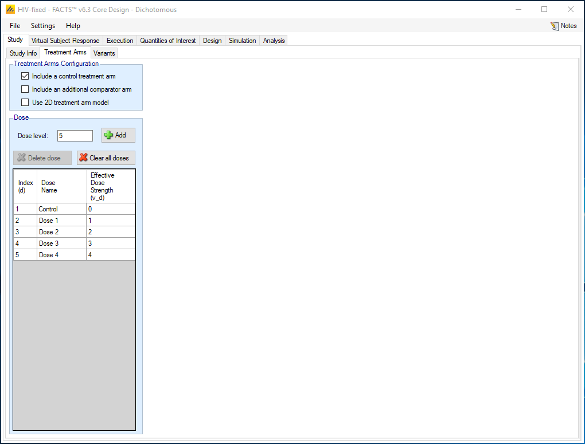

## Virtual Subject Response -- Explicitly Defined

### Dose Response

The Virtual Subject Response tab describes how subject-level data will be generated for the simulations. Add three response scenarios by clicking the Add button. For each scenario, set the underlying response rate for each dose from the corresponding row in the following table:

+-------------+:--------:+:--------:+:--------:+:--------:+:--------:+
| Profiles    | Control  | Dose 1   | Dose 2   | Dose 3   | Dose 4   |
+-------------+----------+----------+----------+----------+----------+
| Flat        | 0.6      | 0.6      | 0.6      | 0.6      | 0.6      |
+-------------+----------+----------+----------+----------+----------+
| Linear      | 0.6      | 0.65     | 0.7      | 0.75     | 0.8      |
+-------------+----------+----------+----------+----------+----------+
| Peak at 3   | 0.6      | 0.6      | 0.65     | 0.78     | 0.7      |
+-------------+----------+----------+----------+----------+----------+

The Profiles can be named by clicking on the default name, e.g. "Response 1" and renaming. Here we just use 3 profiles, as this is a teaching example; in practice a wide range of profiles should be chosen so that you can examine the strengths and weaknesses of a design over the full range of credible response profiles.

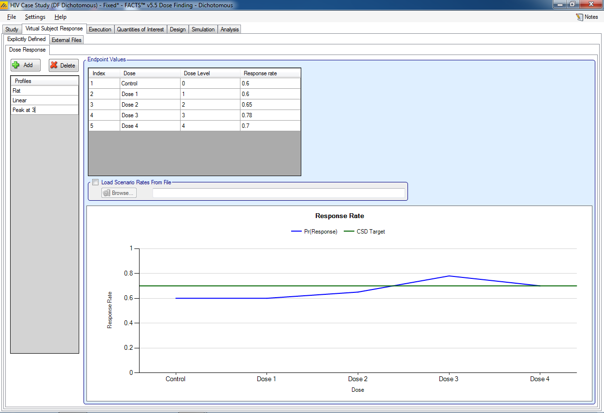

## Execution

### Accrual

Add an accrual scenario by clicking the Add button on the far left. Add a region to this profile by clicking the Add button above the table. Set the following parameters:

- Region 1 peak accrual rate 3.75 subjects per week, starting at week 0, select ramping up to full accrual in week 12.

This approximates an estimated monthly recruitment rates of 5, 10, 10, 15, 15, ... by the following monthly rates: 2.5, 7.5, 12.5, 15, 15, etc.

The names of the profile and the region may be renamed by double-clicking on them.

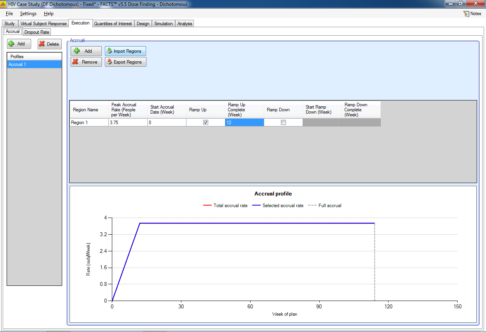

### Dropout Rate

A dropout rate of 0.05 for each treatment arm.

- Select Dropouts per Dose

- Enter 0.05 for each arm

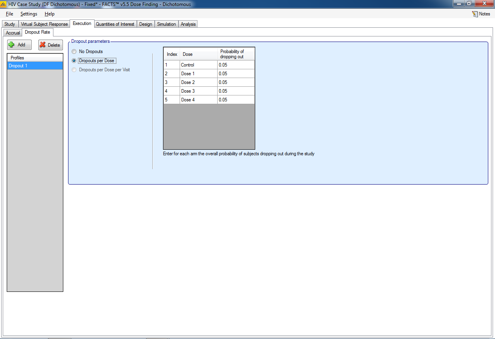

## Quantities of Interest 

The Quantities of Interest (QOIs) are the criteria on which decisions, interim or final analyses, will be made. Numerous QOIs are available and you may select multiple quantities for evaluation. A basic set of QOIs is provided by default. Additional QOIs may be added by clicking the Add row in the table. A QOI can be removed by clicking the X on the right side of the cell. Each QOI may be edited by clicking on it, which opens a pop-up box.

The trial will be judged a success at the end of the trial (after 400 subjects are completed) if the dose most likely to be the maximum effective dose has a high probability of success in a future trial, i.e. a phase 3 trial. A default QOI already exists to monitor the predictive probability of a future trial. We edit the existing Pr(Succ. Future Trial) quantity by clicking on it and a pop-up box will open. In this box:

- Select a Phase of "Future Trial"

- Select Test Type of "Superiority"

- Specify 250 Subjects Per Arm

- Specify a One-sided Alpha of 0.025

- Specify a Superiority Margin of 0

The probability of success in the future trial will be calculated for each dose, assuming that dose is the one carried forward into the future trial. Thus, this is a vector quantity.

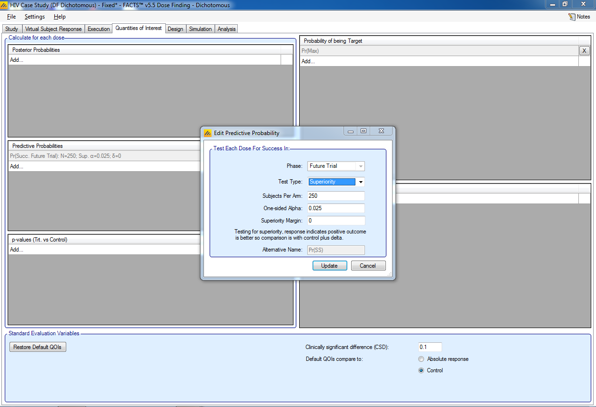

We also would like to see the probability each dose is the maximum effective dose. In the Probability of being Target box we click Add... and select Max for the target type. Note that this quantity may appear as one of the default QOIs. It is another vector quantity that is calculated for each dose.

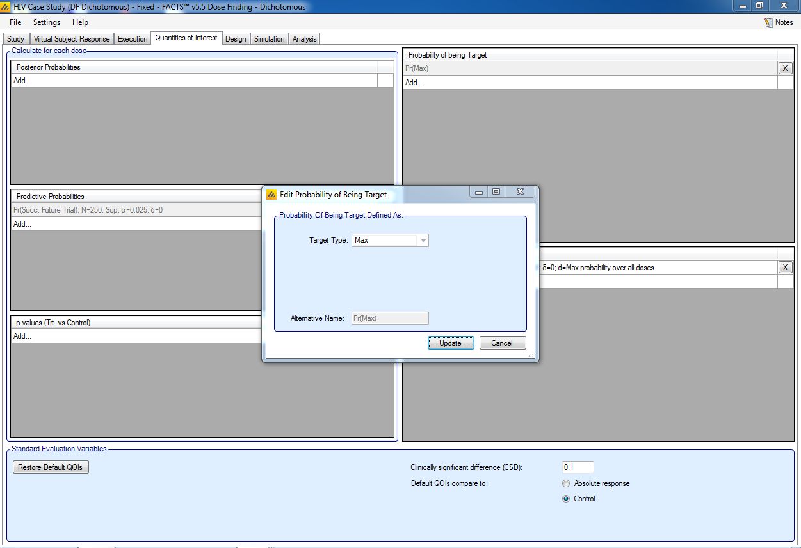

Note, the Alternative Name box contains the name seen in the output files for the quantities.

To make decisions in the trial, we must specify which dose will be evaluated, thus reducing the vector quantity above to a scalar quantity. This information is captured in the Decision Quantities (Scalars) window at the bottom right. We click *Add...* and a popup window opens. We select:

- QOI(Vector Quantity) of Pr(Succ.Future Trial): N=250; Sup. α=0.025; δ=0

- Evaluation Dose: Greatest Pr(Max)

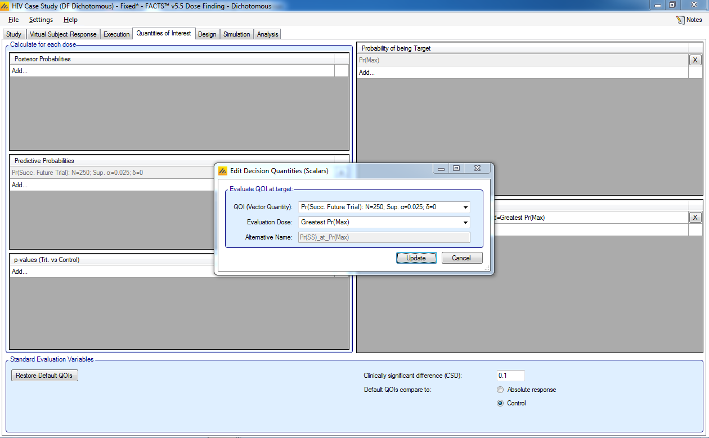

We deleted all the other default QOIs to reduce the amount of output, however they can be left entered in which case they will be computed, and the values output, but they will have no impact on the simulation of the trial.

For the Standard Evaluation Variables at the bottom:

- We will not be using the Clinically Significant Difference (CSD), so leave it at its default of 0.1

- Specify the Default QOIs compare to: Control

- Specify the Trial Type as: Superiority

## Design

### On Setting Priors

On setting priors -- as a rule it is recommended that the user specifies weakly informative priors rather than non-informative ones. There are a number of reasons for this:

1.  In a few circumstances non-informative priors can end up being informative.

2.  What values make a prior non-informative vary depending on the range of the value being estimated, a measure with a SD of 1000 requires quite a different value for a prior to be non-informative than one with an SD of 1.

3.  Measures that are log-odds or log hazard ratios can have parameters that are then exponentiated and used as parameters to other distributions as a maximum these values should have range of (-10,10) and (-5,5). Greater than this and numeric overflows can occur.

4.  Using a "non-informative" prior can sometimes be used as an excuse for not thinking about the prior. Not thinking about a prior is never a good idea.

5.  There are some priors, particularly for the variance parameters of hierarchical models where (as we use inverse Gamma distributions for the priors, weakly informative priors are preferred to uninformative ones \[Gelman 2006, "Prior distributions for variance parameters in hierarchical models" *Bayesian Analysis Vol 1 Number 3*\]

6.  When simulating clinical trial designs there is a balance to be struck between the MCMC sample length used in the within-trial analyses and the number of simulations run. Weakly informative priors can help the MCMC to converge and allow us to use shorter sample lengths.

For many priors the weakly informative is easily judged where the priors directly correspond to values that we are simulating. Others are not so easily judged, for these we used "non-informative" priors ran some simulations and looked at the means and SDs of the posterior estimates of the parameters over all the scenarios and then based a weakly informative prior on these. You will see these priors below being described as having an "initial un-informative" prior and then a weakly informative one. Care must be taken with this approach to not over specify a prior based on the selection of scenarios, and it must be borne in mind that the scenarios may not capture the full potential variability in what the "truth value in nature" might actually be.

### Dose Response

Select the 'Independent Dose Model' option; this option does not do dose response modeling.

Use a prior mean for the log-odds for each dose of 0.4 with a standard deviation of 0.5.

- Initial dose: μ~0~ mean = 0.4, Std Dev of mean = 0.5 (μ~0~ \~ N (log(0.6/0.4), 0.5^2^), and log(0.6/0.4) = 0.4055, the log odds of the control rate)

- The prior was selected to be centered around the log-odds of the control rate.

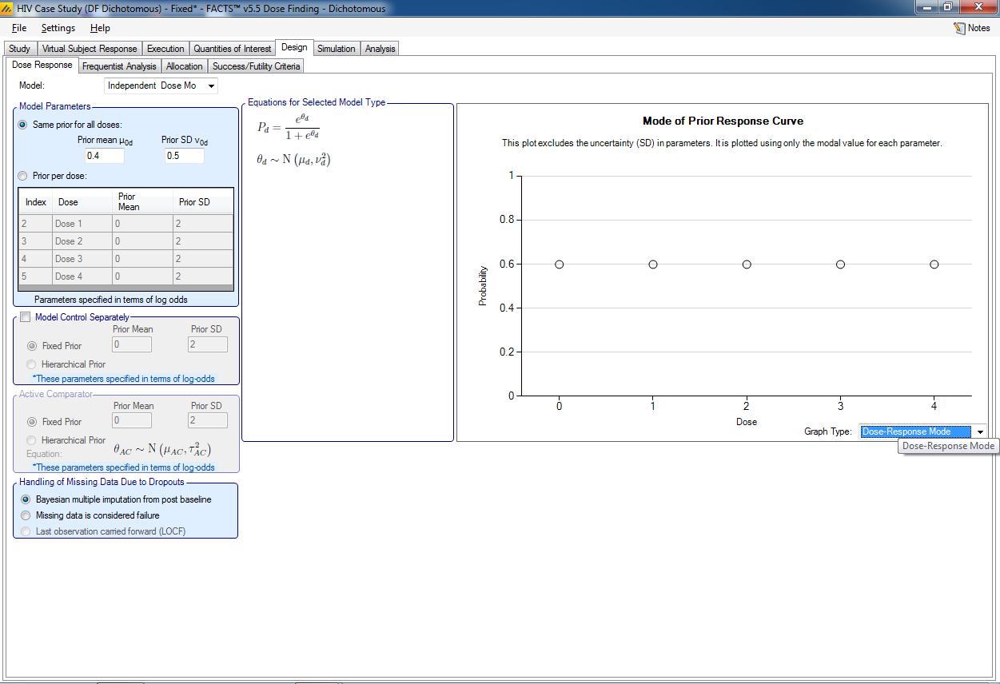

### Frequentist Analysis

The required alpha and the contrast coefficients can be set for the frequentist analysis trend test.

We leave them unchanged.

### Allocation

Because we selected Non-Adaptive on the Study Info screen, only fixed allocation is available, specify a ratio of 1 on control and on each study dose.

### Success/Futility Criteria

We will define a trial to be successful if the probability of success in the future trial is \>0.80. A trial will be defined as futile if the probability of success in the future trial is \<0.50. A trial that finishes with a probability of success in phase 3 of between 0.5 and 0.80 is deemed inconclusive.

Set the following parameters for Futility Criteria:

- Select the QOI to be the probability of success in a future trial that we defined on the Quantities of Interest tab.

- Select a Condition of \<

- Enter a threshold of 0.50

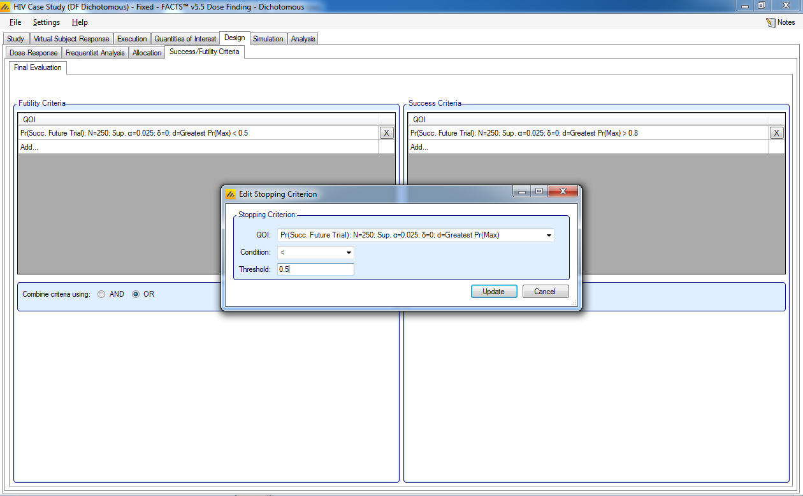

Set the following parameters for Success Criteria:

- Select the QOI to be the probability of success in a future trial that we defined on the Quantities of Interest tab.

- Select a Condition of \>

- Enter a threshold of 0.80

Here we only have one criterion for futility and one for success. You may enter multiple criteria and combine them using AND (all criteria must be met to trigger the rule) or OR (at least one of the criteria must be met to trigger the rule).

## Simulation

For an initial check, set the number of simulations to run to 10, Select All, then press Simulate.

If the results look reasonable, increase the number of simulations to run to 100, Select All, then press Simulate.

What constitutes 'reasonable'?

- Only a small proportion (\<2.5%) of early or late success outcomes for the 'Flat' response scenario, these are equivalent to type-1 errors.

- A high proportion (\~80%) of early or late success outcomes for the 'Linear' or 'Peak at 3' response scenarios, these give our estimate of the designs 'power'.

- A good proportion of trials for the 'Linear' or 'Peak at 3' scenarios that select the correct dose as having the maximum response. What constitutes a 'good proportion' cannot be specified at a fixed level. What can be reasonably achieved is very dependent on the number of doses, number of subjects, nature of the endpoint and the details of the dose response scenario. In this example \~80% is achievable, but it is not uncommon for it to be difficult to be better than 50%.

To achieve more precise estimates of the operating characteristics, you should run 1,000 or 10,000 simulations of each scenario. We only ran 100 simulations here for example purposes.

By default, FACTS simulations run locally on your computer. If you have access to a grid and your FACTS installation has been correctly configured you may use the grid's parallel computing capabilities to improve computation speed. Select "on Grid". Select All and then press Simulate again.

## Results

Check the number of simulations per scenario (note the order of the scenarios) and the mean \# of subjects per scenario.

Check following results:

- Type I error: For the 'Flat' response scenario, only 3.8% of the trials were late successes. These are equivalent to type-1 errors and we want them less than 2.5%.

- Power: For the 'Linear' or 'Peak at 3' response scenarios, 66% and 50% respectively, of trials were late successes. These give our estimates of the designs 'power' and are less than the desired 80%. We will hope to improve the power in the adaptive designs simulated later in this tutorial

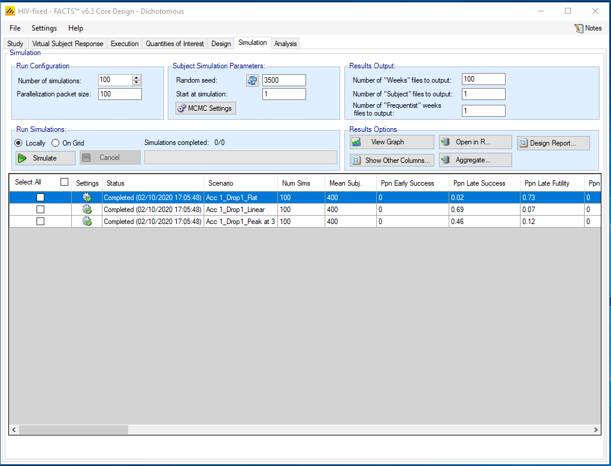

Note that the sum of the proportions of success and futility outcomes may be less than 1 for a scenario; the remainder is the probability of an inconclusive study --not crossing either the success or futility boundary. It is important to treat 'inconclusive' consistently. As in the 'Flat' case, we are only happy with the type 1 error if inconclusive studies are unlikely to be treated as successful, we can't include the inconclusive studies with the successful ones in the other scenarios when we are estimating the power of the design.

Check the ability to correctly determine the target. We click the Show Other Columns button, then click "Probabilities", and look at the probabilities of a dose being the maximum effective dose.

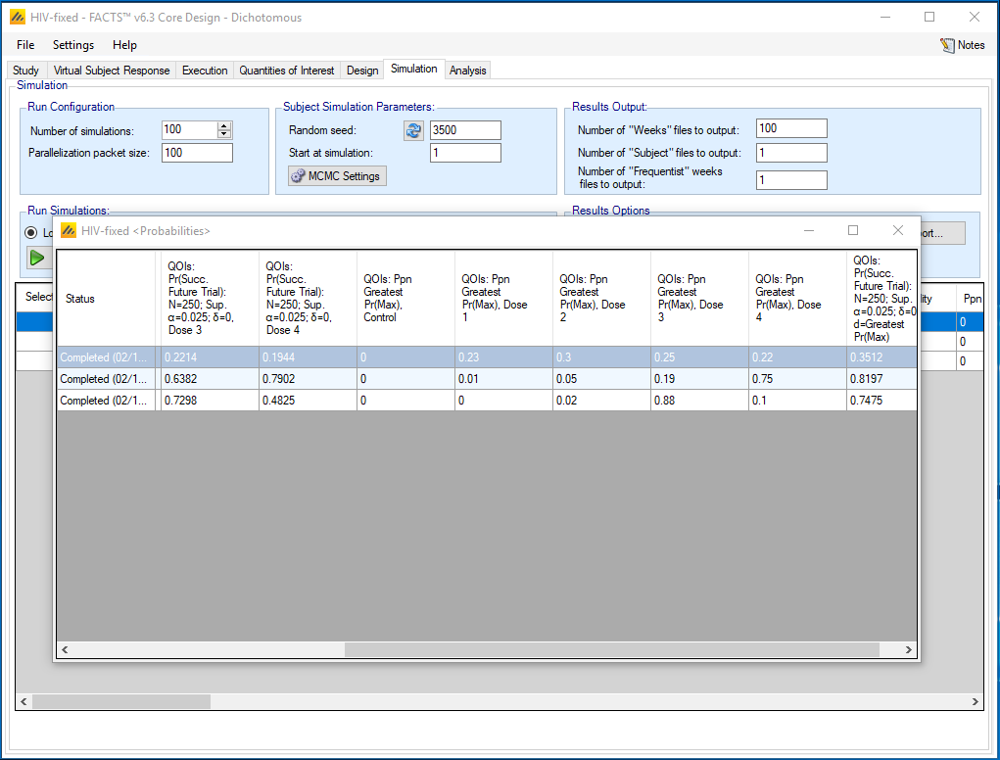

Note that Dose 4 is correctly identified in 75% of the simulations of the Linear scenario and Dose 3 is correctly identified in 88% of the simulations of the 'Peak at 3' scenario. So this aspect of the design looks promising.

# Adaptive Design with Modeling

We now would like to create an adaptive design with modeling. This design will include: a dose-response model, longitudinal modeling of the outcome, and response adaptive randomization.

With the Fixed design above open, use the File \> Save As menu command to create a copy of the design to be edited and modeling and adaptive features added.

The steps below will go through the portions of the design to be changed. If a feature is not discussed it is assumed to remain the same as the fixed design.

Note, the adaptive design below is an example, the design is not necessarily optimized and additional iterations would be required.

## Dose Response Model

The incorporation of side-effects in the endpoint means that the response may not be monotonic across doses, so a normal dynamic linear model (NDLM) is used.

Control (placebo) is included in the model.

We assume the dose strengths give a linear range of doses in terms of the expected change in dose effect, so they are given dose levels of 0, 1, 2, 3, 4 (on the Study Treatment Arms tab).

The probability of a response for a subject on dose *d* is *P~d~*. We will model on the log-odds response:

$$\theta_d = \log\left(\frac{P_d}{1 - P_d}\right) \text{ for } d = 0,1,\ldots,4$$

The prior for the control is:

$$\theta_0 \sim N\left(\log\left(\frac{0.6}{0.4}\right), 0.5^2\right)$$

The prior for each subsequent dose is centered at the mean of the previous dose:

$$\theta_d \sim N\left(\theta_{d-1}, \tau^2\right) \text{ for } d = 1,\ldots,4$$

The smoothing parameter has prior:

$$\tau^2 \sim IG(0.5, 0.32)$$

(using the usual Bayesian α, β parameterisation)

## Design

To add the dose-response model, we make changes to the Design \-- Dose Response tab.

### Dose Response

Set the following parameters:

- Select the Simple NDLM, a Normal Dynamic Linear Model

- For the prior distributions for the 2 parameters for this model

  - Initial dose: μ~0~ mean = 0.4, Std Dev of mean = 0.5 (μ~0~ \~ N (log(0.6/0.4), 0.5^2^), and log(0.6/0.4) = 0.4055, the log odd of the control rate). This prior is the same as was used in the fixed design with an independent model.

  - Tau smoothing parameter: τ~μ~ = 0.8 τ~n~ = 1, (0.8 is used because given the 3 response scenarios, when using a very weak prior for tau, the mean of the posterior distribution for tau ranges between 0.5 and 0.9)

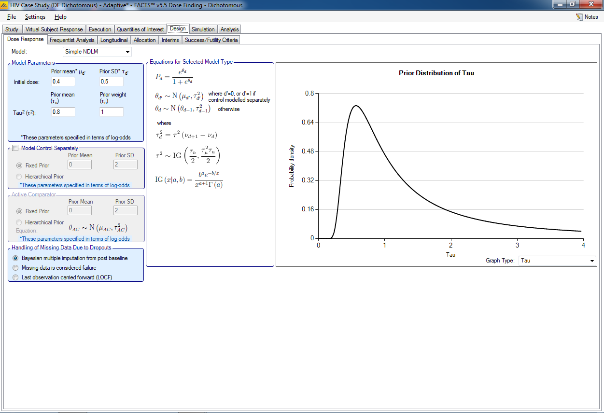

## Longitudinal Modeling

To add the longitudinal model, on the Study -\> Study Info tab, make the following changes:

- Check the "Adaptive" option

- Check the "Use Longitudinal Modeling" option.

- Auto generate 3 visits, starting at 4 with a spacing of 4

The Visit Name may be edited by double-clicking on it.

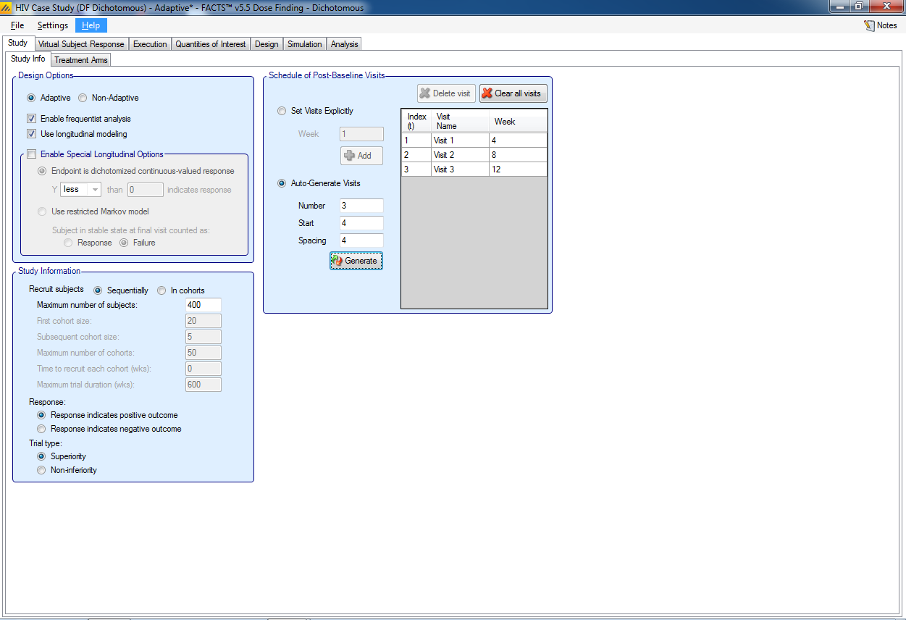

### Simulating Subjects Longitudinal Data

Because we are using longitudinal modelling, on the Virtual Subject Response tab we now have a Longitudinal tab in which to specify how subjects' responses at the intermediate visits are to be simulated. To avoid this specification being too onerous -- requiring transition probabilities to be specified for every dose in each response scenario - FACTS provides a mechanism where you specify one set of transition probabilities and these are then adjusted for each dose in each scenario to give the required final rate.

Assume the 3 month rate to be simulated is *Π*.

We model the transition matrix for each time step *t* by the probability of "entering", P^E^, (becoming a response if previously a fail) and the probability of "retaining", P^R^, (remaining a response if previously a response).

$$\begin{array}{cc} & \begin{array}{cc} 0 \qquad\quad & \quad 1 \end{array} \\ \begin{array}{c} 0 \\ 1 \end{array} & \begin{bmatrix} 1 - P_t^E & P_t^E \\ 1 - P_t^R & P_t^R \end{bmatrix} \end{array}$$

To fit *Π* use an offset on the log-odds scale, *φ*:

$$P_t^X = \frac{\exp\left(\log\left(\frac{P}{1-P}\right) + \varphi\right)}{1 + \exp\left(\log\left(\frac{P}{1-P}\right) + \varphi\right)}$$

Assume the following default transition probabilities:

$$P_1^E = 0.6,\ P_2^E = 0.4,\ P_3^E = 0.2$$

$$P_2^R = 0.8,\ P_3^R = 0.9$$

For each value of *Π* the program fits the appropriate value of *φ*.

Add a profile to the Explicitly Defined \-- Longitudinal tab:

- Enter the following default transition probabilities:

+----------------------+:----------------------:+:-------------------:+
| Visit                | Prob 1-\>1 (r_t)       | Prob 0-\>1 (q_t)    |
+----------------------+------------------------+---------------------+
| Visit 1              | \--                    | 0.6                 |
+----------------------+------------------------+---------------------+
| Visit 2              | 0.8                    | 0.4                 |
+----------------------+------------------------+---------------------+
| Visit 3              | 0.9                    | 0.2                 |
+----------------------+------------------------+---------------------+

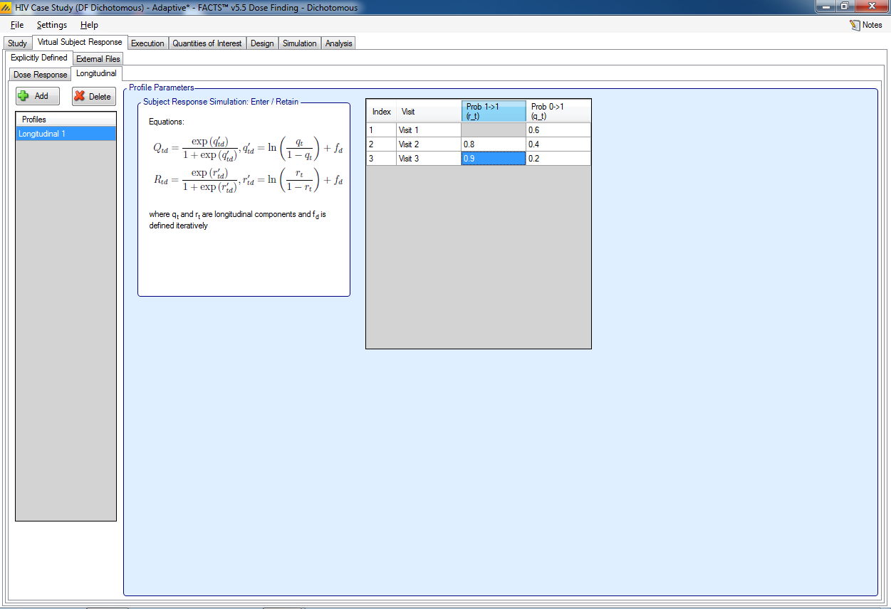

### Fitting a Longitudinal Model

In order to make use of the longitudinal data, the longitudinal modeling needs to be specified within the Design -- Longitudinal tab. This specifies how the visit data will be analyzed in order to impute final results for subjects who have not completed their final visit. For each visit, we model the probability of being a responder at the final visit conditional on the outcome at the current visit.

Set the following parameters:

- Select the Beta Binomial model

<!-- -->

- Select to model control separately. This means that control subjects with an unobserved final visit will be imputed using only the data from other control subjects to inform the transition probabilities between early visits and the final visit. For subjects on the active doses, the transition probabilities will be informed by pooling data across the active doses.

- For Model Priors, select: same priors across all model instances and visits. Separate priors can be specified for each model instance (e.g. the control model and the active doses model) and visit, but for simplicity we use one set of priors for all time points and doses:

  - P(response at 3 month observation \| response at visit) \~ Beta(4,1). A Beta distribution for the probability of final response given being a responder at the visit equivalent to having 4 observations of final responders and 1 observation of a non-responder (i.e a mean of 80%). Thus we are specifying a weakly informative prior in line with our expectation that someone who is a responder will remain a responder.

  - P(response at 3 month observation \| no response at visit) \~ Beta(2,2). A Beta distribution for the probability of final response given being a responder at the visit equivalent to having 2 observations of final responders and 2 observation of a non-responder (i.e. a mean of 50%). Here we are specifying a weakly informative prior in line with an expectation of a roughly 50% response rate.

  - These are weakly informative priors that will be overwhelmed by the observed data during the trial -- which has a maximum sample size of 400 and with early stopping we will require to have enrolled at least 100 subjects. Also note that as we give every arm the same prior we will not be biasing the results in favor of one arm rather than another.

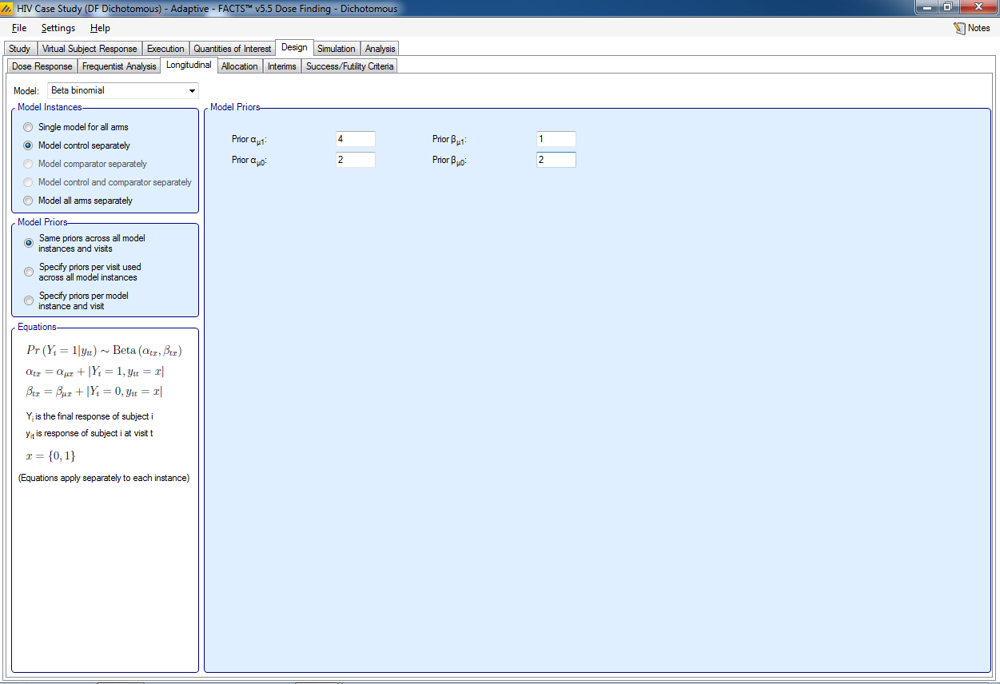

## Allocation

On the Design -- Allocation tab we will specify the details for the adaptive randomization. The goal is to preferentially allocate subjects to the most promising arm(s).

In the adaptive design we are going to increase the proportion allocated to control. As we are comparing each dose to control, a rule of thumb if that the greatest power is when the allocation ratio is sqrt(D) : 1 : 1 : 1 ... where D is the number of treatment arms being compared to control. Although this gives greater statistical power, such an allocation can be unpopular with clinical teams as it means there will be less data on the dose selected at the end of the trial compared to using a 1:1:1 ... ratio. An advantage of response adaptive allocation is that it tends to boost the allocation to the dose that is eventually selected at the end of the trial making this greater allocation to control more acceptable.

Initially we will use a fixed allocation of 2:1:1:1:1, then once adaptation starts (after 80 subjects enrolled), randomly allocate in a block size of 6 where 2 in every block are allocated to the control arm, and the remainder of the block is allocated adaptively.

We will conduct an interim every month adjusting the allocation of subjects to the study drug doses to be in proportion to the probability that the dose is the maximally effective arm. If the randomization probability for any dose falls below 0.05 then we temporarily drop the dose and re-normalize the probabilities for the remaining doses.

Set the following parameters:

- Select Adaptive Allocation

- Set the allocation ratio to be used before the first interim to be 2 for control and 1 for each study dose

- For the control arm check the "Fix Alloc" option and specify that after the first interim it should be allocated 2 times in each randomization block.

- Set the Post first interim block size to 6

- Select Add... under Adaptive Allocation Target

  - Select QOI: Pr(Max)

  - Select Weight For: Information

    - We chose to weight for information because it is less aggressive on the adjusting of the randomization probabilities compared to weighting for probability. Either may be used.

  - Set Relative Weight to 1

- Set the "Allocation probability set to zero for values lower than" at 0.05

- Set Raise allocation to power: 1

  - If you choose a power less than 1 the adaptive randomization will be less aggressive. Different options could be examined.

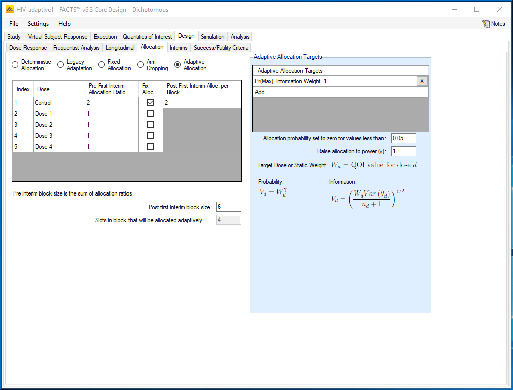

## Interims

On the Design \-- Interims tab we specify the timing and frequency of the interim analyses.

Select the following parameters:

- Set the Subject Information Defined By to Subjects Enrolled

- Set the Specify Interims By: Time

  - Set the Time to every 4 weeks

  - Set First interim at 80 subjects

- Select Continue follow-up if study stopped for success

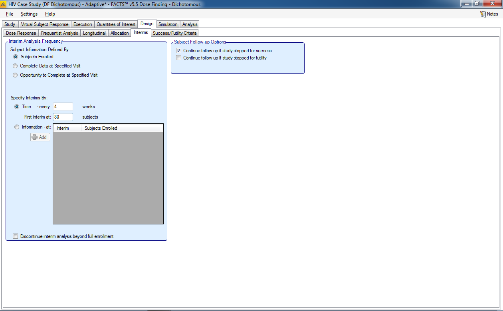

## Success/Futility Criteria

Under Design-Success/Futility Criteria we specify the criteria for early stopping for success and futility as well as the final evaluation criteria.

### Interim 1 Criteria

On this tab we specify the interim analyses criteria for early stopping of accrual. In this example we keep the same criteria across all interims. If we wanted to have different criteria for different interims we would select Create new interim criteria at interim and specify the interim where criteria changes.

Stop early for futility if there are at least 100 subjects randomized and the dose most likely to be the maximum effective dose has a probability of success in phase 3 of \< 15%. We also require that at least 50 subjects have been enrolled on the selected maximum effective dose.

Select the following parameters

- Select Futility Criteria

- Add a QOI

  - Pr(Succ. FutureTrial): N=250...

  - Set Condition \<

  - Set Threshold 0.15

- Set Minimum Information Required to be 100 total subjects enrolled.

- Set the Evaluation Dose to be Greatest Pr(Max)

  - Set the Minimum Number of Subjects Enrolled to be 50, this is the minimum number of subjects on the arm with the greatest probability of being the maximum arm.

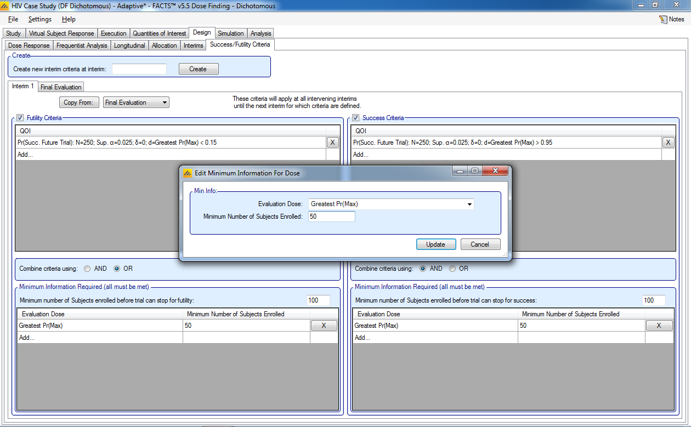

Stop early for success if there are at least 100 subjects randomized and the dose most likely to be the maximum effective dose has a probability of success in phase 3 of \> 95%. We also require the maximum effective dose to have at least 50 subjects enrolled.

Select the following parameters

- Select Success Criteria

- Add a QOI

  - Pr(Succ. FutureTrial): N=250...

  - Set Condition \>

  - Set Threshold 0.95

- Set Minimum Information Required to be 100 total subjects enrolled

- Set the Evaluation Dose to be Greatest Pr(Max)

  - Set the Minimum Number of Subjects Enrolled to be 50, this is the minimum number of subjects on the arm with the greatest probability of being the maximum arm.

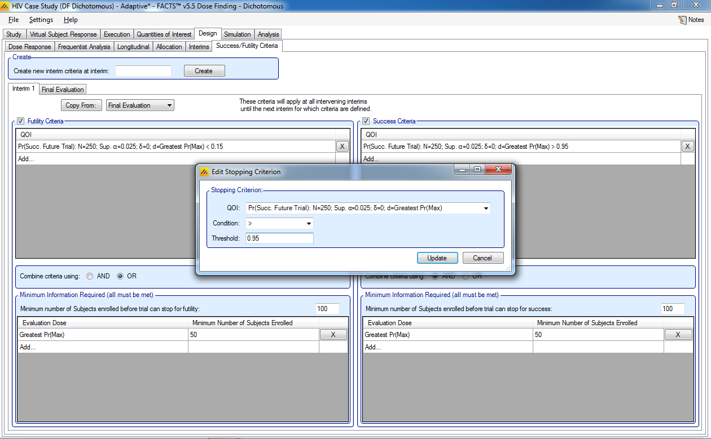

### Final Evaluation

The final analysis is used to judge whether or not the trial is successful. If an early accrual stopping for futility rule is met, then this criterion is evaluated at that time. If an early accrual stopping for success rule is met, then this criterion is evaluated after all subjects have been followed through the 3-month endpoint. If no early stopping rule is met, then the criteria are evaluated after all subjects have been followed through the 3-month endpoint. The final evaluation criteria stay the same as in the fixed design.

The trial will be judged a success if:

- the dose most likely to be the maximum effective dose has a probability of success in phase 3 of \> 80%.

The trial will be judged futile if:

- the dose most likely to be the maximum effective dose has a probability of success in phase 3 of \< 50%.

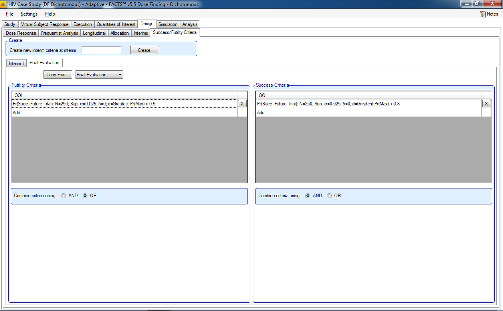

## Simulation

Similar to the fixed design, we set the number of simulations to run to 10 as an initial check, Select All, then press Simulate.

If the results look reasonable, increase the number of simulations to run to 100, Select All, then press Simulate. The criteria for "reasonable" are the same as stated above in 4.6. When the design is calibrated you should run a higher number, 1,000 or 10,000 simulations.

## Results

Check the number of simulations per scenario (note the order of the scenarios) and the mean \# of subjects per scenario.

Check the type-1 error and power, as well as the success to futility flip-flops. The success to futility flip-flops need to be checked because we continue follow-up if enrollment is stopped early for success.

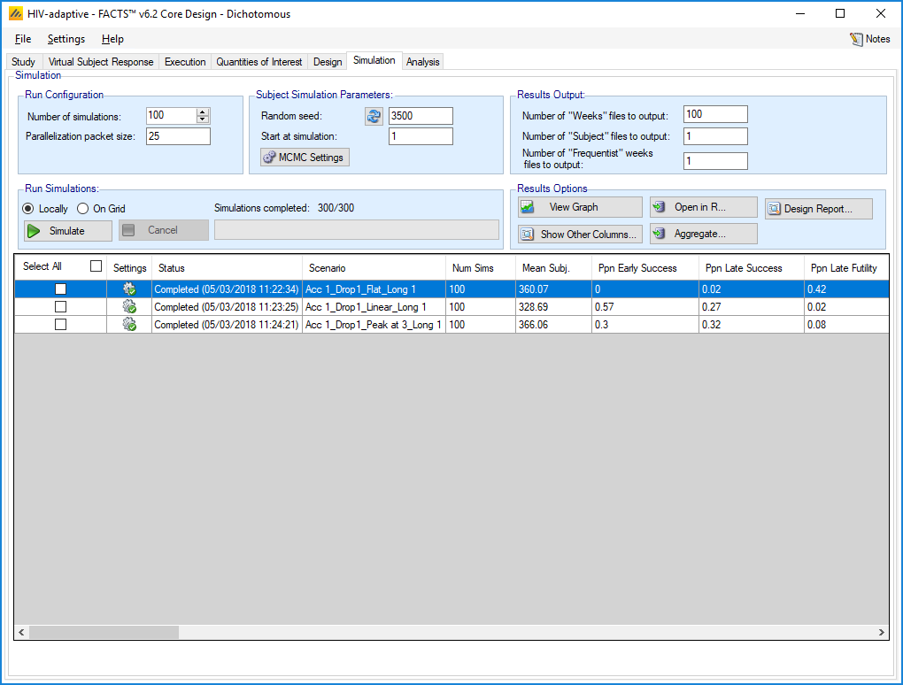

Note that the power of the study in the Linear scenario is approximately 84%, (0.57+0.27), and the power in the Peak scenario is approximately 62% (0.30+0.32). The type I error is determined by looking at the Flat scenario, and is 2%. It is important to note that small proportions are not well estimated at only 100 simulations, so, as we noted above, once calibrated the design should be run with 1,000 or 10,000 simulations. The Success to Futility Flip flop is 0, but should be checked again when a higher number of simulations are performed.

Check the ability to correctly determine the target:

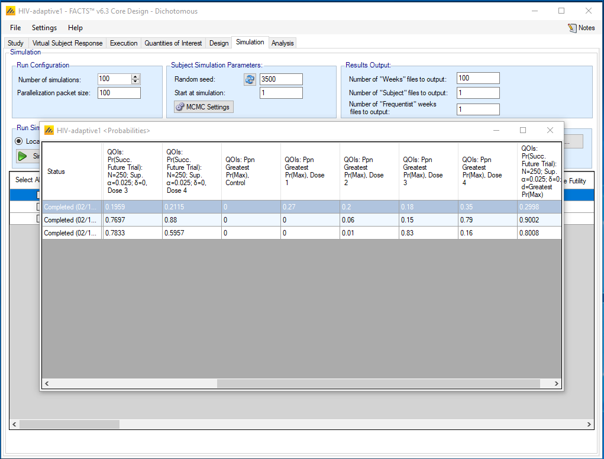

Note that Dose 4 is correctly identified in 79% of the simulations of the Linear scenario and Dose 3 is correctly identified in 83% of the simulations of the 'Peak at 3' scenario. So this aspect of the design looks promising.

We can also look at the average number of subjects randomized to these doses in these scenarios:

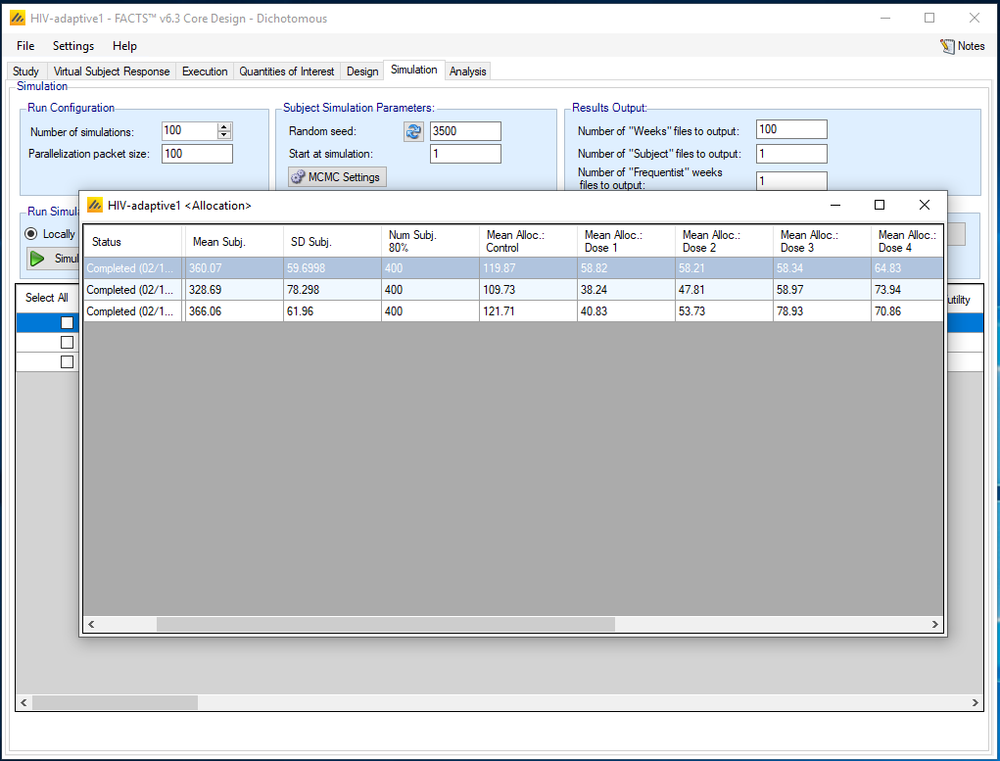

So on average around 74 subjects are allocated to Dose 4 in the Linear scenario and around 79 to Dose 3 in the Peak scenario. Recall that in the fixed design, allocation was 80 per arm, so the adaptive design allocates almost as many subjects to the better performing arms, even with the increased allocation to control. At the same time the average study size has fallen from 400 in the fixed design to between 329 and 366 depending on the scenario.

So whilst maintaining a the desired level of type-1 error (\<2.5%), and almost as many subject data on the selected dose, the adaptive design delivers a good chance (30%-57% depending on the scenario) of stopping enrollment early for success, saving on average 10-20% of the sample size, whilst increasing the power by about 15-16 percentage points. A higher number of simulations should be run to confirm these conclusions.

The dose response model fit should also be checked using the View Graph button. Select Per Scenario Graphs. We can select Response and Subject Allocation to see the fit over all the simulations. In the Peak at 3 scenario, we observe that the dose-response model tends to smooth out the peak to some degree. This graph also illustrates that Dose 3 is allocated the highest number of subjects, approximately 79, other than the control dose which had allocation fixed. Alternatively, we can Per Sim: ... graphs to view the model fit and various quantities for each simulated trial.

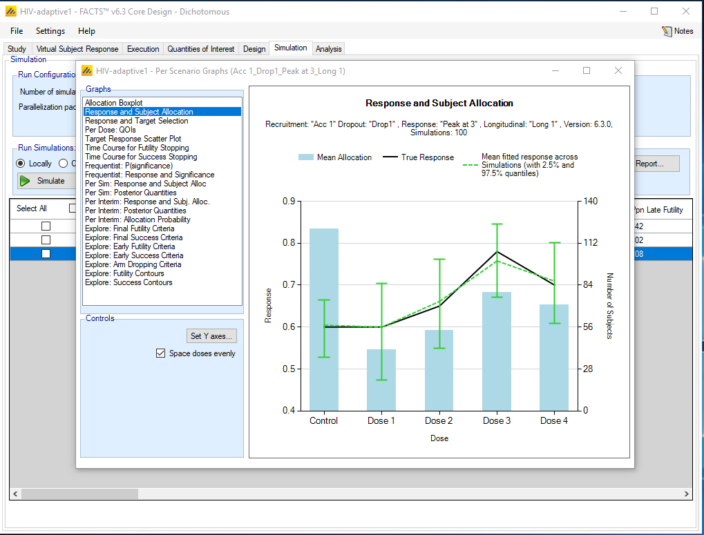

When comparing the adaptive design to the fixed design you should see the type-1 error remains controlled (proportion of success results under the 'Flat' scenario \< 0.025), the power of this design is higher and the correct selection of the max dose is similar to the fixed design but tends to be a little better.

# Arm Dropping Version

Now we create an alternative design where arms may be permanently dropped to provide an example of these features. In this design, we allow up to 3 arms to be dropped during the course of the trial. At each interim, a set of doses will be identified as being eligible for dropping. From this eligible set, doses will be pruned from the low end (so that smaller doses must be dropped before higher doses).

To create the arm dropping version of this design, open the adaptive HIV design and use the menu option File \> Save As and save a version of the design with a new name, for example HIV-arm-dropping.

## Study

### Study Info

This is the same as for the adaptive.

### Treatment Arms

This is the same as for the adaptive.

## Virtual Subject Response

### Explicitly Define -- Dose Response

This is the same as for the adaptive.

### Explicitly Define -- Longitudinal

This is the same as for the adaptive.

## Execution

### Accrual

This is the same as for the adaptive.

### Dropout Rate

This is the same as for the adaptive.

## Quantities of Interest

This is the same as for the adaptive.

## Design

### Dose Response

This is the same as for the adaptive.

### Frequentist Analysis

This is the same as for the adaptive.

### Longitudinal

This is the same as for the adaptive.

### Allocation

In the Design -- Allocation tab, set the parameters as follows:

- Select arm dropping and set the allocation ratio to a fixed 2:1:1\...

- Set the maximum number of arms to be dropped to be 3 (currently don't set this limit so high that all study drug arms can be dropped).

- Select Prune from lowest dose, so that the arm dropping is done from the lower doses eligible.

- Select to maintain the study size and maintain block size (or you can try the other options).

- Add to Arm Dropping Criteria

  - Select that an arm is eligible for dropping if the probability of phase 3 success is less than 0.2. Note that the control arm is never eligible for dropping.

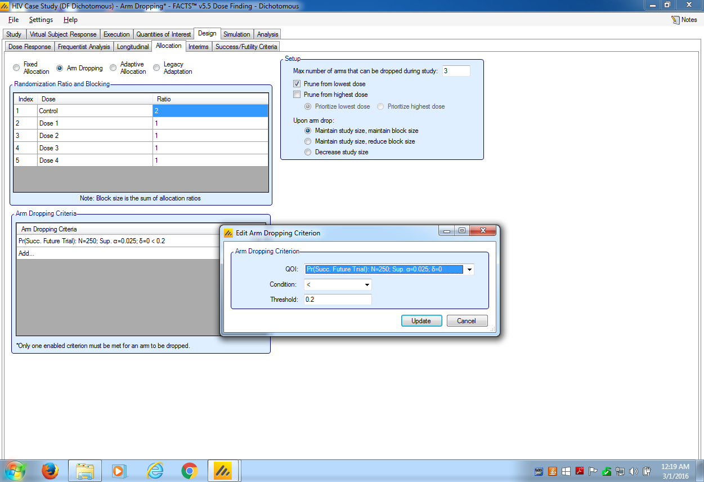

### Interims

Here we would like fewer interim analyses because arm dropping is a permanent decision.

- Specify that interims are to be after 200, 250, 300, 350 and 400 subjects have been enrolled.

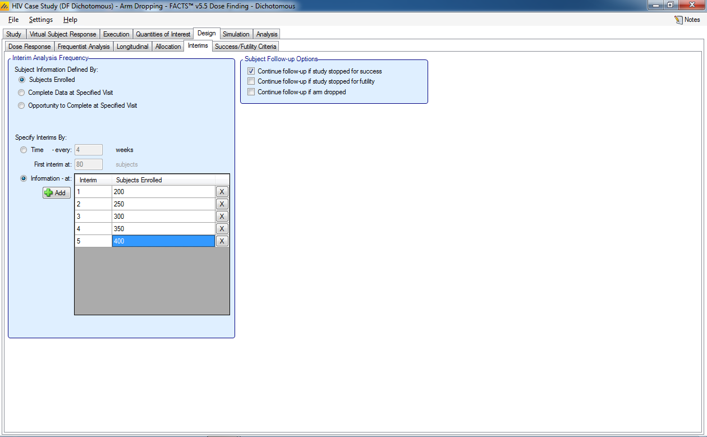

### Success/Futility Criteria

This is the same as for the adaptive.

## Simulation

Running the simulations is the same as for the adaptive version.

Results can be compared between the designs in terms of

- Type 1 and type 2 errors as well as success to futility flip-flops.

- Trial size

- Correct selection of the dose with the maximum effect.

It is also possible to review whether the arm dropping was successful:

- Select a scenario of interest -- e.g. here it is Linear

- Click on View Graph and select Per Scenario Graphs

- Select Response and Ppn Arms Dropped

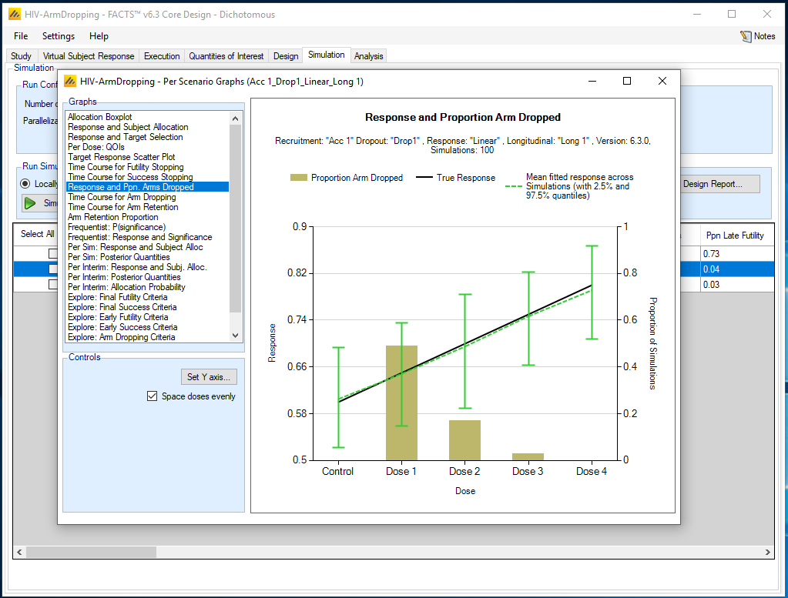

# Designs for comparison

Numerous options are possible for additional design comparisons. At minimum the adaptive design should be compared to the fixed design, i.e. the design with equal allocation to all arms, a fixed sample size of 400 subjects, and no early stopping.

In addition, other possible designs comparisons are:

- Compare the adaptive design to a design that includes longitudinal modeling (so that dropouts are included) but use LOCF.

- Compare two fixed designs: simple pair-wise comparison ('Independent Dose Model') and the NDLM.

- Compare adaptive design above to an arm dropping design allocating equally to all arms. The arm dropping design would start looking after the first 200 subjects have been recruited, and every 50 subjects thereafter to the maximum of 400. Drop any arms that have a probability of success in phase 3 of \< 20%.

- Compare an adaptive trial with a maximum of 200 subjects (proportion to allocate to control of 0.2), with no early stopping, to a fixed design with a maximum of 200 subjects and equal allocation to all arms
