# Introduction

This training example describes a hypothetical example trial design for a study in Rheumatoid Arthritis in which multiple investigational treatments will be evaluated in a single trial with a shared control, using the FACTS Dose Finding Design Engine for a Dichotomous Endpoint.

For this version of the document, the screenshots are from the 6.3 release of FACTS.

The screenshots provided are approximate and may not reflect the exact layout of the information. The contents of each tab, however, will be consistent with the software.

The designs presented are examples and may not be optimally calibrated.

# FACTS Elements Featured

In this tutorial we show a fixed design with the following features:

- Shared control arm and multiple active treatment arms

- Using new quantities of interest

We also include a small example of post-processing the FACTS output in R.

# Case Study: Rheumatoid Arthritis

For this example, the sponsor has four different treatments for Rheumatoid Arthritis (RA) that they would like to compare to the control/standard of care. All four treatments will be investigated in the same patient population. Instead of conducting four separate trials, and enrolling 4 separate control populations, the sponsor would like to enroll one control population and "share" it for comparing to the active treatments.

The primary endpoint is the ACR50 response that measures at least a 50% improvement on a combination of factors assessing how much a person's RA has improved. It is a dichotomous, success/failure outcome. The treatments have acceptable safety profiles, thus the primary outcome only includes efficacy. ACR50 will be measured after 12 weeks of follow-up. The study arms are: Control, and 4 different active treatments (Treatment 1, Treatment 2, Treatment 3, and Treatment 4).

The study will enroll 250 subjects for this 5-arm study, i.e. 4 active treatment arms and a control arm. The active treatment arms will be compared to the control arm. The goal of the study is to determine the treatment, or treatments to take forward to a Phase 3 confirmatory trial. The study will be declared a success if at least one treatment can be found that can be successful (statistically significant at 0.025 1-sided level) in a future 100 subjects per arm phase 3 study.

A fixed design, for a 2- arm trial comparing treatment to control, with 100 subjects/arm (total of 200 subjects) would have approximately 83% power for an active treatment rate of 50% compare to a control rate of 30% using a one-sided alpha test at 0.025.

# Shared Control Example Trial 

Start FACTS. Double Click: Core Design Dichotomous. Use the menu option File \> Save As to create a location for saving this design. Save it as "shared_control" in a convenient location (e.g. in a folder called FACTS\\shared-control-examples in your 'My Documents' folder).

## Study

### Study Info

The Study tab captures basic information about the trial. Set the following parameters:

- Specify Non-Adaptive

- Clear the Use longitudinal modeling option

- Specify that the maximum number of subjects that can be used is 250 and will be recruited Continuously

- Specify that a Response indicates positive outcome

- Enter the Time to Final Endpoint as 12 weeks

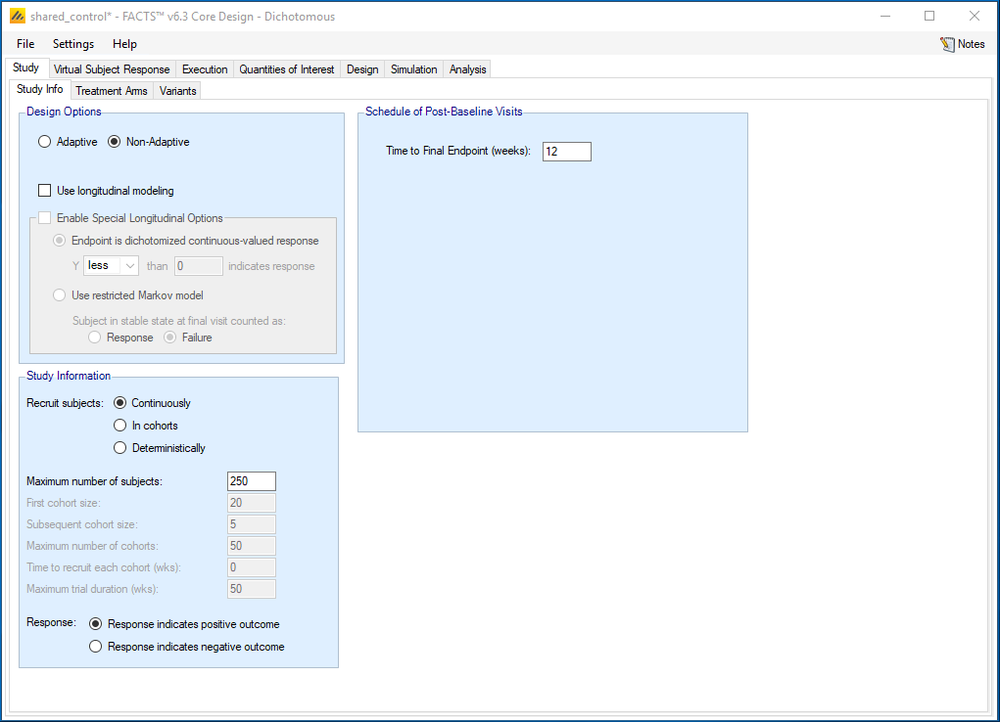

### Treatment Arms

Set the following parameters:

- Include a control treatment arm

- Create 4 additional "doses", starting at dose 1 with a spacing of 1.

- Rename each Dose Name by clicking on the relevant cell in the table. Name them Trt1-Trt4.

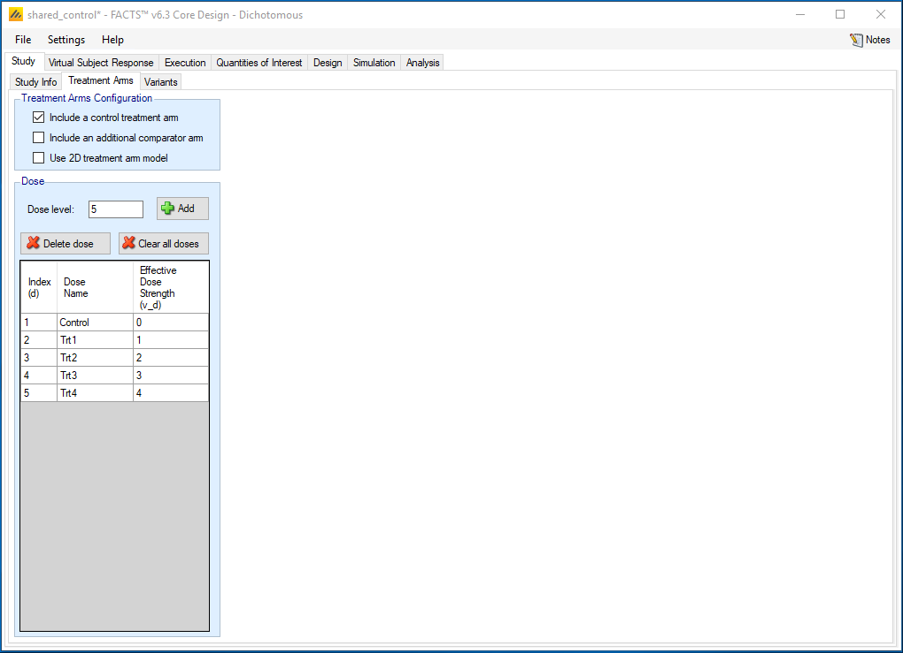

## Virtual Subject Response -- Explicitly Defined

### Dose Response

The Virtual Subject Response tab describes how subject-level data will be generated for the simulations. Add four response scenarios by clicking the Add button. For each scenario, set the underlying response rate for each treatment from the corresponding row in the following table:

+---------------+:-----------:+:-------:+:-------:+:-------:+:-------:+
| Profiles      | Control     | Trt1    | Trt2    | Trt3    | Trt4    |
+---------------+-------------+---------+---------+---------+---------+
| none          | 0.30        | 0.30    | 0.30    | 0.30    | 0.30    |
+---------------+-------------+---------+---------+---------+---------+
| win1          | 0.30        | 0.55    | 0.30    | 0.30    | 0.30    |
+---------------+-------------+---------+---------+---------+---------+
| win2.3        | 0.30        | 0.30    | 0.55    | 0.65    | 0.35    |
+---------------+-------------+---------+---------+---------+---------+
| win1.3.4      | 0.30        | 0.60    | 0.35    | 0.55    | 0.60    |
+---------------+-------------+---------+---------+---------+---------+

The Profiles can be named by double clicking in on the default name, e.g. "Response 1" and renaming. Here we just use 4 profiles, as this is a teaching example; in practice a wide range of profiles should be chosen so that you can examine the strengths and weakness of a design over the full range of credible response profiles.

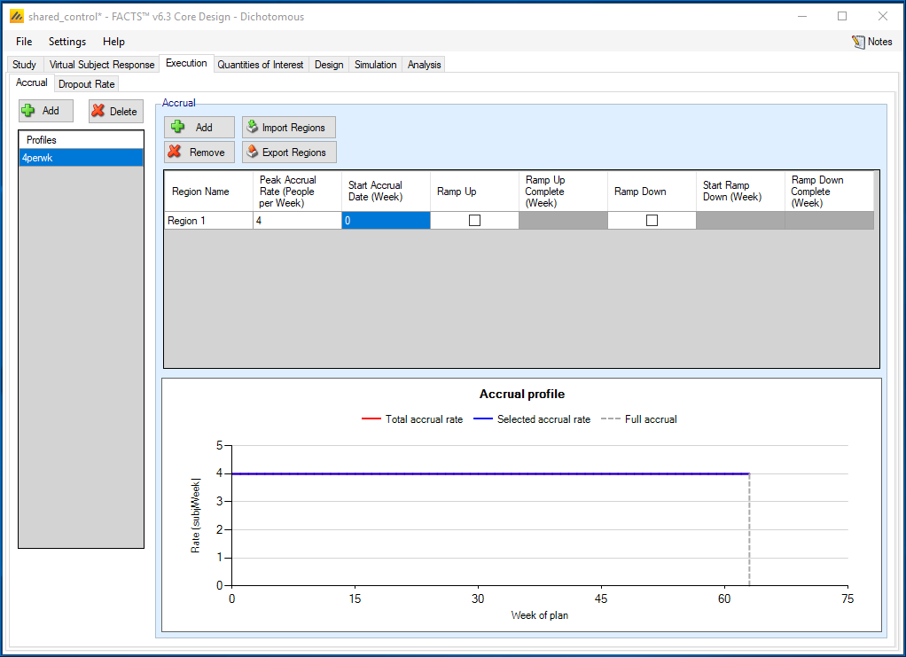

## Execution

### Accrual

Add an accrual scenario by clicking the Add button on the far left. Add a region to this profile by clicking the Add button above the table. Set the following parameters:

- Region 1 peak accrual rate 4 subjects per week.

### Dropout Rate

We assume no dropouts for this example.

## Quantities of Interest 

The Quantities of Interest (QOIs) are the criteria on which decisions, interim or final analyses, will be made. Numerous QOIs are available and you may select multiple quantities for evaluation. A basic set of QOIs is provided by default. Additional QOIs may be added by clicking the Add row in the table. A QOI can be removed by clicking the X on the right side of the cell. Each QOI may be edited by clicking on it, which opens a pop-up box.

The trial will be judged a success at the end of the trial (after 250 subjects are completed) if one of the treatments has a high probability of success in a future trial, i.e. a phase 3 trial. A default QOI already exists to monitor the predictive probability of a future trial. We edit the existing Pr(Succ. Future Trial) quantity by clicking on it and a pop-up box will open. In this box:

- Select a Phase of "Future Trial"

- Select Test Type of "Superiority"

- Specify 100 Subjects Per Arm

- Specify a One-sided Alpha of 0.025

- Specify a Superiority Margin of 0

The probability of success in the future trial will be calculated for each treatment, assuming that treatment is the one carried forward into the future trial. Thus, this is a vector quantity. It is also important to note the Alternative Name box contains the name seen in the output files for the quantities. A file titled QOIMappingFile.csv will also be output and can be used to determine the definitions for the output fields.

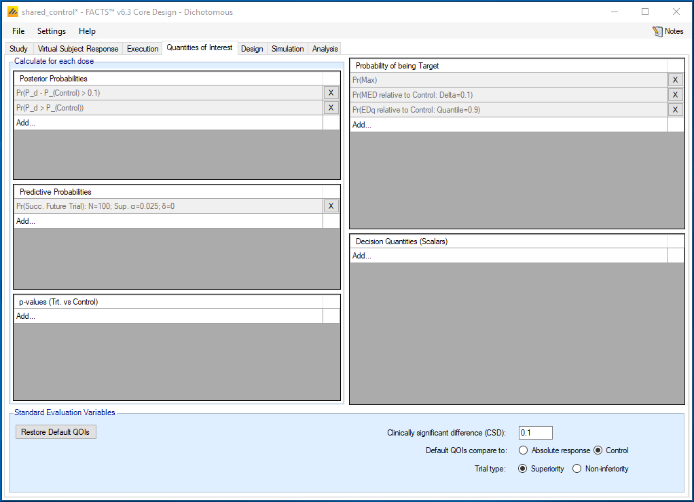

We also are interested in the posterior probability of the treatment compared to the control. This default QOI is a comparison to Control, Pr(P_d\>P(Control)). We also want to add comparisons to each active treatment arm. In the Posterior Probabilities box we click Add...:

- Select Condition: \>

- Response Relation: Relative to: Trt1

- Delta: 0 or leave blank

- Repeat the above and add for each of the 4 treatment arms

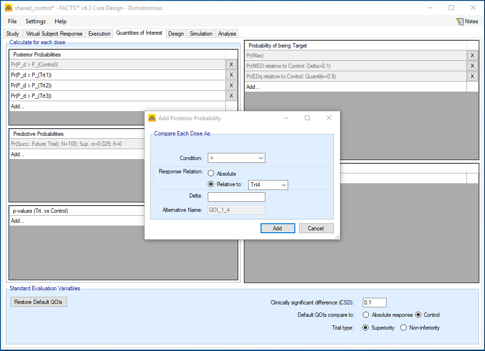

For Probability of being Target, we only keep Pr(Max), a default QOI. We will not be using this target for decisions, but may want it in the future if we post-process FACTS output.

To make decisions in the trial, we must specify which treatment will be evaluated, thus reducing the vector quantity above to a scalar quantity. This information is captured in the Decision Quantities (Scalars) window at the bottom right. We click *Add...* and a popup window opens. We select:

- QOI(Vector Quantity) of Pr(Succ.Future Trial): N=100; Sup. α=0.025; δ=0

- Evaluation Dose: Trt1

- Repeat the above 2 steps for Trt2, Trt3, and Trt4

The trial will be declared a success if *any* of the treatments are successful in a future trial.

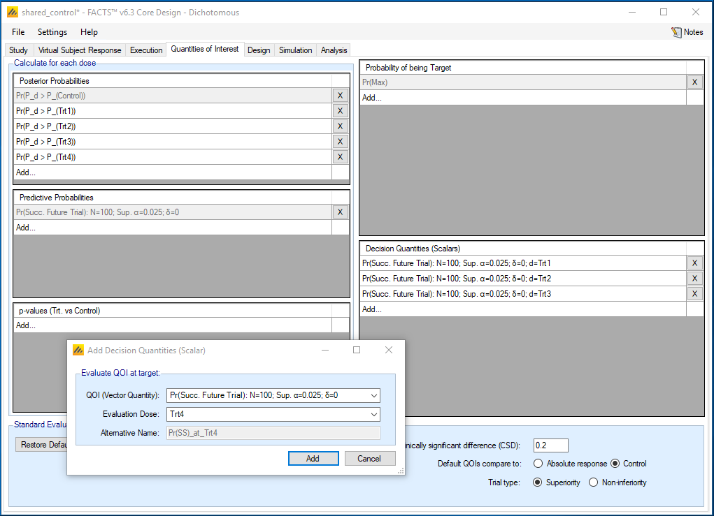

We deleted all the other default QOIs to reduce the amount of output, however they can be left entered in which case they will be computed, and the values output, but they will have no impact on the simulation of the trial.

For the Standard Evaluation Variables at the bottom:

- We will not be using the Clinically Significant Difference (CSD), but we set it at 0.2 to show a reference line on the Virtual Subject Response tab.

- Specify the Default QOIs compare to: Control

- Specify that the Trial type is Superiority

## Design

### Dose Response

Select the 'Independent Dose Model' option; because we want independent pairwise comparisons.

Use a prior mean for the log-odds for each treatment of -0.8 with a standard deviation of 5.

- Initial treatment: μ~0~ mean = -0.8, Std Dev of mean = 5 (μ~0~ \~ N (log(0.3/0.7), 5.0^2^), and log(0.3/0.7) =- 0.847, the log odds of the control rate)

- The prior was selected to be centered around the log-odds of the control rate.

We also choose to Model Control Separately with a more informative prior because we have more confidence in the control rate in this patient population. We use a mean of -0.8 and SD of 1.

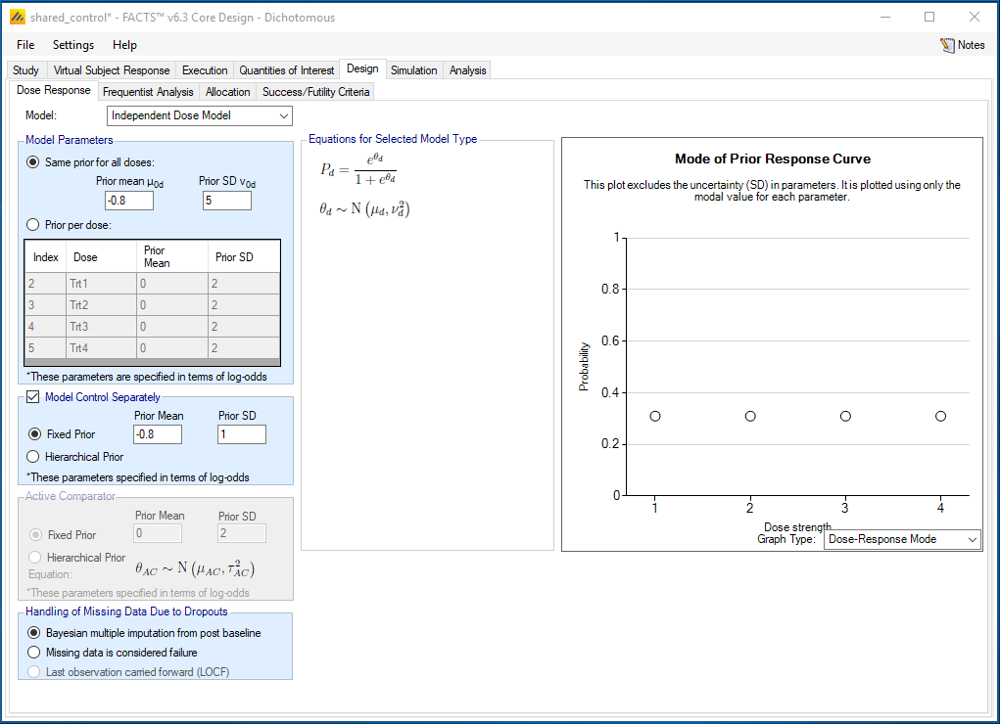

### Frequentist Analysis

Since the arms in this study are different treatments (not, for example, ordered doses), we do not use a trend test, so entries on this tab will be ignored.

### Allocation

Because we selected Non-Adaptive on the Study Info screen, only fixed allocation is available, specify a ratio of 1 on control and on each treatment arm.

### Success/Futility Criteria

Under Design-Success/Futility Criteria we specify the final evaluation criteria.

### Final Evaluation

We will define a trial to be successful if at least one of the treatments has a probability greater than 0.60 of being successful in the future phase 3 trial. We will not set futility criteria. Any trials not meeting the success criteria will be deemed inconclusive.

Set the following parameters for Success Criteria:

- Select the QOI to be the probability of success in a future trial that we defined on the Quantities of Interest tab.

- Select a Condition of \>

- Enter a threshold of 0.60

- Repeat this for each of the 4 treatments, which results in 4 different success criteria.

- We will call the trial successful if *any* of the criteria is triggered, therefore we Combine criteria using: **OR**

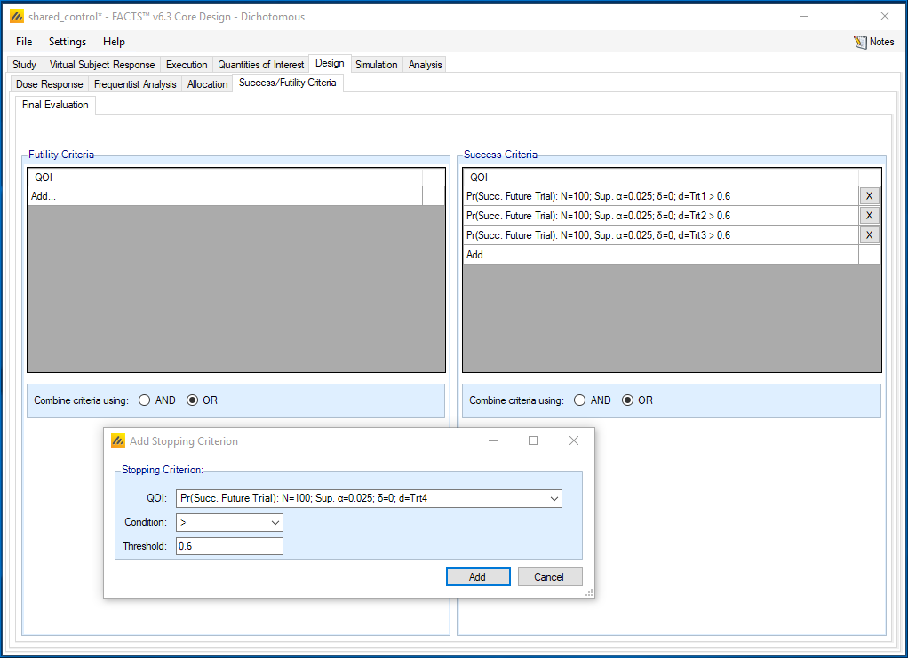

## Simulation Results

We start by running a small number of simulations, 50, as an initial check, Select All, then press Simulate. If the results look reasonable, increase the number of simulations to run to 1,000, Select All, then press Simulate. When the design is calibrated you may want to run a higher number, such as, 10,000 simulations.

Check the number of simulations per scenario (note the order of the scenarios) and the mean \# of subjects per scenario.

We check the type-1 error and the power for each scenario.

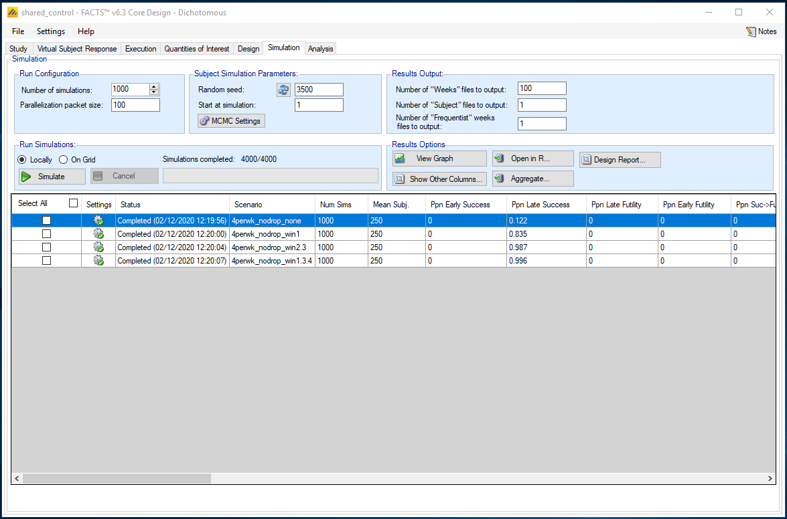

We also use the graphs to understand how the design performed. We select scenario win2.3 and click View Graph. Select the Per Scenario Graphs. We next click on Per Sim: Posterior Quantities and select Quantity: Pr(Succ. Future Trial). Click on the "Set Y axis" button in the "Controls" window, and select a Fixed Maximum of 1, a Fixed Minimum of 0, and 6 Tick Marks. This plot shows the observed and estimated response for a single simulated trial, overlaid on a barchart showing the predictive probability of future trial success for each arm. We see that the predictive probabilities are greatest for treatments 3 and then treatment 2. Both of these arms have predictive probabilities greater than 0.6, so they both are eligible for consideration in a future trial. We can scroll through the simulations to see how this varies through the simulations.

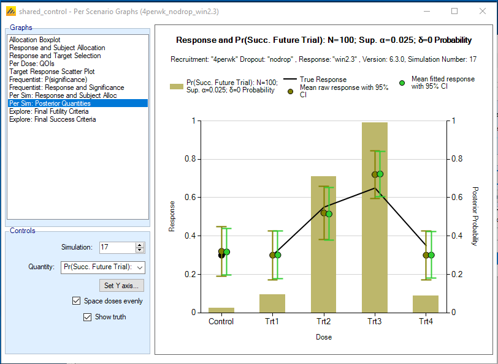

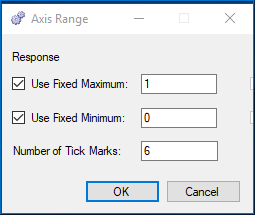

In addition to the numerous default summaries and graphs in FACTS we would like to do some post-processing of the simulation results. We will define how we will select a successful treatment (or treatments) to move forward to the future Phase 3 trial. A treatment arm will be selected for the future study, if its predictive probability of success in the future trial is \> 0.60, AND no other arm has a posterior probability greater than or equal to 0.9 of being better than the arm.

To do this we will use the simulations.csv files provided in the results folders. We want to aggregate the results for all the scenarios, so we push the Aggregate button in the Results Options area of the Simulations page.

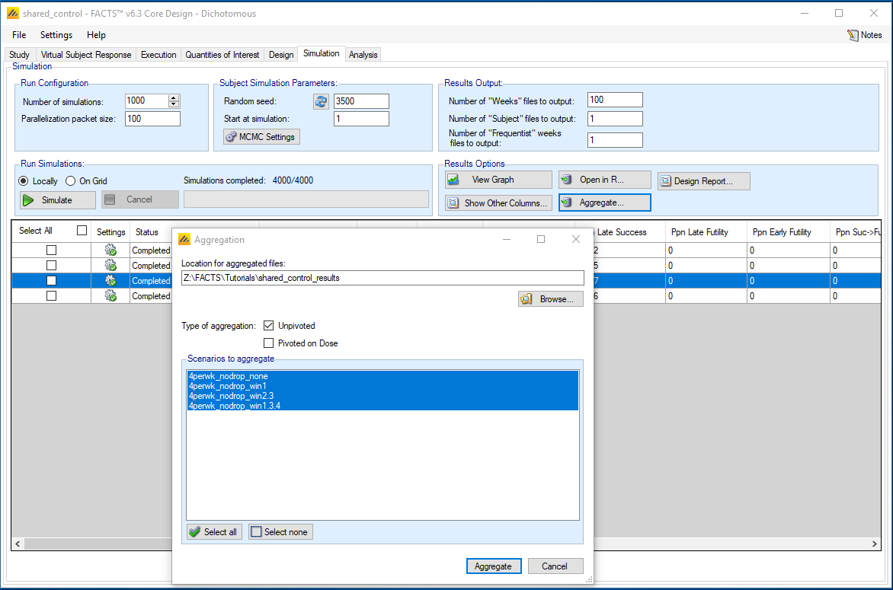

We take the aggregated files and use the following short R program to select out the successful trials. Below are screen shots of the aggregate .csv file and the R program.

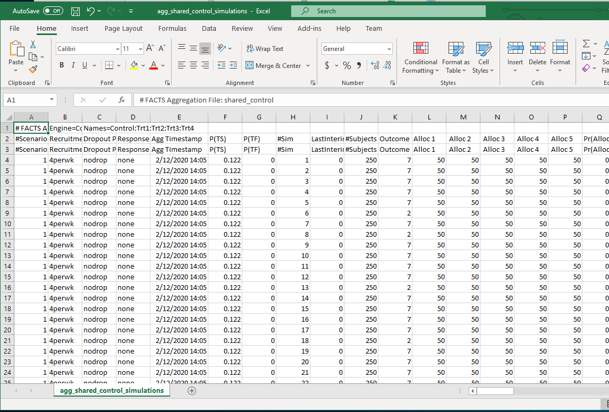

R code:

\# \*\*\*\*\*\*\*\*\*\*\*\*\*\*\*\*\*\*\*\*\*\*\*\*\*\*\*\*\*\*\*\*\*\*\*\*\*\*\*\*\*\*\*\*\*\*\*\*\*\*\*\*\*\*\*\*\*\*\*\*\*\*\*\*\*\*\*\*\*\*\*\*\*\*\*\*\*\*\*\*\*\*\*\*\*\*\*\*\*\*\*\*\*\*\*\*\*\*\*\*\*\*\*\*\*\*\*\*\*\*\*\*\*

\# Berry Consultants, LLC

\# PROGRAM NAME: facts_training_shared_control.r

\# PROJECT NAME: FACTS training example

\# PROGRAM PURPOSE: Post-process FACTS output files

\# SOFTWARE/VERSION #: 5.5.11

\# INPUT: simulations.csv for various scenarios

\# OUTPUT: TBD

\# \*\*\*\*\*\*\*\*\*\*\*\*\*\*\*\*\*\*\*\*\*\*\*\*\*\*\*\*\*\*\*\*\*\*\*\*\*\*\*\*\*\*\*\*\*\*\*\*\*\*\*\*\*\*\*\*\*\*\*\*\*\*\*\*\*\*\*\*\*\*\*\*\*\*\*\*\*\*\*\*\*\*\*\*\*\*\*\*\*\*\*\*\*\*\*\*\*\*\*\*\*\*\*\*\*\*\*\*\*\*\*\*\*

rm(list=ls())

##read in aggregate simulations files created in FACTS

##replace the definition of in.path by the location of the FACTS output

in.path=\'FACTS/shared_control_results/\'

d1=\'shared_control\'

F1=paste(in.path, d1,\'\_results\',\'/agg\_\',d1,\'\_simulations\',\'.csv\',sep=\'\')

scenarios=c(\'none\',\'win1\',\'win2.3\',\'win1.3.4\')

##read in aggregate simulation file and select appropriate header file

read.facts = function(File, design) {

cols = unlist(strsplit(readLines(File,n=3)\[3\],split=\',\')) \# Get col names, here want names from row 3

dat = read.table(File,header=FALSE,sep=\',\',skip=2) \# data

names(dat) = cols

return(dat)

}

sims.out=read.facts(File=F1, design=d1)

count.wins=function(dat1=data.in, success.thresh, dose.thresh){

##success pred prob success \>success.thresh and No arm dose.thresh or better

dat1\$win.trt1=

ifelse(dat1\$\' Pr(SS) 2\'\>success.thresh &

dat1\$\' QOI_1_1 3\'\<=dose.thresh & dat1\$\' QOI_1_1 4\'\<=dose.thresh & dat1\$\' QOI_1_1 5\'\<=dose.thresh,1,0)

dat1\$win.trt2=

ifelse(dat1\$\' Pr(SS) 3\'\>success.thresh &

dat1\$\' QOI_1_2 2\'\<=dose.thresh & dat1\$\' QOI_1_2 4\'\<=dose.thresh & dat1\$\' QOI_1_2 5\'\<=dose.thresh,1,0)

dat1\$win.trt3=

ifelse(dat1\$\' Pr(SS) 4\'\>success.thresh &

dat1\$\' QOI_1_3 2\'\<=dose.thresh & dat1\$\' QOI_1_3 3\'\<=dose.thresh & dat1\$\' QOI_1_3 5\'\<=dose.thresh,1,0)

dat1\$win.trt4=

ifelse(dat1\$\' Pr(SS) 5\'\>success.thresh &

dat1\$\' QOI_1_4 2\'\<=dose.thresh & dat1\$\' QOI_1_4 3\'\<=dose.thresh & dat1\$\' QOI_1_4 4\'\<=dose.thresh,1,0)

out=list()

for(i in 1:length(scenarios)){

dat2=subset(dat1,dat1\$\'Response Profile\'==scenarios\[i\])

numsim=length(dat2\$win.trt1)

dat2.success=c(sum(dat2\$win.trt1)/numsim,

sum(dat2\$win.trt2)/numsim,

sum(dat2\$win.trt3)/numsim,

sum(dat2\$win.trt4)/numsim)

out\[\[i\]\]=(cbind(scenarios\[i\],numsim,success.thresh, dose.thresh,c(\'trt1\', \'trt2\', \'trt3\', \'trt4\'),dat2.success))

}

return(out)

}

summaries=count.wins(dat1=sims.out, success.thresh=0.60, dose.thresh=0.90)

Below is a table of the results from the post-processing. The final column shows, for each arm, the proportion of simulated trials in which that arm was selected to be carried forward into a future trial.

+--------------+----------+--------------------------+------------------------+---------+-------------------+
| **Scenario** | **Num\   | **Pred. Prob.\           | **Other Treatment Arm\ | **Arm** | **Probability of\ |
|              | sims**   | Future Trial Threshold** | Threshold**            |         | Selection**       |
+:============:+:========:+:========================:+:======================:+:=======:+:=================:+
| none         | 1000     | 0.6                      | 0.9                    | trt1    | 0.044             |
+--------------+----------+--------------------------+------------------------+---------+-------------------+
| none         | 1000     | 0.6                      | 0.9                    | trt2    | 0.042             |
+--------------+----------+--------------------------+------------------------+---------+-------------------+
| none         | 1000     | 0.6                      | 0.9                    | trt3    | 0.036             |
+--------------+----------+--------------------------+------------------------+---------+-------------------+
| none         | 1000     | 0.6                      | 0.9                    | trt4    | 0.039             |
+--------------+----------+--------------------------+------------------------+---------+-------------------+
|              |          |                          |                        |         |                   |
+--------------+----------+--------------------------+------------------------+---------+-------------------+
| win1         | 1000     | 0.6                      | 0.9                    | trt1    | 0.832             |
+--------------+----------+--------------------------+------------------------+---------+-------------------+
| win1         | 1000     | 0.6                      | 0.9                    | trt2    | 0.016             |
+--------------+----------+--------------------------+------------------------+---------+-------------------+
| win1         | 1000     | 0.6                      | 0.9                    | trt3    | 0.012             |
+--------------+----------+--------------------------+------------------------+---------+-------------------+
| win1         | 1000     | 0.6                      | 0.9                    | trt4    | 0.019             |
+--------------+----------+--------------------------+------------------------+---------+-------------------+
|              |          |                          |                        |         |                   |
+--------------+----------+--------------------------+------------------------+---------+-------------------+
| win2.3       | 1000     | 0.6                      | 0.9                    | trt1    | 0.003             |
+--------------+----------+--------------------------+------------------------+---------+-------------------+
| win2.3       | 1000     | 0.6                      | 0.9                    | trt2    | 0.529             |
+--------------+----------+--------------------------+------------------------+---------+-------------------+
| win2.3       | 1000     | 0.6                      | 0.9                    | trt3    | 0.978             |
+--------------+----------+--------------------------+------------------------+---------+-------------------+
| win2.3       | 1000     | 0.6                      | 0.9                    | trt4    | 0.011             |
+--------------+----------+--------------------------+------------------------+---------+-------------------+
|              |          |                          |                        |         |                   |
+--------------+----------+--------------------------+------------------------+---------+-------------------+
| win.1.3.4    | 1000     | 0.6                      | 0.9                    | trt1    | 0.843             |
+--------------+----------+--------------------------+------------------------+---------+-------------------+
| win.1.3.4    | 1000     | 0.6                      | 0.9                    | trt2    | 0.016             |
+--------------+----------+--------------------------+------------------------+---------+-------------------+
| win.1.3.4    | 1000     | 0.6                      | 0.9                    | trt3    | 0.623             |
+--------------+----------+--------------------------+------------------------+---------+-------------------+
| win.1.3.4    | 1000     | 0.6                      | 0.9                    | trt4    | 0.845             |
+--------------+----------+--------------------------+------------------------+---------+-------------------+

The above code can be used to evaluate additional predictive probability and other treatment arm comparison thresholds. It also could be expanded to create other summaries of interest. For example, we could determine the proportion of trials in which exactly one arm was selected, two arms were selected, etc. Finally, the code could be expanded so different trial success thresholds other than 0.60 could be examined. In the current simulations, a predictive probability future trial threshold of 0.6 results in a proportion of late successes of 0.128 for the none scenario. Additions could be made to the code so that the proportion of late successes could be determined for multiple higher thresholds across all of the scenarios.

Going back to the win2.3 scenario, the specific simulation number 17, the simulated trial shown in the graph earlier, the predictive probabilities of success in a future trial are 0.709 and 0.992 for treatments 2 and 3 respectively and both satisfy the predictive probability of success in a future trial threshold. The posterior probability that treatment 3 is greater than treatment 2 is 0.986. For treatment 3, none of the posterior probabilities comparing other active treatment arms are greater than 0.9. Thus, in this specific simulated trial, only treatment 3 would be selected to move forward to a future phase 3 study.
