# Introduction

This is a pivotal trial to evaluate the effectiveness of a device to treat heavy menstrual bleeding. It is a single arm trial that will enroll and treat a maximum of 242 patients. The primary endpoint is the pictorial blood loss assessment chart (PBLAC) at 12 months after treatment. Patients who achieve a PBLAC score of \<= 75 will be considered responders. The proportion of patients achieving a response will be compared against an objective performance criterion (OPC) of 66%.

*Primary Efficacy Analysis*

Let *I~i12~* be the response indicator for the *i*^th^ patient at 12 month. *I~i12\ ~*will be 1 where *Y~i12\ ~*(corresponding to PBLAC) is less than or equal to 75 and will be 0 where *Y~i12\ ~*is greater than 75. Let *π* = Pr(*I~i~*~12~ = 1) be the probability of response at 12 months. We model the log odds of response,

*θ* = log(*π*/1-*π*)

as normally distributed with a prior distribution for the log-odds of response

*θ* \~ *N*(0.6633, 2^2^),

When converted from the log-odds scale back to the original probability scale, the resulting prior distribution for the log odds of response has a median of 66% and a 95% probability that the success rate is between 4% and 99%.

If, at the completion of the trial, there is at least a 97.5% probability the device is superior to the OPC of 66%, this trial will be considered a success,

Pr(*π* \> 0.66) \> 0.975.

# Fixed Trial

We use the FACTS dose finding engine with dichotomous outcome. We click on the Study-Study Info tab. We specify a fixed design with 242 patients, and the final outcome is observed at 52 weeks.

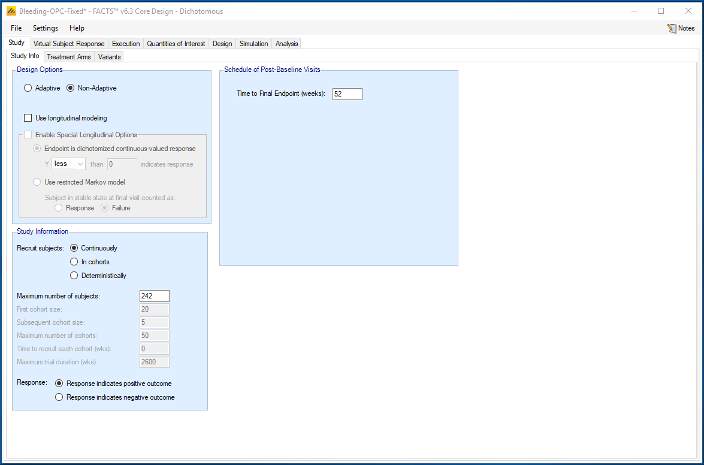

On the Study-Treatment Arm tab we specify a treatment arm in addition to the control.

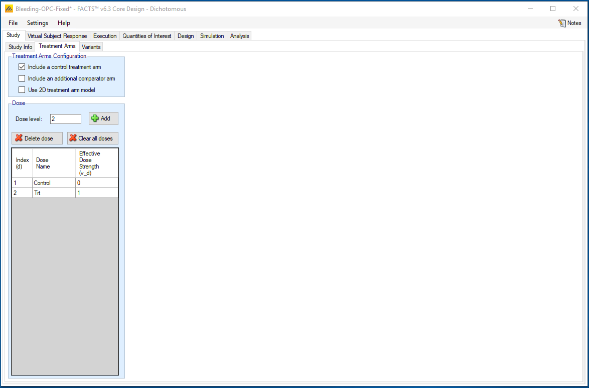

**\
**

On the Design-Allocation tab, we specify that all randomized patients will be allocated to the treatment.

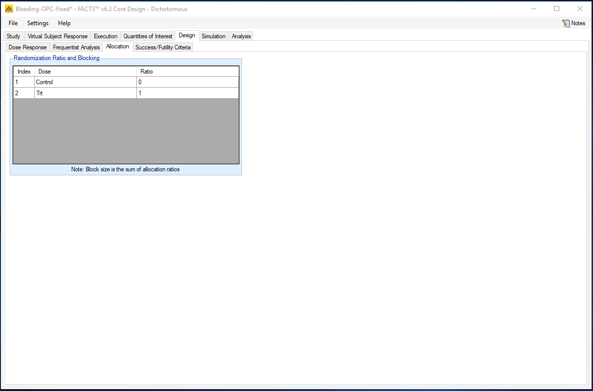

We add 2 scenarios for the null case of treatment p=0.66, and an alternative of p=0.75. The control rate is ignored as no patients are being allocated to control.

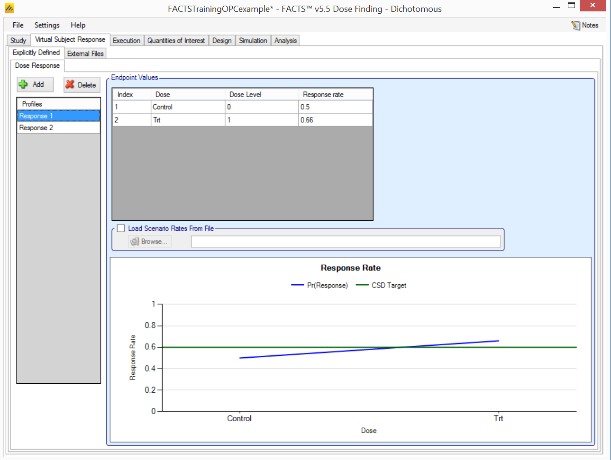

We add 2 accrual rates for expected accrual (11/week and 12 week ramp-up) and slow accrual (5/week and 24 week ramp-up).

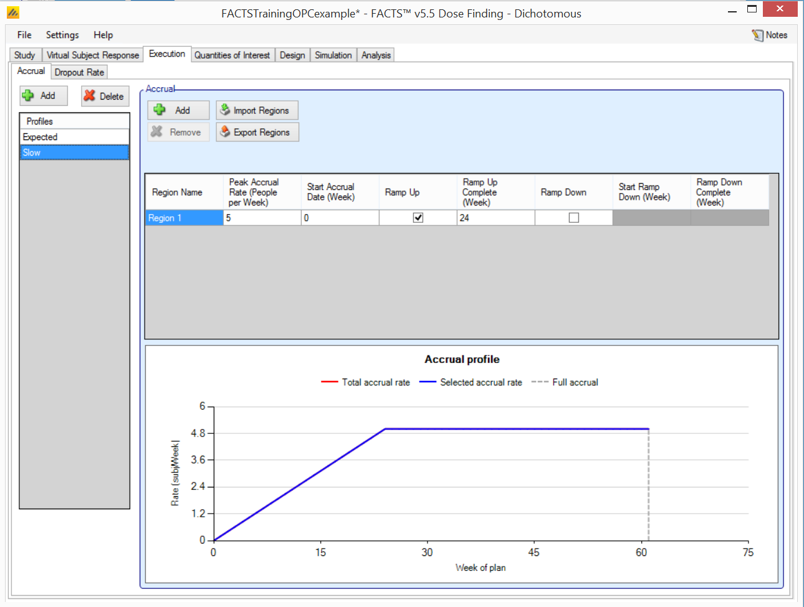

On the quantities of interest tab, we add Pr(P_d\>0.66) corresponding to the posterior probability that the response probability for a given dose is greater than 0.66, where 0.66 represents the Objective Performance Criterion (OPC). Then we add the decision quantity corresponding to this posterior probability for the treatment group.

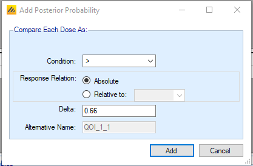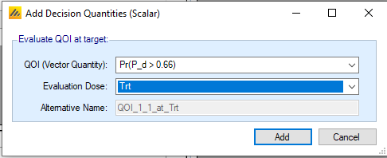

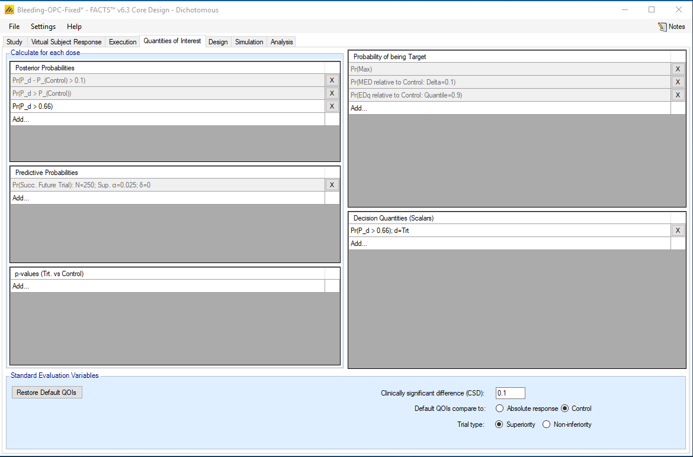

On the Design-Dose Response tab, we select "Independent Dose Model" from the drop-down menu. Then we specify a prior mean of log(0.66/(1-0.66))= 0.663294 with SD 2 corresponding to the prior log odds.

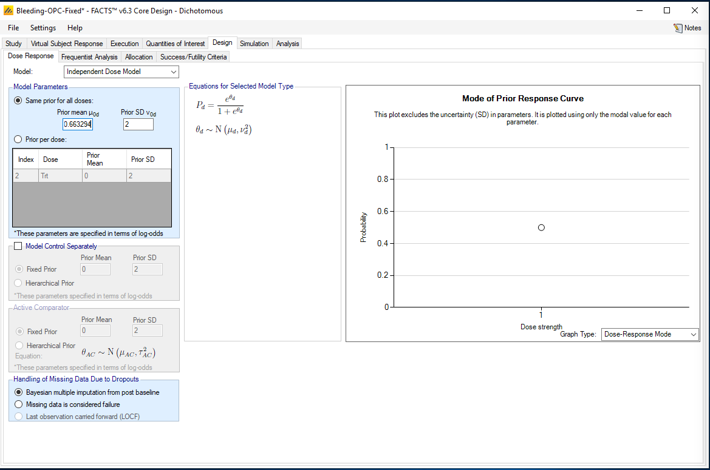

On the Design-Success/Futility Criteria tab, we add success and futility criteria, such that the trial is a success if the posterior probability Pr(P_d\>0.66)\>0.975, and a failure otherwise.

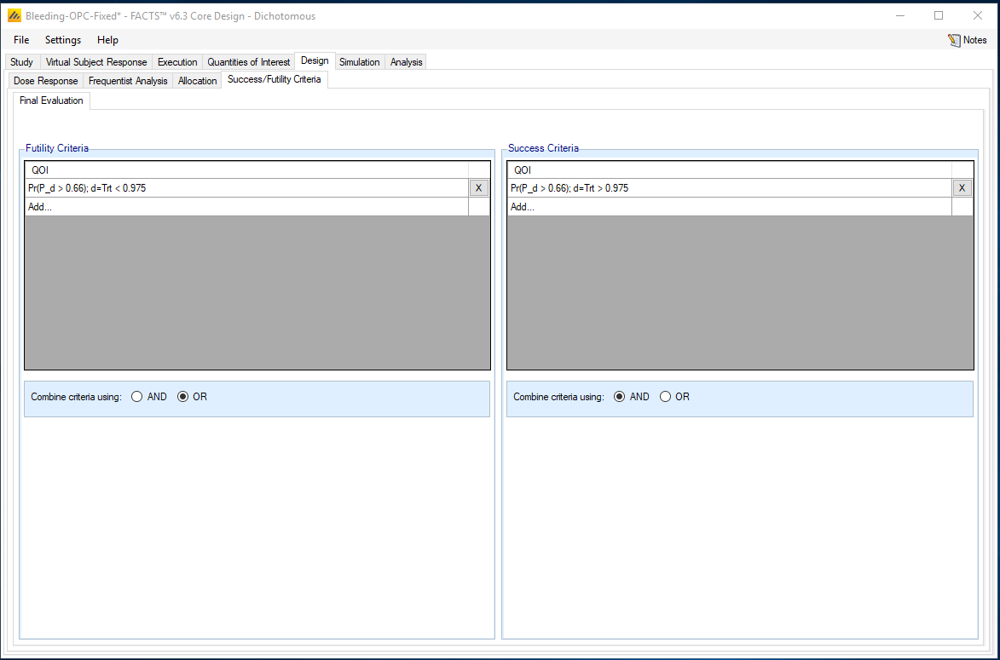

We then simulate the design. Here, for illustration purposes only, we simulate 5 trials per scenario.

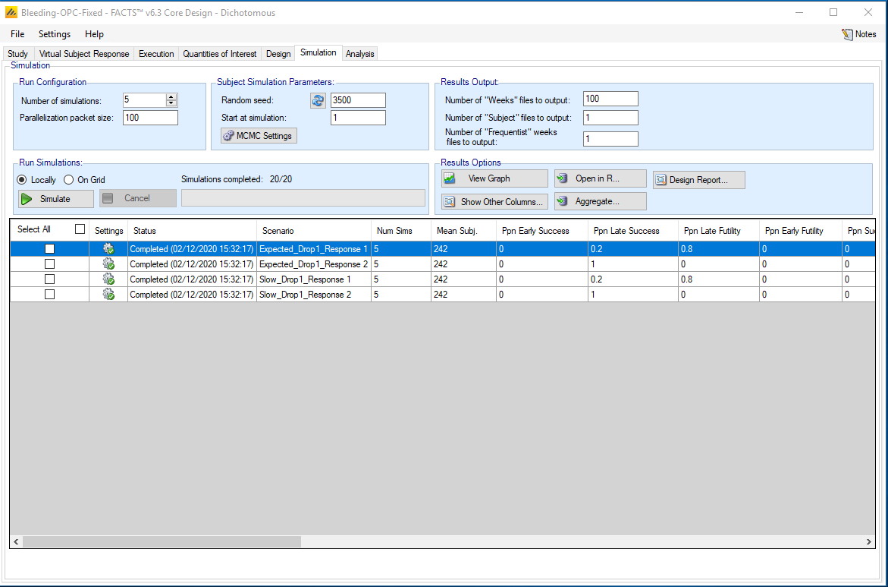

**\
**

# Adding Interim Analyses

We now add adaptive features to the above trial design. Interim analyses are planned when 50, 100, 150, and 200 patients have been treated and in the trial for 12 months, i.e. when the first 50, 100, 150, and 200 patients have had the opportunity to complete follow-up for the 12-month primary endpoint. The final analysis will occur when all 242 patients have the opportunity to complete follow-up for the 12-month primary endpoint.

## Early Futility 

Interim monitoring for early futility will occur at each interim analysis. The trial will stop early for futility at an interim analysis if there is less than a 10% probability that the response rate with the device is superior to the OPC of 66% plus a minimum delta. Formally if:

Pr(*π* \> 0.66+δ) \< 0.10, with δ=0.05

## Early Predicted Success

Interim monitoring for early success will occur at each interim analysis. Early predicted success will be declared if there is a high probability that the response rate with the device is superior to the OPC of 66%. Formally if:

Pr(*π* \> 0.66) \> 0.99.

If predicted success is declared, we stop accrual and wait until all patients have the opportunity to complete their 12-month primary endpoint. At this time a decisive analysis is performed to evaluate treatment efficacy.

If the trial is not stopped early for either futility or predicted success, the decisive analysis when all 242 patients have the opportunity to complete follow-up for the 12-month primary endpoint.

*\
*

## Entering into FACTS

First, on the Study-Study Info tab, select "Adaptive" in the Design Options.

Next, on the Design-Allocation tab, set Randomization Ratios of 0 for Control and 1 for Trt.

On the Design-Interims tab, we specify that interims will be conducted when 50, 100, 150, or 200 patients have the opportunity to complete their 52 week analysis. We ensure that the box for "Continue follow-up if study stopped for success" is checked. This implies that early success stopping with be "predicted success" once all enrolled patients have 52 weeks of observations, and not claims of success outright at the interim analysis.

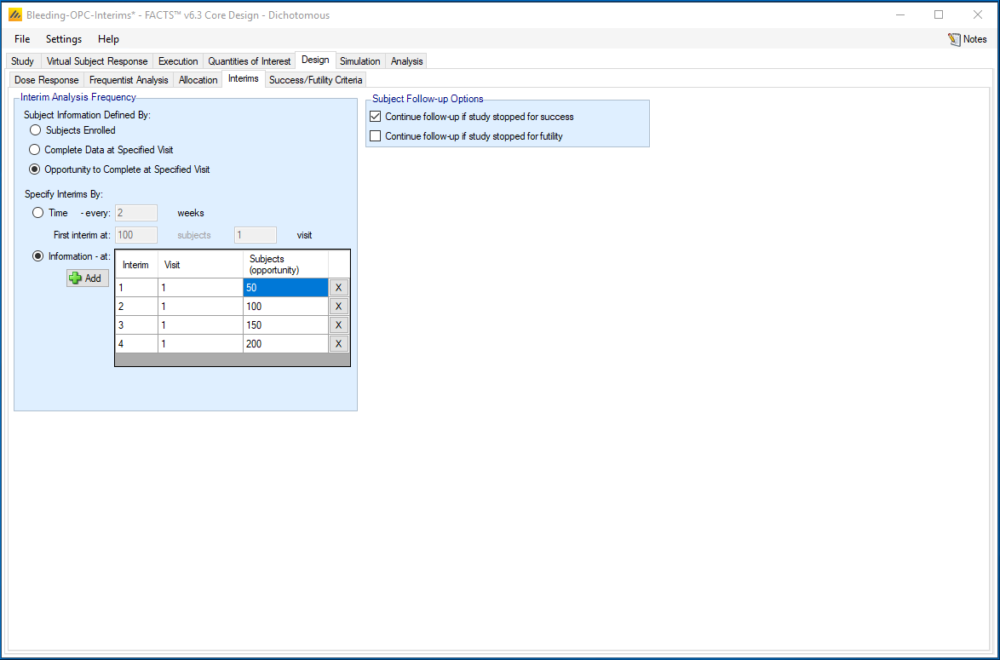

On the Quantities of Interest tab, we add the posterior probability that the response is greater than (0.66+δ) to both the Posterior probabilities and the Decision Quantities sections. In this case, we select δ=0.05, so that we track Pr(P_d\>0.71). This will be used for interim futility rules.

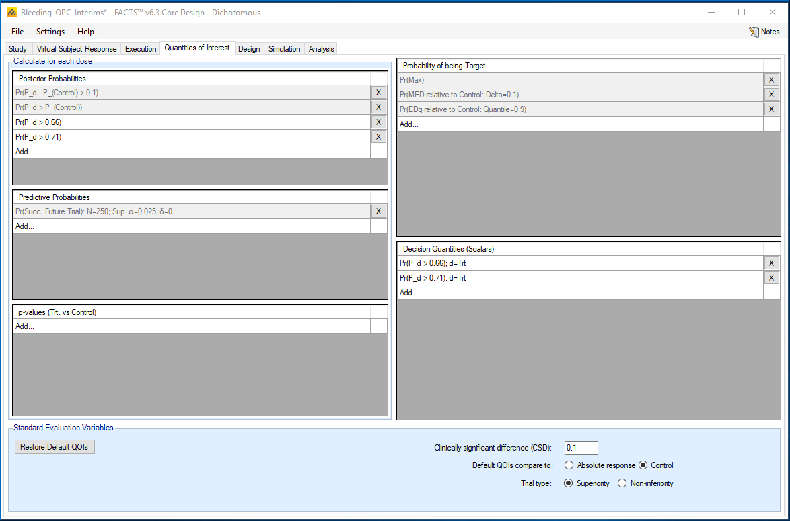

On the Design-Success/Futility Criterion tab, we click on the Interim 1 tab, then enable both the futility and success criteria. Then we add a futility rule that says to stop the trial for futility if Pr(P_d\>0.71)\<0.10. Then we add a success rule that says we stop for predicted success if Pr(P_d\>0.66)\>0.99.

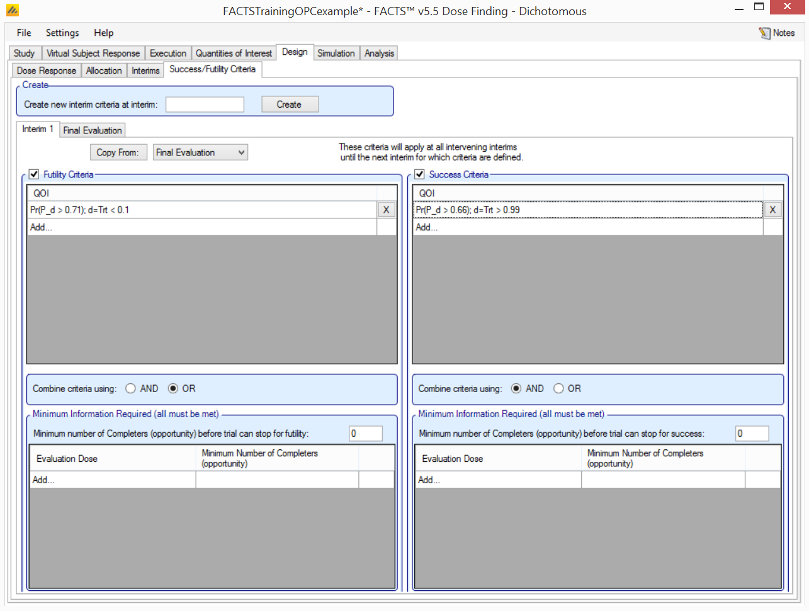

We can then simulate the trial on the Simulation tab.

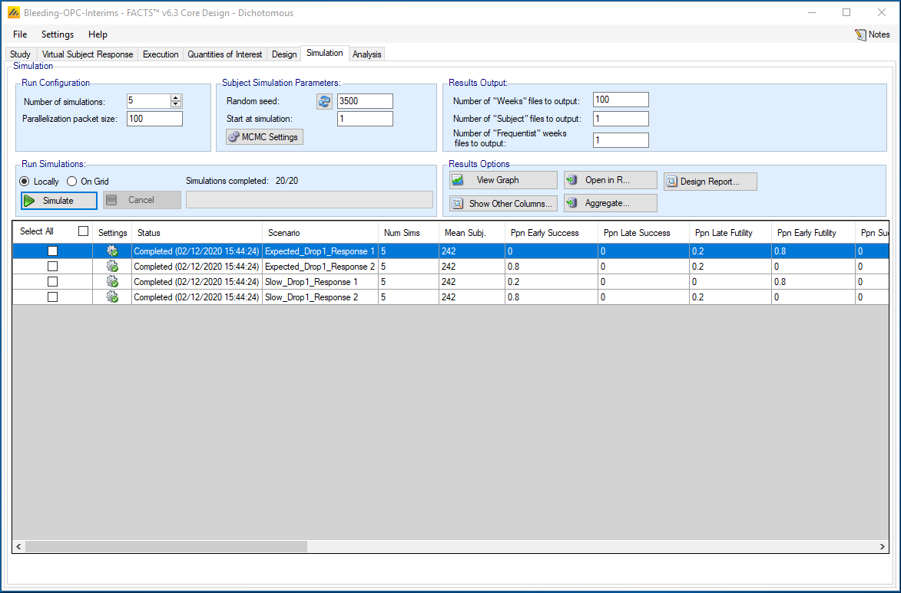

# Incorporate Longitudinal Modeling

We use a longitudinal model that considers the PBLAC as continuous to allow the earlier observations of PBLAC to predict the final 12-month PBLAC value. The primary analysis is based on the dichotomized PBLAC score at 12 months where values less than or equal to a 75 indicate response.

## Longitudinal Model

Patients will be assessed at 3, 6, and 12 months following treatment. We use a longitudinal model of the primary endpoint to allow these earlier observations to predict the final 12-month status. The primary endpoint for an individual patient, *i*, at time *t* is labeled as *Y~it~*. At each interim analysis, some patients will have completed follow-up and we will have observed their 12-months endpoint *Y~i12~*. These patients may also have earlier measures of the primary endpoint, such as at 3 and 6 months. There will be patients with earlier observations of the primary endpoint who have not yet reached 12 months of follow-up. We utilize the information from patients with incomplete follow-up to the extent that these earlier observations are correlated with the final 12-month value. A Bayesian model is built to learn how the early endpoints are correlated with the final 12-month endpoint and patients with complete follow-up information this model.

A linear regression model is created for the correlation between the baseline and 12-month, 3-month and 12-month, and 6-month and 12-month values. We suppress the subject index *i* and refer to the baseline, 3, 6, and 12 month values as *Y~0,~ Y~3~*, *Y~6~*, and *Y~12~*. There are three instances of the model. We model the log PBLAC score and each model instance is identical and has the following structure

$$\left[\log(Y_{12}) \mid \log(Y_0) \sim N\left(\alpha_0 + \beta_0 \log(Y_0), \lambda_0^2\right)\right]$$

$$\begin{aligned} \left[\alpha_6\right] &\sim N\left(1, 2^2\right) \\ \left[\beta_6\right] &\sim N\left(0.5, 1.5^2\right) \\ \left[\lambda_6^2\right] &\sim IG\left(0.6/2,\ 0.6^2/2\right) \end{aligned}$$

Identical models are assumed for the distribution of *Y~12~* given *Y~2~* and *Y~16\ ~*

The joint posterior distribution of *α*~0~, *α*~3~, *α*~6~, *β*~0~, *β*~3~, *β*~6~, *λ*~0~, *λ*~3~, and *λ*~6~, is updated based on all patients with observed values of *Y~12~*. This model is then used (using Bayesian imputation within Markov chain Monte Carlo) to inform the primary analysis.

*\
*

## Entering into FACTS

On the Study-Study Info tab, we click on the box to enable longitudinal modeling, and also the box to Enable Special Longitudinal Options. We denote that the binary endpoint is equal to 1 if the continuous response Y is less than log(75)=4.317488. On the right side of the same page, we add visits corresponding to 1, 12, 26, and 52 weeks.

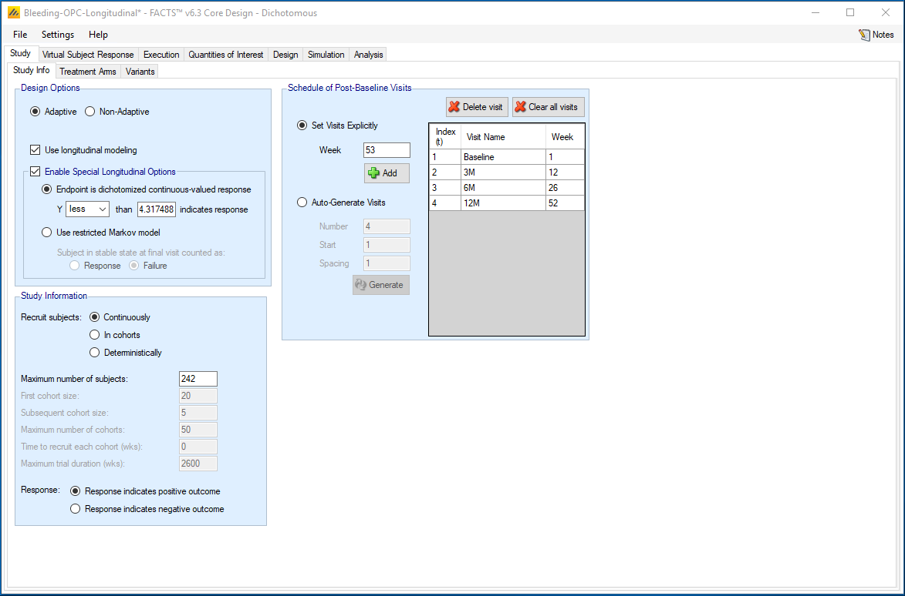

On the Design-Longitudinal tab, we select "Linear Regression" from the pull-down menu. We select "Model control separately", and we change the priors to reflect appropriate values for the chosen model.

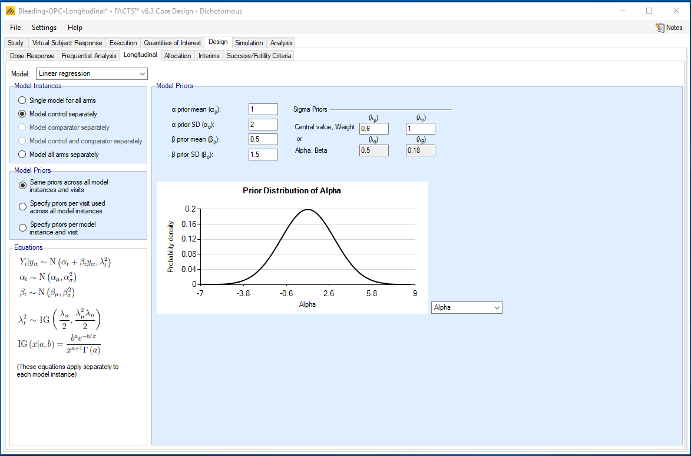

Because we have enabled special longitudinal modeling, we need to re-define the response profiles on the continuous scale. On the Virtual Subject Response-Explictly Defined tab, we create 4 new profiles.

We specify the scenarios for achieving a response at 12 months in terms of the mean and standard deviation of the PBLAC score at 12 months. Because we model the log of the PBLAC score in the longitudinal modeling, we also specify the scenarios for achieving a response at 12 months on the log scale. We consider 2 different standard deviations (SDs) for the log of the PBLAC score and calibrate the mean to achieve a specific proportion of patients who would be considered responders. We consider SDs for PBLAC on the log scale of 1 and 0.5. For example, for a standard deviation of 1.0, we need to find the mean of a normal distribution with sd=1 such that the probability of being less than log(75) is equal to 0.66. This value can be obtained through algebra or computational trial and error. It turns out that a mean of 3.0949 will satisfy this condition

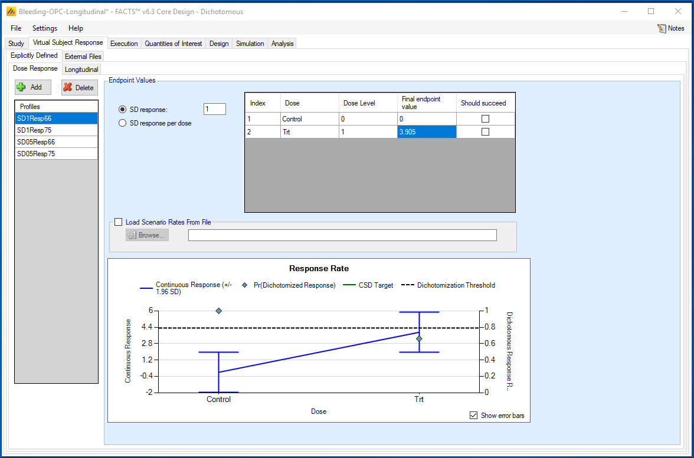

*\
*

Table 1 shows the means and SD on both the log PBLAC scale and PBLAC score scale that correspond to the indicted proportion of patients achieving a response.

+-------------------------------------------------------------------------------------------------------------+-----------------------+---------------------+----------+-----------------+----------+
| **Table 1. Response Scenarios: Mean and SD of the log PBLAC Score and Corresponding Proportion Responding** |                       |                     |          |                 |          |
+:===========================================================================================================:+:=====================:+:===================:+:========:+:===============:+:========:+
|                                                                                                             |                       | **Log PBLAC Scale** |          | **PBLAC Scale** |          |
+-------------------------------------------------------------------------------------------------------------+-----------------------+---------------------+----------+-----------------+----------+
|                                                                                                             | Proportion Responding | SD = 1              | SD = .5  | SD = 1          | SD = .5  |
+-------------------------------------------------------------------------------------------------------------+-----------------------+---------------------+----------+-----------------+----------+
|                                                                                                             |                       | Mean                | Mean     | Mean            | Mean     |
|                                                                                                             |                       |                     |          |                 |          |
|                                                                                                             |                       |                     |          | (SD)            | (SD)     |
+-------------------------------------------------------------------------------------------------------------+-----------------------+---------------------+----------+-----------------+----------+
| 1                                                                                                           | 60%                   | 4.06                | 4.19     | 96              | 75       |
|                                                                                                             |                       |                     |          |                 |          |
|                                                                                                             |                       |                     |          | \(126\)         | \(40\)   |
+-------------------------------------------------------------------------------------------------------------+-----------------------+---------------------+----------+-----------------+----------+
| 2                                                                                                           | 66%                   | 3.905               | 4.111    | 82              | 69       |
|                                                                                                             |                       |                     |          |                 |          |
|                                                                                                             |                       |                     |          | \(107\)         | \(37\)   |
+-------------------------------------------------------------------------------------------------------------+-----------------------+---------------------+----------+-----------------+----------+
| 3                                                                                                           | 70%                   | 3.79                | 4.05     | 73              | 65       |
|                                                                                                             |                       |                     |          |                 |          |
|                                                                                                             |                       |                     |          | \(94\)          | \(35\)   |
+-------------------------------------------------------------------------------------------------------------+-----------------------+---------------------+----------+-----------------+----------+
| 4                                                                                                           | 75%                   | 3.64                | 3.98     | 63              | 61       |
|                                                                                                             |                       |                     |          |                 |          |
|                                                                                                             |                       |                     |          | \(81\)          | \(32\)   |
+-------------------------------------------------------------------------------------------------------------+-----------------------+---------------------+----------+-----------------+----------+

## Longitudinal Profiles

We specify the longitudinal behavior of the PBLAC score by specifying the mean and SD of the log PBLAC score at each earlier visit as well as the correlation between the log PBLAC scores from visit to visit.

## Response Fraction

We specify the mean and SD of the log PBLAC score at each earlier visit in terms of a multiplier on the final 12 month log PBLAC score. For example, a multiplier of 1 would indicate the same mean PBLAC at an earlier visit as compared to the mean 12-month value and a multiplier of 2 would indicate a mean PBLAC score twice the mean 12-month value. In general we consider scenarios where baseline PBLAC scores are higher at baseline and where much of the reduction in the PBLAC score is achieved by the 3-month visit. For the variance of the log PBLAC at each visit, we consider scenarios where either there is a constant variance for the log PBLAC at each visit, or that the earlier values will have larger variability.

The table below shows the different simulation scenarios for the behavior of the mean and the variance of the log PBLAC at each visit (not all scenarios are shown in the FACTS file, but are included here for reference).

+-----------------------------------------------------------------------------------+----------+----------+----------+
| **Table 2: Multipliers for the Mean and Variance of the log PBLAC at Each Visit** |          |          |          |
+===================================================================================+:========:+:========:+:========:+
|                                                                                   | Baseline | 3 Months | 6 Months |
+-----------------------------------------------------------------------------------+----------+----------+----------+
| Scenarios for Mean                                                                |          |          |          |
+-----------------------------------------------------------------------------------+----------+----------+----------+
| > 1\. High Baseline and Early Response                                            | 1.48     | 1.07     | 0.96     |
+-----------------------------------------------------------------------------------+----------+----------+----------+
| > 2\. Higher Baseline and Early Response                                          | 1.6      | 1.2      | 0.8      |
+-----------------------------------------------------------------------------------+----------+----------+----------+
| > 3\. Higher Baseline and Late Response                                           | 1.6      | 1.2      | 1.05     |
+-----------------------------------------------------------------------------------+----------+----------+----------+
| Scenarios for Variance                                                            | 1.5      | 1.12     | 1        |
+-----------------------------------------------------------------------------------+----------+----------+----------+
| > 1\. Higher Variance Early                                                       | 2        | 2        | 1.5      |
+-----------------------------------------------------------------------------------+----------+----------+----------+
| > 2\. High Variance Early                                                         | 1.5      | 1.12     | 1        |
+-----------------------------------------------------------------------------------+----------+----------+----------+
| > 3\. Constant Variance                                                           | 1        | 1        | 1        |
+-----------------------------------------------------------------------------------+----------+----------+----------+

## Visit-to-Visit Correlation

The values of the primary endpoint are correlated within each patient from visit to visit. The table below shows the correlations we assume for the log PBLAC score within a patient between each visit.

+-------------------------------------+-----------------+--------------------------+
| **Table 3 : Correlation Scenarios** |                 |                          |
+=====================================+:===============:+:========================:+
|                                     | **Weaker**      | **Stronger Correlation** |
|                                     |                 |                          |
|                                     | **Correlation** |                          |
+-------------------------------------+-----------------+--------------------------+
| Baseline to 3 Months                | 0.1             | 0.35                     |
+-------------------------------------+-----------------+--------------------------+
| 3 Months to 6 Months                | 0.8             | 0.76                     |
+-------------------------------------+-----------------+--------------------------+
| 6 Months to 12 Months               | 0.3             | 0.6                      |
+-------------------------------------+-----------------+--------------------------+

We simulate no drop-outs. In the primary analysis, any patient who drops-out or has an incomplete 12 month PBLAC score will imputed for the primary analysis according to the longitudinal model.

*\
*

## Entering into FACTS

In the Virtual Subject Response-Explicitly Defined-Longitudinal tab, add new profile. We click on "correlated", and then enter corresponding values. Note we only add some of the above scenarios to the FACTS file.

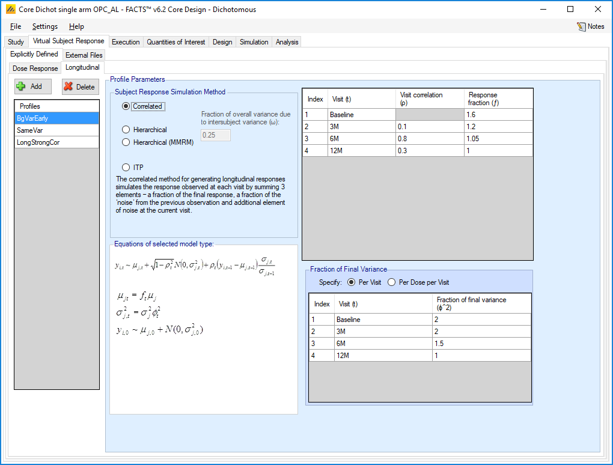

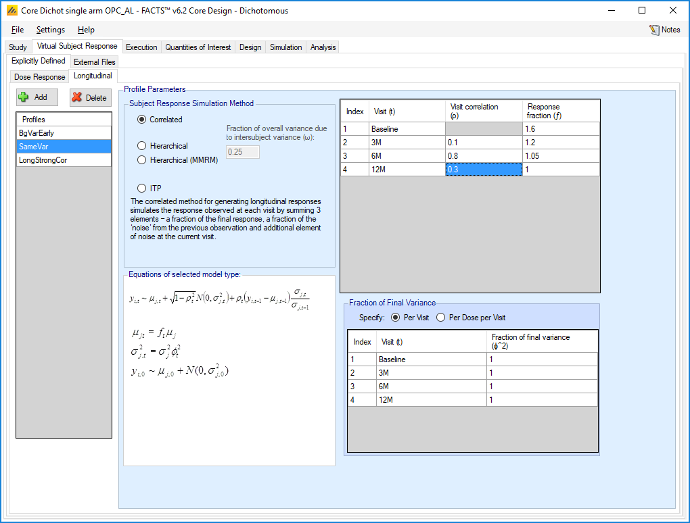

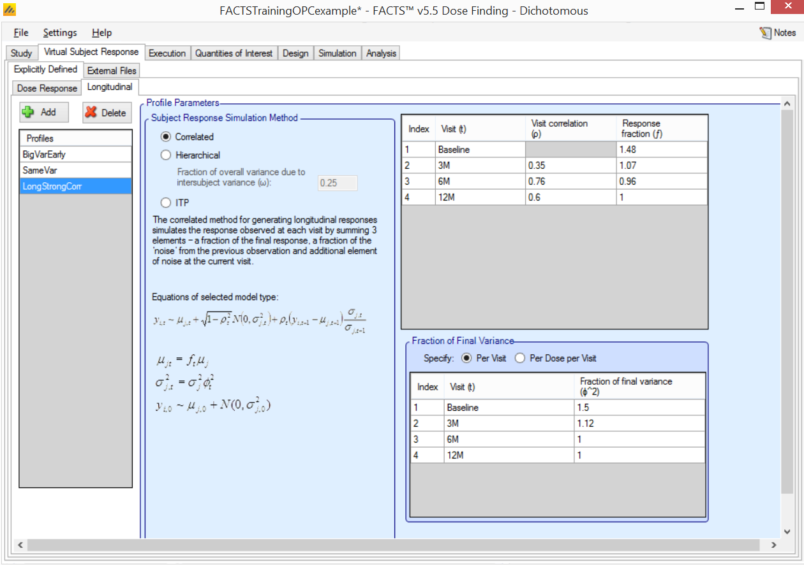

The trial is ready for simulation:

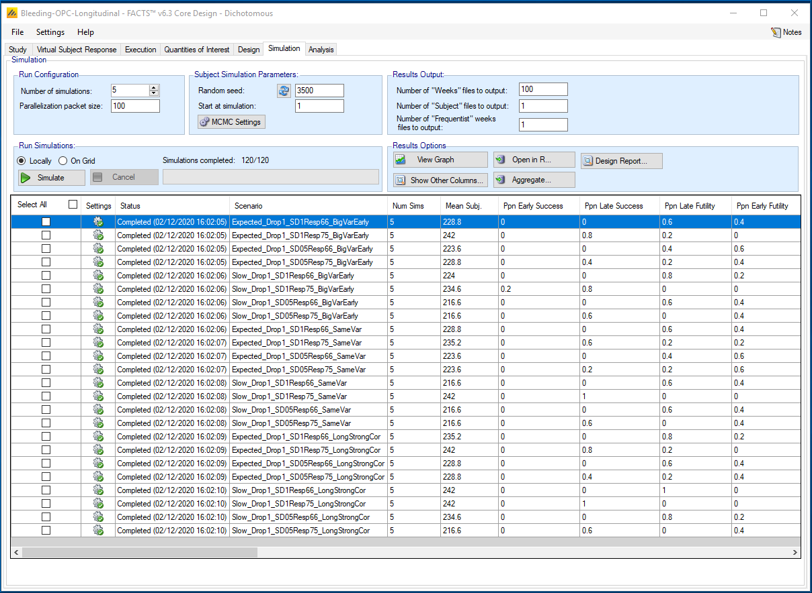
