#  Introduction

This tutorial describes the Chronic Pain example trial design using the FACTS Core Design Engine for Multiple Endpoints. For this version of the document, the screenshots are from the 5.5 release of FACTS.

The screenshots provided are approximate and may not reflect the exact layout of the information. The contents of each tab, however, will be consistent with the software.

The designs presented are examples and may not be optimally calibrated.

# Designs Featured

In this tutorial we begin create the following designs:

- Design 1

  - Utility Index for the multiple endpoints

  - Dose response modelling with a Second Order Normal Dynamic Linear Model (NDLM) for the primary endpoint and a Sigmoidal model for the second endpoint

  - No adaptations, i.e. fixed allocation and no early stopping

- Design 2

  - Add adaptations to Design 1

    - Response adaptive randomization

    - Early stopping for success and futility

- Design 3

  - Add longitudinal modelling to Design 2

# Case Study: Chronic Pain

This case study is based on the paper "Innovative Approaches for Designing and Analyzing Adaptive Dose-Ranging Trials" Bornkamp et al (2007) Journal of Biopharmaceutical Statistics, 17, 965--995. Extended to include a second tolerability endpoint as in a second paper \[ref required\].

The primary endpoint is change from baseline in the average weekly pain score on the 10pt Visual Analogue Scale (VAS) after 6-weeks, observed weekly. The target is to find a dose that is 1.17 points better than control in the mean change from baseline after 6 weeks.

In addition there is a second, binary 'tolerability' endpoint, the background tolerability failure rate is 10%, a failure rate of worse than 20% is predicted to make the drug commercially unviable.

The treatment arms are: Control, and control plus 8 active doses to study (assume dose units are 1, 2, 3, ..., 8).

Given utility indexes for the two endpoints, the goal is to find the dose with the maximum utility, and determine if it has sufficient utility for the drug to be developed further. A range of minimum efficacy targets, i.e. improvements from baseline compared to the control arm, will be examined. The desired maximum level for the lack of tolerability is not more than 10% worse than the control.

## Study

Start FACTS, double click on: Core Design -- Multiple Endpoint.

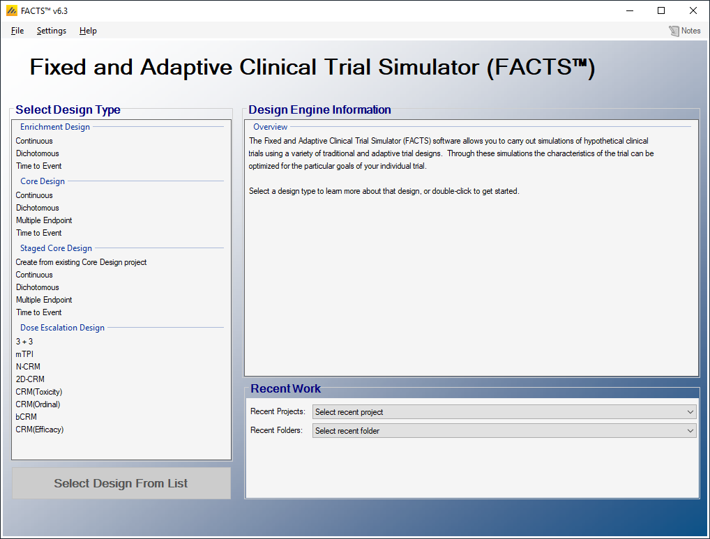

Using the menu option "File \> Save", save this design as "Core-ME-Chronic-Pain-Ex1" in a convenient location (e.g. in a folder called FACTS\\ Core-ME-Chronic-Pain-Ex1 in your 'My Documents' folder).

### Study Info

Set the following parameters:

- This is a non-adaptive design

- With a maximum of 250 subjects

- Add a single visit at 6 weeks.

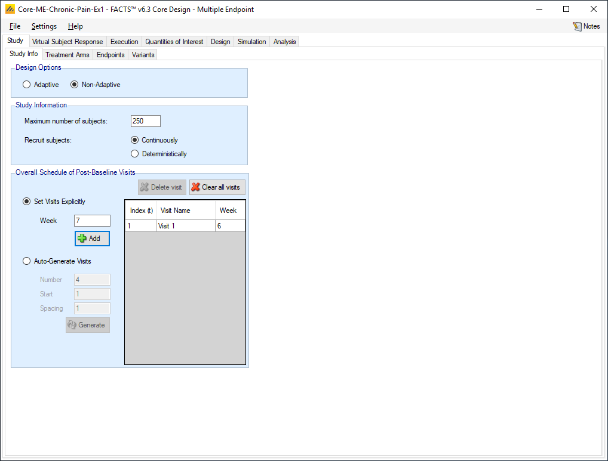

### Treatment Arms

Set the following parameters:

- Include a control arm

- Auto generate 8 doses, starting at dose 1 with a spacing of 1.

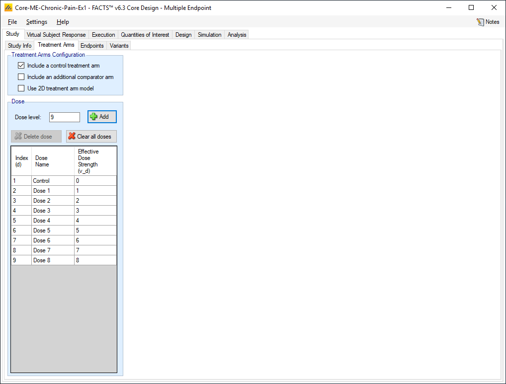

### Endpoints

We would like to select a dose that maximizes our chance of achieving a target minimum efficacy while minimizing our risk of lack of tolerability due to side-effects. In order to ensure a sufficient degree of efficacy we will not just test for superiority against the control arm, but against the control arm plus a clinically significant difference (CSD). Setting the CSD in the comparison used to show sufficient efficacy to the desired margin of 1.3 will make it hard to show efficacy except where the improvement in response is substantially better than 1.3.

In a similar manner to a 'delta' used in a non-inferiority test we need to pick as CSD somewhat less than1.3 in order to not exclude a dose with a true response of 1.3 but with randomly low data during the trial. To help us do this we will examine a range of CSDs, from 0.5 to 1.

To help us select a dose that has sufficient efficacy and acceptable tolerability, we construct a utility function. The utility function comprises a utility function for each endpoint that will map the estimate of the response on that endpoint to a common "utility" scale of our choosing and then a means of combining the utility of each of the two endpoints into an overall utility score.

Because we want a lack of tolerability rate of 20% or worse to equate to no-utility we choose to define the utility for this level of response on this endpoint as 0 and combine the utilities of the two endpoints by multiplying them. Keeping things simple we set the utility of a tolerability rate of less than 20% to be 1, (i.e. the belief is that a in-tolerable side-effect rate of over 20% would cause other drugs to be prescribed in preference, but as long as the rate was below that, the use of our drug would depend on its efficacy).

On the pain scale endpoint we specify that a response (compared to control) of 1.17 points or more, (a difference 10% below our target of 1.3), has a utility of 1, and that any dose with an expected efficacy of 0 or less has a utility of 0. Between 1.17 and 0 we will make the utility decrease quadratically from 1 to 0.

As the utility of each dose will be estimated by integrating over a large number of MCMC iterations the estimated utility in these 'flat regions' where the true utility is either 1 or 0 will be below 1 or above 0. Consider a dose where the mean estimate of the response on the intolerable side-effect scale is exactly 0.2, in roughly half the MCMC iterations it will have been less than 0.2 (and thus had a utility of 1) and in the other half it will have been above 0.2 (and thus have a utility of 0). Thus a dose with a mean estimate of response at "the step" between 1 and 0 will have a utility of 0.5 and doses with responses close to 0.2 will have utilities \<0.5 and \>0.5 and only gradually approach a utility of 0 or 1, only reaching them when the response rate so certainly below 0.2 or above 0.2 that in none of the MCMC samples was it the other side of the 0.2 threshold.

Thus when we include such a step in the utility of an endpoint we do not expect to see a step in the estimate of the utility, but rather a utility that is proportional to the probability that the tolerability of the dose will be above or below the acceptable threshold. This is acceptable because the utility is not an externally accepted measure that we are tying to estimate as part of the claim, the utility is for internal decision making purposes -- namely to help us select a dose that combines a good certainty of being both sufficiently efficacious and sufficiently tolerable.

It would be interesting to explore the impact of changing the tolerability utility to use a linear decline from 1 to 0 over the range 0.1 to 0.2, this might also be more realistic.

#### Utility

We will use multiplied utilities.

Set the following parameters:

- In the dropdown menu for Component utility combination method, select U1 \* U2

#### Primary Endpoint

The primary endpoint, U1, is change from baseline in the average weekly pain score.

We set the following parameters:

- Rename Primary Endpoint: Pain by clicking on the name.

- Set Type: Continuous

- Set Response: Lower response is subject improvement

- We will not include baseline

- We will not use longitudinal modelling in this design

- Leave the Final visit: Visit 1 (wk 6)

- We now must fill in the Component Utility Function for Pain:

  - Add "Knots" at --1.17 and 0.

  - In the interval from --infinity to --1.17, the utility is 1, so set Gamma to 1.

  - In the interval from --1.17 to 0 the utility falls off quadratically, set Alpha to 0.7305

> (because 0.7305\*(-1.17)^2^=1). And Set Gamma to 0

- In the interval from 0 to infinity the utility is 0, set Gamma to 0.

- Check Parameterize response relative to control

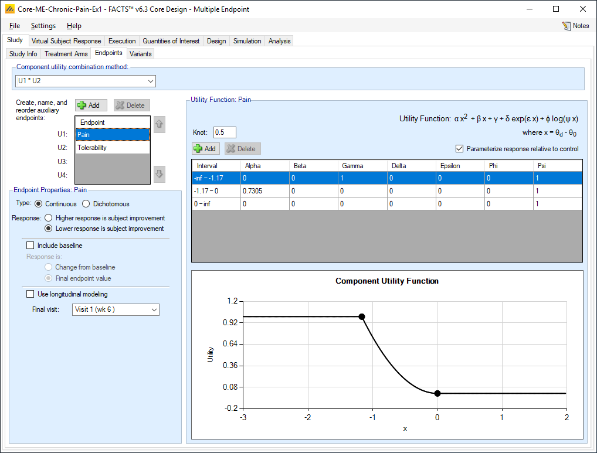

#### Endpoint 2

The second endpoint, U2, is a binary 'tolerability' endpoint, the toxic side effect endpoint.

Set the following parameters:

- Rename Endpoint 2: Tolerability

- Set Type: Dichotomous

- Set: Response indicates negative outcome

<!-- -->

- We will not use longitudinal modelling in this design

- Leave the Final visit: Visit 1 (wk 6)

- We now must fill in the Component Utility Function for Tolerability:

  - This is for absolute response. Do NOT select Parameterize response relative to control.

  <!-- -->

  - Add a "Knot" at 0.2

  - In the interval from 0 to 0.2, the utility is 1, set Gamma to 1.

  - In the interval from 0.2 to 1 the utility is 0, set Gamma to 0.

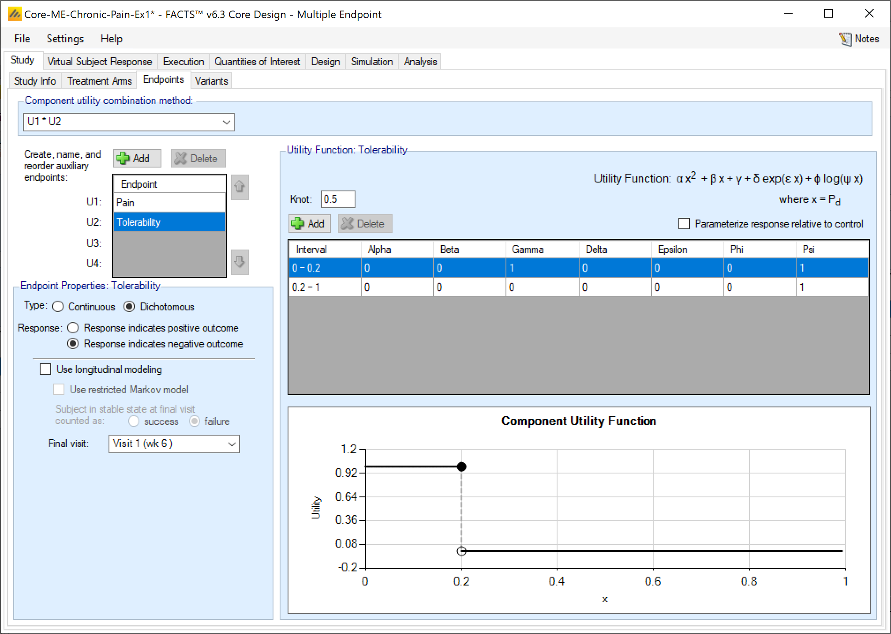

We have 2 endpoints here but the design allows for up to four endpoints.

## Virtual Subject Response -- Explicitly Defined

### Pain

Five different possible dose response scenarios will be simulated. For each scenario, the mean change from baseline for each dose is:

- **For each one** set the SD response (SD of 'error' in the endpoint) to 2.12 -- this is easily overlooked, as the default value is 10, failing to set this will make it very hard for the design estimate the dose response. If your simulation results show large uncertainty and poor estimation of the dose response then you have incorrectly set this value on all your scenarios.

- Set the response for each dose from the corresponding row in the following table:

|              |             |       |       |       |       |       |       |       |       |
|:-------:|:------:|:-----:|:-----:|:-----:|:-----:|:-----:|:-----:|:-----:|:-----:|
| **Scenario** |  **Dose**   |       |       |       |       |       |       |       |       |
|              | **Control** | **1** | **2** | **3** | **4** | **5** | **6** | **7** | **8** |
|     Flat     |      0      |   0   |   0   |   0   |   0   |   0   |   0   |   0   |   0   |
|    Linear    |      0      | -0.21 | -0.41 | -0.62 | -0.83 | -1.03 | -1.24 | -1.44 | -1.65 |
|   Logistic   |      0      | -0.03 | -0.13 | -0.39 | -0.85 | -1.31 | -1.57 | -1.67 | -1.70 |
|     Emax     |      0      | -1.01 | -1.3  | -1.43 | -1.51 | -1.56 | -1.60 | -1.63 | -1.65 |
|   Umbrella   |      0      | -0.5  | -0.92 | -1.25 | -1.47 | -1.6  | -1.65 | -1.6  | -1.47 |

- Rename the Profiles to corresponds the scenario names in the table

- Note the CSD Target is displayed here. The CSD is set on the Quantities of Interest tab and will be discussed later in this tutorial.

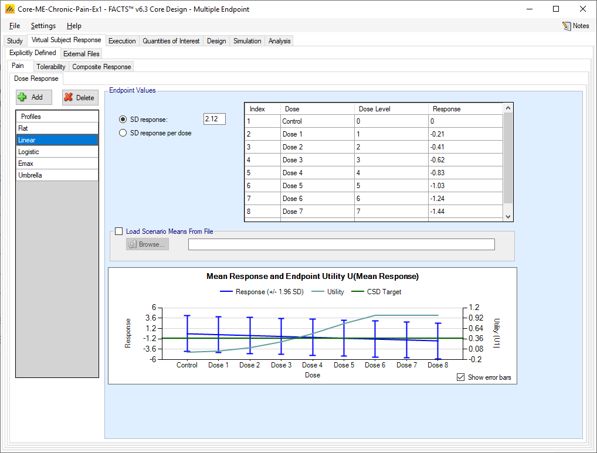

### Tolerability

For each efficacy scenario there is a corresponding tolerability scenario as the two are expected to be closely correlated. These scenarios were simply derived by assuming the probability of the lack of tolerability rises linearly from 0.1 for the control arm to 0.12 for the arm that is the lowest dose that gives an improvement of 1.3 or more and from that dose rising linearly to a probability of 0.24 at the highest dose.

For the second endpoint, Tolerability, add five response scenarios:

- As the endpoint is dichotomous there is no final true sigma to set.

- Set the response for each dose from the corresponding row in the following table and rename the scenarios:

|              |             |        |        |        |        |        |        |       |       |
|:-------:|:------:|:-----:|:-----:|:-----:|:-----:|:-----:|:-----:|:-----:|:-----:|
| **Scenario** |  **Dose**   |        |        |        |        |        |        |       |       |
|              | **Control** | **1**  | **2**  | **3**  | **4**  | **5**  | **6**  | **7** | **8** |
|     Flat     |     0.1     |  0.1   |  0.1   |  0.1   |  0.1   |  0.1   |  0.1   |  0.1  |  0.1  |
|    Linear    |     0.1     | 0.1028 | 0.1058 | 0.1086 | 0.1114 | 0.1142 | 0.1172 | 0.12  | 0.24  |
|   Logistic   |     0.1     | 0.104  | 0.108  | 0.112  | 0.116  |  0.12  |  0.16  |  0.2  | 0.24  |
|     Emax     |     0.1     | 0.1066 | 0.133  |  0.12  | 0.144  | 0.168  | 0.192  | 0.216 | 0.24  |
|   Umbrella   |     0.1     | 0.105  |  0.11  | 0.115  |  0.12  |  0.15  |  0.18  | 0.21  | 0.24  |

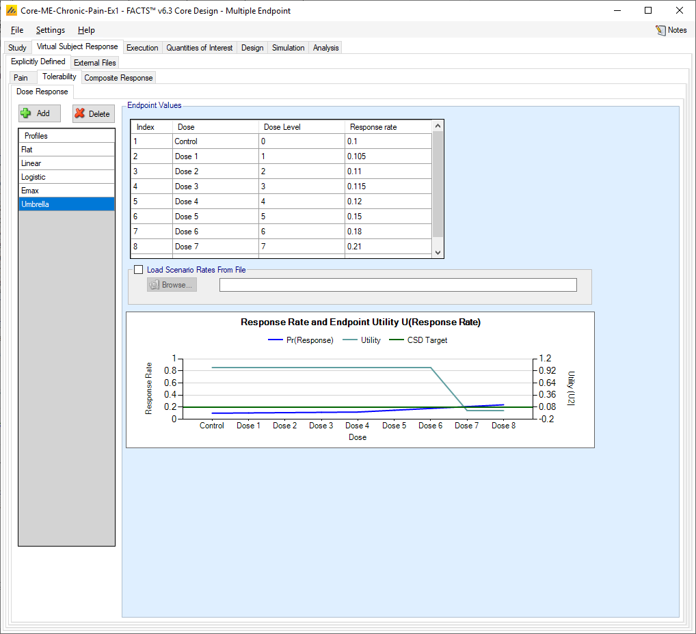

### Composite Response

Add five scenarios, rename them, and select the matching Pain and Tolerability scenarios:

+:-------------:+:------------------------:+:-------------------------:+
| **Scenario**  | **Components**           |                           |
+---------------+--------------------------+---------------------------+
|               | **VAS Pain Scale**       | **Toxic Side Effect**     |
+---------------+--------------------------+---------------------------+
| Flat          | Flat                     | Flat                      |
+---------------+--------------------------+---------------------------+
| Linear        | Linear                   | Linear                    |
+---------------+--------------------------+---------------------------+
| Logistic      | Logistic                 | Logistic                  |
+---------------+--------------------------+---------------------------+
| Emax          | Emax                     | Emax                      |
+---------------+--------------------------+---------------------------+
| Umbrella      | Umbrella                 | Umbrella                  |
+---------------+--------------------------+---------------------------+

If we have perfect knowledge of the dose-response on both endpoints, for each scenario, we would have an overall utility of:

|              |             |       |       |       |       |       |       |       |       |
|:-------:|:------:|:-----:|:-----:|:-----:|:-----:|:-----:|:-----:|:-----:|:-----:|
| **Scenario** |  **Dose**   |       |       |       |       |       |       |       |       |
|              | **Control** | **1** | **2** | **3** | **4** | **5** | **6** | **7** | **8** |
|     Flat     |      0      |   0   |   0   |   0   |   0   |   0   |   0   |   0   |   0   |
|    Linear    |      0      | 0.03  | 0.12  | 0.28  |  0.5  | 0.77  |   1   |   1   |   0   |
|   Logistic   |      0      |   0   | 0.01  | 0.11  | 0.53  |   1   |   1   |   0   |   0   |
|     Emax     |      0      | 0.75  |   1   |   1   |   1   |   1   |   1   |   0   |   0   |
|   Umbrella   |      0      | 0.18  | 0.62  |   1   |   1   |   1   |   1   |   0   |   0   |

The FACTS User Interface allows us to mark those arms in each scenario that "should succeed" -- in our case these are the arms with a utility of 1.

Marking an arm as "should succeed" has no effect on the simulation of the trial, this flag is no passed to the simulator, the flag is used to compute some operating characteristics after the simulation is complete --

- "Ppn Correct Arm" which is the proportion of the simulations that were successful AND selected one of the arms marked "should succeed"

- and "Ppn Incorrect Arm" which is the proportion of the simulations that were successful AND selected one of the arms NOT marked "should succeed"

The arm selection is done using one of the "Target QOI"s (see section 3.4 below) -- the selection of which QOI is used is made on the "Variants" tab (whether variants are being used or not). In this case we use the selection criteria "the arm with the greatest probability of having the maximum utility "Pr(UMax)".

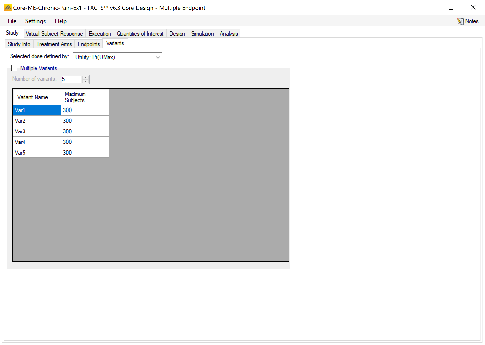

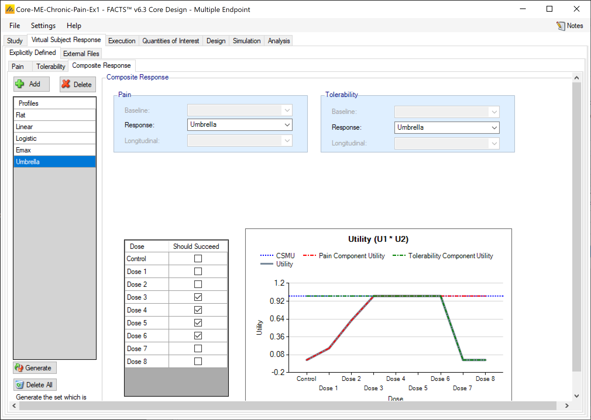

The 5 composite scenarios:

+-------------------------------------------------+-------------------------------------------------+-------------------------------------------------+
| **Flat**                                        | **Linear**                                      | **Logistic**                                    |
+:===============================================:+:===============================================:+:===============================================:+
| 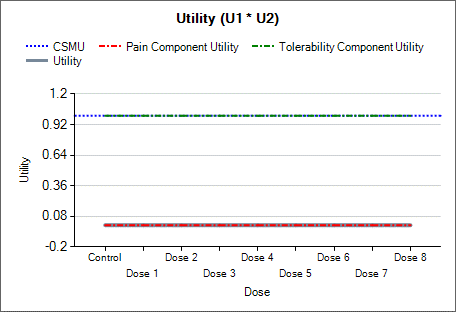 | 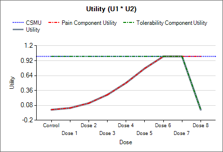 | 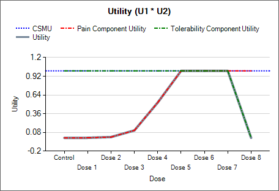 |
|                                                 |                                                 |                                                 |
| No doses "Should Succeed"                       | Doses 6 & 7 "Should Succeed"                    | Doses 5, 6 & 7 "Should Succeed"                 |
+-------------------------------------------------+-------------------------------------------------+-------------------------------------------------+
| **Emax**                                        | **Umbrella**                                    |                                                 |
+-------------------------------------------------+-------------------------------------------------+-------------------------------------------------+
| 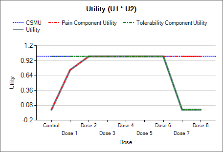 | 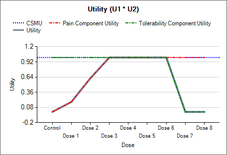 |                                                 |
|                                                 |                                                 |                                                 |
| Doses 2, 3, 4, 5, & 6 "Should Succeed"          | Doses 3, 4, 5, & 6 "Should Succeed"             |                                                 |
+-------------------------------------------------+-------------------------------------------------+-------------------------------------------------+

## Execution

### Accrual

Add an accrual scenario, and add 1 region with a peak accrual rate of 5 subjects per week.

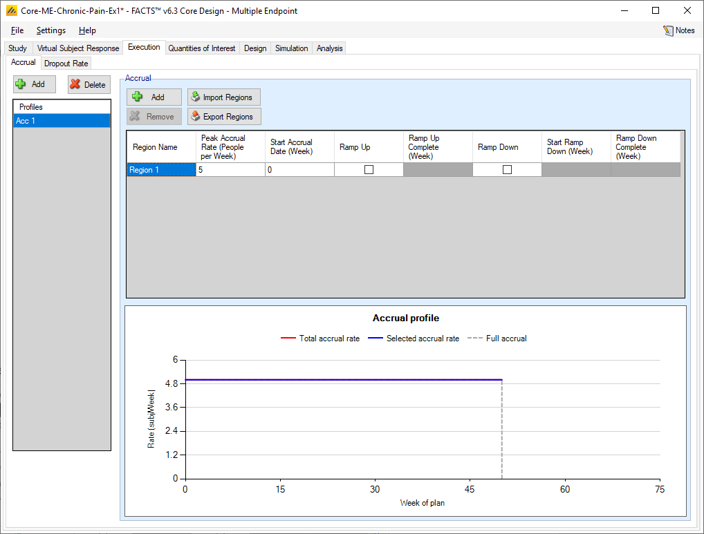

### Dropout Rate

We are assuming no dropouts, so Select No Dropouts as the only profile.

## Quantities of Interest 

We want to determine the probability of the mean pain response at the dose with the greatest utility compared to the Control dose, with the goal of this maximum utility dose being better on the pain score compared to the control by more than the Clinically Significant Difference. We examine a range of CSDs, from 0.5 to 1. Note that we are using the utility function to select the 'best dose', but not directly to judge success of the trial (and whether to run a subsequent trial). Success of the trial is based on best dose's performance on the primary efficacy endpoint relative to placebo.

To do this we have 3 tabs where information can be selected -- one for each endpoint and one for the overall utility.

We will need to specify

- Quantities of Interest (QOI) on the pain scale -- one for each of the CSD's we wish to explore.

- A QOI on the utility scale -- specifying that we wish to identify as a 'target' dose the dose with the maximum utility.

- Decision QOIs on the pain scale -- the evaluation of each of the probabilities of being better than control by each of the CSD's at the Dose with the maximum utility (UMax).

- The tolerability endpoint is used as part of the calculation of utility and we do not need any QOI's solely on this endpoint.

### Pain, Tolerability, and Utility tabs

We want to determine the posterior probability of the difference of the maximum utility dose compared to control being greater less than -CSD, i.e. the maximum utility dose is better.

Set the following parameters:

- We start by specifying our Target. Here our target will be the maximum Utility dose.

  - So first, we go the *Utility tab*, select the Probability of being Target: Pr(UMax). Our decisions will be made on the dose most likely to be the maximum utility dose. The other utility QOIs that FACTS created by default can be deleted (note at the bottom of the tab is button for restoring the default QOIs should we later decide we need them, or we can re-create them by manually specifying equivalents).

- We go back to the *Pain tab.* and at the bottom of the page, ensure the trial type is set to Superiority then set the CSD to 0.8. Note, the CSD is NOT -0.8. We already specified that lower is subject improvement, thus FACTS understands that when comparing the difference between a dose and control we desire the result to be less than -0.8. However, we will examine multiple CSDs; specifying a single CSD here does not limit us to one CSD.

- On the *Pain tab*, for Posterior Probabilities we are interested comparing the max utility dose to the control arm and seeing if it is better than a clinically significant difference (CSD). We select:

  - Pr(θ_d-θ\_(Control)\<-0.8). The \< and Relative to Control and Delta were already filled in because we specified the CSD and comparison. Here lower scores are better so we are interested in evaluating whether the maximum dose has a difference from control less than -0.8.

  - We want to add additional CSDs for comparison. We select:

    - Add...

    - Condition: \<

    - Response Relation: Relative to: Control

    - Delta: -0.6

  - We repeat this process for additional CSDs of -0.5, -0.7, -0.9, -1, -1.13 and ?????

- On the *Pain tab*, we do not select a Probability of being Target because our target is the maximum Utility dose and that is entered on the Utility tab. The other targets could still be included, but here we delete the other targets to reduce output, and also the other default QOIs that we are not interested in.

- On the *Pain tab*, we enter a Decision Quantity. Note, decision quantities cannot be entered until a Target is specified, hence the need to jump to the Utility tab in step 1. Select:

  - QOI (Vector Quantity): Pr(θ_d-θ\_(Control)\<-0.8)

  - Evaluation Dose: Utility: Greatest Pr(UMax)

  - Repeat this step for the additional decision quantities related to our range of CSDs.

- On the *Tolerability tab* we delete all the default QOIs.

- On the *Utility tab*, at the bottom we specify the Clinically significant minimum utility (CSMU) as 1. This quantity is not used in our decisions, but it is a reference line on the graphs on the Virtual Subject Responses tab. We retain the Pr(UMax) QOI (which provided by default).

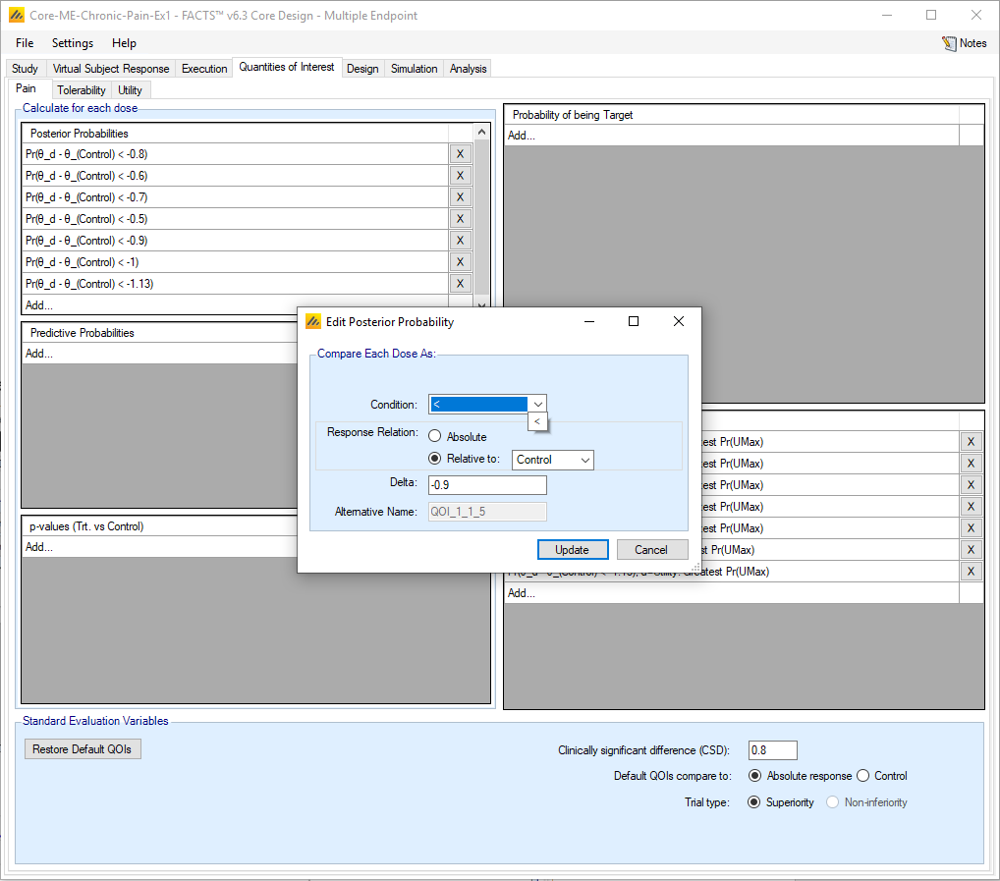

### The Pain Endpoint QOI tab

The completed Quantities of Interest for Pain are shown here:

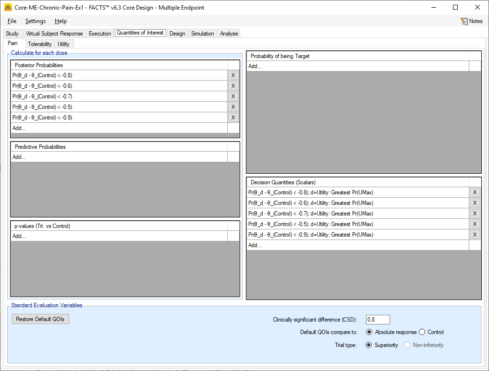

### The Tolerability Endpoint QOI tab

The completed Quantities of Interest for Tolerability are shown here:

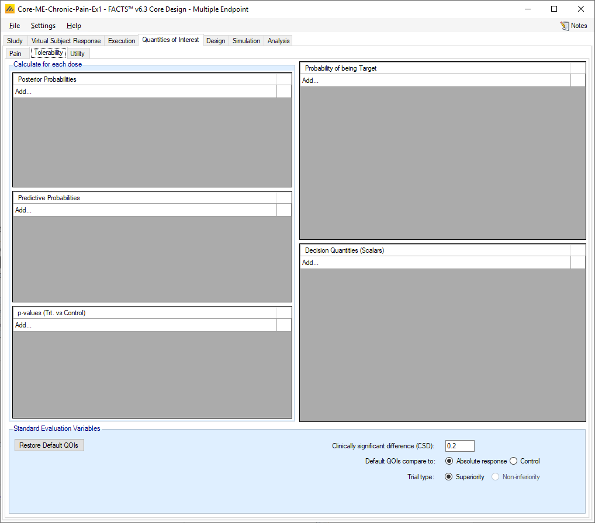

### The Utility Endpoint QOI tab

The completed Quantities of Interest for Utility are shown here:

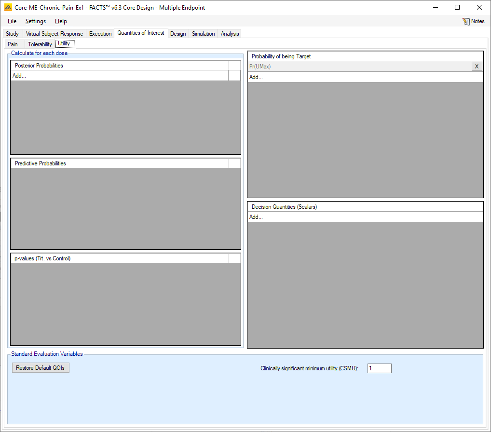

## Design

### On Setting Priors

On setting priors -- as a rule it is recommended that the user specifies weakly informative priors rather than non-informative ones. There are a number of reasons for this:

1.  In a few circumstances non-informative priors can end up being informative.

2.  What values make a prior non-informative vary depending on the range of the value being estimated, a measure with a SD of 1000 requires quite a different value for a prior to be non-informative than one with an SD of 1.

3.  Measures that are log-odds or log hazard ratios can have parameters that are then exponentiated and used as parameters to other distributions as a maximum these values should have range of (-10,10) and (-5,5). Greater than this and numeric overflows can occur.

4.  Using a "non-informative" prior can sometimes be used as an excuse for not thinking about the prior. Not thinking about a prior is never a good idea.

5.  There are some priors, particularly for the variance parameters of hierarchical models where (as we use inverse Gamma distributions for the priors, weakly informative priors are preferred to uninformative ones \[Gelman 2006, "Prior distributions for variance parameters in hierarchical models" *Bayesian Analysis Vol 1 Number 3*\]

6.  When simulating clinical trial designs there is a balance to be struck between the MCMC sample length used in the within-trial analyses and the number of simulations run. Weakly informative priors can help the MCMC to converge and allow us to use shorter sample lengths.

For many priors the weakly informative is easily judged where the priors directly correspond to values that we are simulating. Others are not so easily judged, for these we used "non-informative" priors, ran some simulations and looked at the means and SDs of the posterior estimates of the parameters over all the scenarios and then based a weakly informative prior on these. You will see these priors below being described as having an "initial un-informative" prior and then a weakly informative one. Care must be taken with this approach to not over specify a prior based on the selection of scenarios, and it must be borne in mind that the scenarios may not capture the full potential variability in what the "truth value in nature" might actually be.

### Pain

#### Dose Response

We wish the design to be able to cope with non-monotonic dose response data for the primary endpoint, so we model the primary continuous endpoint using the Second Order NDLM.

We assume the dose strengths give a linear range of doses in terms of the expected change in dose effect, so they are given dose levels of 0, 1, 2, \..., 8 and control is included in the model as the first dose

If the response for the *i^th^* subject given dose *d* at week 6 is *Y~6i~*:

$$Y_{6i} \sim N\left(\theta_d, \sigma^2\right) \text{ for } d = 0,1,\ldots,8$$

We set the prior for the initial dose:

$$\theta_0 \sim N\left(0, 0.5^2\right)$$

The scenarios all use a control rate of 0, so a mean of 0 for the prior seems reasonable. An SD of 0.5 means that the +/- 2SD prior interval is (-1,+1) so any actual rate within that range should see little effect from this prior in the posterior estimate, whereas an observed rate outside that range will see some bias towards 0 in the posterior estimate. The SD of the endpoint is 2.12 (variance 4.5) so this prior (variance 0.25) is roughly equivalent to 18 observations with a sample mean of 0. As we will be simulating typically 50 subjects in control this will contribute some additional shrinkage to the final estimate of the response on control. It will contribute a considerably greater proportionate effect at early interims with a lot less actual data. Exploring how useful this is in this example is left the reader, it is very easily done by making a slight change to this example and re-running the simulations.

Prior for the First dose difference:

$$\theta_1 - \theta_0 \sim N\left(0, 2^2\right)$$

Here we use a weakly informative, conservative prior, the mean of the prior is that there is no change in response from the Control to the first dose. An SD of 2 means that the +/- 2SD prior interval is (-4,4). All our expected changes are well inside this range -- the maximum difference of any dose from control is \~1.7 and the SD of the endpoint is 2.12.

The next two prior distributions use the Inverse Gamma distribution, these can be specified in FACTS using one of two parameterizations -- either the "Alpha, Beta" parameterization which is the more normal parameterization for statisticians, or the "Central value and Weight" parameterization. It is easier with the latter form to discuss the likely impact of the prior so this is the form that will be used here. The FACTS "Settings" menu command can be used to select the form you use. See "Settings \> Options \> Gamma Distribution Parameters".

The 2^nd^ Order NDLM smoothing parameter $\tau^{2}$ is similar to one of those variance parameters of a hierarchical distribution, and as the data being modeled is the change in dose response between doses the number of actual observations in this case to 7 and the prior can play an important role. If we have strong prior that this is a small value, the 2^nd^ order NDLM will tend to a straight line (extreme smoothing) and if we have a strong prior that this is a large value, the 2^nd^ order NDLM will tend to simple pairwise comparison (no smoothing). Thus if we weight the prior to a small value we can reduce type 1 error -- as the Null case is a flat straight line, but at the expense of underestimating the dose response at doses where there are large changes in response from one dose to the next.

Initial simulations were run with prior mean and weight of 1 and 0.1. For this parameter this gave an average for the posterior mean of 0.43 with and SD over the simulations of 0.1 and an average SD of the posterior estimate over the simulations of 0.26. However on the Emax scenario we saw the smoothing cause a biased under estimate of the response on the first dose of -0.22. (\~22%) so we strengthened the prior for tau at a slightly higher value choosing a mean of 0.6 and a weight of 5.

$$\tau^2 \sim IG\left(0.6, 5\right)$$

This marginally reduced the bias at the first dose in the Emax scenario to -0.19. This prior could be further refined by exploring the error and bias of the response estimates across the scenarios at different prior means and weights -- particularly at the key doses.

For the nuisance parameter $\sigma$ we specified a prior with a mean of 2 close to the scenario mean and weight of 5 -- equivalent to 5 observed subjects - so in the posterior estimate, the prior will be quickly dominated by the observed data. With a well research endpoint it would be not usual to have a strong prior expectation for the value of this parameter.

$$\sigma^{2}\sim IG(2,5)$$

Set the following parameters:

- Select Model: Second Order NDLM

- For the initial dose set the prior mean to be 0 and standard deviation to be 0.5

- For the first dose difference, set the prior mean to be 0 and standard deviation to be 2

- For the "smoothing factor", tau*^2^* (*τ^2^*) set the prior mean to be 0.6 with weight of 5.

- Set Error Parameters: Sigma prior mean to be 2, and with weight of 5

- Control is not modeled separately

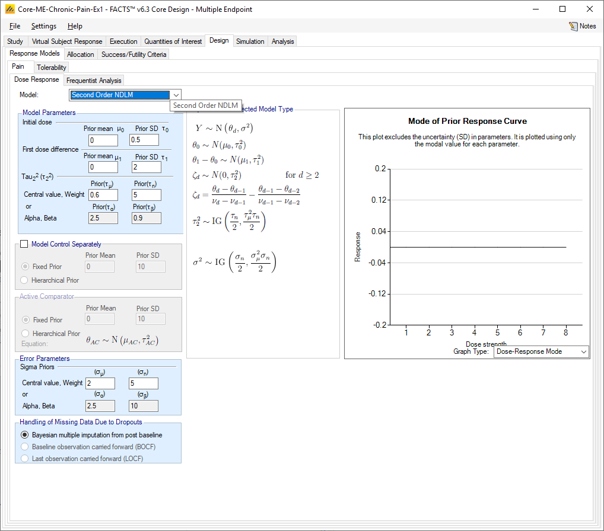

#### Frequentist Analysis

Since we have no dropouts, we leave just LOCF checked

The required alpha and the contrast coefficients can be set for the frequentist analysis. We leave them unchanged.

### Tolerability

#### Dose Response

The second endpoint is strongly expected to be monotonic, so a 4-pararmeter sigmoid is used to model the log-odds of the probability of a lack of tolerability.

If the rate of intolerability response for the subjects on dose *d* is P*~d~*:

$$P_{d} = \frac{e^{\theta_{d}}}{1 + e^{\theta_{d}}}$$

We will model the mean response:

$$\theta_d \sim a_1 + \frac{\left(a_2 - a_1\right) v_d^{a_4}}{v_d^{a_4} + a_3^{a_4}} \text{ for } d = 0,\ldots,8$$

Where a~1~ is the response at the lowest modeled dose, a~2~ some maximal response that is approached asymptotically, a~3~ is the dose level at which half the increase from a~1~ to a~2~ is observed, and a~4~ is a "hill" parameter defining the slope.

Bearing this in mind initially the priors for the model parameters of are set to:

$a_1 \sim N\left(-2, 1^2\right)$, $a_2 \sim N\left(0, 1^2\right)$

$a_3 \sim N^{+}\left(4, 3^2\right)$, $a_4 \sim N^{+}\left(12, 100^2\right)$

The mean of the prior for a~1~ corresponds to a probability of 0.12 and +/- 2 standard deviations gives a probability range from 0.02 to 0.5. As the mean tolerability rate on Control is 0.1 in all scenarios this is close to being correctly centered and is clearly only weakly informative.

The mean of the prior for a~2~ corresponds to a probability of 0.5 and +/- 2 standard deviations gives a probability range from 0.12 to 0.88. In the tolerability scenarios the lack of tolerability never reaches the plateau value that this parameter estimates. The scenarios only go as far as a rising lack of tolerability reaching a rate of 0.24.

The mean for the prior for a~3~ corresponds to the middle of the dose range and +/- 2 standard deviations gives a dose range from 0 to 10 -- covering but not drastically exceeding the dose range being studied.

The mean for the prior for a~4~ corresponds to a reasonable slope (change in rate of 0.13 from d~3~ to d~4~) at the mean values for the other parameters, and the SD of 100 allows for a great deal of variation in the final value.

However after looking at the posterior estimates for these parameters from the initial run we saw that a~3~ and a~4~ were 6 and 77 respectively. As there are relatively few toxic event on each dose this endpoint was in some simulations being estimated poorly and so the priors for a3 and a4 were revised to

$a_{3}\sim N^{+}\left( 6,2^{2} \right)$, $a_{4}\sim N^{+}\left( 80,100^{2} \right)$

Set the following parameters:

- Select Model: Sigmoidal

- For the prior distributions for the 4 alpha parameters set

  - Λ~1~ = -2, λ~1~ = 1 (log odds of: --4, -2, 0 correspond to probabilities of: 0.02, 0.12, 0.5 respectively)

  - Λ~2~ = 0, λ~2~ = 1 (log odds of: --2, 0, 2 correspond to probabilities of: 0.05, 0.5, 0.88 respectively)

  - Λ~3~ = 6, λ~3~ = 2 (spans the upper half of the dose range)

  - Λ~4~ = 80, λ~4~ = 100

- Control is not modeled separately

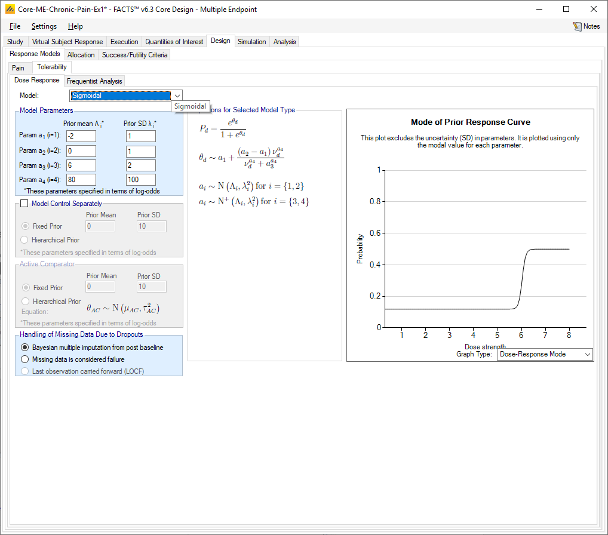

#### Frequentist Analysis

Since we have no dropouts, we leave just LOCF checked.

The required alpha and the contrast coefficients can be set for the frequentist analysis. We leave them unchanged.

### Allocation

Because we selected Non-Adaptive on the Study Info screen, only fixed allocation is available, specify a ratio of 2 on control and 1 on each study dose.

Set the following parameters:

- Set the allocation ratio as 2 for Control, and 1 for every other arm.

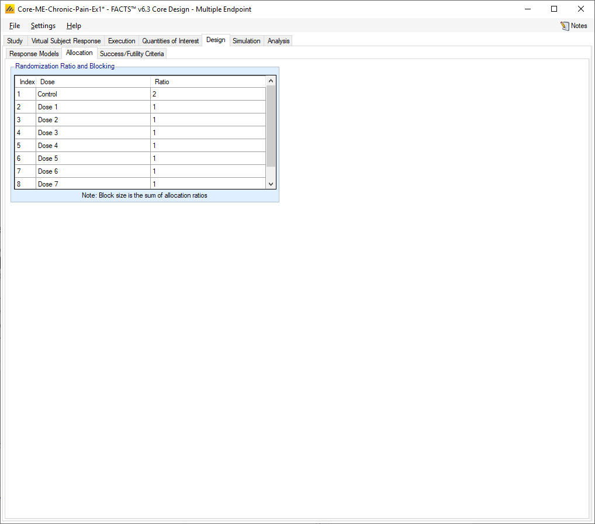

### Success/Futility Criteria

Here we only have a Final Evaluation tab; this initial design will not use any early stopping.

The trial will be judged a success if at the end of the trial:

- the dose most likely to have the maximum utility dose has a posterior probability that its mean improvement minus the Control arm is better than 0.8, is greater than 75%.

The trial will be judged to be futile if at the end of the trial:

- the dose most likely to have the maximum utility has a posterior probability that its mean improvement minus the Control arm is better than 0.8, is less than 25%.

Otherwise the trial will be judged to be inconclusive.

Note that we are using the utility function to select the 'best dose', but not directly to judge success of the trial (and whether to run a subsequent trial). Success is based on best dose's performance on the primary efficacy endpoint relative to control.

Set the following parameters:

- Futility Criteria:

  - QOI: Add "Pain: Pr(θ_d-θ\_(Control)\<-0.8); d=Utility; Greatest Pr(UMax)

  - Condition: \<

  - Threshold: 0.25

  - Combine criteria using: Leave as default since we have specified only one QOI

- Success Criteria:

  - QOI: Add "Pain: Pr(θ_d-θ\_(Control)\<-0.8); d=Utility; Greatest Pr(UMax)

  - Condition: \>

  - Threshold: 0.75

  - Combine criteria using: Leave as default since we have specified only one QOI

Thus, if the probability of the mean response at the dose with the greatest utility being better than Control by more than the 0.8 is 75% or better the compound will be successful. If the probability that the mean response at dose with the greatest utility is better than Control by more than 0.8, is less than 25% the trial is a failure. For anything not meeting either of these criteria, the trial results are inconclusive. The thresholds for success and futility were determined by examining the results of simulations. The rationale for selection 0.8 as the desired amount of improvement over control was also determined by examining simulation results and the range of clinically meaning differences that were supplied. Additional details will be discussed in the Simulations section.

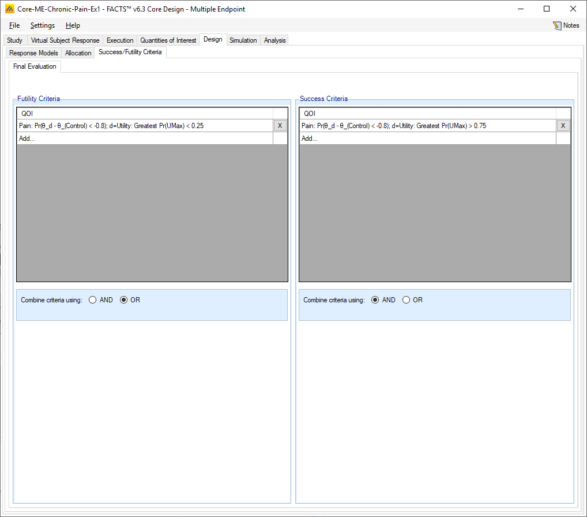

## Simulation

Set the number of simulations to run to 10, Select all Scenarios, then press Simulate. This allows us to make a quick assessment of whether the design is behaving as expected: that the flat scenario's end up mainly futile and the others mainly successful. With a fixed allocation in this design, the other scenarios will have lower probabilities of late success.

If the results look reasonable, increase the number of simulations to run to 100, (re-check the 5 scenario combinations we wish to run) and then press Simulate again. If the results still look promising run 1,000.

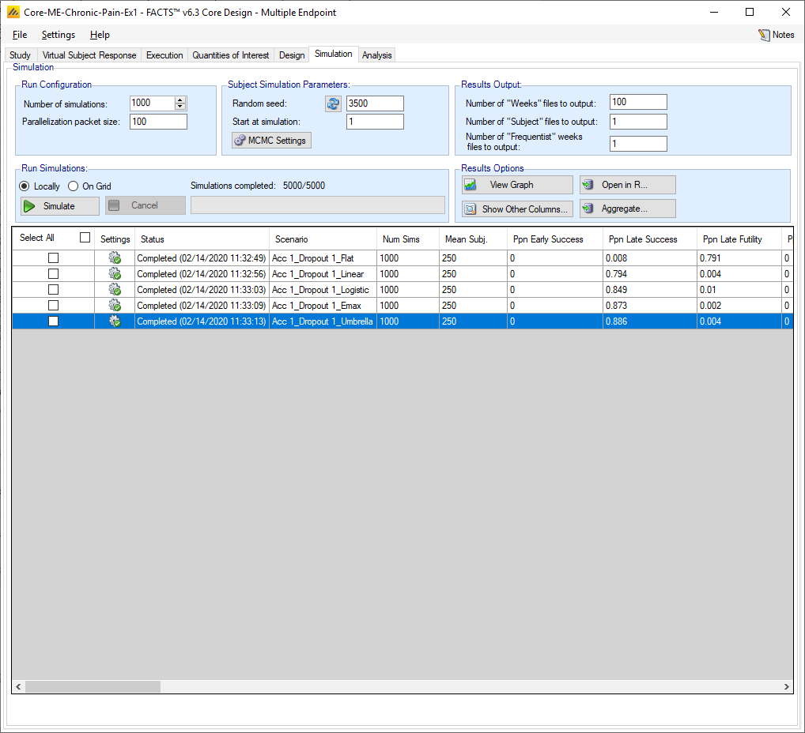

## Results

Review the following to see if the design is successful

1.  Determine if, on the Flat, ineffective, scenario there are not too many type 1 errors (trials that end up successful). Here we see a proportion of 0.008 of the trials declared as late successes.

2.  Determine if, on the effective scenarios that there are sufficient successful (sufficient power) trials. We see power ranging from 0.8 to 0.89.

3.  Determine that the Umax are correctly identified given the data observed. We click on Show Other Columns -- Probabilities. For the Emax scenario, Dose 2 was found to have the greatest probability of UMax in 67% of the trials simulated.

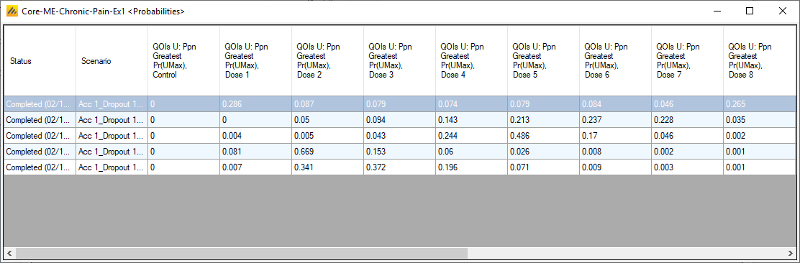

We can also graph the distribution of the selection of doses as Umax from the FACTS graph viewer:

- Click "View Graph" on the Simulation tab:

> 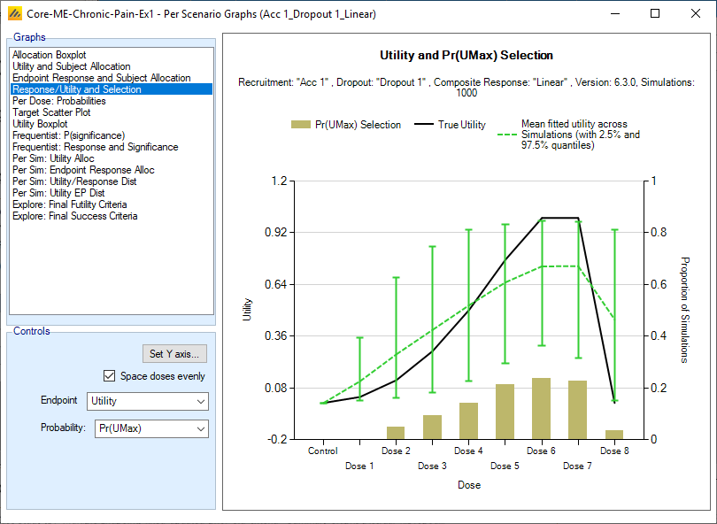

We can see a simple summary of how often by selecting the dose with the highest Pr(UMax) we correctly select one of the doses that we marked as "Should Succeed" by looking at the "Ppn Correct Arm" column in the simulation summary results:

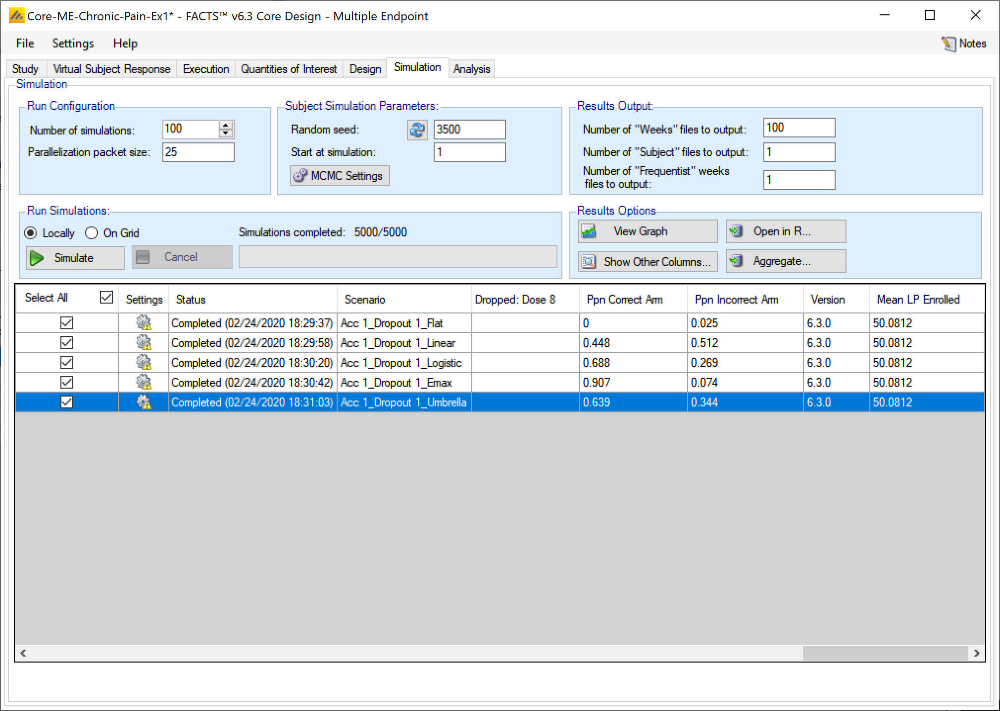

We can see that in the Emax case we select correctly a reasonable 0.9 of the simulations, but we fare less well in the other scenarios, with probabilities of 0.69, 0.64 and 0.45 in the Logistic, Umbrella and Linear scenarios respectively.

From the graphs available there is a particularly useful one for examining model fit of the utility for each of the given scenarios. The graph displays the true utility, the fitted utility, and the allocation for each arm. To view this graph, click on View Graph and select graph Utility and Subject Allocation.

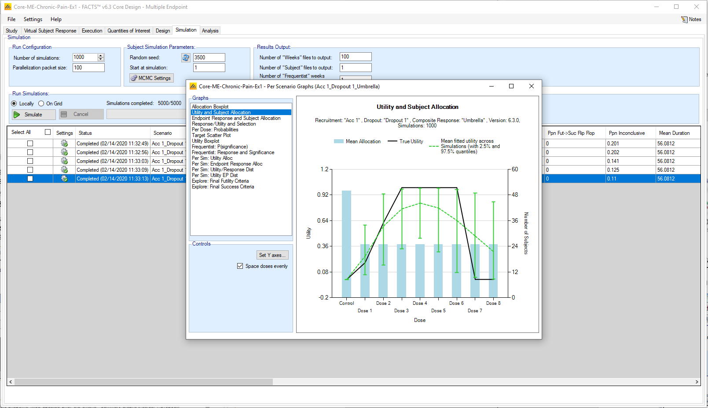

See how the estimated analysis is below the true utility when its one and above it when its zero. This is because when the utility function has a plateau that is approached from below or above the averaged estimate of the utility can only be below / above the value of the plateau.

We also examine useful graphs that assist in selecting the thresholds and the desired improvement from Control. On the QOI tab, we had five Posterior Probabilities and Decision Quantities computed for clinically significant differences ranging from 0.5 to 0.9. We evaluate all of these CSDs in one run of simulations to understand how different thresholds (success and futility) and CSDs will perform in the different virtual subject response scenarios.

To do this, we highlight a scenario, go to View Graph, and examine the graph: Explore: Final Success Criteria. This plot displays the proportion of simulations satisfying the final success criteria for each threshold ranging from 0.5 to 0.9 for each of the CSDs in the selected scenario. Examining the Success criteria plot, we determine which cut-offs in the null case, i.e. Flat scenario, will limit false successes to 0.025. A threshold of approximately 0.75 will work for a CSD of 0.6 for example. We balance this with examining the weakest of the other scenarios, i.e. Linear scenario. For each CSD the threshold that controls the type-1 error at a given level in the Null scenario gives the same power in an alternate scenario as the other QOIs using different CSDs and thresholds.

+------------------+-----------------------------------------------+--------------------------+
| CSD              | Threshold to give 0.025 success in Null case. | Power in Linear scenario |
+==================+===============================================+==========================+
| 0.5              | 0.825                                         | 0.95                     |
+------------------+-----------------------------------------------+--------------------------+
| 0.6              | 0.75                                          | 0.95                     |
+------------------+-----------------------------------------------+--------------------------+
| 0.7              | 0.675                                         | 0.95                     |
+------------------+-----------------------------------------------+--------------------------+
| 0.8              | 0.575                                         | 0.95                     |
+------------------+-----------------------------------------------+--------------------------+
| 0.9              | 0.5                                           | 0.95                     |
+------------------+-----------------------------------------------+--------------------------+

Thus when only considering type-1 error and power, choosing CSD is more a matter of taste -- after success do we wish to claim a high probability of having beaten a relatively low CSD or a relatively low probability of having beaten a high CSD?

For the rest of this example we use the CSD of 0.6.

Investigating type-1 error: the proportion of simulations that would be successful in the \'Flat\' (Null) scenario at different thresholds, for all decision QOIs

Investigating power: the proportion of simulations that would be successful in the 'Linear' scenario at different thresholds, for all decision QOIs

> Modifying the decision criteria to use "Pain: Pr(θ_d-θ\_(Control)\<-0.6); d=Utility; Greatest Pr(UMax) \> 0.75" we get the following results:

+------------------+-------------------------+-------------------------+
| Scenario         | Ppn Late Success        | Ppn Correct Arm         |
+==================+========================:+========================:+
| Flat             | 0.025                   | 0                       |
+------------------+-------------------------+-------------------------+
| Linear           | 0.96                    | 0.448                   |
+------------------+-------------------------+-------------------------+
| Logistic         | 0.957                   | 0.688                   |
+------------------+-------------------------+-------------------------+
| Emax             | 0.981                   | 0.907                   |
+------------------+-------------------------+-------------------------+
| Umbrella         | 0.983                   | 0.639                   |
+------------------+-------------------------+-------------------------+

We can also see the arm selection by scenario in detail in the "Across Scenario Graphs" -- "Selcted Arms":

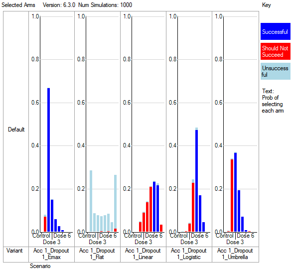

#  Adaptive Allocation Version

To create the adaptive version of this design, open the fixed design and use the menu option File \> SaveAs and save a version of the design with a new name, for example Chronic Pain Case Study (DF Multiple Endpt) -Adaptive. We will now, in two separate steps, add response adaptive randomization and early stopping for futility and success to the design.

The steps below will go through the portions of the design to be changed. If a feature is not discussed it is unchanged with respect to the fixed design.

Note, the adaptive design below is an example, the design is not necessarily optimized and additional iterations might furtherimprove the operating characteristics.

## Study

### Study Info

We select the following options:

- Design Options: Adaptive

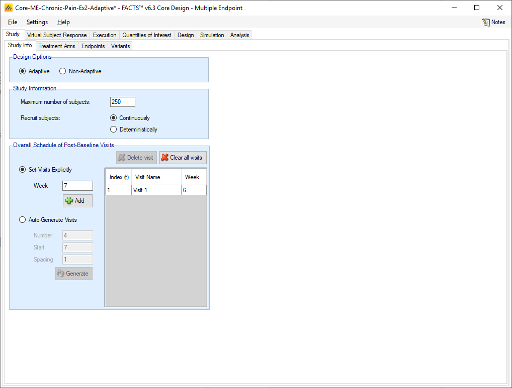

## Design

### Allocation

Set the following parameters:

- Select Adaptive Allocation

- Set the Allocation ratio to 2:1:1 ... as in the fixed design. (The optimal allocation ratio with D multiple arms compared to one control is $\sqrt{D}:1:1:1\ $at least with pair-wise comparisons and using a Dunnett's test -- but we already have good power, we're using a dose response model and we need subjects allocated to the dose arms to help select the Pr(Umax)).

- For the Control arm:

  - Select Fix Alloc.

  - Set: Post Interim Alloc. Per Block to 2

- Set Post first interim block size to 8. Thus, randomization to control will be fixed at 25%, 2 out of every 8.

- Add Adaptive Allocation Target

  - QOI: Utility: Pr(Umax). We will adjust randomization based on the probability that a dose is the maximum utility dose. The Pr(Umax) dose is the dose that we are looking to select for the next phase of development and using for decision making in this stage.

  - Weight For: Probability

    - We could choose to weight for information because it is less aggressive, however we have a lot of doses, a fairly small sample size, frequent adaptations (as you will see on the next tab, we set the interims to be every 2 weeks), so the allocation can change if the emerging data changes where the UMax is and a dose-response model that smoothes between doses. Here we have opted to be more aggressive so we get a significant allocation imbalance in favor of the UMax dose. Feel free to experiment with alternatives.

  - Relative Weight: 1. This parameter is relevant if you have more than one QOI on which randomization probabilities are computed.

- Set Allocation probability set to zero for values less than: 0.05.

- Set the allocation power to 2.

  - The smaller the value the less aggressive the adaptation, 2 is fairly aggressive and used for the same reasons as we used weighting for probability rather than information.

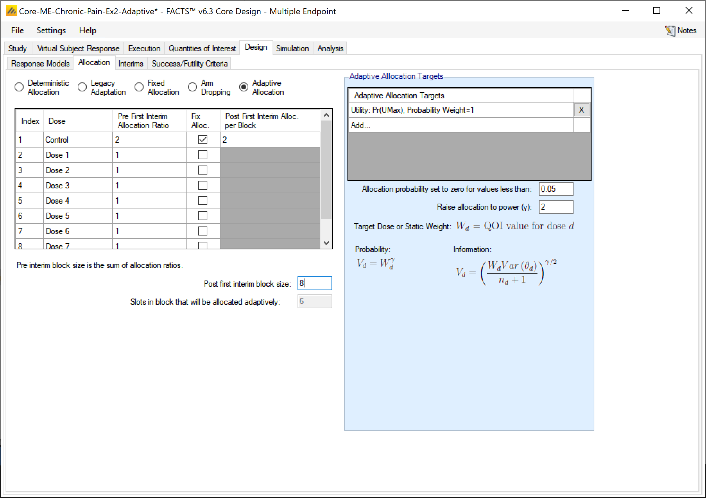

### Interims

Set the following parameters:

- Subject Information Defined By: Subjects Enrolled

- Specify Interims By:

  - Time -- every: 2 weeks

  - First interim at 60 subjects enrolled. (With an average accrual rate of 5 subjects per week and 6 week endpoint, this should be approximately after 12 weeks and the first 30 subjects complete).

- The randomization will be in a 14:5:5:...5 ratio until 60 subjects are enrolled, 16-17 subjects on control and 5-6 per dose, and interim analyses begin.

- Select: Continue follow-up if study stopped for success.

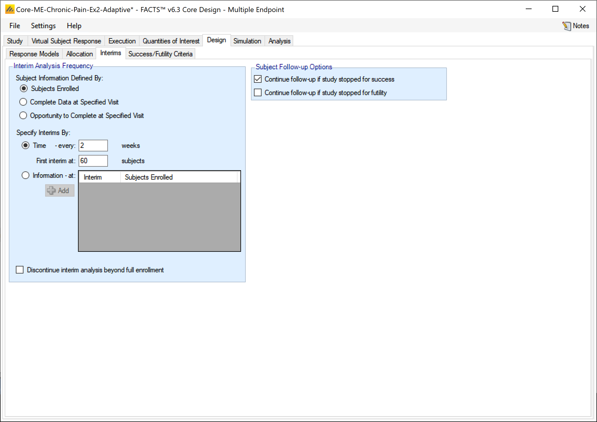

### Quantities of Interest

We chose to examine posterior probabilities for CSDs of 0.5, 0.6, 0.7, 0.8 and 0.9 in the fixed design. Having chosen to use the 0.6 CSD, we eliminate the other QOIs we used in the fixed design to speed up simulations and reduce output.

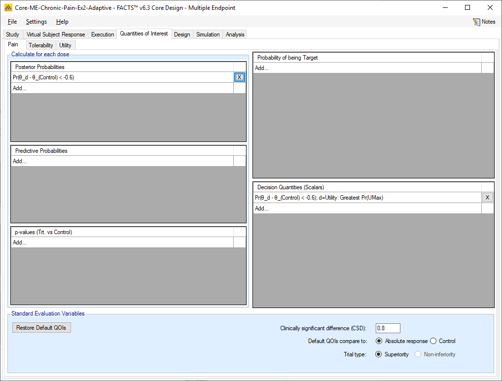

### Success/Futility Criteria

#### Interim 1

Now that we have interim analyses, we have an Interim 1 tab. This is where we will set the details for the early stopping for futility and success criteria in the second version of the adaptive design. For now we leave the check boxes by Futility Criteria and Success Criteria unchecked -- we want to check and tune the adaptive allocation before looking at early stopping.

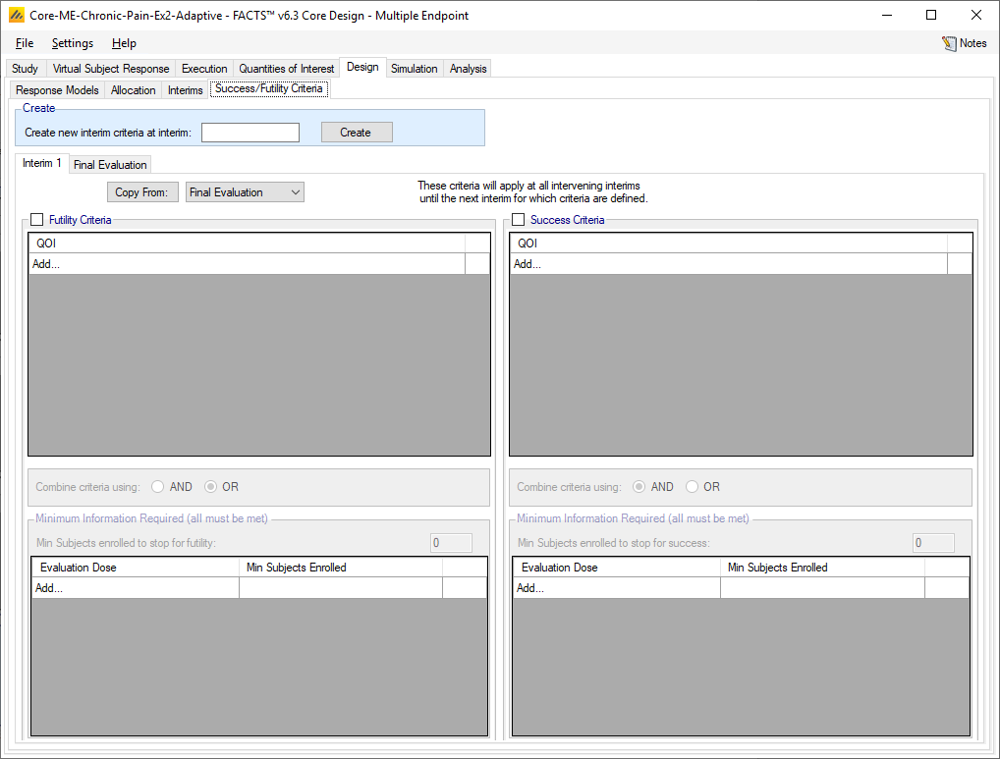

#### Final Evaluation

We need to make sure the Final Evaluation criteria use the CSD of 0.6.

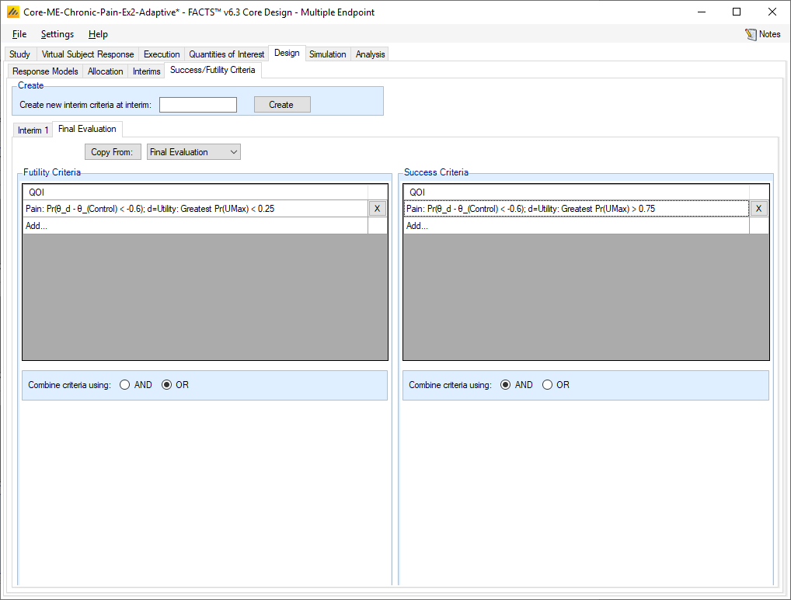

## Simulation

Running the simulation is the same as for the fixed design -- we run 1,000 simulations, but opt to also output 1000 "weeks" files. This is so that we can analyze the interim results to help us select a early stopping criteria, and the more results we have the more robust this process will be.

## Results

Review the following to see if the design is successful

1.  Determine if, on the Flat, ineffective, scenario there are not too many type 1 errors (trials that end up successful). Here we see 0.011 of the trials declared late successes, fewer than in the fixed design.

2.  Determine if, on the effective scenarios that there are sufficient successful (sufficient power) trials. Here we similar power to the fixed design, with power of 0.939-0.988. Similar to the fixed deisgn.

3.  Determine that the Umax are correctly identified given the data observed. We click on Show Other Columns -- Probabilities. For the Emax scenario, Dose 2 was found to have the greatest probability of UMax in 60% of the trials simulated. This is similar to the 62% from the fixed design.

4.  Examine subject allocation per arm. The mean allocations per arm may be seen clicking on Show Other Columns -- Allocation. In this adaptive design, a higher proportion of the subjects are randomized to the better performing arm as a result of the adaptive randomization algorithm.

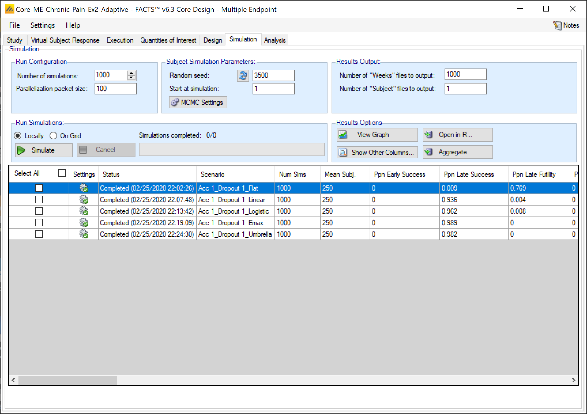

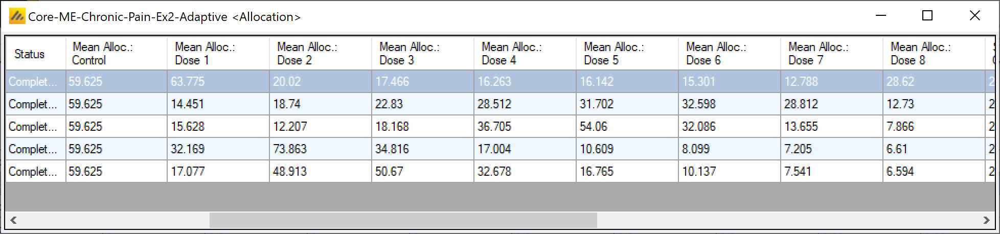

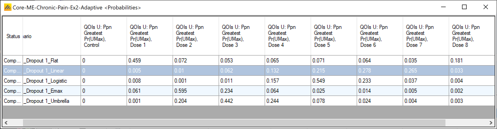

It is easiest to review adaptive subject allocation and pr(Umax) selection graphically. We include the Per Scenario graphs of Pr(Umax) selection from the fixed design for comparison.

+----------+-------------------------------------------------+-------------------------------------------------+-------------------------------------------------+
| Scenario | Adaptive                                        |                                                 | Fixed                                           |
+==========+=================================================+=================================================+=================================================+
|          | Subject Allocation                              | Ppn Umax                                        | Ppn Umax                                        |
+----------+-------------------------------------------------+-------------------------------------------------+-------------------------------------------------+
| Linear   | 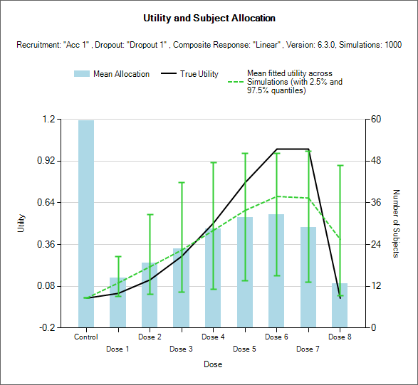 | 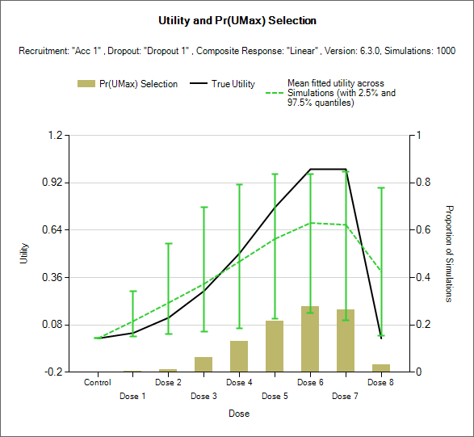 | 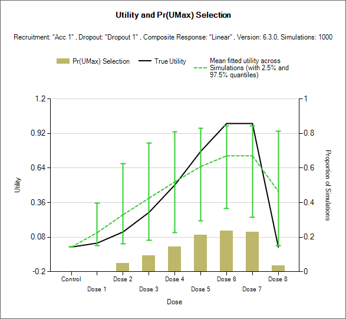 |
+----------+-------------------------------------------------+-------------------------------------------------+-------------------------------------------------+
| Logistic | 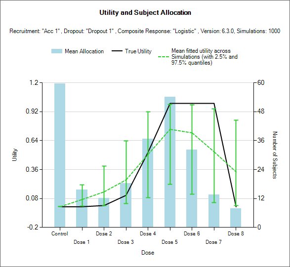 | 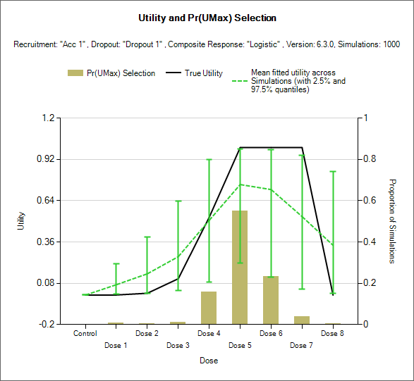 | 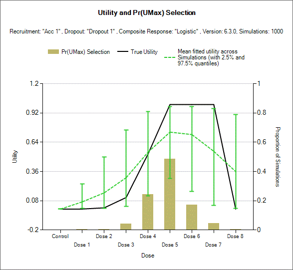 |
+----------+-------------------------------------------------+-------------------------------------------------+-------------------------------------------------+
| Emax     | 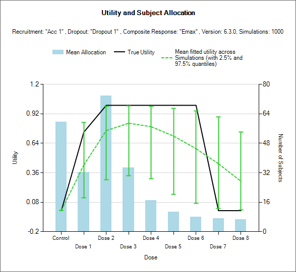 | 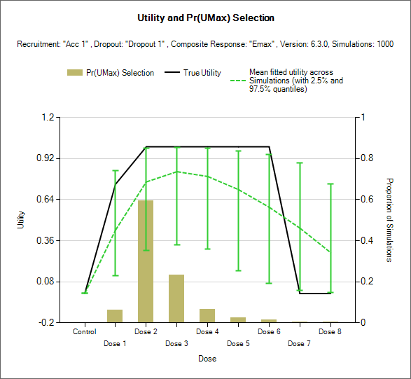 | 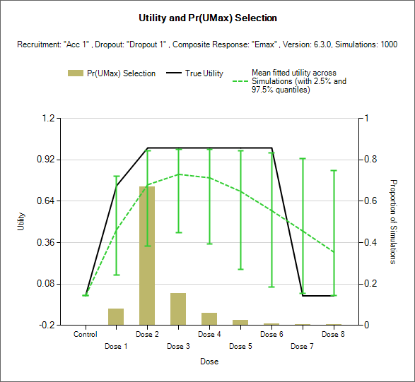 |
+----------+-------------------------------------------------+-------------------------------------------------+-------------------------------------------------+
| Umbrella | 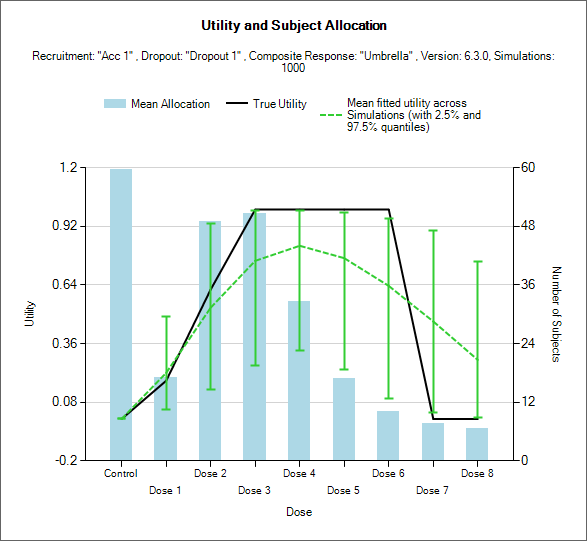 | 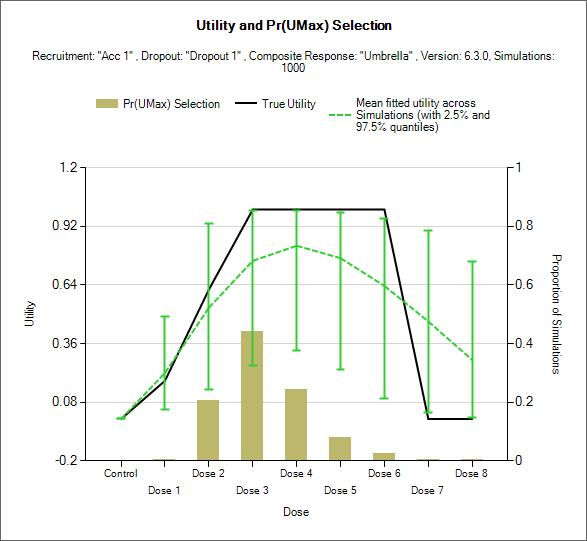 | 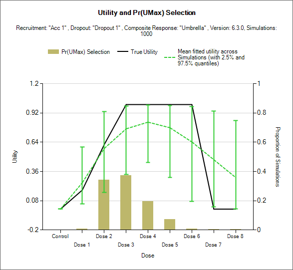 |
+----------+-------------------------------------------------+-------------------------------------------------+-------------------------------------------------+

We can see that the adaptive allocation clearly allocates more subjects (on average) on the doses we are more interested in, and that there is a small improvement in the selection of the Pr(Umax) -- particularly in the Umbrella scenario.

Looking at the Per Interim: Utility Alloc and Endpoint Response graphs for the first simulation of the linear scenario the adaptive allocation looks to be doing what we would hope. Here are the graphs from 5 interims from that simulation

+---------+-------------------------------------------------+-------------------------------------------------+-------------------------------------------------+
| Interim | Utility & Pr(Umax)                              | Endpoint 1 Response Alloc                       | Endpoint 2 Response Alloc                       |
+========:+=================================================+=================================================+=================================================+
| 1       |  |  |  |
+---------+-------------------------------------------------+-------------------------------------------------+-------------------------------------------------+
| 4       |  |  |  |
+---------+-------------------------------------------------+-------------------------------------------------+-------------------------------------------------+
| 8       |  |  |  |
+---------+-------------------------------------------------+-------------------------------------------------+-------------------------------------------------+
| 12      |  |  |  |
+---------+-------------------------------------------------+-------------------------------------------------+-------------------------------------------------+
| 16      |  |  |  |
+---------+-------------------------------------------------+-------------------------------------------------+-------------------------------------------------+

Alternatively we can get a quick overview by selecting Show Across Scenario Graph from the little menu that appears when View Graphs is selected:

The Selected Arms graph shows the proportion of arms selected in each scenario. Because we set Should Succeed that way, arms with a utility of 1 are in dark blue and others are in red. Arms selected in trials that did not succeed are light blue:

We can view the distribution of QOIs:

The fitted responses/utility:

And the allocation:

All of which look reasonable.

# Adaptive Allocation with Early Stopping

## Evaluation Criteria

We note that in the results for the adaptive design with no early stopping, the type-1 error had been reduced relative to the fixed design and was well below the target 0.025. Looking at the Explore Success Criteria for the "Flat" scenario from the results of the adaptive trial with no early stopping, there are fewer curves than the fixed design because we remove the QOIs with the CSDs that we had discarded, leaving us just with the results for the probability of success relative to Control with a CSD of 0.6: *Pr((θ~d~ -- θ~control~) \< -0.6)*

This shows there would have been 0.025% of the simulations successful if the final success criteria had been about 0.63. To be comparable with the fixed design and build in a degree of safety to allow for the variability of the simulations we select a threshold of 0.65 that would have yielded just 0.021% of the simulations successful.

To select the thresholds for early stopping we use Explore: Futility Contours and Explore: Success Contours graphs. To use these graphs it is worth having output weeks files for every simulation (as we did with the adaptive design without early stopping). These graphs take a significant amount of data analysis to draw, and re-draw every time a graph option is changed. Patience is required to use them as this time is nothing compared to repeatedly re-running simulations with different stopping criteria.

To determine the early success criteria we again look at the lowest threshold we can use that would have given a success rate of around 0.02% in the "Flat" scenario.

On the Explore: Success Contours graph for the "Flat" scenario, we select

- the VAS Pain Scale endpoint

- The Utility Pr(Umax) taget dose

- The *Pr((θ~d~ -- θ~control~) \< -0.6)* probability

- The 8^th^ interim to start allowing early stopping for futility. There is a trade-off to made here, the earlier the trial can stop the greater the potential savings, but also the more variable response we expect to see and hence the more conservative the threshold is likely to be. Our first interim is early (60 subjects enrolled and hence with an average accrual rate of 5 per week and a 6 week endpoint, \~30 subjects complete) to give the adaptive allocation plenty of time to adapt. Allowing stopping this early however would require a very high threshold for stopping for success to avoid inflating the type-1 error rate. At the 8^th^ interim -- 14 weeks later -- we would expect to have roughly 130 subjects enrolled of which \~100 would be complete.

- We also set the threshold limit to 0.6 -- So we can see contours around the 0.65 limit for final success that we would use if not allowing early stopping.

The graph plots the contours of equal success rate (combining both early success and late success) using equal early and final thresholds. Each contour tracks left and upwards from the points along the diagonal where the same threshold is used for the final success criteria and the early stopping for success criteria. The contour tracks the threshold combinations as the final threshold is reduced and the early threshold increased, until the early threshold reaches 1 and there is no early stopping.

Here we have contours of 0.019 and 0.028. The 0.019 contour starts just below the (0.64, 1) point and runs to the (0.9, 0.9) point. Any combination of final success threshold and early success threshold along that contour should give us approximately the same type-1 error rate of \~0.019.

If we imagine this contour transposed to the same graph but for the "linear scenario" we can see that it starts close to the 0.965 contour at (0.63, 1) and ends on the 0.938 contour at (0.9, 0.9). This is a trade-off that we typically see: that the more aggressive we want to be about stopping early for success (lower early stopping threshold) whilst adjusting the final success threshold to control the type-1 error rate, the more power we have to give up. Here though the overall power is high and the drop is less than 3 percentage points.

Here we will be conservative and choose (0.64, 0.98) which seems to offer some chance to stop early with barely any loss in power. We could compare to the other alternate scenarios too, but this scenario has the lowest power and so is likely to be the most sensitive to losing power if we have too low a threshold for early stopping for success.

Similarly, we can select an early stopping for futility threshold based on the failure rate in the "success" scenario with the lowest success rate. In this example that is the "Linear" scenario. As we are computing the type-2 error rate as any simulation that is not a success, the final threshold is effectively the same we are using to judge success, namely 0.64. We set up the graph to plot contours (this time of futility rate) for the VAS Pain Scale endpoint, evaluated at the Pr(Umax) target dose, computing the *Pr((θ~d~ -- θ~control~) \< -0.6)* probability from the 8^th^ interim onwards, with a maximum threshold of 0.7.

We can see that with no early stopping for futility (early threshold of 0) if the final success/futility threshold is 0.6, we are close to the 3^rd^ contour 0.04, hence we can expect the type-2 error in this scenario to be about 0.04. If we move vertically up from (0.64, 0) we reach the 5^th^ contour (0.047) at (0.64, 0.035). Thus for a possible single percentage point drop in power we can use 0.035 as the early stopping for futility threshold.

## Success/Futility Criteria

### Interim 1

The details for the early stopping for futility and success criteria are set on the interim 8 tab, we are going to delay the application of early stopping by requiring "minimum information", but this is "belt and braces" just to demonstrate the feature. We leave the "interim 1" unchanged. (we could instead have added the stopping conditions to interim 1, and relied on the "minimum information requirements" to prevent stopping effectively until interim 8 tab. Although we are not allowing early stopping at interims 1 through 7, the response adaptive update of the randomization probabilities will still be occurring.

Notice that we have used more relaxed criteria for the final evaluation (0.64) as well as allowing early stopping. This is because the introduction of adaptive allocation has reduced our type-1 error. For those seeing simulation results for a trail using response adaptive randomization (RAR) for the first time this may be surprising, there is a widely held assumption that "early looks at data" result in inflation of type-1 error. But if the looks are used for RAR then usually the reverse is true. In the "Null" setting the preferential allocation of subjects to arms with good response results in those arms experiencing a "random high" having a greater chance to regress to the mean, and thus type-1 errors are reduced.

and require that for stopping for futility 150 subjects have been enrolled and stopping early for success that there are at least 30 subjects on the dose most likely to have the greatest utility -- Pr(Umax). For futility we require 150 subjects to ensure that a reasonable minimum information has been gathered to justify stopping for futility, but this limit could be tuned further. For success we require 30 subjects on the Pr(Umax) dose as an often voiced criticism of stopping for success in a dose finding trial is that there is a need to have a certain minimum number of subjects exposed in order to gather safety data. Here we guarantee more data (30 subjects worth) on the dose that will be selected for phase 3 than the fixed design would have delivered (25 subjects).

The trial will stop early for success if at an interim analysis:

- the dose most likely to have the maximum utility, Pr(Umax), has a posterior probability that its mean improvement is better than Control plus the clinically significant difference of 0.6, is greater than 0.98 and there at least 30 subjects enrolled on the Pr(Umax) dose.

The trial will stop early for futility if at an interim analysis:

- the dose most likely to have the maximum utility has a posterior probability that its mean improvement is better than Control plus the clinically significant difference of 0.6, is less than 0.035 and there at least 150 subjects enrolled overall.

Otherwise the trial will continue.

We will create a new file for the changes, so choose File-\> Save As, and enter Core-ME-Chronic-Pain-Ex2-Adaptive-2.facts for the new file name, click Save. This new file will automatically load into FACTS.

On the Design-\>Success/Futility Criteria, add and "Interim 8 tab" and enable stopping for both futility and success and set the criteria as follows:

Futility Criteria:

- QOI:

  - "Pain: Pr(θ_d-θ\_(Control)\<-0.6); d=Utility; Greatest Pr(UMax)

  - Condition: \<

  - Threshold: 0.035

- Set Minimum number of Subjects enrolled before trial can stop for futility:150

<!-- -->

- Success Criteria:

  - QOI:

    - Add "Pain: Pr(θ_d-θ\_(Control)\<-0.6); d=Utility; Greatest Pr(UMax)

    - Condition: \>

    - Threshold: 0.98

  - Add an evaluation dose "The Greatest Pr(UMax) and set the Minimum Number of Subjects enrolled on this dose before the trail can stop for success: 30.

For the Final Evaluation Criteria, we use the same criteria as before for futility and modify the criteria for success by changing the required threshold to 0.64.

## Simulation Results

From a 1,000 simulations of each scenario we see

+----------+-------------------+------------------+----------------------+------------------------------+-------------------------------------------------------------------------------------------------------+
| Scenario | Ppn Early Success | Ppn Late Success | Overall Success Rate | Fixed design overall success |                                                                                                       |
+==========+==================:+=================:+=====================:+==============================+=======================================================================================================+
| Flat     | 0.00              | 0.017            | 0.017                | 0.025                        | [Type-1 error rate is below fixed design and well below target]{.mark}                                |
+----------+-------------------+------------------+----------------------+------------------------------+-------------------------------------------------------------------------------------------------------+
| Linear   | 0.572             | 0.379            | 0.951                | 0.96                         | [Power is the same as (within simulation error) the fixed design for all "success" scenarios.]{.mark} |
+----------+-------------------+------------------+----------------------+------------------------------+-------------------------------------------------------------------------------------------------------+
| Logistic | 0.749             | 0.209            | 0.958                | 0.957                        |                                                                                                       |
+----------+-------------------+------------------+----------------------+------------------------------+-------------------------------------------------------------------------------------------------------+
| Emax     | 0.761             | 0.236            | 0.997                | 0.981                        |                                                                                                       |
+----------+-------------------+------------------+----------------------+------------------------------+-------------------------------------------------------------------------------------------------------+
| Umbrella | 0.750             | 0.241            | 0.991                | 0.983                        |                                                                                                       |
+----------+-------------------+------------------+----------------------+------------------------------+-------------------------------------------------------------------------------------------------------+

The mean sample size is 210 for the Flat scenario and 102-219 for the success scenarios. So a 10-25% smaller expected sample size and trial duration than the fixed design (250 subjects).

Not only that but we have increased the probability of selecting a good dose to take to Phase III relative to the fixed design -- even after adding early stopping (but the early stopping is not as good as the adaptive without any early stopping) :

+------------+-------------------------+--------------------------------------------------+--------------------------------------------+
| Scenario   | Ppn Correct Arm (fixed) | Ppn Correct Arm (adaptive but no early stopping) | Ppn Correct Arm (adaptive & early stopping |
+============+========================:+=================================================:+===========================================:+
| Flat       | 0                       | 0                                                | 0                                          |
+------------+-------------------------+--------------------------------------------------+--------------------------------------------+
| Linear     | 0.448                   | 0.516                                            | 0.513                                      |
+------------+-------------------------+--------------------------------------------------+--------------------------------------------+
| Logistic   | 0.688                   | 0.805                                            | 0.750                                      |
+------------+-------------------------+--------------------------------------------------+--------------------------------------------+
| Emax       | 0.907                   | 0.924                                            | 0.92                                       |
+------------+-------------------------+--------------------------------------------------+--------------------------------------------+
| Umbrella   | 0.639                   | 0.780                                            | 0.750                                      |
+------------+-------------------------+--------------------------------------------------+--------------------------------------------+

We can check that the early stopping rules are reasonable by looking at the scatter plots. Checking that the early stopping isn't all at the first opportunity. For example for Flat and Linear:

+-------------------------------------------------+-------------------------------------------------+
|  |  |
+-------------------------------------------------+-------------------------------------------------+
|  |  |
+-------------------------------------------------+-------------------------------------------------+

We can also check that the selection of Pr(Umax) had not deteriorated due to early stopping (if it had we could increase the number of subjects required on Pr(UMax) for stopping, or perhaps ad a stopping criteria that the posterior probability of Pr(Umax) at the dose with the greatest Pr(Umax) was above some threshold.

+----------+-------------------------------------------------+-------------------------------------------------+
| Scenario | Adaptive but No early Stopping                  | With Early Stopping                             |
+==========+=================================================+=================================================+
|          | Ppn Umax                                        | Ppn Umax                                        |
+----------+-------------------------------------------------+-------------------------------------------------+
| Linear   |  |  |
+----------+-------------------------------------------------+-------------------------------------------------+
| Logistic |  |  |
+----------+-------------------------------------------------+-------------------------------------------------+
| Emax     |  |  |
+----------+-------------------------------------------------+-------------------------------------------------+
| Umbrella |  |  |
+----------+-------------------------------------------------+-------------------------------------------------+

Lastly we can review the "Across Scenario" graphs:

