#  Introduction

This tutorial introduces the new FACTS Ordinal Endpoint engine. The Ordinal engine is for working with endpoints that take on a manageably small number of possible values, but more than two, and where there is an assumed ordering of the desirability of the possible outcomes. In this tutorial we simulate a design with an ordinal endpoint taking on seven different values, with four experimental arms and a control arm.

# Designs Featured

In this tutorial we create the following designs:

- Design 1

  - A design using the cumulative logistic framework with proportional odds treatment effects for the four experimental arms relative to control. The design has flexible sample size including stopping for expected success or futility.

- Design 2

  - Like Design 1, but using independent Dirichlet prior distributions to analyze ordinal data.

# Design 1: Proportional odds dose-response modeling

The primary endpoint is assumed to behave similarly to the modified Rankin scale (mRs) in stroke: it has seven possible values 1 to 7, where 1 is the best and reflects a lack of symptoms. The worst outcome (7) is death, while the second largest ordinal outcome is severe disability resulting in dependence, and is often valued similarly to death. The outcomes are given in Table 1, including the patient-centered utilities assigned to them. The endpoint is measured after 90 days.

+----------------------+-----------------------+-----------------------+
| Index                | Name                  | Utility               |
+======================+=======================+=======================+
| 1                    | Perfect               | 10                    |
+----------------------+-----------------------+-----------------------+
| 2                    | Good                  | 9.1                   |
+----------------------+-----------------------+-----------------------+
| 3                    | Fine                  | 7.6                   |
+----------------------+-----------------------+-----------------------+
| 4                    | Fair                  | 6.5                   |
+----------------------+-----------------------+-----------------------+
| 5                    | Poor                  | 3.3                   |
+----------------------+-----------------------+-----------------------+
| 6                    | Dependent             | 0                     |
+----------------------+-----------------------+-----------------------+
| 7                    | Dead                  | 0                     |
+----------------------+-----------------------+-----------------------+

: Table 1

In FACTS Ordinal, the user must assign utility values to the possible ordinal outcomes. These utilities need not play a critical role in the design, and if desired default values can be used. We recommend that the user at least ensure that the entered utilities are larger for more desirable outcomes so that certain FACTS outputs are more interpretable. However, if the user selects modeling with independent Dirichlet distributions, it is more difficult to avoid utilities.

Longitudinal modeling for ordinal endpoints is not available as of FACTS 8.0: in future releases we will enable predictions of 90-day outcomes using 30-day outcomes, for example.

The sponsor has four experimental arms, characterized by four different dose levels, available in addition to the standard of care. A maximum of 600 participants will be randomized, and they will be accrued over a period of roughly two years.

Interim analyses with stopping for futility or expected success begin when 200 patients are randomized, and occur after every 100 randomized patients after that. We will also update the randomization probabilities for the experimental arms to favor arms with high posterior probabilities of a meaningful benefit relative to control.

## Start

Start FACTS 8.0 or later. Under the Trial Types menu to the left, select "Phase 2 and Phase 3". Then click the "New" button at the bottom of the Start from Scratch list to select a new Ordinal design.

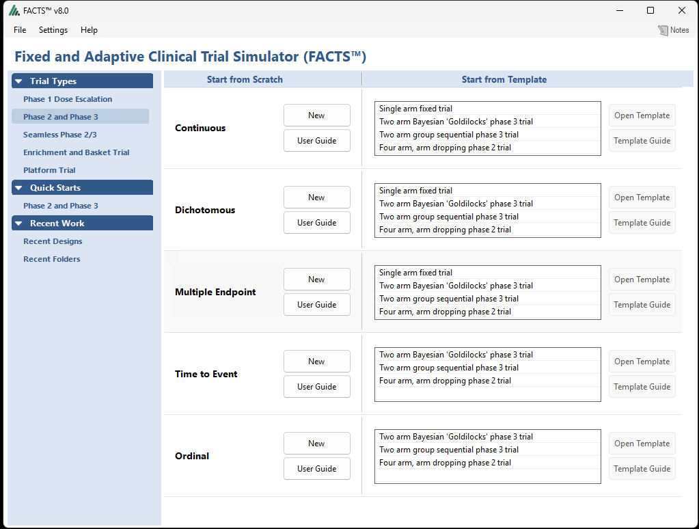

Using the menu option "File \> Save As", save this design as "OrdinalTutorial1" in a convenient location.

## Study

### Study $\rightarrow$ Study Info

On the Study $\rightarrow$ Study Info tab, select the following options:

- Under Design Options, select **Enable adaptive features**

- Still under Design Options, select **Cumulative logistic** for the ordinal endpoint modeling option.

- Under Trial information, select **Continuously** for random arrival of subjects

- Set the Max number of subjects to be **600**

- Check "Lower endpoint value index is improvement" because the most desirable value of the endpoint is value 1, and the worst is value 7.

- Under Ordinal Endpoint Values, click the +Add button seven times to add seven values. Then click inside the cells of the table to enter the names of the endpoint values (Perfect through Dead) and assign utility values (10 through 0).

- Enter 13 for the Time to Final endpoint (approximately 90 days).

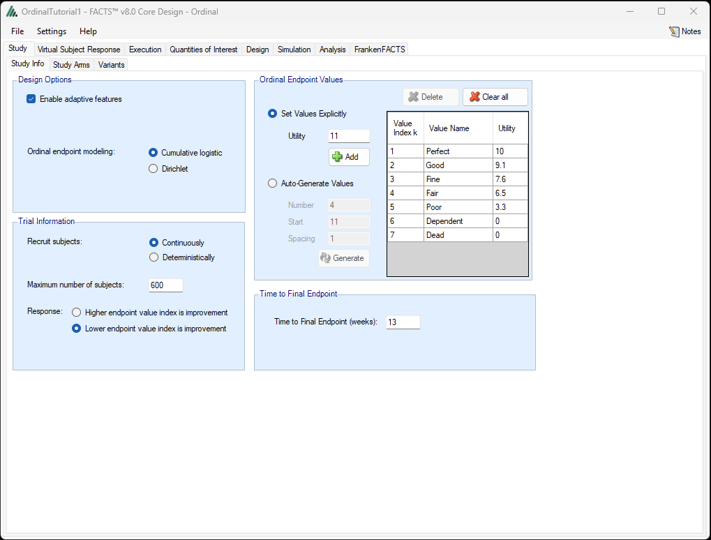

### Study $\rightarrow$ Study Arms

On the Study Arms tab:

- Include a control treatment arm. (As of FACTS 8.0, including a control arm is required.)

- Enter the doses with dose strengths 1, 2, 4, and 10, by entering these values one at a time and clicking "Add arm" four times so that Dose 1 through Dose 4 are added. If desired, the arms can be given different names by clicking inside the Arm Name column and entering the preferred names.

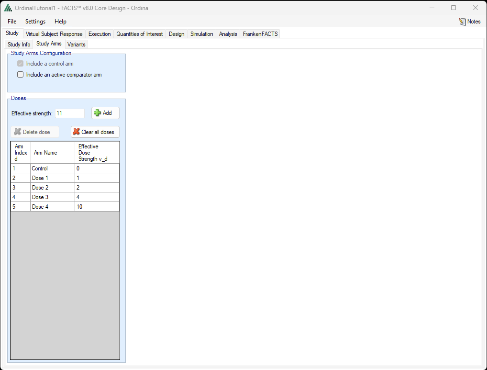

We will not be using the Variants tab.

## Virtual Subject Response

On the Virtual Subject Response tab, we define the probabilities of the endpoint values for simulated patients.

We will define eleven treatment effect scenarios: three null scenarios, four scenarios where the doses have increasing effectiveness, and four scenarios where all doses are equally effective and better than control. We will use the proportional odds model assumption, although FACTS Ordinal will also allow you to enter arbitrary values for the probabilities that do not necessarily satisfy the proportional odds assumption, by unchecking **Use Proportional Odds**.

Our historical data on control arm patients in the population similar to those we intend to enroll in the trial suggest 5% Perfect, 10% Good, 20% Fine, 20% Fair, 10% Poor, 25% Dependent, 10% Dead. We will assume that the control arm patients have these probabilities in our "Base" scenarios with various treatment effects (odds ratios). Numbers proportional to these probabilities can be entered in the "Outcome Data: Relative Proportions" table; we will enter 1, 2, 4, 4, 2, 5, 2. Since lower values of the ordinal endpoint are preferred, an Odds Ratio relative to control less than 1 corresponds to a beneficial treatment, since it implies smaller probabilities of larger values. Our scenarios include the following considerations, and these are summarized in Table 2.

- Null scenarios, where all four doses are equivalent to control

- Efficacious (Eff) scenarios, where the four doses have odds ratios relative to control of 0.95, 0.85, 0.7, 0.65

- Scenarios where the control arm patients are systematically healthier than in the Base scenarios ("Healthier"), and other scenarios where they are "Less Healthy"

- Flat scenarios, one where all experimental arms have odds ratios of 0.6, another with 0.65, another with 0.7, and another with 0.8.

- A tweak to the Eff scenario where the largest dose has an odds ratio of 0.6.

It is believed that a treatment with an odds ratio of 0.75 or smaller relative to control is a good enough treatment to develop further. Such treatments should be identified with "Should Succeed".

To add the null scenario, select the Virtual Subject Response, Explicitly Defined, Arm Response tab and click the "+ Add" button. Rename the Profile from "Resp 1" to "NullBase" by clicking and then typing "NullBase" in the Profiles dialog. In the Relative Proportions table, enter the values 1, 2, 4, 4, 2, 5, 2 as shown in Table 2 for this scenario, and enter 1, 1, 1, 1 for the odds ratios for Doses 1 through 4. Then follow the same procedure for the other scenarios, entering the data given in Table 2. Click the Should Succeed checkbox for the doses with odds ratios less than 0.75 (shown in bold in the table).

+-------------------+---------+------+------+------+------+-----------+------+---------+----------+----------+----------+----------+
| Scenario          | Control Relative Proportions                           | Odds Ratios                                         |
+===================+=========+======+======+======+======+===========+======+=========+==========+==========+==========+==========+
|                   | Perfect | Good | Fine | Fair | Poor | Dependent | Dead | Control | Dose 1   | Dose 2   | Dose 3   | Dose 4   |
+-------------------+---------+------+------+------+------+-----------+------+---------+----------+----------+----------+----------+
| Null Base         | 1       | 2    | 4    | 4    | 2    | 5         | 2    | 1       | 1        | 1        | 1        | 1        |
+-------------------+---------+------+------+------+------+-----------+------+---------+----------+----------+----------+----------+
| Eff Base          | 1       | 2    | 4    | 4    | 2    | 5         | 2    | 1       | 0.95     | 0.85     | **0.7**  | **0.65** |
+-------------------+---------+------+------+------+------+-----------+------+---------+----------+----------+----------+----------+
| Null Healthier    | 2       | 4    | 4    | 4    | 2    | 3         | 1    | 1       | 1        | 1        | 1        | 1        |
+-------------------+---------+------+------+------+------+-----------+------+---------+----------+----------+----------+----------+
| Null Less Healthy | 1       | 1    | 2    | 4    | 6    | 3         | 3    | 1       | 1        | 1        | 1        | 1        |
+-------------------+---------+------+------+------+------+-----------+------+---------+----------+----------+----------+----------+
| Eff Healthier     | 2       | 4    | 4    | 4    | 2    | 3         | 1    | 1       | 0.95     | 0.85     | **0.7**  | **0.65** |
+-------------------+---------+------+------+------+------+-----------+------+---------+----------+----------+----------+----------+
| Eff Less Healthy  | 1       | 1    | 2    | 4    | 6    | 3         | 3    | 1       | 0.95     | 0.85     | **0.7**  | **0.65** |
+-------------------+---------+------+------+------+------+-----------+------+---------+----------+----------+----------+----------+
| Eff 60 Base       | 1       | 2    | 4    | 4    | 2    | 5         | 2    | 1       | 0.95     | 0.85     | **0.7**  | **0.60** |
+-------------------+---------+------+------+------+------+-----------+------+---------+----------+----------+----------+----------+
| Flat Eff 60       | 1       | 2    | 4    | 4    | 2    | 5         | 2    | 1       | **0.60** | **0.60** | **0.60** | **0.60** |
+-------------------+---------+------+------+------+------+-----------+------+---------+----------+----------+----------+----------+
| Flat Eff 65       | 1       | 2    | 4    | 4    | 2    | 5         | 2    | 1       | **0.65** | **0.65** | **0.65** | **0.65** |
+-------------------+---------+------+------+------+------+-----------+------+---------+----------+----------+----------+----------+
| Flat Eff 70       | 1       | 2    | 4    | 4    | 2    | 5         | 2    | 1       | **0.7**  | **0.7**  | **0.7**  | **0.7**  |
+-------------------+---------+------+------+------+------+-----------+------+---------+----------+----------+----------+----------+
| Flat Eff 80       | 1       | 2    | 4    | 4    | 2    | 5         | 2    | 1       | 0.8      | 0.8      | 0.8      | 0.8      |
+-------------------+---------+------+------+------+------+-----------+------+---------+----------+----------+----------+----------+

: Table 2: Virtual Subject Response Scenarios.

For the Eff Base scenario, the resulting screen should look like the figure below.

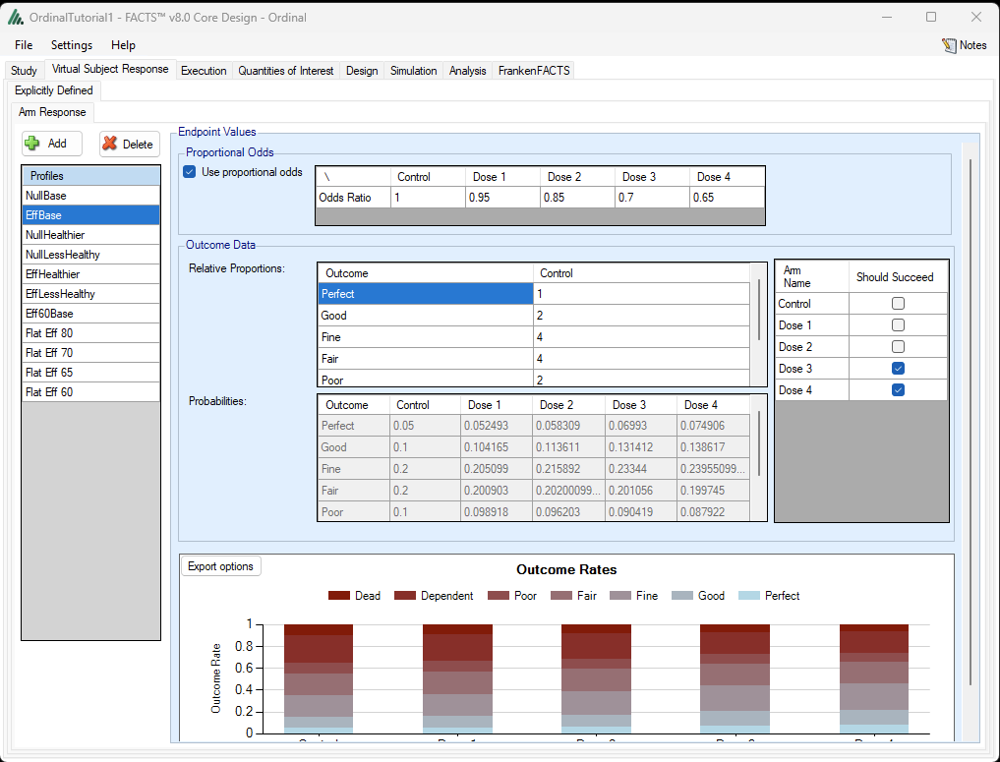

## Execution $\mathbf{\rightarrow}$ Accrual

Move to the Execution: Accrual tab, and add an accrual scenario by clicking the Add button on the far left. Set the peak accrual rate to 6 participants per week. We intend accrual for the trial to last for about two years (104 weeks), so roughly 600 patients can be accrued in that time.

The names of the accrual profile and the region may be renamed by double-clicking on them.

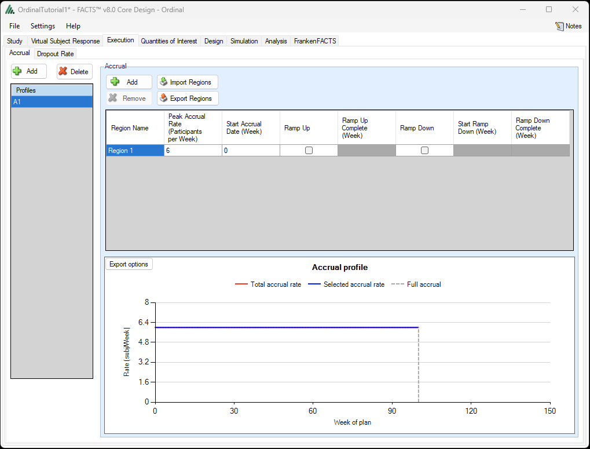

## Execution $\mathbf{\rightarrow}$ Dropout Rate

On the Dropout Rate tab, click +Add to add a dropout scenario with no dropouts. If desired, a FACTS user can also specify different dropout rates for different arms.

## Quantities of Interest 

FACTS has considerable flexibility in allowing the user to define Quantities of Interest (QOIs) to drive adaptations in the trial and decisions at the end of the trial. A basic set of QOIs is provided by default. Additional QOIs may be added by clicking the Add row in the table. A QOI can be removed by clicking the X on the right side of the cell. Each QOI may be edited by clicking on it, which opens a pop-up box.

In this trial we will use the Wilcoxon-Mann-Whitney test for the primary efficacy analysis. We will use predictive probabilities of significant results on this test to make decisions of early stopping for expected success. Response-adaptive randomization probabilities will be based on the Bayesian posterior probability that an arm has an odds ratio relative to control of 0.75 or better (smaller). Futility decisions will also be based on the probability of an odds ratio less than 0.75.

On the Quantities of Interest tab, first select 0.25 as the clinically significant difference (CSD) in the bottom Standard Evaluation Variables panel. This selection will allow us to compare odds ratios to 0.75: note that the top left Posterior Probabilities quantity of interest has changed to Pr(OR_d -- 1\<= -0.25) i.e. the probability that the d'th odds ratio is at least 0.25 smaller than 1, i.e. the probability that the d'th odds ratio is less than 0.75.

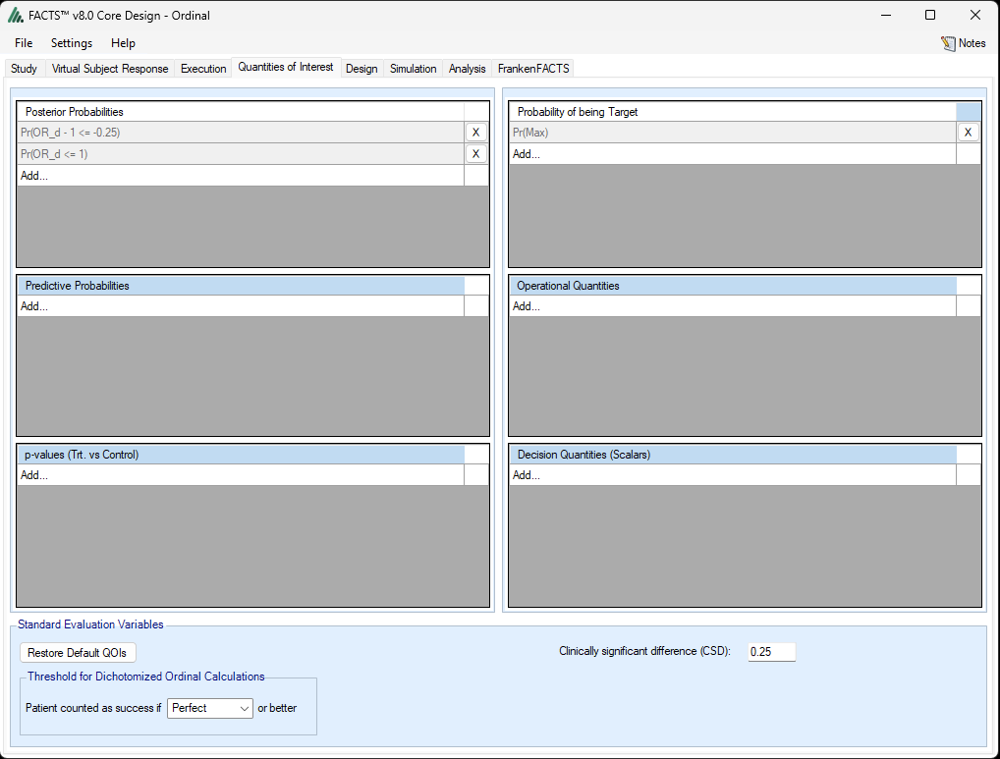

To enable the Wilcoxon(-Mann-Whitney) test, click on "Add..." in the p-values (Trt. vs Control) section (lower left). The Add Frequentist p-value dialog will appear. We will handle missing values by ignoring them. With no dropouts, this will not matter in the final analysis, which will be conducted after all enrolled patients have completed 13 weeks of follow-up. Select "Wilcoxon" as the Test Type.

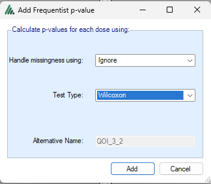

Next, we will enable predictive probabilities of the Wilcoxon test based on the current sample size after all patients complete follow-up. Under Predictive Probabilities, click on Add... and enter:

- Type: Bayesian. (Conditional power capability will be added in a future release).

- Phase: Current Trial. (Alternatively, one may predict the outcome of a separate two-arm phase-III-like trial).

- Handle missingness using: Ignore. (One may also choose to impute missing data with the worst ordinal outcome. In a future release we will add the capability of predicting a final ordinal endpoint with an earlier observation of that same endpoint).

- Test Type: Wilcoxon (We will discuss the other options below).

- Sample Size: Current Enrollment. (The other option is the final sample size of the trial, here 600, but this option is only available in trials without response-adaptive randomization).

- One-sided Alpha: 0.025.

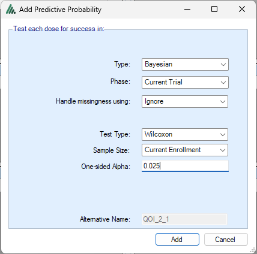

We will also define an Operational Quantity of interest, a feature new as of FACTS 8.0. We want to insist that we are not stopping early for success based on optimism about an arm unless that arm has at least 50 patients enrolled. This will not be a very stringent requirement: it would prevent early stopping at the 200 patient analysis. At the 300 patient analysis, we intend 100 control patients and 200 experimental arm patients spread across the 4 experimental arms, so an experimental arm could have fewer than 50 patients if it had been underperforming relative to other arms at the 200 patient analysis. Click on Add... in the Operational Quantities area:

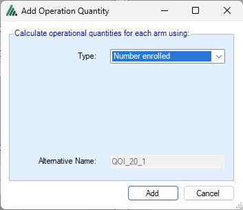

Now that we have defined the four quantities of interest that we will need, the next step is to promote them to be decision quantities that can be used in trial decisions. We will click on "Add..." in the **Decision Quantities (Scalars)** area (bottom right). First we will use Wilcoxon p-value corresponding to the arm with the Greatest Pr(Max), i.e. the arm that is the most likely to have the smallest odds ratio:

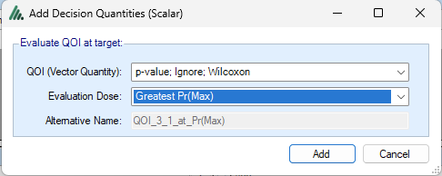

Next we will use the predictive probability of a significant Wilcoxon test, again for the arm that is most likely to have the smallest odds ratio. If this predictive probability is large enough, the trial will stop for expected success in anticipation of a significant final efficacy analysis.

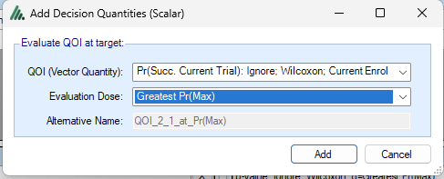

We will use the largest Bayesian posterior probability that an arm has an odds ratio of 0.75 or better. If this probability is small, i.e. if all arms have small posterior probabilities of small enough odds ratios, the trial will stop for futility.

Finally we will use the number of patients enrolled for the Pr(Max) arm (arm with the highest probability of an odds ratio less than 0.75):

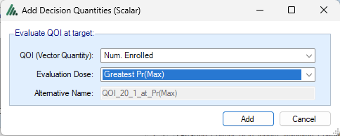

When the Quantities of Interest have been entered, the page should look like this:

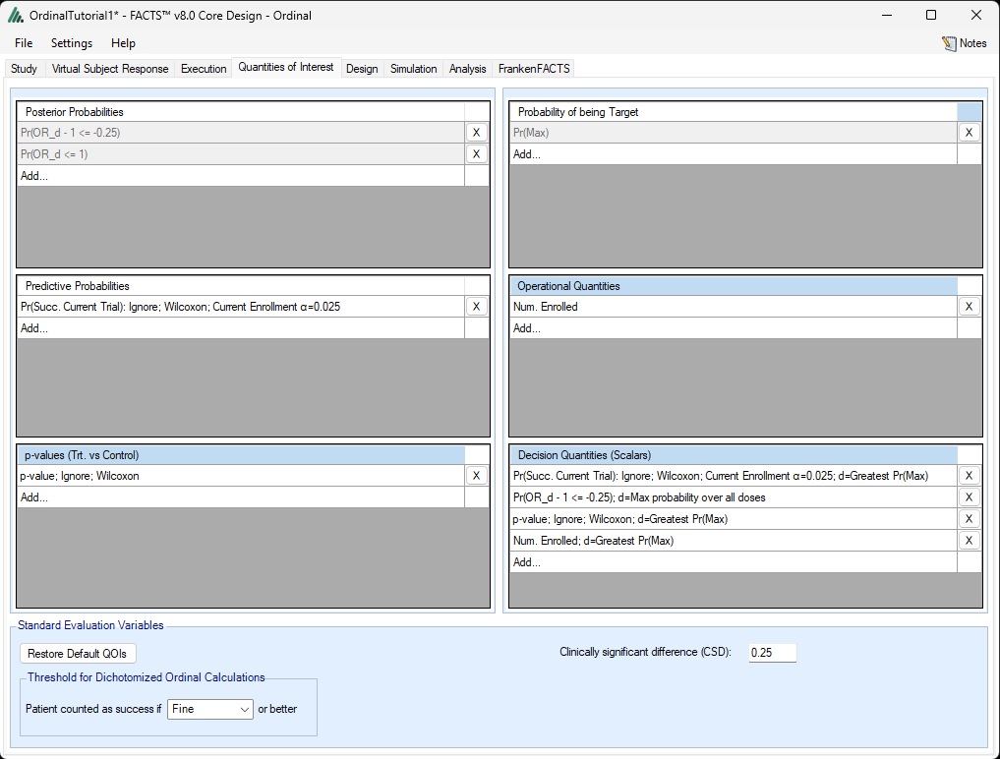

## Design

### Dirichlet Model

We will use a noninformative Dirichlet prior distribution for the control probabilities. FACTS Ordinal's default is to use exponents of 0.8 divided by the number of ordinal values, as recommended by Berger, Bernardo, and Sun in Bayesian Analysis 2015. One may use informative priors, for example by choosing the prior exponents to be data from a previous study.

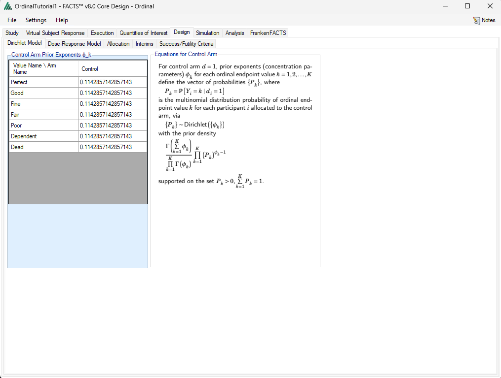

### Dose-Response Model

We will use a normal dynamic linear model, with the control arm included in the model. FACTS Ordinal includes many of the FACTS Core dose-response models, and it applies those models to the log odds ratios of the arms relative to control. By definition, the control arm has a log odds ratio of zero, so the normal dynamic linear model curve goes through the point (dose 0, log odds ratio 0). We will use a prior distribution for the smoothing parameter with center 0.2 and weight 4.

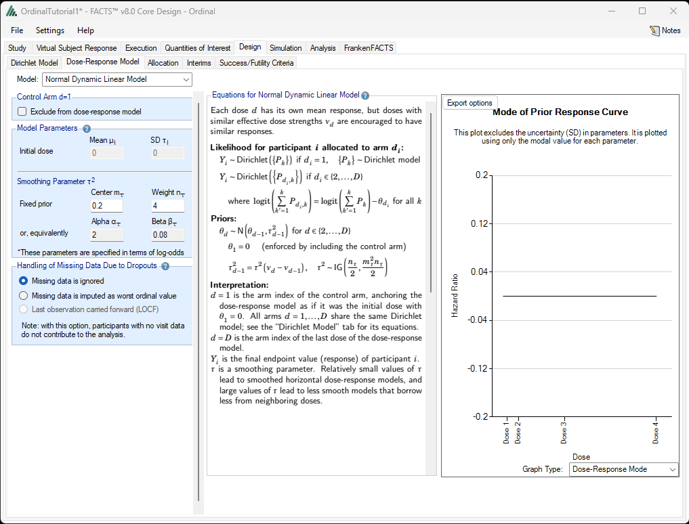

### Allocation

We are going to use response-adaptive allocation, with the randomization probability for control fixed at 1/3, and with the experimental arms fighting over the remaining 2/3, based on their probabilities of an odds ratio less than 0.75.

On the Design: Allocation tab, check the Adaptive Allocation box. This will open up a table for defining randomization blocks and fixing the control probability. Enter 4, 2, 2, 2, 2 for the Pre First Interim Allocation Ratios, click on the Control's "Fix Alloc." box, and enter 4 for its Post First Interim Alloc. per Block. Also enter 12 as the Post First Interim block size. In this way, 4 out of every 12 subjects will be randomized to control, both prior to the first interim and after subsequent interims.

Now under Adaptive Allocation Targets, click Add, and select the Pr(OR_d -- 1 \<= -0.25) QOI. Weight for Probability and use Relative Weight 1, although these last two selections will have no effect because we are using only one adaptive allocation target.

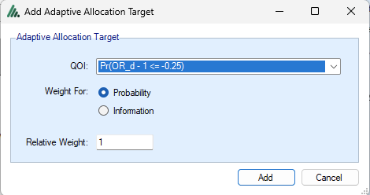

If this allocation target gives an arm an allocation probability between 0 and 0.04, we will round it down to zero and renormalize the other experimental arm probabilities to make up the difference. Now the Allocation tab should be filled out like this:

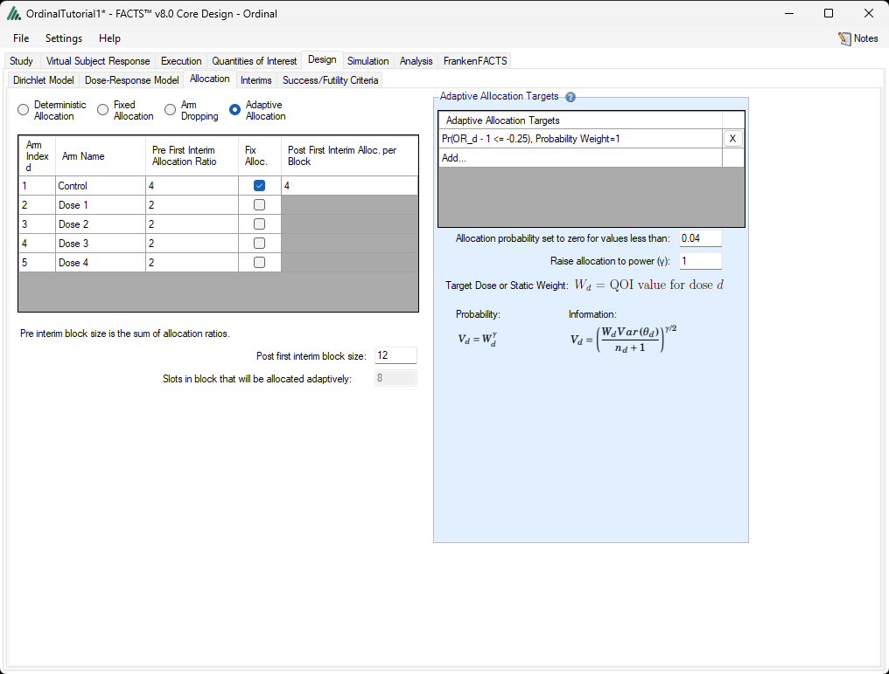

### Interims

In this trial that will randomize a maximum of 600 patients, we will conduct the first trial update when 200 subjects have been randomized, and every 100 patients thereafter.

On the Design:Interims tab, select "Subjects Enrolled" to define the measure of Subject Information: i.e. we will conduct analyses based on number of patients enrolled in the trial. Information can also be defined based on participants with Complete Data. (Opportunity to Complete is another option that can apply, and be different from Complete Data, when there are dropouts.) Select "Information" as the method for Specifying Interims, then click the **+Add** button four times to add four interim analysis, and enter 200, 300, 400, and 500 in the Subjects Enrolled column in the table.

Under "Subject Follow-Up Options After Early Decision", check "Continue follow-up if study stops for early success" and uncheck "Continue follow-up if study stops for early futility." If the trial stops early because of positive data, we will wait until final data are available before making a final efficacy claim, but if the trial stops for futility, we will not claim efficacy even if there is a dramatic turn-around while follow-up is being completed (binding futility).

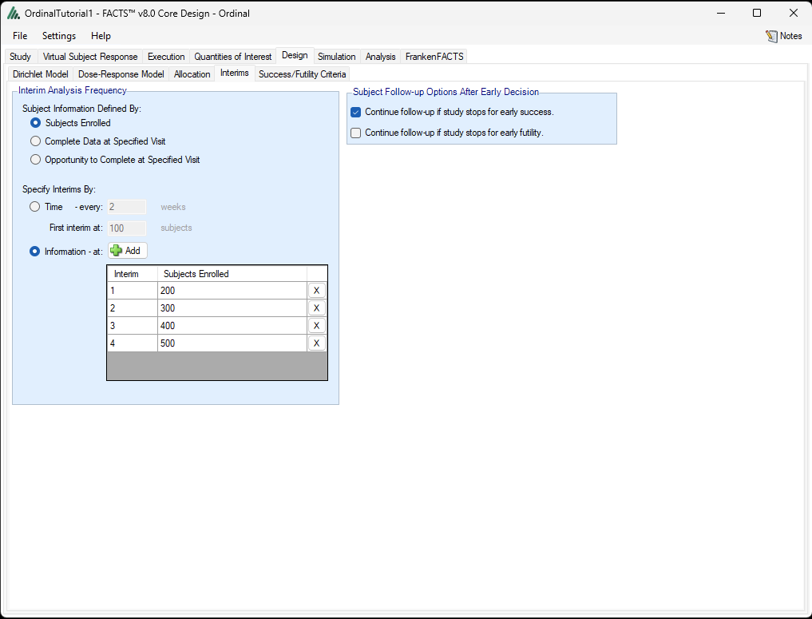

### Success/Futility Criteria

The Design:Success/Futility Criteria tab has a new design as of FACTS 8.0 to allow users to define more flexible criteria based on AND/OR logic. Previously, a criterion could only be defined to be satisfied if all of a set of simple criteria were satisfied (AND), or if at least one of the simple criteria was satisfied (OR). Now FACTS supports more complex combinations of criteria. For example, success can be declared if a posterior probability is greater than 0.95 and the sample size is less than 100, OR if the posterior probability is greater than 0.90 and the sample size is more than 100.

At any of the interim analyses, we will stop for futility if no dose has a sufficiently large (10%) probability of a treatment effect at least as good as an Odds Ratio of 0.75. We will stop for expected success if the Bayesian predictive probability of a significant Wilcoxon test conducted on the currently enrolled patients when they finish follow-up, is at least 90% for the arm that is the most likely to have the most favorable odds ratio, AND if the arm most likely to have the most favorable odds ratio has at least 50 patients randomized.

On the Design $\mathbf{\rightarrow}$ Success/Futility Criteria tab, select the checkbox next to **Enable advanced features**. To define the futility rule, check the Early Futility Criteria checkbox, and click the **+Add Criterion** button. Then choose the following options from the drop-down menus in the popup dialog box as shown in the screenshot below:

- For QOI, select "Pr(OR_d -- 1 \<= -0.25); d = Max probability over all doses

- For Condition, select "\<="

- For Threshold, enter "0.1".

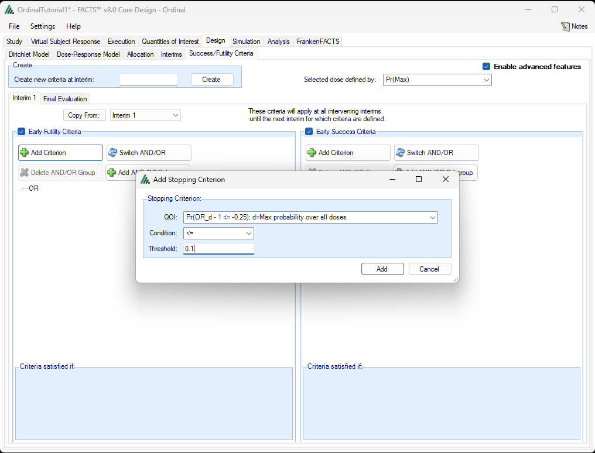

Next, to define the early success stopping rule, select the "Early Success Criteria" checkbox and click on the **+Add Criterion** button below it. In the pop-up dialog box, choose:

- Pr(Succ. Current Trial): Ignore; Wilcoxon; Current Enrollment α=0.025; d=Greatest Pr(Max) for QOI;

- \> for Condition;

- And enter 0.90 for Threshold.

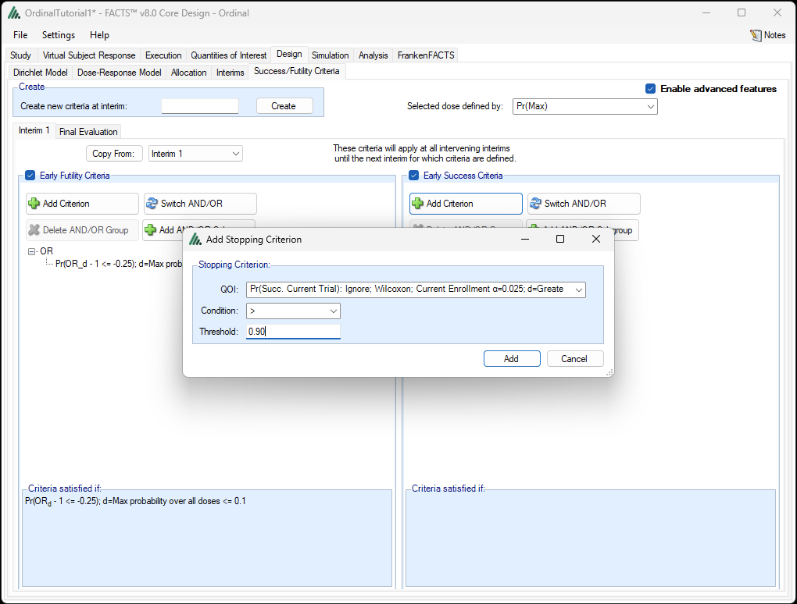

Now, to insist that we only stop for expected success when the arm prompting the stop (the arm with the highest probability of having the most favorable odds ratio) has at least 50 patients enrolled, select/highlight the AND below "**X Delete AND/OR Group**" by clicking it, and click on **+Add Criterion**. Fill in the entries in the pop-up with:

- QOI: select Num. Enrolled; d=Greatest Pr(Max)

- Condition: \>

- Threshold:49.5. Since FACTS uses strict inequalities for \> in stopping criteria, we need to enter a number strictly less than 50 if we want 50 to be the exact minimum allowed.

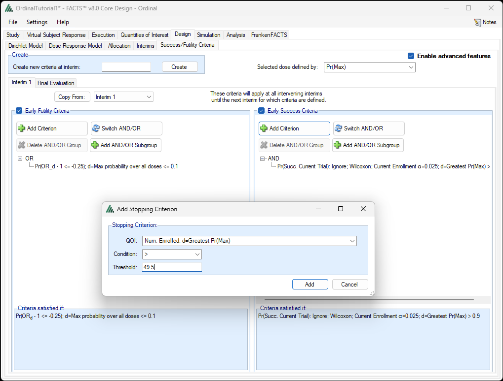

We will use the same stopping rules for all 4 interim analyses, although note that FACTS allows users to have different rules for each. For example, to introduce different stopping rules at interim 3, enter '3' in the "Create new criteria at interim:" box and click "Create".

The final analysis will be a Wilcoxon-Mann-Whitney test conducted at the 0.025 level and comparing the arm with the highest probability of having the most favorable odds ratio. We will define final futility so that it is the complement of final success, i.e. there will be no inconclusive final results.

Still on the Design $\mathbf{\rightarrow}$ Success/Futility Criteria tab, select the "Final Evaluation" tab now that we are done with the Interim 1 tab. Under Late Futility Criteria, click on +Add Criterion and enter:

- QOI: p-value; Ignore; Wilcoxon; d=Greatest Pr(Max)

- Condition: \>

- Threshold: 0.025.

The trial's final result is futility if the Wilcoxon p-value is more than 0.025 for the most likely best arm.

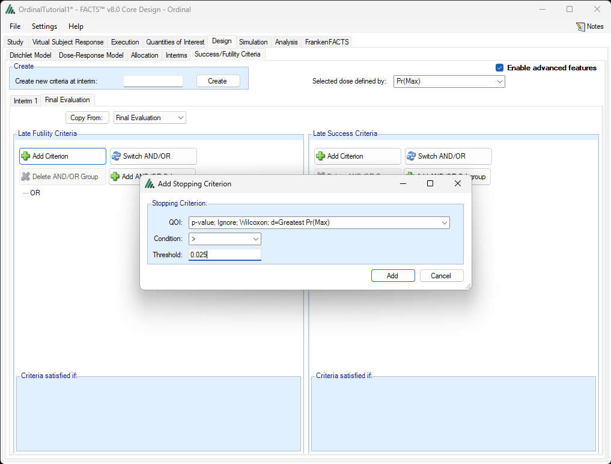

Under Late Success Criteria, click on +Add Criterion and enter:

- QOI: p-value; Ignore; Wilcoxon; d=Greatest Pr(Max)

- Condition: \<=

- Threshold: 0.025.

The trial's final result will be a success in exactly the conditions where it is not a futility, namely when the most likely best arm has a Wilcoxon p-value less than 0.025.

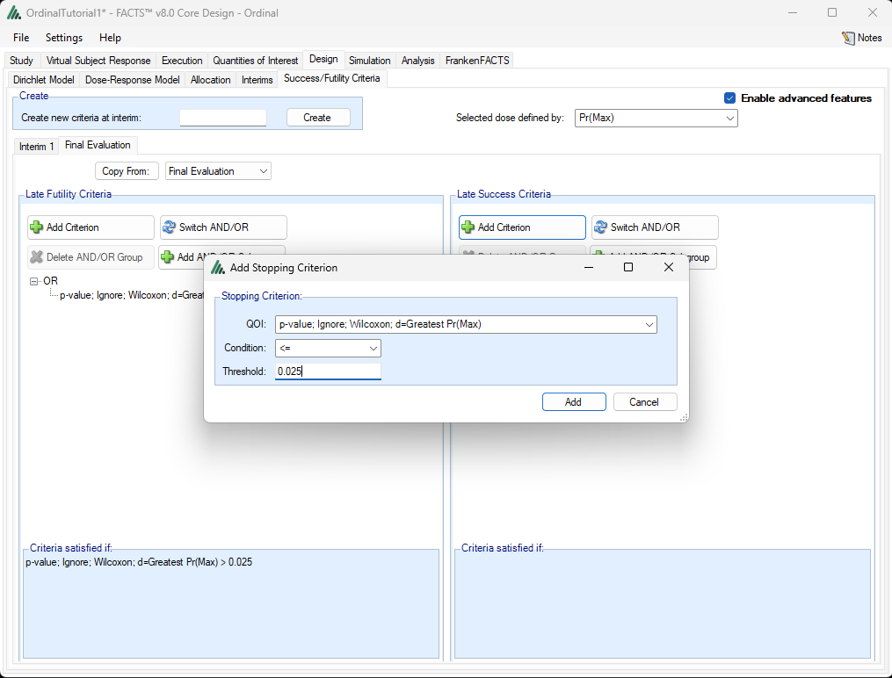

## Simulation

We are now ready to simulate the trial. Normally we recommend running a small number of simulations per scenario first to get fast feedback, and this is a time-consuming design to simulate, but we will skip to running 1000 simulations. Set the number of simulations to 1000, click "Select All" then press Simulate. When the simulations are complete, FACTS pops up a graphics window summarizing results across scenarios.

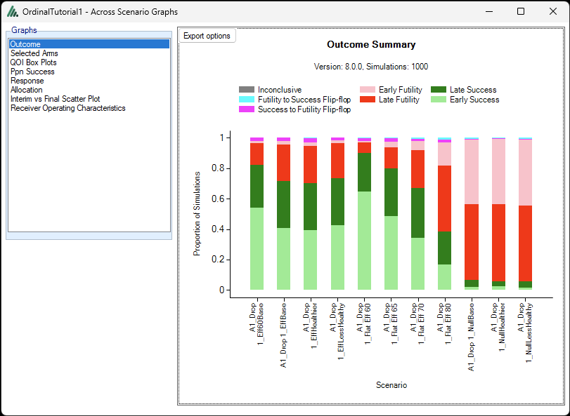

This Outcome graph shows the simulation-based estimates of the probabilities of each trial outcome in each scenario. The two green colors depict early and late success, so the combined heights of the two green sections give quick indications of the design's power and Type I error. The three null scenarios are on the right of the graph and they have the smallest probability of trial success, clearly less than 10%. The "Flat Eff 60" scenario, where all four experimental arms have odds ratios of 0.6, has the highest power as expected, followed by the other scenario with a single 0.6 arm (Eff60Base).

More precise data about the operating characteristics are available in the table on the Simulation tab.

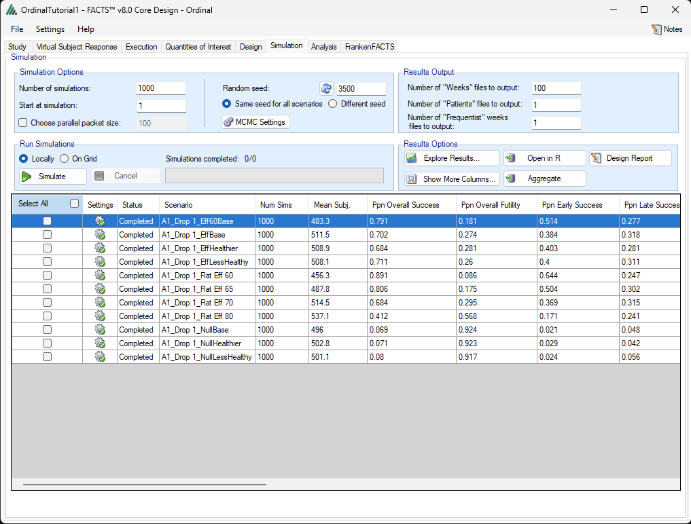

The "Ppn Overall Success" column reports the simulated power and Type I error estimates. The null scenarios have 7-8% success probability, which is a considerable amount of Type I error inflation relative to the 2.5% nominal level at which the Wilcoxon-Mann-Whitney tests were performed. It is not surprising that our design has inflated Type I error, because we allow it to choose the best performing of four experimental arms, and we allow early stopping for expected success which increases the risk of reacting to a temporary random high. This is an arbitrary example of a design, and whether a designer needs to rigorously reduce their Type I error depends on the application. Also, we recommend more than 1000 simulations to accurately estimate Type I error.

We also see that the standard efficacy scenario with treatment effects for the four arms that improve to an odds ratio of 0.65 are achieving approximately 70% power. If all four arms have odds ratios of 0.65, then the power is about 80%. With an odds ratio of 0.60, nearly 90% power is achieved when all four arms are that good, and about 80% when the effect sizes are 0.95, 0.85, 0.7, and 0.6. Of course the power numbers would be reduced if measures were taken to reduce Type I error such as reducing the level of the Wilcoxon test from 0.025. To convert this design into an adequate and well-controlled trial with 80% or 90% power, one would need to increase the sample size and/or target larger effect sizes.

By scrolling to the right in the table, we also see that early futility probabilities in the null scenario are only 35-39%, and often we would want more frequent futility. Recall that we require all four experimental arms to have less than a 10% probability of a hazard ratio less than 0.75. We could modify this rule to have more frequent futility. In many designs, we like to use the predictive probability of a significant final analysis assuming the maximum sample size, but this is not available in FACTS 8.0 for this design because we are using response-adaptive randomization and therefore cannot precisely predict the final sample sizes on each arm.

Returning to the graphs supplied by FACTS, consider the Selected Arms graph from the Across Scenario Graphs. Note that in all scenarios, the larger doses are more likely to be selected. This is as one would hope for the sloping efficacy scenarios. It is what one would expect for the flat (including the null) scenarios as well, because the prior distribution, a normal dynamic linear model that includes the control in the model, implies higher prior uncertainty about the treatment effect for the arms more distant from the control. If one wishes more even balance between the selected arms, one can use a different prior distribution family such as a hierarchical model.

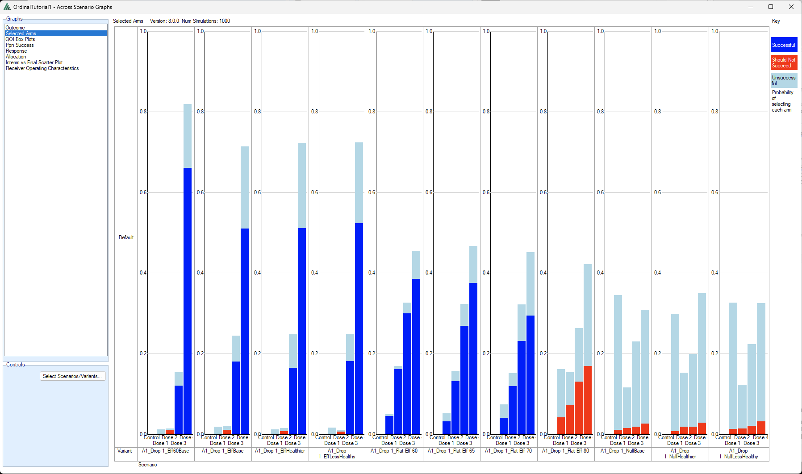

# Design 2: Using Independent Dirichlet Models

The other main approach to modeling ordinal data in FACTS 8.0 is to model each arm independently with Dirichlet prior distributions on the probabilities of each ordinal value. With this approach, we cannot use dose-response models to relate the arms to each other. A strength of the approach is that unlike it does not assume proportional treatment effects: for example, the Dirichlet modeling approach can adequately model an experimental arm that increases the probability of both very good and very bad outcomes compared to control. However, it can be ambiguous whether such an arm is preferable to control, and the utility values specified by the user will usually play a larger role in the design, i.e. the arms' expected utilities may be used to quantify differences between the arms.

## Study Info

To begin, save the design under a new name such as OrdinalTutorial1-Dir.facts (using File $\mathbf{\rightarrow}$ Save As). Return to the Study: Study Info page and select "Dirichlet" under Design Options: Ordinal endpoint modeling. FACTS will warn you that it is deleting some posterior probability QOIs; click Yes to continue.

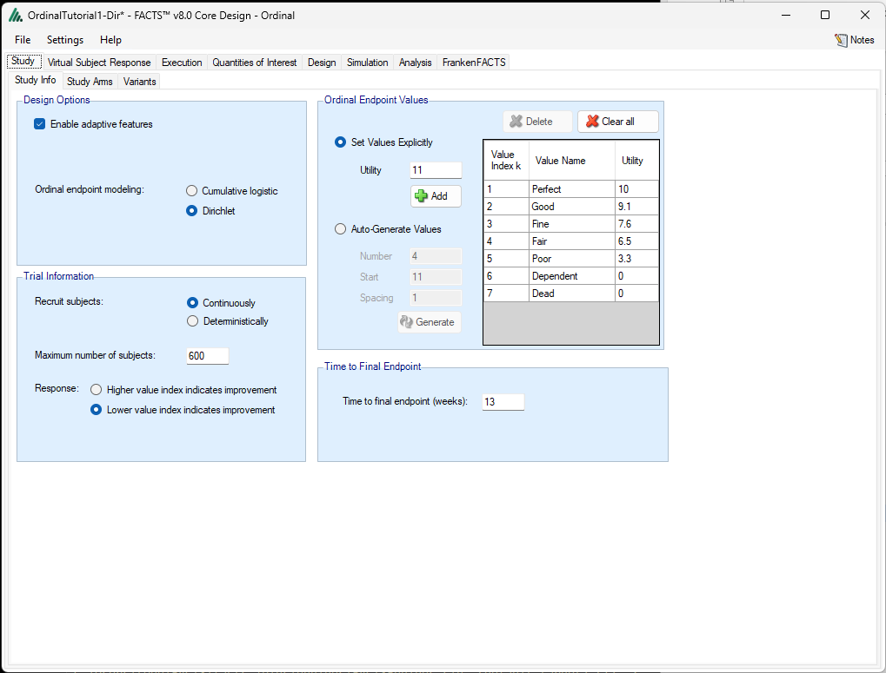

## Virtual Subject Response

On the Virtual Subject Response page, we will define a new non-proportional scenario where the experimental arms increase both very good and very bad outcomes. Click +Add to add a new scenario, then uncheck "Use proportional odds." We will enter all the arms' relative proportions in the table. Enter the following numbers.

+-----------+----------+----------+----------+-----------+-----------+
| Outcome   | Control  | Dose 1   | Dose 2   | Dose 3    | Dose 4    |
+===========+==========+==========+==========+===========+===========+
| Perfect   | 1        | 2        | 2        | 3         | 3         |
+-----------+----------+----------+----------+-----------+-----------+
| Good      | 2        | 3        | 3        | 3         | 3         |
+-----------+----------+----------+----------+-----------+-----------+
| Fine      | 4        | 3        | 3        | 2         | 2         |
+-----------+----------+----------+----------+-----------+-----------+
| Fair      | 4        | 2        | 2        | 2         | 2         |
+-----------+----------+----------+----------+-----------+-----------+
| Poor      | 2        | 2        | 2        | 2         | 2         |
+-----------+----------+----------+----------+-----------+-----------+
| Dependent | 5        | 5        | 5        | 5         | 5         |
+-----------+----------+----------+----------+-----------+-----------+
| Poor      | 2        | 3        | 3        | 3         | 3         |
+-----------+----------+----------+----------+-----------+-----------+

All four experimental arms increase the risk of death from 10% to 15% compared to control, which will rarely be acceptable, but the arms also raise the probabilities of Good + Perfect from 15% to 25% and 30%.

## Quantities of Interest

On the Quantities of Interest tab, as we were warned, the posterior probability QOIs were converted from comparisons of odds ratios to comparisons of expected utilities. Toward the bottom, enter 0.5 as the Clinically significant difference (CSD); this is a difference on the expected utility scale. (It turns out that an odds ratio of 0.78 compared to control is enough to increase expected utility by 0.5 if the control population has our usual probabilities). The Posterior Probability QOI in the upper left changes to incorporate the new CSD. Now we need to promote the new QOI to be a Decision Quantity so that we can use it in response-adaptive randomization and futility. Click on Add...in the table of Decision Quantities (Scalars) to call up the pop-up, choose Pr(EU_d -- EU\_(Control) \> 0.5) and Max probability over all doses, then click Add.

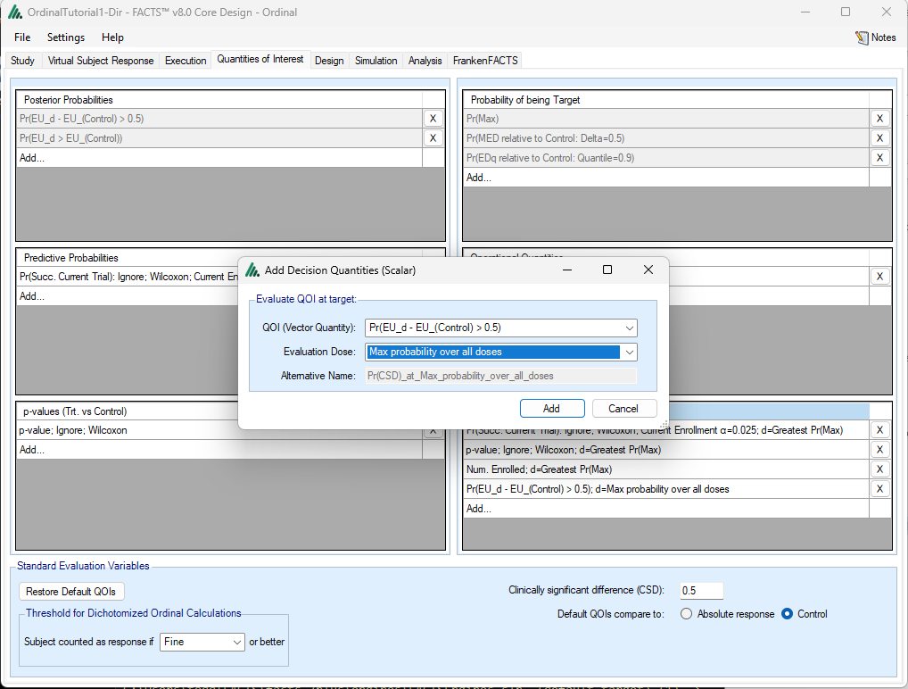

## Design: Dirichlet Model

Defining the statistical model in the Dirichlet case is straightforward, although it may be tedious to fill in desired values in the table. Where the cumulative logistic modeling framework required a Dirichlet prior distribution for the probabilities of the ordinal values for the control arm, here we specify one Dirichlet prior distribution for each arm. By default, FACTS uses prior exponents of 0.8 divided by the number of possible ordinal values. In our design we will just use the defaults.

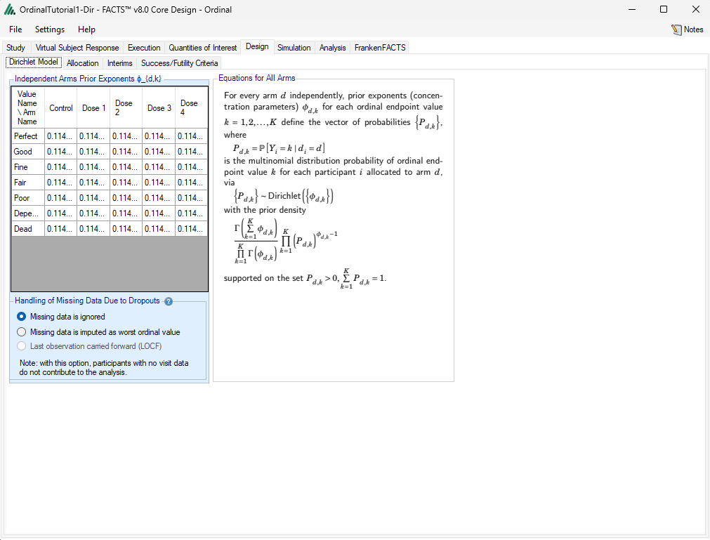

## Design: Allocation

Since we were previously using cumulative logistic odds ratios for adaptive allocation, that Adaptive Allocation Target will have disappeared and we will need to replace it with one based on expected utility. On the Design:Allocation tab, click to Add and Adaptive Allocation Target, and choose Pr(EU_d -- EU\_(Control) \> 0.5). Arms will receive allocation probability to the extent that they have high posterior probabilities of increasing expected utility by at least 0.5 units relative to control.

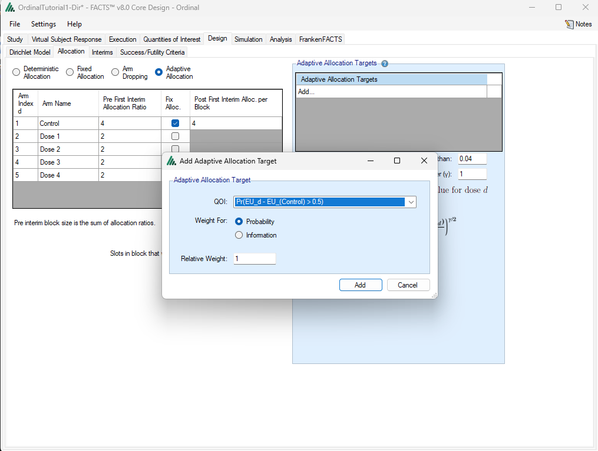

## Design: Success/Futility Criteria

We were also previously using the posterior probability of a benefit in log odds ratio to decide whether to stop for futility, and this is no longer available with Dirichlet modeling, so we need to replace this criterion as well. Under Design: Success/Futility Criteria, on the Interim 1 tab, under Early Futility Criteria, click on +Add Criterion. In the pop-up window, choose:

- QOI: Pr(EU_d -- EU\_(Control) \> 0.5); d=Max probability over all doses

- Condtion: \<=

- Threshold: 0.10

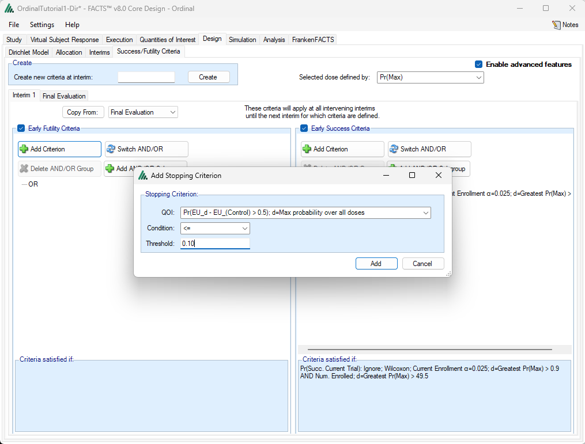

## Simulation

And now we can return to the Simulation tab and simulate the new design. Select All scenarios, and click on Simulate. After 1000 simulations of each scenario we get results like those shown below. The new Nonproportional scenario has low power of 21.4%: it is appropriate that its power is low because the experimental arms are not clearly beneficial, with higher probabilities of very good values but also higher probability of death. The expected utilities for the experimental arms are not much different from the control arm.

When compared to the previous design with cumulative logistic modeling, this design appears to have slightly higher power but that includes higher Type I error. In the null scenarios, the Dirichlet-based design has considerably higher expected sample size (around 548 compared to around 500) and lower probability of early futility (16-19% compared to 36-39%). These differences are to be expected: the Dirichlet design treats all arms independently, while the cumulative logistic design exploits a longitudinal model to smooth the treatment effects. In this way, the cumulative logistic design can more easily determine that all four experimental arms have low probabilities of substantial benefits compared to control, and more easily stop for futility. Also, the dose-response model will dampen down random highs in one of the four arms and reduce Type I error compared to the Dirichlet model with independent arms. In practice, the Dirichlet design would most likely be modified to have more frequent early futility, and both designs would be tweaked to have operating characteristics commensurate with the goals of the planned trial.

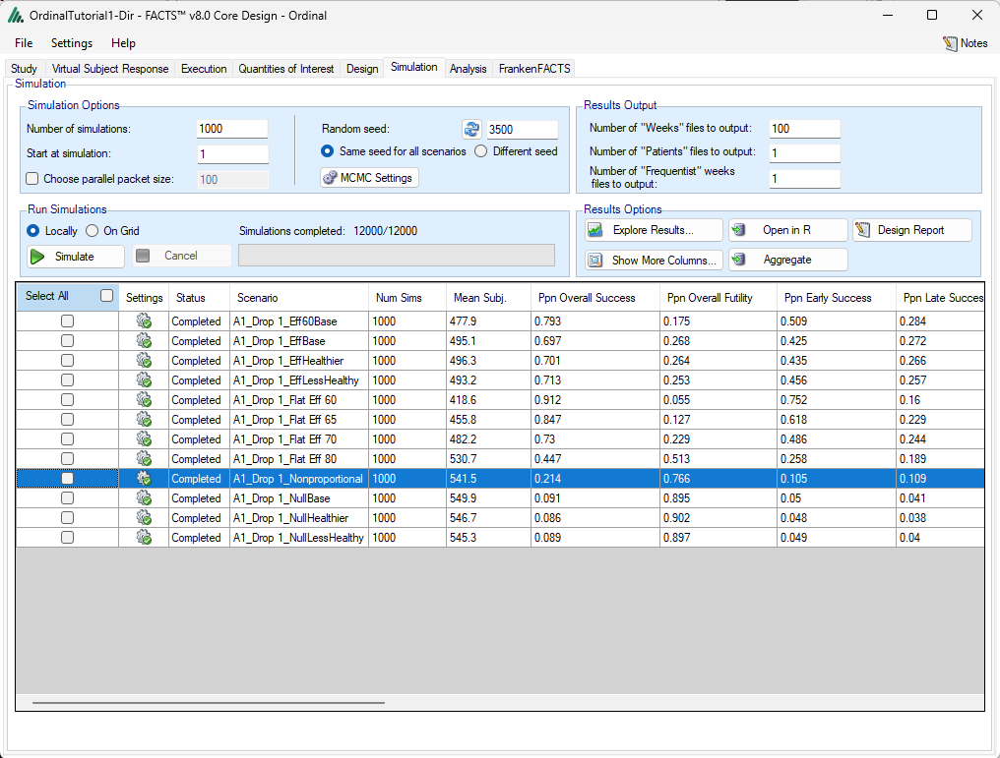

# Discussion

In this tutorial we have introduced the FACTS Ordinal Engine, with examples of both of its broad approaches to modeling of ordinal endpoints, the cumulative logistic model and the independent Dirichlet model. We hope that you have found this tutorial useful.
