#  Introduction

This tutorial introduces three new dose-response models available beginning in FACTS 6.4. These models are the Simple Linear Model, the Hierarchical Model, and the Linear Hierarchical Model. First we illustrate the Linear and Linear Hierarchical models with dichotomous data. Then we create a design based on the Hierarchical model for time-to-event data.

Screenshots are from the 6.4 release of FACTS. The screenshots provided are approximate and may not reflect the exact layout of the information in later versions of FACTS. The contents of each tab, however, will be consistent with the software.

The designs presented are examples and may not be optimally calibrated.

# Designs Featured

In this tutorial we create the following designs:

- Design 1A

  - Dichotomous data

  - No predictor

  - Five experimental arms plus a control arm

  - Adaptive design with three interims

  - Linear dose-response model

- Design 1B

  - Like Design 1A, but uses the Hierarchical Linear dose-response model

- Design 2:

  - Time-to-event data

  - No predictor

  - Four experimental arms plus a control arm

  - Adaptive design with four interims

  - Hierarchical dose-response model

# Design 1A: dichotomous data, linear model

The primary endpoint is presence or absence of a negative outcome one week after treatment. There is no predictor available.

The design will randomize to a control arm and five doses of an experimental drug. The study will include three relatively small doses (0.5, 0.75, and 1 units), and two larger doses (2.5 and 5 units). There is compelling in vitro data suggesting an approximate log-linear relationship between dose and outcome probability.

We expect an event probability of approximately 40% for patients randomized to control. A treatment that reduces event probability by 10% or more would be promising for marketing.

We intend to randomize 600 patients, with no stopping for futility or early success. This is a Phase II trial. We are particularly interested in the largest dose. But we are also interested in outcomes (and, although they will not simulated in FACTS, secondary endpoints) for all five arms.

If the linear model estimates that the drug is beneficial relative to control as a whole, it will always estimate that the largest dose is the most effective of the doses, due to the strong assumption about the shape of the dose-response relationship. Other dose-response models are more suitable for most dose selection tasks, but in this study we are primarly focused on the largest dose.

We particularly wish to gather more data on arms that may be 10% better than control, so we will conduct interims for response-adaptive randomization probability updates. The randomization probability for control will be fixed at 1/3 throughout the trial.

## Study

Start FACTS 6.4 or later, double click on: Core Design -- Dichotomous.

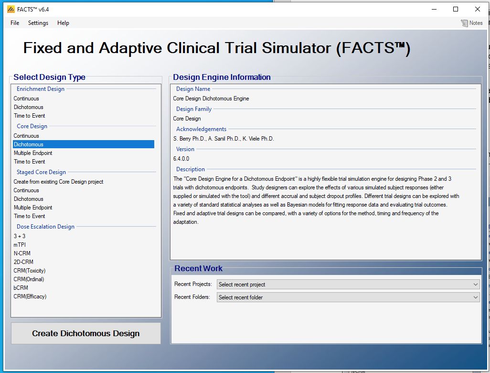

Using the menu option "File \> Save As", save this design as "LinearExample" in a convenient location (e.g. in a folder called FACTS\\Tutorials\--example in your 'My Documents' folder).

### Study Info

On the Study -\> Study Info tab, select the following options:

- Under Design Options, select Adaptive, not Fixed

- Uncheck Use longitudinal modeling

- Under Study information, Recruit subjects Continuously

- Set the Maximum number of subjects to be 600

- Check "Response indicates negative outcome"

- Under Schedule of Post-Baseline Visits, Time to Final Endpoint should be 1 week

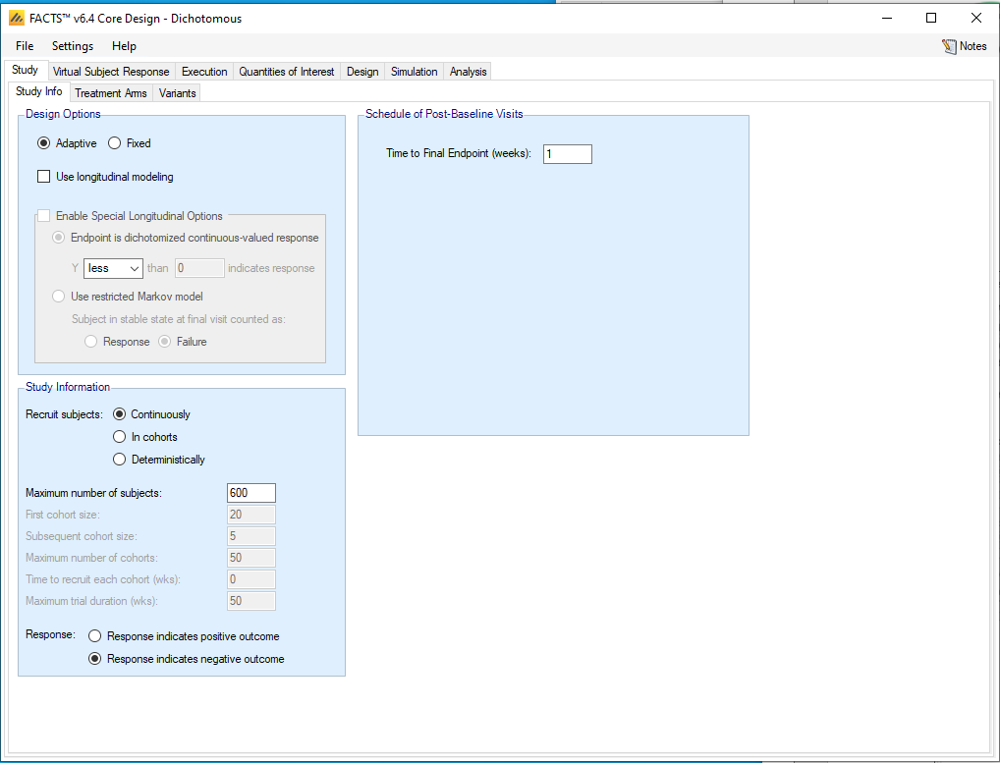

### Study \> Treatment Arms

- Include a control treatment arm

- Enter "0.5" in the Dose level box and then click Add. Repeat to add dose levels of 0.75, 1, 2.5, and 5.

> You do not need to enter anything on the Study -\> Variants tab.

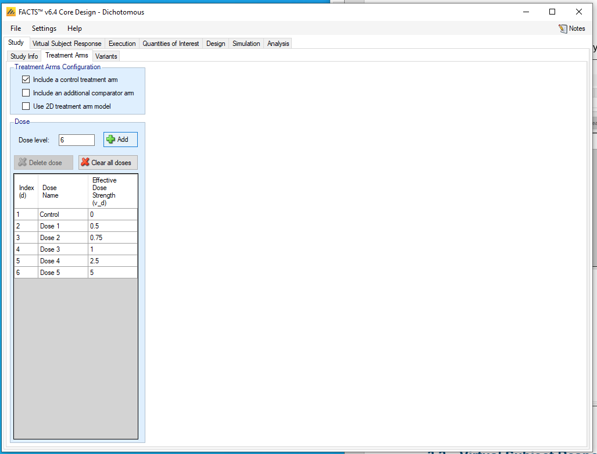

## Virtual Subject Response -- Explicitly Defined

We will define five treatment effect scenarios:

- a null scenario

- two scenarios where the expected log-linear relationship is exactly correct, one with modest treatment effects and one with stronger effects;

- two scenarios for testing the robustness of the linear model when the log-linear relationship is not exactly correct. The linear model makes a strong assumption about the relationship between dose and outcome, so it has the potential to perform poorly when this assumption is violated. We recommend that such scenarios

To add the null scenario, click the "+ Add" button. Rename the Profile from "Resp 1" to "Null" by clicking and then typing "Null" in the Profiles dialog. Then set all the response rates to be 0.4 by entering 0.4's in the Response rate colun in the Endpoint Values table. None of the "Should succeed" boxes should be checked in the null scenario.

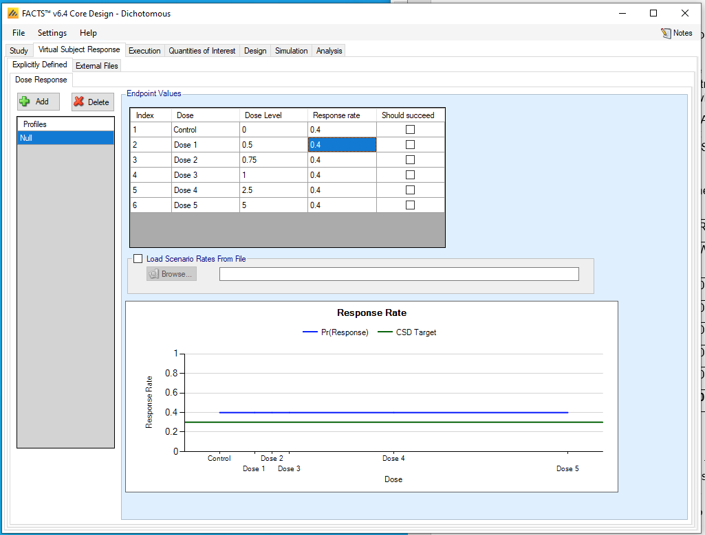

Then create more scenarios, using the values in this table. Check the "Should succeed" box for arms with response rates in bold in the table.

+------------+--------+---------------+-----------------+----------------------+---------+-----------+
|            |        | Response rate |                 |                      |         |           |
+============+========+===============+=================+======================+=========+===========+
| Dose Level | Null   | Weak Logistic | Strong Logistic | Very Strong Logistic | Plateau | Threshold |
+------------+--------+---------------+-----------------+----------------------+---------+-----------+
| 0          | 0.4    | 0.4           | 0.4             | 0.4                  | 0.4     | 0.4       |
+------------+--------+---------------+-----------------+----------------------+---------+-----------+
| 0.5        | 0.4    | 0.389         | 0.383           | 0.377                | 0.387   | 0.4       |
+------------+--------+---------------+-----------------+----------------------+---------+-----------+
| 0.75       | 0.4    | 0.384         | 0.375           | 0.365                | 0.38    | 0.4       |
+------------+--------+---------------+-----------------+----------------------+---------+-----------+
| 1          | 0.4    | 0.379         | 0.367           | 0.354                | 0.374   | 0.4       |
+------------+--------+---------------+-----------------+----------------------+---------+-----------+
| 2.5        | 0.4    | 0.348         | 0.320           | **0.29**             | 0.348   | **0.3**   |
+------------+--------+---------------+-----------------+----------------------+---------+-----------+
| 5          | 0.4    | **0.3**       | **0.250**       | **0.2**              | 0.348   | **0.3**   |
+------------+--------+---------------+-----------------+----------------------+---------+-----------+

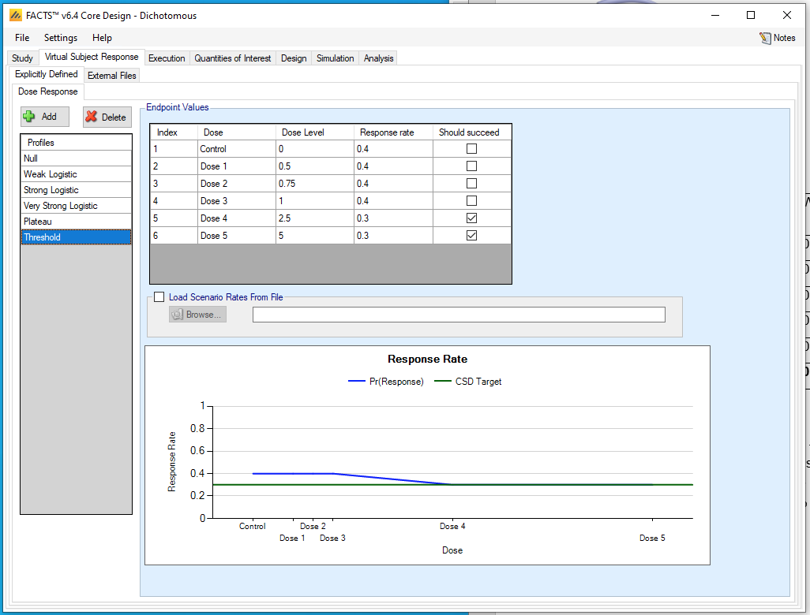

The Plateau profile has been defined to explore whether the linear model tends to extrapolate beyond the four smaller doses to be too enthusiastic about the largest dose. The Threshold profile will explore to what extent the linear model acts as if the two largest doses are equally worthy, and to what it extent it favors the largest dose.

A more thorough example would also explore scenarios where the control response rate is not 0.4.

## Execution

### Accrual

Add an accrual scenario by clicking the Add button on the far left, then add 1 region by clicking the Add button above the table. Set the peak accrual rate to 12 subjects per week, to give an overall recruitment period of approximately 50 weeks.

The names of the accrual profile and the region may be renamed by double-clicking on them.

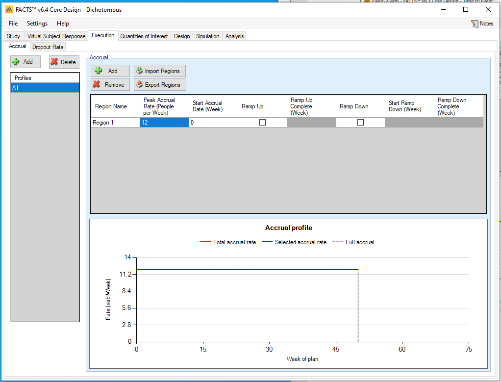

### Dropout Rate

Select "No Dropouts".

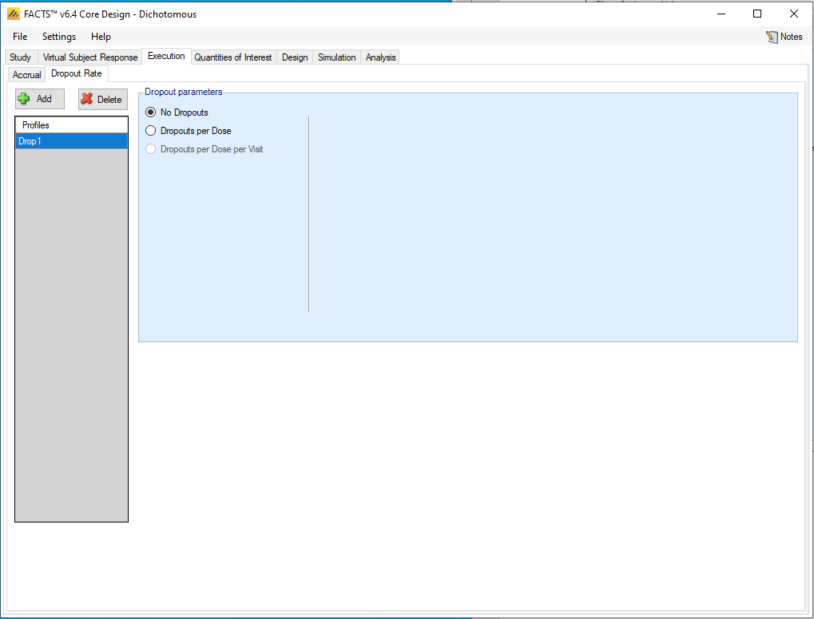

## Quantities of Interest 

FACTS has considerable flexibility in allowing the user to define Quantities of Interest (QOIs) to drive adaptations in the trial and decisions at the end of the trial. A basic set of QOIs is provided by default. Additional QOIs may be added by clicking the Add row in the table. A QOI can be removed by clicking the X on the right side of the cell. Each QOI may be edited by clicking on it, which opens a pop-up box.

Recall that a 10% benefit relative to control is considered to be a large enough benefit. We will define a QOI based on the probability of a better than a 5% benefit, so that a null arm will eventually have small probability of a 5% benefit and a good arm with at least a 10% benefit will eventually have a large such probability. The trial will be judged a success if at the end of the trial:

- The arm with the largest dose has a posterior probability of at least 90% that it is 5% better than control.

Otherwise the trial will be judged to be futile.

Set the following parameters:

- At the bottom of the page, set the Clinically significant difference (CSD) to be 0.05. Default QOIs compare to control, and the Trial type is Superiority.

- For Posterior Probabilities:

  - Verify that Pr(P_d -- P\_(Control) \<-0.05) is already added. It should have been automatically filled in because we already specified the CSHRD.

- We are not interested in any Predictive Probabilities, p-values, or Probabilities of being Target. The Pr(Max) probability in FACTS calculates the probability that each dose is the best dose. This probability in particular is not useful with the Linear model, because no dose between two other doses can possibly be the best dose.

- For Decision Quantities (Scalars):

  - QOI: Pr(P_d -- P\_(Control) \<-0.05)

  - Evaluation Dose: Dose 5

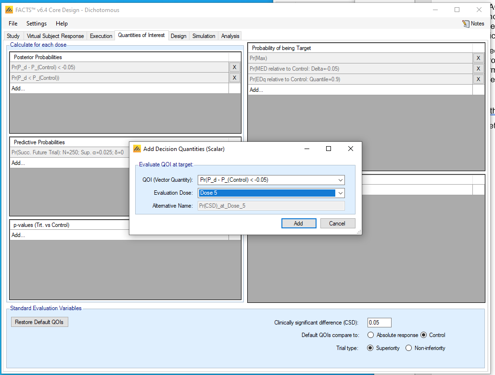

## Design

### Dose Response

The linear model assumes that the probability of outcome $P_{d}$ for arm number $d$, which has dose level $\nu_{d}$, is

$$P_{d} = \frac{e^{\theta_{d}}}{1 + e^{\theta_{d}}}$$

Here the $\theta_{d}$ are the dose parameters and they satisfy the linear model:

$$\theta_{d} = \alpha + \beta\nu_{d}$$

FACTS gives the option of not including the control arm in the linear model. But here we include it (we leave "Model Control Separately" unchecked), so the parameter $\alpha$ is the logit of the outcome rate corresponding to dose level zero, i.e. the control outcome rate is equal to

$$P_{0} = \frac{e^{\alpha}}{1 + e^{\alpha}}$$

First select "Simple Linear" from the Model list. In FACTS we must specify prior distributions for the unknown parameters. We set the prior mean for $\alpha$ to be -0.405, the logit of the expected control probability 0.4, and other prior parameters as in the screenshot. In the graph, select Graph Type: Dose-Response Samples to view samples from the prior distribution for the Dose-Response model. In Dichotomous and Time-to-event models in particular, it can be easy to inadvertently choose prior distributions that are so non-informative that most prior samples look absurd.

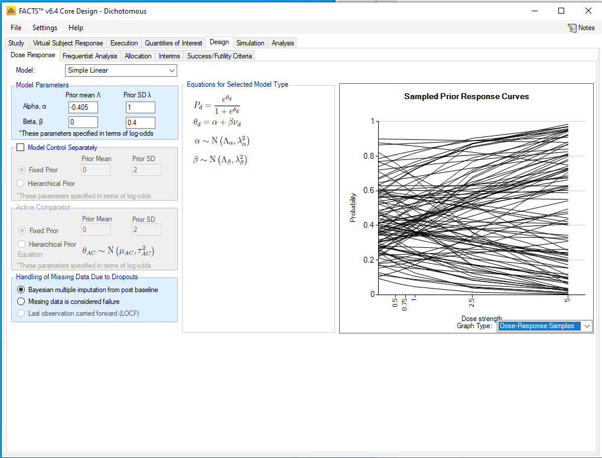

### Frequentist Analysis

We will not use the Frequentist Analysis tab.

### Allocation

To institute response-adaptive randomization, check the "Adaptive Allocation" box. Set the "Pre First Interim Allocation Ratios" to be 5 for control and 2 for each of the experimental arms. Check "Fix Alloc." for the control arm, and enter 5 for the Post First Interim Alloc. per Block. Below the table, enter 15 in the Post first interim block size.

In the "Adaptive Allocation Targets" dialog, click "Add". Select Pr(P_d - P\_(Control) \< -- 0.05) in the QOI pull-down. Check (Weight For) Probability, and give it relative weight 1.

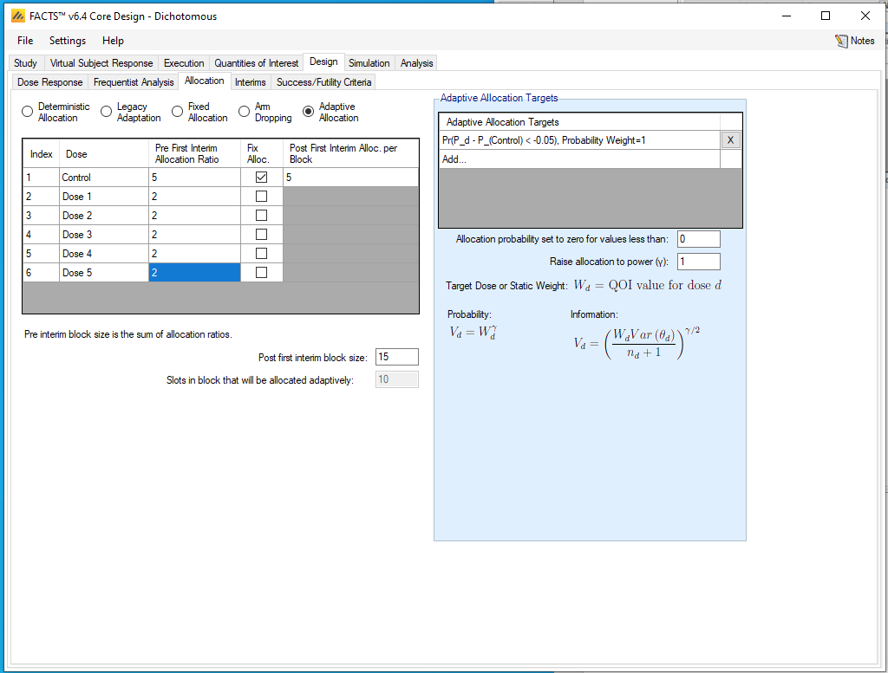

### Interims 

We will update randomization probabilities at each of three interims. Check "Opportunity to Complete at Specified Visit". This means that an interim analysis scheduled for 150 patients will happen 1 week after the 150^th^ patient is randomized and treated, and the randomization probability update will usually not take effect until more than 150 patients have been randomized. If we selected "Subjects Enrolled" instead, the interim would necessarily occur before 150 patients have complete data, but randomization probabilities would be updated in time for the 151^st^ patient. Either choice can be good.

In our simulated study, there are no dropouts and no unexpected delays in data availability, so it is equivalent to define information based on complete data or on opportunity to complete. In practice, basing interim timing on opportunity to complete can make interims more predictable and meetings to discuss the results easier to schedule.

Check (Specify Interims By) Information. Click the Add button three times and enter 150, 300, and 450 in the Subjects (opportunity) column.

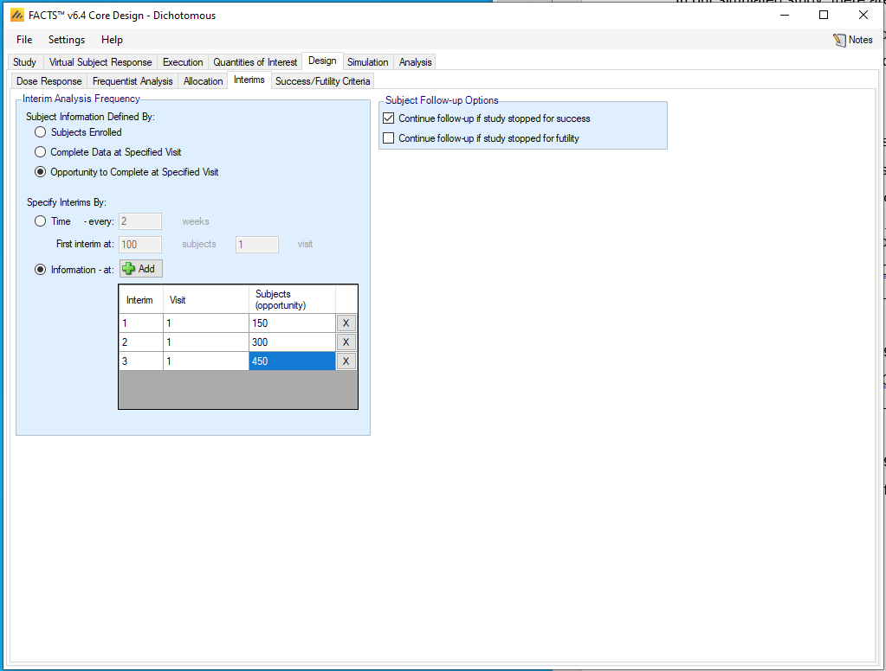

### Success/Futility Criteria

The trial will be judged a success if at the end of the trial:

- the arm with the largest dose has a posterior probability of at least 90% that it is 5% better than control.

Otherwise the trial will be judged to be futile.

Go to the "Final Evaluation" tab. (Since this design does not allow early stopping, we will not select anything on the "Interim 1" tab, nor will we create tabs for the other interims.) Set the following parameters:

- Futility criteria: Add QOI

  - QOI: Pr(P_d -- P\_(Control) \< - 0.05), d = Dose 5

  - Condition: \<

  - Threshold: 0.9

- Success criteria: Add QOI

  - QOI: Pr(P_d -- P\_(Control) \< - 0.05), d = Dose 5

  - Condition: \>

  - Threshold: 0.9

We have left no room between futility and success, so the trial can not be declared inconclusive.

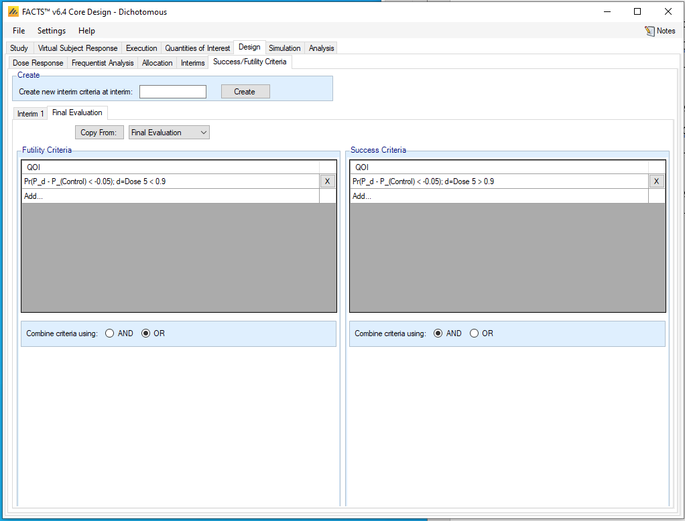

## Simulation

In order to get an initial check on the design set up, set the number of simulations to run to 10, then press Simulate. This allows us to make a quick assessment of whether the design is behaving as expected: that the Null scenario ends up mainly futile and the Strong Logistic scenario mainly successful.

If the results look reasonable, increase the number of simulations to run to 1000, re-check all the scenario combinations and then press Simulate again. This is a design that is very fast to simulate, even running 10,000 simulations for each scenario takes less than an hour on a laptop. If you have access to a computer grid, and your FACTS installation has been correctly configured to use it, you may use the grid's parallel computing capabilities to improve computation speed. To do so, select "on Grid."

## Results

Looking at the operating characteristics for each scenario:

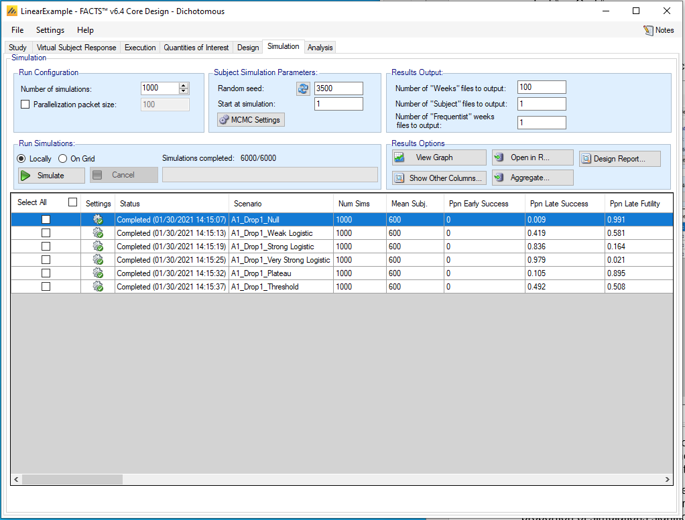

The design as very high probability of success for the Very Strong Logistic scenario, and high probability of success in the Strong Logistic scenario. The Weak Logistic and Threshold scenarios are more borderline with success probabilities between 0.4 and 0.5. Type I error (probability of success in the Null scenario) is quite low, at 0.9% in this set of simulations. More than 1000 simulations should be run if it is desired to have a more accurate estimate of this small probability.

Next we investigate the sample size properties of the design. Click on "Show Other Columns" in the Results Options area, and then select Allocation. An additional window opens, and after adjusting the widths of the columns, we can inspect average sample sizes.

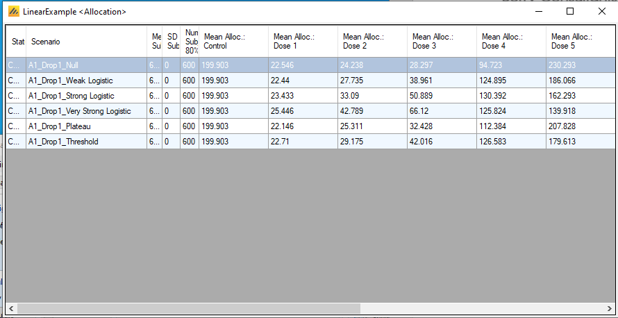

The average sample sizes for Dose 1 are just above 20. Since the design randomizes 20 patients to each experimental arm out of the first 150, the design is aggressive at reducing allocation to this arm using response adaptive randomization. The user should consider whether these sample sizes are adequate for their purposes, and perhaps consider less aggressive randomization or a later first interim.

In all scenarios, the design randomizes a large number of patients to the largest dose. This happens even in the null scenario, in part due to the linear model. Even though the data from all five experimental arms should be suggesting that no arm is 5% better than control, the linear model infers that if any arm is, it must be the largest dose, tilting the randomization probabilities accordingly. In the plateau scenario, in which the two largest doses are in fact equally effective, the design prefers to allocate to the largest dose.

We can also look at the graphs supplied by FACTS to help understand the design. Close the Allocation table window and return to the main FACTS window. Click in the Threshold scenario row to highlight it, and click on "View Graph" in the Results Options area. Then choose "Show Per Scenario Graphs". In the new window, select "Response and Subject Allocation".

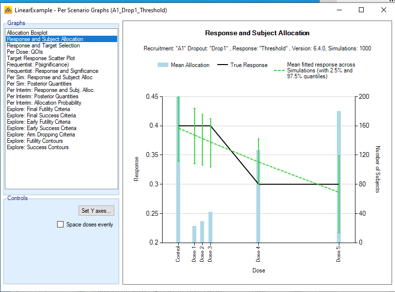

This graph compares the true dose-response relationship in black to the mean fitted response. This scenario is not a linear model, so the model cannot fix it exactly, and this leads to downward bias in favor of Dose 5 (and the small doses) and an upward (i.e. in the direction of less efficacy) bias for Dose 4. This does not necessarily make the linear model a poor choice; it may still make reasonable allocation decisions, and the threshold scenario may be thought to be highly unlikely.

We can also look at FACTS graphs associated with individual simulated trials. Still in the graphs window, select "Per Interim: Response and Subj. Alloc" to display summaries of data and model fits for each interim analysis and each simulated trial. In this example, we show the data after 150 patients have opportunity to complete (160 subjects enrolled in this simulation). The linear model fit is quite reasonable.

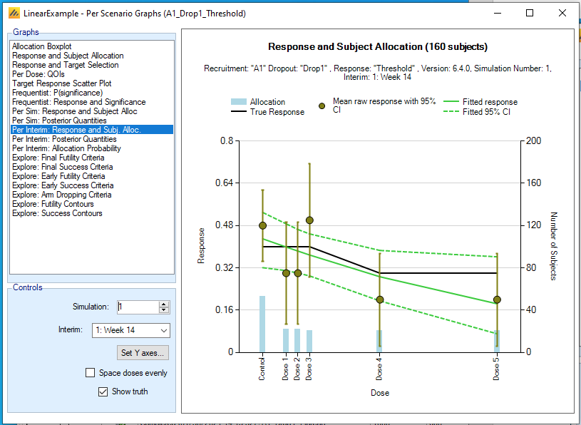

# Design 1B: hierarchical linear model

The hierarchical linear model is based on the linear model, but adds flexibility so that the design considers the possibiltiy that there could be deviations from exact linearity, and is capable of fitting data that deviate from linearity. As before the probability of outcome $P_{d}$ for arm number $d$, which has dose level $\nu_{d}$, is

$$P_{d} = \frac{e^{\theta_{d}}}{1 + e^{\theta_{d}}}$$

The hierarchical linear model is defined by the equations

$$\theta_{d} = \alpha + \beta\nu_{d} + \zeta_{d}$$

where the $\zeta_{d}$ parameters are deviations from linearity. They have prior distribution

$$\zeta_{d}\sim N\left( 0,\tau^{2} \right)$$

subject to the constraint that the sum of the $\zeta_{d}$'s is zero. The parameter $\tau^{2}$ is assigned an inverse-Gamma prior distribution and estimated from the data. As in the linear model, the parameters $\alpha$ and $\beta$ have normal prior distributions.

The additional flexibility of the hierarchical linear model opens up some additional design options that don't make sense in the linear model, such as inference about which experimental arm is the most effective one. The linear model structure is still present to guide the model fitting.

## Design

We will create this example from the Linear example already created in this tutorial. With the linear example open in FACTS, go to the File menu, select Save As, and save to a different .facts file, such as HierarchicalLinearExample.facts.

Now go to the Design tab and the Dose Reponse sub-tab. Select "Simple Hierarchical Linear" from the Model list. The prior parameters for $\alpha$ and $\beta$ from the linear example are still available, and now we need to select a prior distribution for $\tau^{2}$. We choose parameters 0.1 and 2. We encourage users to experiment with different prior parameters and inspect the operating characteristics and graphs.

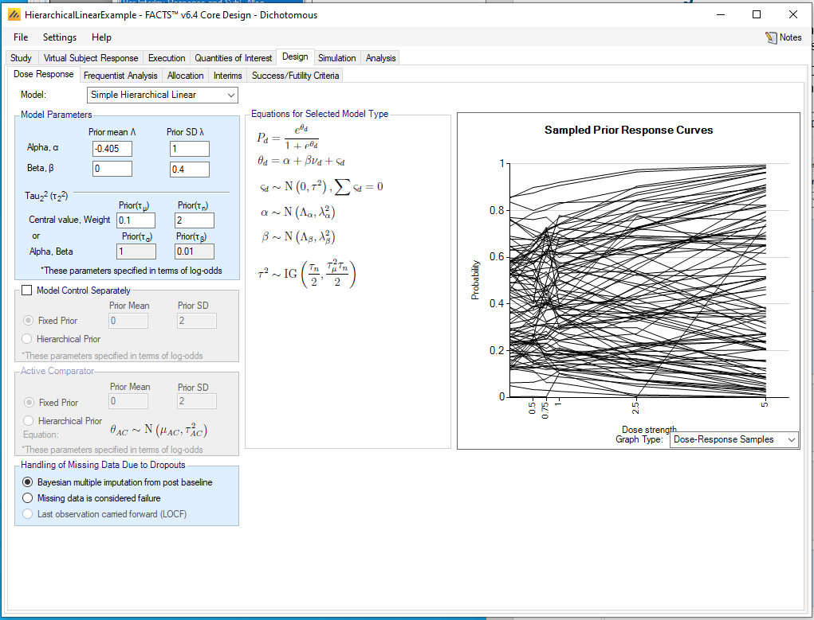

## Quantities of Interest

To take advantage of the more flexible model, we will define and use and additional quantity of interest: the probability that each experimental arm is the best one. On the Quantities of Interest tab, click "Add..." in the Decision Quantities dialog.

- Under QOI, select Pr(P_d -- P\_(Control) \< -0.05)

- Under Evaluation Dose, select Greatest Pr(Max)

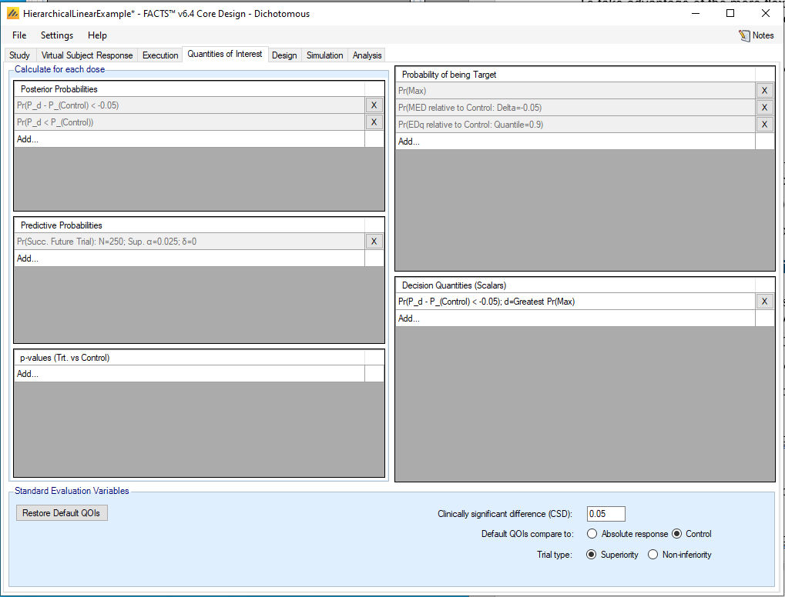

## Allocation

We will change the response-adaptive randomization to be based on the probability that each dose is the best. In the Design -\> Allocation tab, click the X next to the old adaptive allocation target to delete it. Then click Add...

- Select Pr(Max) as the QOI

- Select Weight For: Information. This choice encourages the design to gather more data on arms with relatively smaller sample sizes when they have similar efficacy estimates.

- Set the Relative Weight to be 1

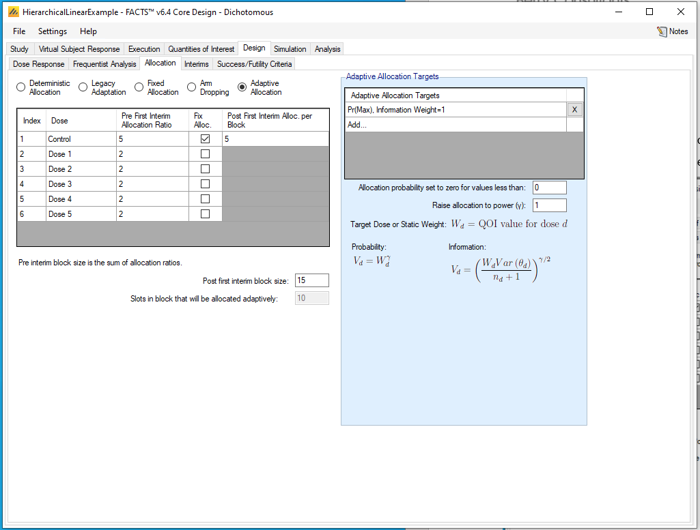

## Success/Futility Criteria

In the linear model, we based trial success and futility on the inference about the largest dose. Since we are now making inference about the best arm, we will change the trial success definition accordingly.

On the Design -\> Success/Futility Criteria tab, select the "Final Evaluation" tab.

Delete the existing futility and success criteria by clicking the X's. Then for a Futility Criterion, click Add...

- For QOI, select Pr(P_d -- P\_(Control) \< -0.05); d=Greatest Pr(Max)

- Select Condition to be \<

- Select Threshold to be 0.9

Then for a Success Criterion, click Add...

- For QOI, select Pr(P_d -- P\_(Control) \< -0.05); d=Greatest Pr(Max)

- Select Condition to be \>

- Select Threshold to be 0.9

The trial will now be identified as a success if the dose most likely to be the best dose has at least a 90% probability of being 5% better than control.

We will leave the other design choices as in the linear example. 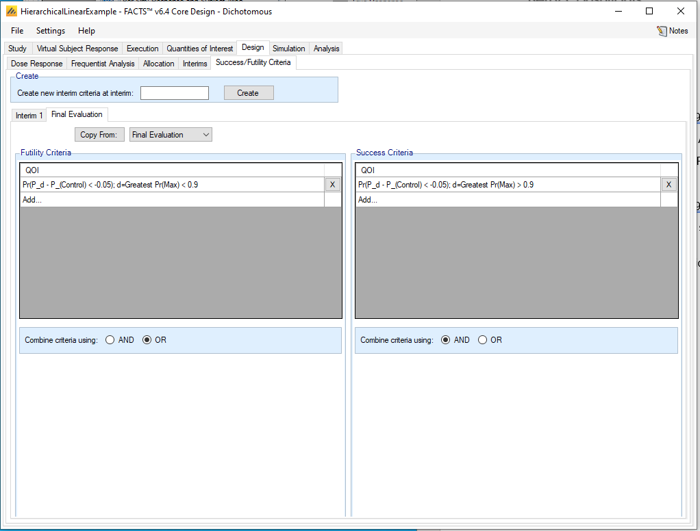

## Results

The operating characteristics for each scenario are, at first glance, similar to the results for the linear model. The design here has been set an additional task: that of identifying the best dose. When we used the linear model, we just told the design that Dose 5 was the best dose, and we didn't simulate any scenarios where any other dose was better. 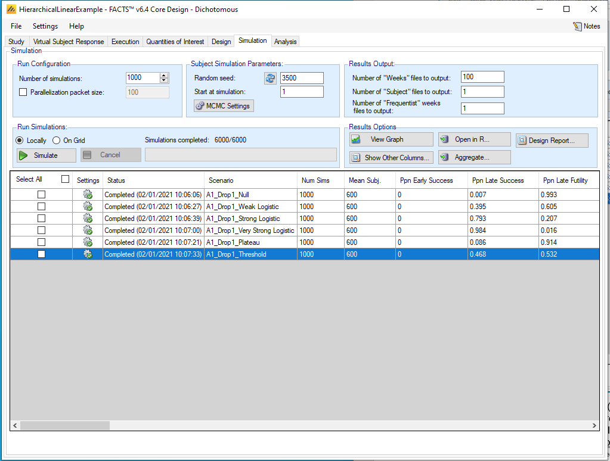

Looking at the sample size numbers (click on Show Other Columns under Results Options, then select Allocation) shows that the allocation patterns are quite different from the Linear model. In the Very Strong Logistic scenario, the design identifies Dose 5 as the top candidate very early and seldom goes back to the other arms. In the null scenario, however, the design is much more skeptical of the largest dose, and assigns many more patients to other arms as compared to the linear model design. Dose 5 is still favored relative to Dose 4 by the approximate linear structure of the model in the Plateau and Threshold scenarios where those two arms are actually equivalent.

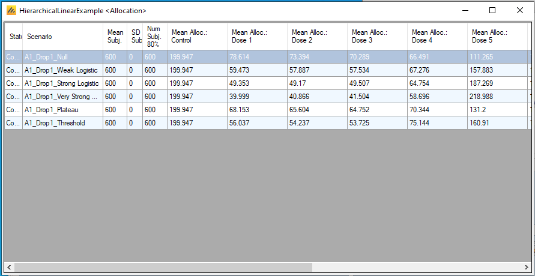

We will look at two graphs to illustrate how the model reacts to data. Select "View Graph", then "Show Per Scenario Graphs", and then "Per Interim: Response and Subj. Alloc." from the list of available graphs. The first interim (160 subjects randomized) for Simulation 1 is shown below. The model fit is not exactly linear, but it is guided by the linear structure while recognizing the good performance of Doses 1 and 2.

It is useful to look through several sets of these graphs to develop intuition for and comfort with how the design performs. For example, here is the graph from the final analysis of a different simulated trial. Here, the data suggest that the model should allow substantial deviations from linearity, and the model is capable of doing so.

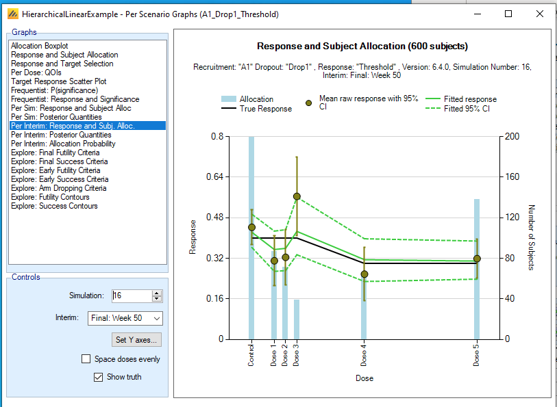

# Design 2: time-to-event data, hierarchical model

In this example, we use the hierarchical model in FACTS 6.4 in a time-to-event problem. The primary endpoint is the time to a negative outcome. This example does not use a predictor.

The design will randomize to a control arm and four different experimental agents. The hierarchical model does not utilize dose level information for the experimental arms; there is no ordering of the doses and no mechanism for informing the model that one pair of arms is more similar than another pair. However, the model starts from the expectation that all arms are likely to be similar.

We expect roughly one event per patient per 25 weeks, but are concerned that events may be less frequent. We are hoping to identify a treatment that reduces the hazard rate relative to control by better than 25%.

We intend to randomize 400 patients, but we will conduct futility analyses. We will not consider the option of stopping early for efficacy. This is a Phase II trial; we will not endeavor to control Type I error at a particular value.

Open FACTS 6.4 or later and double click "Time to Event" under "Core Design." From the File menu, save the design as "HierarchicalTTE-Example.facts" or somewhere similar.

## Study

### Study Info

On the Study -\> Study Info tab:

- Choose "Adaptive" under Design Options

- Enter 400 as the Maximum number of subjects

- Enter 400 as the Maximum number of events

- Enter 52 (weeks) as the Follow-up after full enrollment.

- Events should indicate Failure.

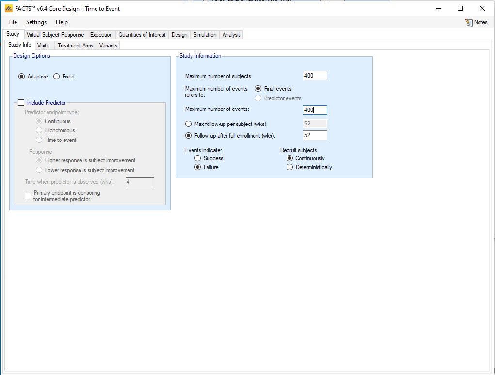

### Visits

The Visits tab should already have "Restrict Event Times to Visits" unchecked. We will assume that events can be observed at any time.

### Treatment Arms

On the Study -\> Treatment Arms tab, under "Dose", click "+ Add" four times to add four experimental arms. FACTS will set the dose levels to be 1, 2, 3, and 4, and these are not relevant to the hierarchical model.

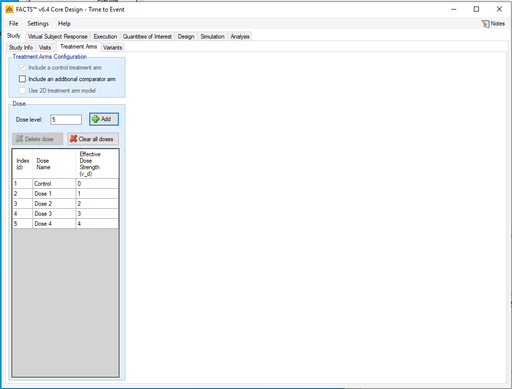

We don't need to do anything with the Variants tab.

## Virtual Subject Response

### Control Hazard Rates

We will define two scenarios for the hazard rate for the control arm: one event per 25 weeks and one event per 50 weeks. Click Add. Rename the profile as "Base" by clicking on its name in the Profiles list. Then enter 0.04 as the Events per week.

Then Add another profile called "Rare" with 0.02 events per week.

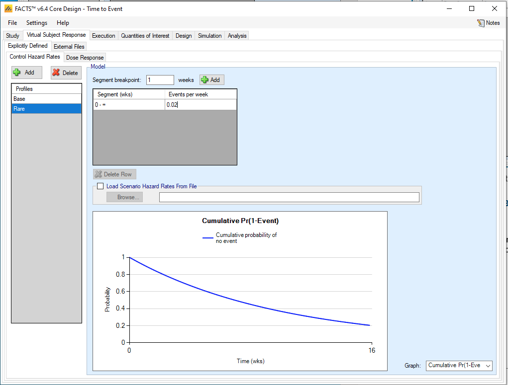

### Control Hazard Rates

We will define six efficacy scenarios as shown in the table below.

+---------+---------+-----------+-------------+-----------+----------+----------+
| Arm     | Null    | Linear    | Weak Linear | All Doses | One Dose | Overdose |
+=========+=========+===========+=============+===========+==========+==========+
| Dose 1  | 1       | 0.875     | 0.925       | **0.6**   | 1        | 1        |
+---------+---------+-----------+-------------+-----------+----------+----------+
| Dose 2  | 1       | 0.75      | 0.85        | **0.6**   | 1        | **0.5**  |
+---------+---------+-----------+-------------+-----------+----------+----------+
| Dose 3  | 1       | **0.625** | 0.775       | **0.6**   | 1        | **0.5**  |
+---------+---------+-----------+-------------+-----------+----------+----------+
| Dose 4  | 1       | **0.5**   | **0.7**     | **0.6**   | **0.5**  | 1.25     |
+---------+---------+-----------+-------------+-----------+----------+----------+

These are defined on the Virtual Subject Response -\> Dose Response tab. New profiles are added with the "Add" button, they can be renamed by clicking in the Profiles table, and the hazard ratios are entered in the Endpoint Values tables. The boldface arms in the table have effects of better than 25% and "Should Succeed."

We have a null scenario, and two "Linear" scenarios where the arms with larger labels have greater efficacy. We have a scenario where all experimental arms are effective; the hierarchical model should do well at inferring that all experimental arms are similar and that they are different from control. We have a scenario where three arms are identical to control but one has a large effect; this scenario could be challenging for the hierarchical model. Finally we have an "Overdose" scenario which might be challenging for many parametric dose-response models, in which "Doses" 2 and 3 have good effects, but "Dose" 4 is too much drug and leads to side effects and worse outcomes than control. The hierarchical model doesn't care about the order of the doses, so it has no concept of overdose, but it does need to learn that there are widely varying treatment effects on both sides of control.

## Execution

Create an accrual profile in which 5 patients per week are accrued.

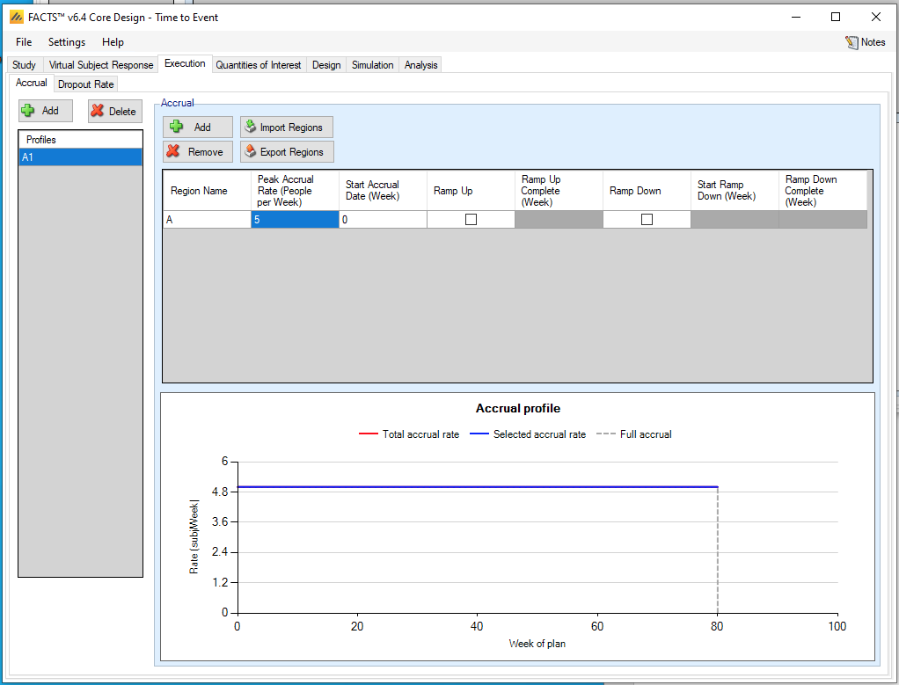

## Quantities of Interest

We will use two decision quantities in the trial. First, at the bottom of the Quantities of Interest tab, set the Clinically significant hazard ratio delta to be 0.25. Then add a decision quantities by clicking Add... under Decision Quantities (Scalars).

- For the first QOI, choose Pr(HR_d -- 1 \< -0.25), and select Evaluation Dose to be Greatest Pr(Max)

- For the second QOI, choose Pr(Max) and select Evaluation Dose to be Max probability over all doses. We will not use this QOI to make decisions during the trial, but we want the output to tell us the probability of selecting each arm as the most likely best arm.

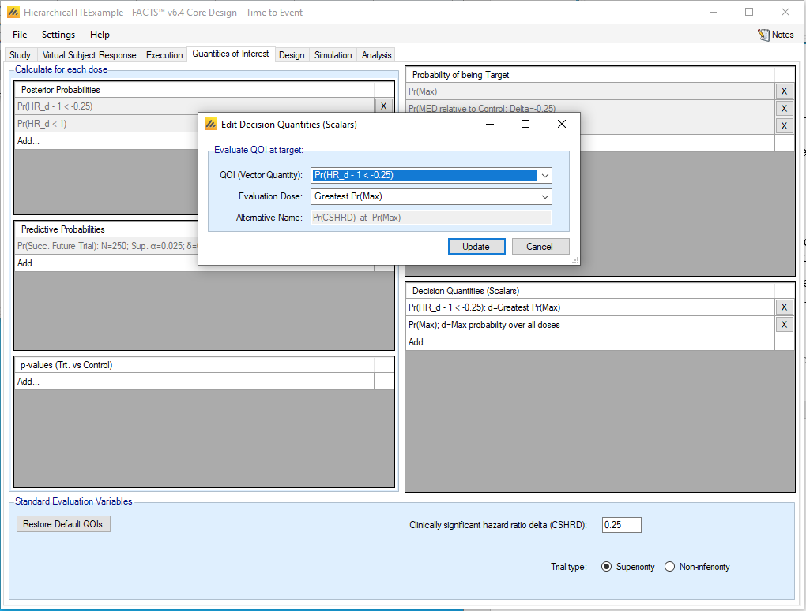

## Design

### Hazard Model

On the Design -\> Hazard Model tab, set the prior mean hazard rate for control to be 0.04. We will use an exponential model with a single piece.

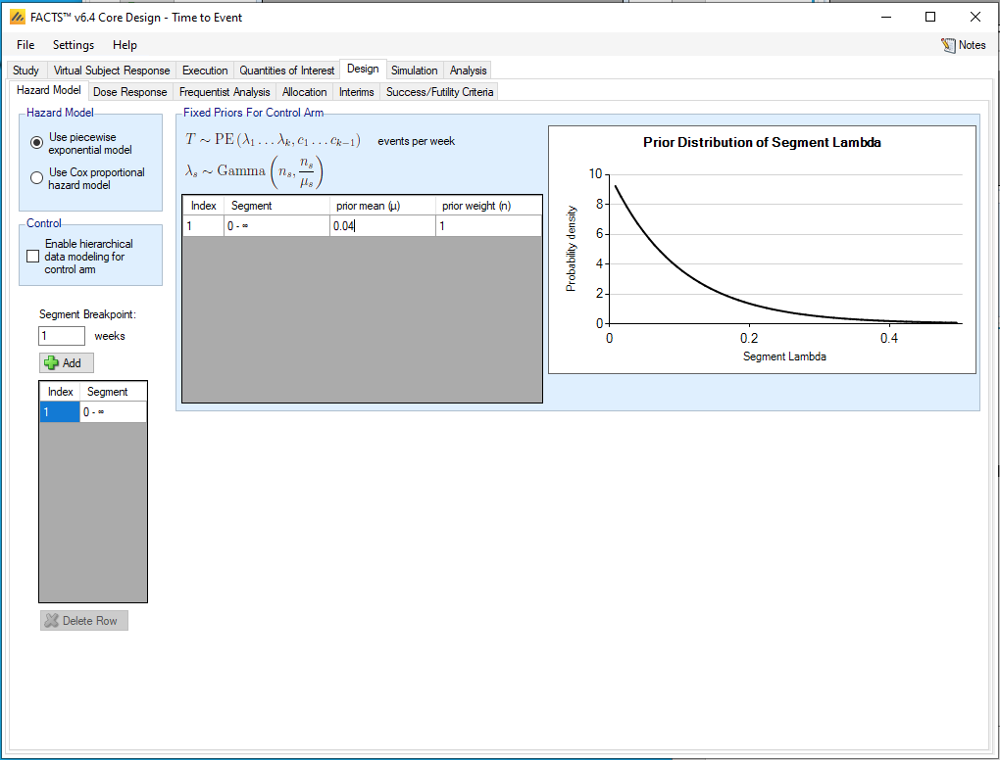

### Hazard Model

Choose the Simple Hierarchical model from the drop-down Model menu on the Dose Response tab. We are going to use a statistical model that estimates a hazard rate $\lambda_{s}$ for the control arm, and also estimates log hazard ratio parameters $\theta_{d}$ for the experimental arms relative to control. The $\theta_{d}$'s are drawn from a normal hierarchical model:

$$\theta_{d}\sim N(\mu,\tau^{2})$$

with prior distributions for $\mu$ (normal) and $\tau^{2}$ (Inverse Gamma). We will use the default values of the prior parameters. Using $\mu = 0$ means that the treatment effects are centered around zero (i.e. the experimental arms are expected to be about the same as the control arm). It is also possible to choose a different value for the prior mean for $\mu$ if, for example, one expects all the experimental arms to be 25% better than control, but this is likely to be an unusual situation.

In most FACTS models, the user has the option of choosing whether or not the control is included in the dose-response model or modeled separately. For technical reasons, this option is not available for time-to-event data with a hierarchical model. By estimating the parameter $\mu$, the FACTS hierarchical model, in effect, always uses the data to determine whether the control should be modeled separately or not: if $\mu$ is close to zero, then the control is, in effect, in the model.

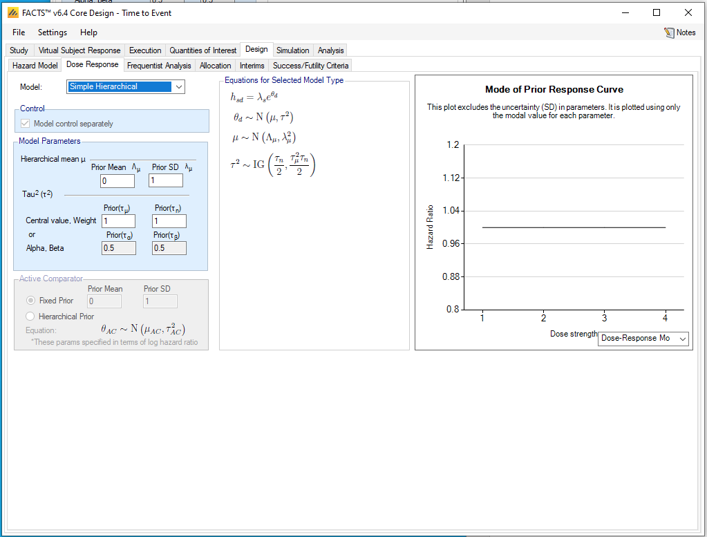

We won't use the Frequentist Analysis tab.

### Allocation

We will use response-adaptive randomization to encourage collecting more data on experimental arms, while fixing the control allocation at 1/3.

On the Allocation tab, select "Adaptive Allocation." Click "Fix Alloc." for the control arm, then set the Pre First Interim Allocation Ratios to be 2 for control and 1 for each of the four experimental arms. Then set the Post first interim block size to be 6 and the control allocation post first interim to be 2.

Then define an adaptive allocation target by clicking Add...,

- set the QOI to be Pr(HR_d -- 1 \< -0.25)

- select Information weighting

- set the relative weight to be 1.

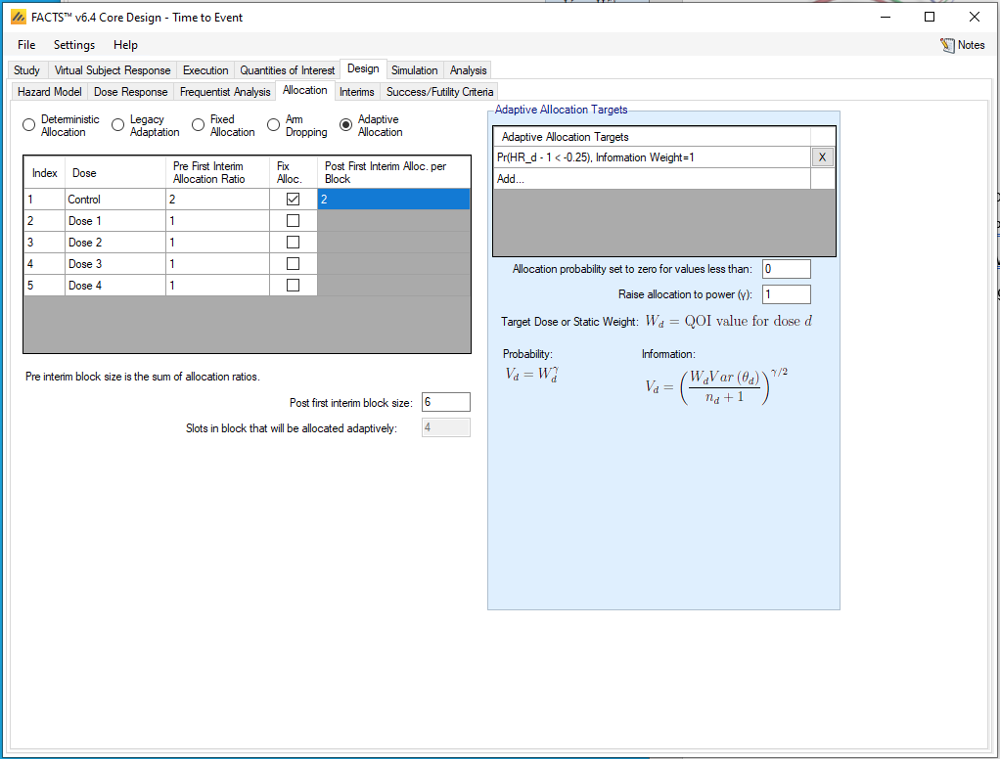

### Interims

We will define four interims, after 200, 250, 300, and 350 patients enrolled.

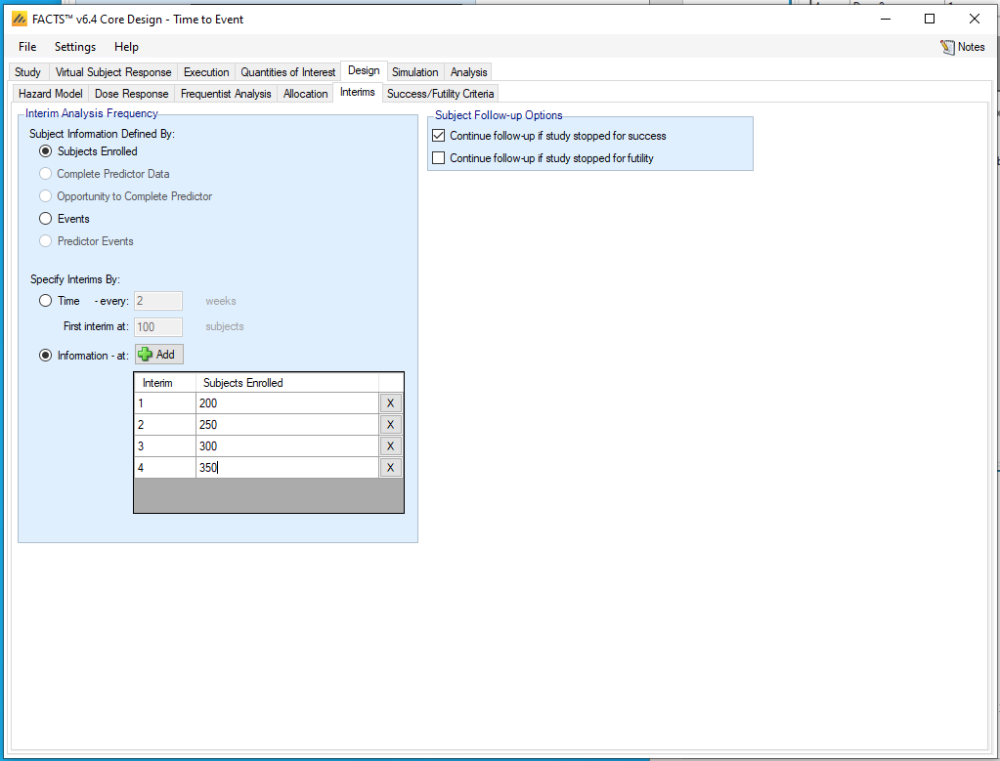

### Success/Futility Criteria

We will define a futility stopping rule that applies at each interim analysis. On the Design -\> Success/Futility Criteria tab, and on the "Interim 1" sub-tab, check the "Futility Criteria" box Then Add a criterion that stops the study for futility if the experimental arm most likely to be the best arm has less than a 25% probability of having better than a 25% effect relative to control.

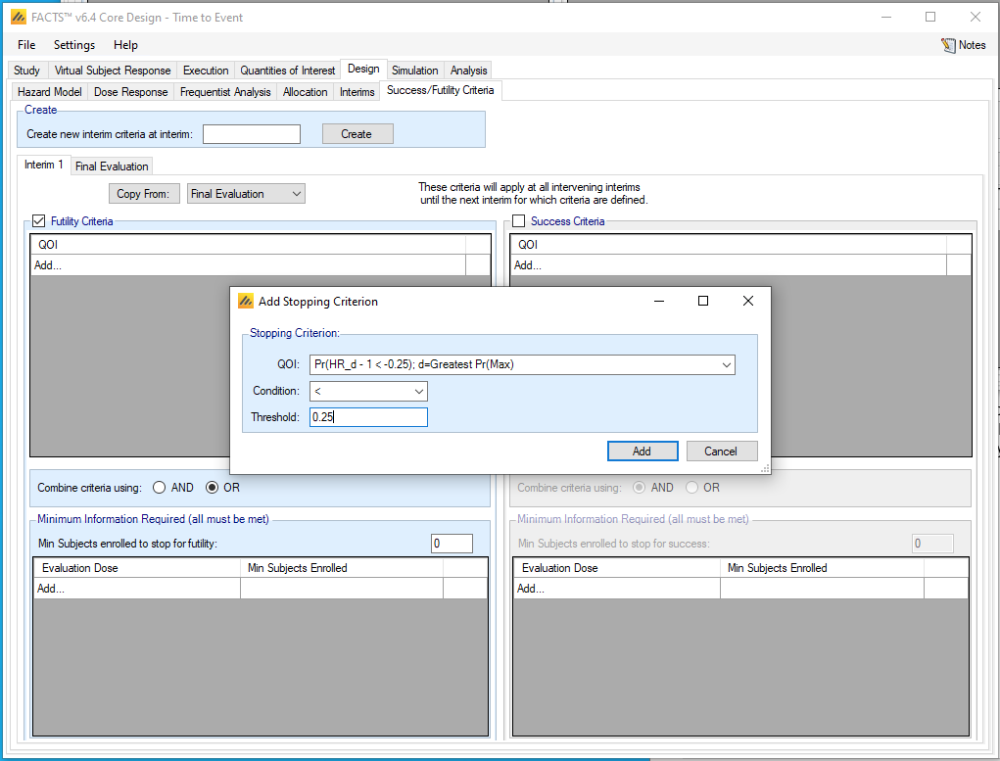

We will not stop the study for expected success. However, if we wanted to change the futility stopping criteria at each interim, we could Create new interim criteria and enter new values on the resulting tab.

For the Final Evaluation, we will define the study to be a success if the most likely best arm has at least a 90% probability of being at least 25% better than control. We will define the study to be futile at the final analysis if the most likely best arm has less than a 50% probability of being 25% better than control. The study is inconclusive if the probability is between 50% and 90%.

##  Simulation

After simulating all twelve scenario (6 efficacy x 2 control hazard rates) we can inspect operating characteristics:

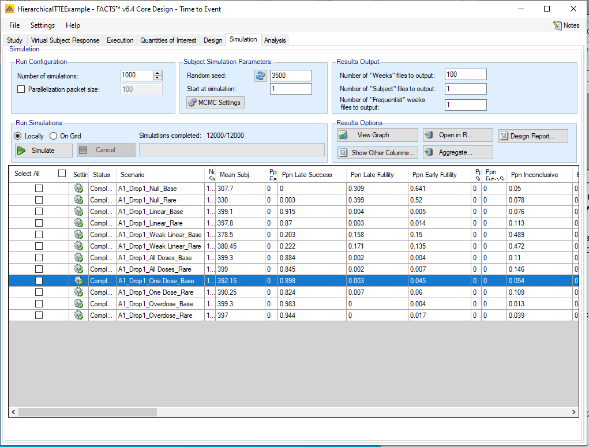

The Linear, All Doses, One Dose, and Overdose scenarios all have high probabilities of Late Success. In all these efficacy scenarios, the design loses some power when the event rate is cut in half ("Rare"), but the drop is not catastrophic. Type I error as measured by "Late Success" in the Null scenario is very small; there is room to experiment with different success rules if desired. Futility probabilities are 64% and 52% in the null scenarios; it may be desired to experiment with the futility rule to increase the probability of futility. The Weak Linear scenario is borderline, and the most common outcome is inconclusive, which is appropriate because the best arm has exactly the effect (25%) that we are hoping to exceed.

We now click on Show Other Columns from Results Options, and select Probabilities. This gives us information about dose selection, as shown below. In the All Doses scenario (and also in the Null scenario), all experimental arms are roughly equally likely to be identified as the best arm. When the experimental arms differ, the design is likely to make a correct identification, with the task being most difficult in the Weak Linear scenario. When events are Rare, the power to choose the best arm is reduced, but the design appears to still be adequate in the Rare event rate scenarios.

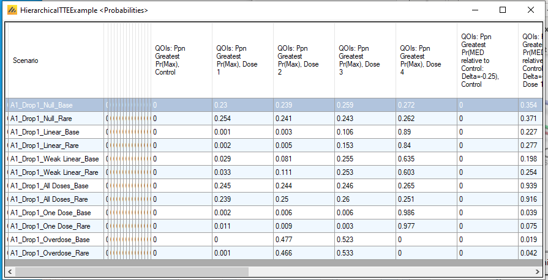
