#  Introduction

This tutorial describes a Small Cell Lung Cancer example trial design using the FACTS Core Design Engine for a Time-to-Event Endpoint.

For this version of the document, the screenshots are from the 6.3 release of FACTS.

The screenshots provided are approximate and may not reflect the exact layout of the information in later versions of FACTS. The contents of each tab, however, will be consistent with the software.

The designs presented are examples and may not be optimally calibrated.

# Designs Featured

In this tutorial we create the following designs:

- Design 1

  - Fixed design with no adaptations

  - No predictor

  - Include 2 arms, a control arm and a treatment arm

- Design 2:

  - Add interim analyses to allow for early stopping for success or futility

# Case Study: Small Cell Lung Cancer

The primary endpoint is progression free survival after 2 years.

Patients will initially undergo 6 \* 3 week cycles of treatment, followed by observation at quarterly intervals (every 12 weeks) to the end of the first year, and then observation at half-year intervals (every 25 weeks) for the second year. We expect that the rate of PFS events may vary across these time intervals. Patients are not followed beyond two years.

This is a phase 3 trial and the basic design is Control plus the active treatment arm.

The goal is to establish that there is a hazard ratio of 0.90 or less between the new treatment and the standard of care for these patients. Note that this is a super-superiority criterion. Showing simply statistical significance (HR \< 1) is not sufficient. The type-1 error must be controlled at the 5% level.

## The Expected Event Rate & Conventional Sample Size

The overall probability of survival in this patient population is 90% after the first 18 weeks of treatment, 70% after the first year and 37.5% after 2 years.

For a one-sided significance of 0.05, assuming the accrual is over 3 years, with a two year follow up and 21 month median survival time, to detect a hazard ratio of 0.833 with 80% power, a conventional sample size calculation gives a required total sample size of 1059 subjects (Schoenfeld's formula).

## Study

Start FACTS, double click on: Core Design -- Time to Event.

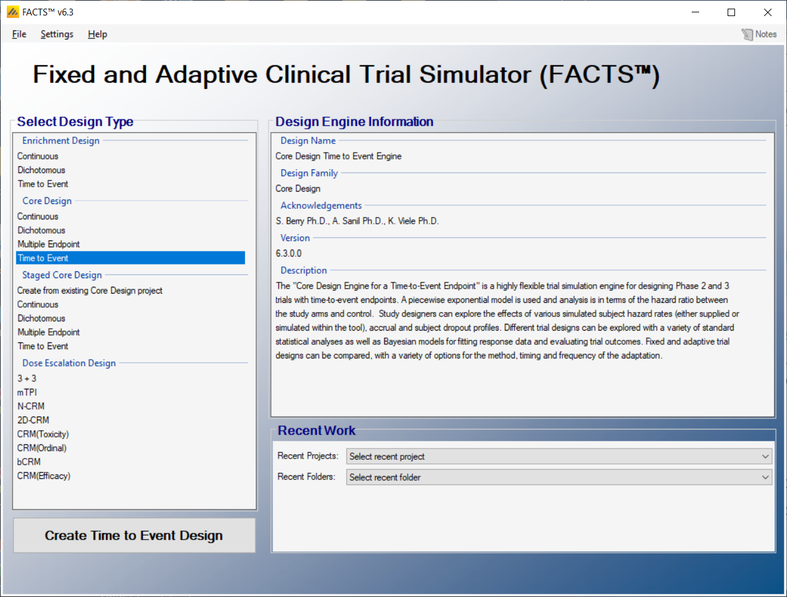

Using the menu option "File \> Save As", save this design as "Fixed-2-arm" in a convenient location (e.g. in a folder called FACTS\\TTE\--example in your 'My Documents' folder).

### Study Info

The Study tab captures basic information about the trial. Set the following parameters:

- Select: Non-Adaptive design

- Do not select Include Predictor Type

- Set Maximum number of subjects: 1060

- We do not have a limit on number of events, so Set Maximum number of events: 1060

- Specify Max follow-up per subject (wks): 104 weeks (2 years).

- Set: Events indicate: Failure

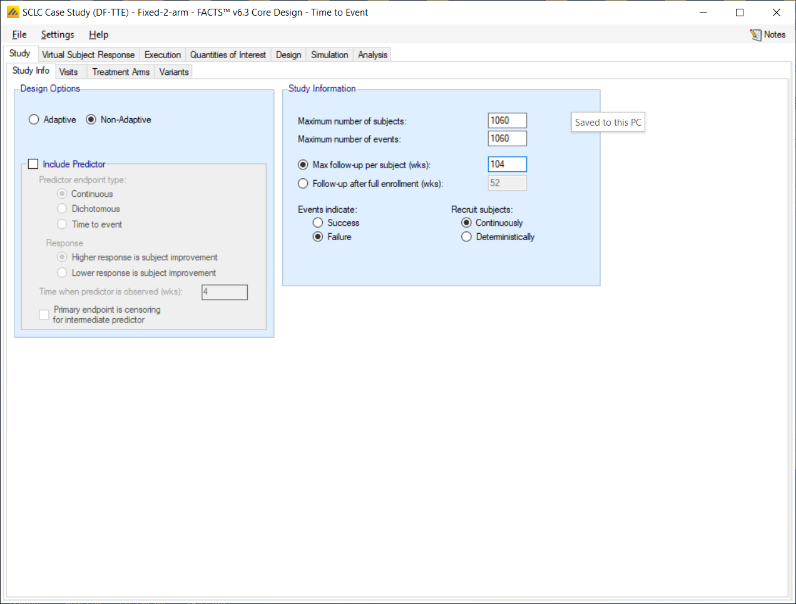

### Visits

- Do not select "Restrict Event Times to Visits"

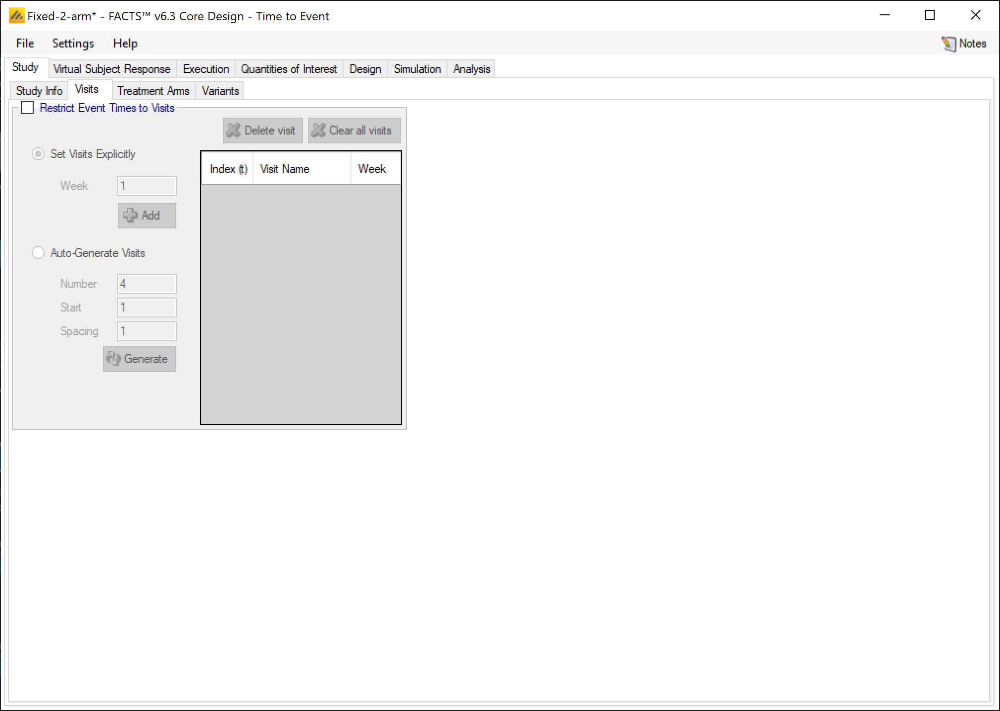

### Treatment Arms

Set the following parameters:

- A control arm is always included in TTE designs, because the analysis uses a hazard ratio.

- Add just 1 study dose with a level of 1 (the level is actually immaterial).

The Dose Name may be changed by double-clicking on the relevant cell in the table. This name is simply a label for the treatment arms.

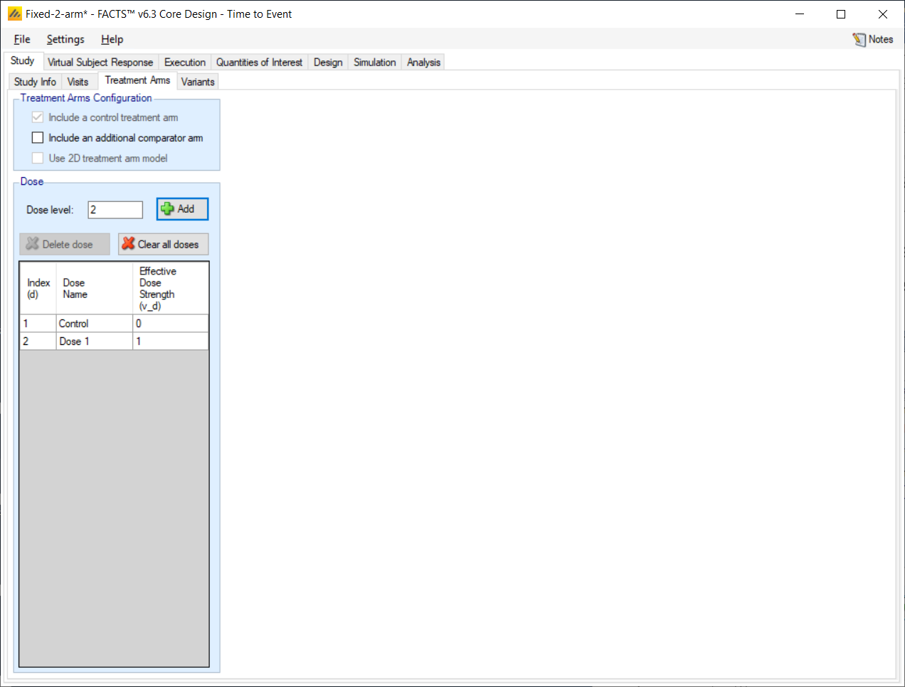

## Virtual Subject Response -- Explicitly Defined

### Control Hazard Rate

The Virtual Subject Response (VSR) tab describes how subject-level data will be generated for the simulations. For time-to-event endpoint, the VSR includes two components -- the hazard rate for the control arm, and the hazard ratio for the treatment arm. Event times will be simulated according to a piecewise-exponential model.

For now just one scenario is specified for the control hazard rate, others should be added reflecting the uncertainty in the true underlying rate, in order to provide a sensitivity analysis.

Create one control profile by clicking the Add button. The Profile can be named by double-clicking on the default name, e.g. "CHaz 1" and renaming.

- Create segment breakpoints at 18, 30, 42, 54, 79 and 104[^1] weeks giving an initial segment of 18 weeks (6 \* 3 week treatment cycles), 3 \* 12 week observations and 2 \* 25 week observations.

- Set the event rate per unit time (weeks) to 0.005 for the first segment (0-18), 0.0075 for the 3 \* 12 week segments, and 0.01 for the 2 \* 25 week segments.

<!-- -->

- Use the Graph drop down box to see the cumulative probability of having an event (progression) or not having an event (progression-free survival).

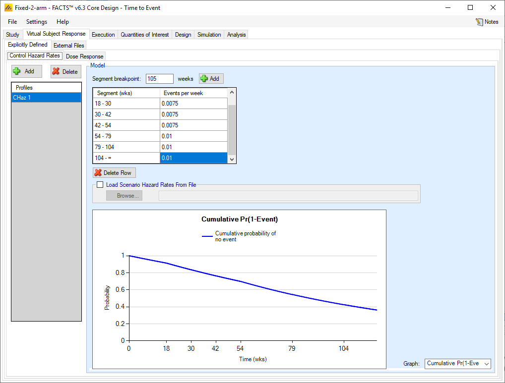

### Dose Response

Dose response is defined as the overall hazard ratio for each dose relative to control. (For more complex dose response models, you may wish to generate the data for a patient population externally and load it as a file). In this trial there is only one study dose, thus the response scenarios are defined by a single number.

Four different possible dose response scenarios will be simulated, where the hazard ratio is 1 (the 'null case'), 0.9, 0.8 and 0.7 respectively. These are scenarios that represent a drug that is no different from the current standard of care, a weak performing drug, a good drug and an excellent drug.

Create 4 scenarios:

- Null: where the hazard ratio is 1

- Weak: where the hazard ratio is 0.9

- Good: where the hazard ratio is 0.8

- Excellent: where the hazard ratio is 0.7

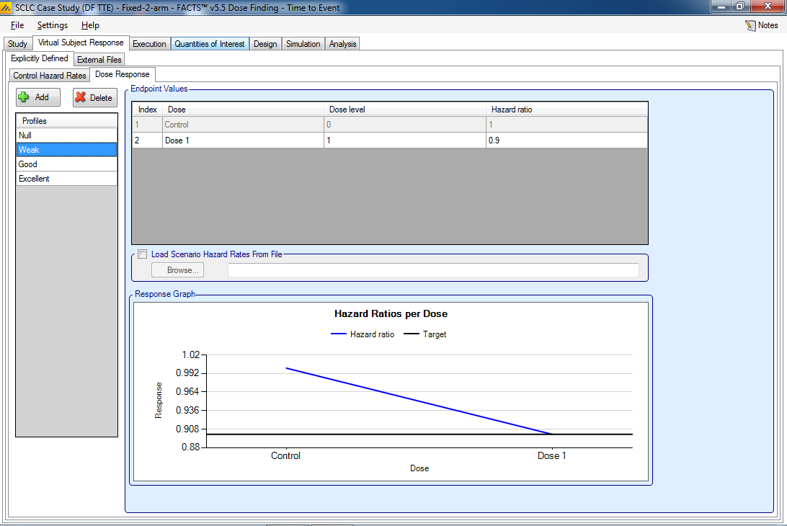

## Execution

### Accrual

Add an accrual scenario by clicking the Add button on the far left, then add 1 region by clicking the Add button above the table. Set the peak accrual rate to 6.5 subjects per week, to give an overall recruitment period of \~3 years.

The names of the accrual profile and the region may be renamed by double-clicking on them.

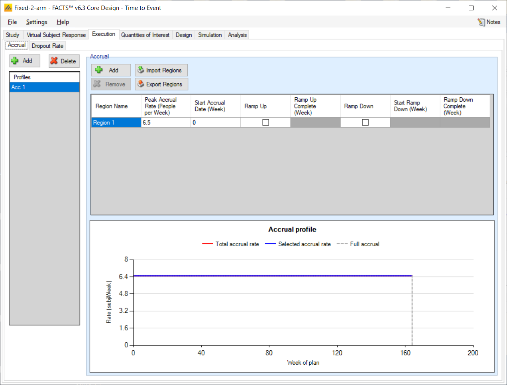

### Dropout Rate

No results are expected to be missing at random, select "No Dropouts".

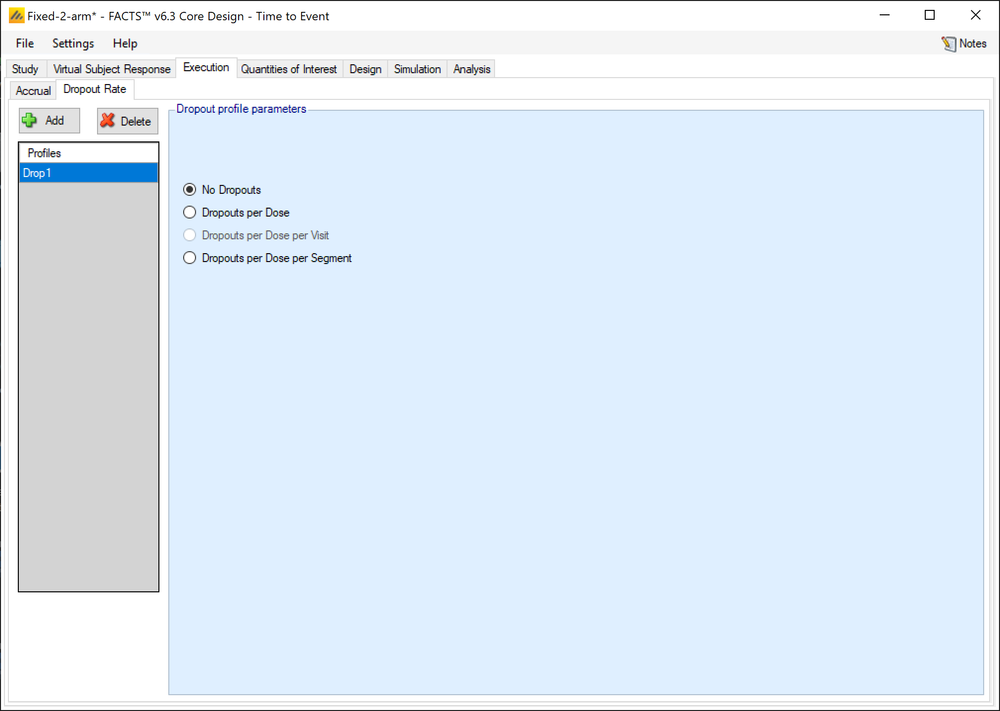

## Quantities of Interest 

The Quantities of Interest (QOIs) are criteria on which decisions, interim or final analyses, will be made. Numerous QOIs are available and you may select multiple quantities for evaluation. A basic set of QOIs is provided by default. Additional QOIs may be added by clicking the Add row in the table. A QOI can be removed by clicking the X on the right side of the cell. Each QOI may be edited by clicking on it, which opens a pop-up box.

The trial will be judged a success if at the end of the trial:

- The study arm has a posterior probability of at least 60% that the hazard ratio compared to Control is less than 0.9 (this 60% threshold was established by simulation to limit the proportion of successes when simulating the null case to \< 0.05).

Otherwise the trial will be judged to be futile.

Set the following parameters:

- At the bottom of the page, set the Clinically significant hazard ratio delta (CSHRD): 0.1 (i.e. hazard ratio 0.9 or less)

- For Posterior Probabilities:

  - Pr(HR_d-1\<-0.1) is already added.

  - Make sure Condition: \<

  - Select Delta -0.1

  - The above should have been automatically filled in because we already specified the CSHRD

- We are not interested in any Predictive Probabilities, so we delete these options to reduce output. However, it is acceptable to have them calculated even if it is not part of the design.

- For Probability of being Target, we keep Target Type: Max. Although, specifying a target is not necessary because there is only one dose and a control.

- For Decision Quantities (Scalars):

  - QOI: Pr(HR_d-1\<-0.1)

  - Evaluation Dose: Dose 1

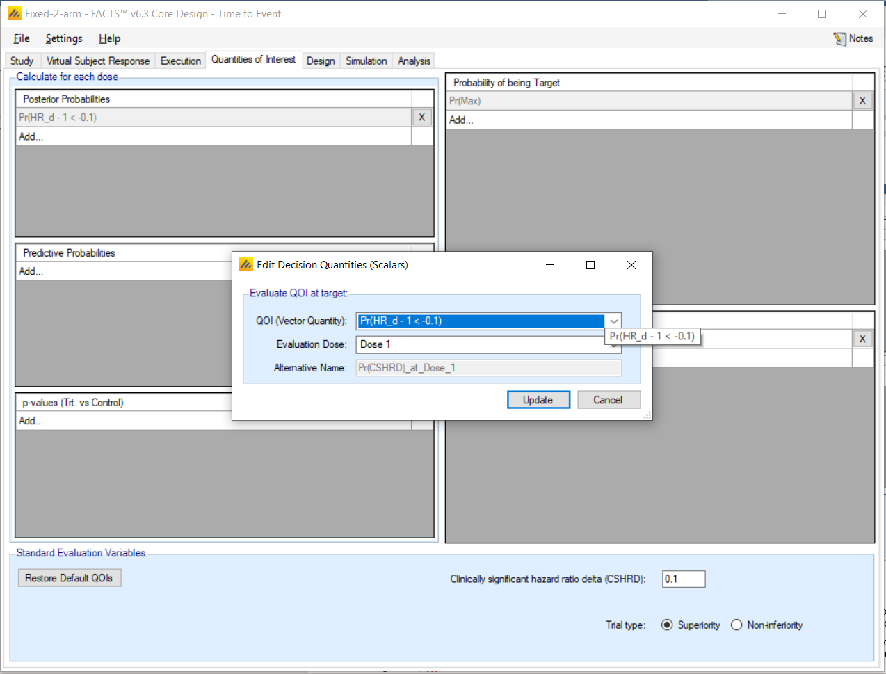

## Design

The statistical model must specify priors for the control hazard rate, and the hazard ratio. The hazard rate is expected to vary over time: from 0.005 per week during treatment, to 0.0075 for the rest of the first year, and then 0.01 for the second year.

For a time-to-event endpoint we model event rates over a set of segments s є {1, \..., S}. The hazard rate of the control arm in each segment is λ~s~. For the treatment arm a proportional hazards model is assumed. The model hazard rate for dose d, and segment s, h~sd~. is:

$$h_{sd} = \lambda_s e^{\theta_d},$$

So θ~d~ is the log hazard ratio:

$$\theta_d = \log\left(h_{sd} / \lambda_s\right)$$

where *d* is the dose and *θ*~0~=0. The prior distribution for the control arm hazard rate in segment *s*, λ~s~ is

$$\lambda_s \sim \text{Gamma}\left(\lambda_n, \lambda_n \lambda_\mu\right)$$

where λ~μ~ is the prior mean of λ, and λ~n~ is a subject equivalent weight. As there is only one study arm, the log hazard ratio of the treatment arm is simply modeled as independent and normally distributed with a prior of:

$$\theta_d \sim N\left(\mu_{0d}, \nu_{0d}^2\right)$$

### Hazard Model

This tab captures the prior distribution for the control hazard rate. Set the following parameters:

- Select Hazard Model: Use piecewise exponential model

- Create the same segment breakpoints as for the control hazard rate: 18, 30, 42, 54 and 79 weeks. Note: it is not required for the same segments to be used for the model and for data generation.

- Presuming there is a lot of useful data on hazard rates for SCLC, we set priors that mirror the simulated hazard rate from the Virtual Subject Response tab, and give them a prior weight of 10 (equivalent to observing 10 events over the appropriate exposure period -- i.e. equivalent to 1-2,000 weeks of data).

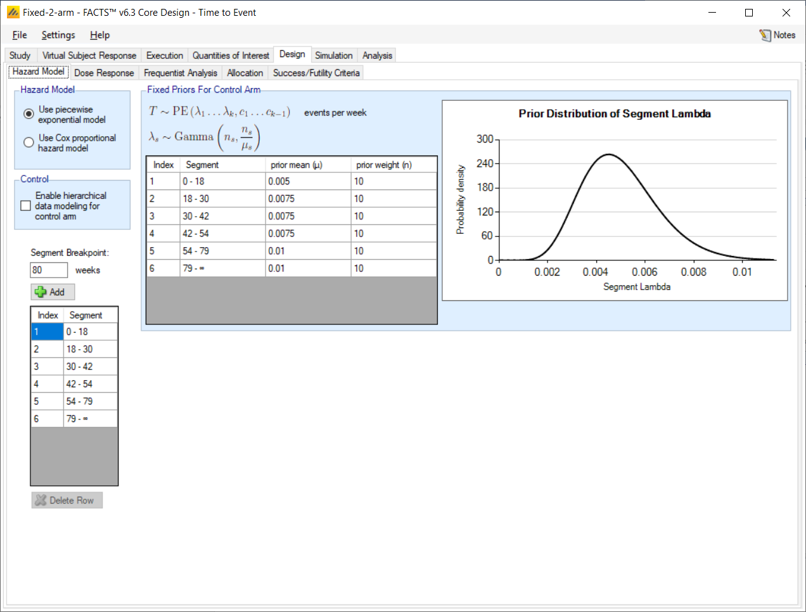

### Dose Response

This tab captures the prior distribution on the log hazard ratio. Set the following parameters:

- Select: Independent Dose Mode, no model (i.e. pair-wise comparison)

- For the prior distributions for the normal distribution of the log-hazard ratio use a mean of 0 and Std Dev of 5. This is a weak prior. Too small a Std Dev will tend to affect the estimate of the hazard rate, it is difficult to judge 'too small' by analysis, but easy to see it in simulations where other effects (response modeling, early stopping, adaptive allocation) are disabled.

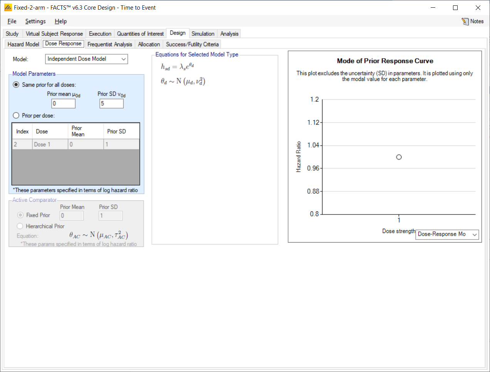

### Frequentist Analysis

Change the required alpha for the frequentist analysis to 0.05 one-sided and leave "Output frequentist files" checked. The results of these frequentist tests will be monitored in the output files, but are not used for decision-making in the simulations.

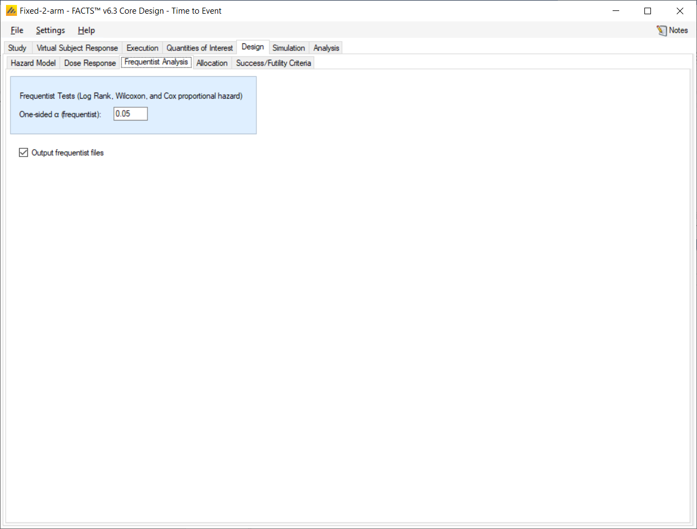

### Allocation

Because we selected Non-Adaptive on the Study Info screen, only fixed allocation is available. This initial design will use a fixed allocation of 1:1.

Set the following parameters:

- Set the allocation ratio as 1:1 for Control, and the study arm.

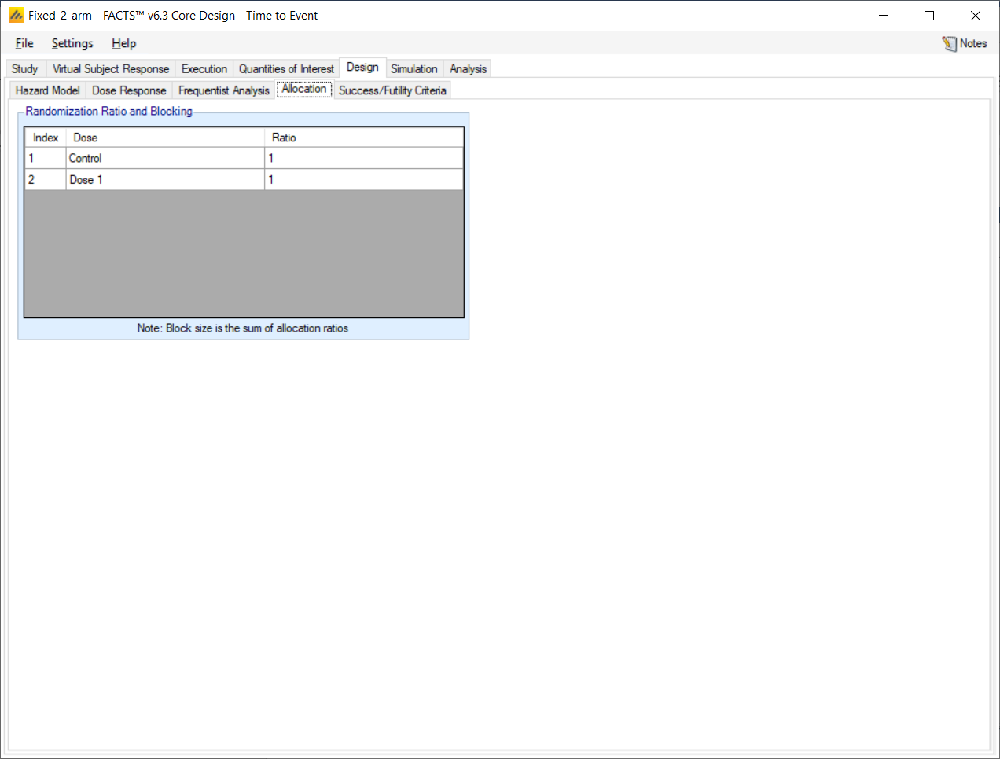

### Success/Futility Criteria

The trial will be judged a success if at the end of the trial:

- the study arm has a posterior probability of at least 60% that the hazard ratio compared to Control is less than 0.9, (this threshold was established by simulation to limit the proportion of successes when simulating the null case to \< 0.05).

Otherwise the trial will be judged to be futile.

Set the following parameters

- Futility Evaluation:

  - QOI: Pr(HR_d-1\<-0.1); d=Dose 1

  - Condition: \<

  - Threshold: 0.60

- Success Evaluation:

  - QOI: Pr(HR_d-1\<-0.1); d=Dose 1

  - Condition: \>

  - Threshold: 0.60

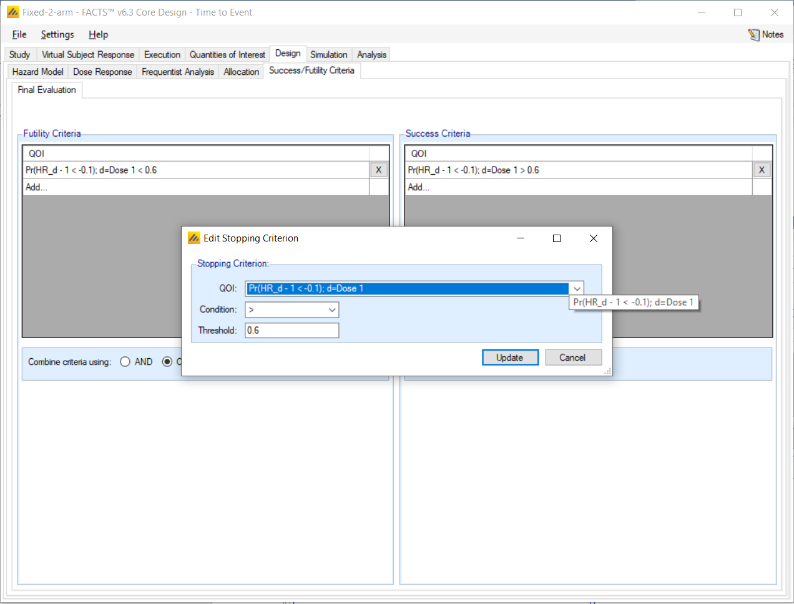

## Simulation

In order to get an initial check on the design set up, set the number of simulations to run to 10, then press Simulate. This allows us to make a quick assessment of whether the design is behaving as expected: that the Null scenario ends up mainly futile and the Excellent scenario mainly successful.

If the results look reasonable, increase the number of simulations to run to 1000, (re-check all the scenario combinations) and then press Simulate again. This is a design that is very fast to simulate, even running 10,000 simulations for each scenario takes less than an hour on a laptop. If you have access to a computer grid, and your FACTS installation has been correctly configured to use it, you may use the grid's parallel computing capabilities to improve computation speed. To do so, select "on Grid."

## Results

Looking at the operating characteristics for each scenario:

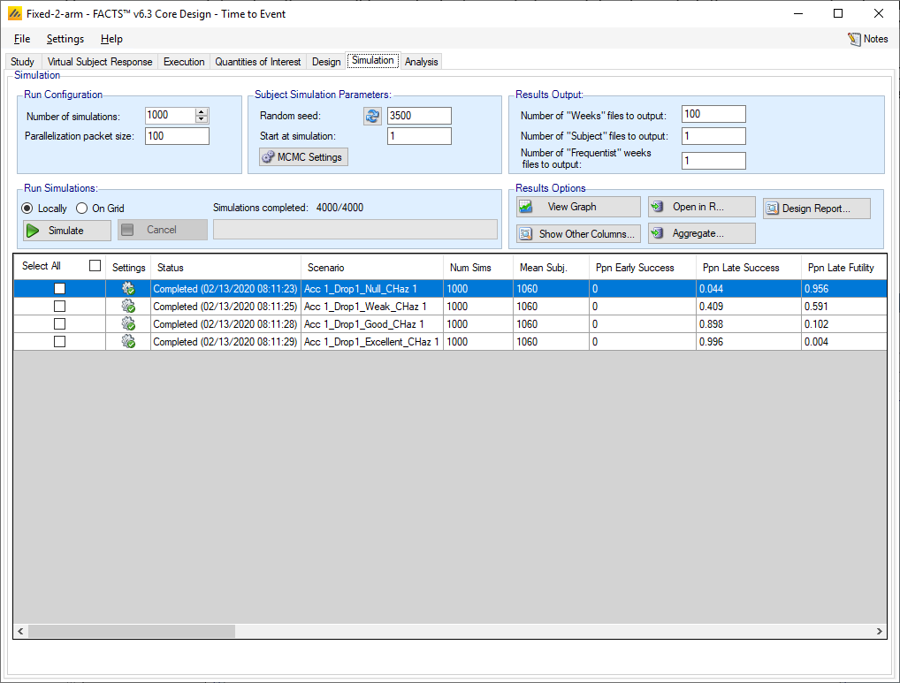

The probabilities of success and futility are as we require: a false positive rate of 0.05 or less on the null scenario, a power of \> 80% for the good scenario and a power of 40% on the 'weak' scenario where the simulated hazard ratio is exactly the Clinically Significant Hazard Ration (CSHR) and our success criteria are a 60% posterior probability that we achieved it.

Compare these results to the frequentist results (click on "Show Other Columns" and select "Frequentist Results"). The Bayesian analysis gives a little more power -- e.g. for the 'good' scenario, where power of the above design is 90%, the proportion of simulations significant by most of the frequentist measures (Log-Rank test, Wilcox, Hazard Ratio) is 86%. For the other scenarios too (except the Null) the power of the Bayesian analysis is somewhat greater (probably because it does not assume a constant hazard rate, and in this example, we have simulated an increasing hazard rate over time).

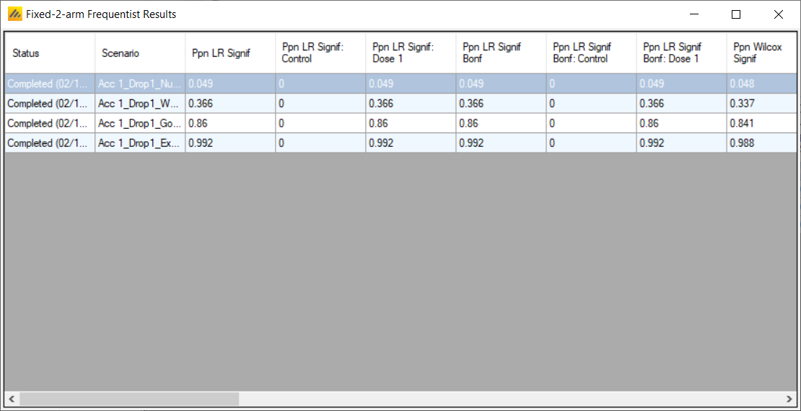

#  Adaptive Design: Early Stopping

We now will add interim analyses to the fixed design with the possibility of early stopping. We will create the early stopping design in two steps, first we will simulate with interims and investigate the values of the Quantity of Interest over time and then second simulate with the early stopping criteria and thresholds specified.

To create the adaptive version of this design, open the fixed design and use the menu option File \> SaveAs and save a version of the design with a new name, for example "Interims-2-arm".

The steps below will go through the portions of the design to be changed. If a feature is not discussed it is assumed to remain the same as the fixed design.

## Study

### Study Info

We select the following options:

- Adaptive

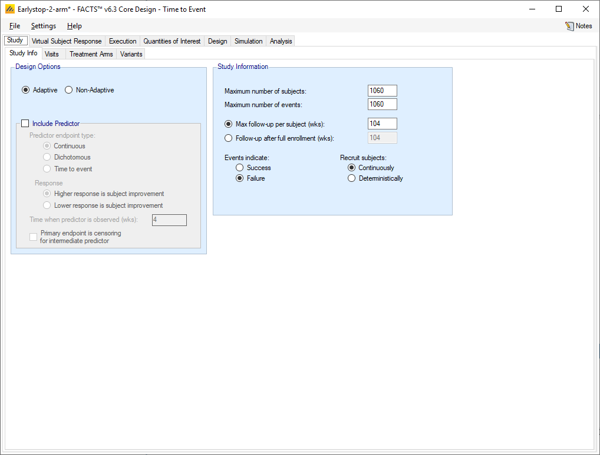

## Design

### Allocation

We will use fixed allocation but perform regular analysis in order to determine whether to stop the trial. To specify this:

- Select the "Fixed Allocation" option

- Specify 1:1 randomization

> 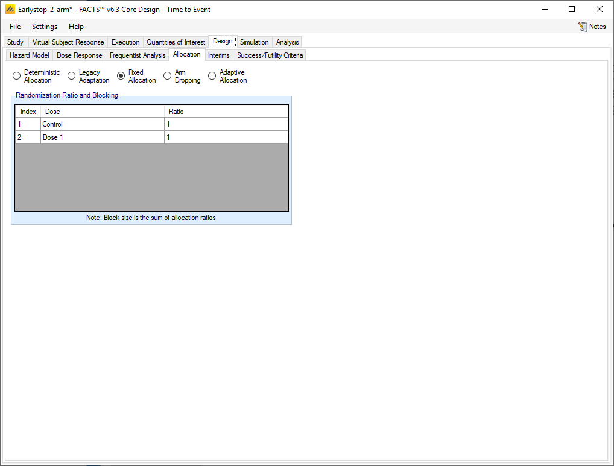

### Interims

Set the following parameters:

- Set Subject Information Defined By: Events

- Set Specify Interims By:

  - Time -- every 16 weeks (or very 4 months) -- given the length of accrual (\~ 3 years) and follow up (\~ 2 years)

  - First interim at 50 events.

- For Subject Follow-up Options un-check both Continue follow-up if study stopped for success and Continue follow-up if study stopped for futility, the trial can stop when we have sufficient events to determine success or futility (in practice further follow up could take place but we wish the simulations to report the time to decision via the reported "duration" quantity).

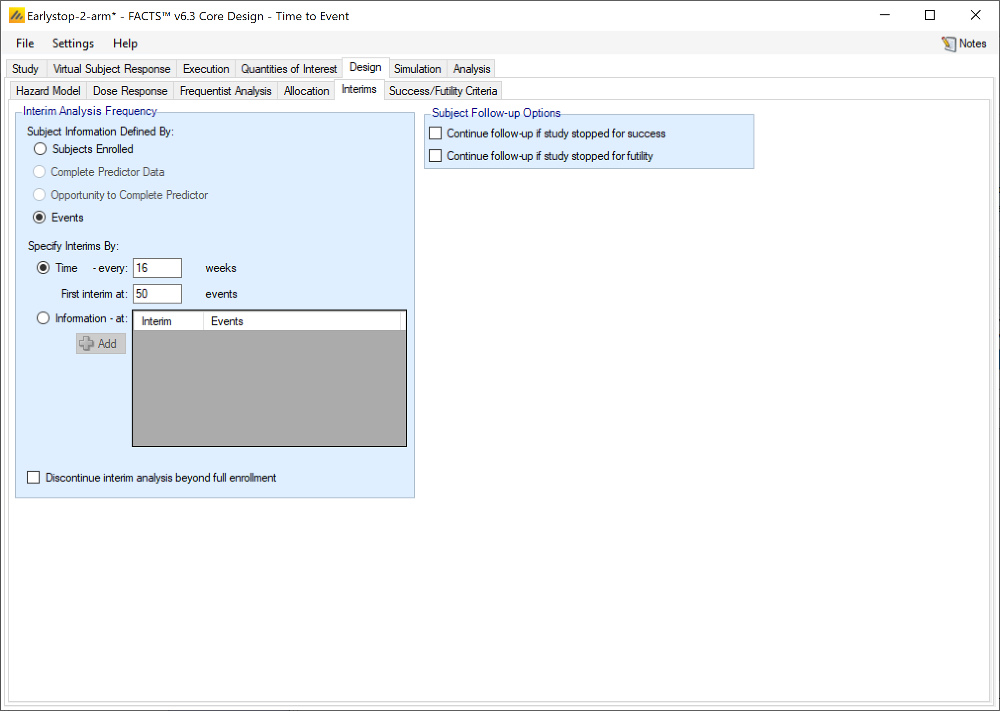

### Simulation

We now simulate the trial. Each simulation will run to the end and evaluate each interim, we will use these simulated values at the interims to set the early stopping thresholds. In order that that the values at each interim are written out for each simulation, we need to set the "Number of Weeks files to output" -- in this case to 1,000 to match the number of simulations we will run.

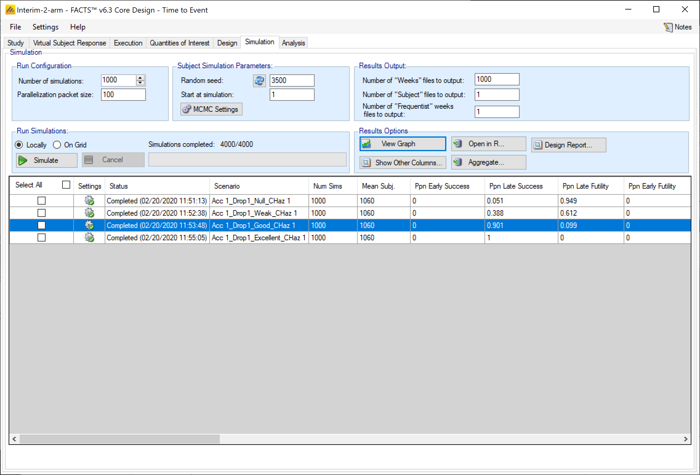

The number of Weeks files is 1,000.

There is no early stopping for success or futility as we have not yet specified stopping criteria & thresholds. In order to set these we will in this example, look to make decisions on the same criteria that we are using to make the final decision:

- Pr(HR_d-1\<-0.1); d=Dose 1

We wish to set success early stopping thresholds so there is minimal additional false positive results in the "Null" scenario, and minimal additional false negative results in the "Good" scenario. We can get a good initial value to use (we may need to refine with a little trial and error) using the "Interim-2-arm" simulation results and the graphs "Explore: Early Success Criteria" from the "Null" scenario and "Explore: Early Futility Criteria" from the "Good" scenario.

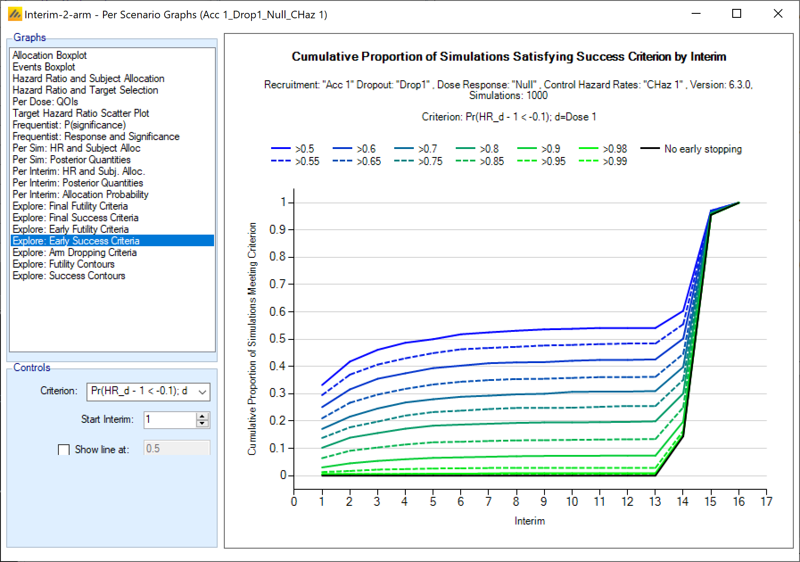

From the "Explore: Early Success Criteria" from the "Null" scenario we can see that a threshold of 0.98 will give a minimal (\< 1%) chance of the trial stopping early for success if there is in truth no treatment effect (HR=1). The solid bright green 0.98 line is just visible above the black "no early stopping" line.

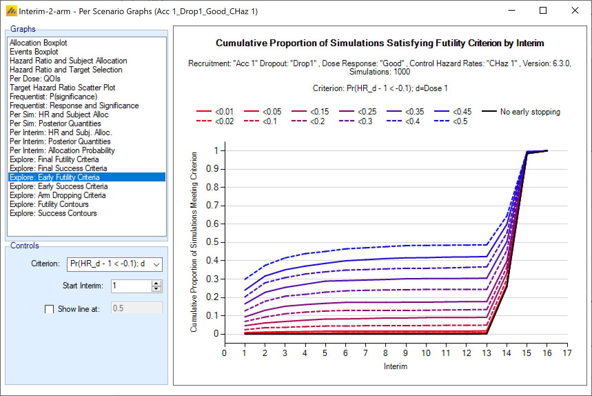

From the "Explore: Early Futility Criteria" from the "Good" scenario we can see that a threshold of 0.05 will give a minimal (\< 1%) chance of the trial stopping early for futility if there is in truth a good treatment effect (HR=0.8). The solid bright red 0.05 line is just visible above the black "no early stopping" line.

### Success/Futility Criteria

In order to decide whether to stop early, we will evaluate the same criteria used for the final analysis but use these much more conservative thresholds that we identified above. We will allow stopping for either success or futility. But early stopping will not be enabled until we have a desired amount of information. In this case we do not want to allow the trial to stop enrollment early until at least 50 total events have been observed, including 20 on the treatment arm.

### Interim 1 Criteria

On this tab we specify the interim analyses early stopping criteria. In this example we keep the same criteria across all interims. If we wanted to have different criteria for different interims, we would select Create new interim criteria at interim and specify the interim where criteria changes.

Set the following parameters:

- Select Futility Criteria

  - Add a QOI:

    - Select Pr(HR_d-1\<-0.1); d=Dose 1

    - Select a Condition of \<

    - Enter a threshold of 0.05

  <!-- -->

  - Specify Minimum number of Events before trial can stop for futility: 50 (note this is "belt and braces" we have already specified that the first interim is to occur at 50 events so this criteria should always be true)

  - Specify Pr(Max) as the evaluation dose, and that we require to have observed a minimum of 20 events on that arm before stopping.

- Select Success Criteria

  - Add a QOI:

    - Select Pr(HR_d-1\<-0.1); d=Dose 1

    - Select a Condition of \>

    - Enter a threshold of 0.98

  <!-- -->

  - Specify Minimum number of Events before trial can stop for success: 50 (again this is belt and braces)

  - Specify Pr(Max) as the evaluation dose, and that we require to have observed a minimum of 20 events on that arm before stopping.

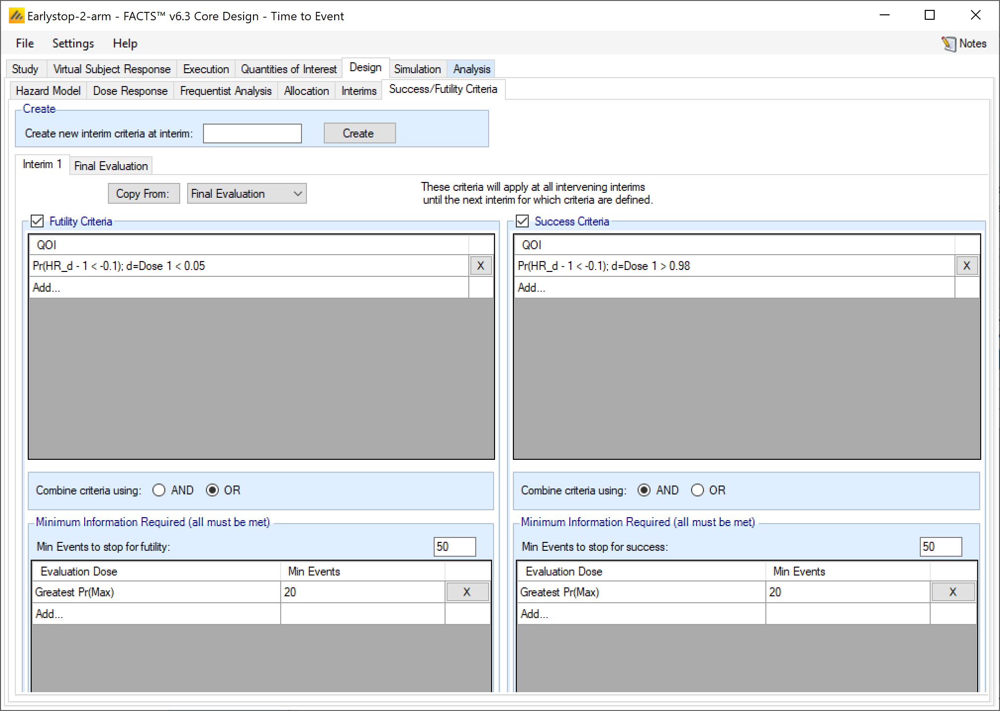

The Final Evaluation remains the same as the fixed design.

## Simulation

Running the simulation is the same as for the fixed design (we no longer require 1,000 weeks files).

Results can be compared between the designs in terms of

- Type 1 and type 2 errors: note that you will need to add together early success, late success, and futility to success flip flop for type 1 error in the Null scenario, and early futility, late futility, and success to futility flip flop for type 2 error in the other scenarios. The Type I error in this situation is 0.051 (0.006+0.045+0.0), which is greater than 0.05 but is within the simulation error, greater numbers of simulations will be required to see if a small increase in the final success threshold is necessary to keep the type-1 error below 0.05.[^2]

- The mean trial size ranges from 765-978, but we can't assume that the distribution of the expected trial sizes will be uniform. For instance a scatter plot of the trial sizes for the 'Good' scenario shows a small group simulations stopping early for futility, then a regular stream stopping for success from about 400 subject onwards, and of course a large spike at the study cap.

> 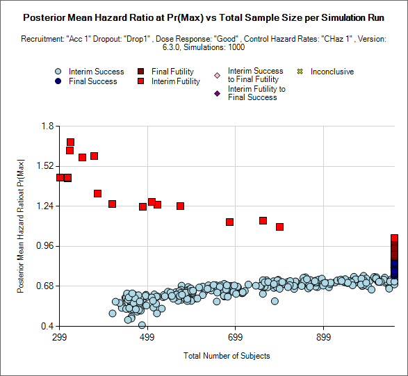

- In this design we do not need to check for the risk of a 'flip-flop' (a trial that stopped early contradicting its reason for stopping early in the final analysis after full follow-up) as we have unchecked the "follow-up after early stopping" options..

> 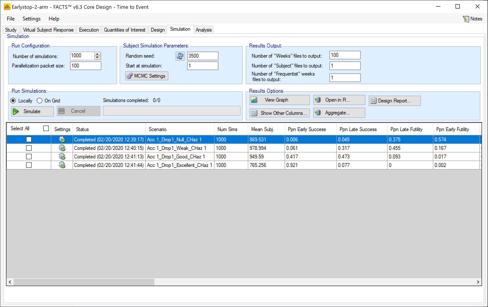

Note that whilst still controlling the type-1 error (0.006+0.045=0.051), and without loss of power in the 'Good' (0.417+0.473=0.890) and 'Excellent' scenarios (0.921+0.077=0.998), there is the possibility of significant savings in time and cost -- with fewer subjects being required on average and a 57% chance of stopping early in the Null scenario and 42% chance of stopping early in the 'Good' scenario and 92% chance of stopping early in the 'Excellent' scenario.

This results in a reduction in expected mean sample size from 1060 to 870 in the Null, 950 in the Good and 770 in the Excellent scenarios, and reduction in expected mean duration from 267 weeks to 183 weeks (Null), 210 weeks (Good) and 130 weeks (Excellent). Note that as many of the interims will occur during the 104 week follow up after the last subject has been recruited some early stopping will only save time and not sample size.

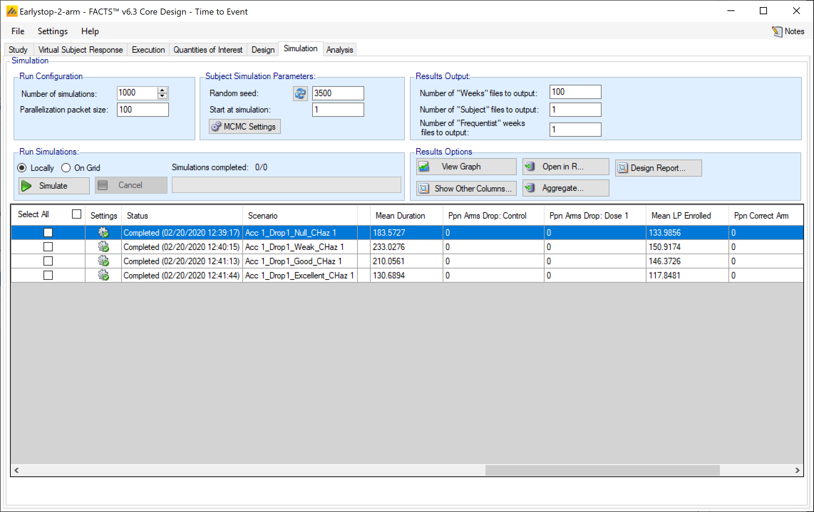

[^1]:  It is not strictly necessary to specify the 104 week segment, we could simply specify the hazard rate from 79 weeks to infinity, but including the 104 week breakpoint forces the graph to display out until 104 weeks. Similarly, we could collapse the segments 18-54, and 54-infinity.

[^2]:  Running 10,000 simulations of the Null scenario the proportion of successful outcomes (type-1 errors) fell to 0.054.
