#  Introduction

This tutorial describes an example trial design for treatment of traumatic brain injury (TBI) using the FACTS Core Design Engine for a Dichotomous Endpoint, using a 2-dimensional NDLM model for a Phase II dose-finding trial.

For this version of the document, the screenshots are from the 6.3 release of FACTS.

The screenshots provided are approximate and may not reflect the exact layout of the information. The contents of each tab, however, will be consistent with the software.

The design is based on Gajewski et al.[^1]^1^, modified to incorporate the 2-D aspect of the dose space. The designs presented are intended purely as examples, should not be considered as critique of the original design, and are not intended to be optimally calibrated.

# Design Features

The primary goal of this tutorial is to introduce the use of 2-D dose specification and examine the models available for 2-D dose response.

In this tutorial we create the following designs:

- Design 1: Example file "Two Dimensional Dosing TBI ContFactorial.facts"

  - Uses the Continuous Factorial model.

- Design 2: Example file "Two Dimensional Dosing TBI DiscFactorial.facts"

  - Uses the Dichotomous Factorial model.

- Design 3: Example file "Two Dimensional Dosing TBI 2DNDLM.facts"

  - Uses the 2-D NDLM model.

- Design 4: Example file "Two Dimensional Dosing TBI HierLogistic.facts"

  - Uses the one-dimensional Hierarchical Logistic model.

All four files have the same broad design. The only differences between the files are the dose response models selected on the Design -\> Dose Response tab, with the success/futility criteria adjusted to calibrate Type I error.

# Case Study: Traumatic Brain Injury (TBI)

The endpoint is a dichotomized assessment of improvement, based on severity-adjusted GOS-E score at 26 weeks.

The study treatment has two factors that can be adjusted: hyperbaric oxygen at one of four atmospheric pressures (1.0, 1.5, 2.0, and 2.5 atmospheres absolute \[ATA\]), with or without the addition of 100% normobaric oxygen (NBH). The ATA=1.0 arm with no addition of NBH is the control arm for the study.

The aim of the Phase II study is to find the optimal treatment arm in preparation for a Phase III study with larger sample size. The Phase III study will only be run if there is sufficient evidence of potential success, defined for the best arm (the arm that has greatest posterior probability of being the best dose Pr(Max)) by:

- At least P% posterior probability the best treatment arm is more effective than the control arm;

- and at least 50% predictive probability that a 1:1 randomized Phase III trial with n=500 per arm will be successful.

The value of P will change according to the modeling choices in order to achieve approximately 10% type I error. The choice of dose response model will affect these posterior probabilities, as well as the selection of the best arm.

# Base Design

Start FACTS. Double Click: Core Design: Dichotomous on the opening screen:

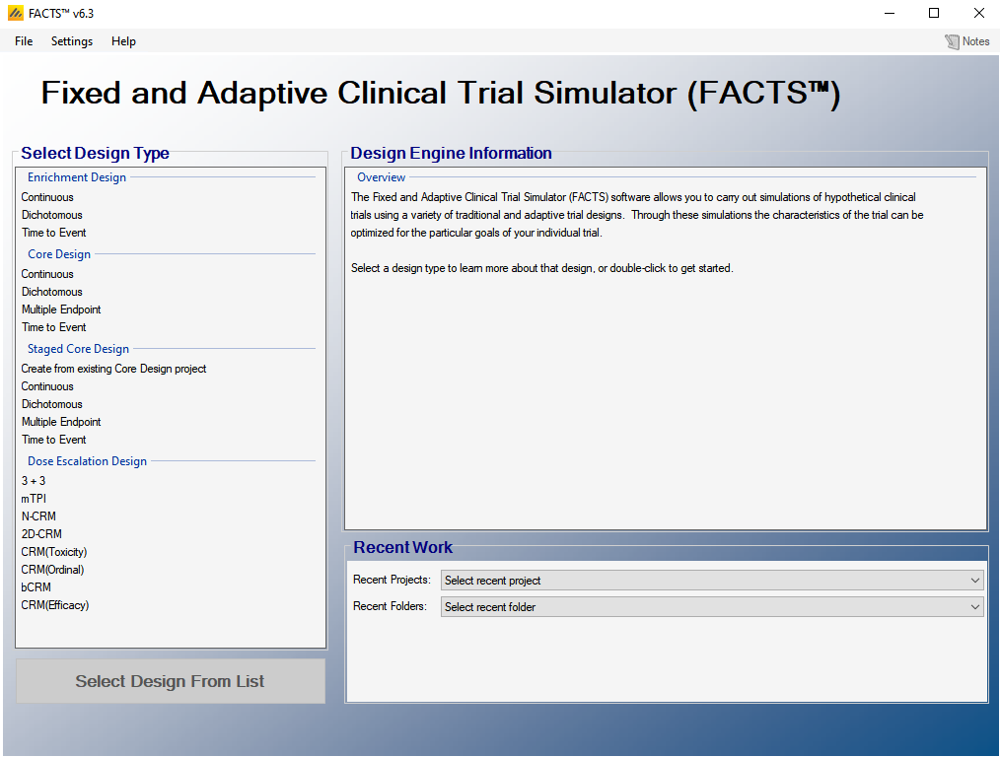

Using the menu option File \> Save As, save this design as TBI-ContFactorial in a convenient location (e.g. in a folder called FACTS\\TBI-example in your 'My Documents' folder).

We will set up the overall design in this version, then save different versions with various dose response modeling options.

## Study

### Study Info

The Study tab captures basic information about the trial. Set the following parameters:

- Select the Non-adaptive option: since this tutorial is focused on the modeling options, adaptive features will not be used.

- Clear the "Use longitudinal model" check box. No intermediate outcomes are observed for patients.

- Set the time to final endpoint to 26 weeks.

- Set the accrual to "Continuously."

- Set the maximum number of subjects to 200.

- Select "Response indicates positive outcome."

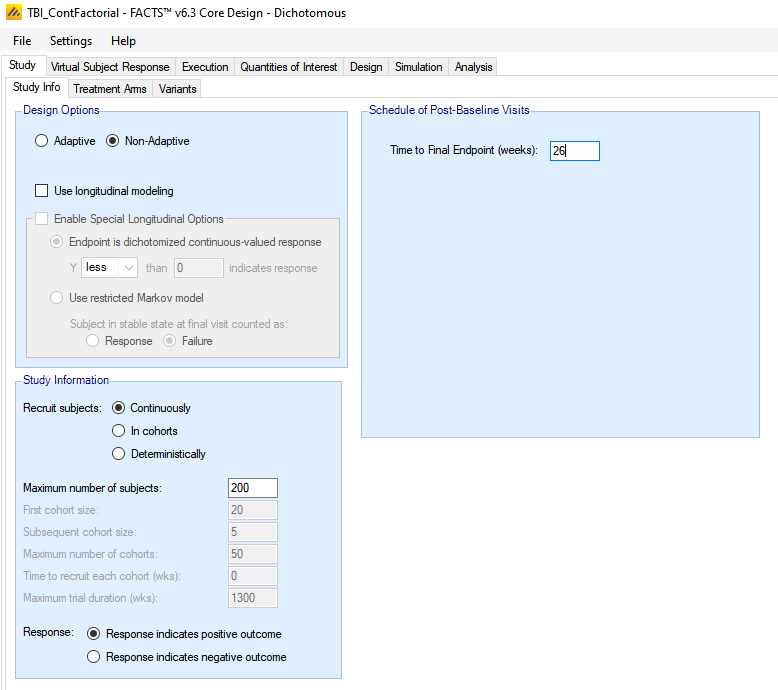

### Treatment Arms

Set the following parameters:

- Select the box "Include a control treatment arm."

- Select the box "Use 2D treatment arm model." This selection adds two panels to the screen to allow the set up of dosing according to two factors. Only when this selection is chosen will the 2D dose response model options be available.

- Add 3 column factor levels with effective column strengths of 0.5, 1, and 1.5 to represent the atmospheric pressure options. Note that the Control is already chosen with an effective strength of 0, though it corresponds to an ATA of 1.0. Thus, we are selecting effective column strengths based on the ATA difference from control.

  - Change the column names to "Ctrl (ATA 1.0)," "ATA 1.5," "ATA 2.0," and "ATA 2.5."

- Add 2 row factor levels with effective row strengths of 0 and 1, to represent the without and with NBH options

  - Change the row names to "No NBH" and "With NBH."

At this point, the screen should look like the following. Look at the right panel of the screen, labeled "Dose Combinations." All combinations of column and row factors are listed in the left column of that panel.

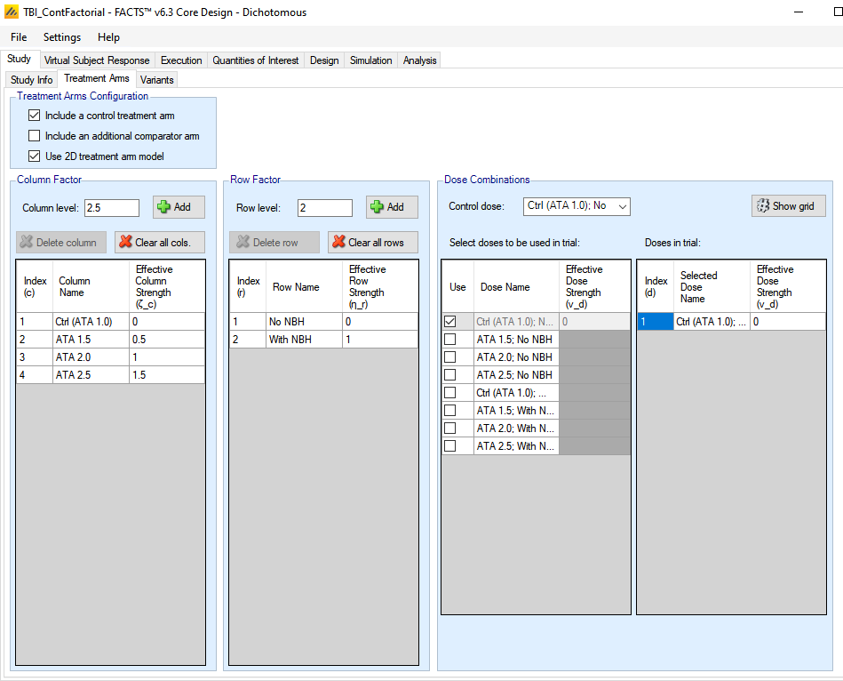

- One by one, click the "Use" box next to each dose combination in the left column of the Dose Combinations panel. After use click on Use for the dose combination, the Effective Dose Strength column becomes visible. Edit the effective dose strengths so that: **Ctl (ATA 1.0); No NBH** = 0, **ATA 1.5; No NBH** = 2.6, **ATA 2.0; No NBH** = 4.17, **ATA 2.5; No NBH** = 5.92, **Ctl (ATA 1.0); With NBH** = 5.4, **ATA 1.5; With NBH** = 6.4, **ATA 2.0; With NBH** =7.76, and **ATA 2.5; With NBH** = 9.52.

- Note: since the "Include a control arm" is selected at the top of this tab, the treatment arm with an effective column strength of 0 and the lowest allowed value for the column strength is considered the control arm. In this case, that is the **Ctl (ATA 1.0); No NBH** arm.

- Note: after the effective dose strengths are entered. The right column of the Dose Combinations panel shows the ordering of the doses that are used in the trial (not all column and row factor combinations need be selected), ordered according to the effective dose strength. Graphs will be plotted with this ordering for the doses, and quantities of interest that depend on order (i.e., MED and EDq) utilize this ordering.

- Note: when a dose combination is selected for use, its default effective dose strength is the sum of the effective column strength for the column factor and effective row strength for the row factor. These are intended only as starting values and should be edited to match the expected combination strength. Ties in effective dose strength are not allowed, so each combination must be given a unique strength value.

The Study \> Treatment Arms tab should now look like the following:

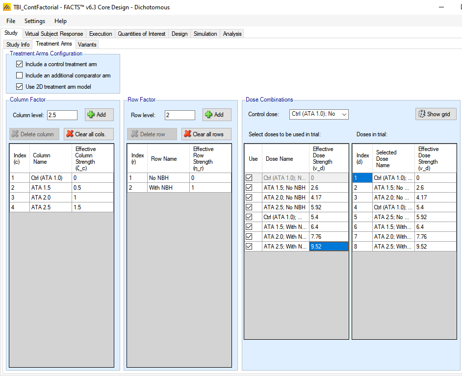

## Virtual Subject Response -- Explicitly Defined

### Dose Response

The Virtual Subject Response (VSR) tab describes how subject-level data will be generated for the simulations. Add six response scenarios by clicking the Add button. For each scenario, set the underlying response rate for each treatment from the corresponding row in the following table. *Note that the columns are listed in the order that they will appear on the FACTS VSR screen -- according to effective dose strength (rather than column-row order)*.

- Add the following 6 profiles:

+:---------:+:----------------------:+:---------------:+:---------------:+:------------------------:+:---------------:+:-----------------:+:-----------------:+:-----------------:+
|           | Treatment Arm                                                                                                                                                       |
+-----------+------------------------+-----------------+-----------------+--------------------------+-----------------+-------------------+-------------------+-------------------+
|           | Ctrl (ATA 1.0); No NBH | ATA 1.5; No NBH | ATA 2.0; No NBH | Ctrl (ATA 1.0); With NBH | ATA 2.5; No NBH | ATA 1.5; With NBH | ATA 2.0; With NBH | ATA 2.5; With NBH |
+-----------+------------------------+-----------------+-----------------+--------------------------+-----------------+-------------------+-------------------+-------------------+
| Null      | 0.41                   | 0.41            | 0.41            | 0.41                     | 0.41            | 0.41              | 0.41              | 0.41              |
+-----------+------------------------+-----------------+-----------------+--------------------------+-----------------+-------------------+-------------------+-------------------+
| Large\    | 0.41                   | 0.348           | 0.435           | 0.478                    | 0.522           | [0.609]{.mark}    | [0.696]{.mark}    | [0.783]{.mark}    |
| Monotone  |                        |                 |                 |                          |                 |                   |                   |                   |
+-----------+------------------------+-----------------+-----------------+--------------------------+-----------------+-------------------+-------------------+-------------------+
| NBH Only  | 0.41                   | 0.348           | 0.348           | [0.783]{.mark}           | 0.348           | [0.783]{.mark}    | [0.783]{.mark}    | [0.783]{.mark}    |
+-----------+------------------------+-----------------+-----------------+--------------------------+-----------------+-------------------+-------------------+-------------------+
| Overdose  | 0.41                   | 0.348           | 0.435           | 0.522                    | [0.783]{.mark}  | 0.522             | 0.174             | 0.087             |
+-----------+------------------------+-----------------+-----------------+--------------------------+-----------------+-------------------+-------------------+-------------------+
| Cont.\    | 0.41                   | 0.484           | [0.559]{.mark}  | 0.534                    | [0.631]{.mark}  | [0.607]{.mark}    | [0.676]{.mark}    | [0.738]{.mark}    |
| Factorial |                        |                 |                 |                          |                 |                   |                   |                   |
+-----------+------------------------+-----------------+-----------------+--------------------------+-----------------+-------------------+-------------------+-------------------+
| Disc.\    | 0.41                   | 0.363           | [0.642]{.mark}  | 0.459                    | 0.534           | 0.534             | [0.783]{.mark}    | [0.698]{.mark}    |
| Factorial |                        |                 |                 |                          |                 |                   |                   |                   |
+-----------+------------------------+-----------------+-----------------+--------------------------+-----------------+-------------------+-------------------+-------------------+

The Profiles can be named by double clicking on the default name, e.g. "Response 1" and renaming. A wide range of profiles should be chosen so that you can examine the strengths and weakness of a design.

For the purposes of this tutorial, we checked "Should succeed" for any treatment arm where the response rate was greater than 0.5 (highlighted in yellow), to reflect a dose with \>99% power in a subsequent 1:1 Phase III trial with n=500/arm. This selection tells FACTS how to report statistics on how often the desired doses are selected at the end of simulations. We need to define the target Quantity of Interest (QoI) to use to select the target dose on the Study \> Variants tab, but in general, we need to set up the QoIs first. In this tutorial, the default QoI of Pr(Max) is the appropriate dose selection.

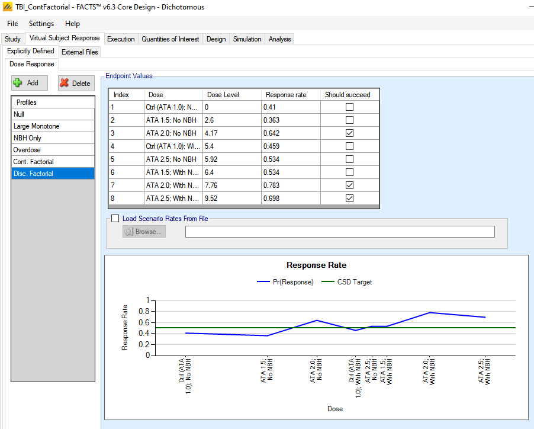

## External Files

There are no externally generated data for this example.

## Execution

### Accrual

Since no adaptive features are being used, accrual rate only contributes to trial duration for the purposes of this tutorial. Add one profile with an average accrual of 10/week.

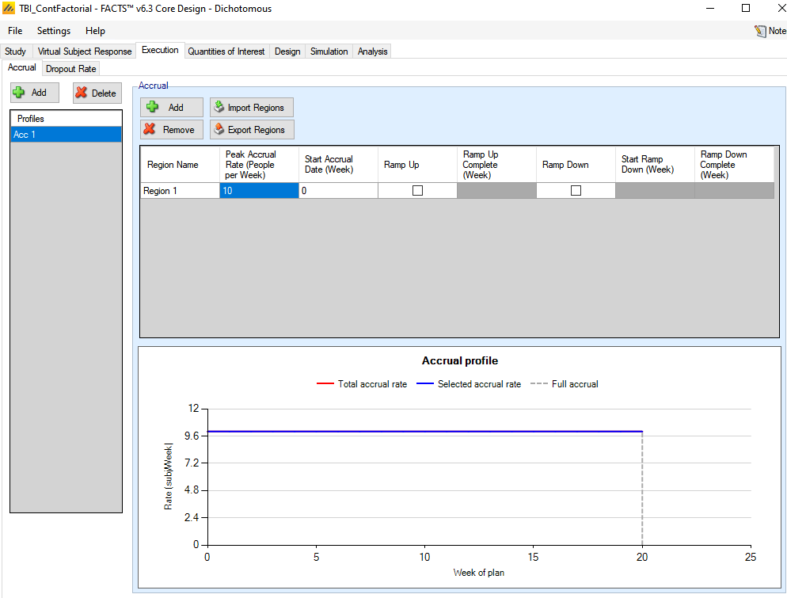

###  Dropout Rate

Select "No Dropouts".

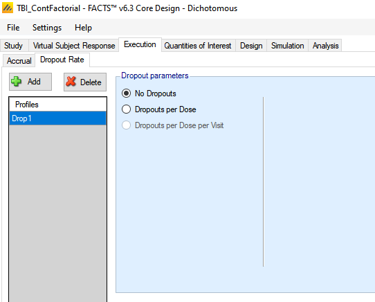

## Quantities of Interest

The Quantities of Interest (QOIs) are the criteria on which decisions, interim or final analyses, will be made. Numerous QOIs are available and you may select multiple quantities for evaluation. A basic set of QOIs is provided by default. Additional QOIs may be added by clicking the Add row in the table. A QOI can be removed by clicking the X on the right side of the cell. Each QOI may be edited by clicking on it, which opens a pop-up box.

The primary goal of this trial is to find the most effective treatment arm to carry to Phase III, and to trigger the initiation of the Phase III trial only with sufficient evidence to potential success.

The treatment arm that has the highest probability of being the maximally effective treatment arm, Pr(Max), is the arm at which potential Phase III success will be judged. Two decision QoIs based on that dose will be used to determine trial success:

1.  Pr(P_d \> P\_(Ctrl (ATA 1.0); No NBH))

2.  Pr(Succ. Future Trial; N=500; Sup. α=0.025; δ=0)

The former of these, the posterior probability of beating control, is available by default. There is a Pr(Succ. Future Trial) QoI set up by default as well, though it must be edited to match the Phase III sample size desired. Click on the Pr(Succ. Future Trial) predictive probability QoI. Set Phase to Future Trial, Test Type to Superiority, Subjects per Arm to 500, One-sided Alpha to 0.025, and Superiority Margin to 0.

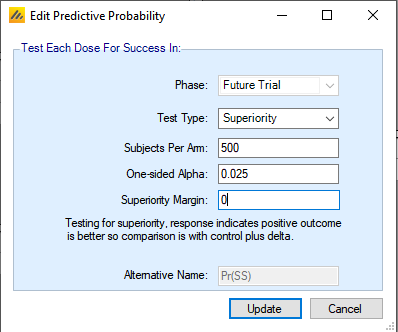

In this trial, there is no need to establish the notions of a minimally effective dose (MED) nor a treatment arm that's at least q% as good as the maximally effective dose (EDq). However, they will be explored briefly in this tutorial in order to demonstrate the effect of the 2D dosing structure on such quantities. Both of these quantities require an ordering to the dose strengths in order to be well-defined. The ordering used is the *effective dose strength* that is established in the Dose Combinations panel of the Study \> Treatment Arms tab. This trial also has no meaningful definition for a clinically significant difference, but for the sake of constructing an example, a value of 0.14 is used to match the "should succeed" criterion established with the VSR. Setting the CSD to 0.14 on the bottom of the QoI tab will automatically update the default MED QoI. Click on the Pr(EDq relative to Ctrl (ATA 1.0) QoI, and change the quantile to 0.8.

Two decision QoIs are needed. Click on "Add..." under the Decision Quantities (Scalars) panel to add one. First select the posterior probability of beating control QoI and evaluate it at the Greatest Pr(Max) dose. Then add a second decision QoI by selecting the predictive probability for a future trial and evaluating it at the Greatest Pr(Max) dose.

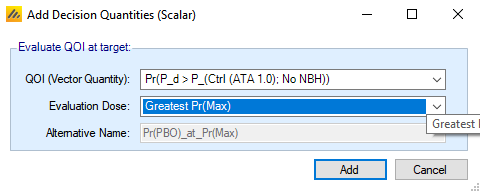 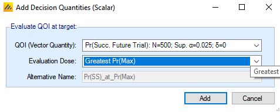

The finished QoI tab looks like this:

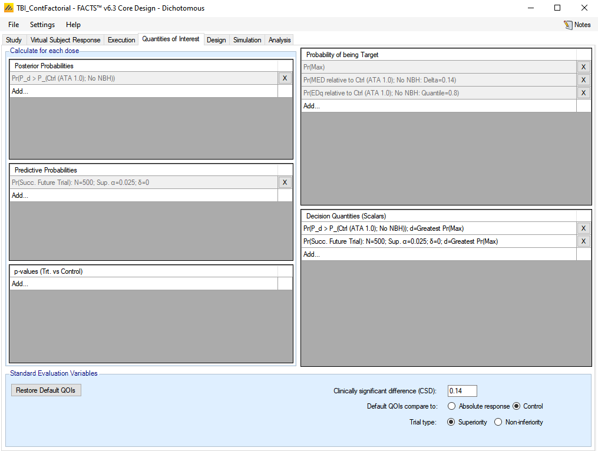

## Design

### Dose Response

For the first version of the design, we will use one of 2D dose response models -- the 2D Continuous Factorial model. This approach models the log-odds of response as an additive linear model, treating the column effective strength values as a continuous covariate and the row effective strength values as a continuous covariate. There is an option for an interaction term as well, but we will not use that option in this example.

We will need to assign prior distributions to the parameters of the dose response model. In practice, the construction of the priors should be assisted by subject matter experts. For purposes of this tutorial, relatively non-informative priors were used, with an attempt to match the spirit of the priors in the Gajewski paper. Since analysis will only be performed for a complete data set, the non-informative priors should have relatively minor effect on the final analysis, though expert-informed priors would likely perform better.

Select the '2D Continuous Factorial Model' option.

- Under Model Parameters, uncheck the box for "Include Interaction Term."

- For α~0~, enter a mean of -0.41 (which is the logit of a nominal response rate of 40%) and a SD of 1. This parameter corresponds to the dose response for an effective column strength of 0 and an effective row strength of 0, which for this example corresponds to the control treatment arm. However, in this trial, the control arm represents a natural environment with variability in natural conditions, so it will be modeled separately \[see below\].

- For α~1~ and α~2~, enter a mean of 0.0 with a standard deviation of 1. This represents an a priori assumption of no treatment effect, but with a moderate amount of uncertainty. A positive value of α~1~ corresponds to an increase in the response rate as the effective column strength increases. A positive value of α~2~ corresponds to an increase in the response rate as the effective row strength increases.

- Check the box "Model Control Separately." Select Fixed Prior and enter a mean of -0.41 and an SD of 0.75. This represents the a priori knowledge of the response rate for the control arm.

- The Handling of Missing Data Due to Dropouts selection will not matter, since no dropouts are being simulated.

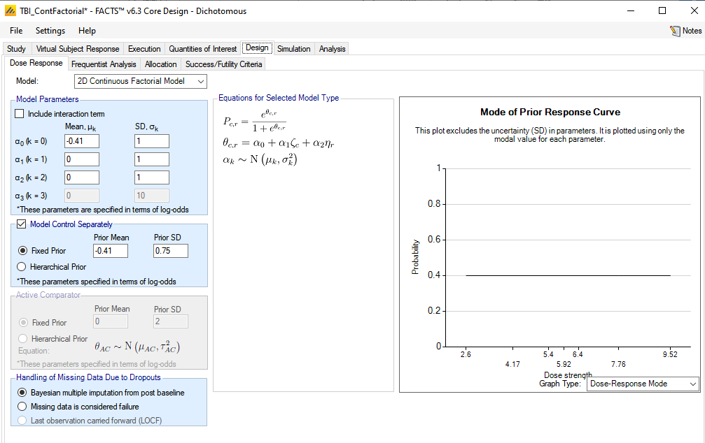

### Frequentist Analysis

We do not require a frequentist analysis, to save run-time we ensure that all the options for handling missingness are de-selected. In particular we ensure that the option to calculate Dunnetts adjusted p-values is de-selected (this has a particularly high runtime overhead and should only be selected if required).

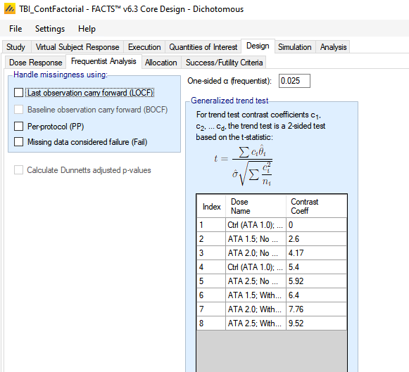

### Allocation

Set all the allocation ratio to 39 for the control arm (**Ctrl (ATA 1.0); No NBH**) and to 23 for the remaining treatment arms. The control arm thus has more information than any single treatment arm, though the treatment arms will share information through the dose response model.

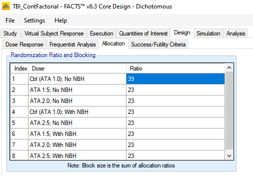

### Success/Futility Criteria

The success criteria will be defined by two criteria:

1.  the dose most likely to be max response has a greater than P posterior probability that its response is better than Control. The value of P will be adjusted separately for each dose response model considered, to give 10% type I error under the null hypothesis. For the 2D Continuous Factorial model P=0.955.

2.  and the dose most likely to be max response has a greater than 0.5 predictive probability of winning a future Phase III trial with N=500.

Set the following parameters for Success Criteria:

1^st^ Criterion

- Select the QOI: Pr(θ_d - θ\_(Ctrl (Ata 1.0); No NBH)); d=Greatest Pr(Max)

- Select a Condition of \>

- Enter a threshold of 0.955

2^nd^ Criterion

- Select the QOI: Pr(Succ. Future Trial): N=500; Sup. α=0.025; δ=0; d=Greatest Pr(Max)

- Select a Condition of \>

- Enter a threshold of 0.5

Select: Combine criteria using: AND

We will define the futility criteria as the exact complement of these. Set the following parameters for Failure Criteria:

1^st^ Criterion

- Select the QOI: Pr(θ_d - θ\_(Ctrl (Ata 1.0); No NBH)); d=Greatest Pr(Max)

- Select a Condition of \<

- Enter a threshold of 0.955

2^nd^ Criterion

- Select the QOI: Pr(Succ. Future Trial): N=500; Sup. α=0.025; δ=0; d=Greatest Pr(Max)

- Select a Condition of \<

- Enter a threshold of 0.5

Select: Combine criteria using: OR

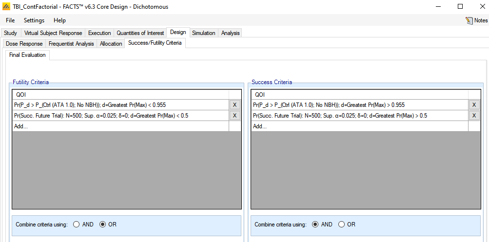

## Setting the dose selection criteria

As we have indicated on the Virtual Subject Response profiles which doses "should succeed", FACTs will summarize for us how often one of these doses is actually selected. In order to do this correctly, we need to indicate to FACTS which Target QoI we will be using to select the dose to go forward. Here it is the Pr(Max) \[which is FACTS default\]. This is specified on the Study \> Variants tab (even though we are not defining any variants).

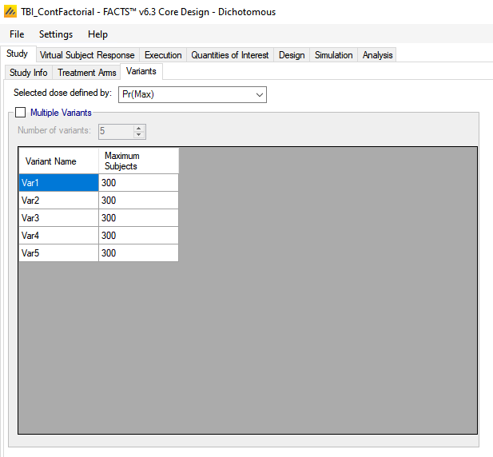

## Simulation

To get an initial check on the design set up, set the number of simulations to run to 100, Select All, the press Simulate.

If the results look reasonable, increase the number of simulations to run to 1000. Select All and then press Simulate again.

To achieve more precise estimates of the operating characteristics, we may need to run 10,000 or more simulations of a scenario. By default, FACTS simulations run locally on your computer, which for this simple fixed design is likely to take a few seconds to run 1000 simulations. If you have access to a computer grid and your FACTS installation has been correctly configured to use it, you may use the grid's parallel computing capabilities to improve computation speed. To do so, select "on Grid."

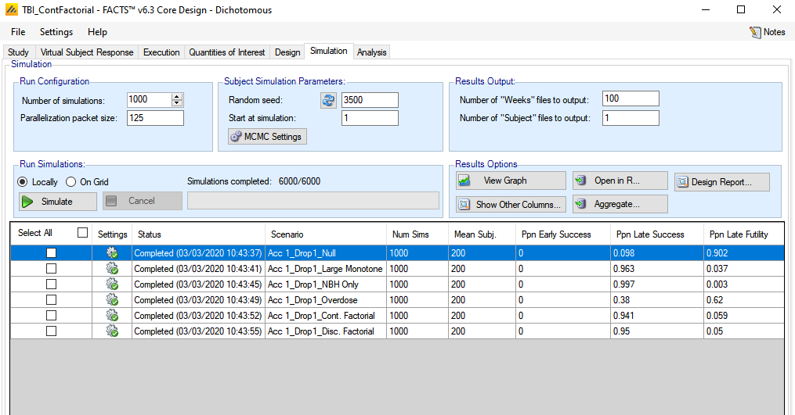

### Results

The success/futility thresholds were adjusted to provide a type-1 error of approximately 10%, which can be seen from the Ppn Late Success column for the Null scenario. The power is high (\>90%) for all scenarios except one, the overdose scenario. However, declaration of success in a trial is only good if the selected dose was a good selection. To explore this, we will look at some graphs of model fits and dose selection. On the Simulations tab, click on View Graph and select the Show Across Scenario Graphs Option.

The first across scenario graph shows the dose selection for each scenario. Note that a lot of information is being displayed in this graph, and you may need to adjust to a full screen view to be able to see details. There may be insufficient room for all of the treatment arm labels to show across the x-axis. The treatment arms are ordered in the same order as presented on the Virtual Subject Response tab. The scenarios will have been re-ordered alphabetically by scenario name.

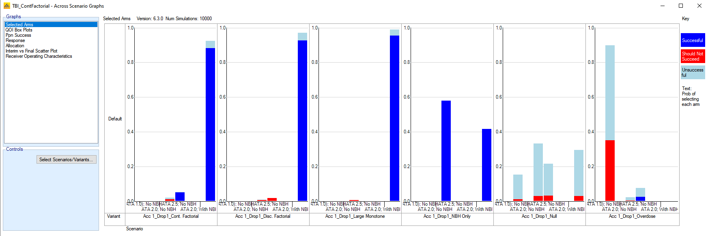

The blue bars in these plots indicate a successful trial that selected of a good treatment arm -- one that was listed as "Should Succeed" on the Virtual Subject Response tab. The red bars indicate a successful trial that selected a treatment arm that should not have succeeded. The light blue bars indicate the dose selection in unsuccessful trials.

For four of the scenarios, this design generally selected a good treatment arm. However, it is not always selecting the *best* treatment arm. Below is the same graph if we had defined "should succeed" as only the best arm rather than any arm with response rate \> 0.55.

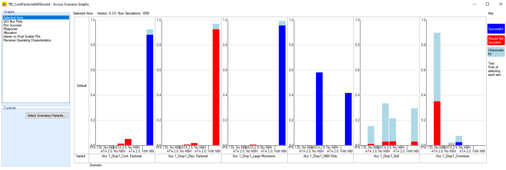

In particular, note that it never selects the correct arm for the Disc. Factorial setting. A careful examination shows that in fact the model only ever picks one of 4 treatment arms. This is due to the linearity assumption of the model. Since there is no interaction term in the model, the only doses that can be selected are doses that are on the corners of the 2D grid -- either the highest or lowest on column strength and row strength.

To see how well the model does on average for the various scenarios, select the Response graph.

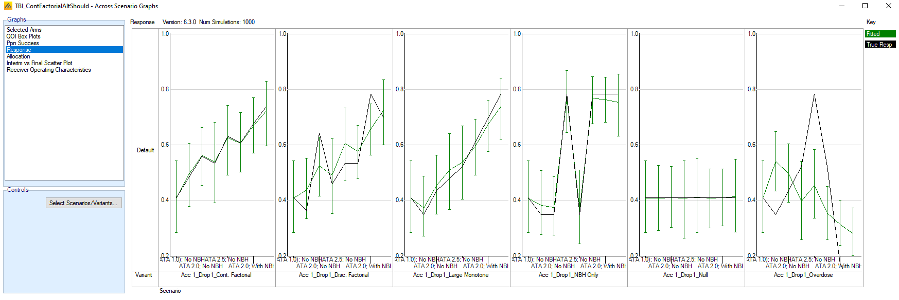

This graph overlays the mean fitted response from the model along with the true values for the scenarios. For the Cont. Factorial scenario and the Null scenario, the fits line up very well with the response, since the true values correspond to scenarios where the VSR truth corresponds exactly to the 2D continuous factorial model, for appropriately chosen parameters. There are two scenarios where no model parameters are good at approximating the true VSR -- the Disc. Factorial where the column strength (ATA) is not linear (nor monotonic) and the Overdose scenario which deviates greatly from the linearity/monotonicity assumption. For the Overdose scenario, the model tends to fit a negative value for both α~1~ and α~2~, due to the extremely poor response rate for the highest combination doses. As such, it tends to select the lowest dose: **ATA 1.5; No NBH** as the Pr(Max), when in truth that treatment arm has lower response than control. Over 30% of the time, the trial is being declared successful and selecting this arm. If this scenario is a realistic scenario, this may indicate a substantive problem with using this model for this design.

We can take a closer look at the Disc. Factorial scenario by selecting its row on the Simulations tab, then selecting View Graph \> Show Per Scenario Graphs. Click on the Response and Target Selection Graph. For the target of Pr(Max), we see a more detailed view of what was shown above in the across scenarios graph.

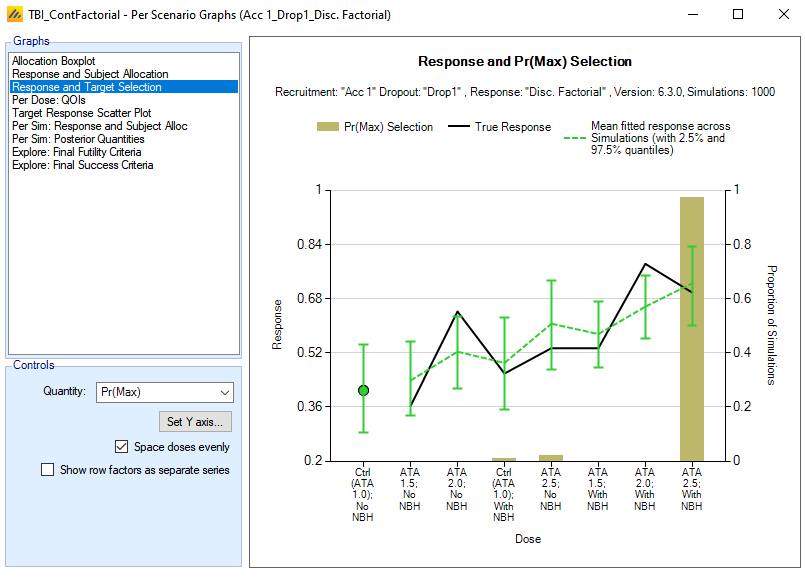

An option to help see the two-dimensional structure of the fits is to click on the checkbox "Show row factors as separate series." With this option, each level of the row factor is plotted with connected lines across the column factors. In the plot below, the linear structure of the continuous factorial model is much easier to see when separated out by row.

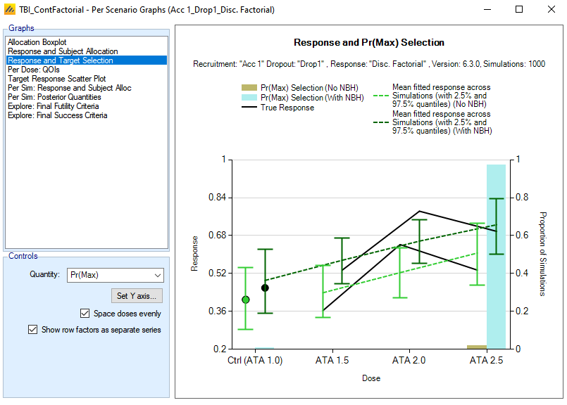

It does not make sense in the context of this example to use an EDq target rather than the Pr(Max), as toxicity from overdosing is not a concern -- the dichotomous response already accounts for overdosing response. But for the sake of demonstrating the quantity in the context of 2D dosing, we will examine the ED80 selection for this scenario.

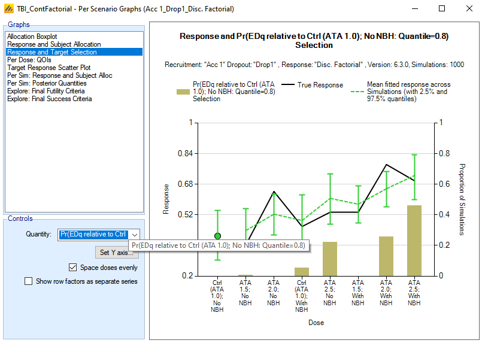

The ED80 dose is the *lowest* dose that achieves at least 80% of the response of the best treatment arm. Here, *lowest* refers to the effective dose strength defined for the dose combinations. The graph shows the treatment arms in increasing order of the effective combination dose. Had we used the ED80 as the dose selection option, we then have a chance to choose arms other than the 4 that the Pr(Max) chooses. In this example, while the continuous factorial model tends to make the **ATA 2.5; With NBH** arm the best dose, but occasionally, the fitted α~1~ term is small enough to indicate that the **ATA 2.0; With NBH** arm is nearly as good, and since it is lower in combination dose strength, it is chosen as the ED80. And sometimes, when **ATA 2.5; No NBH** is selected as the Pr(Max) arm, the **Ctrl (ATA 1.0); With NBH** arm is selected as the ED80, since in terms of combination effective dose strength, it is a lower effective dose than **ATA 2.5; No NBH**.

# 2D Discrete Factorial Model

We will now examine the same design using a different dose response model -- the 2D Discrete Factorial Model. This model is similar to the continuous factorial, except that it treats the levels of the columns and rows as factors rather than continuous variables, and as such, it should be more flexible for capturing non-linearity/non-monotonicity along the columns or rows, but at the cost of less precise fit when the response is linear.

With the design created above, use the File \> Save As menu command to create a copy of the design. Here we have called the copy TBI_DiscFactorial.

We will use all of the features of the previous design, except for updating the design model. Go to the Design \> Dose Response tab.

- For Model, select 2D Discrete Factorial Model.

- For α, enter a mean of -0.41 and SD of 1. This term has the same meaning as α~0~ in the 2D continuous factorial model.

- For the β's, enter a mean of 0 and SD of 0.75. These represent potential deviations from low dose on the columns, and there is one β for each level of the columns above the lowest.

- For the γ's, enter a mean of 0 and SD of 0.75. These represent potential deviations from low dose on the rows, and there is one γ for each level of the rows above the lowest.

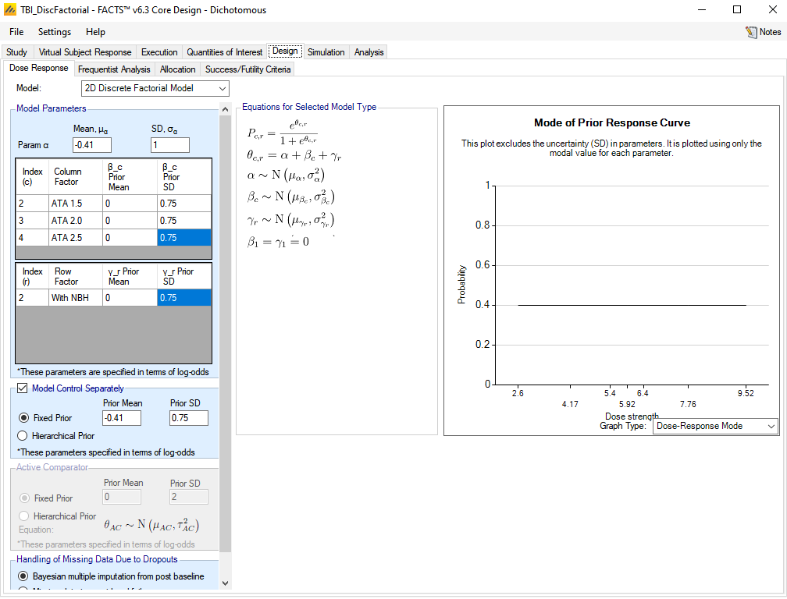

Should we go to the Simulation tab and simulate the Null scenario with no other adjustments, we will see a higher Type I error rate: \~12.5%. The two extra parameters in this model may lead to some over-fitting relative to the continuous factorial model and thus requires a more stringent success criterion. In order to make operating characteristics comparable to the continuous factorial model, we need to adjust the threshold for declaring success to reduce the Type I error rate to \~10%.

Go to the Design \> Success/Futility Criteria tab. Click on the success criteria for P(P_d \> P_Ctrl (ATA 1.0); No NBH)) and adjust the threshold to be 0.965 \[instead of 0.955 as in the previous model\]. Do the same for the futility criteria.

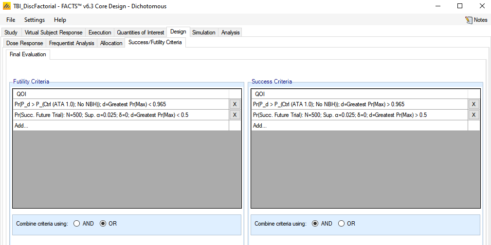

Now switch to the Simulation tab and simulate all scenarios.

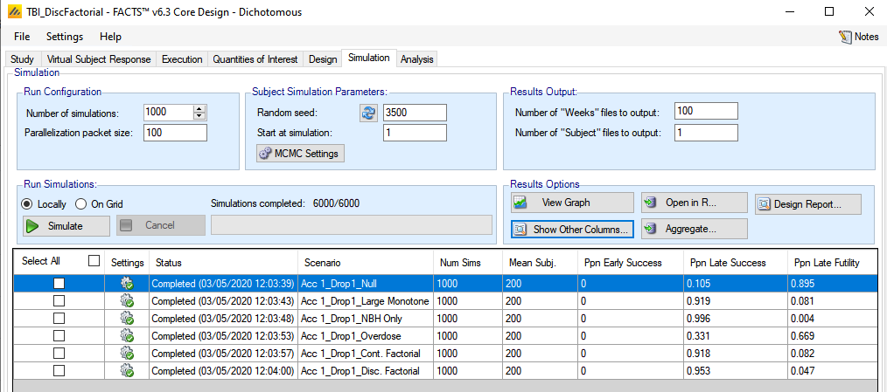

The Type I error has been calibrated to be roughly 10%. The power in across the other scenarios has dropped a few percentage points in all of the non-null scenarios, compared to the continuous factorial model. However, the discrete factorial model may have a benefit in dose selection, since the model fit is more flexible.

Click on View Graph \> Show Across Scenario Graphs.

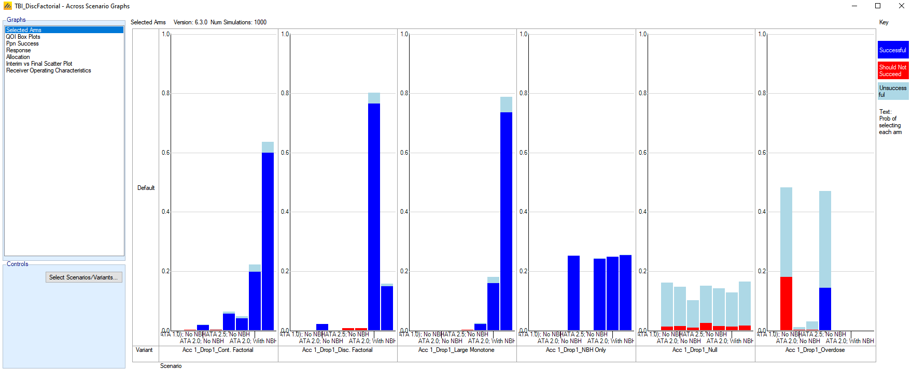

The discrete factorial model is not as good at selecting the best arm in scenarios where the true best arm lies on a corner of the 2D grid, like the Cont. Factorial scenario and the Large Monotone scenario. However, it is able to select the best dose over 70% of the time in the Disc. Factorial scenario, and it generally selects a good dose, even if not the best. The Overdose scenario is still problematic, as the model cannot account for a lack of additivity for the factors in the true response rate. Note, however, that the selection of the low dose (**ATA 1.5; No NBH**) has dropped to under 20% in successful trials, and the correct arm (**ATA 2.5; No NBH**) is selected nearly 15%.

Click on the Response graph.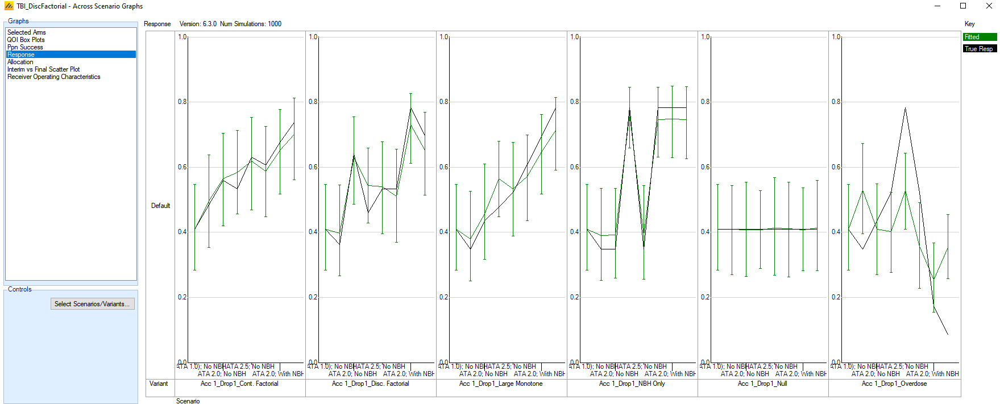

The fitted responses are generally close to the truth for most of the scenarios, but does over-smooth in the Large Monotone scenario, and like the Continuous Factorial mode is unable to match the Overdose scenario that deviates strongly from factor additivity.

# 2D NDLM Model

We will now examine the same design using the third 2D dose response model, the 2D Normal Dynamic Linear Model (2D NDLM). This model is effectively a smoothing model and assumes that neighbors in the 2D space have similar response, though we must define our notion of "similarity" through our priors. This model is similar in nature to the Simple NDLM model in FACTS but takes advantage of the 2D neighbor structure.

From your previous FACTS file, select File \> Save As to generate a copy of the design. We named this design file TBI_2DNDLM.

We are once again utilizing the same design, but changing the dose response model and calibrating the success threshold for type I error.

On the Design \> Dose Response tab:

- Select the model: 2D NDLM

- Select the "Initial Dose" as **ATA 1.5; No NBH**. Set the prior mean to -0.41 and prior SD to 1.0. The model requires prior information to be included about the response rate for one arm. Typically, the chosen arm would be the control arm, since the most historical information is generally available about the control arm. However, since we are modeling the control arm separately, we must select a different initial dose about which to input a prior distribution for the response rate. We chose the **ATA 1.5; No NBH** arm since it is the arm closest to the control in combination dose strength and thus choosing a prior distribution similar to the intercept term for the previous models is a reasonable choice.

- For τ, set the prior central value to 1.0 and prior weight to 2.0. Setting this prior can take some practice to understand its behavior. τ represents the response deviation that one might expect from a neighboring dose at a distance of 1 unit. Small values of τ indicate that neighboring doses should have similar response rates and thus high borrowing of response from neighbors, while high values of τ indicate that neighboring doses can have highly different response rates and thus little borrowing in response. This notion can help guide the selection of the prior central value. In this case, we chose 1.0 to represent an expected standard deviation in response of the difference between column doses one unit apart (e.g. ATA 1.5 to ATA 2.5).

- Check the box: Fixed smoothing ratio. Set smoothing ratio k to 0.7071. The fixed smoothing ratio indicates that we do not wish to model the smoothing parameters in the column and row directions separately but rather just set them to a fixed ratio. In this design, the effective column strengths increase linearly by an increment of 0.5, while the effective row strength increases by an increment of 1.0. If we wish the same degree of smoothing in the column direction and the row direction (e.g., we believe that the change in response rate moving from **ATA 1.5; No NBH** to **ATA 2.0; No NBH** should be about the same as moving from **ATA 1.5; No NBH** to **ATA 1.5; With NBH**), then we want to adjust the smoothing parameter φ (the smoothing parameter in the row direction) so that φ is smaller than τ. Since the variance component is determined by the change in dose strength times the square of the smoothing parameter, we wish to make Δς~c~ τ^2^ = Δη~r~φ^2^. Thus we use k = √0.5, since 0.5 is the ratio of \[average\] differences in effective column strength to the difference in effective row strengths.

> The Design \> Dose Response tab should look like the following:

> 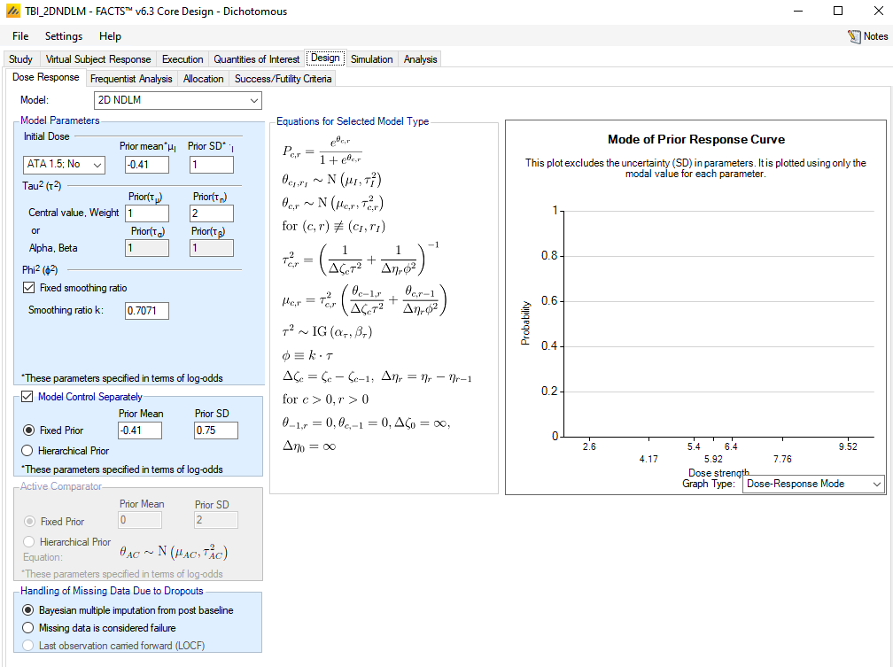

> The success criteria need to be calibrated for type I error for this model. Setting a threshold on the posterior probability of beating control to 0.95 results in approximately 10% type I error for this design.

> 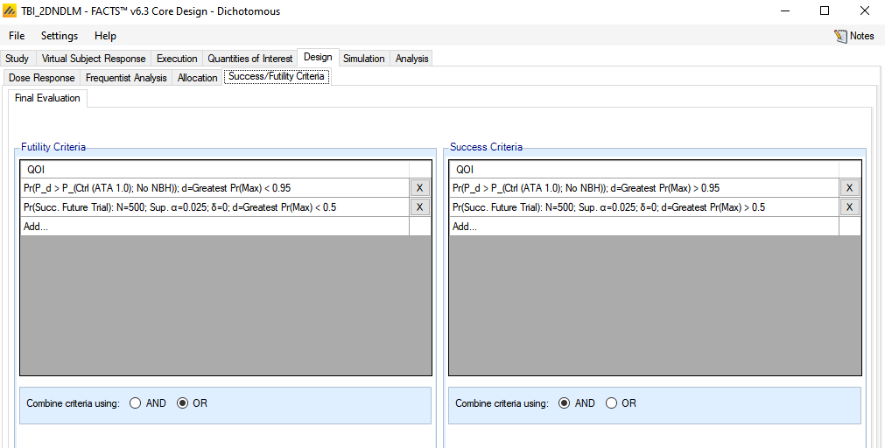

> Now switch to the Simulations tab and simulate all scenarios.

> 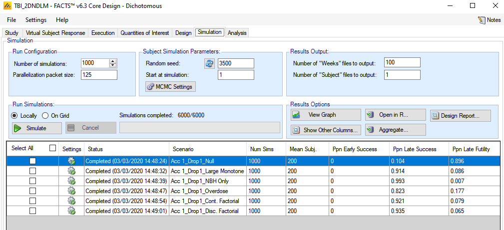

> We see that with this model, the power for most scenarios is close but slightly lower than the continuous factorial or discrete factorial model. However, the power is greatly increased in the Overdose scenario.

> To see how this model does with dose selection, click the View Graph \> Show Across Scenarios Graph.

> 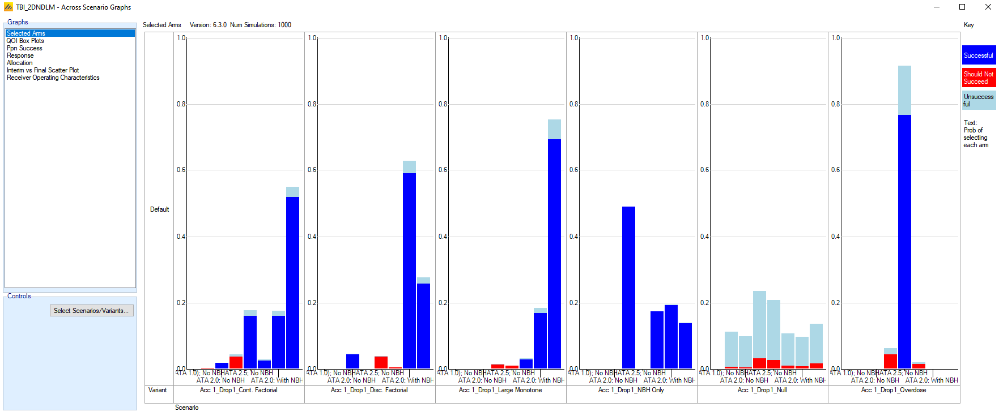

> We can see that the smoothing across the arms leads to less frequent selection of the best dose, when neighboring doses are nearly as good, and a small but noticeable increase in the selection of inferior arms across the first 3 scenarios. However, the model is quite good at selecting the one good arm in the Overdose scenario.

> The model responses show good overall fit, with some smoothing out of peaks and valleys.

> 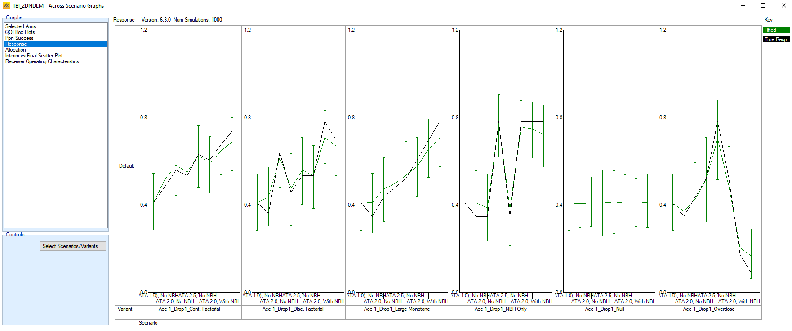

# Using a 1D model -- Hierarchical Logistic

Because we chose to enter our treatment arms on the Study \> Treatment Arms tab as "Use 2D treatment arm model," we are not required to use a 2D dose response model. There is little reason to enter treatment arms in that fashion if we are not using a 2D dose response model, since it requires a bit more effort to set up. However, if we are unsure whether or not we want to use a 2D structure, it keeps the 2D model options available on the Design \> Dose Response tab. All of the usual dose response models are also available, and they operate as 1D models with dose strengths as specified by the combination effective dose strength.

Select File \> Save As to save a copy of the design. We named this file TBI_HierLogistic.

On the Design \> Dose Response tab:

- Select the Model as: Hierarchical Logistic.

- For a~1~, set the prior mean to -0.41 and prior SD to 1.

- For a~2~, set the prior mean to 0 and prior SD to 5.

- For a~3~, set the prior mean to 3 and prior SD to 10.

- For λ, set the central value to 0.1 and weight to 0.2.

(These are the parameter values used in the Gajewski paper.)

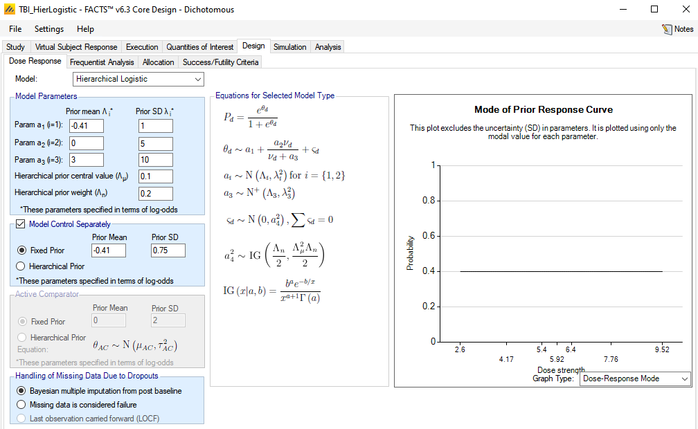

On the Design \> Success/Futility Criteria tab, set the threshold for the posterior probability QoI to be 0.922 for both success and futility.

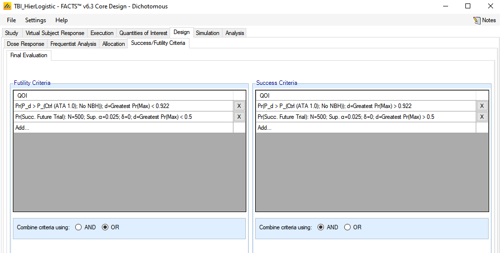

Go to the Simulate tab and simulate all scenarios. 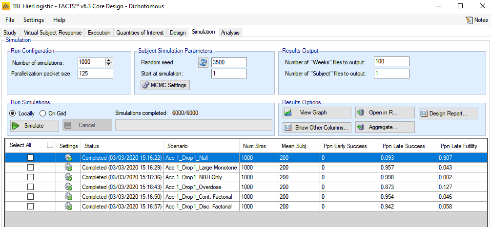

The power is quite good for all scenarios, so how does it compare in terms of arm selection?

The hierarchical logistic model was selected amongst the 1D dose response models because it incorporates a monotonic growth curve across the effective dose strength, but the hierarchical piece adds a random effect to each dose, allowing some deviations from monotonicity, and is thus less prone to be fooled by a non-monotonic scenario like the Overdose scenario.

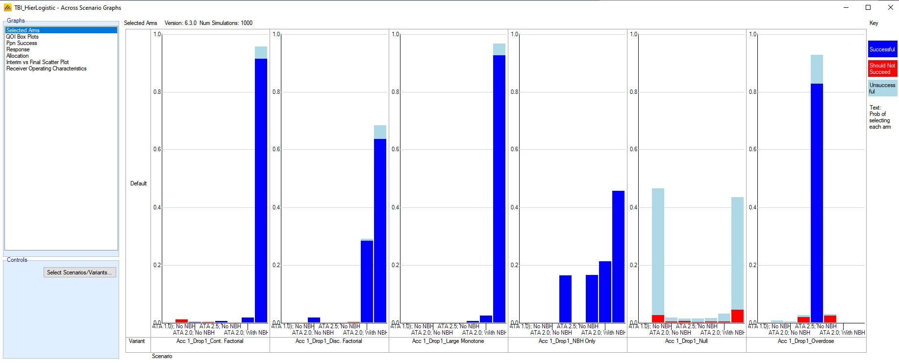

The arm selection does well for most scenarios, though in the Disc. Factorial scenario, it tends to pick the **ATA 2.5; With NBH** arm when the **ATA 2.0; With NBH** arm is actually superior. In that scenario, the deviation from monotonicity is not large, and thus the random effects component is often outweighed by the monotonic model. In the Overdose scenario, however, the deviation from monotonicity is so strong that the model effectively weights the random effects portion more heavily and is nearly fitting an independent arms model.

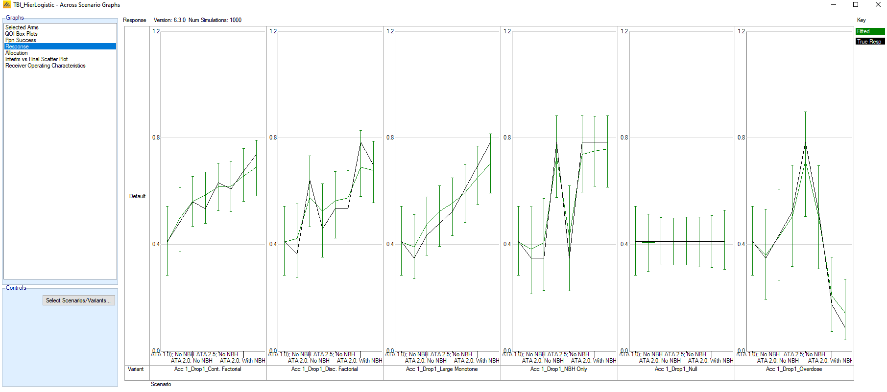

In terms of the model fits, one can see that the model is missing out on 2D structure of the doses, where it actually exists, as we can see from the overly smooth fits for the Cont. Factorial and Disc. Factorial settings.

[^1]:  Gajewski, B.J., Meinzer, C., Berry, S.M., Rockswold, G.L., Barsan, W.G., Korley, F.K., and Martin, R.H. "Bayesian hierarchical EMAX model for dose-response in early phase efficacy clinical trials." *Statistics in Medicine* 2019; **38**: 3123-3138.
