# Introduction

This tutorial describes an example trial design using the FACTS Dose Escalation Design Engine for Toxicity and Efficacy.

For this version of the document, the screenshots are from the V5.6 release of FACTS.

The screenshots provided are approximate and may not reflect the exact layout of the information. The contents of each tab, however, will be consistent with the software.

# Case Study: \[Braun\]

The example is taken from Thomas Braun's 2002 paper on the addition of modelling efficacy to the Continual Reassessment Method.

The endpoint is to find the optimum dose of T-cells for allogeneic bone marrow transplant.

The target maximum tolerated level of toxicity is a 15% rate of GCHD (Graft Versus Host Disease, a common complication of allogeneic bone marrow transplants). \[See [www.marrow.org](http://www.marrow.org) or [www.cancerhelp.org.uk](http://www.cancerhelp.org.uk) for some details\].

The efficacy target is a 95% rate for non-rejection of the graft.

There are 18 treatment arms and a maximum of 30 subjects.

Subjects will be dosed in cohorts of 3, starting at the 14^th^ dose.

We will never increment by more than 1 dose strength.

We will switch from determining the MTD after 2 cohorts have been allocated to the dose currently adjudged to be MTD, of after 6 cohorts.

After determining the MTD we will allocate at the MED, as long as that is at or below the MTD.

We will not stop early (only 4 cohorts to allocate).

## Simulation Details

Three different possible dose toxicity responses will be simulated, combined with three different efficacy responses.

Toxicity:

+--------+:-----:+:-----:+:-----:+:-----:+:-----:+:-----:+:-----:+:-----:+:-----:+:------:+:------:+:------:+:------:+:------:+:------:+:------:+:------:+:------:+
|        | **Dose**                                                                                                                                               |
+--------+-------+-------+-------+-------+-------+-------+-------+-------+-------+--------+--------+--------+--------+--------+--------+--------+--------+--------+
| **\#** | **1** | **2** | **3** | **4** | **5** | **6** | **7** | **8** | **9** | **10** | **11** | **12** | **13** | **14** | **15** | **16** | **17** | **18** |
+--------+-------+-------+-------+-------+-------+-------+-------+-------+-------+--------+--------+--------+--------+--------+--------+--------+--------+--------+
| **A**  | 0.015 | 0.02  | 0.03  | 0.05  | 0.1   | 0.2   | 0.35  | 0.44  | 0.48  | 0.49   | 0.5    | 0.5    | 0.5    | 0.5    | 0.5    | 0.5    | 0.5    | 0.5    |
+--------+-------+-------+-------+-------+-------+-------+-------+-------+-------+--------+--------+--------+--------+--------+--------+--------+--------+--------+
| **B**  | 0.01  | 0.01  | 0.01  | 0.01  | 0.01  | 0.015 | 0.02  | 0.03  | 0.05  | 0.1    | 0.2    | 0.35   | 0.44   | 0.48   | 0.49   | 0.5    | 0.5    | 0.5    |
+--------+-------+-------+-------+-------+-------+-------+-------+-------+-------+--------+--------+--------+--------+--------+--------+--------+--------+--------+
| **C**  | 0.01  | 0.01  | 0.01  | 0.01  | 0.01  | 0.01  | 0.01  | 0.01  | 0.015 | 0.02   | 0.03   | 0.05   | 0.1    | 0.2    | 0.35   | 0.44   | 0.48   | 0.49   |
+--------+-------+-------+-------+-------+-------+-------+-------+-------+-------+--------+--------+--------+--------+--------+--------+--------+--------+--------+

Efficacy:

+--------+:-----:+:-----:+:-----:+:-----:+:-----:+:-----:+:-----:+:-----:+:-----:+:------:+:------:+:------:+:------:+:------:+:------:+:------:+:------:+:------:+
|        | **Dose**                                                                                                                                               |
+--------+-------+-------+-------+-------+-------+-------+-------+-------+-------+--------+--------+--------+--------+--------+--------+--------+--------+--------+
| **\#** | **1** | **2** | **3** | **4** | **5** | **6** | **7** | **8** | **9** | **10** | **11** | **12** | **13** | **14** | **15** | **16** | **17** | **18** |
+--------+-------+-------+-------+-------+-------+-------+-------+-------+-------+--------+--------+--------+--------+--------+--------+--------+--------+--------+
| **A**  | 0.5   | 0.5   | 0.5   | 0.51  | 0.75  | 0.95  | 0.955 | 0.96  | 0.965 | 0.97   | 0.975  | 0.98   | 0.98   | 0.98   | 0.98   | 0.98   | 0.98   | 0.98   |
+--------+-------+-------+-------+-------+-------+-------+-------+-------+-------+--------+--------+--------+--------+--------+--------+--------+--------+--------+
| **B**  | 0.5   | 0.5   | 0.5   | 0.5   | 0.51  | 0.6   | 0.75  | 0.86  | 0.95  | 0.97   | 0.975  | 0.98   | 0.98   | 0.98   | 0.98   | 0.98   | 0.98   | 0.98   |
+--------+-------+-------+-------+-------+-------+-------+-------+-------+-------+--------+--------+--------+--------+--------+--------+--------+--------+--------+
| **C**  | 0.5   | 0.5   | 0.5   | 0.5   | 0.5   | 0.5   | 0.5   | 0.51  | 0.6   | 0.75   | 0.86   | 0.95   | 0.97   | 0.975  | 0.98   | 0.98   | 0.98   | 0.98   |
+--------+-------+-------+-------+-------+-------+-------+-------+-------+-------+--------+--------+--------+--------+--------+--------+--------+--------+--------+

## Expected Performance

OSD selected:

+-------------------+--------------------------+---------------------------+----------------------------------+
|                   | Toxicity Scenario                                                                       |
+-------------------+--------------------------+---------------------------+----------------------------------+
| Efficacy Scenario | A\) MTD at dose 5        | B\) MTD at dose 10        | C\) MTD at dose 13               |
+-------------------+--------------------------+---------------------------+----------------------------------+
| A\) MED at dose 6 | OSD at MTD around dose 5 | OSD between dose 6 and 10 | OSD at MED around dose 6         |
+-------------------+--------------------------+---------------------------+----------------------------------+
| B\) MED at dose 9 | OSD at MTD around dose 5 | OSD at MTD around dose 10 | OSD at MED between dose 9 and 13 |
+-------------------+--------------------------+---------------------------+----------------------------------+
| C\) MED at dose12 | OSD at MTD around dose 5 | OSD at MTD around dose 10 | OSD at MTD around dose 13        |
+-------------------+--------------------------+---------------------------+----------------------------------+

Braun's results are

- Scenario 1: MTD at 10, MED at 6 (though he uses a steeper toxicity curve in this scenario)

- Scenario 2: MTD at 10, MED at 9

- Scenario 3: MTD at 10, MED at 12

Braun reports selection of 'correct MTD' where the selected dose is correct if within the range from the MED to the MTD.

Unfortunately we do not report the same statistic directly -- we report MTD, MED and OSD separately, but where the OSD is the MED if \<= MTD otherwise the MTD. We need to calculate the equivalent of Braun's statistic from the summary.csv files.

Other metrics to consider are the number of subjects used and minimizing the number of toxicities observed.

## Designs for comparison

Compare with using the 3+3 design.

Compare with using other models e.g. the tanh model, and the alternative uniform prior distribution for β.

Compare using different cohort sizes.

# Simulating using FACTS N-CRM

Pre FACTS 6.2 dose escalation considering both toxicity and efficacy could only be performed using FACTS bCRM (bivariate CRM). Since FACTS 6.2 including an efficacy endpoint in a dose escalation design has been an option in N-CRM, which has the advantage of more flexible modelling and the ability to combine it with other options such overdose control, run-ins, two groups and continuous enrolment. Here we just replicate the Braun example as closely as we can.

After starting FACTS we start an N-CRM, for example from the File menu option we select New \> Dose Escalation \> N-CRM. To give our new design a name we select File \> Save As, choose a suitable location and name, for example 'N-CRM eff-tox".

We now work through the tabs in order.

## Study

Under the study tab we will enter the overall shape of the trial, the toxicity target, the efficacy target and the details of the doses available to test in the trial.

### Study Info

On the Study Info tab, we:

- Check the "Include Efficacy" check box,

- Opt to recruit subjects in cohorts

- Specify that the

  - maximum number of cohorts will be 10

  - the cohort size will be 3,

  - there will be no cohorts accrued until the results of the current cohort are known.

- We leave the "execution rate" at the default of 2 weeks (though is likely to be un-realistic) as this is a strict cohort design, the estimation of time is not very interesting, time will be solely dependent on the time to recruit and follow up a cohort and the number of cohorts. In terms of the expected duration we will simply compare number of cohorts. One assumption of this simulation is that in the allocation to the MED phase we wait until we have both the toxicity and efficacy results from the current cohort before selecting the dose for the next.

- There is just one "group" in this trial.

- There is no cohort expansion.

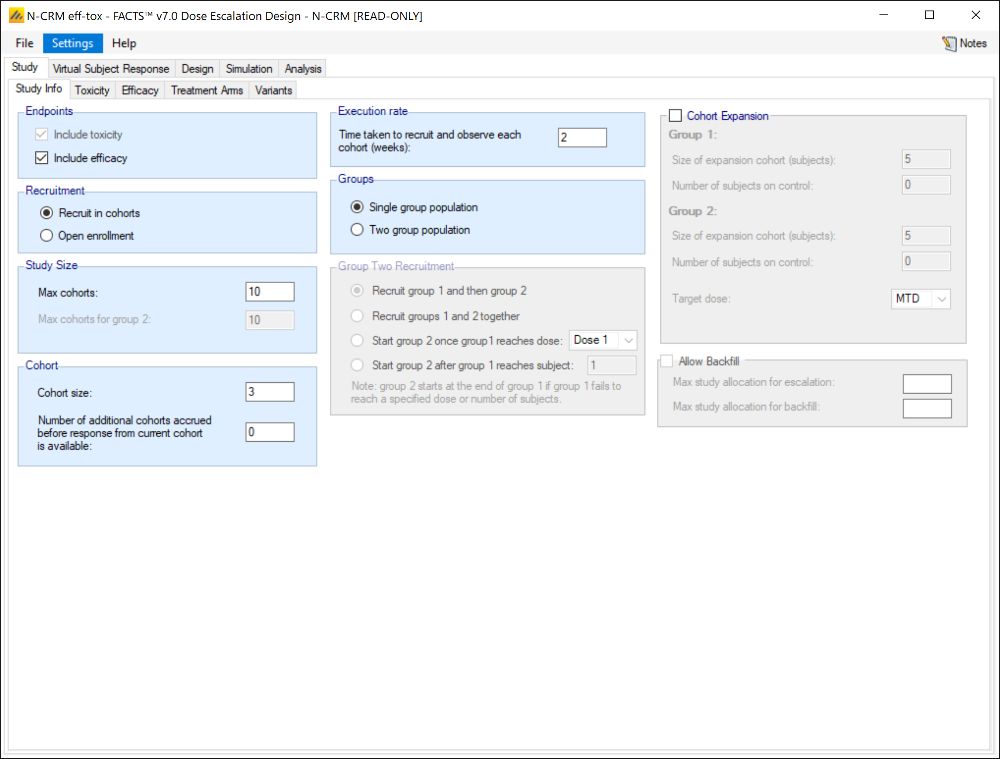

### Toxicity

To replicate the Braun example (and bCRM) we ignore some of N-CRM options, and select

- Not to simulate ordinal toxicity

- To target a single dose (not a toxicity band), targeting

  - The dose with toxicity nearest to a rate of 0.15

- No overdose control limits are specified

- But we do specify a target toxicity band, this not used in the simulations, but it is used by the FACTS GUI to interpret the results, it will tell us, for each scenario, how often the dose selected as MTD was in the underdosing, target, excess toxicity or unacceptable band. The target toxicity rate is 0.15, but none of the scenarios have a dose with exactly that rate and we only select doses present in the trial, we do not interpolate. The scenarios have doses with simulated rates 0.1 and 0.2, and we decide that selection of either would be an acceptable choice. To ensure that when FACTS judges whether the design has selected a dose with true rate of 0.1 or 0.2 it determines them to be in the target band we, set the band limits to 0.099 and 0.201.

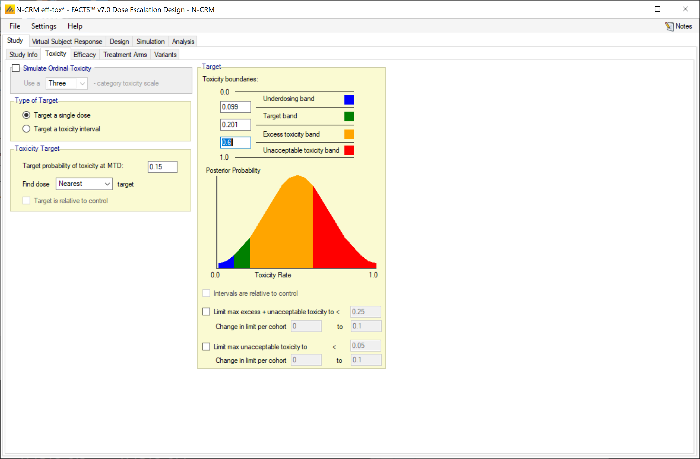

### Efficacy

On the efficacy tab we specify that

- A target experiencing a toxicity can still count towards efficacy

- The target efficacy rate is 95%

- The targe MED dose is the one nearest the target rate.

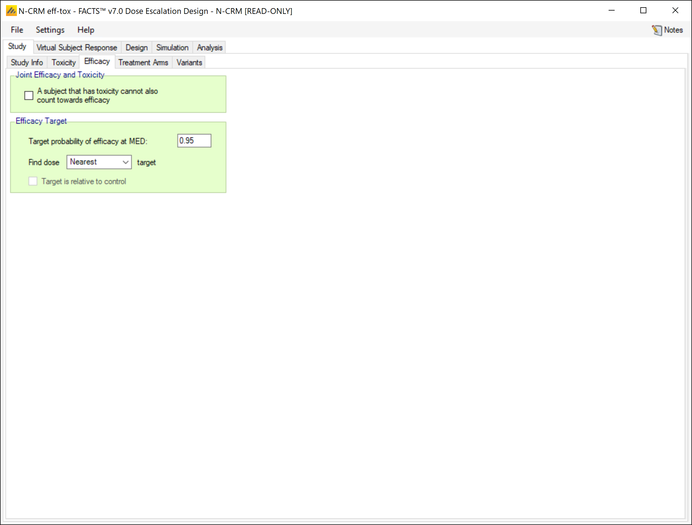

### Treatment Arms

On the Treatment Arms tab we create 18 doses and give them strengths from 1 to 9.5 in steps of 0.5.

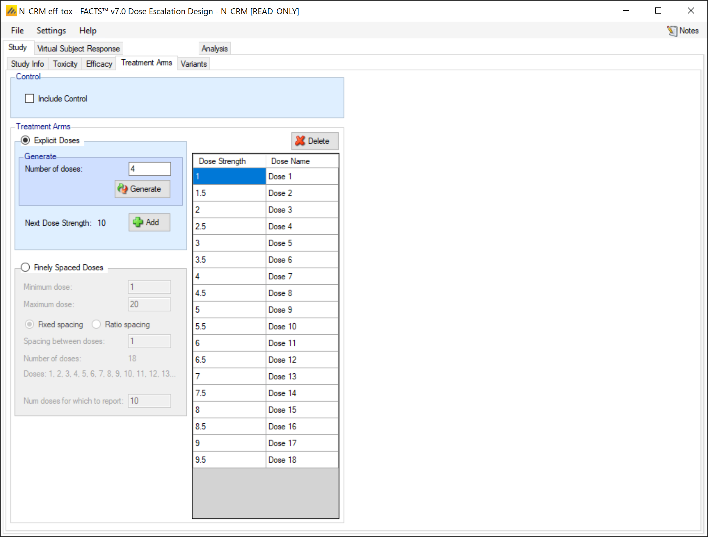

### Variants

The variants tab allows us to easily create different versions of the design with different maximum numbers of cohorts. We leave the tab at its default and do not create any variants.

## Virtual Subject Response

### Explicitly Defined \> Toxicity

On this tab we specify the 3 toxicity profiles described above in section 2.1, calling them "MTD-dose_5", "MTD_dose_11" and "MTD_dose_13" to reflect the dose in that profile with a toxicity rate closest to the target. Note though that in the profile no dose has a simulated rate of target rate (0.15) and the doses in the profile names actually all have simulated rates of 0.1 (and the next highest dose in all these profiles have a simulated rate of 0.2 which is actually just as close to the target and so just as valid a dose to select).

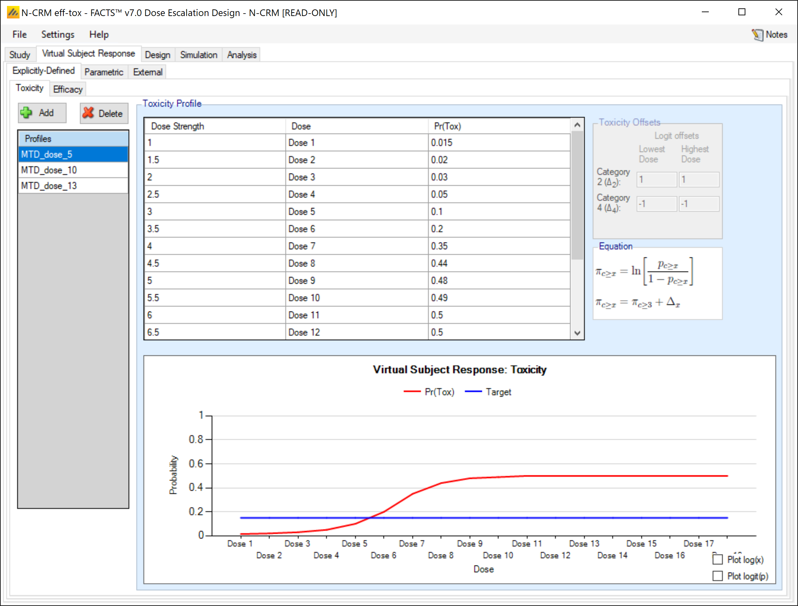

### Explicitly Defined \> Efficacy

On this tab, similarly to the toxicity tab, we specify the 3 efficacy profiles described above in section 2.1, calling them "MED-dose_6", "MED_dose_9" and "MED_dose_12" to reflect the first dose in that profile with an efficacy rate closest to the target of 0.95.

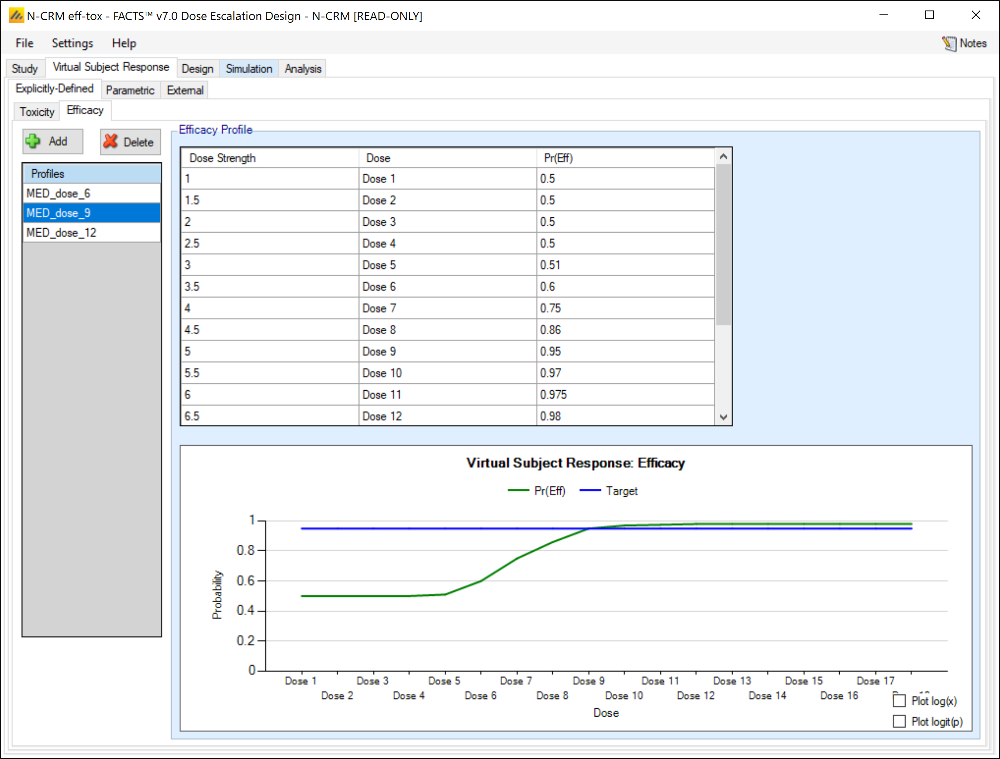

### Parametric

This tab allows toxicity and efficacy profiles to be defined using parametric models, we are not using any of these in this example.

### External

This tab allows toxicity and efficacy responses to be specified by supplying a file of simulated patient responses, we are not using any of these in this example.

## Design

The N-CRM with efficacy differs from the bCRM based on Thomas Braun's paper in two respects

- N-CRM uses the Bayesian Logistic Regression model with both parameters being estimated, the Braun paper uses the CRM method that uses the model but fixes the alpha parameter.

- N-CRM with efficacy does not attempt to estimate the probability of a patient experiencing **both** toxicity and efficacy, but Braun does.

### Design \> X-hats

Here we specify the transformation of the dose strengths to the "effective dose strengths" to be used in the Bayesian Logistic Regression model. The specification consists of two parts:

- Specification of a 'reference dose'

- Specification of the transformation which is either to use the log of the ratio of dose strengths to the reference dose or a simple linear transformation where the reference dose is subtracted from the dose strength.

- We select to use the median dose strength as the reference dose, and the linear transformation -- as the dose strengths we have entered changed linearly. The result is that the effective dose strengths, the 'x-hats' vary linearly.

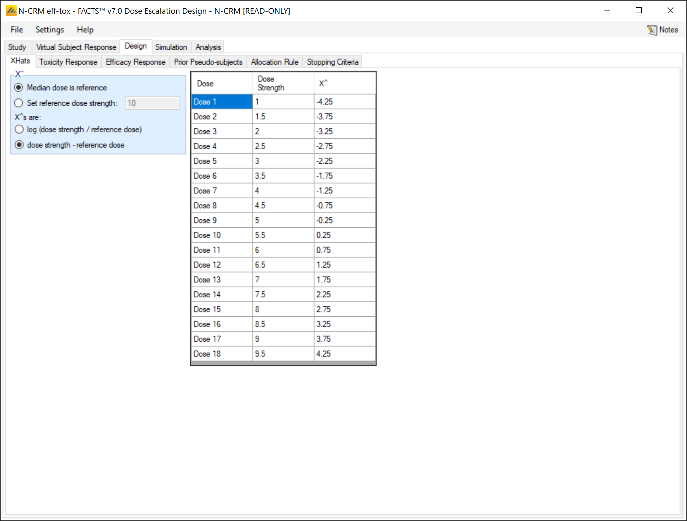

These "x-hats" are quite different from the Braun paper, and those used in the bCRM implementation of this case study (see below). Indeed N-CRM constrains us to use the same x-hats for both the toxicity and the efficacy models, whereas in Braun and bCRM they are different. However we can get away with this in the N-CRM because we are going to fit the two-parameter model, where bCRM requires alpha to be fixed and only estimates the slope -- which is why the x-hats then have to be different for the two outcomes, the toxicity response sets the x-hats so that the fixed point (where the x-hat value is 0, so the model has the fixed value of alpha) is above the dose range, and the efficacy response has the fixed point below the dose range.

As you will see from the simulation results the performance is not harmed by this.

### Design \> Toxicity Response

This example is unusual in that the upper limit of toxicity is less than 1, the profiles we will be simulating from (see section 2.1 above) plateau out at 0.5. So, the most important element of the toxicity model specified here is that we will re-scale the logistic so that it runs between 0 and 0.55. This means the usual derive prior tool cannot be used and we need to manually come up with the parameters of the bi-variate normal for alpha and beta. We aim to have a relatively uninformative prior.

Alpha is the expected toxicity at the reference dose we set the prior to N(-1.75, 2^2^) in the log-odds space, that is a mean at around 0.15, which is 0.08 after re-scaling. The +/- 2SD range is 0.003 to 0.9, which is 0.002 to 0.497 after re-scaling. We will be simulating rates of 0.0175, 0.075 and 0.485 at the reference dose (the reference dose is half way between doses 9 and 10) so this seems reasonable.

Ln(Beta) is the slope, we simply set the prior to N(0,1), experience (and the sampled plots) show this to be a sufficiently uninformative prior that permits a wide range of curves to be fitted - permitting any dose to be the MTD with a toxicity rate of 0.15.

The correlation of the prior is set to 0 -- we do not presume any linkage between the toxicity at the reference dose and the slope.

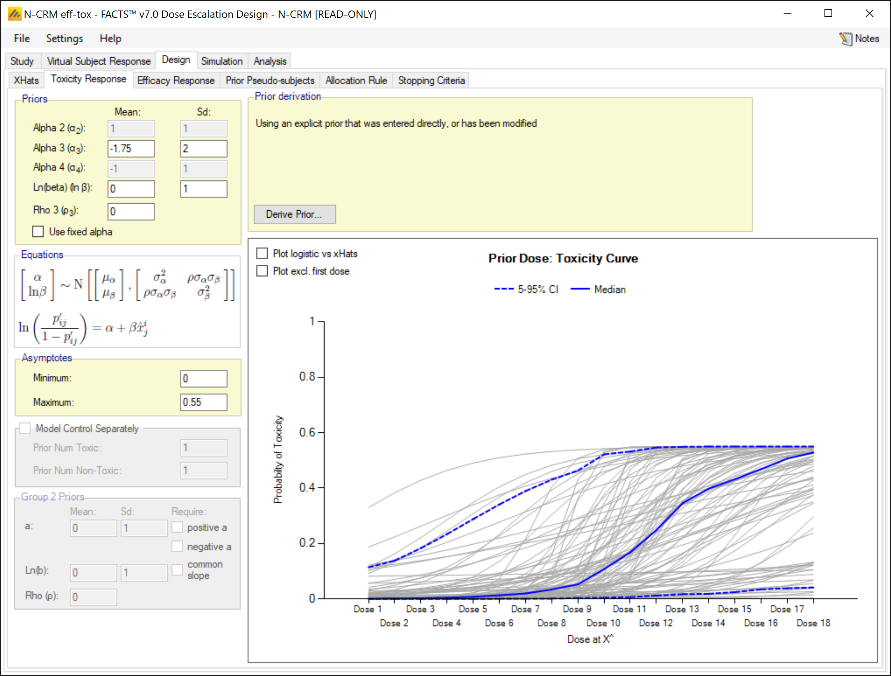

### Design \> Efficacy Response

Similar to the toxicity response, the efficacy responses we are simulating from (see 2.1 above) range from 0.5 to1. So we rescale the efficacy model to range between 0.4 and 1.

Alpha is the expected efficacy at the reference dose we set the prior to N(2.6, 1.5^2^) in the log-odds space, that is a mean at around 0.93, which is 0.96 after re-scaling. The +/- 2SD range is 0.40 to 0.996, which is 0.64 to 0.998 after re-scaling. We will be simulating rates of 0.9675, 0.96 and 0.675 at the reference dose (the reference dose is half way between doses 9 and 10) so this seems reasonable.

Ln(Beta) is the slope, we simply set the prior to N(0,0.5), experience (and the sampled plots) show this to be a sufficiently uninformative prior that permits a wide range of curves to be fitted -- permitting any dose to be the MED with an efficacy rate of 0.95 (though unlikely at above dose 15)

The correlation of the prior is set to 0 -- we do not presume any linkage between the efficacy at the reference dose and the slope.

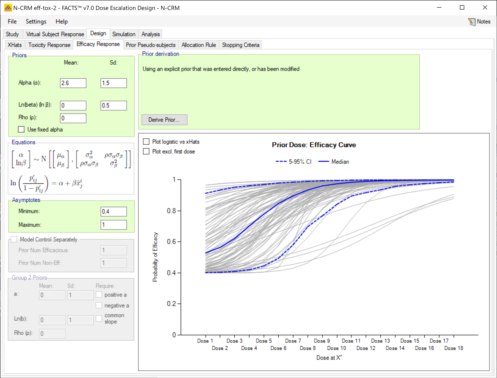

### Prior pseudo-subjects

No prior pseudo subjects are specified -- either for toxicity or efficacy.

### Allocation Rules

There is no run-in.

The starting dose is Dose 9.

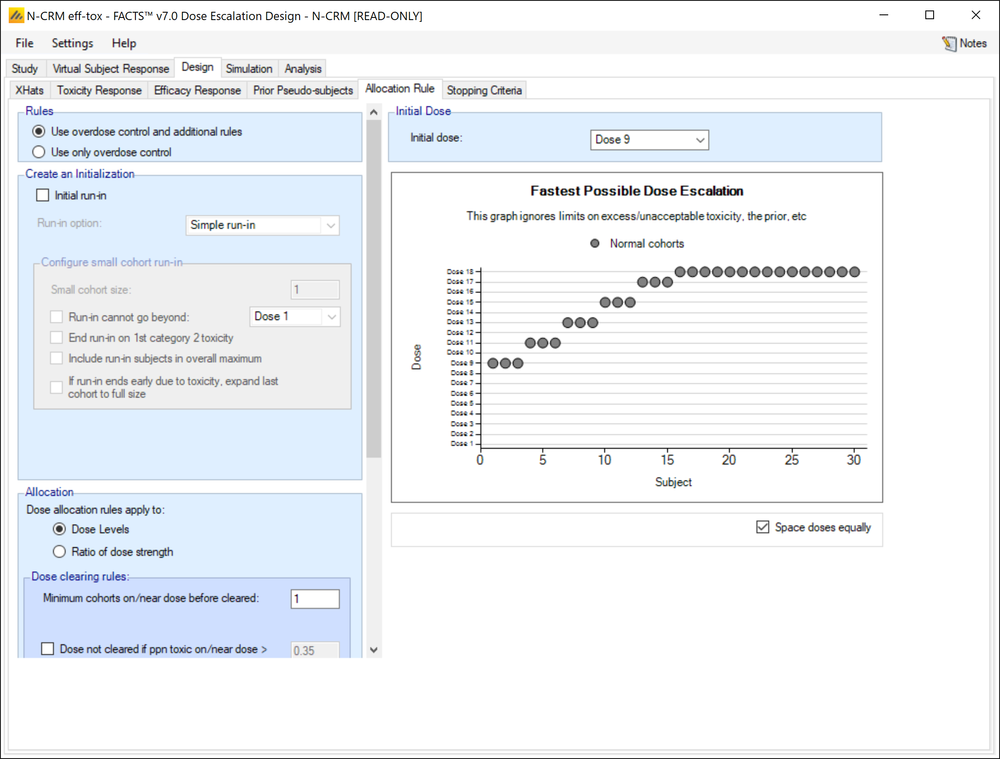

We only require one cohort on a dose before we can escalate beyond it.

We allow escalation to be by up to 2 dose levels above the dose last tested.

We want the "MTD" search stage to be able to complete with 6 cohorts.

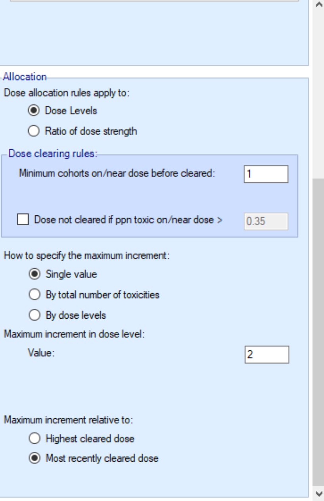

### Stopping Criteria

To end the "search for the MTD" phase, we simply require that:

- Two cohorts have been tested at the dose currently estimated to be the MTD,

- We have enrolled at least one cohort (which of course must be true if there are two cohorts on the MTD)

- If all doses appear to be too toxic, that we have tested at least two cohorts before stopping the trial.

- OR that we have tested 6 cohorts, this means that the "search for the MTD" phase will end after 6 cohorts, even if we do not have 2 cohorts on the dose currently estimated to be the MTD.

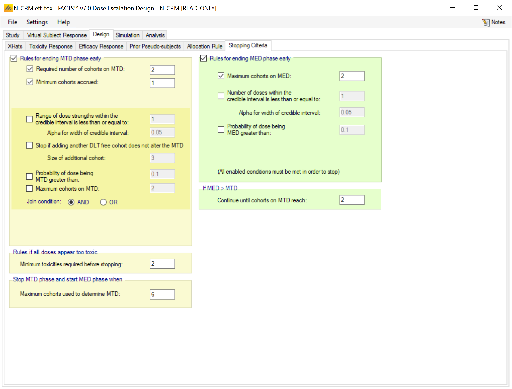

To end the "search for MED" phase (and hence the trial) we simply require 2 cohorts on the dose currently estimated to be the MED.

If the MED lies above the MTD (so we can't allocate to it) then we stop if there are 2 cohorts on the dose currently estimated to be the MTD.

## Simulation Results

Running just 100 simulations for now we can get a flavour for how the design has worked.

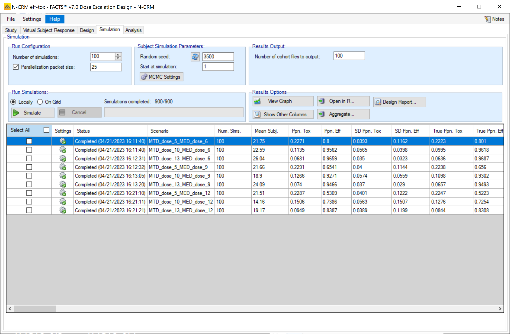

The graph in "Show Across Scenario Graphs" we can see how often each dose has been selected in each scenario:

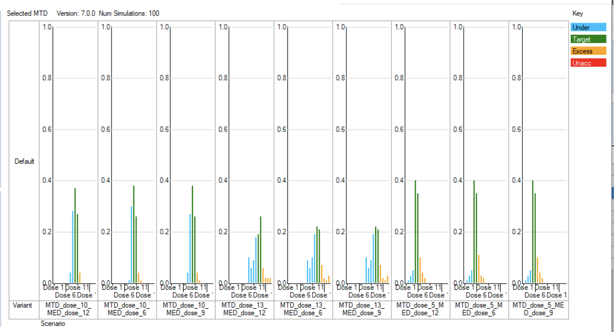

The histogram helpfully coloured according to the true toxicity being simulated and which range it is in: "underdosing", "target", "excess", "unacceptable". Recall we set the target range to be from 0.099 to 0.21 so the doses with toxicity rates of 0.1 or 0.2 are included as "target". We can see that these doses are typically the most selected, and that doses with "excess" toxicity are rarely selected and with "unacceptable" toxicity are never selected.

Running 1,000 simulations, and then on the "Across Scenarios Graphs" we can use "Select Scenarios/Variants" to look at just the MTD_dose_10, MTD_dose_13 and MTD_dose_5 graphs separately. These are a clearer:

### MTD Graphs

When the MTD is at Dose 5 (or 6) we can see these two doses dominate the MTD selection. In the summary results there is a column "ppn MTD Target" that reports what proportion of the simulations selected a dose as MTD that had a true toxicity in the target range. The results for these three scenarios are: 0.687, 0.685 and 0.674.

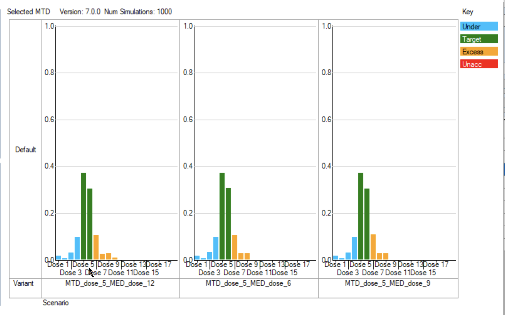

When the MTD is at Dose 10 (or 11) we can see these two doses dominate the MTD selection. In the summary results there is a column "ppn MTD Target" that reports what proportion of the simulations selected a dose as MTD that had a true toxicity in the target range. The results for these three scenarios are: 0.696, 0.680 and 0.651.

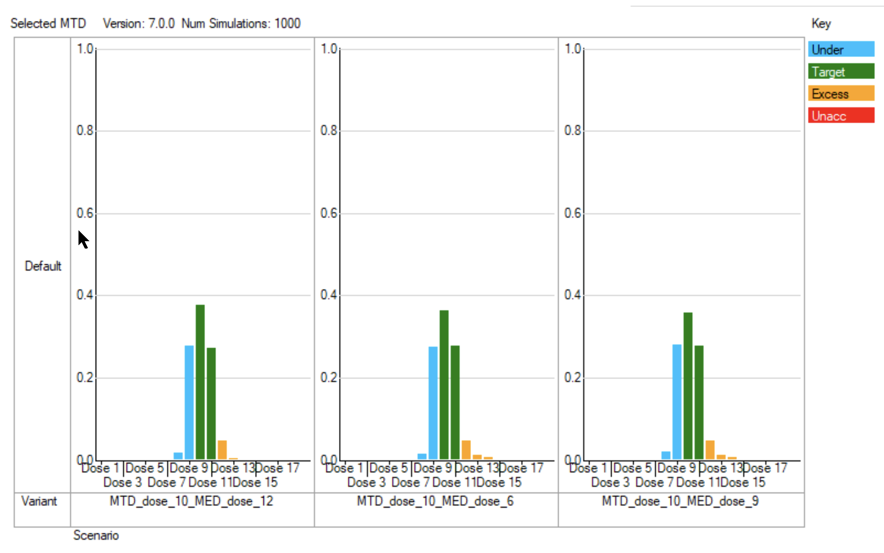

When the MTD is at Dose 13 (or 14) we can see three doses dominate the MTD selection -- doses 12, 13 and 14. In the summary results the column "ppn MTD Target" reports that proportion of the simulations selected a dose as MTD that had a true toxicity in the target range was: 0.464, 0.479 and 0.428. Because the true MTD is at a higher dose in these scenarios, the trial fails to find as well as in the other scenarios, with a tendency to pick the dose just below the true MTD just as often as either of the true MTD doses.

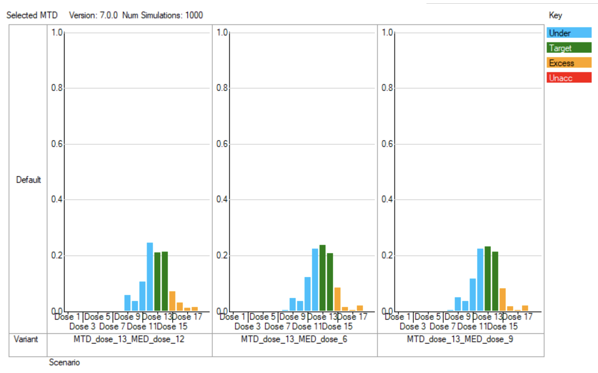

###   {#section-1}

\

### OSD Graphs

The "Optimal Selected Dose" is the MED unless the MTD is below the MED, in which case it's the MTD. These graphs colour the bars in the histogram by the combination of the 4 categories of the true toxicity of the dose in the scenario: "Under dosing", "Target toxicity", "Excess toxicity" and "Unacceptable toxicity" with the 2 categories of the true efficacy: "Ineffective" (below the target efficacy rate for the MED) and "Effective".

In the scenarios where the MTD is dose 5 (or 6) then only when the MED is at dose 6 is there the possibility of an effective dose that is also in the toxicity target range otherwise inevitably the majority of the probability is that the selection of the OSD will be at an ineffective dose.

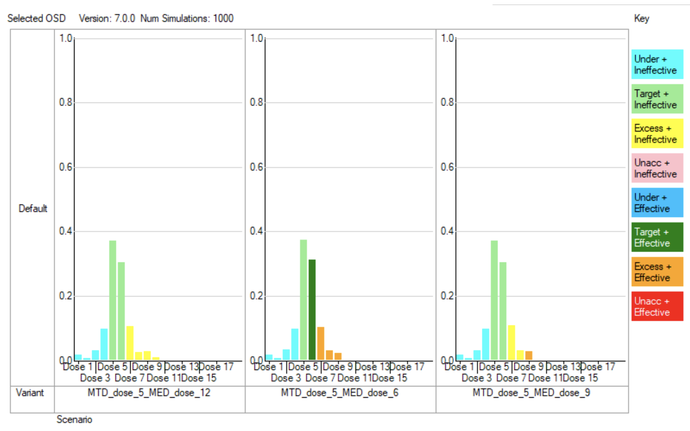

In the scenarios where the true MTD is dose 10 (or 11) except when the MED is at dose 12, we see the majority of the probability is that the selected OSD dose will be either effective and safe or effective and tolerable. When the MED is at dose 12, we see results similar to above when the MTD is below the MED, a safe or tolerable but ineffective dose is selected because there is no safe or tolerable and effective dose in the scenario.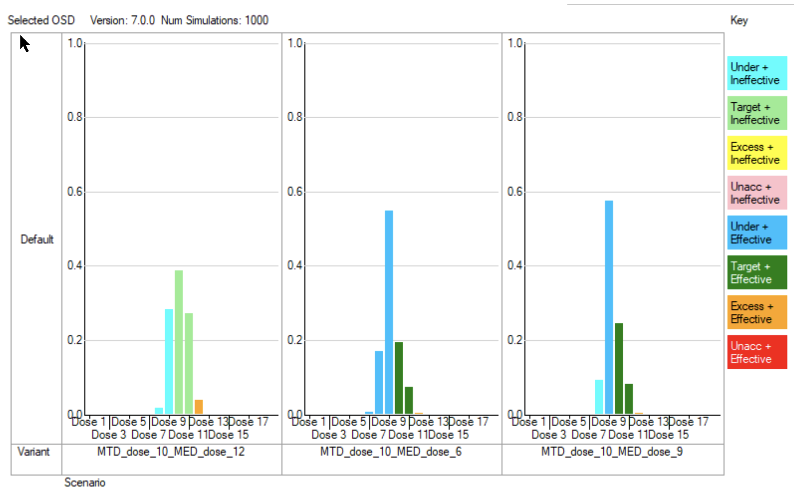

In the scenarios where the true MTD is dose 13 (or 14) we see the majority of the probability is that the selected OSD dose will be either effective and safe or effective and tolerable. When the MED is at dose 12, there is a modest risk (\~30%) that an ineffective dose will be selected -- we can see that this is the same as the risk of underestimating the MTD, and it is this that has caused the OSD to be too low.

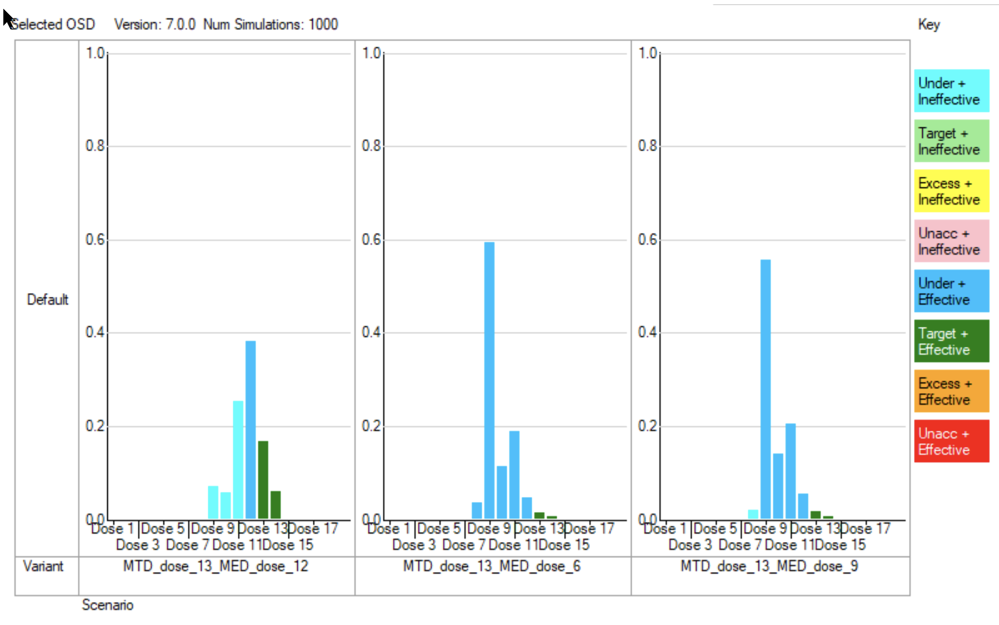

# Simulating using FACTS bCRM

Start FACTS Dose Escalating. Use the menu option File \> New \> bCRM to create a new bivariate CRM design.

Using the menu option File \> Save As, save this design as for example "CRM-tox-and-eff" in a convenient location (e.g. in a folder called FACTS\\CRM-examples in your 'My Documents' folder).

## Study

### Study Info

Set the following parameters:

- Maximum Trial Size (cohorts): 10

- Cohort size: 3

- Number of additional cohorts accrued before response from the current cohort is available: 0

- A subject can show both efficacy and toxicity.

- Target probability of toxicity at MTD: 0.15, Find dose: Nearest target for MTD

- Target probability of efficacy at MED: 0.95, Find dose: Nearest target for MED

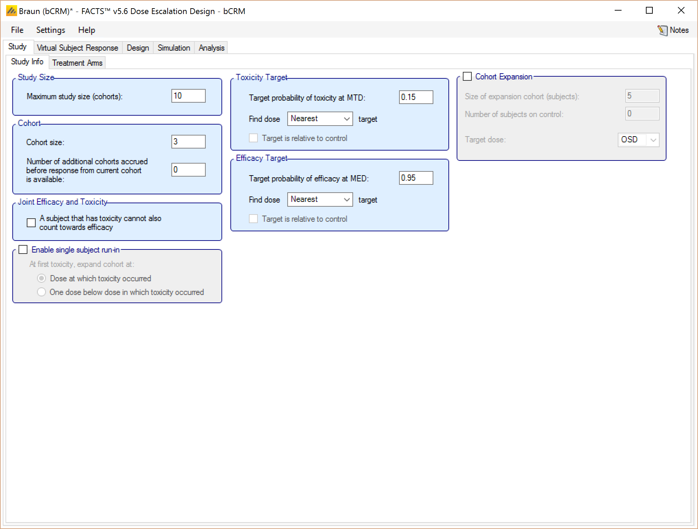

###  Treatment Arms

Create 18 doses 1 to 18 with no placebo:

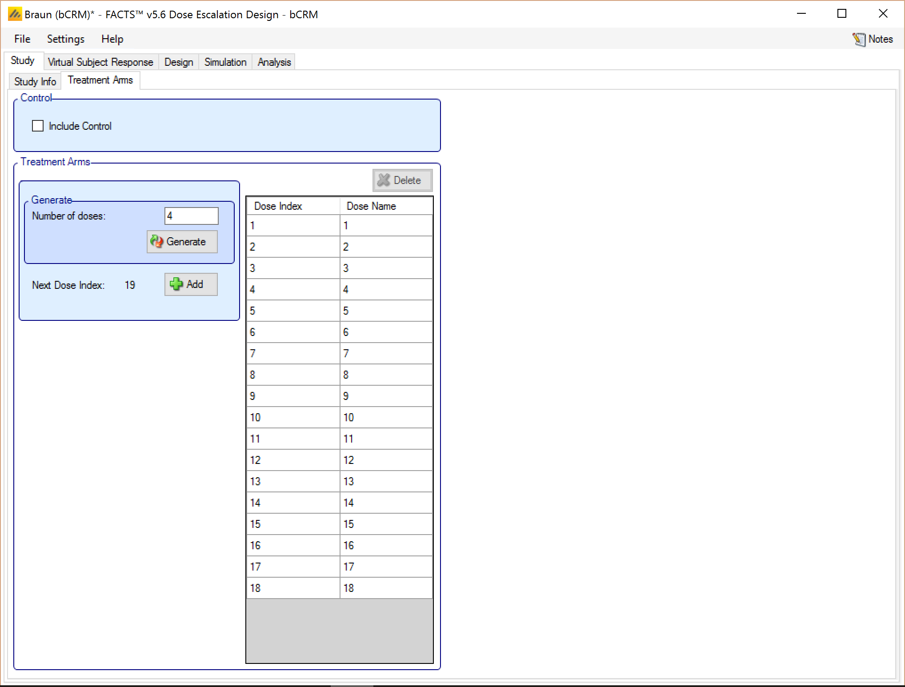

## Virtual Subject Response

### Explicitly Defined -- Toxicity

Add 2 toxicity scenarios to be simulated, specify the P(tox) values for the scenarios as follows:

+--------+:-----:+:-----:+:-----:+:-----:+:-----:+:-----:+:-----:+:-----:+:-----:+:------:+:------:+:------:+:------:+:------:+:------:+:------:+:------:+:------:+
|        | **Dose**                                                                                                                                               |
+--------+-------+-------+-------+-------+-------+-------+-------+-------+-------+--------+--------+--------+--------+--------+--------+--------+--------+--------+
| **\#** | **1** | **2** | **3** | **4** | **5** | **6** | **7** | **8** | **9** | **10** | **11** | **12** | **13** | **14** | **15** | **16** | **17** | **18** |
+--------+-------+-------+-------+-------+-------+-------+-------+-------+-------+--------+--------+--------+--------+--------+--------+--------+--------+--------+
| **A**  | 0.015 | 0.02  | 0.03  | 0.05  | 0.1   | 0.2   | 0.35  | 0.44  | 0.48  | 0.49   | 0.5    | 0.5    | 0.5    | 0.5    | 0.5    | 0.5    | 0.5    | 0.5    |
+--------+-------+-------+-------+-------+-------+-------+-------+-------+-------+--------+--------+--------+--------+--------+--------+--------+--------+--------+
| **B**  | 0.01  | 0.01  | 0.01  | 0.01  | 0.01  | 0.015 | 0.02  | 0.03  | 0.05  | 0.1    | 0.2    | 0.35   | 0.44   | 0.48   | 0.49   | 0.5    | 0.5    | 0.5    |
+--------+-------+-------+-------+-------+-------+-------+-------+-------+-------+--------+--------+--------+--------+--------+--------+--------+--------+--------+
|        | 0.01  | 0.01  | 0.01  | 0.01  | 0.01  | 0.01  | 0.01  | 0.01  | 0.015 | 0.02   | 0.03   | 0.05   | 0.1    | 0.2    | 0.35   | 0.44   | 0.48   | 0.49   |
+--------+-------+-------+-------+-------+-------+-------+-------+-------+-------+--------+--------+--------+--------+--------+--------+--------+--------+--------+

Set the correlations to be --1, 0 and 2 respectively (this is the log odds ratio of seeing both efficacy and toxicity, this gives values of ψ of approx 0.25, 0.5 and 0.88).

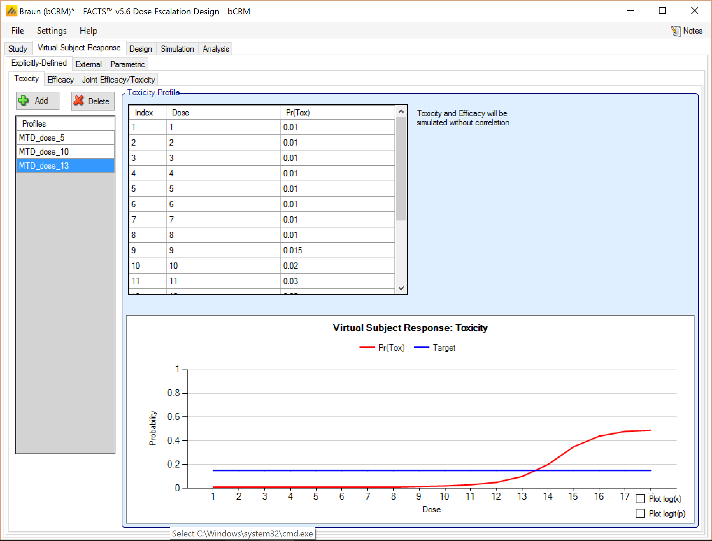

There are no external or parametrically defined curves in this example.

###  Explicitly Defined -- Efficacy

Add 3 efficacy scenarios to be simulated, specify the P(eff) values for the scenarios as follows:

+--------+:-----:+:-----:+:-----:+:-----:+:-----:+:-----:+:-----:+:-----:+:-----:+:------:+:------:+:------:+:------:+:------:+:------:+:------:+:------:+:------:+
|        | **Dose**                                                                                                                                               |
+--------+-------+-------+-------+-------+-------+-------+-------+-------+-------+--------+--------+--------+--------+--------+--------+--------+--------+--------+
| **\#** | **1** | **2** | **3** | **4** | **5** | **6** | **7** | **8** | **9** | **10** | **11** | **12** | **13** | **14** | **15** | **16** | **17** | **18** |
+--------+-------+-------+-------+-------+-------+-------+-------+-------+-------+--------+--------+--------+--------+--------+--------+--------+--------+--------+
| **A**  | 0.5   | 0.5   | 0.5   | 0.51  | 0.75  | 0.95  | 0.955 | 0.96  | 0.965 | 0.97   | 0.975  | 0.98   | 0.98   | 0.98   | 0.98   | 0.98   | 0.98   | 0.98   |
+--------+-------+-------+-------+-------+-------+-------+-------+-------+-------+--------+--------+--------+--------+--------+--------+--------+--------+--------+
| **B**  | 0.5   | 0.5   | 0.5   | 0.5   | 0.51  | 0.6   | 0.75  | 0.86  | 0.95  | 0.97   | 0.975  | 0.98   | 0.98   | 0.98   | 0.98   | 0.98   | 0.98   | 0.98   |
+--------+-------+-------+-------+-------+-------+-------+-------+-------+-------+--------+--------+--------+--------+--------+--------+--------+--------+--------+
| **C**  | 0.5   | 0.5   | 0.5   | 0.5   | 0.5   | 0.5   | 0.5   | 0.51  | 0.6   | 0.75   | 0.86   | 0.95   | 0.97   | 0.975  | 0.98   | 0.98   | 0.98   | 0.98   |
+--------+-------+-------+-------+-------+-------+-------+-------+-------+-------+--------+--------+--------+--------+--------+--------+--------+--------+--------+

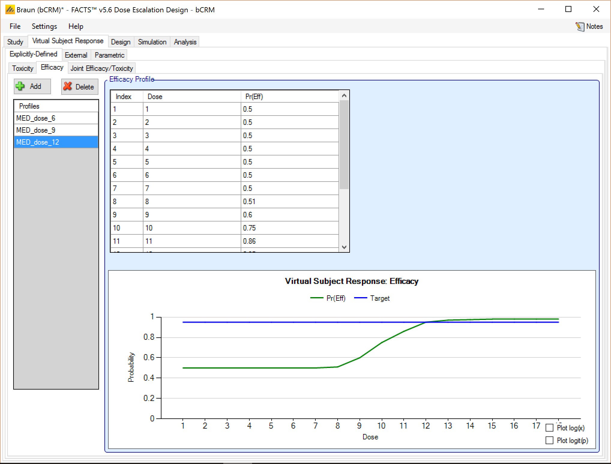

There are no external or parametrically defined curves in this example.

##  Design

### Toxicity Response

Set the parameters as follows, it is important in this example to set the minimum-maximum range for the response and, with so many doses, ensure they are well spaced within the model's transformed dose levels:

- Model type: logistic

- Minimum: 0

- Maximum: 0.55 (the scenarios all plateau at 0.5)

- Alpha: 3

- Prior type: exponential

- Prior probability of Toxicity is specified using evenly spaced transformed dose levels in the range --9 to --0.5. NOTE these must be ascending, they must be below 0, using equal spacing of 0.5 in the transformed dose scale gives reasonable flexibility in the curve between doses (though with this many doses it does go outside the range that would be normally recommended, tests show that this is better than halving the range by using steps of 0.25).

+--------+:-----:+:-----:+:-----:+:-----:+:-----:+:------:+:-----:+:-----:+:-----:+:------:+:------:+:------:+:------:+:------:+:------:+:------:+:------:+:------:+
|        | **Dose**                                                                                                                                                |
+--------+-------+-------+-------+-------+-------+--------+-------+-------+-------+--------+--------+--------+--------+--------+--------+--------+--------+--------+
| **\#** | **1** | **2** | **3** | **4** | **5** | **6**  | **7** | **8** | **9** | **10** | **11** | **12** | **13** | **14** | **15** | **16** | **17** | **18** |
+--------+-------+-------+-------+-------+-------+--------+-------+-------+-------+--------+--------+--------+--------+--------+--------+--------+--------+--------+
| **A**  | -9    | -8.5  | -8    | -7.5  | -7    | \--6.5 | -6    | -5.5  | -5    | -4.5   | -4     | -3.5   | -3     | -2.5   | -2     | -1.5   | -1     | -0.5   |
+--------+-------+-------+-------+-------+-------+--------+-------+-------+-------+--------+--------+--------+--------+--------+--------+--------+--------+--------+

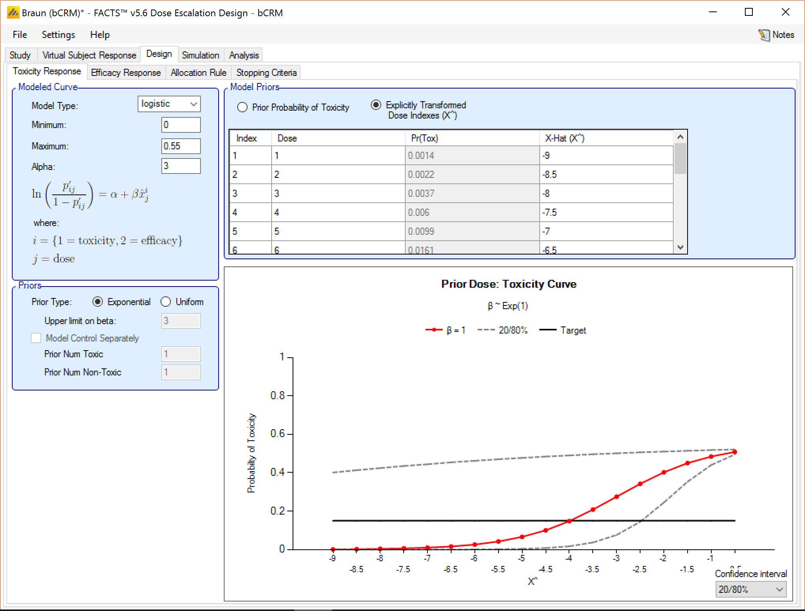

###  Efficacy Response

Set the parameters as follows, as with toxicity it is important in this example to set the minimum-maximum range for the response and, with so many doses, ensure they are well spaced within the model's transformed dose levels. For efficacy we also use Alpha of --3 rather than 3. Effectively this shifts the sensitivity to the upper doses: we have a stronger prior that the lowest dose will be ineffective than we do that the upper dose will be effective.

- Model type: logistic

- Minimum: 0.4 (the scenarios all start at 0.5)

- Maximum: 1

- Alpha: -3

- Prior type: uniform

- Prior probability of Efficacy: NOTE these must be ascending, they must be between 0 and 1 and they must all be different.

+--------+:-----:+:-----:+:-----:+:-----:+:-----:+:-----:+:-----:+:-----:+:-----:+:------:+:------:+:------:+:------:+:------:+:------:+:------:+:------:+:------:+
|        | **Dose**                                                                                                                                               |
+--------+-------+-------+-------+-------+-------+-------+-------+-------+-------+--------+--------+--------+--------+--------+--------+--------+--------+--------+
| **\#** | **1** | **2** | **3** | **4** | **5** | **6** | **7** | **8** | **9** | **10** | **11** | **12** | **13** | **14** | **15** | **16** | **17** | **18** |
+--------+-------+-------+-------+-------+-------+-------+-------+-------+-------+--------+--------+--------+--------+--------+--------+--------+--------+--------+
| **A**  | 0.5   | 1     | 1.5   | 2     | 2.5   | 3     | 3.5   | 4     | 4.5   | 5      | 5.5    | 6      | 6.5    | 7      | 7.5    | 8      | 8.5    | 9      |
+--------+-------+-------+-------+-------+-------+-------+-------+-------+-------+--------+--------+--------+--------+--------+--------+--------+--------+--------+

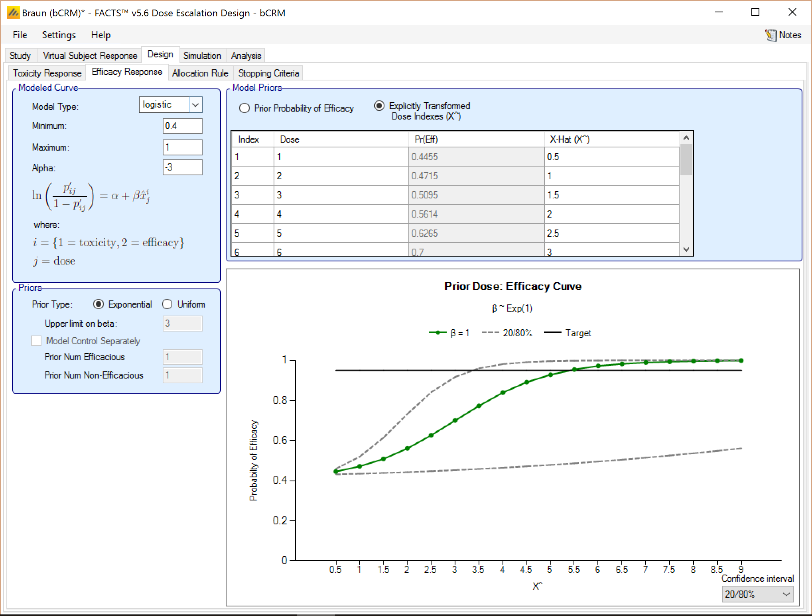

### Allocation Rule

Set the parameters as follows:

- Maximum dose levels that can be incremented: 1

- Minimum cohorts on dose before incrementing: 1

- Maximum number of cohorts use to determine MTD: 6 (switch to looking for MED with the remaining 4 cohorts even if the MTD doesn't have two cohorts on it)

- Starting dose level: 9 -- with this many dose levels, we need to start in the middle of the range.

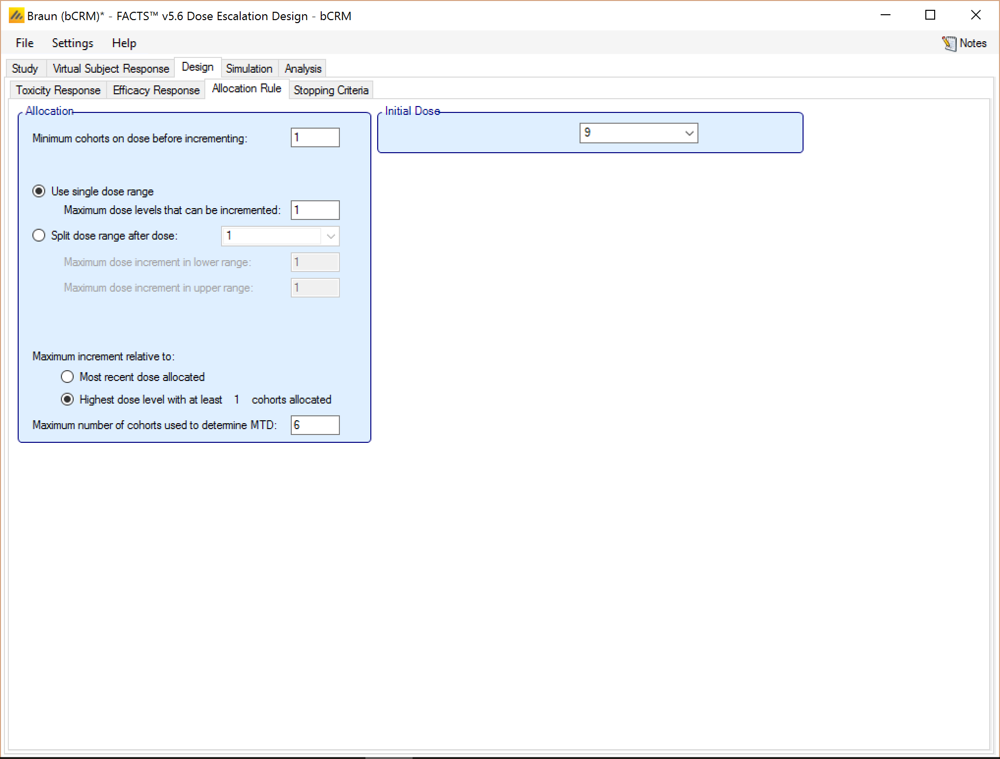

###  Stopping Criteria

Set the parameters as follows:

- Select rules for stopping trial early

- Maximum cohorts on MTD: 2 (recall that cohort size is 3)

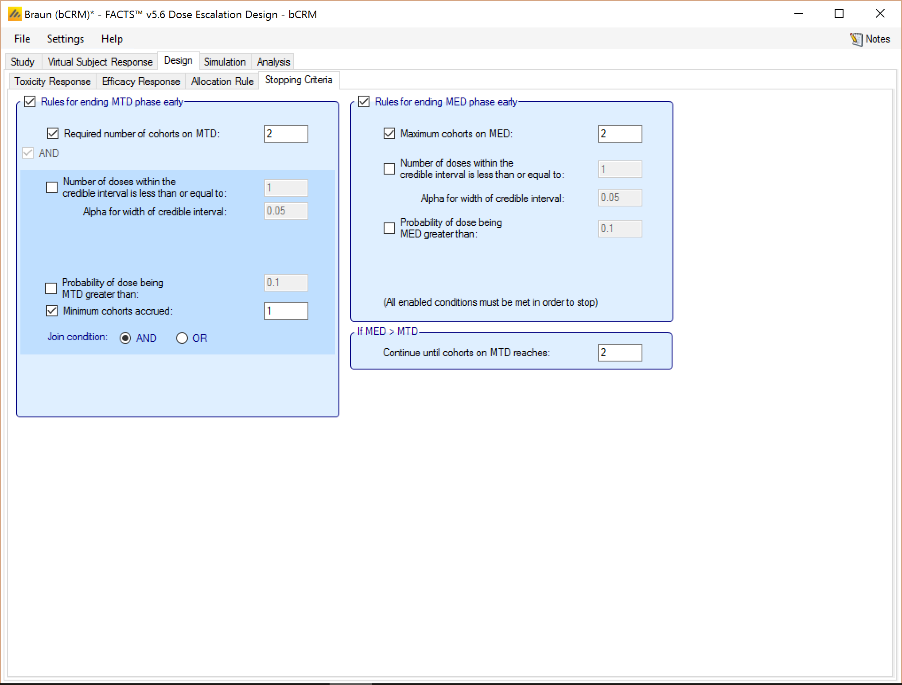

## Simulation

Select all scenarios and run 1000 simulations of each (this is fairly fast even when run locally).

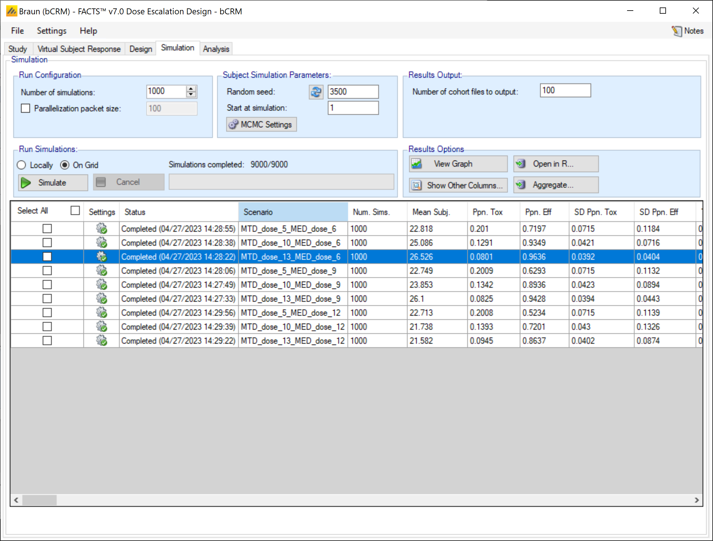

Click on "show other columns" and then select "probabilities etc." to see MTD selection results:

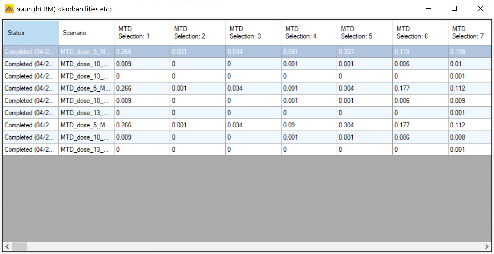

And scroll further right for the MED results:

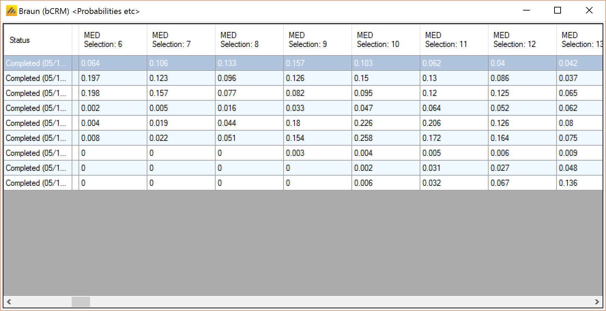

and still further right for the OSD (Optimally Selected Dose), this is MED if MED is \< MTD, otherwise it is MTD:

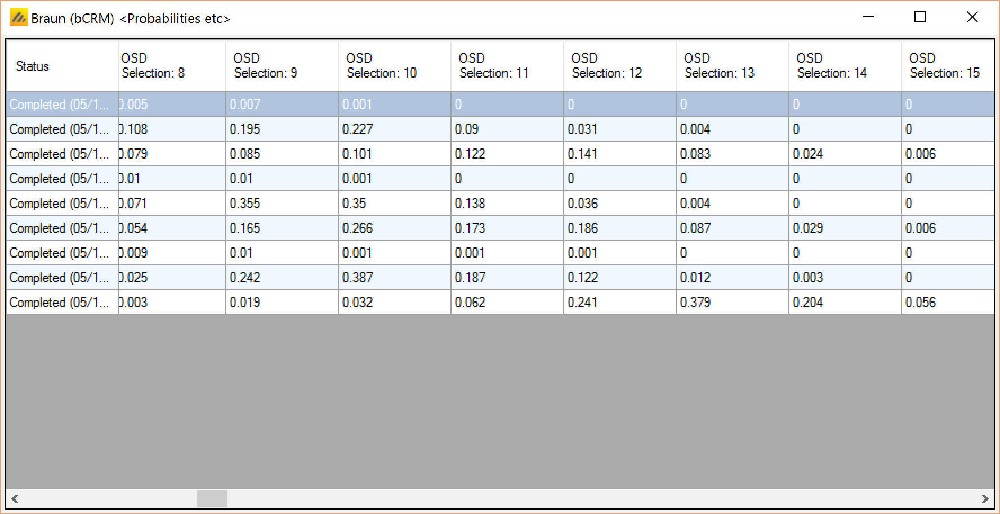

# Comparing bCRM and N-CRM results

We will simply look at the OSD selection in the different scenarios

MTD at dose 5 scenarios -- MED is always above MTD, so the desired outcome is to select dose 5 or 6:

+-------------------------+----------+---------------------+---------------------+-----------+
| Scenario                | Design   | Ppn selected Dose 5 | Ppn selected Dose 6 | Total     |
+=========================+==========+=====================+=====================+===========+
| MTD_dose_5_MED_dose_6   | N-CRM    | 0.373               | 0.311               | **0.684** |
|                         +----------+---------------------+---------------------+-----------+
|                         | bCRM     | 0.316               | 0.186               | **0.502** |
+-------------------------+----------+---------------------+---------------------+-----------+
| MTD_dose_5_MED_dose_9   | N-CRM    | 0.371               | 0.304               | **0.675** |
|                         +----------+---------------------+---------------------+-----------+
|                         | bCRM     | 0.304               | 0.177               | **0.481** |
+-------------------------+----------+---------------------+---------------------+-----------+
| MTD_dose_5_MED_dose_12  | N-CRM    | 0.37                | 0.304               | **0.674** |
|                         +----------+---------------------+---------------------+-----------+
|                         | nCRM     | 0.304               | 0.177               | **0.481** |
+-------------------------+----------+---------------------+---------------------+-----------+

The N-CRM clearly out performs the bCRM at MTD selection.

MTD at dose 10 scenarios -- When the MED 6, any dose between dose 6 to 11 is acceptable, when the MED is dose 9, doses 9, 10 & 11 are acceptable, when the MED is dose 12 only doses 10 & 11 are acceptable:

+-------------------------+--------+---------------------+---------------------+---------------------+---------------------+----------------------+----------------------+-----------+
| Scenario                | Design | Ppn selected Dose 6 | Ppn selected Dose 7 | Ppn selected Dose 8 | Ppn selected Dose 9 | Ppn selected Dose 10 | Ppn selected Dose 11 | Total     |
+=========================+========+=====================+=====================+=====================+=====================+======================+======================+===========+
| MTD_dose_10_MED_dose_6  | N-CRM  | 0.001               | 0.007               | 0.171               | 0.548               | 0.195                | 0.073                | **0.995** |
|                         +--------+---------------------+---------------------+---------------------+---------------------+----------------------+----------------------+-----------+
|                         | bCRM   | 0.172               | 0.184               | 0.099               | 0.237               | 0.126                | 0.152                | **0.970** |
+-------------------------+--------+---------------------+---------------------+---------------------+---------------------+----------------------+----------------------+-----------+
| MTD_dose_10_MED_dose_9  | N-CRM  |                     |                     |                     | 0.575               | 0.245                | 0.081                | **0.901** |
|                         +--------+---------------------+---------------------+---------------------+---------------------+----------------------+----------------------+-----------+
|                         | bCRM   |                     |                     |                     | 0.372               | 0.211                | 0.227                | **0.810** |
+-------------------------+--------+---------------------+---------------------+---------------------+---------------------+----------------------+----------------------+-----------+
| MTD_dose_10_MED_dose_12 | N-CRM  |                     |                     |                     |                     | 0.387                | 0.272                | **0.659** |
|                         +--------+---------------------+---------------------+---------------------+---------------------+----------------------+----------------------+-----------+
|                         | nCRM   |                     |                     |                     |                     | 0.149                | 0.468                | **0.617** |
+-------------------------+--------+---------------------+---------------------+---------------------+---------------------+----------------------+----------------------+-----------+

Here the N-CRM out performs the bCRM in MTD selection, with a strong peak at Dose 9 and less tendency to select higher than necessary doses close to MTD.

MTD at dose 13 scenarios -- When the MED 6, any dose between dose 6 to 14 is acceptable, when the MED is dose 9, any dose between dose 9 to 14 is acceptable, when the MED is dose 12 only doses 12, 13 & 14 are acceptable:

+---------------------------+----------+---------------------+---------------------+---------------------+
| Scenario                  | Design   | Ppn selected Dose 6 | Ppn selected Dose 7 | Ppn selected Dose 8 |
+===========================+==========+=====================+=====================+=====================+
| MTD_dose_13_MED_dose_6    | N-CRM    | 0                   | 0                   | 0.036               |
|                           +----------+---------------------+---------------------+---------------------+
|                           | bCRM     | 0.190               | 0.206               | 0.031               |
+---------------------------+----------+---------------------+---------------------+---------------------+

+-------------------------+--------+---------------------+----------------------+----------------------+----------------------+----------------------+----------------------+-----------+
| Scenario                | Design | Ppn selected Dose 9 | Ppn selected Dose 10 | Ppn selected Dose 11 | Ppn selected Dose 12 | Ppn selected Dose 13 | Ppn selected Dose 14 | Total     |
+=========================+========+=====================+======================+======================+======================+======================+======================+===========+
| MTD_dose_13_MED_dose_6  | N-CRM  | 0.594               | 0.113                | 0.189                | 0.046                | 0.016                | 0.067                | **1.000** |
|                         +--------+---------------------+----------------------+----------------------+----------------------+----------------------+----------------------+-----------+
|                         | bCRM   | 0.114               | 0.076                | 0.106                | 0.061                | 0.137                | 0.067                | **0.988** |
+-------------------------+--------+---------------------+----------------------+----------------------+----------------------+----------------------+----------------------+-----------+
| MTD_dose_13_MED_dose_9  | N-CRM  | 0.556               | 0.141                | 0.205                | 0.054                | 0.017                | 0.006                | **0.979** |
|                         +--------+---------------------+----------------------+----------------------+----------------------+----------------------+----------------------+-----------+
|                         | bCRM   | 0.160               | 0.200                | 0.182                | 0.108                | 0.150                | 0.074                | **0.874** |
+-------------------------+--------+---------------------+----------------------+----------------------+----------------------+----------------------+----------------------+-----------+
| MTD_dose_13_MED_dose_12 | N-CRM  |                     |                      |                      | 0.383                | 0.168                | 0.061                | **0.612** |
|                         +--------+---------------------+----------------------+----------------------+----------------------+----------------------+----------------------+-----------+
|                         | nCRM   |                     |                      |                      | 0.150                | 0.389                | 0.221                | **0.760** |
+-------------------------+--------+---------------------+----------------------+----------------------+----------------------+----------------------+----------------------+-----------+

Here again the N-CRM outperforms the bCRM, except in MTD_dose_13_MED_dose_12 where bCRM out performs N-CRM.
