#  Introduction

This tutorial describes the example trial design using the FACTS Dose Escalation Design Engine for Efficacy.

For this version of the document, the screenshots are from the FACTS v6.3.

The screenshots provided are approximate and may not reflect the exact layout of the information in later versions of FACTS. The contents of each tab, however, will be consistent with the software.

# Case Study: Migraine

The example is the use of the Continual Reassessment Method to find the MED in a Migraine Study.

The endpoint is to find the minimum dose with a recovery rate of 50%, where recovery is that the headache has cleared 2 hours after the onset of a migraine and taking the medication.

There are Placebo plus 5 treatment arms and a maximum of 80 subjects.

Subjects will be dosed in cohorts of 1, 20% of subjects will be allocated to placebo and 20% to the highest dose, the remainder will be allocated to the currently estimated MED

There is no restriction on incrementing dose strength.

We will stop when we have allocated 6 subjects to the same dose but not stop before 18 subjects have been treated (unless there are no usable doses).

## Response Model

If the probability of observing efficacy for a subject given dose *j* *p~j~*

We will model the probability of efficacy across the range of doses:

With *α* set to --3 and *β* distributed:

$$\beta \sim U[0,3)$$

Each dose *j* is given a 'strength' $\widehat{x_{j}}$ by fitting the user supplied prior expectations of efficacy for each dose *p^0^~j~* to the above model with *β* set to 1. i.e. solving:

$$\log\left(\frac{p^{0}_{j}}{1 - p^{0}_{j}}\right) = \alpha + \widehat{x_{j}}$$

for $\widehat{x_{j}}$.

## Simulation Details

Four different possible dose efficacy responses will be simulated

+-------------------+:------:+:------:+:------:+:------:+:------:+:------:+
|                   | **Efficacy Rate per Dose**                          |
+-------------------+--------+--------+--------+--------+--------+--------+
| **\#**            | **0**  | **1**  | **2**  | **3**  | **4**  | **5**  |
+-------------------+--------+--------+--------+--------+--------+--------+
| **Ineffective**   | 0.2    | 0.2    | 0.21   | 0.24   | 0.3    | 0.4    |
+-------------------+--------+--------+--------+--------+--------+--------+
| **Top**           | 0.2    | 0.21   | 0.25   | 0.3    | 0.4    | 0.55   |
+-------------------+--------+--------+--------+--------+--------+--------+
| **Mid**           | 0.2    | 0.25   | 0.35   | 0.5    | 0.55   | 0.56   |
+-------------------+--------+--------+--------+--------+--------+--------+
| **Not effective** | 0.2    | 0.2    | 0.2    | 0.2    | 0.2    | 0.2    |
+-------------------+--------+--------+--------+--------+--------+--------+

## Designs for comparison

Compare with using other models (tanh or power) and the alternative exponential prior distribution for β.

#  Simulating using FACTS

Start FACTS Dose Escalating. Use the menu option File \> New \> CRM (Efficacy) to create a new CRM design.

Using the menu option File \> Save As, save this design as for example "CRM-eff" in a convenient location (e.g. in a folder called FACTS\\CRM-examples in your 'My Documents' folder).

## Study

### Study Info

Set the following parameters:

- Maximum Trial Size (cohorts): 80

- Single sample population

- Cohort size: 1

- Number of additional cohorts accrued before response from the current cohort is available: 10 (represents the delay in waiting subjects to have a migraine)

- Target probability of efficacy at MED: 0.5

- Find Dose: Nearest target

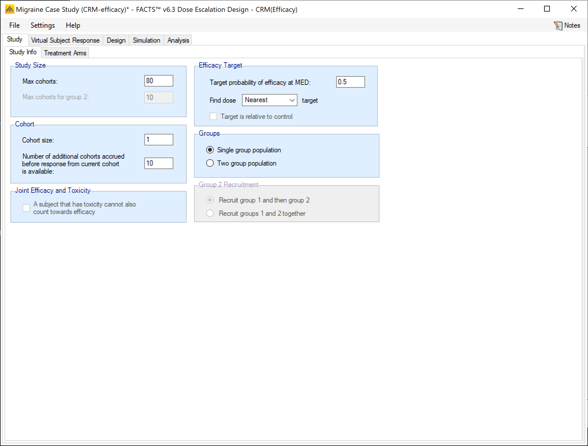

###  Treatment Arms

Create 6 doses, 1 to 6 and rename the lowest as "Control".

(The "Include Control" option is used to allocate one or more subjects out of each cohort to control, but we have single subject cohorts, so we cannot use it here.)

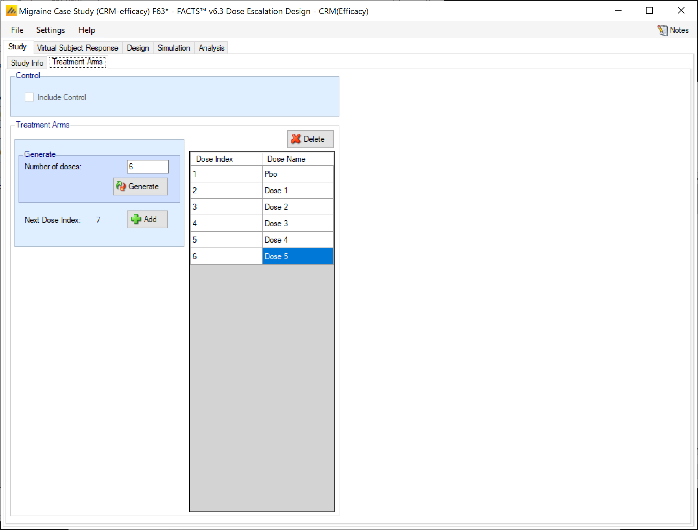

##  Virtual Subject Response

### Explicitly Defined -- Efficacy

Add 4 response scenarios to be simulated, specify the P(Eff) values for each scenario as follows:

+-------------------+:------:+:------:+:------:+:------:+:------:+:------:+
|                   | **Efficacy Rate per Dose**                          |
+-------------------+--------+--------+--------+--------+--------+--------+
| **\#**            | **0**  | **1**  | **2**  | **3**  | **4**  | **5**  |
+-------------------+--------+--------+--------+--------+--------+--------+
| **Ineffective**   | 0.2    | 0.2    | 0.2    | 0.2    | 0.2    | 0.2    |
+-------------------+--------+--------+--------+--------+--------+--------+
| **Top**           | 0.2    | 0.21   | 0.25   | 0.3    | 0.4    | 0.55   |
+-------------------+--------+--------+--------+--------+--------+--------+
| **Mid**           | 0.2    | 0.25   | 0.35   | 0.5    | 0.55   | 0.56   |
+-------------------+--------+--------+--------+--------+--------+--------+
| **Weak**          | 0.2    | 0.2    | 0.21   | 0.24   | 0.3    | 0.4    |
+-------------------+--------+--------+--------+--------+--------+--------+

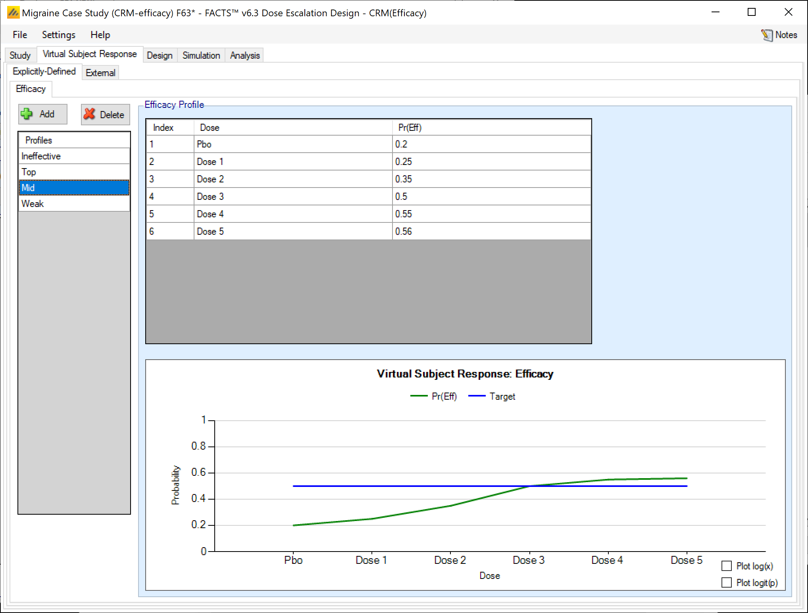

There are no external or parametrically defined curves in this example.

##  Design

### Efficacy Response

Set the parameters as follows:

- Model type: logistic

- Minimum: 0

- Maximum: 1

- Alpha: 3

- Prior type: uniform, upper limit 3

- Prior probability of Toxicity for both samples: 0.2, 0.25, 0.3, 0.4, 0.5, 0.6

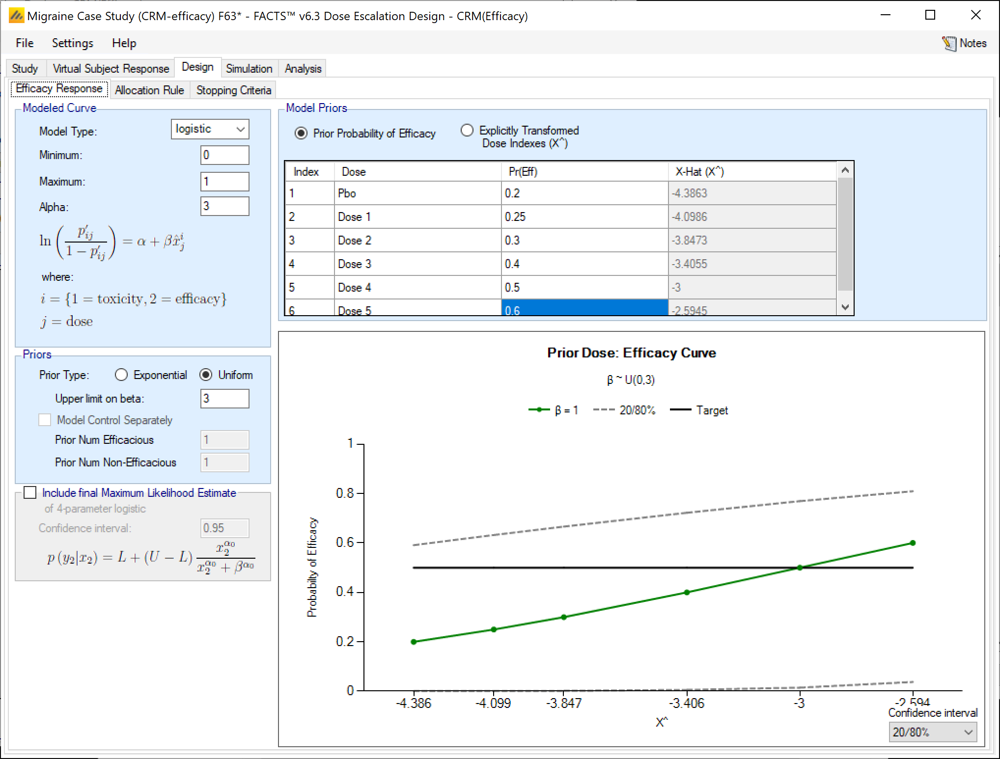

### Allocation Rule

- Probability of allocation to min dose: 0.2

- Probability of allocation to max dose: 0.2

- Probability gamma: 2 (this is a parameter for a function that biases the randomization to try to achieve the desired probabilities, the higher the stronger the bias).

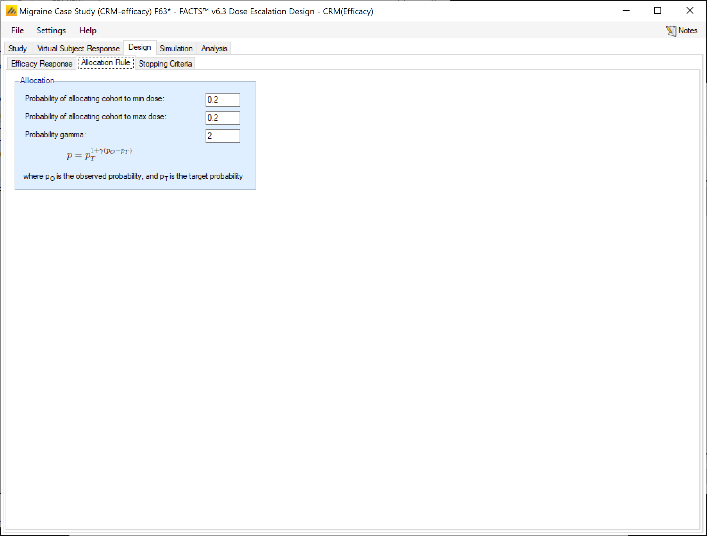

###  Stopping Criteria

Set the parameters as follows:

- Select rules for stopping trial early

- Only stop early for futility

- Don't stop until at least 10 cohorts (10 subjects) has been allocated to both placebo and the maximum dose.

- Stop for futility if the difference in the response rate between the maximum dose and placebo is less than 0.1.

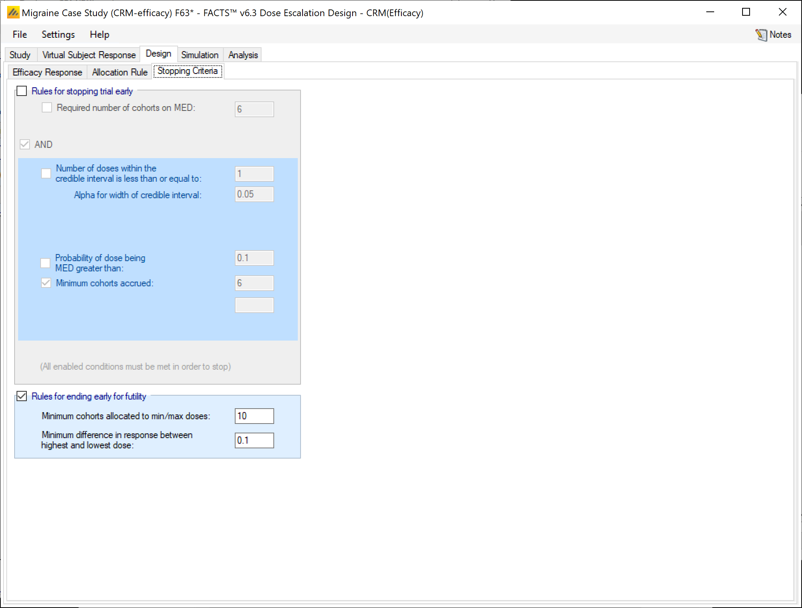

## Simulation

Select all scenarios and run 1000 simulations of each (this is fairly fast even when run locally). Scroll across to the MED selection results:

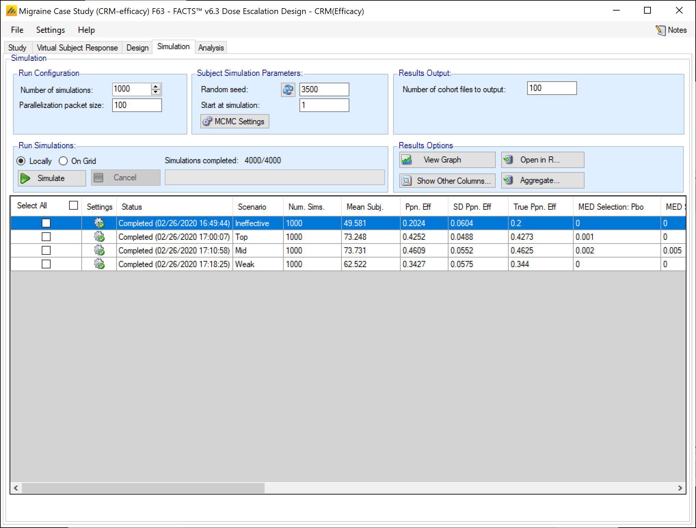

Note that because we asked for the dose nearest to 0.5, the top dose is reported as MED even if it performs poorly. If instead we look at MED+ (click on "show other columns" and select "Pr(MED) Etc."),

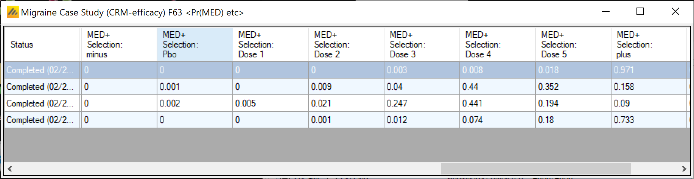

On the ineffective scenario 97% of simulations report that the MED is somewhere above the top dose (MED+plus) and in the weak scenario, 74.4% of simulations. This could be used as part of a go/no-go criteria.

The ability to detect that there is an MED at the top two doses in the "Top" scenario dose and at doses 3 & 4 in the Mid is reasonable.

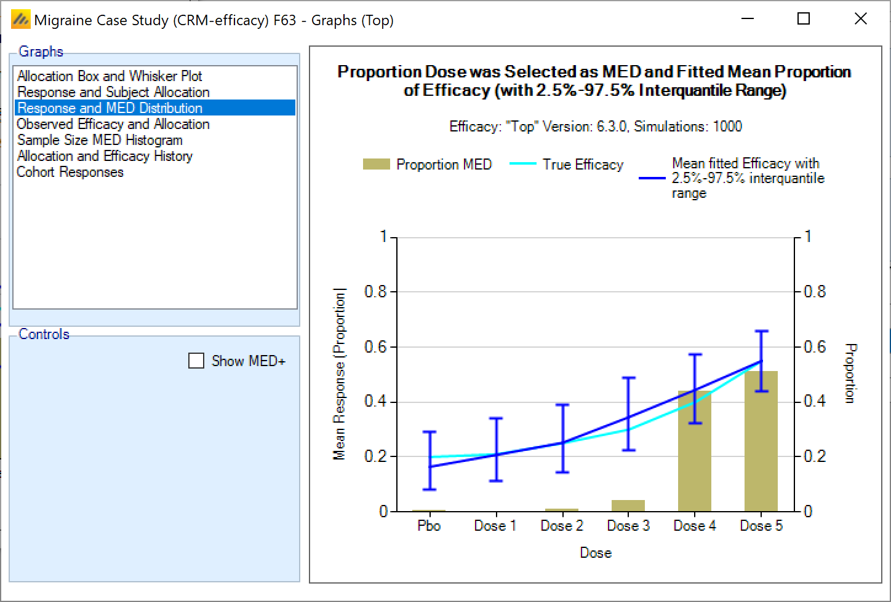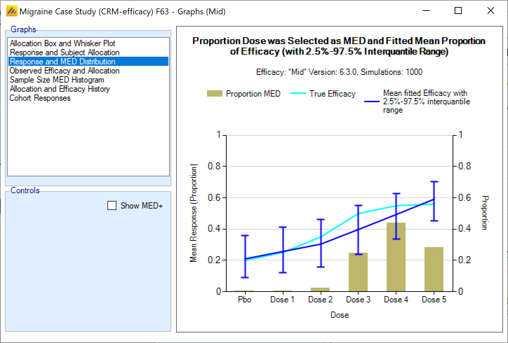

## Alternative Dose-Toxicity Model

An alternative design that is usually worth considering for efficacy trials is to use an Alpha of --3 rather than 3 when dealing with efficacy, and re-scale the model fit, to be between 0.2 and 0.6, and changing the prior toxicities slightly to: 0.22, 0.25, 0.3, 0.4, 0.5, 0.55.

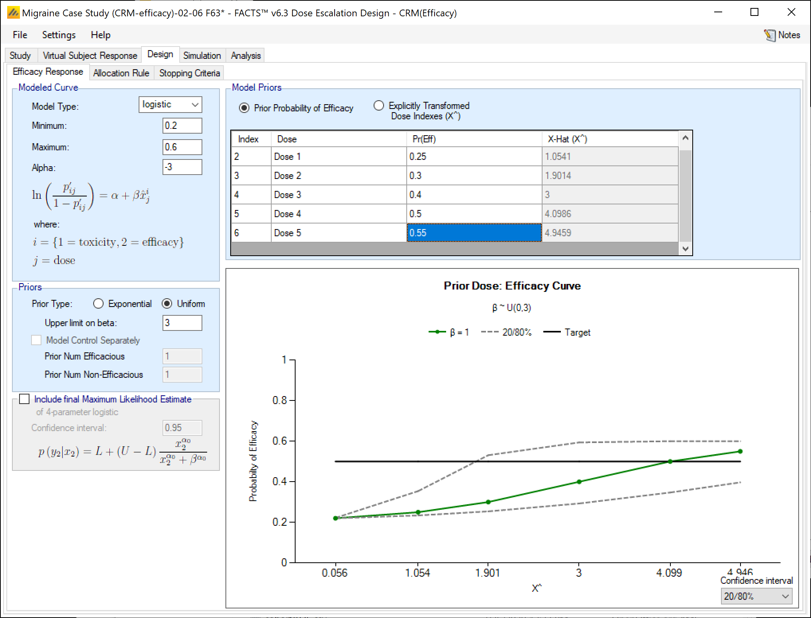

Using Alpha --3 and a restricted model range more in keeping with the expected response (a lower asymptote at 0.2 and upper asymptote at 0.6) gives slightly better selection of dose 3 as MED and a lot better subject allocation to the lower doses.

+-------------------------------------------+--------+-----------------------------------------------+-----------------------------------------------+
|                                           |        | Selection of MED                              | Allocation of subjects to doses               |
+-------------------------------------------+--------+-----------------------------------------------+-----------------------------------------------+
| Using Alpha 3                             | Top    | 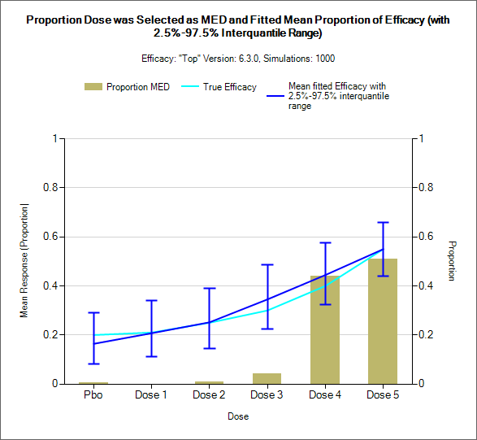 | 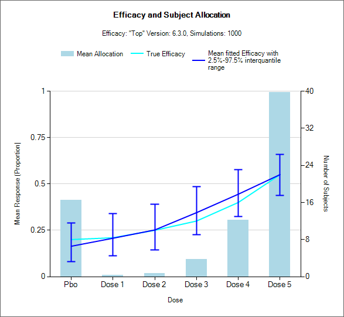 |
|                                           +--------+-----------------------------------------------+-----------------------------------------------+
|                                           | Mid    | 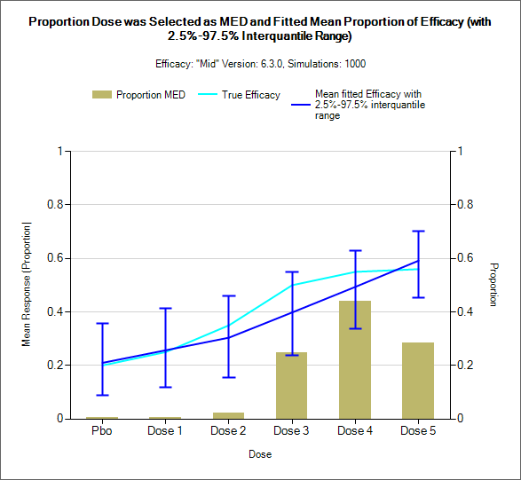 | 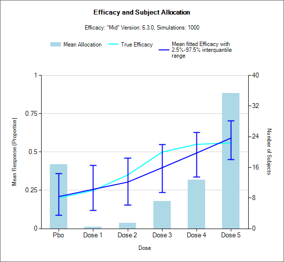 |
+-------------------------------------------+--------+-----------------------------------------------+-----------------------------------------------+
| Using Alpha -3 and model range of 0.2-0.6 | Top    | 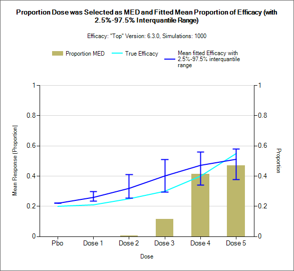 | 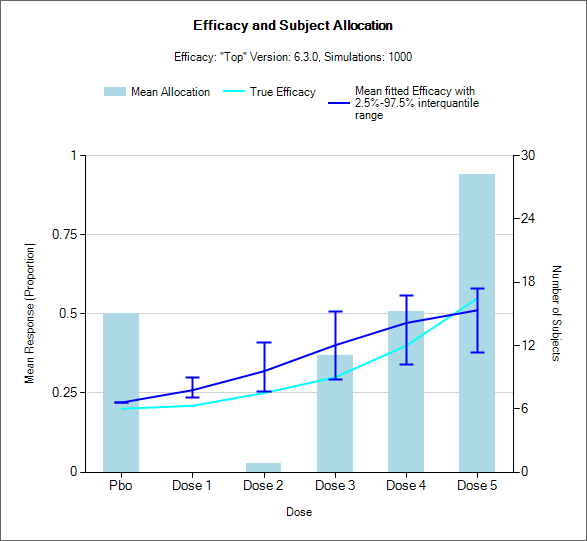 |
|                                           +--------+-----------------------------------------------+-----------------------------------------------+
|                                           | Mid    | 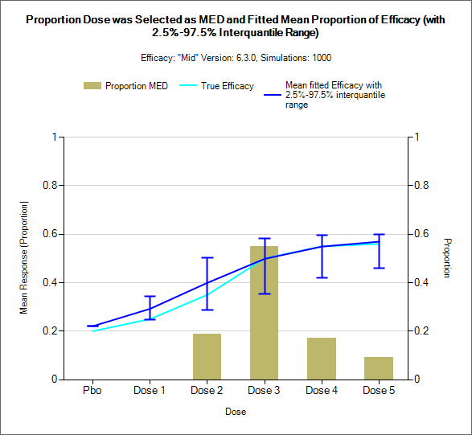 | 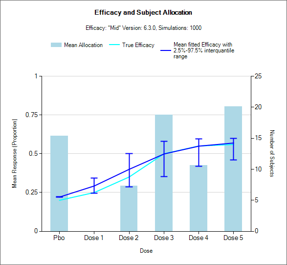 |
+-------------------------------------------+--------+-----------------------------------------------+-----------------------------------------------+
