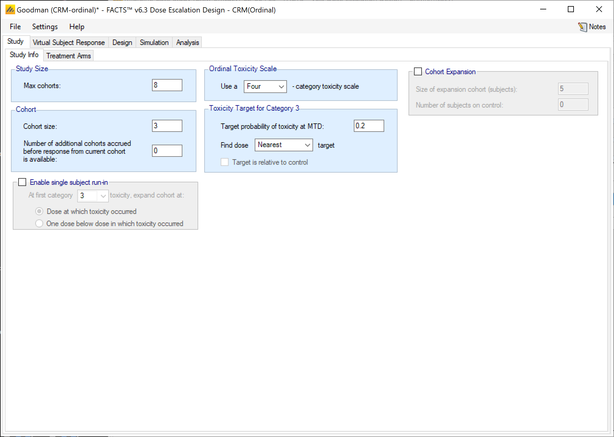
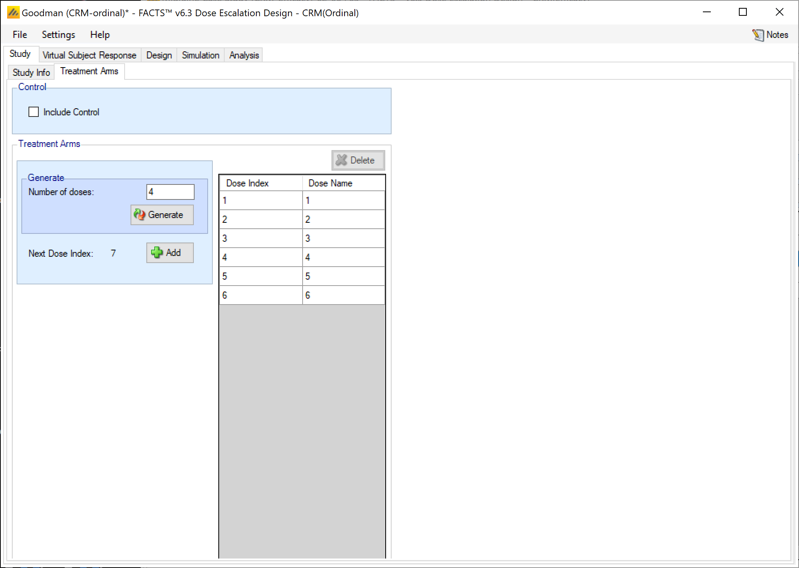
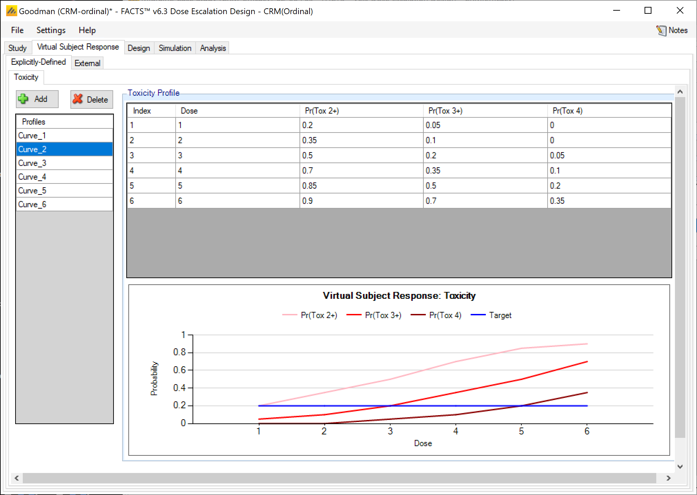
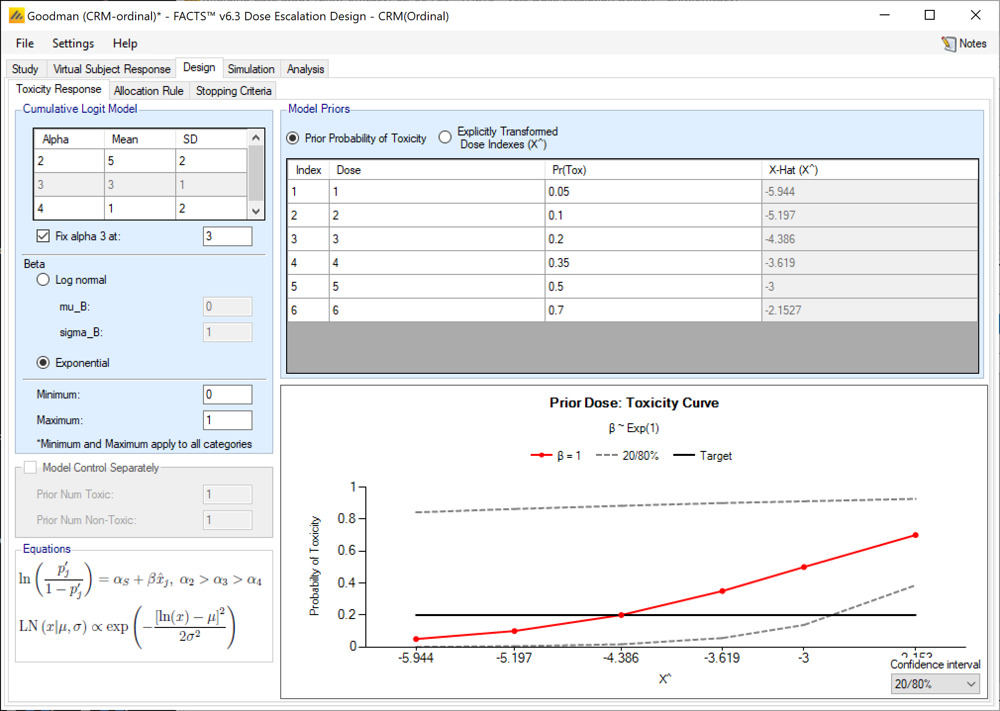
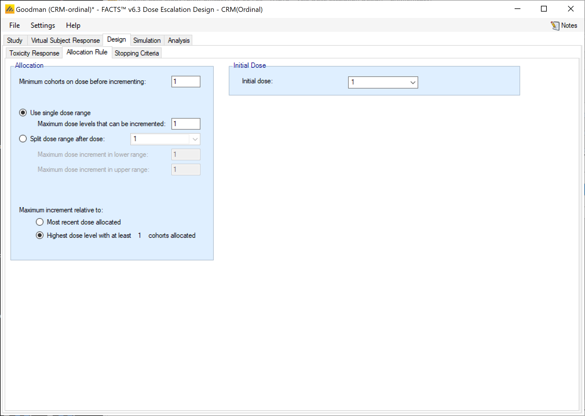
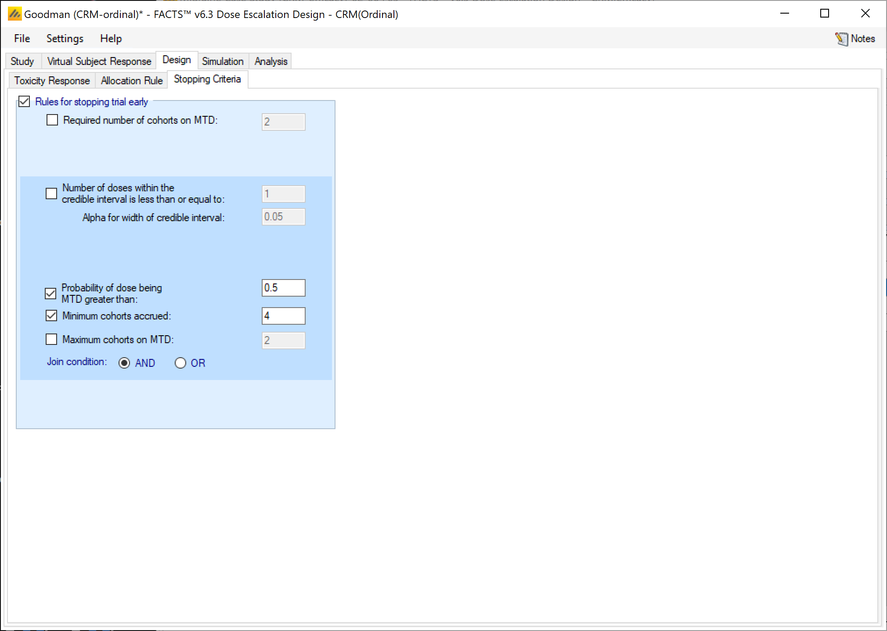
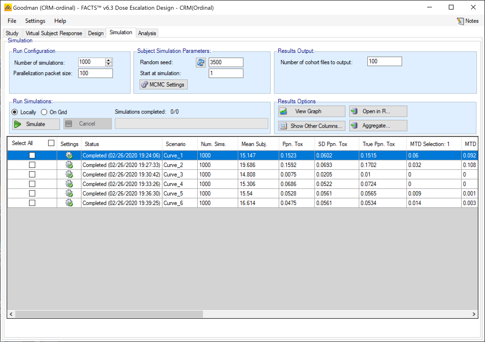
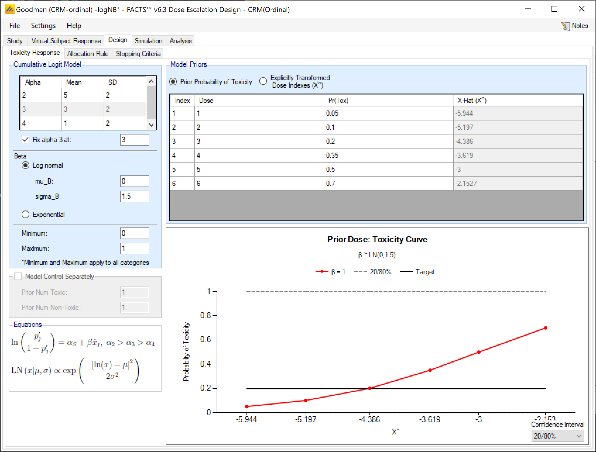

#  Introduction

This tutorial describes the example trial design using the FACTS Dose Escalation Design Engine for Ordinal Toxicity.

For this version of the document, the screenshots are from the v6.3 release of FACTS.

The screenshots provided are approximate and may not reflect the exact layout of the information in later versions of FACTS. The contents of each tab, however, will be consistent with the software.

# Case Study: Modified Goodman

The example based on the example used for CRM Toxicity that was is taken from Steven Goodman's 1995 paper on the Continual Reassessment Method.

The patient endpoint is toxicity on a scale of 1 to 4 toxicity grades, where grade 1 is no or minimal toxicity, grade 2 is moderate toxicity, grade 3 is severe toxicity and grade 4 is extreme toxicity, possibly fatal.

The target is to find the maximum tolerated dose with a target toxicity rate of 0.2 grade 3 toxicity.

There are 6 treatment arms and a maximum of 24 subjects (8 cohorts).

Subjects will be dosed in cohorts of 3, starting at the lowest dose.

We will never increment by more than 1 dose strength.

We will stop when we have allocated at least 4 cohorts and there is a dose with 50% or greater probability of being the MTD.

## Response Model

If the probability of observing grade *i* or higher toxicity for a subject given dose *j* is *p~ij~*

We will model the probability of toxicity across the range of doses:

$$\log\left(\frac{p_{ij}}{1 - p_{ij}}\right) = \alpha_i + \beta\widehat{x_{j}}$$

With *α~3~* set to 3 and *β* given the prior distribution:

$$\beta \sim \exp(1)$$

And *α~2~* and *α~4~* given Normal prior distributions (mean 5, variance 4) and (mean 1 variance 4) respectively:

$$\alpha_2 \sim N(5,4),\ \alpha_4 \sim N(1,4)$$

Each dose *j* is given a 'strength' $\widehat{x_{j}}$ by fitting the user supplied prior expectations of toxicity for each dose *p^0^~3j~* to the above model with *β* set to 1. i.e. solving:

$$\log\left(\frac{p^{0}_{3j}}{1 - p^{0}_{3j}}\right) = \alpha_3 + \widehat{x_{j}}$$

for $\widehat{x_{j}}$.

## Simulation Details

Six different possible dose toxicity responses will be simulated, in each scenario the target MTD is highlighted.

+---------------+--------------+:-----:+:-----:+:-----:+:-----:+:-----:+:-----:+
|               |              | **Dose**                                      |
+---------------+--------------+-------+-------+-------+-------+-------+-------+
| **Scenario#** | **Toxicity** | **1** | **2** | **3** | **4** | **5** | **6** |
+---------------+--------------+-------+-------+-------+-------+-------+-------+
| **1**         | Pr(Tox 2+)   | 0.05  | 0.1   | 0.2   | 0.35  | 0.5   | 0.7   |
|               +--------------+-------+-------+-------+-------+-------+-------+
|               | Pr(Tox 3+)   | 0.05  | 0.1   | 0.2   | 0.35  | 0.5   | 0.7   |
|               +--------------+-------+-------+-------+-------+-------+-------+
|               | Pr(Tox 4)    | 0     | 0     | 0     | 0     | 0     | 0     |
+---------------+--------------+-------+-------+-------+-------+-------+-------+
| **2**         | Pr(Tox 2+)   | 0.2   | 0.35  | 0.5   | 0.7   | 0.85  | 0.9   |
|               +--------------+-------+-------+-------+-------+-------+-------+
|               | Pr(Tox 3+)   | 0.05  | 0.1   | 0.2   | 0.35  | 0.5   | 0.7   |
|               +--------------+-------+-------+-------+-------+-------+-------+
|               | Pr(Tox 4)    | 0     | 0     | 0.05  | 0.1   | 0.2   | 0.35  |
+---------------+--------------+-------+-------+-------+-------+-------+-------+
| **3**         | Pr(Tox 2+)   | 0.2   | 0.35  | 0.5   | 0.7   | 0.85  | 0.9   |
|               +--------------+-------+-------+-------+-------+-------+-------+
|               | Pr(Tox 3+)   | 0.01  | 0.01  | 0.01  | 0.01  | 0.01  | 0.01  |
|               +--------------+-------+-------+-------+-------+-------+-------+
|               | Pr(Tox 4)    | 0     | 0     | 0     | 0     | 0     | 0     |
+---------------+--------------+-------+-------+-------+-------+-------+-------+
| **4**         | Pr(Tox 2+)   | 0.01  | 0.01  | 0.05  | 0.25  | 0.5   | 1     |
|               +--------------+-------+-------+-------+-------+-------+-------+
|               | Pr(Tox 3+)   | 0.01  | 0.01  | 0.05  | 0.1   | 0.25  | 0.8   |
|               +--------------+-------+-------+-------+-------+-------+-------+
|               | Pr(Tox 4)    | 0     | 0     | 0     | 0.05  | 0.1   | 0.25  |
+---------------+--------------+-------+-------+-------+-------+-------+-------+
| **5**         | Pr(Tox 2+)   | 0.05  | 0.05  | 0.05  | 0.05  | 0.1   | 0.15  |
|               +--------------+-------+-------+-------+-------+-------+-------+
|               | Pr(Tox 3+)   | 0.05  | 0.05  | 0.05  | 0.05  | 0.1   | 0.15  |
|               +--------------+-------+-------+-------+-------+-------+-------+
|               | Pr(Tox 4)    | 0     | 0     | 0     | 0     | 0     | 0     |
+---------------+--------------+-------+-------+-------+-------+-------+-------+
| **6**         | Pr(Tox 2+)   | 0.1   | 0.2   | 0.3   | 0.5   | 0.7   | 0.95  |
|               +--------------+-------+-------+-------+-------+-------+-------+
|               | Pr(Tox 3+)   | 0.05  | 0.05  | 0.05  | 0.05  | 0.1   | 0.15  |
|               +--------------+-------+-------+-------+-------+-------+-------+
|               | Pr(Tox 4)    | 0     | 0     | 0     | 0     | 0     | 0.1   |
+---------------+--------------+-------+-------+-------+-------+-------+-------+

The grade 3 toxicities of Case 1 will be used as the prior expectations of toxicity for the calculation of the $\widehat{x_{j}}$ values.

## Expected performance

The probabilities of grade 3 or higher toxicity in scenarios #1 and #2 are the same. In scenario #1 the probabilities of grade 2 or higher are the same as for grade 3 toxicity and the probability of grade 4 toxicity is 0 -- i.e. all that should be observed are grade 3 toxicities. In scenario #2 the probabilities of grade 2 or higher toxicity are the same as for grade 3 but shifted 2 doses to the left and the probabilities of grade 4 or higher are the same as for grade 3 but shifted 2 doses to the right. The operating characteristics of these scenarios can be compared to CRM toxicity tutorial scenario 1. If only grade 3 toxicity is observed (ordinal scenario #1) we would expect this to give very similar results to the non-ordinal case. If there is grade #2 toxicity with a similar but earlier dose-toxicity relationship, we might hope this improves our ability to determine the MTD.

In scenario #3 there is effectively no grade 3 or grade 4 toxicity, however there is significant grade 2 toxicity, this tests the effect of grade 2 toxicity then that alone is what is observed.

In scenario #4 there is only significant grade 3 toxicity at the highest two doses with significant grade 2 toxicity at the highest three doses. This can be compared to the CRM toxicity tutorial scenario 4.

In scenarios #5 and #6 there is detectable but tolerable levels of grade 3 toxicity at the highest two doses. In scenario 5 the probabilities of grade 2 and 4 toxicity are identical to those for grade 3, so only grade 3 toxicity should be seen. The performance in this case should be comparable to CRM toxicity tutorial scenario #6. In scenario #6 the difference is that there is early high probability of grade 2 toxicity, this should give results similar to scenario #3 above.

## Designs for comparison

This example is very similar to the CRM-Toxicity example (also based on a paper by Goodman). The probabilities of Cat-3 toxicity are the same in the two examples in scenarios 1, 4 & .

CRM toxicity tutorial modified to use the same 50% stopping rule as this example:

+-------------------+---------------+--------------------------------+-----------------------+----------------------------+
| Curve -- true MTD | Simulation    | Ppn times true target selected | Ppn toxicity observed | Average number of subjects |
+===================+===============+===============================:+======================:+===========================:+
| 1 -- dose 3       | 50% stop rule | 0.50                           | 0.18                  | 22.8                       |
+-------------------+---------------+--------------------------------+-----------------------+----------------------------+
| 4 -- dose 5       | 50% stop rule | 0.44                           | 0.08                  | 19.8                       |
+-------------------+---------------+--------------------------------+-----------------------+----------------------------+
| 6 - dose 6        | 50% stop rule | 0.41                           | 0.05                  | 19.2                       |
+-------------------+---------------+--------------------------------+-----------------------+----------------------------+

# Simulating using FACTS CRM

Start FACTS Dose Escalating. Use the menu option File \> New \> Dose Escalation \> CRM (ordinal) to create a new CRM design.

Using the menu option File \> Save As, save this design as for example "CRM-ord" in a convenient location (e.g. in a folder called FACTS\\CRM-examples in your 'My Documents' folder).

## Study

### Study Info

Set the following parameters:

- Maximum Trial Size (cohorts): 8

- Cohort size: 3

- Number of additional cohorts accrued before response from the current cohort is available: 0

- Use 4 category toxicity scale

- Target probability of grade 3 toxicity at MTD: 0.2

- Find Dose: Nearest target

We do not use single patient run-in or cohort expansion in this example.

### Treatment Arms

Create 6 doses 1 to 6 with no control:

##  Virtual Subject Response

### Explicitly Defined -- Toxicity

Add 6 response scenarios to be simulated, specify the P(tox) values for the 3 different toxicity grades, for each curve as follows:

+---------------+--------------+:-----:+:-----:+:-----:+:-----:+:-----:+:-----:+
|               |              | **Dose**                                      |
+---------------+--------------+-------+-------+-------+-------+-------+-------+
| **Scenario#** | **Toxicity** | **1** | **2** | **3** | **4** | **5** | **6** |
+---------------+--------------+-------+-------+-------+-------+-------+-------+
| **1**         | Pr(Tox 2+)   | 0.05  | 0.1   | 0.2   | 0.35  | 0.5   | 0.7   |
|               +--------------+-------+-------+-------+-------+-------+-------+
|               | Pr(Tox 3+)   | 0.05  | 0.1   | 0.2   | 0.35  | 0.5   | 0.7   |
|               +--------------+-------+-------+-------+-------+-------+-------+
|               | Pr(Tox 4)    | 0.05  | 0.1   | 0.2   | 0.35  | 0.5   | 0.7   |
+---------------+--------------+-------+-------+-------+-------+-------+-------+
| **2**         | Pr(Tox 2+)   | 0.2   | 0.35  | 0.5   | 0.7   | 0.85  | 0.9   |
|               +--------------+-------+-------+-------+-------+-------+-------+
|               | Pr(Tox 3+)   | 0.05  | 0.1   | 0.2   | 0.35  | 0.5   | 0.7   |
|               +--------------+-------+-------+-------+-------+-------+-------+
|               | Pr(Tox 4)    | 0     | 0     | 0.05  | 0.1   | 0.2   | 0.35  |
+---------------+--------------+-------+-------+-------+-------+-------+-------+
| **3**         | Pr(Tox 2+)   | 0.2   | 0.35  | 0.5   | 0.7   | 0.85  | 0.9   |
|               +--------------+-------+-------+-------+-------+-------+-------+
|               | Pr(Tox 3+)   | 0.01  | 0.01  | 0.01  | 0.01  | 0.01  | 0.01  |
|               +--------------+-------+-------+-------+-------+-------+-------+
|               | Pr(Tox 4)    | 0     | 0     | 0     | 0     | 0     | 0     |
+---------------+--------------+-------+-------+-------+-------+-------+-------+
| **4**         | Pr(Tox 2+)   | 0.01  | 0.01  | 0.05  | 0.25  | 0.5   | 1     |
|               +--------------+-------+-------+-------+-------+-------+-------+
|               | Pr(Tox 3+)   | 0.01  | 0.01  | 0.05  | 0.1   | 0.25  | 0.8   |
|               +--------------+-------+-------+-------+-------+-------+-------+
|               | Pr(Tox 4)    | 0     | 0     | 0     | 0.05  | 0.1   | 0.25  |
+---------------+--------------+-------+-------+-------+-------+-------+-------+
| **5**         | Pr(Tox 2+)   | 0.05  | 0.05  | 0.05  | 0.05  | 0.1   | 0.15  |
|               +--------------+-------+-------+-------+-------+-------+-------+
|               | Pr(Tox 3+)   | 0.05  | 0.05  | 0.05  | 0.05  | 0.1   | 0.15  |
|               +--------------+-------+-------+-------+-------+-------+-------+
|               | Pr(Tox 4)    | 0     | 0     | 0     | 0     | 0     | 0     |
+---------------+--------------+-------+-------+-------+-------+-------+-------+
| **6**         | Pr(Tox 2+)   | 0.1   | 0.2   | 0.3   | 0.5   | 0.7   | 0.95  |
|               +--------------+-------+-------+-------+-------+-------+-------+
|               | Pr(Tox 3+)   | 0.05  | 0.05  | 0.05  | 0.05  | 0.1   | 0.15  |
|               +--------------+-------+-------+-------+-------+-------+-------+
|               | Pr(Tox 4)    | 0     | 0     | 0     | 0     | 0     | 0.1   |
+---------------+--------------+-------+-------+-------+-------+-------+-------+

There are no externally defined curves in this example.

##  Design

### Toxicity Response

Set the parameters as follows (there is no choice of model type, for ordinal response only the logistic is available):

- Prior alpha for grade 2 toxicity: mean of 5, SD of 2

- Prior alpha for grade 4 toxicity: mean of 1, SD of 2

- Fix alpha: 3

- Prior type: exponential

- Minimum: 0

- Maximum 1

- Prior probability of Toxicity: 0.05, 0.1, 0.2, 0.35, 0.5, 0.7. Note how these give well-spaced 'transformed dose strength' values in the range -6 to -2

The graph shows the doses on the transformed dose strength, with a graph of the model at Beta=1 and the lower and upper limits of the model at 20-80% quantiles of the Beta prior distribution.

### Allocation Rule

Set the parameters as follows:

- No single patient run in.

- Maximum dose levels that can be incremented: 1

- Minimum cohorts on dose before incrementing: 1

- Maximum increment is relative to highest dose with at least 1 cohort allocated to it

- Starting dose level: 1

###  Stopping Criteria

- Set the parameters as follows:

<!-- -->

- Select rules for stopping trial early

- Stop when probability of dose being MTD is greater than: 0.5

- Don't stop until a minimum of: 4 cohorts have been accrued

##  Simulation

Set the number of simulations to 1000, select all the scenarios and run the simulations (this takes a moderate time when run locally, it took 20 minutes on a 2.2 GHz Intel Core i7)

Summary of results:

+----------+----------------+-----------+---------+-----------------+-----------+---------+-----------------+
|          |                | Ordinal Example (CRM Ordinal)         | Binary Example (CRM Toxicity)         |
+:========:+:==============:+:=========:+:=======:+:===============:+:=========:+:=======:+:===============:+
| Scenario | Correct MTD    | Mean Subj | PPn Tox | \% correct MTD+ | Mean Subj | PPn Tox | \% correct MTD+ |
+----------+----------------+-----------+---------+-----------------+-----------+---------+-----------------+
| Curve_1  | dose 3         | 15.1      | 0.15    | 0.514           | 22.8      | 0.18    | 0.498           |
+----------+----------------+-----------+---------+-----------------+-----------+---------+-----------------+
| Curve_2  | dose 3         | 19.7      | 0.16    | 0.552           |           |         |                 |
+----------+----------------+-----------+---------+-----------------+-----------+---------+-----------------+
| Curve_3  | above top dose | 14.8      | 0.01    | 0               |           |         |                 |
+----------+----------------+-----------+---------+-----------------+-----------+---------+-----------------+
| Curve_4  | dose 5         | 15.3      | 0.07    | 0.593           | 19.8      | 0.08    | 0.437           |
+----------+----------------+-----------+---------+-----------------+-----------+---------+-----------------+
| Curve_5  | above top dose | 15.5      | 0.05    | 0.428           |           |         |                 |
+----------+----------------+-----------+---------+-----------------+-----------+---------+-----------------+
| Curve_6  | above top dose | 16.6      | 0.05    | 0.009           | 19.2      | 0.05    | 0.407           |
+----------+----------------+-----------+---------+-----------------+-----------+---------+-----------------+

In the scenarios Curve_1 and Curve_4 the ordinal model has increased probability of selecting the right dose with lower sample size and lower probability of toxicity than the dichotomous CRM. In Curve_6 the ordinal model has been too conservative and over-estimated the toxicity.

## Non-fixed prior for α~3~

After running simulations it is unnecessary to save the current parameters from the GUI, they will have been saved prior to starting the simulations. Now to create a modified version of this design, from the **File** menu select **Save As** and save the project under an alternative name before modifying it.

On the **Design** \> **Toxicity Response** tab, change the prior for α~3~ to:

- Not fixed

- Mean of 3, SD of 2

Return to the simulation tab and run 1,000 simulations of this modified design.

## Lognormal prior for β

Re-open the original example created above (with fixed alpha), again use Save As to create a new version of the project that can be modified (whilst preserving the previous design and simulation results).

On the **Design** \> **Toxicity Response** tab, modify the prior for Beta to:

- Log normal

- Prior for mu_B: 0, prior for sigma_B: 1.5

This specifies a log normal prior for Beta with mean 0 and SD 1.5. Note that with this value for sigma_B, this is a weaker prior for Beta than the exponential prior.

Note that the log normal is highly skewed (except for σ \<\< 1), and the mode, median and mean of the distribution are different. For the 50% curve the median value is used (e^μ^).

Return to the simulation tab and run 1,000 simulations of this modified design.

# Summary of results

+-----------------------------------------------------------------------+--------------------------+---------------------------------------+-----------------------+----------------------------+
| Curve -- true MTD                                                     | Simulation               | Ppn times true target selected (MTD+) | Ppn toxicity observed | Average number of subjects |
+-----------------------------------------------------------------------+--------------------------+---------------------------------------+-----------------------+----------------------------+
| 1 -- dose 3 -- no grade 2 toxicity                                    | Non ordinal              | 0.498                                 | 0.177                 | 22.8                       |
|                                                                       +--------------------------+---------------------------------------+-----------------------+----------------------------+
|                                                                       | Ordinal                  | 0.514                                 | 0.152                 | 15.1                       |
|                                                                       +--------------------------+---------------------------------------+-----------------------+----------------------------+
|                                                                       | Ordinal unfixed α~3~     | 0.498                                 | 0.164                 | 15.8                       |
|                                                                       +--------------------------+---------------------------------------+-----------------------+----------------------------+
|                                                                       | Ordinal log normal prior | 0.488                                 | 0.155                 | 15.2                       |
+-----------------------------------------------------------------------+--------------------------+---------------------------------------+-----------------------+----------------------------+
| 2 -- dose 3 -- grade 2 toxicity                                       | Non ordinal              | 0.498                                 | 0.177                 | 22.8                       |
|                                                                       +--------------------------+---------------------------------------+-----------------------+----------------------------+
|                                                                       | Ordinal                  | 0.552                                 | 0.159                 | 19.7                       |
|                                                                       +--------------------------+---------------------------------------+-----------------------+----------------------------+
|                                                                       | Ordinal unfixed α~3~     | 0.544                                 | 0.178                 | 20.6                       |
|                                                                       +--------------------------+---------------------------------------+-----------------------+----------------------------+
|                                                                       | Ordinal log normal prior | 0.607                                 | 0.164                 | 19.7                       |
+-----------------------------------------------------------------------+--------------------------+---------------------------------------+-----------------------+----------------------------+
| 3 -- MTD+ plus (non-toxic) -- but grade 2 toxicity                    | Non ordinal              | 0.874                                 | 0.006                 | 15.9                       |
|                                                                       +--------------------------+---------------------------------------+-----------------------+----------------------------+
|                                                                       | Ordinal                  | 0                                     | 0.008                 | 14.8                       |
|                                                                       +--------------------------+---------------------------------------+-----------------------+----------------------------+
|                                                                       | Ordinal unfixed α~3~     | 0                                     | 0.007                 | 16.3                       |
|                                                                       +--------------------------+---------------------------------------+-----------------------+----------------------------+
|                                                                       | Ordinal log normal prior | 0                                     | 0.000                 | 14.6                       |
+-----------------------------------------------------------------------+--------------------------+---------------------------------------+-----------------------+----------------------------+
| 4 -- dose 5 -- with grade 2 toxicity                                  | Non ordinal              | 0.437                                 | 0.081                 | 19.8                       |
|                                                                       +--------------------------+---------------------------------------+-----------------------+----------------------------+
|                                                                       | Ordinal                  | 0.593                                 | 0.069                 | 15.3                       |
|                                                                       +--------------------------+---------------------------------------+-----------------------+----------------------------+
|                                                                       | Ordinal unfixed α~3~     | 0.468                                 | 0.082                 | 16.8                       |
|                                                                       +--------------------------+---------------------------------------+-----------------------+----------------------------+
|                                                                       | Ordinal log normal prior | 0.544                                 | 0.073                 | 15.1                       |
+-----------------------------------------------------------------------+--------------------------+---------------------------------------+-----------------------+----------------------------+
| 5 -- MTD+ plus (mild toxicity at dose 6) -- no grade 2 toxicity       | Non ordinal              | 0.407                                 | 0.052                 | 19.2                       |
|                                                                       +--------------------------+---------------------------------------+-----------------------+----------------------------+
|                                                                       | Ordinal                  | 0.428                                 | 0.053                 | 15.5                       |
|                                                                       +--------------------------+---------------------------------------+-----------------------+----------------------------+
|                                                                       | Ordinal unfixed α~3~     | 0.384                                 | 0.059                 | 17.5                       |
|                                                                       +--------------------------+---------------------------------------+-----------------------+----------------------------+
|                                                                       | Ordinal log normal prior | 0.377                                 | 0.056                 | 15.2                       |
+-----------------------------------------------------------------------+--------------------------+---------------------------------------+-----------------------+----------------------------+
| 6 -- MTD+ plus (mild toxicity at dose 6) -- a lot of grade 2 toxicity | Non ordinal              | 0.407                                 | 0.052                 | 19.2                       |
|                                                                       +--------------------------+---------------------------------------+-----------------------+----------------------------+
|                                                                       | Ordinal                  | 0.009                                 | 0.048                 | 16.6                       |
|                                                                       +--------------------------+---------------------------------------+-----------------------+----------------------------+
|                                                                       | Ordinal unfixed α~3~     | 0.013                                 | 0.058                 | 19.8                       |
|                                                                       +--------------------------+---------------------------------------+-----------------------+----------------------------+
|                                                                       | Ordinal log normal prior | 0.013                                 | 0.048                 | 16.7                       |
+-----------------------------------------------------------------------+--------------------------+---------------------------------------+-----------------------+----------------------------+

In all the example curves all the ordinal designs used a smaller sample size and the same or fewer toxicities observed than the non-ordinal CRM.

With the ordinal CRM with fixed alpha,

- In curves 1 & 2 where the cat-3 toxicity is the same but in curve 1 there is no cat 2 toxicity, the selection of the MTD is almost identical, but on average it takes almost 5 additional subjects to achieve this. The ordinal model's MTD selection is better than the binary model.

- In curves 3 & 6 if there is no or very little grade 3 toxicity but there is significant grade 2 toxicity there is a strong tendency to select the MTD at one below the top dose. Here all the ordinal models perform worse than the binary, failing to recognize that the top dose is only weakly toxic or not-toxic at all.

- Where the MTD is high and there is some earlier grade 2 toxicity (Curve 4), or there is little grade 3 toxicity and little grade 2 toxicity (Curve 5) the ordinal case outperforms the binary case.

Not fixing the alpha for grade 3 toxicity or using a more uninformative prior for Beta does not bring a significant or consistent benefit in these scenarios.

This study suggests that unless there are high rates of category 2 toxicity and low rates of category 3 toxicity, using an ordinal CRM should be beneficial in identifying the MTD.
