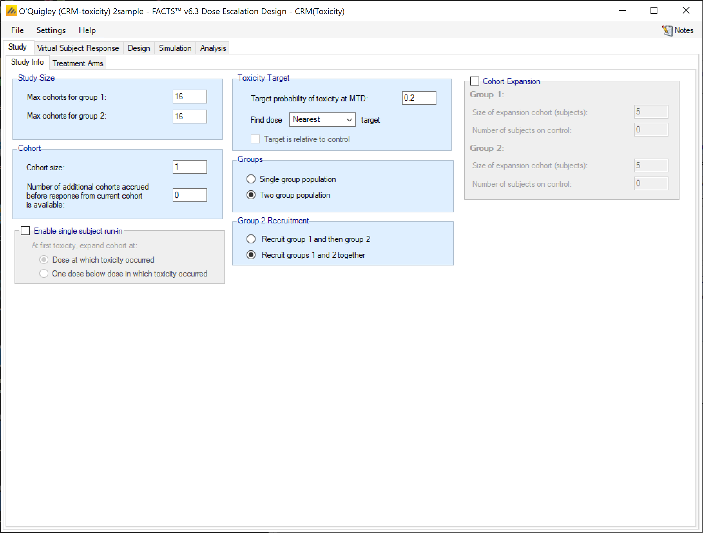
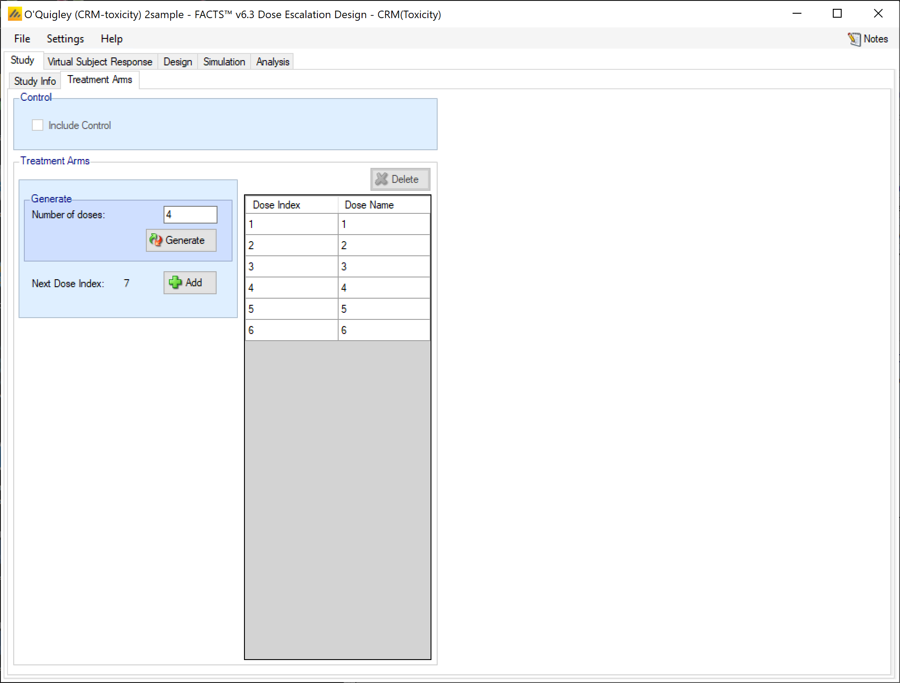
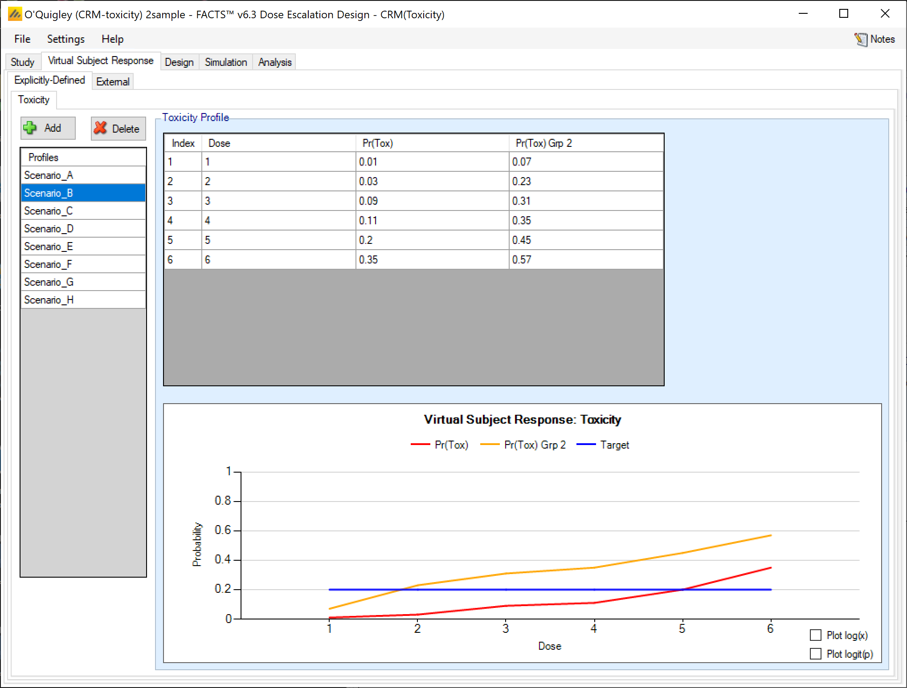
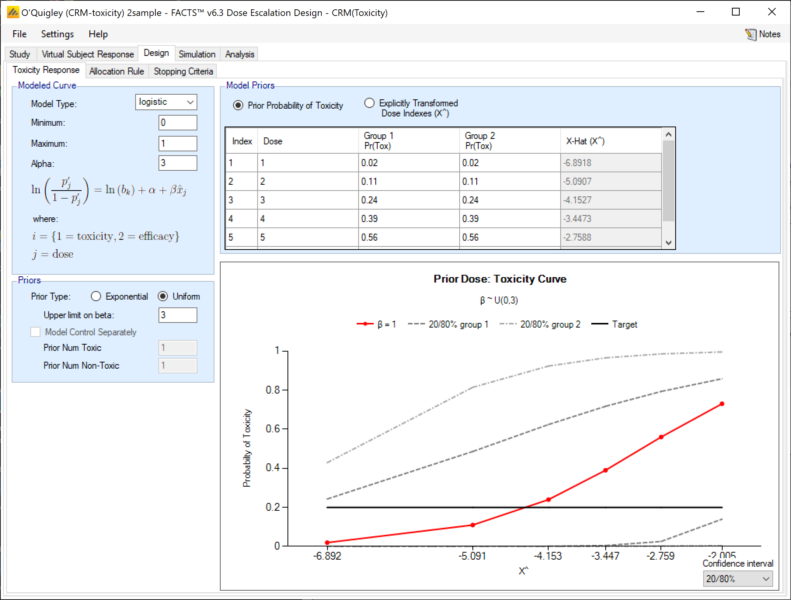
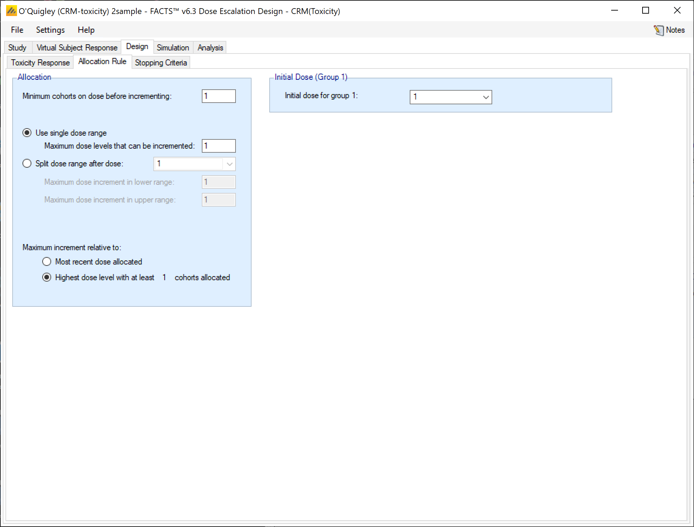
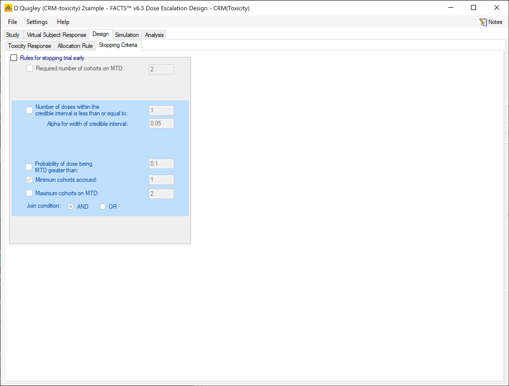
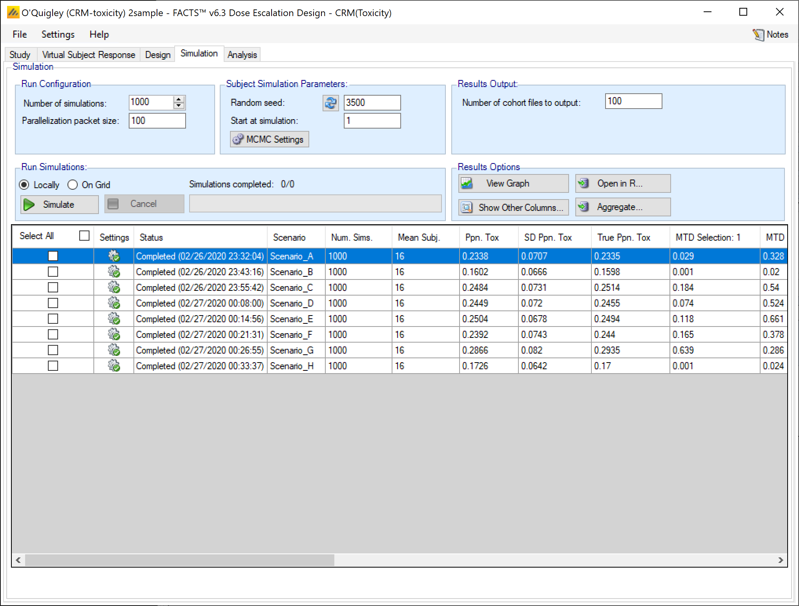
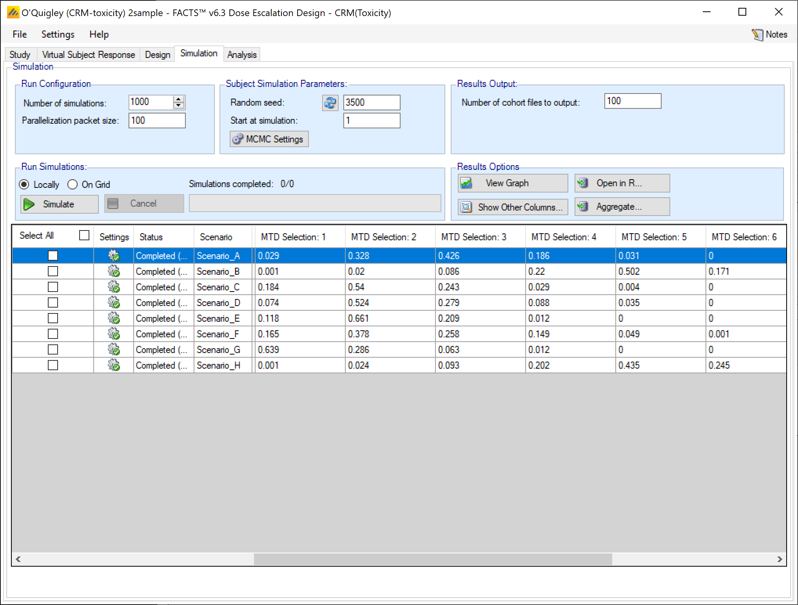
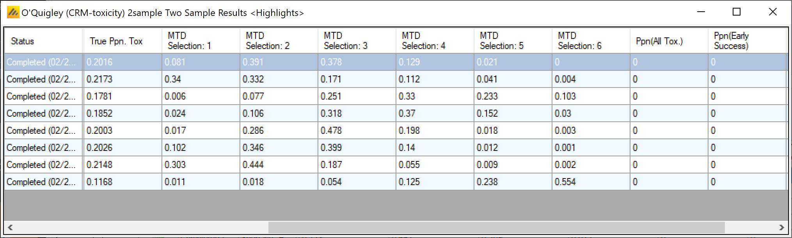

#  Introduction

This tutorial describes the example trial design using the FACTS Dose Escalation Design Engine for Toxicity with two samples.

For this version of the document, the screenshots are from the v6.3 release of FACTS.

The screenshots provided are approximate and may not reflect the exact layout of the information in later versions of FACTS. The contents of each tab, however, will be consistent with the software.

# Case Study: \[Quigley\]

The example is taken from O'Quigley's 1999 paper on the addition of modeling a second sample to the Continual Reassessment Method.

The endpoint is to find the maximum tolerated dose with a target toxicity rate of 0.2.

There are 6 treatment arms and a maximum of 32 subjects.

There will be two samples recruited together.

Subjects will be dosed in cohorts of 1, starting at the lowest dose.

We will never increment by more than 1 dose strength.

We will stop when we have allocated 6 subjects to the same dose but not stop before 18 subjects have been treated (unless there are no usable doses).

## Response Model

If the probability of observing toxicity for a subject given dose *j* *p~j~*

We will model the probability of toxicity across the range of doses:

$$\log\left(\frac{p'_{ij}}{1 - p'_{ij}}\right) = \log(b_k) + \alpha + \beta_i \widehat{x}_{j}^{i},\ b_1 = 1,\ b_2 = b$$

Where *b~1~* is used for sample 1 and *b~2~* for sample 2. With *α* set to --3 and *β* distributed:

$$\beta \sim U[0,3)$$

Each dose *j* is given a 'strength' $\widehat{x_{j}}$ by fitting the user supplied prior expectations of the average toxicity for each dose *p^0^~j~* across the two samples, to the above model with *β* set to 1. i.e. solving:

$$\log\left(\frac{p^{0}_{j}}{1 - p^{0}_{j}}\right) = \alpha + \widehat{x_{j}}$$

for $\widehat{x_{j}}$.

The range for b is exp(+/-3 max($\widehat{x_{j}}$)). This allows the second sample to be shifted so that its lowest dose has the same probability as the highest dose of sample one, or vice versa.

## Simulation Details

Eight different possible dose toxicity responses will be simulated

|  |  |  |  |  |  |  |  |  |  |  |  |  |
|-----|:----:|:----:|:----:|:----:|:----:|:----:|:----:|:----:|:----:|:----:|:----:|:----:|
|  | **Sample 1 Rate per Dose** |  |  |  |  |  | **Sample 2 Rate per Dose** |  |  |  |  |  |
| **\#** | **1** | **2** | **3** | **4** | **5** | **6** | **1** | **2** | **3** | **4** | **5** | **6** |
| **A** | 0.02 | 0.11 | 0.24 | 0.39 | 0.56 | 0.73 | 0.02 | 0.11 | 0.24 | 0.39 | 0.56 | 0.73 |
| **B** | 0.01 | 0.03 | 0.09 | 0.11 | 0.2 | 0.35 | 0.07 | 0.23 | 0.31 | 0.35 | 0.45 | 0.57 |
| **C** | 0.07 | 0.2 | 0.35 | 0.55 | 0.7 | 0.75 | 0.01 | 0.05 | 0.1 | 0.2 | 0.32 | 0.38 |
| **D** | 0.02 | 0.19 | 0.31 | 0.45 | 0.51 | 0.63 | 0.03 | 0.05 | 0.11 | 0.21 | 0.39 | 0.5 |
| **E** | 0.03 | 0.19 | 0.39 | 0.61 | 0.83 | 0.95 | 0.01 | 0.07 | 0.19 | 0.37 | 0.55 | 0.79 |
| **F** | 0.08 | 0.19 | 0.29 | 0.37 | 0.51 | 0.63 | 0.03 | 0.12 | 0.21 | 0.43 | 0.55 | 0.71 |
| **G** | 0.21 | 0.33 | 0.45 | 0.57 | 0.71 | 0.89 | 0.07 | 0.2 | 0.32 | 0.45 | 0.57 | 0.76 |
| **H** | 0.01 | 0.03 | 0.09 | 0.11 | 0.2 | 0.35 | 0.01 | 0.01 | 0.05 | 0.09 | 0.13 | 0.19 |

## Expected performance

In \[Quigley\] the reported % of times the correct dose was identified as the MTD was:

- Scenario A: Sample 1 Dose 3 31%, Sample 2 Dose 3 31%

- Scenario B: Sample 1 Dose 5 39%, Sample 2 Dose 2 57%

- Scenario C: Sample 1 Dose 2 63%, Sample 2 Dose 4 36%

- Scenario D: Sample 1 Dose 2 65%, Sample 2 Dose 4 34%

- Scenario E: Sample 1 Dose 2 74%, Sample 2 Dose 3 41%

- Scenario F: Sample 1 Dose 2 56%, Sample 2 Dose 3 33%

- Scenario G: Sample 1 Dose 1 66%, Sample 2 Dose 2 61%

- Scenario H: Sample 1 Dose 5 37%, Sample 2 Dose 6 68%

Other metrics to consider are the number of subjects used and minimizing the number of toxicities observed.

## Designs for comparison

Compare with using the 3+3 design in two separate studies.

Compare with using other models (tanh or power) and the alternative exponential prior distribution for β.

Compare with recruiting sample 1 first then sample 2.

#  Simulating using FACTS

Start FACTS Dose Escalating. Use the menu option File \> New \> CRM (toxicity) to create a new CRM design.

Using the menu option File \> Save As, save this design as for example "CRM-tox" in a convenient location (e.g. in a folder called FACTS\\CRM-examples in your 'My Documents' folder).

## Study

### Study Info

Set the following parameters:

- Maximum Trial Size (cohorts): 16 (this is actually the sample 1 maximum size, the label should be changed)

- Second sample maximum trial size (cohorts): 16

- Two sample population

- Recruit sample 1 and sample 2 together

- Cohort size: 1

- Number of additional cohorts accrued before response from the current cohort is available: 0

- Target probability of toxicity at MTD: 0.2

- Find Dose: Nearest target

###  Treatment Arms

Create 6 doses 1 to 6 with no placebo:

##  Virtual Subject Response

### Explicitly Defined -- Toxicity

Add 8 response scenarios to be simulated, specify the P(tox) values for the two samples for each scenario as follows:

|  |  |  |  |  |  |  |  |  |  |  |  |  |
|-----|:----:|:----:|:----:|:----:|:----:|:----:|:----:|:----:|:----:|:----:|:----:|:----:|
|  | **Sample 1 Rate per Dose** |  |  |  |  |  | **Sample 2 Rate per Dose** |  |  |  |  |  |
| **\#** | **1** | **2** | **3** | **4** | **5** | **6** | **1** | **2** | **3** | **4** | **5** | **6** |
| **A** | 0.02 | 0.11 | 0.24 | 0.39 | 0.56 | 0.73 | 0.02 | 0.11 | 0.24 | 0.39 | 0.56 | 0.73 |
| **B** | 0.01 | 0.03 | 0.09 | 0.11 | 0.2 | 0.35 | 0.07 | 0.23 | 0.31 | 0.35 | 0.45 | 0.57 |
| **C** | 0.07 | 0.2 | 0.35 | 0.55 | 0.7 | 0.75 | 0.01 | 0.05 | 0.1 | 0.2 | 0.32 | 0.38 |
| **D** | 0.02 | 0.19 | 0.31 | 0.45 | 0.51 | 0.63 | 0.03 | 0.05 | 0.11 | 0.21 | 0.39 | 0.5 |
| **E** | 0.03 | 0.19 | 0.39 | 0.61 | 0.83 | 0.95 | 0.01 | 0.07 | 0.19 | 0.37 | 0.55 | 0.79 |
| **F** | 0.08 | 0.19 | 0.29 | 0.37 | 0.51 | 0.63 | 0.03 | 0.12 | 0.21 | 0.43 | 0.55 | 0.71 |
| **G** | 0.21 | 0.33 | 0.45 | 0.57 | 0.71 | 0.89 | 0.07 | 0.2 | 0.32 | 0.45 | 0.57 | 0.76 |
| **H** | 0.01 | 0.03 | 0.09 | 0.11 | 0.2 | 0.35 | 0.01 | 0.01 | 0.05 | 0.09 | 0.13 | 0.19 |

There are no externally defined curves in this example.

## Design

### Toxicity Response

Set the parameters as follows:

- Model type: logisitic

- Minimum: 0

- maximum: 1

- Alpha: 3

- Prior type: uniform, with upper limit 3

- Prior probability of Toxicity for both samples: 0.02, 0.11, 0.24, 0.39, 0.56, 0.73. Note these result in reasonably evenly spaced effective dose strengths in the range -7 to -2.

### Allocation Rule

Set the parameters as follows:

- No single patient run-in (single patient cohorts)

- Maximum dose levels that can be incremented: 1

- Minimum cohorts on dose before incrementing: 1

- Maximum increment relative to highest dose with at least 1 cohort allocated to it

- Starting dose level: 1

###  Stopping Criteria

Set the parameters as follows:

- No early stopping -- for comparison with O'Quigley we recruit the full 16 subjects in each sample

## Simulation

Select all scenarios and run 1000 simulations of each this is fairly fast even when run locally.

Scroll across to the MTD selection results:

To see the MTDs for sample 2, click on "show other columns" and select "two sample results"

These aren't quite so good as for the first sample, it there is a --ve bias in its selection of MTD when this is at a higher dose that in sample 1. Looking at Quigley's paper he does not report results for the logistic model, only the two version of the tanh model. It is easy to use SaveAs from this design, thus keeping al the parameters and scenarios and then creating a modified version of the design that uses the tanh model.

Additional designs were created testing the prior for Beta and the different models for the joint toxicity. You might like to explore the tanh based models, (when using the uniform prior, try an an upper limit of 30).

The following table shows the proportion of times the correct dose is selected for each scenario for each model and each choice of prior for beta (exponential or uniform), (though for tanh & tanh+b just 100 simulations were used).

|  |  |  |  |  |  |  |  |  |  |  |
|-----|----|----|--------|--------|--------|--------|--------|--------|--------|--------|
| Scenario and target dose |  |  | Quigley separate CRMs (1) |  | Quigley 2 sample CRM (2) |  | FACTS logistic uniform |  | FACTS logistic expon'tial |  |
|  | 1 | 2 | 1 | 2 | 1 | 2 | 1 | 2 | 1 | 2 |
| A | 3 | 3 | 0.31 | 0.31 | 0.29 | 0.44 | 0.43 | 0.38 | 0.44 | 0.41 |
| B | 5 | 2 | 0.39 | 0.57 | 0.08 | 0.42 | 0.50 | 0.33 | 0.45 | 0.32 |
| C | 2 | 4 | 0.63 | 0.36 | 0.57 | 0.48 | 0.54 | 0.33 | 0.54 | 0.32 |
| D | 2 | 4 | 0.65 | 0.34 | 0.59 | 0.47 | 0.52 | 0.37 | 0.51 | 0.36 |
| E | 2 | 3 | 0.74 | 0.41 | 0.66 | 0.51 | 0.66 | 0.48 | 0.63 | 0.49 |
| F | 2 | 3 | 0.56 | 0.33 | 0.54 | 0.42 | 0.38 | 0.40 | 0.40 | 0.40 |
| G | 1 | 2 | 0.66 | 0.61 | 0.71 | 0.53 | 0.64 | 0.44 | 0.70 | 0.45 |
| H | 5 | 6 | 0.37 | 0.68 | 0.24 | 0.26 | 0.44 | 0.55 | 0.44 | 0.51 |

The figures for (1) are taken from \[Quigley\] from the 0.05 columns for "Scheme II" in tables 5, 7, 9, 11, 13, 15, 17, 19.

The figures for (2) are taken from \[Quigley\] from the 0.05 columns for "S I, model 1, 13-19" tables 5, 7, 9, 11, 13, 15, 17, 19.

O'Quigley's design seems to work well when the target dose is a low dose both when run separately and in the combined model -- the selection of dose 2 for sample 1 is superior than any of the FACTS simulations.

However when the MTD is high, or the MTD's are the same the FACTS CRM performs best.

As a way of ranking the designs over all the scenarios, for each design we sum the squares of the difference for its score from the best score for that sample in that scenario. This favors designs that score consistently well and penalizes those that have an Achilles' heel or blind spot. \[One might consider that samples where the responses are the same are under represented or that scenario A should have a \> 1 weighting\]. This method of scoring ranks the use of the logistic the highest with either the uniform or exponential prior.

The FACTS tanh with uniform prior does extremely well with all but scenario H. It get the best results for the second sample in 5 of the scenarios. But never selecting the top dose for sample 2 in scenario H lets it down.
