#  Introduction

This tutorial describes the example trial design using the FACTS Dose Escalation Design Engine for Toxicity with a single sample.

For this version of the document, the screenshots are from the v6.3 release of FACTS.

The screenshots provided are approximate and may not reflect the exact layout of the information in later versions of FACTS. The contents of each tab, however, will be consistent with the software.

# Case Study: \[Goodman\]

The example is taken from Steven Goodman's 1995 paper on the Continual Reassessment Method.

The patient endpoint is a binary toxicity response -- no or minimal toxicity vs intolerable or severe toxicity.

The target is to find the maximum tolerated dose with a target toxicity rate of 0.2.

There are 6 treatment arms and a maximum of 24 subjects.

Subjects will be dosed in cohorts of 3, starting at the lowest dose.

We will never increment by more than 1 dose strength.

We will stop when we have allocated 2 cohorts to the same dose but not stop before 18 subjects have been treated (unless there are no usable doses).

## Response Model

If the probability of observing toxicity for a subject given dose *j* is *p~j~*

We will model the probability of toxicity across the range of doses:

$$\log\left(\frac{p_j}{1 - p_j}\right) = \alpha + \beta\widehat{x_{j}}$$

With *α* set to --3 and *β* given the prior distribution:

$$\beta \sim U[0,3)$$

Each dose *j* is given a 'strength' $\widehat{x_{j}}$ by fitting the user supplied prior expectations of toxicity for each dose *p^0^~j~* to the above model with *β* set to 1. i.e. solving:

$$\log\left(\frac{p^{0}_{j}}{1 - p^{0}_{j}}\right) = \alpha + \widehat{x_{j}}$$

for $\widehat{x_{j}}$.

## Simulation Details

Six different possible dose toxicity responses will be simulated, in each scenario the target MTD is highlighted.

+----------------+--------+--------+--------+--------+--------+--------+
|                | Dose                                                |
+----------------+--------+--------+--------+--------+--------+--------+
| Scenario#      | 1      | 2      | 3      | 4      | 5      | 6      |
+----------------+--------+--------+--------+--------+--------+--------+
| 1              | 0.05   | 0.1    | 0.2    | 0.35   | 0.5    | 0.7    |
+----------------+--------+--------+--------+--------+--------+--------+
| 2              | 0.05   | 0.1    | 0.15   | 0.2    | 0.25   | 0.35   |
+----------------+--------+--------+--------+--------+--------+--------+
| 3              | 0.1    | 0.1    | 0.1    | 0.1    | 0.25   | 0.8    |
+----------------+--------+--------+--------+--------+--------+--------+
| 4              | 0.01   | 0.01   | 0.05   | 0.1    | 0.25   | 0.8    |
+----------------+--------+--------+--------+--------+--------+--------+
| 5              | 0.3    | 0.4    | 0.52   | 0.61   | 0.76   | 0.78   |
+----------------+--------+--------+--------+--------+--------+--------+
| 6              | 0.05   | 0.05   | 0.05   | 0.05   | 0.1    | 0.15   |
+----------------+--------+--------+--------+--------+--------+--------+

There is no acceptable MTD for Case 5.

The toxicities of Case 1 will be used as the prior expectations of toxicity for the calculation of the $\widehat{x_{j}}$ values.

## Expected performance

In \[Goodman\] the reported % of times the correct dose was identified as the MTD was:

- Curve 1: Dose 3, \~50%

- Curve 2: Dose 4, \~25%

- •Curve 3: Dose 5, 30-55%

- •Curve 4: Dose 5, \~55%

- •Curve 5: Dose 1 (no dose), 80-90%

- •Curve 6: Dose 6, 35-65%

Other metrics to consider are the number of subjects used and minimizing the number of toxicities observed.

## Designs for comparison

Compare with using the 3+3 design.

Compare with using other models (tanh or power) and the alternative exponential prior distribution for β.

Compare with using different cohort sizes. Cohort of size 1 should be the most efficient.

#  Simulating using FACTS 3+3

As a benchmark to judge how well the CRM performs, first simulate the trial performed using the 3+3 method.

Start FACTS, use the menu option File \> New \> Dose Escalation \> 3+3 to create a new 3+3 design.

Using the menu option File \> Save As, save this design as for example "CRM-tox-compare3+3" in a convenient location (e.g. in a folder called FACTS\\CRM-examples in your 'My Documents' folder).

## Study Info

Set a trial size of 8 cohorts, do not include an expansion cohort.

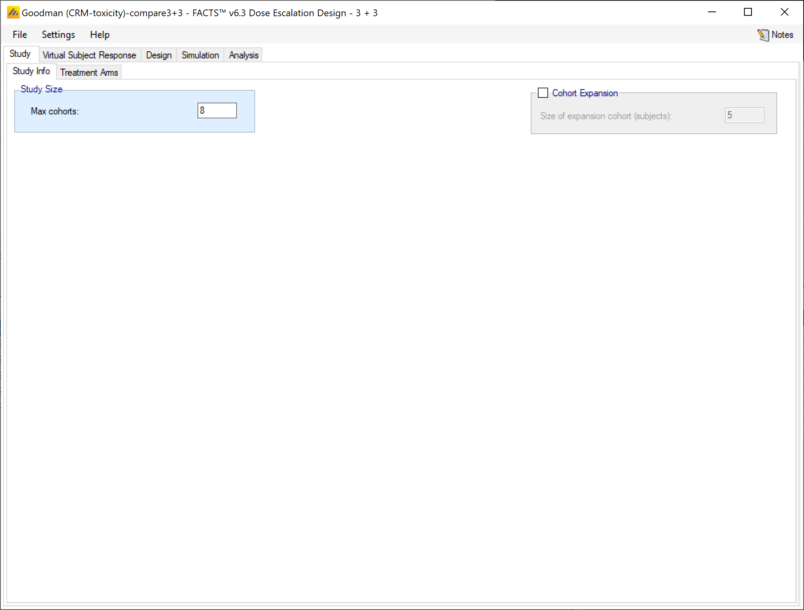

##  Treatment Arms

Generate 6 treatment arms:

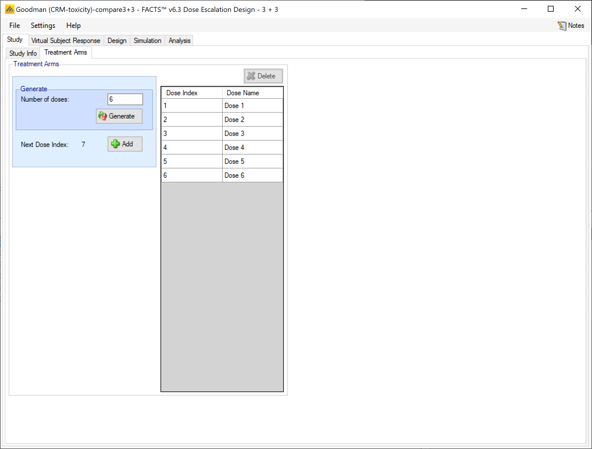

##  Virtual Subject Responses

Create the 6 scenarios and enter the probability of toxicity for each dose for each scenario corresponding to the table:

+----------------+--------+--------+--------+--------+--------+--------+
|                | Dose                                                |
+----------------+--------+--------+--------+--------+--------+--------+
| Scenario#      | 1      | 2      | 3      | 4      | 5      | 6      |
+----------------+--------+--------+--------+--------+--------+--------+
| 1              | 0.05   | 0.1    | 0.2    | 0.35   | 0.5    | 0.7    |
+----------------+--------+--------+--------+--------+--------+--------+
| 2              | 0.05   | 0.1    | 0.15   | 0.2    | 0.25   | 0.35   |
+----------------+--------+--------+--------+--------+--------+--------+
| 3              | 0.1    | 0.1    | 0.1    | 0.1    | 0.25   | 0.8    |
+----------------+--------+--------+--------+--------+--------+--------+
| 4              | 0.01   | 0.01   | 0.05   | 0.1    | 0.25   | 0.8    |
+----------------+--------+--------+--------+--------+--------+--------+
| 5              | 0.3    | 0.4    | 0.52   | 0.61   | 0.76   | 0.78   |
+----------------+--------+--------+--------+--------+--------+--------+
| 6              | 0.05   | 0.05   | 0.05   | 0.05   | 0.1    | 0.15   |
+----------------+--------+--------+--------+--------+--------+--------+

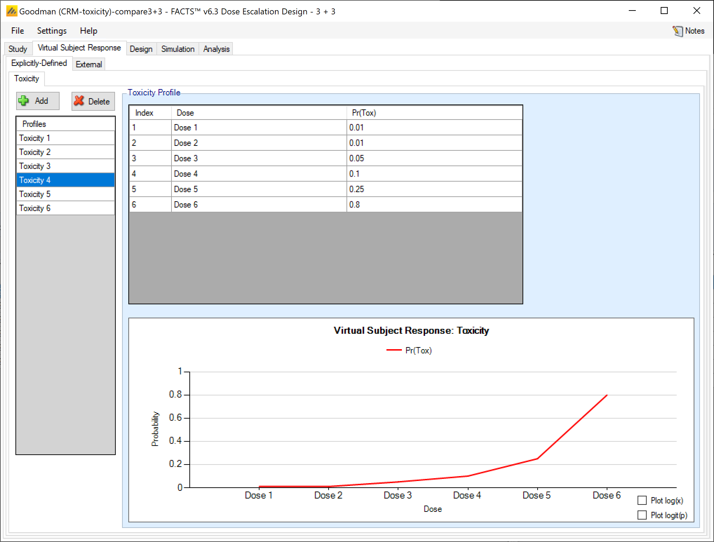

##  Design

Set dose 1 as the starting dose and include a validation cohort.

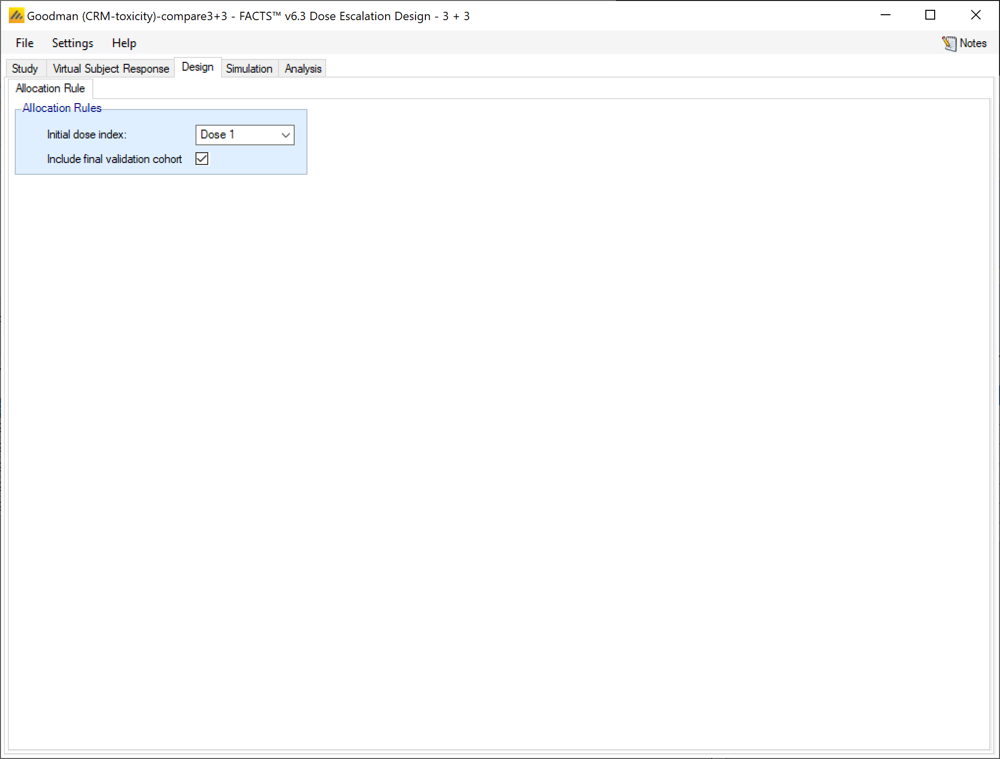

##  Simulation

On the simulation tab, set the number of simulations to be run at 1,000, select all scenarios and then run the simulations:

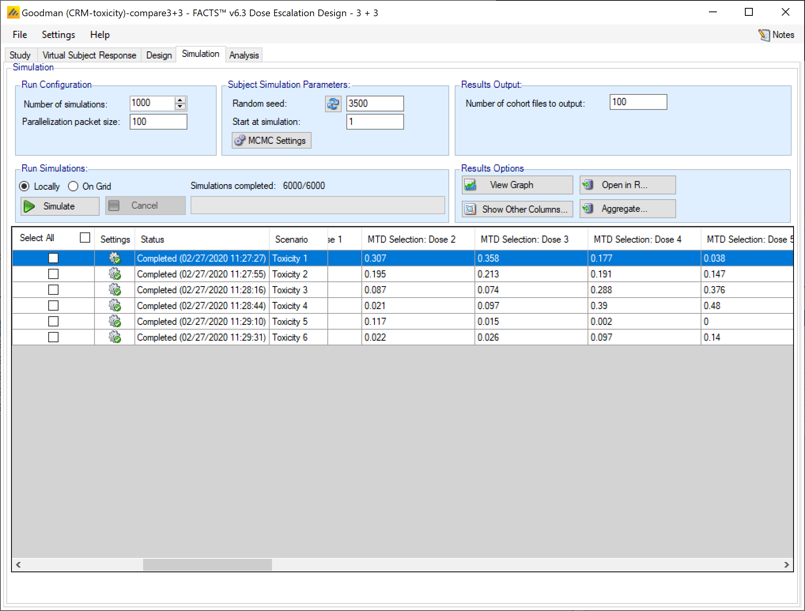

Note that with the exception of curves 5 (all toxic) and 6 (non-toxic) the correct MTD is selected at most 48% of the time, and with curve 2 it is selected only 19% of the time. The maximum selection of MTD does occur at the highlighted doses (except curve 2) where the dose below is selected more often.

+-----------+--------------+--------------+--------------+--------------+--------------+--------------+
|           | Simulated Toxicity rate / MTD Selection - Dose                                          |
+-----------+--------------+--------------+--------------+--------------+--------------+--------------+
| Scenario# | 1            | 2            | 3            | 4            | 5            | 6            |
+-----------+--------------+--------------+--------------+--------------+--------------+--------------+
| 1         | 0.05 / 0.114 | 0.10 / 0.307 | 0.20 / 0.358 | 0.35 / 0.177 | 0.50 / 0.038 | 0.70 / 0.006 |
+-----------+--------------+--------------+--------------+--------------+--------------+--------------+
| 2         | 0.05 / 0.113 | 0.10 / 0.195 | 0.15 / 0.213 | 0.20 / 0.191 | 0.25 / 0.147 | 0.35 / 0.141 |
+-----------+--------------+--------------+--------------+--------------+--------------+--------------+
| 3         | 0.10 / 0.168 | 0.10 / 0.087 | 0.10 / 0.074 | 0.10 / 0.288 | 0.25 / 0.376 | 0.80 / 0.007 |
+-----------+--------------+--------------+--------------+--------------+--------------+--------------+
| 4         | 0.01 / 0.001 | 0.01 / 0.021 | 0.05 / 0.097 | 0.10 / 0.390 | 0.25 / 0.480 | 0.80 / 0.011 |
+-----------+--------------+--------------+--------------+--------------+--------------+--------------+
| 5         | 0.30 / 0.866 | 0.40 / 0.117 | 0.52 / 0.015 | 0.61 / 0.002 | 0.76 / 0.000 | 0.78 / 0.000 |
+-----------+--------------+--------------+--------------+--------------+--------------+--------------+
| 6         | 0.05 / 0.050 | 0.05 / 0.022 | 0.05 / 0.026 | 0.05 / 0.097 | 0.10 / 0.140 | 0.15 0.665   |
+-----------+--------------+--------------+--------------+--------------+--------------+--------------+

+-----------------------------------------------+-----------------------------------------------+
| **Distribution of MTD seleciton by Scenario: results for 3+3**                                |
+===============================================+===============================================+
| 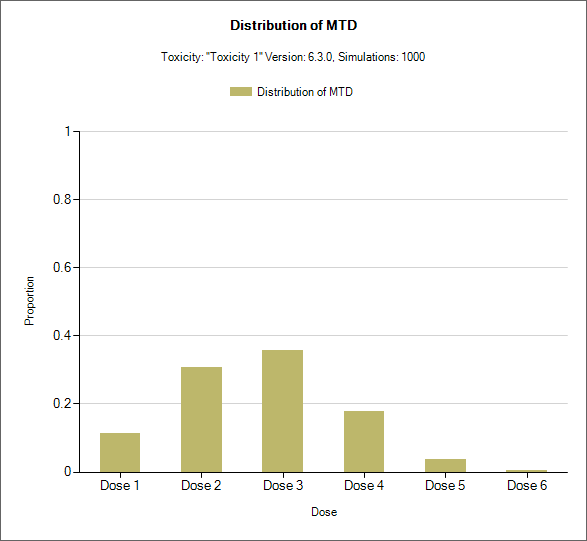 | 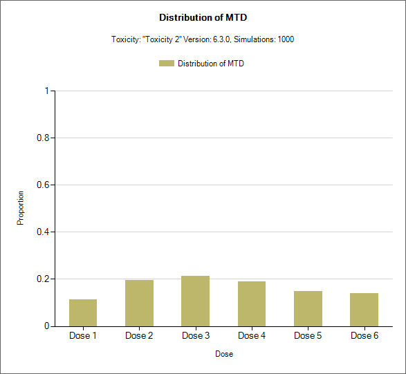 |
|                                               |                                               |
| Scenario 1 -- true MTD is Dose 3              | Scenario 2 -- true MTD is Dose 4              |
+-----------------------------------------------+-----------------------------------------------+
| 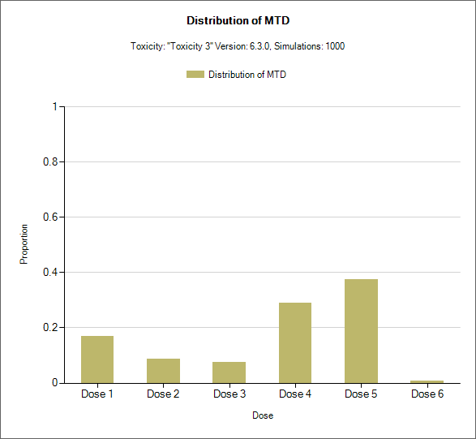 | 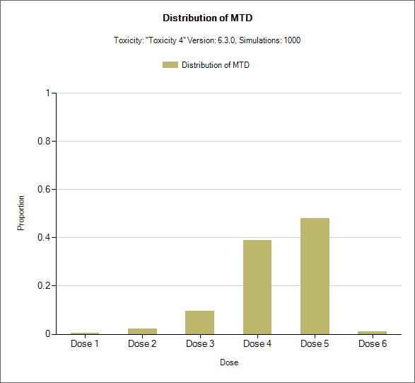 |
|                                               |                                               |
| Scenario 3 -- true MTD is Dose 5              | Scenario 4 -- true MTD is Dose 5              |
+-----------------------------------------------+-----------------------------------------------+
| 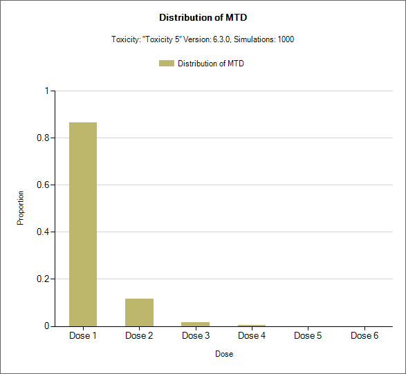 | 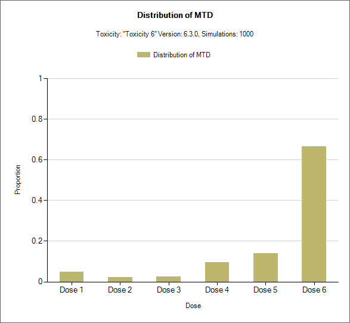 |
|                                               |                                               |
| Scenario 5 -- all doses too toxic             | Scenario 6 -- no dose too toxic               |
+-----------------------------------------------+-----------------------------------------------+

#  Simulating using mTPI

As a 2^nd^ benchmark to judge how well the CRM performs, next simulate the trial using the mTPI method.

Start FACTS, use the menu option File \> New \> Dose Escalation \> mTPI to create a new mTPI design.

Using the menu option File \> Save As, save this design as for example "CRM-tox-compare-mTPI" in a convenient location (e.g. in a folder called FACTS\\CRM-examples in your 'My Documents' folder).

## Study Info

Set a trial size of 8 cohorts, with a cohort size of 3. Recruit in cohorts and do not recruit cohorts before the previous cohort complete.

Set a target toxicity of 0.25 with a delta of 0.1, so the lower bound is 0.15 and upper bound is 0.35.

Do not include an expansion cohort.

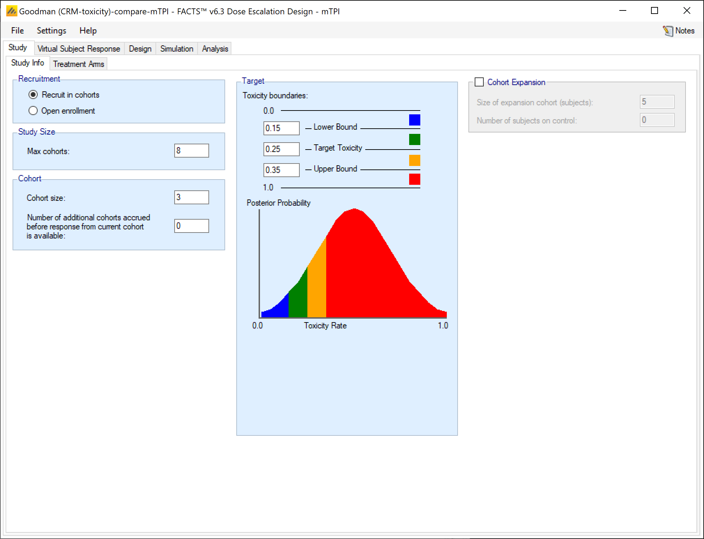

##  Treatment Arms

Generate 6 treatment arms:

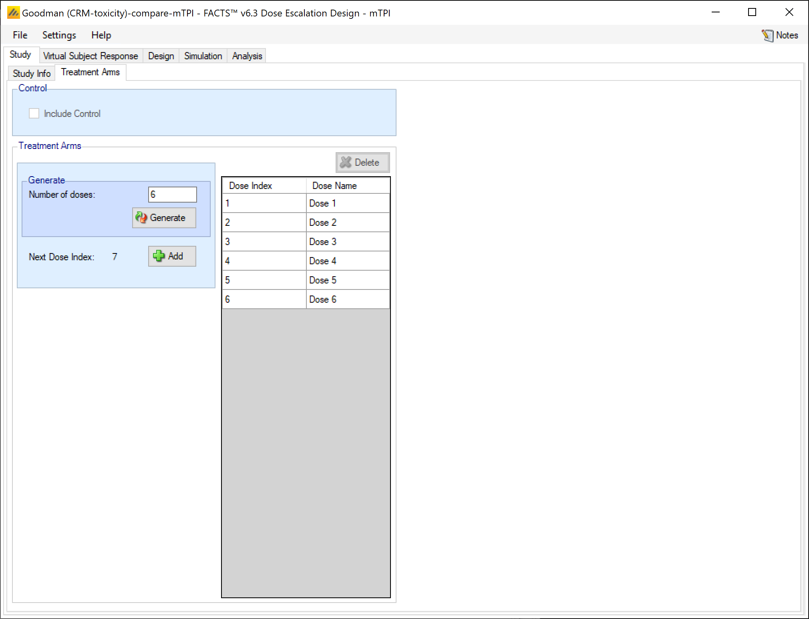

##  Virtual Subject Responses

Create the 6 scenarios and enter the probability of toxicity for each dose for each scenario corresponding to the table:

+----------------+--------+--------+--------+--------+--------+--------+
|                | Dose                                                |
+----------------+--------+--------+--------+--------+--------+--------+
| Scenario#      | 1      | 2      | 3      | 4      | 5      | 6      |
+----------------+--------+--------+--------+--------+--------+--------+
| 1              | 0.05   | 0.1    | 0.2    | 0.35   | 0.5    | 0.7    |
+----------------+--------+--------+--------+--------+--------+--------+
| 2              | 0.05   | 0.1    | 0.15   | 0.2    | 0.25   | 0.35   |
+----------------+--------+--------+--------+--------+--------+--------+
| 3              | 0.1    | 0.1    | 0.1    | 0.1    | 0.25   | 0.8    |
+----------------+--------+--------+--------+--------+--------+--------+
| 4              | 0.01   | 0.01   | 0.05   | 0.1    | 0.25   | 0.8    |
+----------------+--------+--------+--------+--------+--------+--------+
| 5              | 0.3    | 0.4    | 0.52   | 0.61   | 0.76   | 0.78   |
+----------------+--------+--------+--------+--------+--------+--------+
| 6              | 0.05   | 0.05   | 0.05   | 0.05   | 0.1    | 0.15   |
+----------------+--------+--------+--------+--------+--------+--------+

##  Design

Use the default "maximum probability that dose exceeds target probability of 0.95. This sets the "DU" dose decisions. It applies an overdose control. The lower the threshold more tox observed / total observed combinations will become "DU", the higher the threshold, the fewer will become "DU". A dose that meets the DU criterion will no longer be allocated to by mTPI, it will not permit re-escalation to the dose (whereas doses from which it simple de-escalated "D" can be returned to).

Specify a stopping rule of a maximum of "9" subjects on a dose: if the next dose to be allocated to already has 9 subjects allocated to it (3 cohorts) then the trial will stop and declare that dose the MTD.

The table then shows the mTPI decision rules for up to 9 subjects.

For example with the current parameters settings if 6 results have been observed on the last dose tested:

- If there have been 0 toxicities ("E"), escalate to the next dose.

- If there have been 1 or 2 toxicities ("S") re-dose at this dose.

- If there had been 3 toxicities ("D") then de-escalate to the previous dose.

- If there have been 4 or more toxicities ("DU") then de-escalate to the previous dose and do not allow re-escalation to this dose.

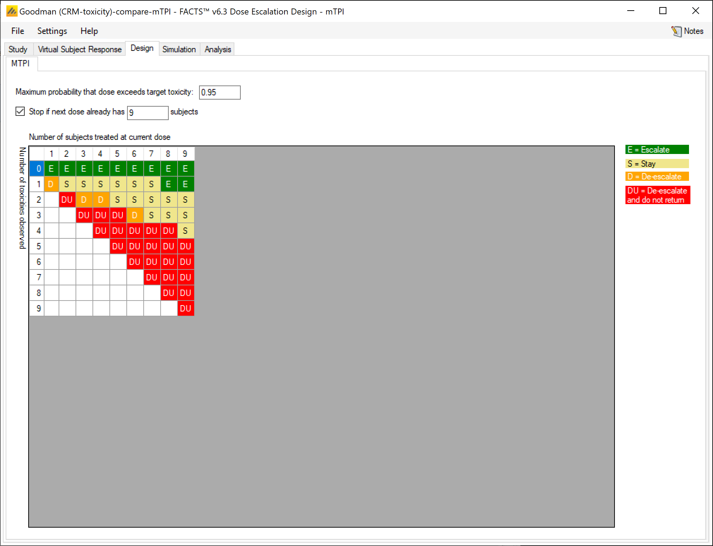

##  Simulation

On the simulation tab, set the number of simulations to be run at 1,000, select all scenarios and then run the simulations:

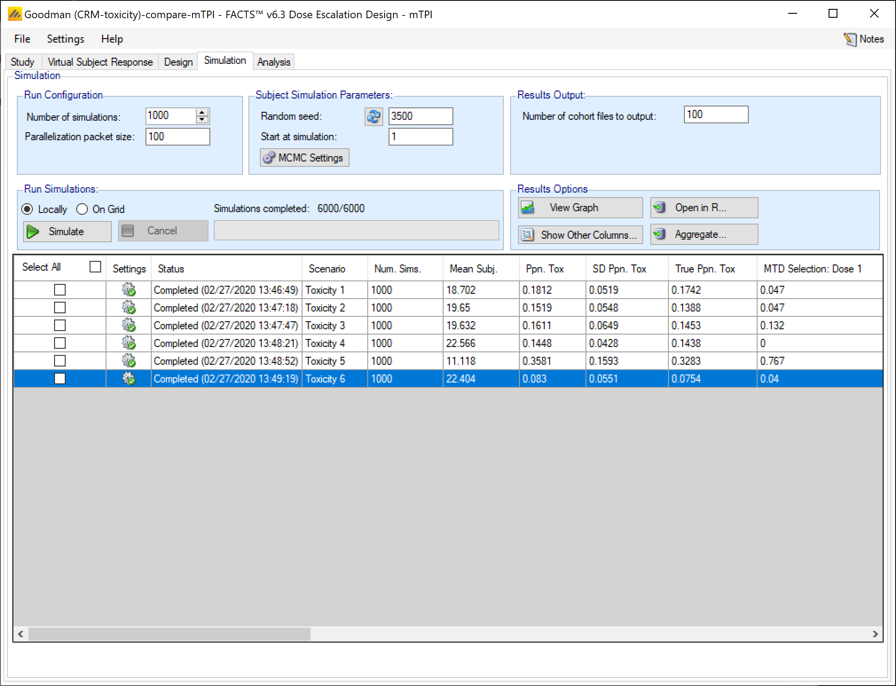

Note that with the exception of curves 5 (all toxic) and 6 (non-toxic) the correct MTD is selected at most \~50% of the time, and with curve 2 it is selected only 28% of the time. The maximum selection of MTD does however occur at the highlighted doses. The tendency for over dosing (selection of dose above MTD) is greater than 3+3 (this could be re-calibrated by changing the target toxicity rate -- but this will impact the selection of the correct MTD as well).

+-----------+--------------+--------------+--------------+--------------+--------------+--------------+
|           | Simulated Toxicity rate / MTD Selection - Dose                                          |
+-----------+--------------+--------------+--------------+--------------+--------------+--------------+
| Scenario# | 1            | 2            | 3            | 4            | 5            | 6            |
+-----------+--------------+--------------+--------------+--------------+--------------+--------------+
| 1         | 0.05 / 0.047 | 0.10 / 0.163 | 0.20 / 0.414 | 0.35 / 0.313 | 0.50 / 0.051 | 0.7 / 0.012  |
+-----------+--------------+--------------+--------------+--------------+--------------+--------------+
| 2         | 0.05 / 0.047 | 0.10 / 0.135 | 0.15 / 0.250 | 0.20 / 0.280 | 0.25 / 0.165 | 0.35 / 0.123 |
+-----------+--------------+--------------+--------------+--------------+--------------+--------------+
| 3         | 0.10 / 0.132 | 0.10 / 0.103 | 0.10 / 0.116 | 0.10 / 0.209 | 0.25 / 0.305 | 0.80 / 0.135 |
+-----------+--------------+--------------+--------------+--------------+--------------+--------------+
| 4         | 0.01 / 0.000 | 0.01 / 0.003 | 0.05 / 0.044 | 0.10 / 0.246 | 0.25 / 0.519 | 0.80 / 0.188 |
+-----------+--------------+--------------+--------------+--------------+--------------+--------------+
| 5         | 0.30 / 0.767 | 0.40 / 0.199 | 0.52 / 0.028 | 0.61 / 0.006 | 0.76 / 0.000 | 0.78 / 0.000 |
+-----------+--------------+--------------+--------------+--------------+--------------+--------------+
| 6         | 0.05 / 0.040 | 0.05 / 0.038 | 0.05 / 0.035 | 0.05 / 0.098 | 0.10 / 0.161 | 0.15 / 0.628 |
+-----------+--------------+--------------+--------------+--------------+--------------+--------------+
|           |              |              |              |              |              |              |
+-----------+--------------+--------------+--------------+--------------+--------------+--------------+

+-----------------------------------------------+-----------------------------------------------+
| **Distribution of MTD seleciton by Scenario: results for mTPI**                               |
+===============================================+===============================================+
| 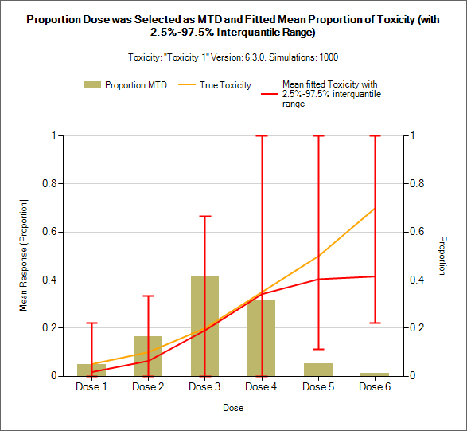 | 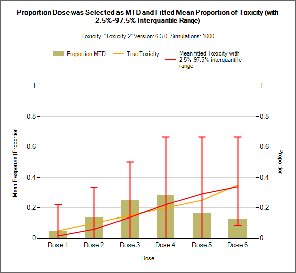 |
|                                               |                                               |
| Scenario 1 -- true MTD is Dose 3              | Scenario 2 -- true MTD is Dose 4              |
+-----------------------------------------------+-----------------------------------------------+
| 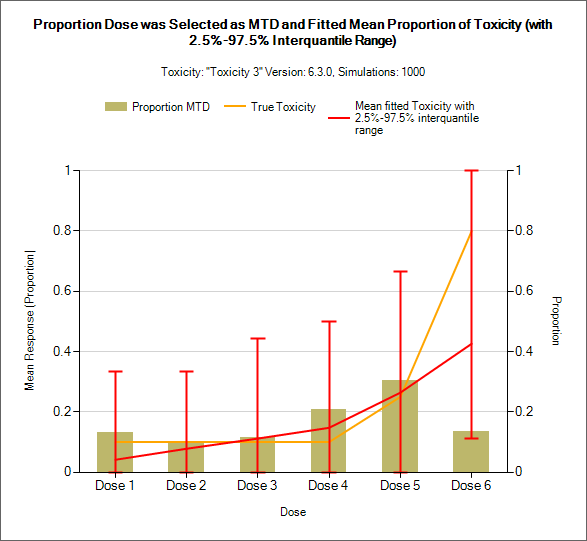 | 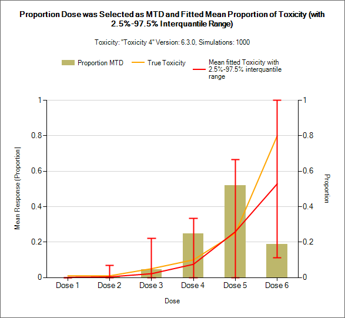 |
|                                               |                                               |
| Scenario 3 -- true MTD is Dose 5              | Scenario 4 -- true MTD is Dose 5              |
+-----------------------------------------------+-----------------------------------------------+
| 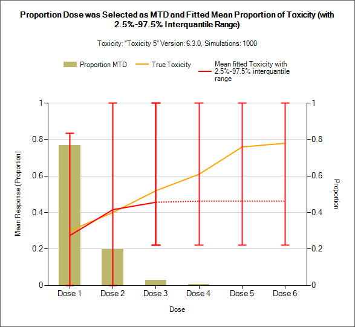 | 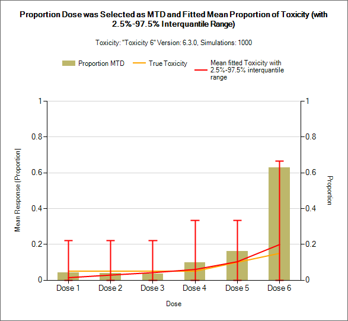 |
|                                               |                                               |
| Scenario 5 -- all doses too toxic             | Scenario 6 -- no dose too toxic               |
+-----------------------------------------------+-----------------------------------------------+

# Simulating using FACTS CRM

Start FACTS Dose Escalating. Use the menu option File \> New \> Dose Escalation \> CRM (toxicity) to create a new CRM design.

Using the menu option File \> Save As, save this design as for example "CRM-tox" in a convenient location (e.g. in a folder called FACTS\\CRM-examples in your 'My Documents' folder).

## Study

### Study Info

Set the following parameters:

- Maximum Trial Size (cohorts): 8

- Single sample population

- Cohort size: 3

- Number of additional cohorts accrued before response from the current cohort is available: 0

- Target probability of toxicity at MTD: 0.2

- Find Dose: Nearest target

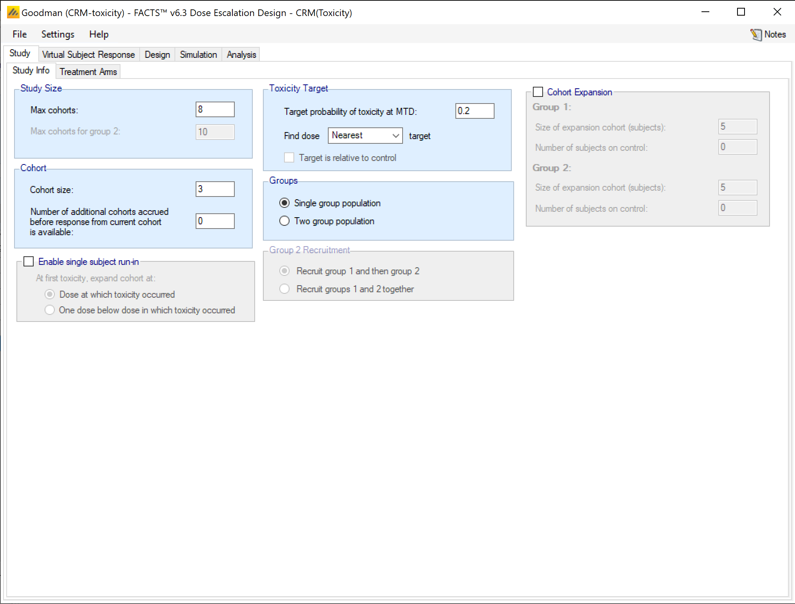

###  Treatment Arms

Create 6 doses 1 to 6 with no control:

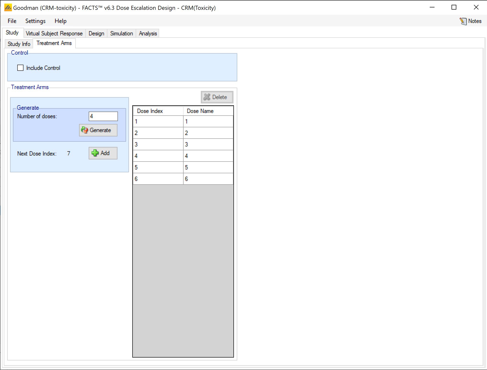

##  Virtual Subject Response

### Explicitly Defined -- Toxicity

Add 6 response curves to be simulated, specify the P(tox) values for each curve as follows:

+------------+:-------:+:------:+:------:+:-------:+:-------:+:-------:+
|            | Dose                                                    |
+------------+---------+--------+--------+---------+---------+---------+
| scenario   | 1       | 2      | 3      | 4       | 5       | 6       |
+------------+---------+--------+--------+---------+---------+---------+
| 1          | 0.05    | 0.1    | 0.2    | 0.35    | 0.5     | 0.7     |
+------------+---------+--------+--------+---------+---------+---------+
| 2          | 0.05    | 0.1    | 0.15   | 0.2     | 0.25    | 0.35    |
+------------+---------+--------+--------+---------+---------+---------+
| 3          | 0.1     | 0.1    | 0.1    | 0.1     | 0.25    | 0.8     |
+------------+---------+--------+--------+---------+---------+---------+
| 4          | 0.01    | 0.01   | 0.05   | 0.1     | 0.25    | 0.8     |
+------------+---------+--------+--------+---------+---------+---------+
| 5          | 0.3     | 0.4    | 0.52   | 0.61    | 0.76    | 0.87    |
+------------+---------+--------+--------+---------+---------+---------+
| 6          | 0.05    | 0.05   | 0.05   | 0.05    | 0.1     | 0.15    |
+------------+---------+--------+--------+---------+---------+---------+

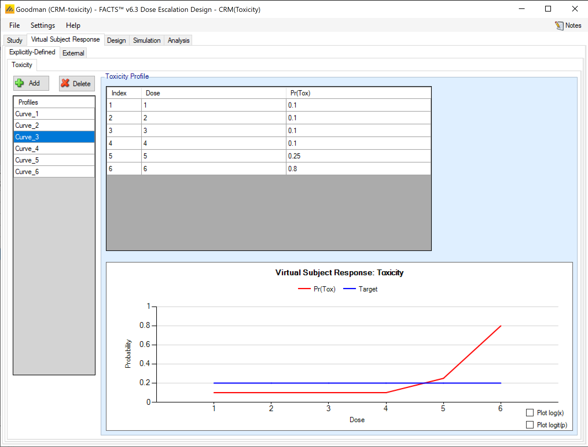

There are no externally defined curves in this example.

##  Design

### Toxicity Response

Set the parameters as follows:

- Model type: logistic

- Minimum: 0

- maximum: 1

- Alpha: 3

- Prior type: uniform

- Prior probability of Toxicity: 0.05, 0.1, 0.2, 0.35, 0.5, 0.7. Note how these create transformed dose strengths in the range -6 to -2 that are roughly evenly spaced. This allows the logistic model to work reasonably well at estimating the dose-toxicity curve.

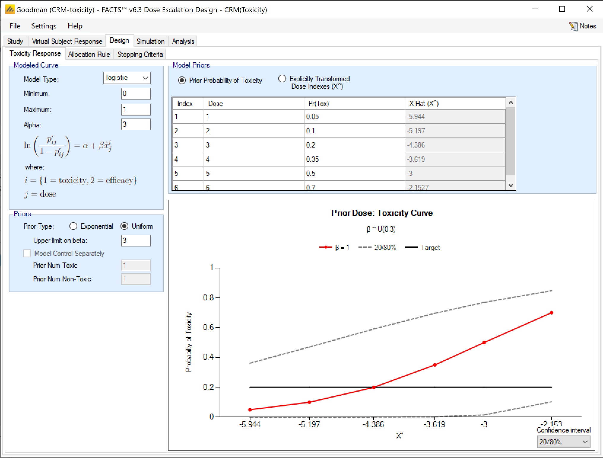

### Allocation Rule

Set the parameters as follows:

- Maximum dose levels that can be incremented: 1

- Minimum cohorts on dose before incrementing: 1

- Maximum increment is relative to the most recent dose level allocated to.

- Starting dose level: 1

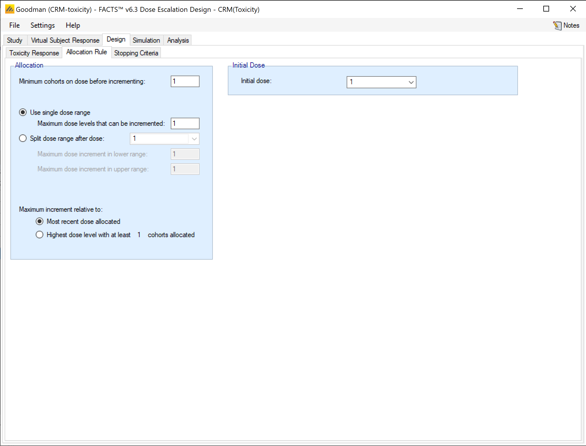

###  Stopping Criteria

- Set the parameters as follows:

<!-- -->

- Select rules for stopping trial early

- Maximum cohorts on MTD: 2

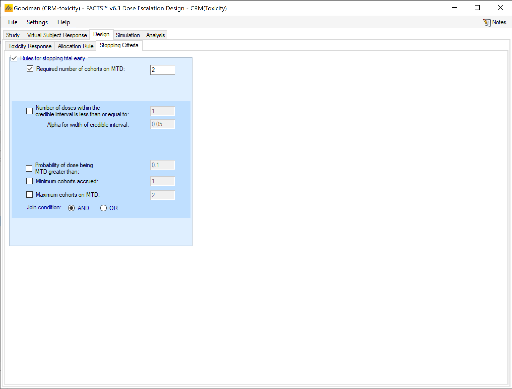

## Simulation

Set the number of simulations to 1000, select all the scenarios and run the simulations.

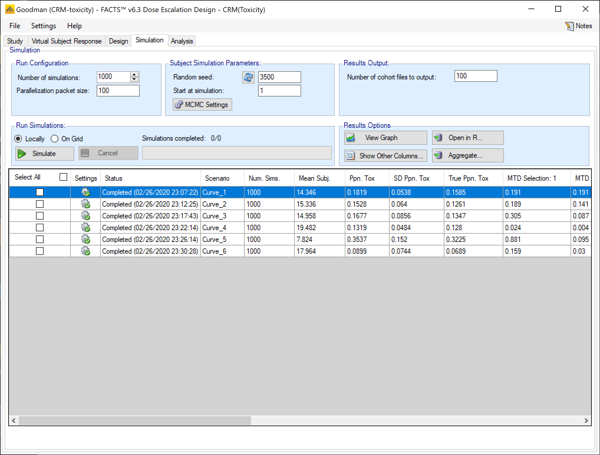

Goodman report results for a number of different designs, the results here are for Goodman's modified CRM, with a uniform prior and a cohort size of 3 (which is the closest to the design simulated here in FACTS).

We are uncertain as to why the selection of MTD by FACTS is better than that reported by Goodman, the sample sizes tend to be smaller because Goodman's algorithm enforced a minimum trial size of 18 whereas we did not.

+-----------------------------------------------+-----------------------------------------------+
| **Distribution of MTD seleciton by Scenario: results for CRM(Toxicity)**                      |
+===============================================+===============================================+
| 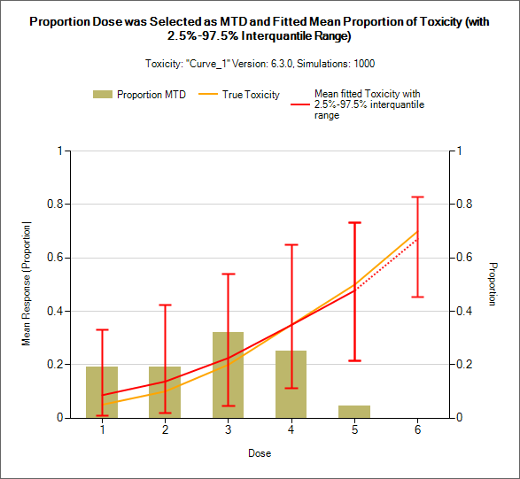 | 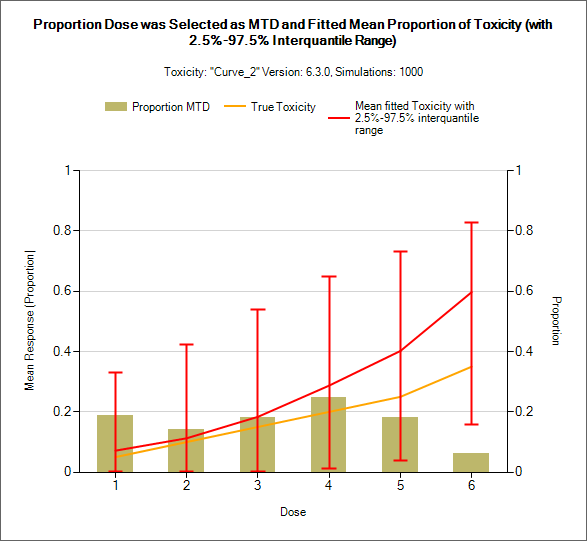 |
|                                               |                                               |
| Scenario 1 -- true MTD is Dose 3              | Scenario 2 -- true MTD is Dose 4              |
+-----------------------------------------------+-----------------------------------------------+
| 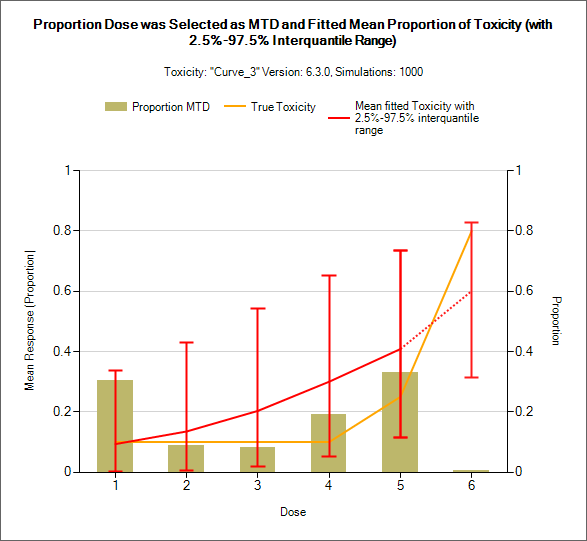 | 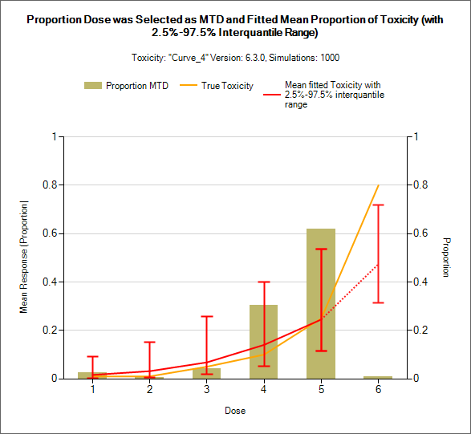 |
|                                               |                                               |
| Scenario 3 -- true MTD is Dose 5              | Scenario 4 -- true MTD is Dose 5              |
+-----------------------------------------------+-----------------------------------------------+
| 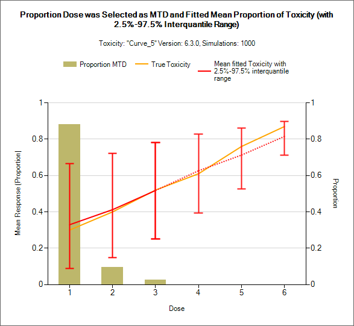 | 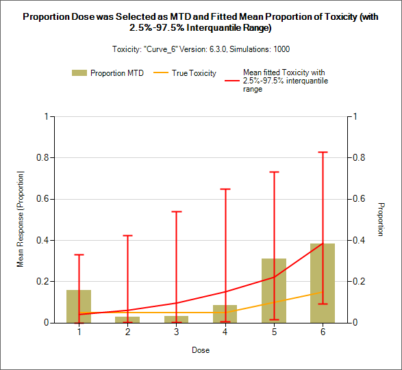 |
|                                               |                                               |
| Scenario 5 -- all doses too toxic             | Scenario 6 -- no dose too toxic               |
+-----------------------------------------------+-----------------------------------------------+

## Alternative Stopping Rule

After running simulations it should be unnecessary to save the current parameters from the GUI, they will have been saved prior to starting the simulations. From the **File** menu select **Save As** and save the project under an alternative name before creating a variation of the design.

On the **Design** \> **Stopping Criteria** tab, change the stopping rule to:

- Combined Rules

- Probability of dose being MTD greater than: 0.5

- Minimum cohorts accrued: 4

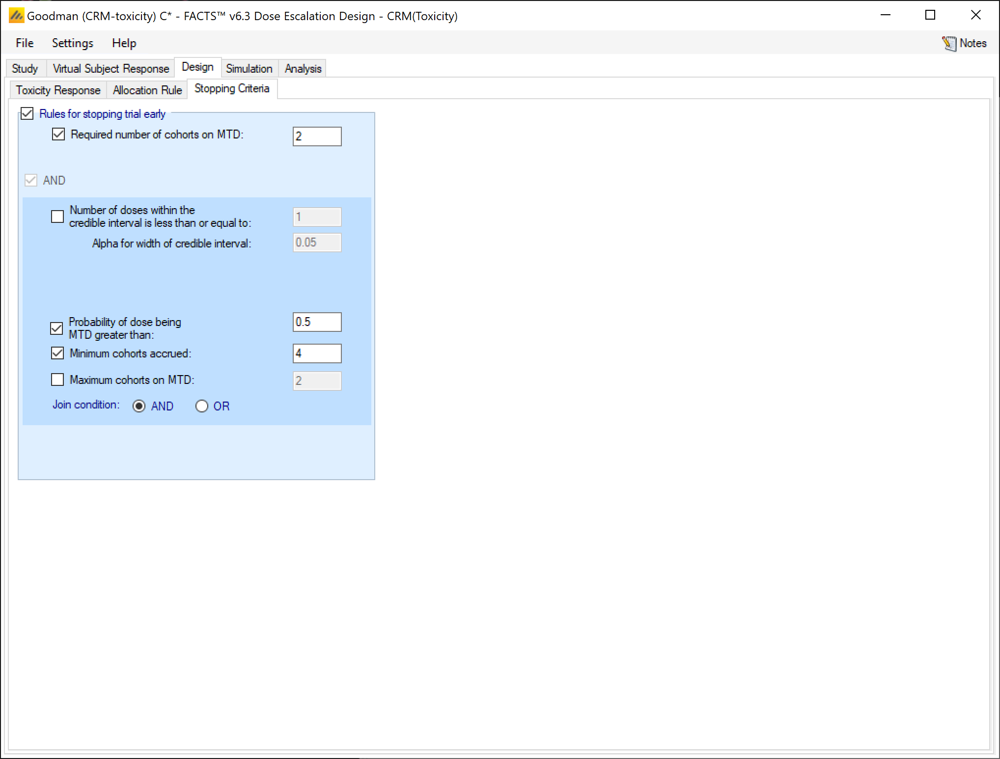

This specifies that the trial should not stop until one dose has a probability of being the MTD of at least 0.5 and at least 4 cohorts have been treated. The former will tend to make the trials last longer and test more subjects, and as a result increase the accuracy of the selection of the MTD, the latter will address those simulation where 2 toxicities in the first cohort or one in the first and one and in the second cause the trial to terminate and select the first dose. The tendency to select dose 1 as MTD can be seen in some of the plots above.

Return to the simulation tab and run 1,000 simulations of this modified design. You should find that in all scenarios the proportion of times selection of the correct MTD has increased, but with an increase in the average number of subjects used.

+-----------------------------------------------+------------------------------------------------------------------------+
| **Distribution of MTD seleciton by Scenario: results for CRM(Toxicity), stop if probability of dose being MTD \> 0.5** |
+===============================================+========================================================================+
|  | 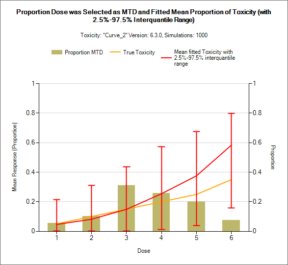                          |
|                                               |                                                                        |
| Scenario 1 -- true MTD is Dose 3              | Scenario 2 -- true MTD is Dose 4                                       |
+-----------------------------------------------+------------------------------------------------------------------------+
| 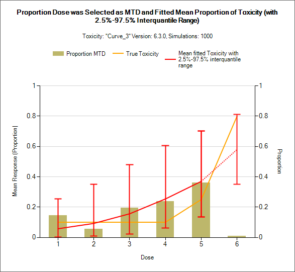 | 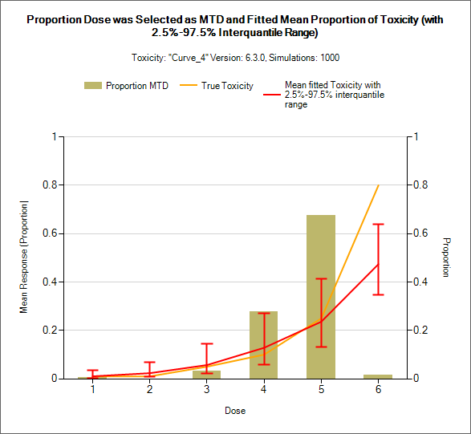                          |
|                                               |                                                                        |
| Scenario 3 -- true MTD is Dose 5              | Scenario 4 -- true MTD is Dose 5                                       |
+-----------------------------------------------+------------------------------------------------------------------------+
| 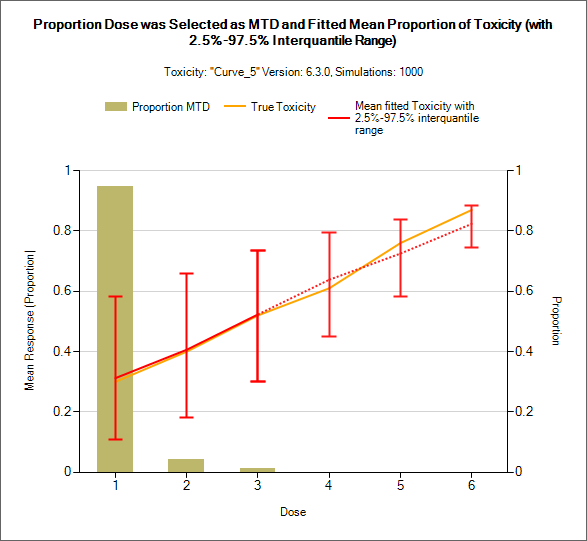 | 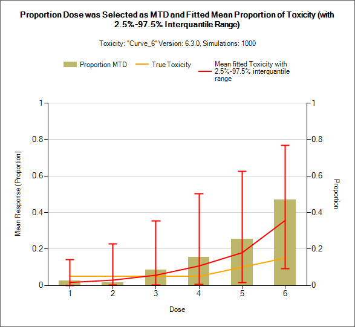                          |
|                                               |                                                                        |
| Scenario 5 -- all doses too toxic             | Scenario 6 -- no dose too toxic                                        |
+-----------------------------------------------+------------------------------------------------------------------------+

## Single Patient Run In

From the design with the modified stopping rule, again use Save As to create a new version of the project that can be modified (whilst preserving the previous design and simulation results).

On the Study \> Study Info tab:

- Enable single patient run-in

- Assigning the first cohort to the dose below the dose at which the first toxicity occurs.

This specifies that the trial should start allocating one subject at a time, escalating one dose at a time until the first toxicity is observed.

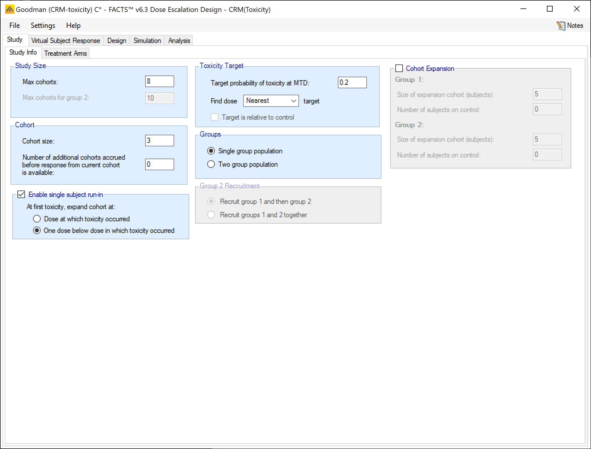

Return to the simulation tab and run 1,000 simulations of this modified design. You should find that the scenarios where the correct MTD is a high dose (curves 3, 4 and 6), the proportion of times the correct MTD is selected has increased and in curves 1 and 2 it has decreased. In scenarios 3 and 4 the average number of subjects used has also decreased.

+-----------------------------------------------+------------------------------------------------------------------------------------------------------------+
| **Distribution of MTD seleciton by Scenario: results for CRM(Toxicity), stop if probability of dose being MTD \> 0.5, with a single patient run-in phase** |
+===============================================+============================================================================================================+
| 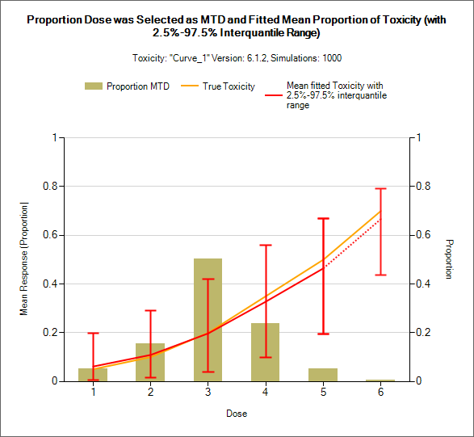 | 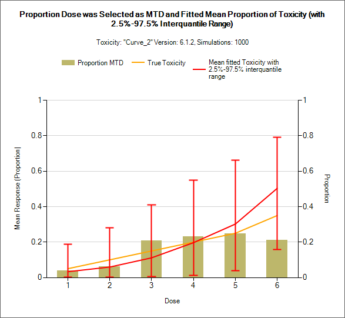                                                              |
|                                               |                                                                                                            |
| Scenario 1 -- true MTD is Dose 3              | Scenario 2 -- true MTD is Dose 4                                                                           |
+-----------------------------------------------+------------------------------------------------------------------------------------------------------------+
| 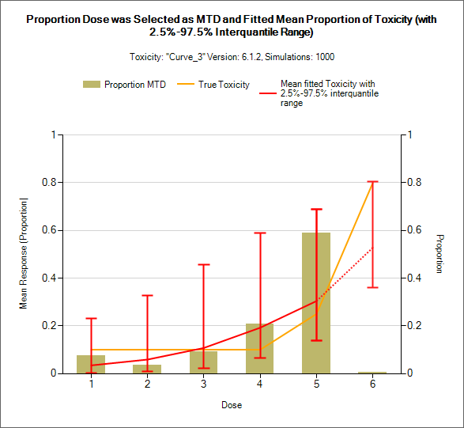 | 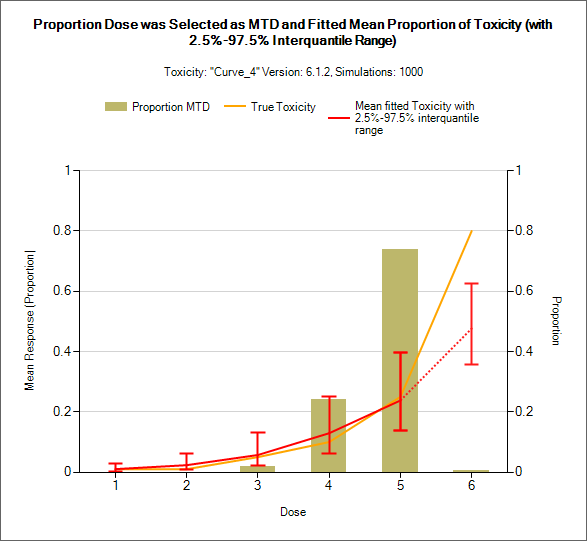                                                              |
|                                               |                                                                                                            |
| Scenario 3 -- true MTD is Dose 5              | Scenario 4 -- true MTD is Dose 5                                                                           |
+-----------------------------------------------+------------------------------------------------------------------------------------------------------------+
| 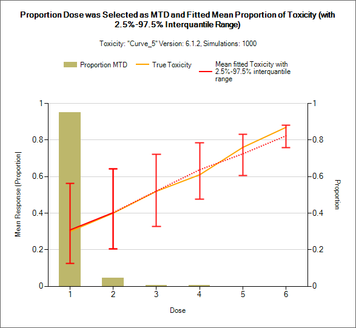 | 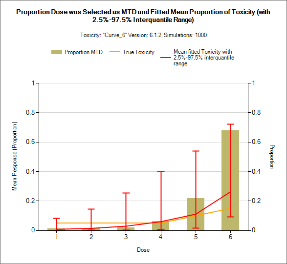                                                              |
|                                               |                                                                                                            |
| Scenario 5 -- all doses too toxic             | Scenario 6 -- no dose too toxic                                                                            |
+-----------------------------------------------+------------------------------------------------------------------------------------------------------------+

# Summary of results

From the Goodman paper we report the results for "Mod CRM (3/group)" with the uniform prior.

The CRM with single patient run-in is the best at MTD selection in all but the 2^nd^ scenario -- where no design does well. Apart from scenario 2 it is conservative in its dose selection. Apart from scenario 2 it is more conservative than mTPI and apart from scenario 1 & 2 it is more conservative than 3+3. Due to the run-in it does have a slightly higher (\~2 percentage points) probability of observing toxicities during the trial.

+:------------------------------------------------:+:----------------:+:------------------:+:---------------:+:-----------------:+:-----------------------:+:------------------------------:+
| **Curve -- true MTD**                            | **Design**       | **% times MTD selected**                                 | **% toxicity observed** | **Average number of subjects** |
|                                                  |                  +--------------------+-----------------+-------------------+                         |                                |
|                                                  |                  | **Below true MTD** | **On true MTD** | **Over true MTD** |                         |                                |
+--------------------------------------------------+------------------+--------------------+-----------------+-------------------+-------------------------+--------------------------------+
| 1 -- dose 3                                      | Goodman          | 46                 | 30              | 24                | 18.9                    | 19.1                           |
|                                                  +------------------+--------------------+-----------------+-------------------+-------------------------+--------------------------------+
|                                                  | 3+3              | 42                 | 36              | 22                | 19.8                    | 16.9                           |
|                                                  +------------------+--------------------+-----------------+-------------------+-------------------------+--------------------------------+
|                                                  | mTPI             | 21                 | 41              | 38                | 18.1                    | 18.7                           |
|                                                  +------------------+--------------------+-----------------+-------------------+-------------------------+--------------------------------+
|                                                  | CRM(Tox)         | 38                 | 32              | 30                | 18.2                    | 14.3                           |
|                                                  +------------------+--------------------+-----------------+-------------------+-------------------------+--------------------------------+
|                                                  | \+ 50% stop rule | 24                 | 50              | 26                | 17.9                    | 23.1                           |
|                                                  +------------------+--------------------+-----------------+-------------------+-------------------------+--------------------------------+
|                                                  | \+ 1 pat run-in  | 20                 | 50              | 29                | 21.6                    | 24.3                           |
+--------------------------------------------------+------------------+--------------------+-----------------+-------------------+-------------------------+--------------------------------+
| 2 -- dose 4                                      | Goodman          | 67                 | 19              | 14                | 14.7                    | 19.5                           |
|                                                  +------------------+--------------------+-----------------+-------------------+-------------------------+--------------------------------+
|                                                  | 3+3              | 52                 | 19              | 29                | 16.6                    | 18.6                           |
|                                                  +------------------+--------------------+-----------------+-------------------+-------------------------+--------------------------------+
|                                                  | mTPI             | 43                 | 28              | 29                | 15.2                    | 19.7                           |
|                                                  +------------------+--------------------+-----------------+-------------------+-------------------------+--------------------------------+
|                                                  | CRM(Tox)         | 51                 | 25              | 24                | 15.3                    | 15.3                           |
|                                                  +------------------+--------------------+-----------------+-------------------+-------------------------+--------------------------------+
|                                                  | \+ 50% stop rule | 47                 | 26              | 28                | 14.2                    | 22.7                           |
|                                                  +------------------+--------------------+-----------------+-------------------+-------------------------+--------------------------------+
|                                                  | \+ 1 pat run-in  | 31                 | 23              | 46                | 16.7                    | 20.1                           |
+--------------------------------------------------+------------------+--------------------+-----------------+-------------------+-------------------------+--------------------------------+
| 3 -- dose 5                                      | Goodman          | 82                 | 15              | 3                 | 14.4                    | 20.3                           |
|                                                  +------------------+--------------------+-----------------+-------------------+-------------------------+--------------------------------+
|                                                  | 3+3              | 62                 | 38              | 1                 | 19.2                    | 18.9                           |
|                                                  +------------------+--------------------+-----------------+-------------------+-------------------------+--------------------------------+
|                                                  | mTPI             | 56                 | 31              | 14                | 16.1                    | 19.6                           |
|                                                  +------------------+--------------------+-----------------+-------------------+-------------------------+--------------------------------+
|                                                  | CRM(Tox)         | 66                 | 33              | 1                 | 16.8                    | 15.0                           |
|                                                  +------------------+--------------------+-----------------+-------------------+-------------------------+--------------------------------+
|                                                  | \+ 50% stop rule | 63                 | 36              | 1                 | 14.3                    | 21.6                           |
|                                                  +------------------+--------------------+-----------------+-------------------+-------------------------+--------------------------------+
|                                                  | \+ 1 pat run-in  | 41                 | 59              | 0                 | 18.2                    | 19.8                           |
+--------------------------------------------------+------------------+--------------------+-----------------+-------------------+-------------------------+--------------------------------+
| 4 -- dose 5                                      | Goodman          | 69                 | 25              | 6                 | 14.5                    | 20.2                           |
|                                                  +------------------+--------------------+-----------------+-------------------+-------------------------+--------------------------------+
|                                                  | 3+3              | 51                 | 48              | 1                 | 16.6                    | 21.0                           |
|                                                  +------------------+--------------------+-----------------+-------------------+-------------------------+--------------------------------+
|                                                  | mTPI             | 29                 | 52              | 19                | 14.5                    | 22.6                           |
|                                                  +------------------+--------------------+-----------------+-------------------+-------------------------+--------------------------------+
|                                                  | CRM(Tox)         | 37                 | 62              | 1                 | 13.2                    | 19.5                           |
|                                                  +------------------+--------------------+-----------------+-------------------+-------------------------+--------------------------------+
|                                                  | \+ 50% stop rule | 31                 | 68              | 2                 | 13.5                    | 22.3                           |
|                                                  +------------------+--------------------+-----------------+-------------------+-------------------------+--------------------------------+
|                                                  | \+ 1 pat run-in  | 26                 | 74              | 0                 | 18.6                    | 19.2                           |
+--------------------------------------------------+------------------+--------------------+-----------------+-------------------+-------------------------+--------------------------------+
| 5 -- all toxic                                   | Goodman          | 0                  | 78              | 22                | 33.1                    | 18.2                           |
|                                                  +------------------+--------------------+-----------------+-------------------+-------------------------+--------------------------------+
|                                                  | 3+3              | 0                  | 87              | 13                | 40.6                    | 8.6                            |
|                                                  +------------------+--------------------+-----------------+-------------------+-------------------------+--------------------------------+
| here we count selecting dose 1 as MTD as correct | mTPI             | 0                  | 77              | 23                | 35.8                    | 11.1                           |
|                                                  +------------------+--------------------+-----------------+-------------------+-------------------------+--------------------------------+
|                                                  | CRM(Tox)         | 0                  | 88              | 12                | 35.4                    | 7.8                            |
|                                                  +------------------+--------------------+-----------------+-------------------+-------------------------+--------------------------------+
|                                                  | \+ 50% stop rule | 0                  | 95              | 5                 | 33.9                    | 13.8                           |
|                                                  +------------------+--------------------+-----------------+-------------------+-------------------------+--------------------------------+
|                                                  | \+ 1 pat run-in  | 0                  | 95              | 5                 | 35.7                    | 15.4                           |
+--------------------------------------------------+------------------+--------------------+-----------------+-------------------+-------------------------+--------------------------------+
| 6 - dose 6                                       | Goodman          | 86                 | 14              | 0                 | 7.1                     | 21.3                           |
|                                                  +------------------+--------------------+-----------------+-------------------+-------------------------+--------------------------------+
|                                                  | 3+3              | 34                 | 67              | 0                 | 8.1                     | 20.2                           |
|                                                  +------------------+--------------------+-----------------+-------------------+-------------------------+--------------------------------+
|                                                  | mTPI             | 37                 | 63              | 0                 | 8.3                     | 22.4                           |
|                                                  +------------------+--------------------+-----------------+-------------------+-------------------------+--------------------------------+
|                                                  | CRM(Tox)         | 62                 | 38              | 0                 | 9.0                     | 18.0                           |
|                                                  +------------------+--------------------+-----------------+-------------------+-------------------------+--------------------------------+
|                                                  | \+ 50% stop rule | 53                 | 47              | 0                 | 7.1                     | 22.1                           |
|                                                  +------------------+--------------------+-----------------+-------------------+-------------------------+--------------------------------+
|                                                  | \+ 1 pat run-in  | 32                 | 68              | 0                 | 8.7                     | 15.7                           |
+--------------------------------------------------+------------------+--------------------+-----------------+-------------------+-------------------------+--------------------------------+
