#  Introduction

This tutorial describes the example trial design using the FACTS Dose Escalation Design Engine for Toxicity Interval, "N-CRM".

For this version of the document, the screenshots are from the V6.3 release of FACTS.

The screenshots provided are approximate and may not reflect the exact layout of the information in later versions of FACTS. The contents of each tab, however, will be consistent with the software.

# Case Study: \[Neuenschwander\]

The N-CRM is based on the "Critical aspects of the Bayesian approach to phase 1 cancer trials" by Beat Neuenschwander, Michael Branson and Thomas Gsponer, Statistics in Medicine 2008; 27:2420-2439. The example is taken from that paper and allows some comparison of the approach described in the paper and the implementation in FACTS.

The setting is a conventional phase 1 oncology trial, where a degree of toxicity is thought an inevitable consequence of using a dose that is strong enough to be likely to have some efficacy. Thus having either too much or too little toxicity is undesirable; the aim of the trial therefore is to estimate which of the available doses are most likely to have a probability of toxicity in the targeted toxicity range.

The target is to find the dose most likely to have a toxicity rate in the range (0.20, 0.35\].

Toxicity in the range (0.00, 0.20\] is deemed 'under dosing', in the range (0.35, 0.60\] excessive toxicity and in the range (0.60, 1.00\] unacceptable toxicity.

We will simulate the design that is labelled LRcat25 in the paper, this design aims to limit the likelihood of overdosing by avoiding doses where the posterior probability that its toxicity rate lies in the excessive or unacceptable bands is 25% or greater.

There are 7 treatment arms and a maximum of 12 cohorts of 3 subjects.

Subjects will be dosed in cohorts of 3, starting at the lowest dose.

Doses at successive cohorts may be incremented by any amount subject to the overdosing constraint described above.

As in the paper there will be no early stopping, unless all doses are inadmissible by the overdosing constraint.

## Response Model

Let the probability of observing toxicity for a subject given dose *j* be *p~j~*

We will model the probability of toxicity across the range of doses:

$$\log\left( \frac{p_{j}}{{1 - p}_{j}} \right) = \alpha + \beta\widehat{x_{j}}$$

With *α* and log *β* given a normal bivariate prior. The actual parameters of this distribution are estimated based on user supplied quantiles for the prior probability of the toxicity rate for each dose.

Each dose *j* is given a 'strength' $\widehat{x_{j}}$ by taking the log of the doses scaled to a reference dose:

$$\widehat{x_{j}} = log\left( \frac{d_{j}}{d^{*}} \right)$$

The paper defines 8 dose-toxicity scenarios.

## Simulation Details

Six different possible dose toxicity responses will be simulated; in each scenario the target MTD is highlighted.

+--------------+-------+-------+-------+-------+-------+-------+-------+
|              | Dose  |       |       |       |       |       |       |
+--------------+-------+-------+-------+-------+-------+-------+-------+
| Scenario#    | 1     | 2     | 3     | 4     | 5     | 6     | 7     |
+--------------+-------+-------+-------+-------+-------+-------+-------+
| S2           | 0.11  | 0.27  | 0.52  | 0.76  | .84   | 0.90  | 0.94  |
+--------------+-------+-------+-------+-------+-------+-------+-------+
| F2           | 0.18  | 0.27  | 0.39  | 0.52  | 0.65  | 0.76  | 0.84  |
+--------------+-------+-------+-------+-------+-------+-------+-------+
| S4           | 0.01  | 0.04  | 0.11  | 0.27  | 0.52  | 0.76  | 0.90  |
+--------------+-------+-------+-------+-------+-------+-------+-------+
| F4           | 0.07  | 0.11  | 0.18  | 0.27  | 0.39  | 0.52  | 0.65  |
+--------------+-------+-------+-------+-------+-------+-------+-------+
| S6           | 0.01  | 0.01  | 0.03  | 0.04  | 0.11  | 0.27  | 0.52  |
+--------------+-------+-------+-------+-------+-------+-------+-------+
| F6           | 0.03  | 0.04  | 0.07  | 0.11  | 0.18  | 0.27  | 0.39  |
+--------------+-------+-------+-------+-------+-------+-------+-------+
| F7           | 0.01  | 0.03  | 0.04  | 0.07  | 0.11  | 0.18  | 0.27  |
+--------------+-------+-------+-------+-------+-------+-------+-------+
| F1           | 0.27  | 0.39  | 0.52  | 0.65  | 0.76  | 0.84  | 0.90  |
+--------------+-------+-------+-------+-------+-------+-------+-------+

The scenarios are divided into **S**teep and **F**lat and the number indicates the correct dose to select at the end of the study if one had perfect information.

## Designs for comparison

Compare with using the 3+3 and the original CRM(toxicity).

Compare using the N-CRM with different priors, dose escalation rules (e.g. no over dose control and/or with doses only incremented one step at a time).

Compare with using different cohort sizes. Cohort of size 1 should be the most efficient.

#  Simulating using FACTS 3+3

As a benchmark to judge how well the N-CRM performs, first simulate the trial performed using the 3+3 method.

Start FACTS Dose Escalating. Use the menu option File \> New \> Dose Escalation \> 3+3 to create a new CRM design.

Using the menu option File \> Save As, save this design as for example "3+3" in a convenient location (e.g. in a folder called FACTS\\N-CRM-example in your 'My Documents' folder).

## Study Info

Set a trial size of 12 cohorts

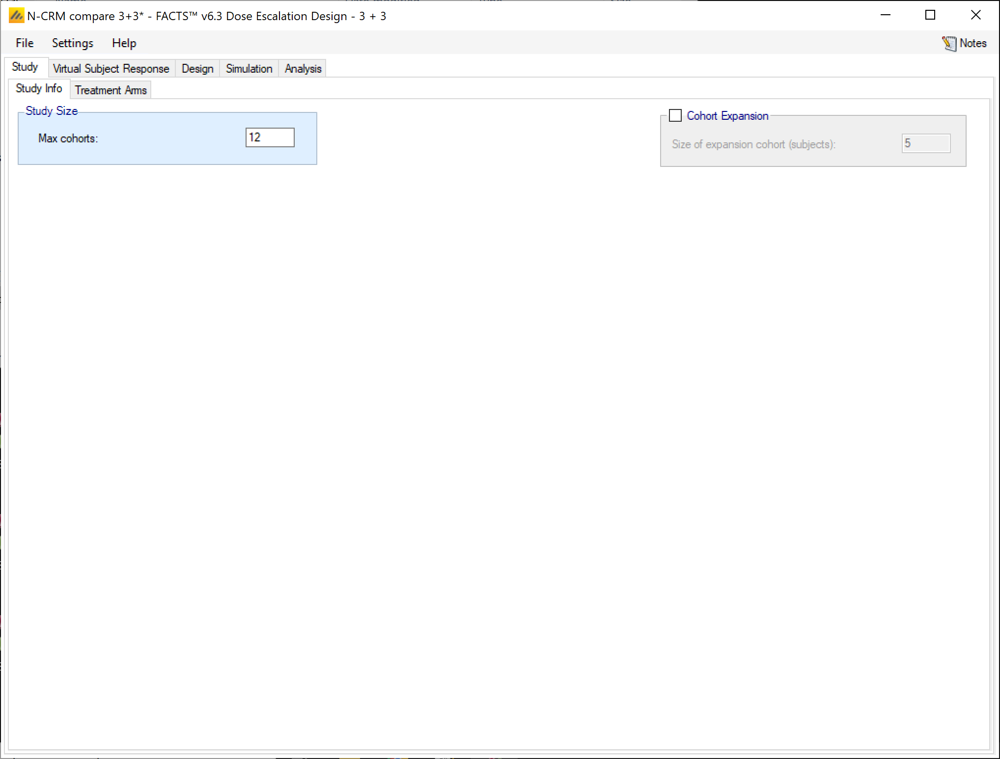

##  Treatment Arms

Create 7 treatment arms, do not include a control:

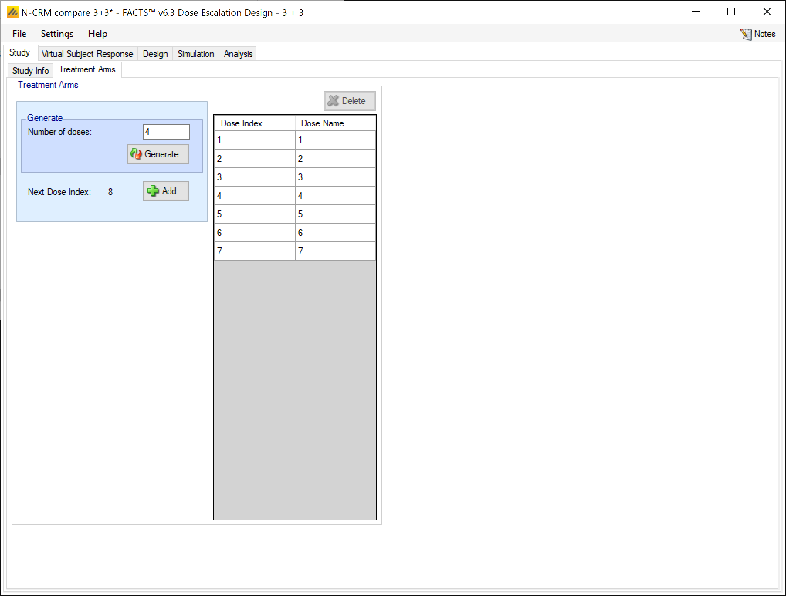

##  Virtual Subject Responses

Create the 8 scenarios and enter the probability of toxicity for each dose for each scenario corresponding to the table:

+--------------+-------+-------+-------+-------+-------+-------+-------+
|              | Dose  |       |       |       |       |       |       |
+--------------+-------+-------+-------+-------+-------+-------+-------+
| Scenario#    | 1     | 2     | 3     | 4     | 5     | 6     | 7     |
+--------------+-------+-------+-------+-------+-------+-------+-------+
| S2           | 0.11  | 0.27  | 0.52  | 0.76  | 0.84  | 0.90  | 0.94  |
+--------------+-------+-------+-------+-------+-------+-------+-------+
| F2           | 0.18  | 0.27  | 0.39  | 0.52  | 0.65  | 0.76  | 0.84  |
+--------------+-------+-------+-------+-------+-------+-------+-------+
| S4           | 0.01  | 0.04  | 0.11  | 0.27  | 0.52  | 0.76  | 0.90  |
+--------------+-------+-------+-------+-------+-------+-------+-------+
| F4           | 0.07  | 0.11  | 0.18  | 0.27  | 0.39  | 0.52  | 0.65  |
+--------------+-------+-------+-------+-------+-------+-------+-------+
| S6           | 0.01  | 0.01  | 0.03  | 0.04  | 0.11  | 0.27  | 0.52  |
+--------------+-------+-------+-------+-------+-------+-------+-------+
| F6           | 0.03  | 0.04  | 0.07  | 0.11  | 0.18  | 0.27  | 0.39  |
+--------------+-------+-------+-------+-------+-------+-------+-------+
| F7           | 0.01  | 0.03  | 0.04  | 0.07  | 0.11  | 0.18  | 0.27  |
+--------------+-------+-------+-------+-------+-------+-------+-------+
| F1           | 0.27  | 0.39  | 0.52  | 0.65  | 0.76  | 0.84  | 0.90  |
+--------------+-------+-------+-------+-------+-------+-------+-------+

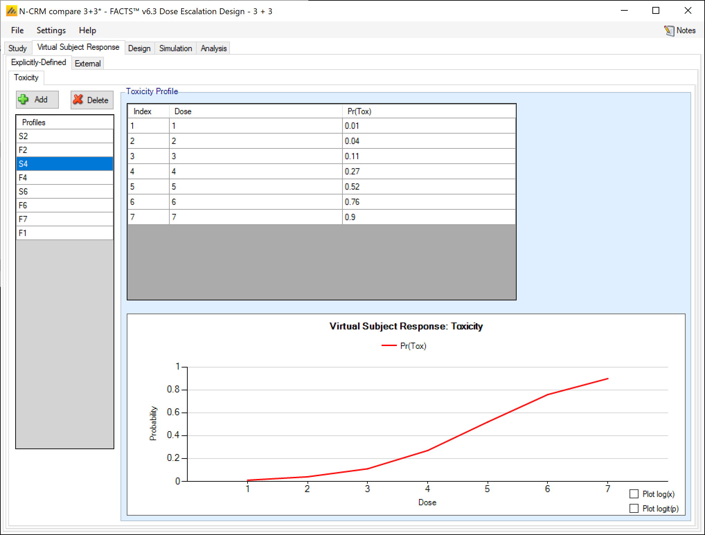

##  Design

Set dose 1 as the starting dose and do not include a validation cohort (in these scenarios -- with the exception of F1 - the inclusion of a validation cohort impairs the ability to select the correct MTD).

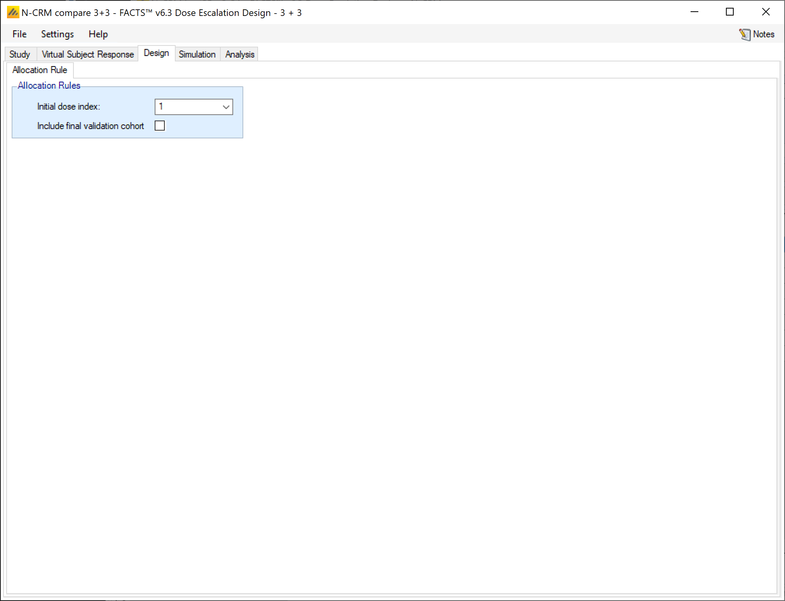

##  Simulation

On the simulation tab, set the number of simulations to be run at 1,000, select all scenarios and then run the simulations:

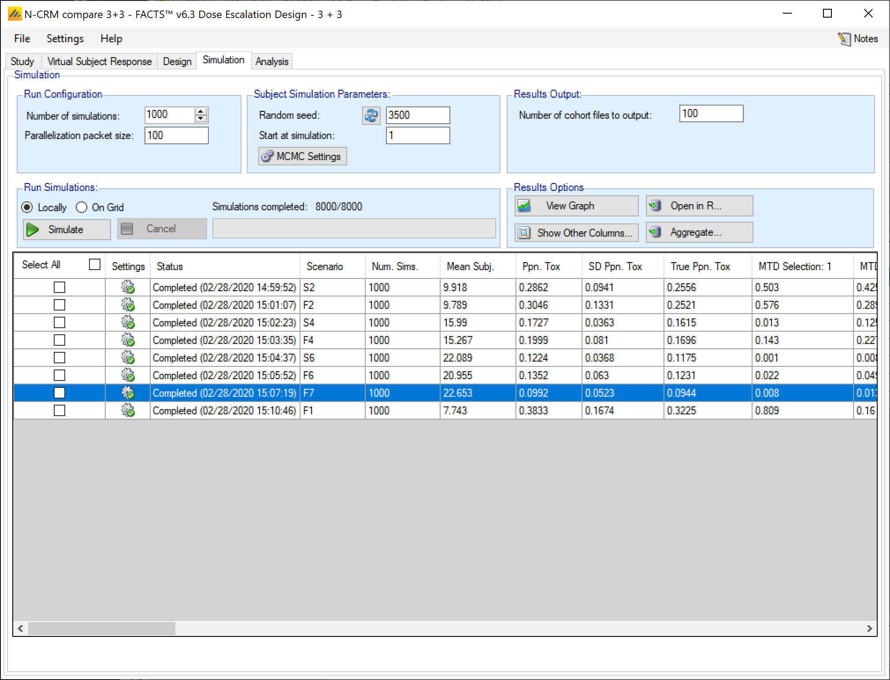

Note that with the exception of scenario F1 (first dose is MTD) the 'correct' doses are only selected between 19% and 38% of the time depending on the scenario. In all scenarios except F1 and F7, other doses are more likely to be selected.

+-----------+---------------------------------------------------------------+-------------+-------------+-------------+-------------+-------------+-------------+
|           | Dose- showing stimulated toxicity / Ppn times selected as MTD |             |             |             |             |             |             |
+-----------+---------------------------------------------------------------+-------------+-------------+-------------+-------------+-------------+-------------+
| Scenario# | 1                                                             | 2           | 3           | 4           | 5           | 6           | 7           |
+-----------+---------------------------------------------------------------+-------------+-------------+-------------+-------------+-------------+-------------+
| S2        | 0.11 / 0.50                                                   | 0.27 / 0.42 | 0.52 / 0.07 | 0.76 / 0.00 | 0.84 / 0.00 | 0.90 / 0.00 | 0.94 / 0.00 |
+-----------+---------------------------------------------------------------+-------------+-------------+-------------+-------------+-------------+-------------+
| F2        | 0.18 / 0.58                                                   | 0.27 / 0.29 | 0.39 / 0.12 | 0.52 / 0.02 | 0.65 / 0.00 | 0.76 / 0.00 | 0.84 / 0.00 |
+-----------+---------------------------------------------------------------+-------------+-------------+-------------+-------------+-------------+-------------+
| S4        | 0.01 / 0.01                                                   | 0.04 / 0.13 | 0.11 / 0.38 | 0.27 / 0.40 | 0.52 / 0.07 | 0.76 / 0.00 | 0.90 / 0.00 |
+-----------+---------------------------------------------------------------+-------------+-------------+-------------+-------------+-------------+-------------+
| F4        | 0.07 / 0.14                                                   | 0.11 / 0.23 | 0.18 / 0.29 | 0.27 / 0.21 | 0.39 / 0.11 | 0.52 / 0.02 | 0.65 / 0.00 |
+-----------+---------------------------------------------------------------+-------------+-------------+-------------+-------------+-------------+-------------+
| S6        | 0.01 / 0.00                                                   | 0.01 / 0.01 | 0.03 / 0.02 | 0.04 / 0.11 | 0.11 / 0.37 | 0.27 / 0.42 | 0.52 / 0.07 |
+-----------+---------------------------------------------------------------+-------------+-------------+-------------+-------------+-------------+-------------+
| F6        | 0.03 / 0.02                                                   | 0.04 / 0.05 | 0.07 / 0.09 | 0.11 / 0.22 | 0.18 / 0.27 | 0.27 / 0.23 | 0.39 / 0.12 |
+-----------+---------------------------------------------------------------+-------------+-------------+-------------+-------------+-------------+-------------+
| F7        | 0.01 / 0.01                                                   | 0.03 / 0.01 | 0.04 / 0.05 | 0.07 / 0.11 | 0.11 / 0.20 | 0.18 / 0.29 | 0.27 / 0.34 |
+-----------+---------------------------------------------------------------+-------------+-------------+-------------+-------------+-------------+-------------+
| F1        | 0.27 / 0.81                                                   | 0.39 / 0.16 | 0.52 / 0.03 | 0.65 / 0.00 | 0.76 / 0.00 | 0.84 / 0.00 | 0.90 / 0.00 |
+-----------+---------------------------------------------------------------+-------------+-------------+-------------+-------------+-------------+-------------+

#  Simulating using FACTS N-CRM

Start FACTS Dose Escalating. Use the menu option File \> New \> Dose Escalation \> N-CRM to create a new CRM design.

Using the menu option File \> Save As, save this design as for example "N-CRM-1" in a convenient location (e.g. in a folder called FACTS\\N-CRM-example in your 'My Documents' folder).

This design is also available as "N-CRM lrcat25-p2-24" from the FACTS File \> Examples menu option.

## Study

### Study Info

Set the following parameters:

- Maximum Trial Size (cohorts): 8

- Cohort size: 3

- Number of additional cohorts accrued before response from the current cohort is available: 0

- Target toxicity intervals

  - Under dosing: 0.0-0.2

  - Target band: 0.2-0.35

  - Excess toxicity: 0.35-0.6

  - Unacceptable toxicity: 0.6-1.0

- Check: Limit max excess/unacceptable toxicity to \< 0.25

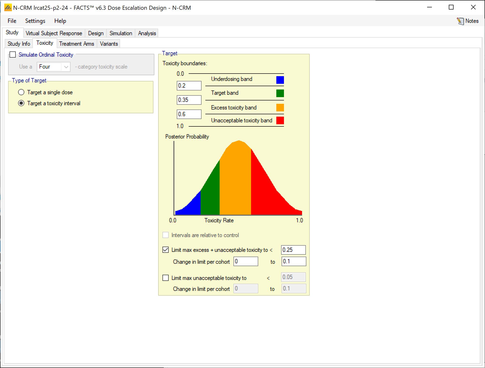

###  Treatment Arms

Create 7 doses 1 to 7 with no control, set the dose strengths to 12.5, 25, 50, 100, 150, 200, 250.

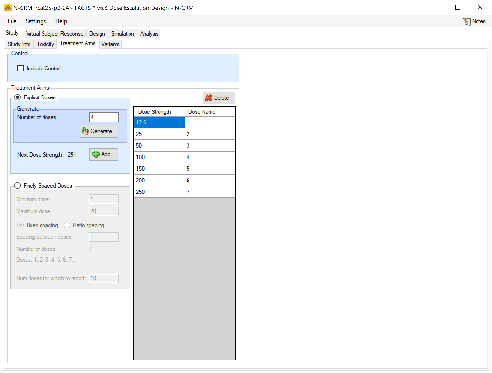

##  Virtual Subject Response

### Explicitly Defined -- Toxicity

Create the 8 scenarios and enter the probability of toxicity for each dose for each scenario corresponding to the table:

+--------------+-------+-------+-------+-------+-------+-------+-------+
|              | Dose  |       |       |       |       |       |       |
+--------------+-------+-------+-------+-------+-------+-------+-------+
| Scenario#    | 1     | 2     | 3     | 4     | 5     | 6     | 7     |
+--------------+-------+-------+-------+-------+-------+-------+-------+
| S2           | 0.11  | 0.27  | 0.52  | 0.76  | 0.84  | 0.90  | 0.94  |
+--------------+-------+-------+-------+-------+-------+-------+-------+
| F2           | 0.18  | 0.27  | 0.39  | 0.52  | 0.65  | 0.76  | 0.84  |
+--------------+-------+-------+-------+-------+-------+-------+-------+
| S4           | 0.01  | 0.04  | 0.11  | 0.27  | 0.52  | 0.76  | 0.90  |
+--------------+-------+-------+-------+-------+-------+-------+-------+
| F4           | 0.07  | 0.11  | 0.18  | 0.27  | 0.39  | 0.52  | 0.65  |
+--------------+-------+-------+-------+-------+-------+-------+-------+
| S6           | 0.01  | 0.01  | 0.03  | 0.04  | 0.11  | 0.27  | 0.52  |
+--------------+-------+-------+-------+-------+-------+-------+-------+
| F6           | 0.03  | 0.04  | 0.07  | 0.11  | 0.18  | 0.27  | 0.39  |
+--------------+-------+-------+-------+-------+-------+-------+-------+
| F7           | 0.01  | 0.03  | 0.04  | 0.07  | 0.11  | 0.18  | 0.27  |
+--------------+-------+-------+-------+-------+-------+-------+-------+
| F1           | 0.27  | 0.39  | 0.52  | 0.65  | 0.76  | 0.84  | 0.90  |
+--------------+-------+-------+-------+-------+-------+-------+-------+

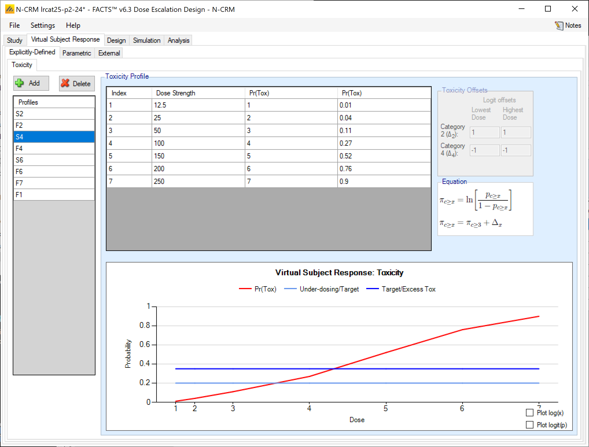

There are no externally defined curves in this example.

## Design

### XHats

The "CRM" model always uses some sort of transformation from the actual doses to a set of "effective dose strengths" for use in the logistic model. These are traditionally shown as $\widehat{x}$ in the formula, hence the term "X-hat". In the N-CRM the transformation uses two simple choices:

- The "reference dose" which all the dose strengths are relative to. At the reference dose strength (which doesn't have to be one of the available doses) the value of $\widehat{x}$ is 0, and the estimate of the logit of the toxicity rate at this dose strength will be α in the Bayesian Logistic Regression formula. One convention is to use the median of the dose range as the reference dose, (this minimizes the correlation in the estimate of α and β), others are is to use the start of the dose range or the dose thought, a priori, the most likely to be the MTD. If the reference dose is changed, the prior for α and β must be re-calibrated. Here we set it explicitly to the middle dose 100mg.

- The strength transformation can be log of the dose ratio (if the expected dose effect is expect to be roughly log linear) or a linear transformation (if the doses' have been specified with linear dose strength -- e.g. the dose strengths have simply been left at 1, 2, 3, ...). Were we set it to the log of the dose ration (as in the paper).

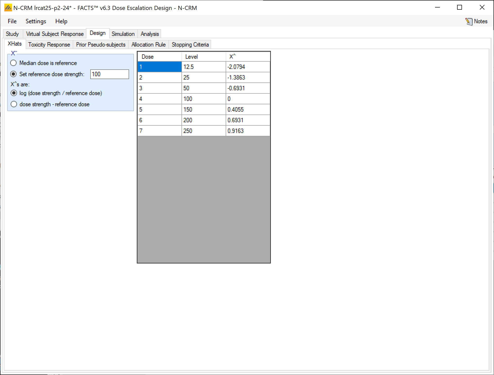

### Toxicity Response

Set the parameters as follows:

- Model type: logistic (the only option in the N-CRM)

- Minimum: 0

- Maximum: 1

- Priors specified by specifying all quantiles: click "Derive Prior", specify "All Quantiles" and enter the prior expectations of toxicity rates at the 2.5%, 50% and 97.5% quantiles as follows (this is the second prior from the paper, but where the paper uses values of '0'; or '1', we ue '0.001' and '0.999' respectively -- as 0 and 1 are impossible values given the method of deriving the prior):

+-------+------------+---------------+----------------+----------------+
| Dose  | Dose level | 2.5%          | 50%            | 97.5%          |
+======:+===========:+==============:+===============:+===============:+
| 1     | 12.5       | 0.001         | 0.03           | 0.79           |
+-------+------------+---------------+----------------+----------------+
| 2     | 25         | 0.001         | 0.05           | 0.84           |
+-------+------------+---------------+----------------+----------------+
| 3     | 50         | 0.01          | 0.11           | 0.90           |
+-------+------------+---------------+----------------+----------------+
| 4     | 100        | 0.01          | 0.25           | 0.95           |
+-------+------------+---------------+----------------+----------------+
| 5     | 150        | 0.01          | 0.38           | 0.98           |
+-------+------------+---------------+----------------+----------------+
| 6     | 200        | 0.01          | 0.47           | 0.99           |
+-------+------------+---------------+----------------+----------------+
| 7     | 250        | 0.01          | 0.54           | 0.999          |
+-------+------------+---------------+----------------+----------------+

> 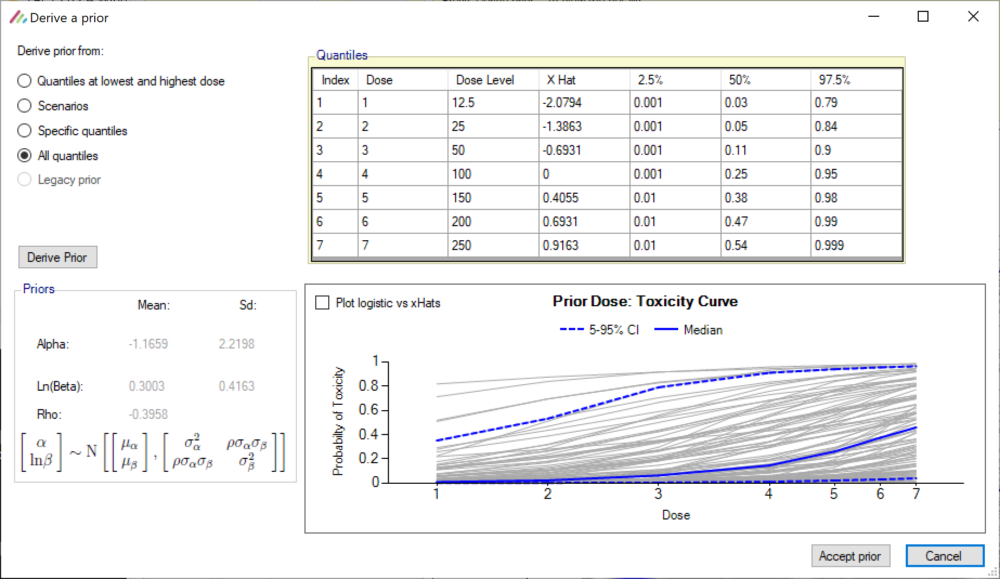

- Click on accept prior

> 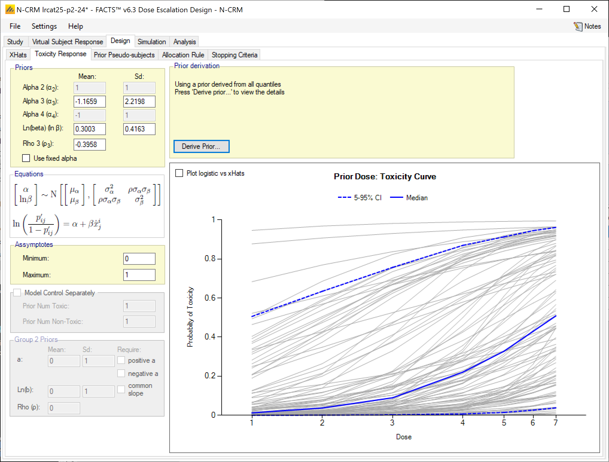

### Prior Pseudo-subjects

We don't use any prior pseudo-subjects in this example.

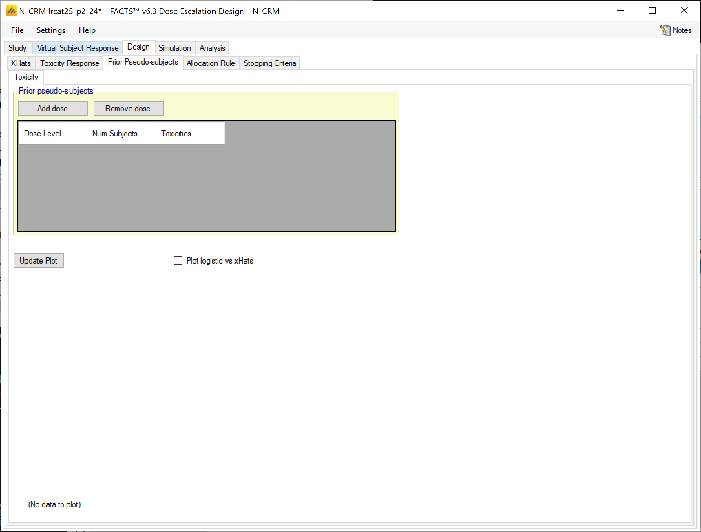

### Allocation Rule

Set the parameters as follows:

- Specify that allocation will be limited entirely by using the 'overdose control' specified on the study tab: that only doses with a posterior probability of \< 25% of having a toxicity rate above the target band may be allocated to. Thus follows the strategy used in the paper by Neuenschwander, in practice dose escalation rules are usually used in combination with the overdose control.

- Set the starting dose level: 1

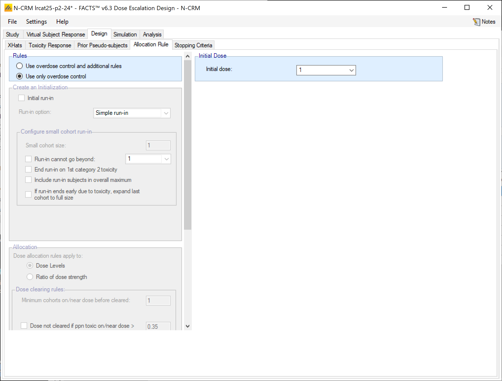

###  Stopping Criteria

Set the parameters as follows:

- Uncheck the "Rules for stopping trial early". In the paper we are comparing with results where no stopping rule was applied. This is probably unrealistic in practice, and it will be interesting to investigate whether a well-chosen stopping rule can yield similar performance in terms of correct identification of the MTD whilst giving lower expected average study sizes.

- Minimum toxicities required before stopping: 2. This is not mentioned in the paper, but there is a problem common to all CRM methods -- what to do if an early toxicity causes the expected toxicity at all doses to be too high for allocation to continue by the normal rules? Currently in the other CRMs the allocation stops. If the simulation specifies a low but non-zero probability of toxicity (0.01 say) at the first (or second) dose, a single toxicity in a cohort of 3 will show up in some simulations (\~3% if the probability is 0.01), causing a number of outlier simulations with small sample size and no selected MTD (or first dose as MTD). If this occurred on a trial in practice there is likely to be an ad hoc assessment of whether to allocate a further cohort at the lowest dose, and the precise rules governing this case might be quite hard to formulate; this parameter allows a simple approximation of this decision making -- by specifying that should all doses be inadmissible allocation to the lowest dose should continue until a the specified number of toxicities (over all doses) has been observed.

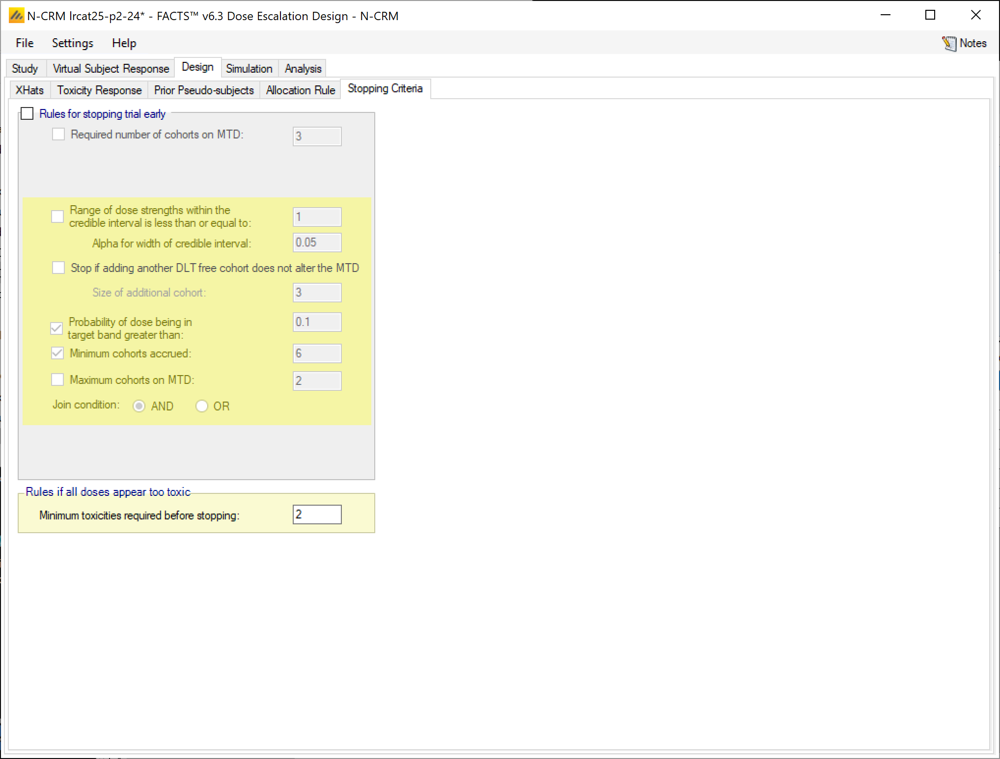

## Simulation

Set the number of simulations to 1000, select all the scenarios and run the simulations (this is moderately fast even when run locally on a laptop, it took \~20 minutes on a dual core 2.2 GHz Intel i7)

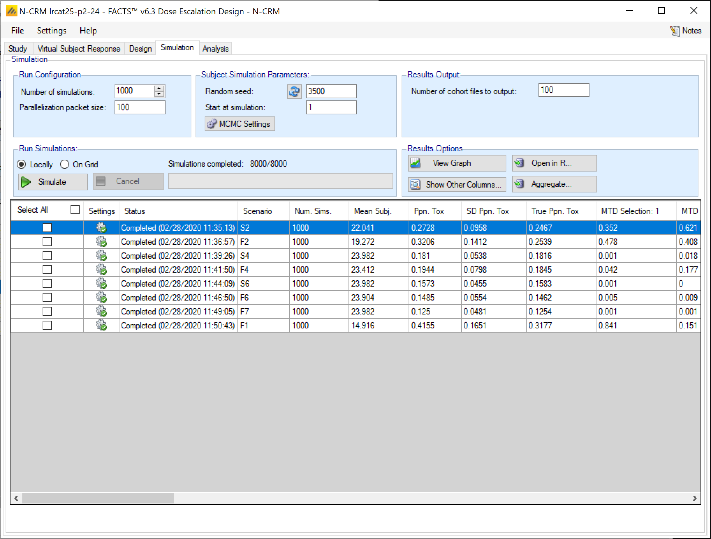

## Alternative Stopping Rule

After running simulations two things were noted: whilst the 3+3 did a poor job of MTD selection, so did the N-CRM with over dose control enabled at \<25%, and N-CRM's sample size was larger on many scenarios (because no stopping rules had been specified). Thus a second N-CRM design was created with an overdose control threshold of 33% and the following stopping rule:

Using **File** \> **SaveAs** to create a new copy of the design, on the Study \> Study info tab, change the "Limit max excess/unacceptable toxicity" threshold from 0.25 to 0.33.

On the **Design** \> **Stopping Criteria** tab:

- Enable Rules for stopping trial early

- Select Combined Rules

- Set the Probability of dose being MTD greater than: 0.4

- Set the Minimum cohorts accrued: 3

This specifies that the trial should not stop until at least 4 cohorts have been treated and one dose has a probability of being the MTD of at least 0.5.

Return to the simulation tab and run 1,000 simulations of this modified design. You should find that in all scenarios the proportion of times selection of the correct MTD has increased, but with an increase in the average number of subjects used.

# Summary of results

+-------------------+---------------+-------------------------------+----------------------+----------------------------+
| Curve -- true MTD | Simulation    | \% times true target selected | \% toxicity observed | Average number of subjects |
+-------------------+---------------+-------------------------------+----------------------+----------------------------+
| S2                | LRcat25       | 68%                           | 26%                  | 24                         |
+-------------------+---------------+-------------------------------+----------------------+----------------------------+
|                   | 3+3           | 43%                           | 29%                  | 9.9                        |
+-------------------+---------------+-------------------------------+----------------------+----------------------------+
|                   | FACTS LRcat25 | 62%                           | 27%                  | 22.0                       |
+-------------------+---------------+-------------------------------+----------------------+----------------------------+
|                   | FACTS LCcat33 | 66%                           | 31%                  | 16.8                       |
+-------------------+---------------+-------------------------------+----------------------+----------------------------+
| F2                | LRcat25       | 44%                           | 27%                  | 24                         |
+-------------------+---------------+-------------------------------+----------------------+----------------------------+
|                   | 3+3           | 29%                           | 30%                  | 9.8                        |
+-------------------+---------------+-------------------------------+----------------------+----------------------------+
|                   | FACTS LRcat25 | 41%                           | 32%                  | 19.2                       |
+-------------------+---------------+-------------------------------+----------------------+----------------------------+
|                   | FACTS LCcat33 | 41%                           | 34%                  | 15.2                       |
+-------------------+---------------+-------------------------------+----------------------+----------------------------+
| S4                | LRcat25       | 70%                           | 18%                  | 24                         |
+-------------------+---------------+-------------------------------+----------------------+----------------------------+
|                   | 3+3           | 40%                           | 17%                  | 16.0                       |
+-------------------+---------------+-------------------------------+----------------------+----------------------------+
|                   | FACTS LRcat25 | 41%                           | 18%                  | 24.0                       |
+-------------------+---------------+-------------------------------+----------------------+----------------------------+
|                   | FACTS LCcat33 | 53%                           | 21%                  | 18.9                       |
+-------------------+---------------+-------------------------------+----------------------+----------------------------+
| F4                | LRcat25       | 43%                           | 19%                  | 24                         |
+-------------------+---------------+-------------------------------+----------------------+----------------------------+
|                   | 3+3           | 21%                           | 20%                  | 15.2                       |
+-------------------+---------------+-------------------------------+----------------------+----------------------------+
|                   | FACTS LRcat25 | 25%                           | 19%                  | 23.4                       |
+-------------------+---------------+-------------------------------+----------------------+----------------------------+
|                   | FACTS LCcat33 | 29%                           | 23%                  | 17.9                       |
+-------------------+---------------+-------------------------------+----------------------+----------------------------+
| S6                | LRcat25       | 50%                           | 15%                  | 24                         |
+-------------------+---------------+-------------------------------+----------------------+----------------------------+
|                   | 3+3           | 42%                           | 12%                  | 22.1                       |
+-------------------+---------------+-------------------------------+----------------------+----------------------------+
|                   | FACTS LRcat25 | 43%                           | 16%                  | 24.0                       |
+-------------------+---------------+-------------------------------+----------------------+----------------------------+
|                   | FACTS LCcat33 | 34%                           | 19%                  | 17.7                       |
+-------------------+---------------+-------------------------------+----------------------+----------------------------+
| F6                | LRcat25       | 24%                           | 15%                  | 24                         |
+-------------------+---------------+-------------------------------+----------------------+----------------------------+
|                   | 3+3           | 23%                           | 14%                  | 21.0                       |
+-------------------+---------------+-------------------------------+----------------------+----------------------------+
|                   | FACTS LRcat25 | 23%                           | 15%                  | 23.9                       |
+-------------------+---------------+-------------------------------+----------------------+----------------------------+
|                   | FACTS LCcat33 | 27%                           | 18%                  | 18.5                       |
+-------------------+---------------+-------------------------------+----------------------+----------------------------+
| F7                | LRcat25       | 57%                           | 10%                  | 24                         |
+-------------------+---------------+-------------------------------+----------------------+----------------------------+
|                   | 3+3           | 34%                           | 9%                   | 22.7                       |
+-------------------+---------------+-------------------------------+----------------------+----------------------------+
|                   | FACTS LRcat25 | 48%                           | 13%                  | 24.0                       |
+-------------------+---------------+-------------------------------+----------------------+----------------------------+
|                   | FACTS LCcat33 | 52%                           | 16%                  | 19.7                       |
+-------------------+---------------+-------------------------------+----------------------+----------------------------+
| F1                | LRcat25       | 65%                           | 32%                  | 24                         |
+-------------------+---------------+-------------------------------+----------------------+----------------------------+
|                   | 3+3           | 81%                           | 38%                  | 7.7                        |
+-------------------+---------------+-------------------------------+----------------------+----------------------------+
|                   | FACTS LRcat25 | 84%                           | 42%                  | 14.9                       |
+-------------------+---------------+-------------------------------+----------------------+----------------------------+
|                   | FACTS LCcat33 | 64%                           | 43%                  | 12.4                       |
+-------------------+---------------+-------------------------------+----------------------+----------------------------+

## Observations

### FACTS LRcat25 Results

It was instructive that the LRcat25 and FACTS LRcat25 results differed, as this led to an interesting analysis of how our implementation of the 'overdose control' differed from that used by the authors of the paper. Helped by correspondence with the authors we have identified two differences in implementation that fully account for the differences in the results:

1.  In the method as implemented in the paper the full number of cohorts is always allocated. In the implementation in FACTS if overdose control is enabled, when there are no admissible doses, even if no stopping conditions have been specified the trial will stop. This seems to be the most likely behavior of a clinical team in practice if faced with this situation. However we have allowed this behavior to be overridden through the "minimum toxicities required before stopping", as the rule can lead to stopping with very little data and in practice teams might decide further allocation to the lowest dose was permissible. If this value is set to the maximum number of subjects then the behavior of the method implemented by the authors is recovered.

2.  In the method as implemented in the paper the final selection of MTD is done without regard to overdose control, whereas the current implementation in FACTS still takes overdose control into account in the final selection. We will await feedback from users to see if this was the correct decision or whether it needs to made optional.

### FACTS LRcat33 Results

The overdose threshold of \<25% in FACTS LRcat25 has possibly made the selection of the final MTD too cautious. The ability to correctly identify the correct MTD in this design is starting to resemble that of 3+3.

In order to see if an N-CRM could be used to do a better job of selecting the MTD than 3+3, whilst stopping early to achieve samples sizes similar to 3+3, and control of overdosing that is as cautious as 3+3, the LRcat33 design was created. As well as increasing the overdose threshold to \<33%, an early stopping rule was introduced that allowed the trial to stop once one admissible dose had probability of being in the target band of \> 0.4 and a minimum of 3 cohorts has been tested (though this can be overridden by the overdose control).

With the exception of scenario F1 and to a lesser extend S6, LRcat33 is still consistently better at identifying the correct MTD, and has similar expected sample sizes (larger in S2, F2, equal in S4, F4 and smaller in S, F6). LRcat33 has a smaller range of average expected sample sizes than FATCS LRcaat25 or Neuenschwander's LRcat 25. LRcat33 has slightly higher expected toxicity than 3+3, but that is due to 3+3's tendency to under dose.

# Using FACTS when running an N-CRM trial

The N-CRM design engine was the first design engine in FACTS which has built-in GUI support for using the design engine to execute the trial.

Using the design engine to analyze a dataset and report the recommended action for the next cohort we use the "Analysis" tab. As well as using FACTS to help with the analysis during the trial, it is also highly instructive to analyze example data sets during the trial design process both to tune the design and to get the clinical team comfortable with the process.

Here we show what it might look like to use the FACTS "LRcat33" design described above to run a trial.

We open FACTS with the design that we wish to use to run the trial and open the analysis tab:

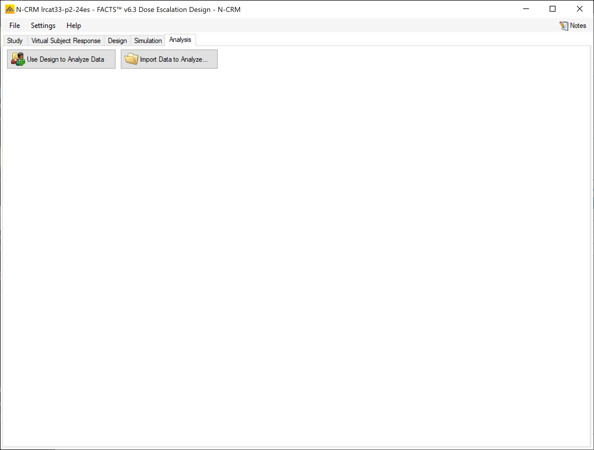

Clicking on the "Use Design to Analyze Data" button, creates an empty "subject.csv" file in the main simulation results directory and a sub-directory there for running FACTS and saving the outputs.

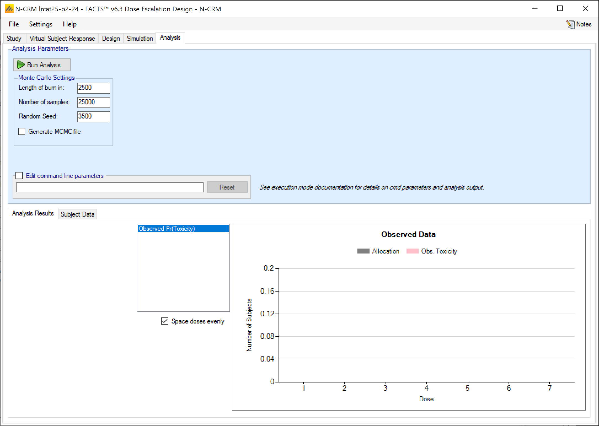

Here is a screen shot of the "\_results" folder for "lmcat33" showing the subject.csv file and the Analysis directory.

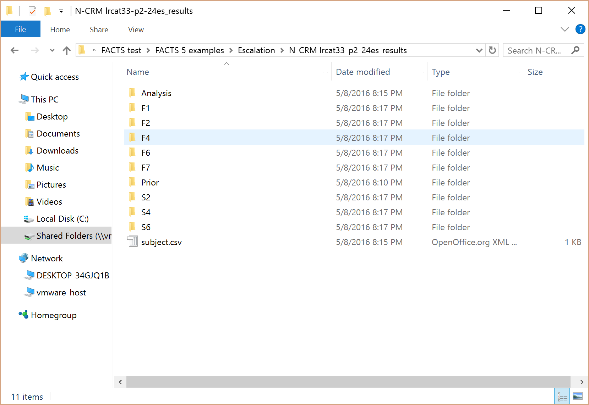

## Cohort 1

To start we need to enter the results of the first cohort on the subject tab (or it could be entered into the subject.csv file and the file 'loaded' -- see the end of this section for details of the subject.csv file format.

Note that we need to enter

- A subject ID (a simple incrementing number will suffice).

- The number of the cohort

- The 'dose strength' of the dose each subject received

- Whether the subject experience dose limiting toxicity or not -- entered as '1' or '0' respectively.

- Whether the subject's outcome was an efficacy response or not -- enter a '0' as efficacy is not used in this model.

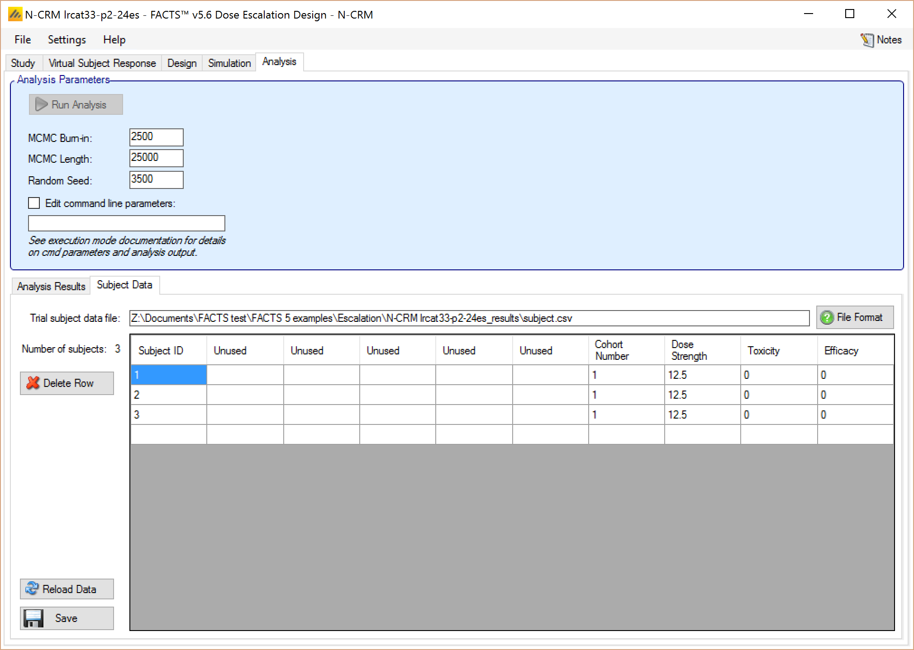

The click 'Save'. Then 'Run Analysis'.

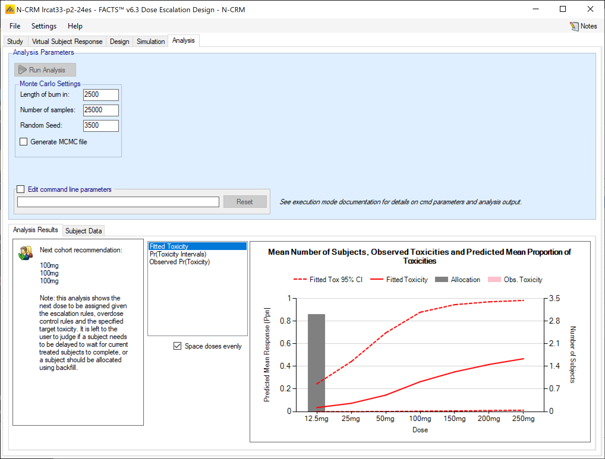

This summaries the number of subjects read, and the graph shows the subjects on each dose and any toxicities (not visible in the screenshot above because there were none), and the median fitted toxicity response. The box to the right contains the recommendation of whether to stop or which dose to give the next cohort. The toxicity interval graph is also available, showing the posterior probability that the toxicity rate is in each of the toxicity bands, for each dose:

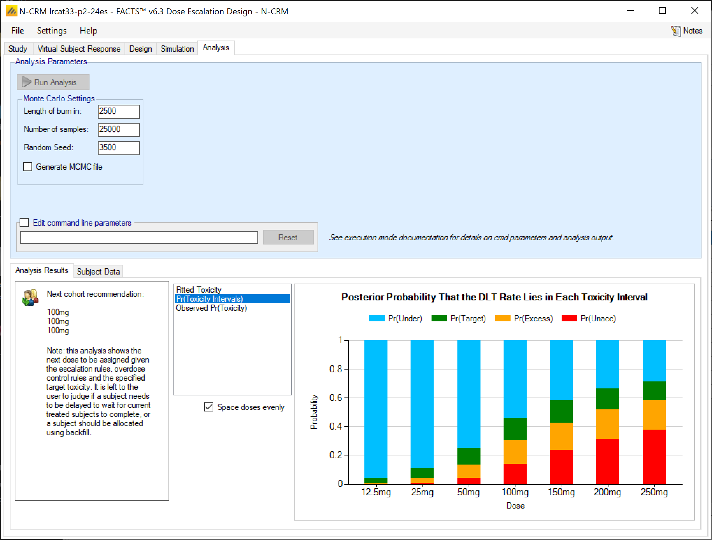

Note in this instance how the dose escalation threshold of 33% is allowing allocation to the 100mg dose (pr(Excess) = 0.15, pr(Unacceptable) = 0.12) whereas a dose escalation threshold of 25% would have limited the escalation to the 50mg. Exact values for the posterior probabilities can be found in the 'simulations.csv' file in the Analysis directory

## Cohort 2

We update the subjects.csv, adding result for the second cohort (allocated to the 100mg dose as recommended) with one toxicity:

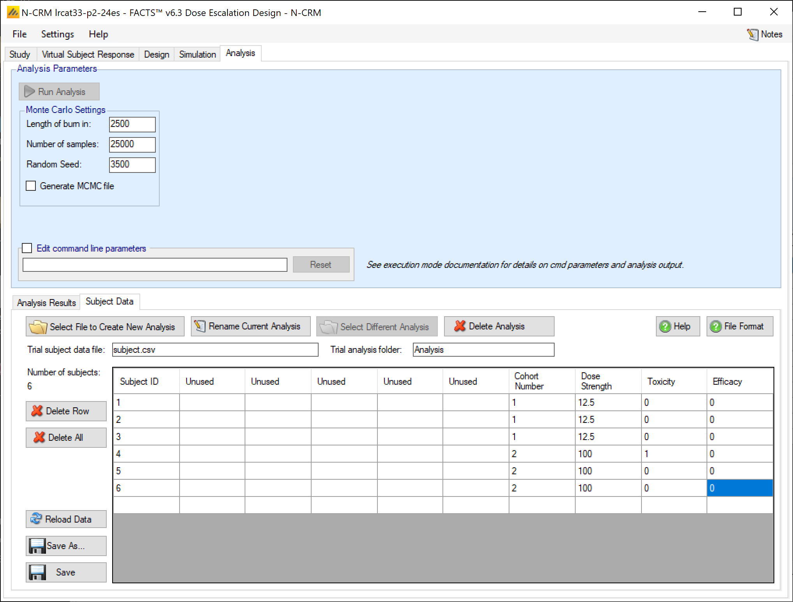

We click "Run Analysis" again.

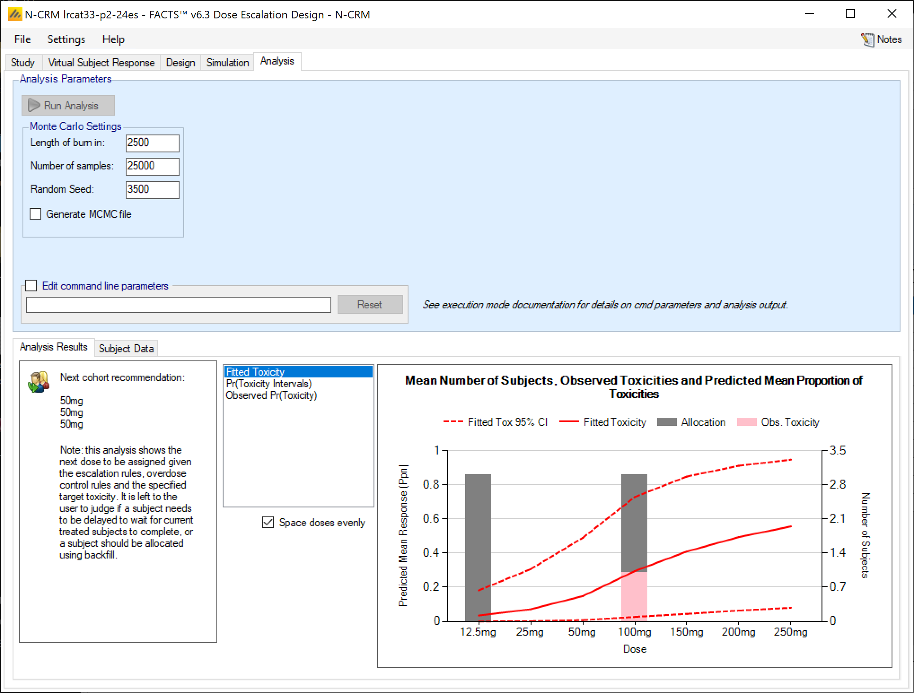

+------------------+----------------------------------------+----------------------------------------+----------------------------+
| Cohort           | Fitted toxicity after cohort           | Pr(Toxicity bands) after cohort        | Reco                       |
+:================:+:======================================:+:======================================:+:==========================:+
| 3\) 50mg, no tox | 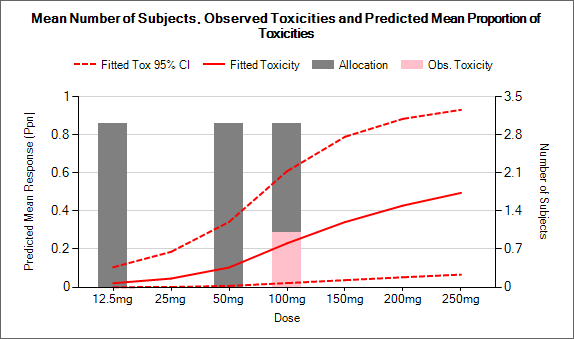 | 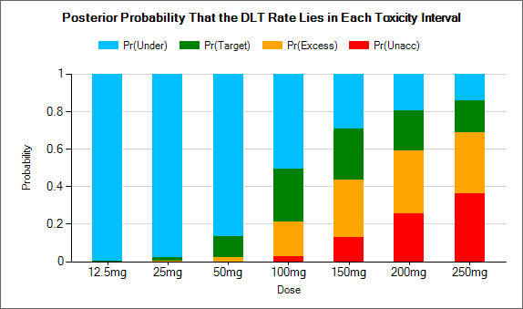 | 100mg                      |
+------------------+----------------------------------------+----------------------------------------+----------------------------+
| 4\) 100mg no tox | 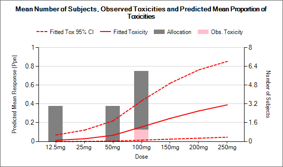 | ``                                     | `150mg`                    |
+------------------+----------------------------------------+----------------------------------------+----------------------------+
| 5\) 150mg 2 tox  | 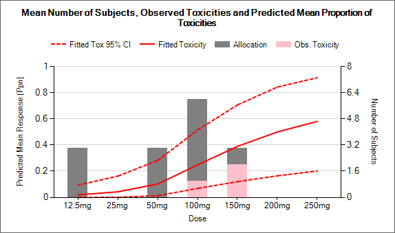 | ``                                     | `Study ends, MTD is 100mg` |
+------------------+----------------------------------------+----------------------------------------+----------------------------+

Having entered this data, notice how easy it is to modify save and re-analyse the data -- to see "what-if". Also note that you do not have to follow the recommended dosing -- FACTS will analyse whatever data is provided regardless. But data can only be provided at the doses in the treatment arms table.

## The Subject.csv file

The file is a simple ascii file with the different data items separated by commas. Any line starting with '#'' is ignored, here we use that to include a header row. The data may also include spaces to aid readability (but **not**, currently, tabs). Each line defines the dose given to a single subject and that subject's response.

For historic reasons the CRM subject.csv file format includes patient identification data. The FACTS design engine does not use this data, and the fields may be left blank -- but the commas separating the columns still need to be included. As this design engine only analyses the toxicity outcomes the only two columns we need to enter are "Dose" and "Tox". "Dose" needs to contain the **dose level** (**not** the dose index)) of the dose given to the subject, in this design the dose levels were specified as 12.5, 25, 50, 100, 150, 200 and 250 so this column should contain one of these values. "Tox" needs to contain either a '1' (to indicate toxicity observed) or a '0' (for no toxicity). A value also in the final "Efficacy" column is also required although it will be ignored by the N-CRM method, it should be left as '0'.

The first cohort will have been allocated the lowest dose '12.5' and we will report that no subjects experienced toxicity ('0'). The subjects.csv file looks like this:

``` text
#Patient ID, Patient Initials, Year, Month, Day, Time, Cohort, Dose, Toxicity, Efficacy
1,,,,,,1,12.5,0,0
2,,,,,,1,12.5,0,0
3,,,,,,1,12.5,0,0
```

Having saved the file (and if edited using Excel, closed Excel so that it releases its file lock), in FACTS on the Recommender page we can click the 'Reload Data' button:
