#  Introduction

This tutorial describes the example trial design using the FACTS Dose Escalation Design Engine for Toxicity Interval, "N-CRM", targeting 2 groups (adult and pediatric populations) and using "open enrollment" rather than cohort enrolment.

For this version of the document, the screenshots are from the v6.5 release of FACTS.

The screenshots provided are approximate and may not reflect the exact layout of the information. The contents of each tab, however, will be consistent with the software.

# Case Study

This case study is based on the paper "Bayesian dose escalation in oncology with sharing of information between patient populations" by Kristine Broglio, Larissa Sandalic, Tina Alberton and Scott Berry, Contemporary Clinical Trials 44 (2015) 56-63.

The setting is a conventional phase 1 oncology trial in acute lymphoblastic leukaemia (ALL), this is a rare condition and it can occur in both adults and children, but is more commonly diagnosed in children, hence the need to study a potential treatment in both populations. The paper demonstrates that a combined trial with information sharing between the two populations is more efficient than running two separate CRM trials.

The design did not use the toxicity band target but a conventional "dose nearest the MTD" target, targeting a toxicity rate of 30%, but it also used "over dose control", in that to be considered safe a dose level had to have at least 50% probability that its DLT rate was less than 50%. The MTD was defined as the highest safe dose.

The design used 7 doses, that are simply labelled 1, 2, ... 7 and given those 'strengths', or 'x-hats' in the CRM parlance.

## Toxicity response model

The model is the standard N-CRM model for adults:

$\theta_{d} = log\left( \frac{\pi_{d}}{1 - \pi_{d}} \right)$, $\theta_{d} = \alpha + \beta d$

And for the pediatric population the model uses the same slope but has a potential offset to the intercept

$$\theta_{ped\_ d} = \alpha + \alpha_{ped} + \beta d$$

The following priors were used:

$\alpha\sim N\left( - 3,1^{2} \right)$, $\alpha_{ped}\sim N\left( 0,1^{2} \right)$, $\beta\sim N\left( 0.5,\ \ {0.2}^{2} \right)$

Plus prior pseudo data of half an observation on the lowest dose with no DLT, and half an observation on the highest dose with half a DTL (the paper is not explicit on which population these pseudo patients are added to but we can assume that it is the adult population).

Note:

- that the prior on Beta is specified on Beta not Ln(Beta), we will need to adjust this when we enter the prior in FACTS

- that a bivariate-Normal prior was not used, so we will simply set the correlation parameter to 0

## Enrollment

The maximum sample size is 60, comprising 35 adult and 25 pediatric patients.

The assumed accrual rate is 3 per month for adults, and 1 per month for children.

Open enrollment will be used, with enrollment suspended in the respective groups if there are 3 adult or 3 pediatric patients with unknown DLT information.

Enrollment into the pediatric population starts once 6 adults have been enrolled, and the initial dose allocation is to the dose one below the highest safe dose for adults where there is data from at least 2 adults. (Strictly the first 6 adults were recruited in 3 cohorts of 2, but we couldn't replicate this specifically in FACTS).

## Allocation

For doses 1 -- 3, data from 2 patients was required for a dose before it was considered 'cleared', for doses 4 -7, data from 3 patients was required for a dose to be considered 'cleared'. When escalating, no dose could be skipped. Escalation for the adult patient group depended on just the adult patients.

The pediatric population followed the same rules as the adults, but could escalate if just adults had been tested on a dose, as long as adults had also been tested on the dose above as well and both doses were considered safe for adults. (FACTS does not currently support different escalation rules for the two groups so this could only be approximated).

## Stopping

Stopping was triggered for adults if 8 patients were treated on the MTD and 20 patients on the MTD or a dose either side of it, and for the pediatric group if 5 patients had been treated on the MTD and 10 patients on the MTD or a dose either side of it. It was also required that if three additional hypothetical patients were treated on the MTD and experienced no DLTs that that should not change the MTD.

## Toxicity Response Scenarios

Four different dose toxicity scenarios were defined for adult patients and for each of those, 3 different dose toxicity scenarios for pediatric patients (A: the same as, B: higher than, and C: lower than the rates in the adult population). The rates are replicated in the table below, in each scenario the target MTD is highlighted.

+-----------+-----------+:---------:+:---------:+:---------:+:---------:+:---------:+:---------:+:---------:+
|           |           | Dose                                                                              |
+-----------+-----------+-----------+-----------+-----------+-----------+-----------+-----------+-----------+
| Scenario# | Group     | 1         | 2         | 3         | 4         | 5         | 6         | 7         |
+-----------+-----------+-----------+-----------+-----------+-----------+-----------+-----------+-----------+
| All Safe  | Adults    | 0.030     | 0.050     | 0.070     | 0.090     | 0.110     | 0.130     | **0.150** |
+-----------+-----------+-----------+-----------+-----------+-----------+-----------+-----------+-----------+
| A         | Pediatric | 0.030     | 0.050     | 0.070     | 0.090     | 0.110     | 0.130     | **0.150** |
+-----------+-----------+-----------+-----------+-----------+-----------+-----------+-----------+-----------+
| B         | Pediatric | 0.049     | 0.080     | 0.110     | 0.140     | 0.169     | 0.198     | **0.225** |
+-----------+-----------+-----------+-----------+-----------+-----------+-----------+-----------+-----------+
| C         | Pediatric | 0.018     | 0.031     | 0.044     | 0.057     | 0.070     | 0.083     | **0.097** |
+-----------+-----------+-----------+-----------+-----------+-----------+-----------+-----------+-----------+
| Steep     | Adults    | 0.050     | **0.200** | 0.350     | 0.450     | 0.550     | 0.600     | 0.650     |
+-----------+-----------+-----------+-----------+-----------+-----------+-----------+-----------+-----------+
| A         | Pediatric | 0.050     | **0.200** | 0.350     | 0.450     | 0.550     | 0.600     | 0.650     |
+-----------+-----------+-----------+-----------+-----------+-----------+-----------+-----------+-----------+
| B         | Pediatric | 0.080     | **0.292** | 0.470     | 0.574     | 0.668     | 0.712     | 0.754     |
+-----------+-----------+-----------+-----------+-----------+-----------+-----------+-----------+-----------+
| C         | Pediatric | 0.031     | 0.132     | **0.246** | 0.332     | 0.426     | 0.476     | 0.530     |
+-----------+-----------+-----------+-----------+-----------+-----------+-----------+-----------+-----------+
| Shallow   | Adults    | 0.030     | 0.080     | 0.110     | 0.170     | **0.270** | 0.370     | 0.600     |
+-----------+-----------+-----------+-----------+-----------+-----------+-----------+-----------+-----------+
| A         | Pediatric | 0.030     | 0.080     | 0.110     | 0.170     | **0.270** | 0.370     | 0.600     |
+-----------+-----------+-----------+-----------+-----------+-----------+-----------+-----------+-----------+
| B         | Pediatric | 0.049     | 0.125     | 0.169     | **0.252** | 0.379     | 0.492     | 0.712     |
+-----------+-----------+-----------+-----------+-----------+-----------+-----------+-----------+-----------+
| C         | Pediatric | 0.018     | 0.050     | 0.070     | 0.111     | 0.183     | **0.263** | 0.476     |
+-----------+-----------+-----------+-----------+-----------+-----------+-----------+-----------+-----------+
| Unsafe    | Adults    | 0.400     | 0.440     | 0.480     | 0.520     | 0.560     | 0.600     | 0.640     |
+-----------+-----------+-----------+-----------+-----------+-----------+-----------+-----------+-----------+
| A         | Pediatric | 0.400     | 0.440     | 0.480     | 0.520     | 0.560     | 0.600     | 0.640     |
+-----------+-----------+-----------+-----------+-----------+-----------+-----------+-----------+-----------+
| B         | Pediatric | 0.524     | 0.564     | 0.603     | 0.641     | 0.677     | 0.712     | 0.746     |
+-----------+-----------+-----------+-----------+-----------+-----------+-----------+-----------+-----------+
| C         | Pediatric | **0.288** | 0.323     | 0.359     | 0.397     | 0.436     | 0.476     | 0.519     |
+-----------+-----------+-----------+-----------+-----------+-----------+-----------+-----------+-----------+

## Designs for comparison

Two possible alternative designs that it would be straightforward to evaluate in FACTS would be to replace the open enrollment with cohort enrollment and to replace the MTD target with a toxicity band target. These are left as exercises to the user and not presented in this tutorial.

#  Simulating using FACTS N-CRM

Start FACTS Dose Escalation. Use the menu option File \> New \> Dose Escalation \> N-CRM to create a new CRM design.

Using the menu option File \> Save As, save this design as for example "n-crm-adults-peds-per-paper-MTD.facts" in a convenient location (e.g. in a folder called FACTS\\N-CRM-example in your 'My Documents' folder).

## Study

### Study Info

To simulate the paper we are going to simulate using "Open Enrollment" -- dosing subjects as they arrive, but imposing a limit on how many subjects we can have treated but not complete (3) and "2 Groups" for adult and pediatric patients. We will recruit up to 35 Adult, and 25 Pediatric patients. Adult patients are expected to accrue at 3 per month (=0.75 per week) and pediatric patients at 1 per month (=0.25 per week). The treatment cycle is 21 days. We will start recruiting pediatric patients after 6 adult patients have been recruited.

Note that since this trial was run two features have been added to FACTS that might improve the design but are not used at this stage

1.  Two maximums for the number of "subjects we can have treated but not complete" can now be specified -- one if the current dose has not been 'cleared' and another if it has been cleared. The specification of what counts as a 'cleared' dose is done on the Design \> Allocation tab. To be cleared a dose must have had the specified number of patients tested at that dose. This is a fixed number through the trial, though a smaller number can be used initially by specifying an initial run-in that will be followed until the first toxicity is observed. By having two maximums, we can allocate more cautiously to doses while clearing doses and escalating until we can allocate to the target dose, then we can continue to allocate more aggressively to this dose once it as cleared.

2.  Backfilling: this allows us to allocate patients that arrive while the number of subjects treated but not complete are at the maximum, by allocating them to a lower dose (rather than losing the opportunity to use them in the trial).

Set the following parameters:

- Endpoints: Don't include efficacy.

- Recruitment: use Open Enrollment

- Groups: use Two group populations

- Open Enrollment

  - Maximum size (subjects) for group 1: 35

  - Time unit: week

  - Mean recruitment rate (0.75)

  - Time unit final result: 3 weeks

  - Maximum subjects without final results if dose is uncleared: 3

  - Maximum subjects without final results if dose is cleared: 3

- Two Group recruitment

  - Start group 2 after subject reaches: 6

- Open Enrollment for Group 2

  - Maximum subjects in Group 2: 25

  - Group is a property of the subject

  - Mean subject recruitment rate, Group 2: 0.25

  - Group 2 Queue options:

    - Maximum subjects without final results if dose is uncleared: 3

    - Maximum subjects without final results if dose is cleared: 3

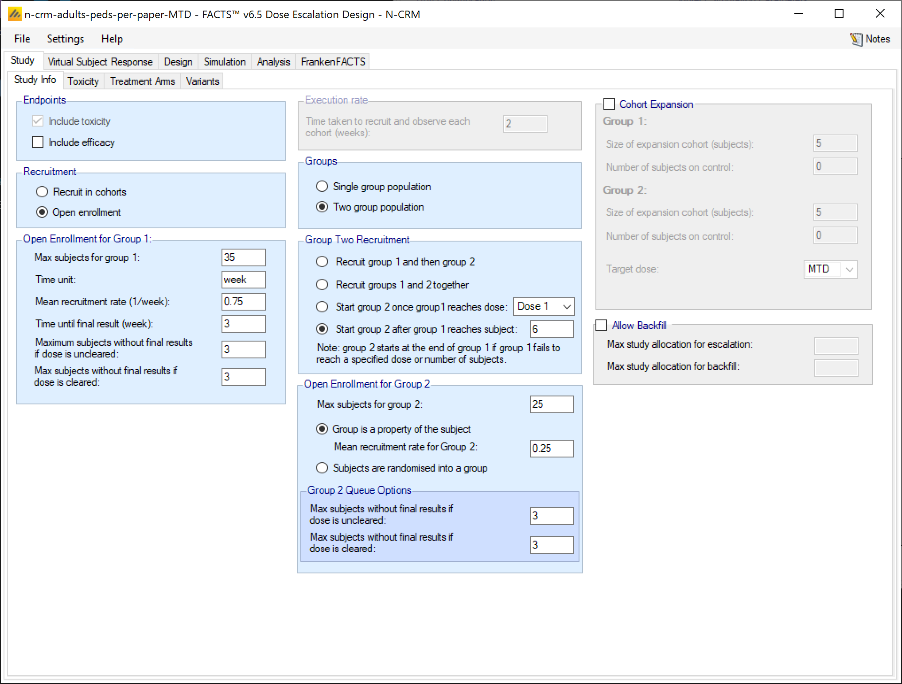

### Toxicity

To replicate the operating characteristics of the design in the paper, we will target a single dose (MTD) rather than a toxicity band. And we will define toxicity bands so we can specify a overdose control such that a dose will be deemed unsafe if the expected probability that the toxicity rate is \> 30% is above 50%.

We set the following parameters:

- We are not using Ordinal toxicity.

- The type of target is "Target a single dose"

  - The target probability of toxicity at MTD is 0.3.

  - Find the dose Nearest the target. (Note we will tend not to select doses with toxicity rates estimated to be above the target because of the overdose control limit).

- Specify target bands of

  - 0-0.15 (Under-dosing),

  - 0.15-0.3 (Target)

  - 0.3-0.6 (Excess)

  - 0.6-1.0 (Unacceptable

- Specify that we want to limit excess + unacceptable toxicity to \< 0.5, the change in this limit per cohort is 0 -- so the limit remains the same throughout the trial.

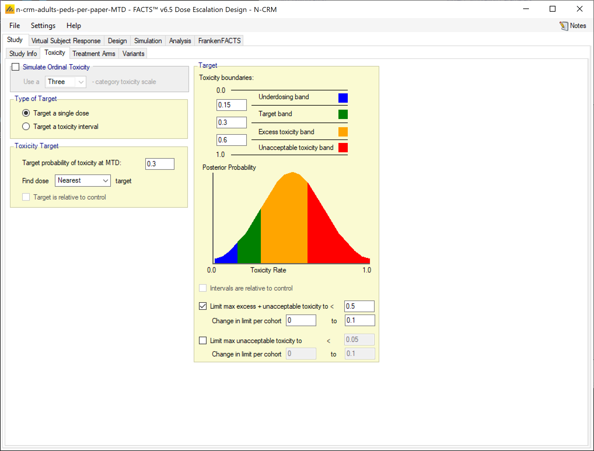

###  Treatment Arms

Create 7 doses, 1 to 7 with no control, we leave the dose strengths as nominal 1, 2, ,3, ... 7.

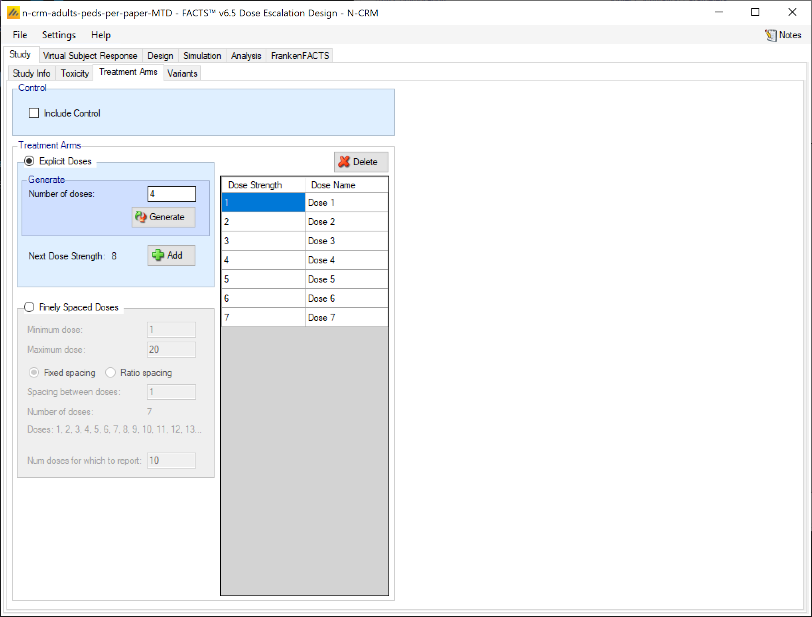

### Variants

We don't specify any variants. If we did this would allow us to easily create designs that were identical except in maximum sample size -- allowing us to easily explore the effect of different sample sizes.

##  Virtual Subject Response

### Explicitly Defined -- Toxicity

Create the 12 scenarios that combine 4 adult toxicity rates (AllSafe, Steep, Shallow & UnSafe) with 3 pediatric scenarios (A, B, C) and enter the probability of toxicity for each dose for each scenario corresponding to the table above (see section 2.5)

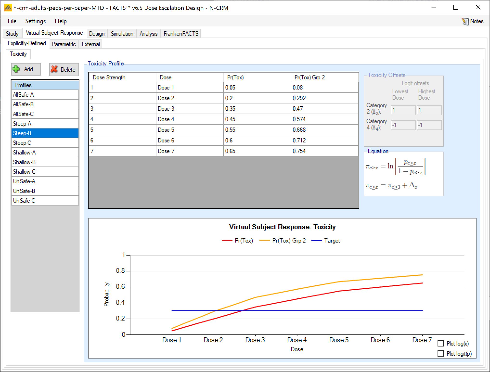

There are no parametric or externally defined curves in this example.

## Design

### XHats

Here we define the dose strength values to use for each dose in the BLRM model. In this instance we are simply going to use the values (1, 2, 3, ... 7) for each dose respectively. So we set the reference dose to 0 and define the X\^ conversion as linear: dose strength -- reference dose.

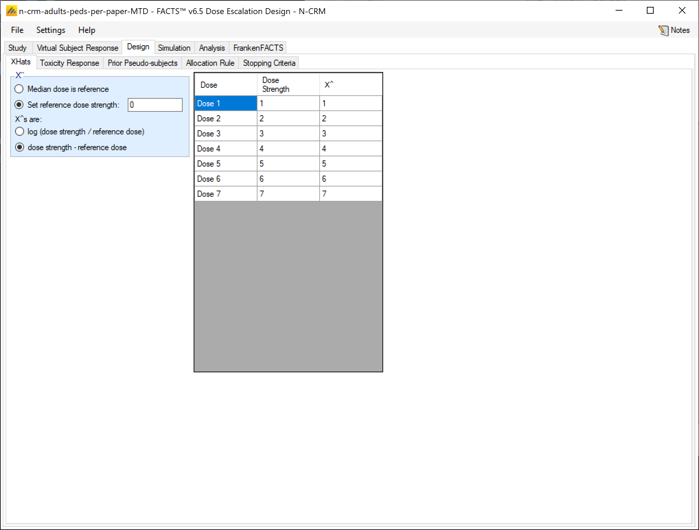

### Toxicity Response

The only model available is the BLRM, which is the model used in the paper. In the paper a common estimate of the gradient is used for both groups and an offset \[α~ped~ in the paper, 'a' in FACTS\] on the intercept. The priors in the paper are:

$\alpha\sim N\left( - 3,1^{2} \right)$, $\alpha_{ped}\sim N\left( 0,1^{2} \right)$, $\beta\sim N\left( 0.5,\ \ {0.2}^{2} \right)$

In FACTS the prior on β is on ln(β), so we convert the above prior to $Ln(\beta)\sim N\left( - 0.7,\ \ {0.5}^{2} \right)$. \[The prior in the paper on $\beta$ ranges from 0.1 to 0.9 (+/- 2 standard deviations) the Ln of these values is: -2.3, -1.2, -0.69, -0.36[, -0.11 (in steps of 1 SD), we have chosen a prior on]{.underline} $Ln(\beta)$ [that has the corresponding values: -1,7, -1,2, -0.7, -0.2, 0.3. As we shall see this results in some small but not significant differences from the paper.]{.underline}

Set the parameters as follows:

- Priors

  - Alpha: N(-3,1)

  - Ln(Beta): N(-0.7, 0.5)

  - Rho: 0

- Asymptotes

  - Minimum: 0

  - Maximum: 1

- Group 2 priors

  - A: N(0, 1) (*no restriction*)

  - Common slope

Figure 3‑1 Toxicity Response showing the effect of the prior on the model for group 1

Figure 3‑2 Toxicity response showing the effect of the prior on the model for group 2

###  Prior Pseudo-subjects

As per the paper, we add 0.5 prior pseudo-subjects to the model for group 1 (adults) at the lowest and highest doses. With no DLTs at the lowest dose and 0.5 DLT at the highest dose. This makes our prior very slightly more informative, in a way that it is hoped is meaningful to the clinical team.

Note we can explore the effect of adding pseudo subjects to the prior by simply creating a version of the design without them and then comparing the simulation results.

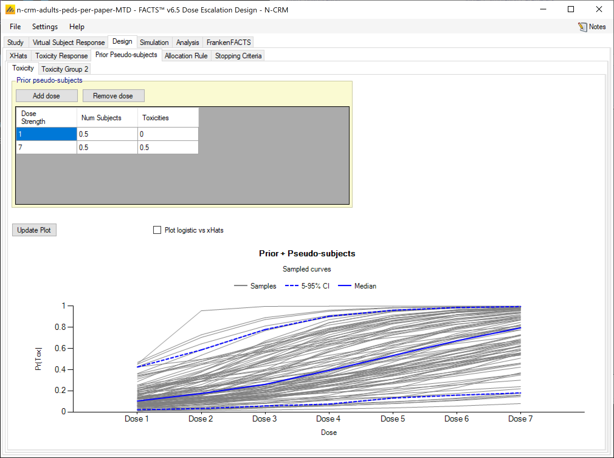

### Allocation Rule

Here in FACTS we have to depart from the paper somewhat -- we can't completely replicate the described rules. We will use both overdose control and escalation rules, require 2 subjects per dose before escalating, and only allow one dose strength to be increased at a time. This will apply separately to both groups. Group 1 starts at the lowest dose, Group 2 at one dose below the Group 1 MTD.

Set the parameters as follows:

- Specify that allocation will be limited by using the 'overdose control' specified on the study tab and additional rules specified on this tab.

- Allocation:

  - The dose allocation rules will use dose levels (not dose strengths)

  - There must be a minimum of 2 subjects on a dose before incrementing

  - The increment is the same across the whole dose range

  - The maximum increment is 1 dose level

  - The increment is relative to the most recently cleared dose

- Set the starting dose level: Dose 1

- The Initial dose for the second population (pediatrics): one dose below the MTD of the first population

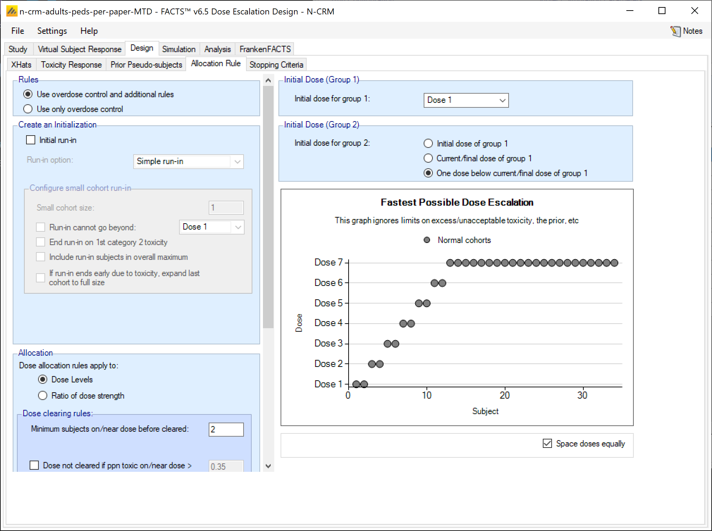

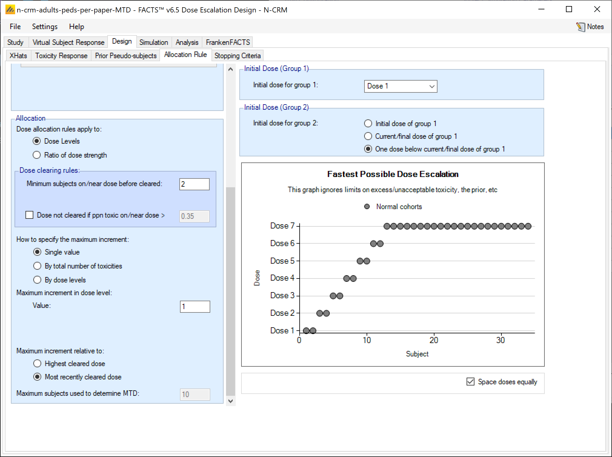

###  Stopping Criteria

As with the allocation rules, what we can specify in FACTS is not as complex as defined in the paper. We will use a required minimum number of subjects on MTD of 8, and that if 3 further subjects were to complete on the MTD with no DLTs that the selection of MTD would not change.

Set the parameters as follows:

- Check the "Rules for stopping trial early

- Required number of subjects on MTD: 8

- Stop if adding another DLT free cohort does not alter the MTD. Size of cohort: 3

- Minimum subjects accrued: 8

- Combine all the above rules with AND. They all have to be met for the trial to stop.

- Minimum toxicities required before stopping: 2. This solves the problem of what to do if an early toxicity causes the expected toxicity at all doses to be too high for allocation to continue by the normal rules. This parameter allows the user to specify that, should all doses be inadmissible, allocation to the lowest dose should continue until at least the specified number of toxicities has been observed.

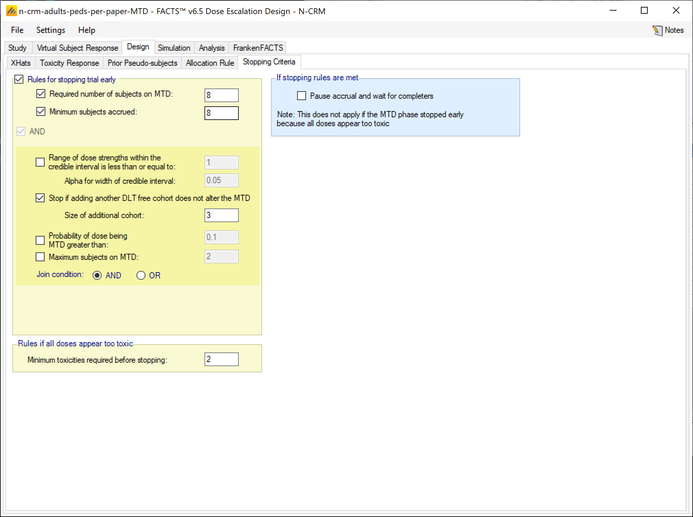

## Simulation

Set the number of simulations to 1000, and the packet size to 100. Select all the scenarios and run the simulations (In FACTS terms this takes a relatively long time to run, because with Open Enrolment there is an analysis every subject. It took \~90 minutes on a dual core 2.2 GHz Intel i7).

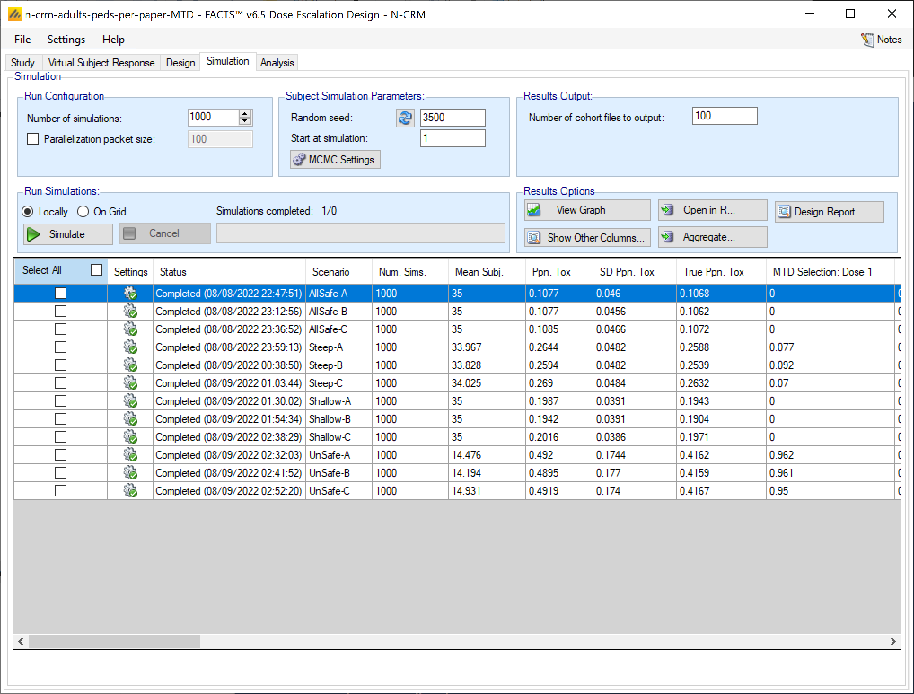

We can use the "Across Scenario Graphs" plots of selected MTD for group 1 and group 2 to get a quick overall impression of the ability of the trial to "pick the right dose".

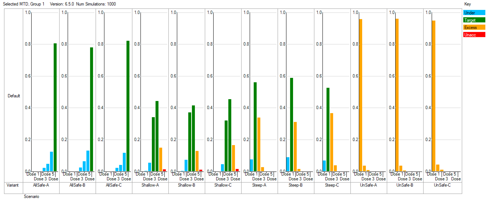

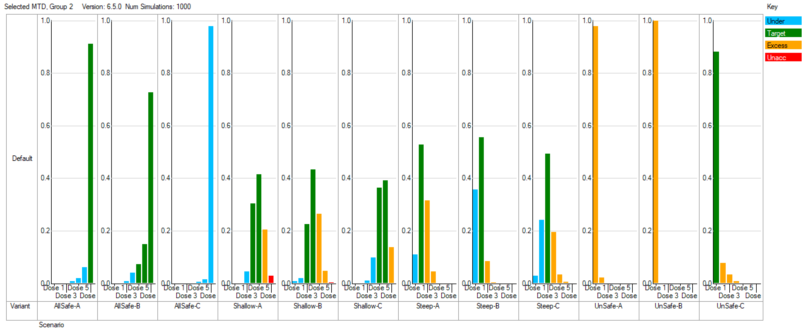

These results look very good.

- In all the scenarios where there is one or more doses in the target range these are the most likely doses to be picked.

- In the scenarios where no doses are safe the lowest dose is picked with probability \> 95%

- In the scenario where all doses have rates below the target band, the highest dose is picked with probability \> 95%

- In the Steep scenarios where there is a \~30% change of more of picking a dose for Group 1 with a toxicity rate above the target range, that dose is Dose 3 simulated with a toxicity rate of 0.35. So this is a "near miss".

- In the Steep-C scenario where there is a \~30% chance of picking a dose for group 2 with a toxicity below the target range, that dose is Dose 2 with a simulated toxicity rate of 0.132, only just below the range, so this is a "near miss".

- In the Steep-B scenario where there is a \~40% chance of picking a dose for group 2 with a toxicity below the target range, that dose is Dose 1 with a simulated toxicity rate of 0.08, well below the target range so this is a "significant miss", however the simulated toxicity rate on Dose 2 (the "correct target" in this scenario) is 0.292, very close to the top of the target band, so it is almost certain that in the nearly 40% of scenarios where Dose 1 has been selected it will be because the observed data on Dose 2 has made it look too toxic.

## Example Simulation

Individual simulations can be used to check that the behavior of the design would be acceptable to the clinical team, and to check the explanations given above for the results in those scenarios where the chances of selecting a non-optimal dose were quite high.

Note that in Steep-A, Steep-B and Steep-C the virtual subject response being simulated for group 1 is the same, so the same allocation histories can be seen in occurring across the 3 scenarios.

On the face of it these example dose escalation histories seem to back up our analysis of the results of these scenarios, and there are no obvious glaring poor decision being made. In practice a more detailed review would be carried out to confirm this.

### Group 1 Examples: Steep-A, Steep-B and Steep-C

+-------------------------------------------------------------+-------------------------------------------------------------+
| Steep-A correct MTD                                         | Steep-A overshoot                                           |
+=============================================================+=============================================================+
| 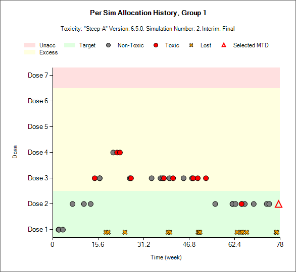 | 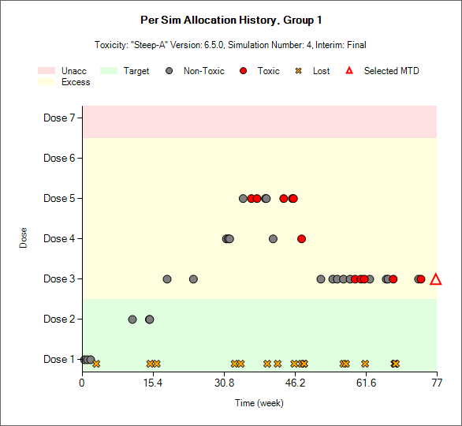 |
+-------------------------------------------------------------+-------------------------------------------------------------+
| 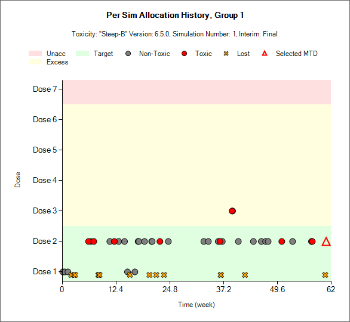 | 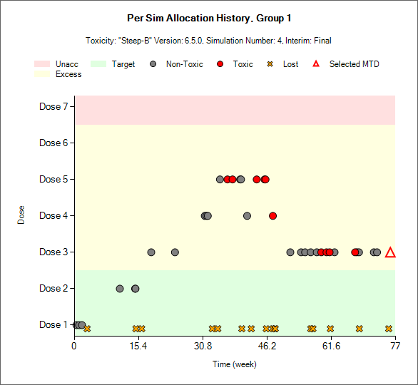 |
+-------------------------------------------------------------+-------------------------------------------------------------+
| Steep-B correct MTD                                         | Steep-B overshoot                                           |
+-------------------------------------------------------------+-------------------------------------------------------------+
| 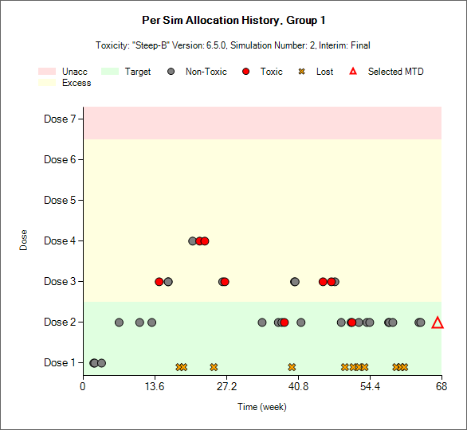 | 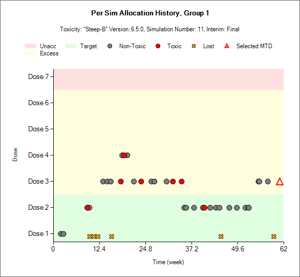 |
+-------------------------------------------------------------+-------------------------------------------------------------+
| Steep-C correct MTD                                         | Steep-C overshoot                                           |
+-------------------------------------------------------------+-------------------------------------------------------------+
| 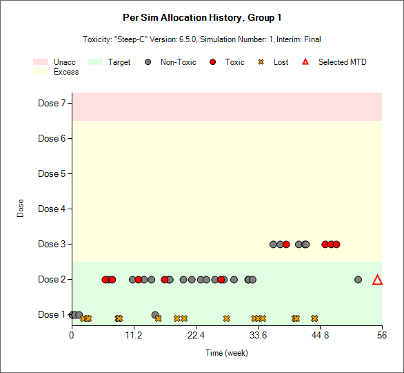 | 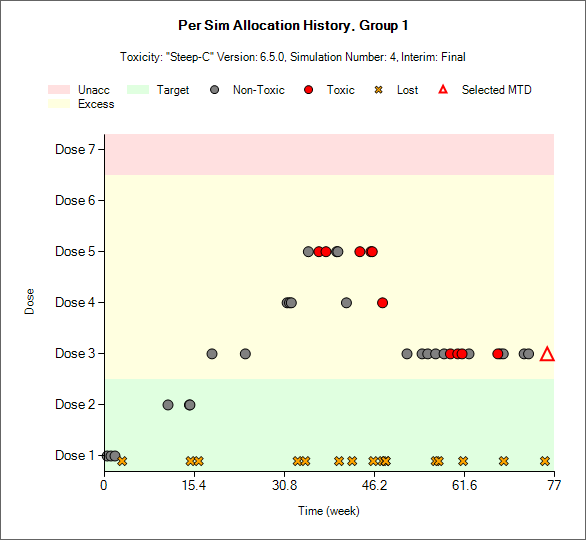 |
+-------------------------------------------------------------+-------------------------------------------------------------+

### Group 2 Examples: Steep-A, Steep-B and Steep-C

+-------------------------------------------------------------+-------------------------------------------------------------+
| Steep-A correct MTD                                         | Steep-A overshoot                                           |
+=============================================================+=============================================================+
| 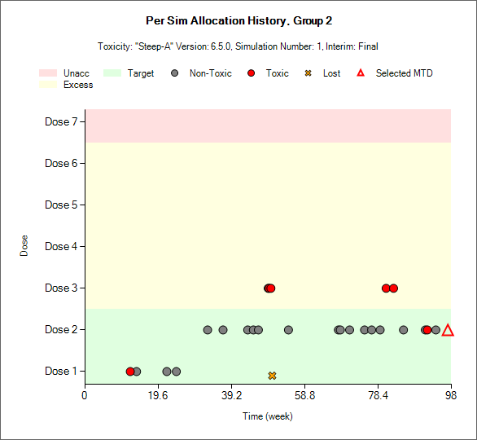 | 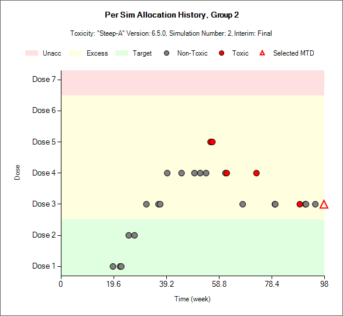 |
+-------------------------------------------------------------+-------------------------------------------------------------+
| Steep-B correct MTD                                         | Steep-B undershoot                                          |
+-------------------------------------------------------------+-------------------------------------------------------------+
| 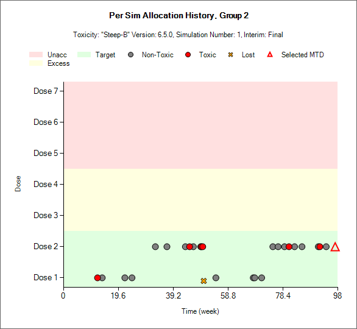 | 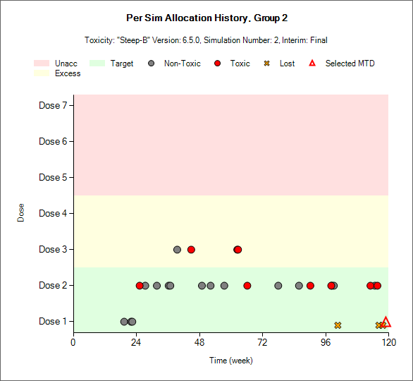 |
+-------------------------------------------------------------+-------------------------------------------------------------+
| Steep-C correct MTD                                         | Steep-C undershoot                                          |
+-------------------------------------------------------------+-------------------------------------------------------------+
| 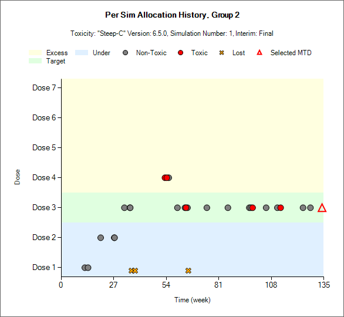 | 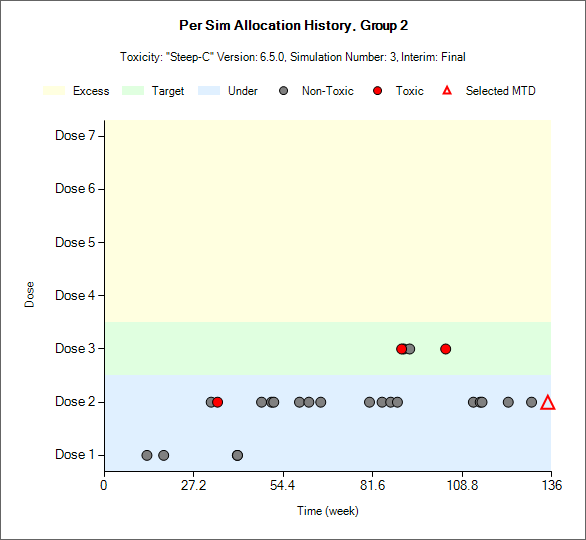 |
+-------------------------------------------------------------+-------------------------------------------------------------+

# Comparison of Results with Paper

## Individual Analysis

The paper has an example simulated trial and shows 5 analyses during it. Here we replicate those analyses using the FACTS "Analysis" tab and compare the results to the paper.

The graph from the paper shows the number of subjects allocated at each dose: group 1 in grey, group 2 (pediatric) in pink. The black shaded part of the bars show the number of observed DLTS. The curves show the mean estimate of the DLT rate (open circles) and posterior probability that the toxicity rate of the dose is 30% or less (filled circles). This corresponds to the combined FACTS probabilities of under-dosing and target toxicity. The graph has a horizontal dashed line at 30%.

### Analysis 1

Only Adults have been treated, 2 on each of the first doses, no toxicities have been observed.

Data:

+-------------+--------+--------+--------+--------+--------+--------+--------+
|             | Dose 1 | Dose 2 | Dose 3 | Dose 4 | Dose 5 | Dose 6 | Dose 7 |
+=============+=======:+=======:+=======:+=======:+=======:+=======:+=======:+
| Adults Obs  | 2      | 2      | 2      | 0      | 0      | 0      | 0      |
+-------------+--------+--------+--------+--------+--------+--------+--------+
| Adults DLTs | 0      | 0      | 0      | 0      | 0      | 0      | 0      |
+-------------+--------+--------+--------+--------+--------+--------+--------+
| Peds Obs    | 0      | 0      | 0      | 0      | 0      | 0      | 0      |
+-------------+--------+--------+--------+--------+--------+--------+--------+
| Ped DLTs    | 0      | 0      | 0      | 0      | 0      | 0      | 0      |
+-------------+--------+--------+--------+--------+--------+--------+--------+

+-----------------------------------------------------------------------------------------------------------------------------------------------------------------------------------------------------+-------------------------------------------------------------+----------------------+
| Paper                                                                                                                                                                                               | FACTS Group 1                                               | FACTS Group 2        |
+:===================================================================================================================================================================================================:+:===========================================================:+:====================:+
| 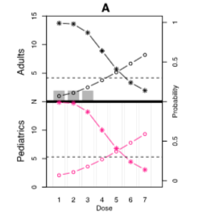                                                                                                                                         | 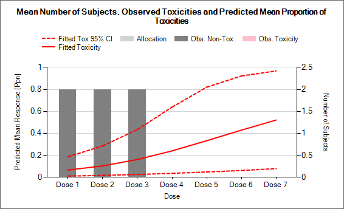 |                      |
+-----------------------------------------------------------------------------------------------------------------------------------------------------------------------------------------------------+-------------------------------------------------------------+----------------------+
| FACTS agrees with the paper in that the group 1 mean estimates of toxicity have Dose 4 just below 30% and Dose 5 just above.                                                                        | 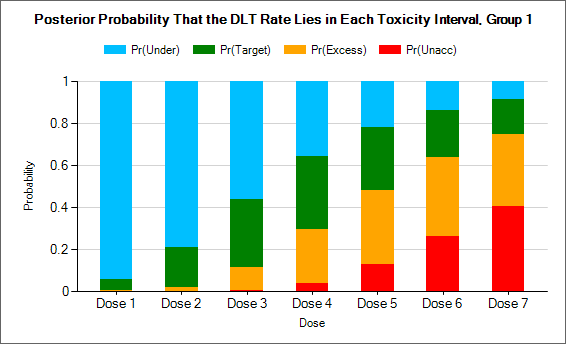 |                      |
|                                                                                                                                                                                                     |                                                             |                      |
| In both FACTS and the paper doses 6 & 7 are unsafe for group 1. But dose 5 is borderline, in the paper it looks as though it would be flagged unsafe whilst in FACTS it would just be flagged safe. |                                                             |                      |
+-----------------------------------------------------------------------------------------------------------------------------------------------------------------------------------------------------+-------------------------------------------------------------+----------------------+

### Analysis 2

3 Adults have been treated on dose 4, and the first Peds has been treated on dose 2, no toxicities have been observed.

Data:

+-------------+--------+--------+--------+--------+--------+--------+--------+
|             | Dose 1 | Dose 2 | Dose 3 | Dose 4 | Dose 5 | Dose 6 | Dose 7 |
+=============+=======:+=======:+=======:+=======:+=======:+=======:+=======:+
| Adults Obs  | 2      | 2      | 2      | 3      | 0      | 0      | 0      |
+-------------+--------+--------+--------+--------+--------+--------+--------+
| Adults DLTs | 0      | 0      | 0      | 0      | 0      | 0      | 0      |
+-------------+--------+--------+--------+--------+--------+--------+--------+
| Peds Obs    | 0      | 1      | 0      | 0      | 0      | 0      | 0      |
+-------------+--------+--------+--------+--------+--------+--------+--------+
| Ped DLTs    | 0      | 0      | 0      | 0      | 0      | 0      | 0      |
+-------------+--------+--------+--------+--------+--------+--------+--------+

+-----------------------------------------------------------------------------------------------------------------------------------------------------------------------------------+-------------------------------------------------------------+-------------------------------------------------------------+
| Paper                                                                                                                                                                             | FACTS Group 1                                               | FACTS Group 2                                               |
+:=================================================================================================================================================================================:+:===========================================================:+:===========================================================:+
| 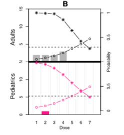                                                                                                                       | 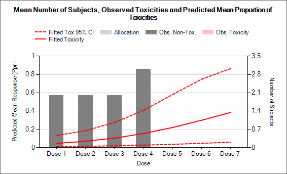 | 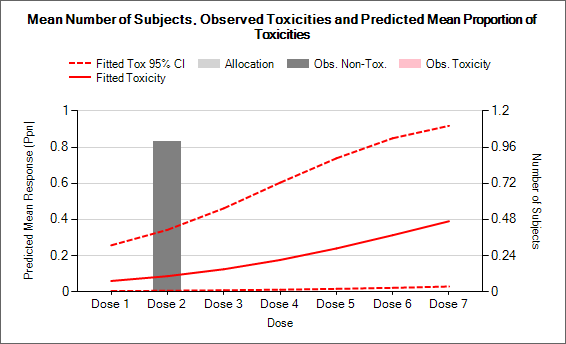 |
+-----------------------------------------------------------------------------------------------------------------------------------------------------------------------------------+-------------------------------------------------------------+-------------------------------------------------------------+
| FACTS mean estimates of toxicity look slightly below those in the paper (probably due to the slight difference in the Beta prior), but not enough to effect the selection of MTD. | 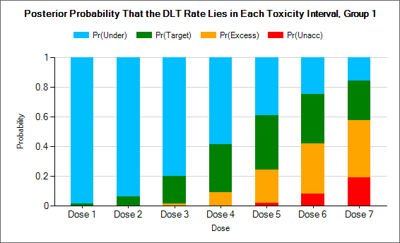 | 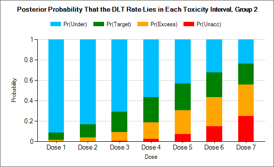 |
|                                                                                                                                                                                   |                                                             |                                                             |
| In the paper for both groups both dose 6 & 7 are unsafe, whereas in FACTS in both groups only dose 7 is unsafe.                                                                   |                                                             |                                                             |
+-----------------------------------------------------------------------------------------------------------------------------------------------------------------------------------+-------------------------------------------------------------+-------------------------------------------------------------+

### Analysis 3

5 Adults have been treated on dose 5, with one toxicity observed, and four adults have been treated on dose 6 with 2 toxicities observed.

1 Peds has been treated on dose 5, and 1 toxicity has been observed.

Data:

+-------------+--------+--------+--------+--------+--------+--------+--------+
|             | Dose 1 | Dose 2 | Dose 3 | Dose 4 | Dose 5 | Dose 6 | Dose 7 |
+=============+=======:+=======:+=======:+=======:+=======:+=======:+=======:+
| Adults Obs  | 2      | 2      | 2      | 3      | 5      | 4      | 0      |
+-------------+--------+--------+--------+--------+--------+--------+--------+
| Adults DLTs | 0      | 0      | 0      | 0      | 1      | 2      | 0      |
+-------------+--------+--------+--------+--------+--------+--------+--------+
| Peds Obs    | 0      | 1      | 0      | 0      | 1      | 0      | 0      |
+-------------+--------+--------+--------+--------+--------+--------+--------+
| Ped DLTs    | 0      | 0      | 0      | 0      | 1      | 0      | 0      |
+-------------+--------+--------+--------+--------+--------+--------+--------+

+--------------------------------------------------------------------------------------------------------------------------------------------------+-------------------------------------------------------------+-------------------------------------------------------------+
| Paper                                                                                                                                            | FACTS Group 1                                               | FACTS Group 2                                               |
+:================================================================================================================================================:+:===========================================================:+:===========================================================:+
| 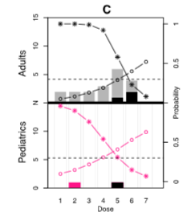                                                                                      | 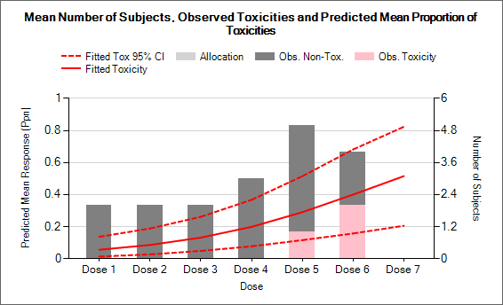 | 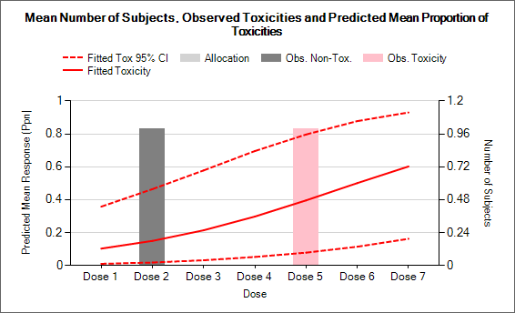 |
+--------------------------------------------------------------------------------------------------------------------------------------------------+-------------------------------------------------------------+-------------------------------------------------------------+
| FACTS agrees with the paper in that the group 1 mean estimates of toxicity has Dose 5 at about 30% and group 2 estimate has Dose 4 at about 30%. | 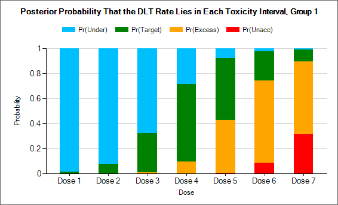 | 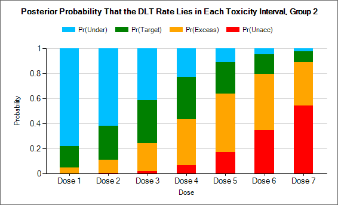 |
|                                                                                                                                                  |                                                             |                                                             |
| As with the paper in group 1 doses 6 & 7 are unsafe, and for group 2 doses 5, 6 & 7 are unsafe.                                                  |                                                             |                                                             |
+--------------------------------------------------------------------------------------------------------------------------------------------------+-------------------------------------------------------------+-------------------------------------------------------------+

### Analysis 4

7 additional Adults have been treated on dose 5, making at total of 12, with one toxicity additional observed.

2 Peds has been treated on dose 4, and no toxicity has been observed.

Data:

+-------------+--------+--------+--------+--------+--------+--------+--------+
|             | Dose 1 | Dose 2 | Dose 3 | Dose 4 | Dose 5 | Dose 6 | Dose 7 |
+=============+=======:+=======:+=======:+=======:+=======:+=======:+=======:+
| Adults Obs  | 2      | 2      | 2      | 3      | 12     | 4      | 0      |
+-------------+--------+--------+--------+--------+--------+--------+--------+
| Adults DLTs | 0      | 0      | 0      | 0      | 2      | 2      | 0      |
+-------------+--------+--------+--------+--------+--------+--------+--------+
| Peds Obs    | 0      | 1      | 0      | 2      | 1      | 0      | 0      |
+-------------+--------+--------+--------+--------+--------+--------+--------+
| Ped DLTs    | 0      | 0      | 0      | 0      | 1      | 0      | 0      |
+-------------+--------+--------+--------+--------+--------+--------+--------+

+--------------------------------------------------------------------------------------------------------------------------------------------------+-------------------------------------------------------------+-------------------------------------------------------------+
| Paper                                                                                                                                            | FACTS Group 1                                               | FACTS Group 2                                               |
+:================================================================================================================================================:+:===========================================================:+:===========================================================:+
| 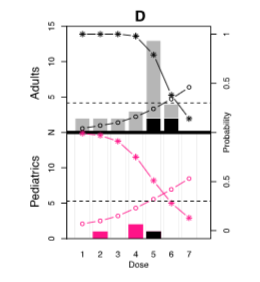                                                                                      | 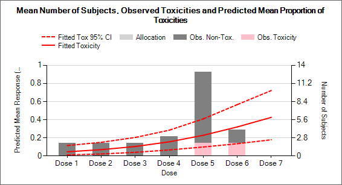 | 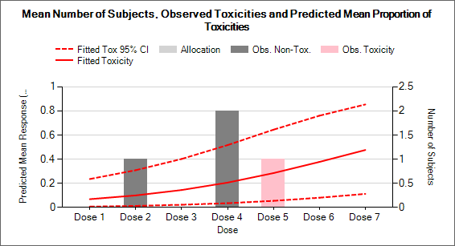 |
+--------------------------------------------------------------------------------------------------------------------------------------------------+-------------------------------------------------------------+-------------------------------------------------------------+
| FACTS agrees with the paper in that the group 1 mean estimates of toxicity has Dose 6 at about 30% and group 2 estimate has Dose 5 at about 30%. | 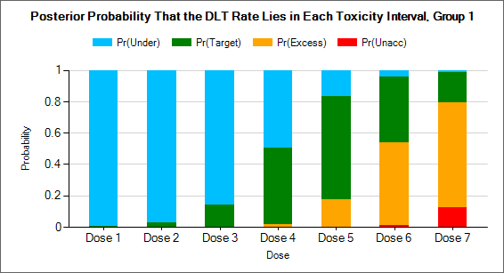 | 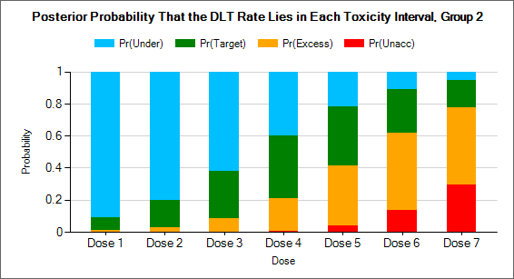 |
|                                                                                                                                                  |                                                             |                                                             |
| As with the paper in group 1 doses 6 & 7 are unsafe, and for group 2 doses 6 & 7 are unsafe.                                                     |                                                             |                                                             |
+--------------------------------------------------------------------------------------------------------------------------------------------------+-------------------------------------------------------------+-------------------------------------------------------------+

+----------------------------------------------------------------------------------------------------------------------------------------------------+-------------------------------------------------------------+-------------------------------------------------------------+
| Paper                                                                                                                                              | FACTS Group 1                                               | FACTS Group 2                                               |
+:==================================================================================================================================================:+:===========================================================:+:===========================================================:+
| 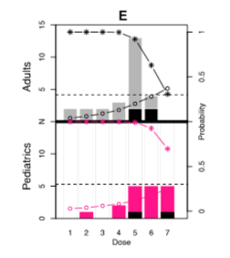                                                                                        | 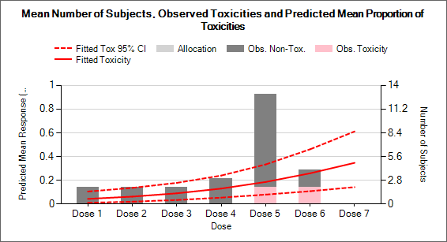 | 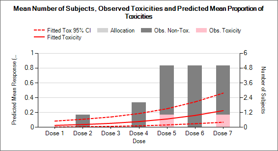 |
+----------------------------------------------------------------------------------------------------------------------------------------------------+-------------------------------------------------------------+-------------------------------------------------------------+
| FACTS agrees with the paper in that the group 1 mean estimates of toxicity has Dose 6 at about 30% and group 2 estimate has Dose 7 just below 30%. | 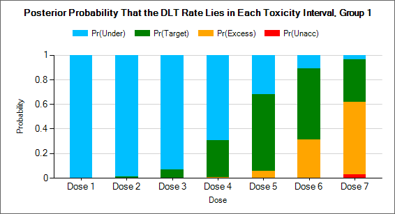 | 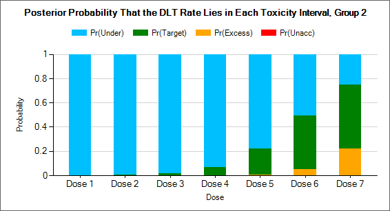 |
|                                                                                                                                                    |                                                             |                                                             |
| As with the paper in group 1 dose 7 is unsafe, and for group 2 no doses are unsafe.                                                                |                                                             |                                                             |
+----------------------------------------------------------------------------------------------------------------------------------------------------+-------------------------------------------------------------+-------------------------------------------------------------+

## Mean Subject Allocation

These graphs show the mean allocation of subjects to each dose across the different scenarios. The first table is for case 'A' where the toxicity for the pediatric patients is the same as for adult patients. In the first row the graphs from the paper are reproduced where the grey bars show the adult patients and the pink bars the pediatric. In the middle row the graphs are the FACTS graphs of mean subject allocation of the adult patients and in the bottom row they are the FACTS graphs of the mean allocation of the pediatric patients. The FACTS graphs have been manually shrunk vertically so that the "number of subjects" y-axis are consistent.

+-------------------------------------------------------------+-------------------------------------------------------------+-------------------------------------------------------------+-------------------------------------------------------------+
| 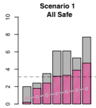 |  |  |  |
+=============================================================+=============================================================+=============================================================+=============================================================+
|  |  |  |  |
+-------------------------------------------------------------+-------------------------------------------------------------+-------------------------------------------------------------+-------------------------------------------------------------+
|  |  |  |  |
+-------------------------------------------------------------+-------------------------------------------------------------+-------------------------------------------------------------+-------------------------------------------------------------+

This second table shows the result when the pediatric 'B' scenarios were simulated, where the toxicity in the pediatric population was higher than that for the adult population.

+-------------------------------------------------------------+-------------------------------------------------------------+-------------------------------------------------------------+-------------------------------------------------------------+
|  |  |  |  |
+=============================================================+=============================================================+=============================================================+=============================================================+
|  |  |  |  |
+-------------------------------------------------------------+-------------------------------------------------------------+-------------------------------------------------------------+-------------------------------------------------------------+
|  |  |  |  |
+-------------------------------------------------------------+-------------------------------------------------------------+-------------------------------------------------------------+-------------------------------------------------------------+

This third table shows the result when the pediatric 'C' scenarios were simulated, where the toxicity in the pediatric population was lower than that for the adult population.

+-------------------------------------------------------------+-------------------------------------------------------------+-------------------------------------------------------------+-------------------------------------------------------------+
|  |  |  |  |
+=============================================================+=============================================================+=============================================================+=============================================================+
|  |  |  |  |
+-------------------------------------------------------------+-------------------------------------------------------------+-------------------------------------------------------------+-------------------------------------------------------------+
|  |  |  |  |
+-------------------------------------------------------------+-------------------------------------------------------------+-------------------------------------------------------------+-------------------------------------------------------------+

## Distribution of MTD Selection

These graphs show the proportion of times each dose was selected as the MTD across the different scenarios. The first table is for case 'A' where the toxicity for the pediatric patients is the same as for adult patients. In the first row the graphs from the paper are reproduced where the grey bars show the MTD selection for adult patients and the pink bars the MTD selection for pediatric patients. In the middle row the graphs as the FACTS graphs of the MTD selection for adult patients and in the bottom row the graphs are the FACTS graphs of the MTD selection for pediatric patients. For the "Unsafe" scenario the FACTS graphs have been plotted of the MTD+ selection -- in this selection FACTS includes the possibility that the MTD is below the tested dose range or above the tested dose range. This is to be consistent with the graph in the paper where the MTD is not selected if all doses are 'unsafe'.

+-------------------------------------------------------------+-------------------------------------------------------------+-------------------------------------------------------------+-------------------------------------------------------------+
|  |  |  |  |
+=============================================================+=============================================================+=============================================================+=============================================================+
|  |  |  |  |
+-------------------------------------------------------------+-------------------------------------------------------------+-------------------------------------------------------------+-------------------------------------------------------------+
|  |  |  |  |
+-------------------------------------------------------------+-------------------------------------------------------------+-------------------------------------------------------------+-------------------------------------------------------------+

This second table shows the result when the pediatric 'B' scenarios were simulated, where the toxicity in the pediatric population was higher than that for the adult population.

+--------------------------------------------------------------+--------------------------------------------------------------+--------------------------------------------------------------+--------------------------------------------------------------+
|  |  |  |  |
+==============================================================+==============================================================+==============================================================+==============================================================+
|  |  |  |  |
+--------------------------------------------------------------+--------------------------------------------------------------+--------------------------------------------------------------+--------------------------------------------------------------+
|  |  |  |  |
+--------------------------------------------------------------+--------------------------------------------------------------+--------------------------------------------------------------+--------------------------------------------------------------+

This third table shows the result when the pediatric 'C' scenarios were simulated, where the toxicity in the pediatric population was lower than that for the adult population.

+--------------------------------------------------------------+--------------------------------------------------------------+--------------------------------------------------------------+--------------------------------------------------------------+
|  |  |  |  |
+==============================================================+==============================================================+==============================================================+==============================================================+
|  |  |  |  |
+--------------------------------------------------------------+--------------------------------------------------------------+--------------------------------------------------------------+--------------------------------------------------------------+
|  |  |  |  |
+--------------------------------------------------------------+--------------------------------------------------------------+--------------------------------------------------------------+--------------------------------------------------------------+

## Observations

It looks as though the prior in FACTS has a slightly lower expectation of toxicity at the higher doses. This difference is only observable early on and disappears as the amount of data increases and dominates the prior.

We can see the difference in the allocation rule between the paper and FACTS that arises from the change in the number of subjects required on a dose from 2 to 3, after dose 3. FACTS does not have the facility to implement such a rule so we required just 2 per dose for all doses. The difference can be seen in the "AllSafe" scenario where the paper shows mean allocations of \~6 (adult) and \~3 (pediatric) at doses 4, 5 & 6 whilst FACT shows mean allocations of \~4 and \~2 respectively.

The higher mean allocation in FACTS to Dose 7 in this scenario is simply because there are more subjects left to allocate at the top dose before the max sample size is reached.

While the allocation distributions are not identical, the allocation of subjects in FACTS is very similar to the paper and looks to be entirely appropriate to the scenarios being simulated.

The MTD selection distribution in FACTS is very similar to that of the paper, except in the extreme scenarios where FACTS has a slightly higher selection of MTD at the top dose in the "Allsafe" scenario, and slightly higher selection of the lowest dose as MTD (as opposed to no selection of MTD) in the "UnSafe" scenario.
