# Introduction

This is an example of the design of a phase 1 dose escalation study using the FACTS N-CRM simulator.

# Background

In this tutorial we will look at the design of a trial for a single agent phase I dose escalation trial in oncology.

We look at 3 versions of the design

- An initial cohort design with a weak prior.

- The cohort design with the prior made more informative using "pseudo patients".

- Changing the cohort design to use "open enrolment".

In this example there are 8 pre-specified dose levels and the starting dose will be the first dose level. This trial will enroll a maximum of 40 patients. The primary objective is to determine the maximum tolerated dose (MTD), which will be the dose level that has the highest probability of a toxicity rate in the band 0.13-0.3. DLTs will be assessed within the first cycle of therapy. A cycle is 4 weeks in duration. It is expected that subjects can be recruited at the rate of 3 every 4 weeks -- so the total time taken to recruit and observe a cohort of 3 is 8 weeks.

# Cohort Design

To simulate this trial in FACTS we open a new N-CRM design. We enter the maximum study size in terms of dosing cohorts. This trial will using dosing cohorts of size 3 and will enroll a maximum of 39 patients. We enter the DLT cycle length of 8 weeks.

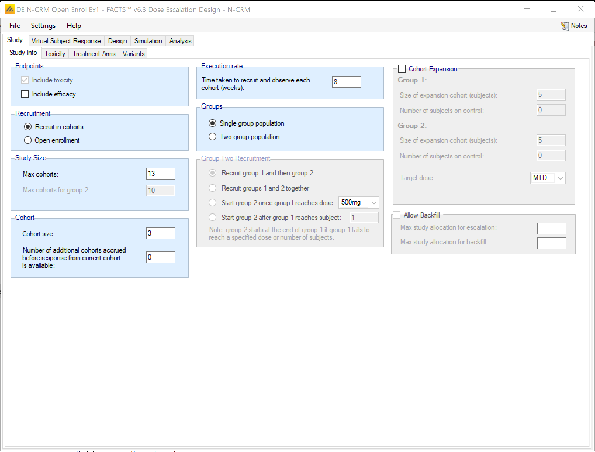

We will not be simulating an efficacy endpoint, a population of two "groups" or the use of an expansion cohort.

## Toxicity

This trial will target a toxicity interval, the dose with the highest probability that it has a DLT rate in the range 0.15 to 0.3. During the trial we will limit dosing to exclude doses that are assessed to have posterior probability of over 0.25 that their DLT rate is above 0.3. (Note we check this overdose control limit is not so extreme that it limits dose escalation when we would like to occur, later.)

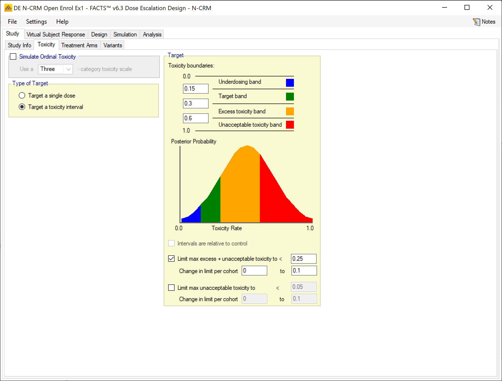

## Treatment Arms

We enter the 8 dose levels. They range from 500mg to 2250mg in steps of 250mg. We assign them dose strengths of 5 to 22.5 in steps of 2.5. The exact values we use does not matter greatly -- as long as the model priors we set take the values we have used into account. The other dependency is in the spacing of the dose values, here we have entered a linearly spaced set of doses and so will use a linear transform when we specify how the effective dose strengths, the "x-hats", are to be derived. if the doses strengths were exponentially spaced we would use the log of the dose ratio transform so that the resulting effective dose strengths are linearly spaced.

The dose strength is the value of the dose that will be used in the dose-toxicity modeling. The dose name is just a label.

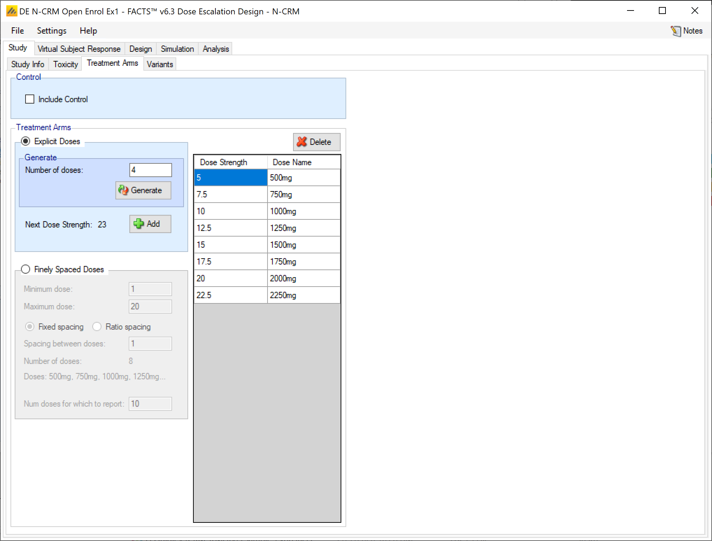

## Variants

Here we will not be using the "Variant" option. But we could use it to simply the exploration of the effect of changing the total number of cohorts allowed.

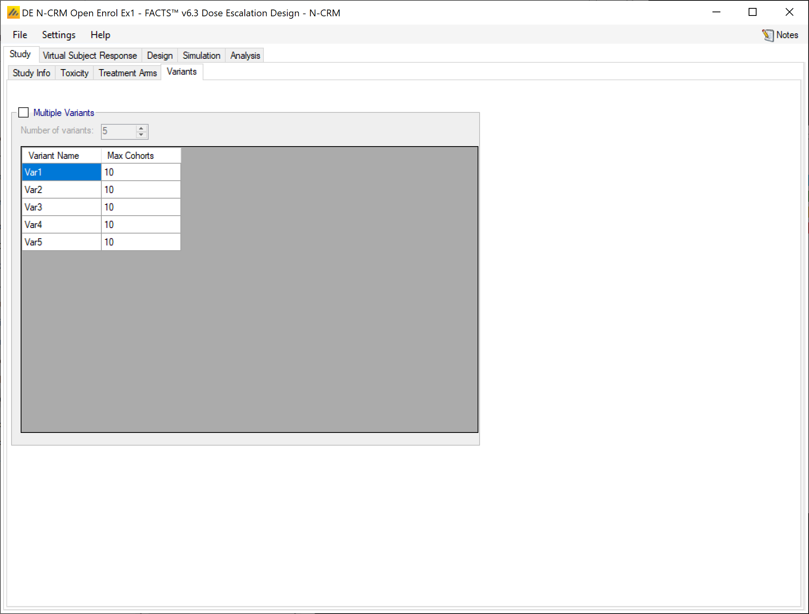

## Virtual Subject Response

On the virtual subjects tab we enter the dose-toxicity scenarios we will use to evaluate the behavior of the trial. We define one scenario "allsafe" in which all dose levels have a DLT rate below 30%, and one scenario "notsafe" in which even the lowest dose level would be considered unsafe with a DLT rate of 40%. We define three additional scenarios in which the true MTD will be dose levels 2, 3, and 5. Finally we enter an additional scenario where the mts is at dose 5 but the gradient with which the toxicity rises is much steeper.

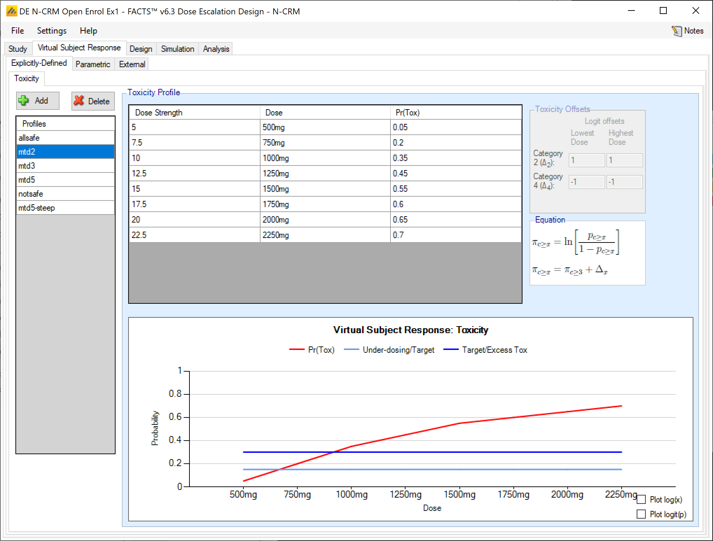

The details of the scenarios are:

+-----------+---------+-------+-------+-------+-------+---------+------------+
| Scenario: | allsafe | mtd2  | mtd3  | mtd5  | mtd7  | notsafe | mtd5-steep |
+===========+========:+======:+======:+======:+======:+========:+===========:+
| 500mg     | 0.03    | 0.05  | 0.05  | 0.01  | 0.01  | 0.40    | 0.00       |
+-----------+---------+-------+-------+-------+-------+---------+------------+
| 750mg     | 0.05    | 0.2   | 0.10  | 0.03  | 0.01  | 0.44    | 0.02       |
+-----------+---------+-------+-------+-------+-------+---------+------------+
| 1000mg    | 0.07    | 0.35  | 0.225 | 0.06  | 0.01  | 0.48    | 0.05       |
+-----------+---------+-------+-------+-------+-------+---------+------------+
| 1250mg    | 0.09    | 0.45  | 0.38  | 0.12  | 0.03  | 0.52    | 0.07       |
+-----------+---------+-------+-------+-------+-------+---------+------------+
| 1500mg    | 0.11    | 0.55  | 0.60  | 0.225 | 0.06  | 0.56    | 0.27       |
+-----------+---------+-------+-------+-------+-------+---------+------------+
| 1750mg    | 0.13    | 0.60  | 0.75  | 0.37  | 0.12  | 0.60    | 0.47       |
+-----------+---------+-------+-------+-------+-------+---------+------------+
| 2000mg    | 0.15    | 0.65  | 0.80  | 0.60  | 0.225 | 0.64    | 0.67       |
+-----------+---------+-------+-------+-------+-------+---------+------------+
| 2250mg    | 0.17    | 0.70  | 0.85  | 0.80  | 0.37  | 0.68    | 0.87       |
+-----------+---------+-------+-------+-------+-------+---------+------------+

We do not use any parametric or external virtual subject response profiles.

## Design

### x-hats

As noted above (see "Treatment Arms") we use the linear dose transformation "dose strength -- reference dose".

We also elect to use a reference dose of 0. Sometimes a reference dose in the middle of the dose range can give problems. If the prior on Ln(Beta) is very uninformative, observing no toxicities below the reference dose can yield higher expectations of toxicity above the reference dose compared to seeing a toxicity below the reference dose. This can be addressed with an informative prior on ln(Beta) -- but this requires some careful tuning to ensure the fitting of the model across the range of scenarios is still good. Here we avoid the problem simply.

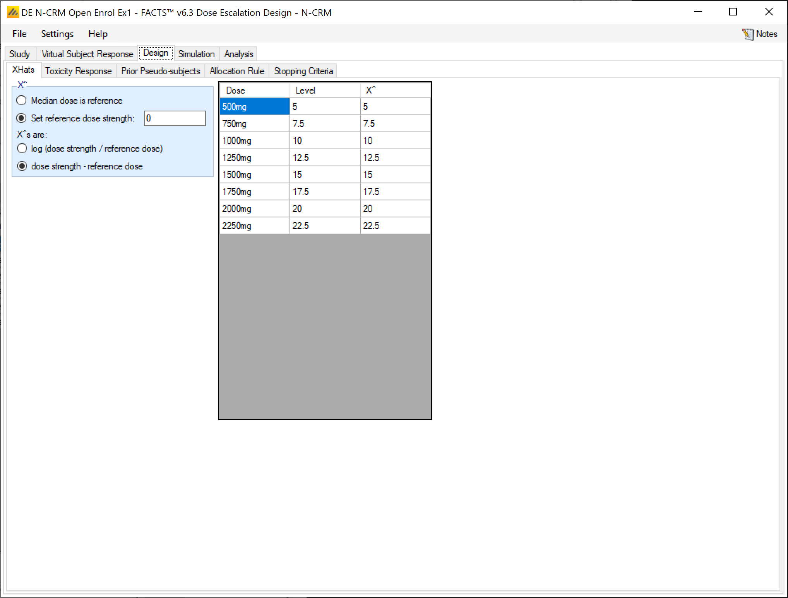

### Toxicity Response

We will use a logistic model for the dose toxicity model. We place priors on the parameters for the logistic model. The priors are scaled to be consistent with the selection of refence dose and the x-hat values. This can be done by looking at the logits of the scenarios manually, or with reference to the "Derive prior" "Scenarios" option. Here this latter approach results in a prior of Alpha \~N(-4.1227, 2.0748^2^), Ln(Beta) \~N(-1.6815, 0.6057^2^) Rho=-0.8327. We have rounded these values to a single decimal place, replaced the SD for Ln(Beta) with a larger value (making the prior less informative) and set the prior for Rho to 0, also making the prior less informative.

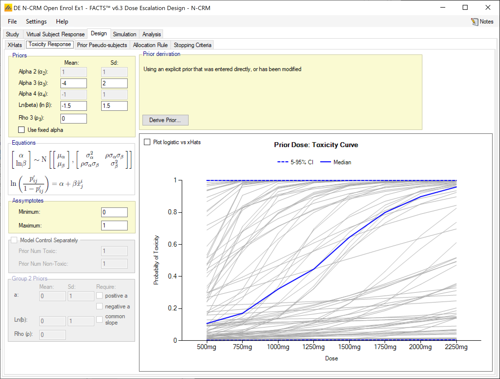

### Prior Pseudo-subjects 

Prior pseudo subjects are an explicit mechanism for making the prior more informative. We will apply some prior pseudo subject data in the next iteration of the design.

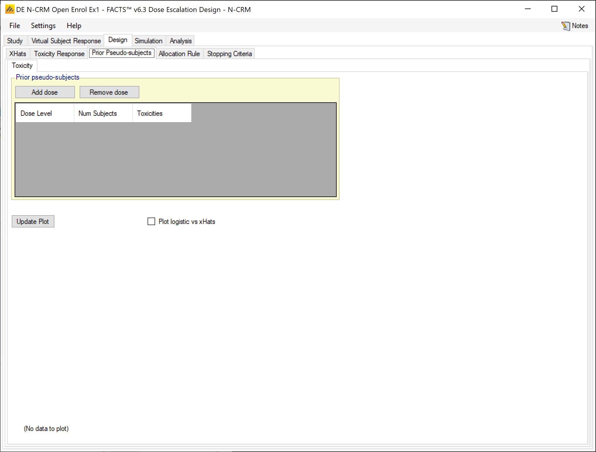

### Allocation rule

In the design tab, under "Allocation" we define the patient allocation to the dose levels and the dose escalation rules. We do not use a single patient/small cohort run-in. We will require DLT information from at least 1 cohort/3 patients on each dose level in order to escalate. No doses may be skipped, and more specifically, the dose may only be escalated one dose level from the dose most recently used. The starting dose will be the first dose level, 500mg.

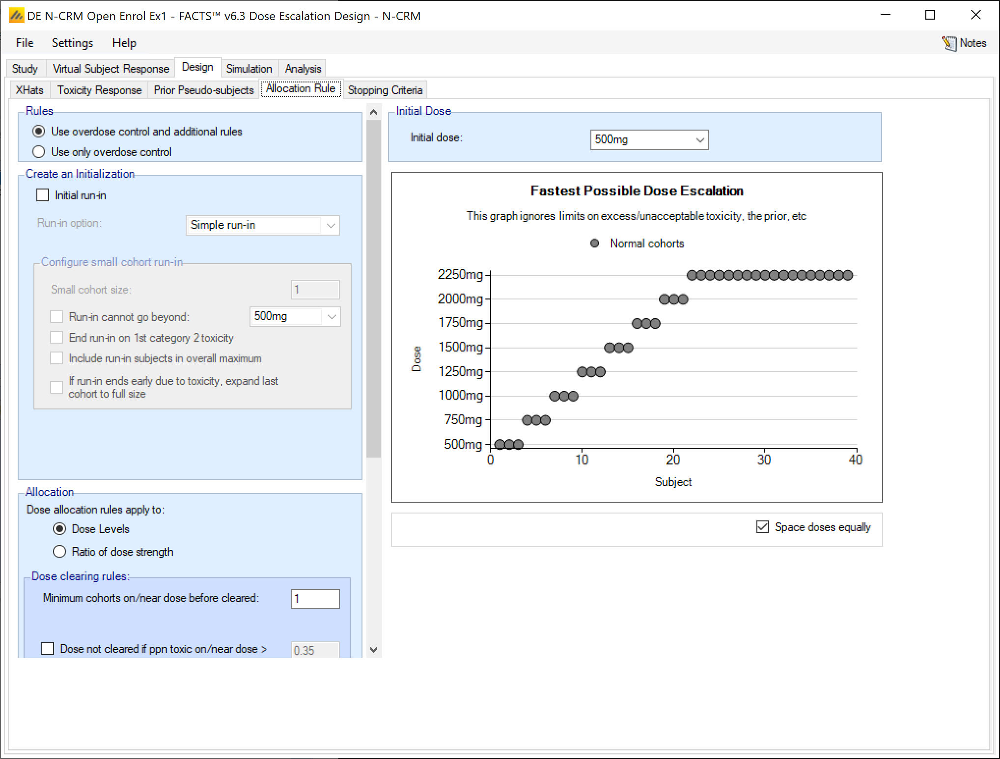

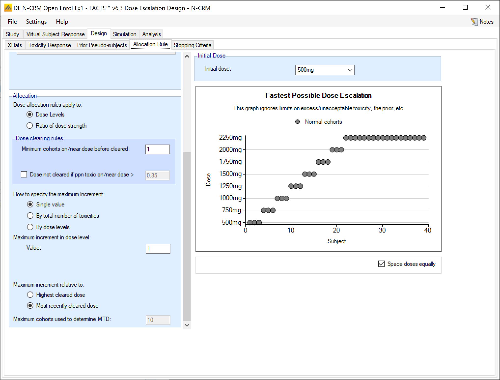

### Stopping Criteria

This trial will stop early for having identified the MTD if we have at least 3 cohorts/9 patients assigned to the MTD. Alternatively, we must observe at least 2 toxicities before the trial could stop early for safety.

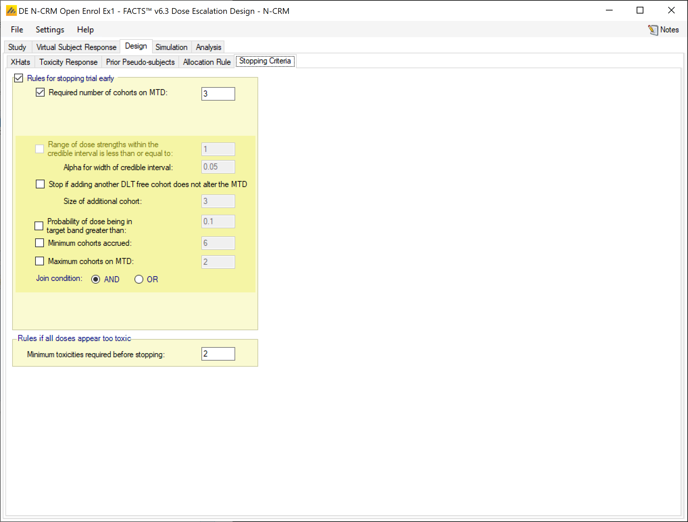

## Analysis

We can check our overdose control limit and prior using the analysis tab and checking a number of situations to ensure that together they allow escalation when we would wish it. Here we just show 4:

+---------------------------+------------------------------------------------------+------------------------------------------------------+--------------------------------------------------------------------------------------------------------------------------------------------------------------------------+
| Data Analyzed             | Fitted Toxicity                                      | Posterior probability of DLT rate in bands           | Next:                                                                                                                                                                    |
|                           |                                                      |                                                      |                                                                                                                                                                          |
| \<Dose\>: \<Tox\>/\<Obs\> |                                                      |                                                      |                                                                                                                                                                          |
+===========================+======================================================+======================================================+==========================================================================================================================================================================+
| 500mg: 0/3                | 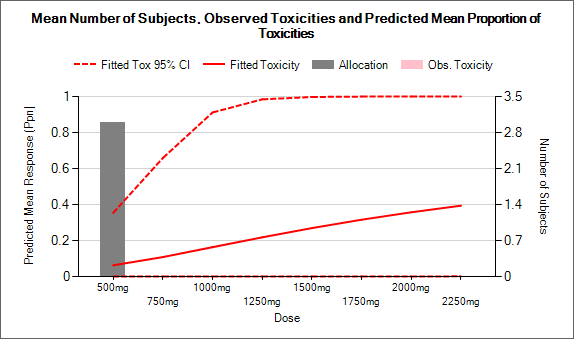 | 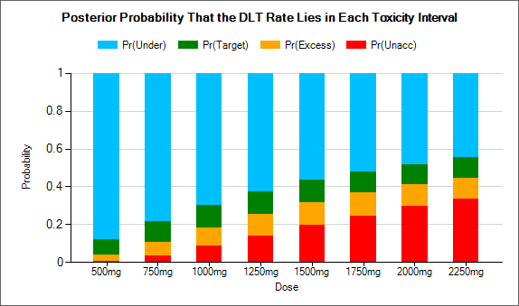 | We can escalate to 7500mg, limited by the escalation rules. Keeping to Pr(Tox \> 0.3) \< 0.25 would allow us to escalate to 1000mg                                       |
+---------------------------+------------------------------------------------------+------------------------------------------------------+--------------------------------------------------------------------------------------------------------------------------------------------------------------------------+
| 500mg: 0/3                | 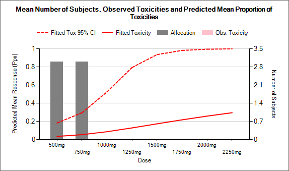 | 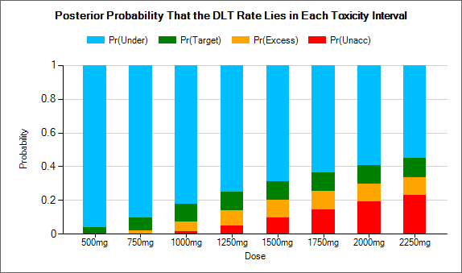 | We can escalate to 1000mg, limited by the escalation rules. Keeping to Pr(Tox \> 0.3) \< 0.25 would allow us to escalate to 1500mg                                       |
|                           |                                                      |                                                      |                                                                                                                                                                          |
| 750mg: 0/3                |                                                      |                                                      |                                                                                                                                                                          |
+---------------------------+------------------------------------------------------+------------------------------------------------------+--------------------------------------------------------------------------------------------------------------------------------------------------------------------------+
| 500mg: 0/3                | 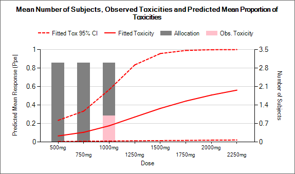 | 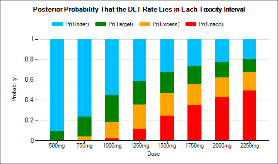 | We must re-dose at 1000mg. We are limited from preventing further to remain within Pr(Tox \> 0.3) \< 0.25. At 1000mg Pr(Tox \> 0.3) \< 0.2 we don't have to de-escalate. |
|                           |                                                      |                                                      |                                                                                                                                                                          |
| 750mg: 0/3                |                                                      |                                                      |                                                                                                                                                                          |
|                           |                                                      |                                                      |                                                                                                                                                                          |
| 1000mg: 1/3               |                                                      |                                                      |                                                                                                                                                                          |
+---------------------------+------------------------------------------------------+------------------------------------------------------+--------------------------------------------------------------------------------------------------------------------------------------------------------------------------+
| 500mg: 0/3                | 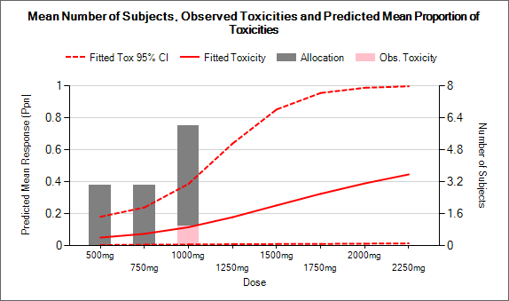 | 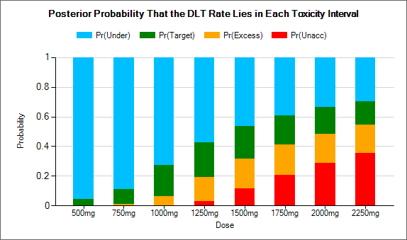 | We can escalate to 1250mg, which is the MTD and has Pr(Tox \> 0.3) is just below 0.2                                                                                     |
|                           |                                                      |                                                      |                                                                                                                                                                          |
| 750mg: 0/3                |                                                      |                                                      |                                                                                                                                                                          |
|                           |                                                      |                                                      |                                                                                                                                                                          |
| 1000mg: 1/6               |                                                      |                                                      |                                                                                                                                                                          |
+---------------------------+------------------------------------------------------+------------------------------------------------------+--------------------------------------------------------------------------------------------------------------------------------------------------------------------------+

## Simulation

We obtain some early, rough estimates of the operating characteristics of the design by simulating just 100 simulations of the design in each scenario.

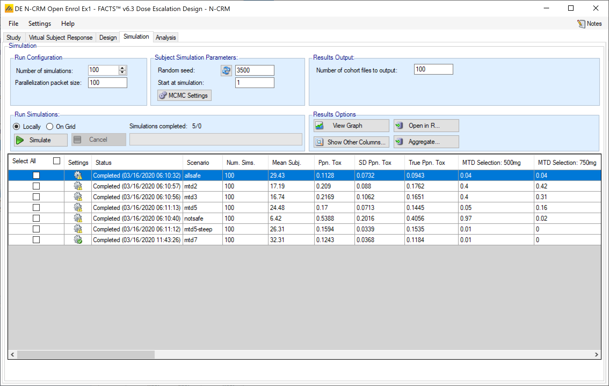

We can assess the total sample size, proportion of subject who experienced a toxicity, the distribution of patients across the dose levels, the probability each dose is selected as the MTD, and the fit of the dose-toxicity curve. For example, the plots below show the mean number of patients at each dose and the probability each dose is selected as the MTD (bottom), along with the fitted dose-toxicity curve for the scenario "MTD3".

We can also an overlay plot of the dose allocation histories and individual dose allocation histories.

| 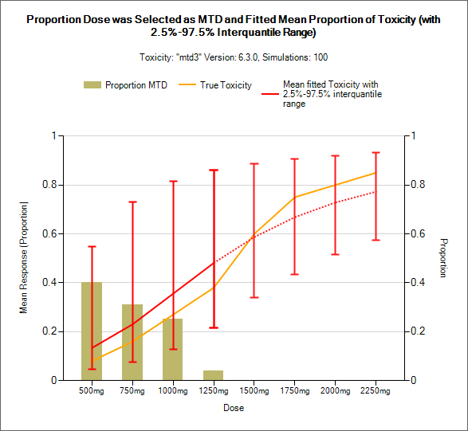 |
|----|
| 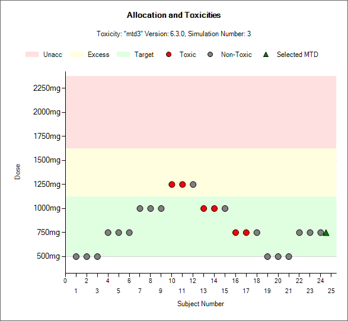 |

# Adding Pseudo-Subject Data

Saving the above design to a new ".facts" file allows us to retain the old design and simulation results for comparison, and create a new design with all the same basic properties and scenarios with just one small change. We now augment the non-informative prior with a small amount of pseudo data. Here we assume that the clinical team is prepared to represent their prior expectations of toxicity in terms of

- half a patient on the lowest dose (500mg -- strength 5), not experiencing any DLT.

- half a patient on the 1750mg (strength 17.5), with 30% probability of a DLT (i.e. we observe 0.15 toxicities).

- half a patient on the highest dose (2250mg -- strength 22.5), experiencing a DLT (i.e. we observe 0.5 toxicities)

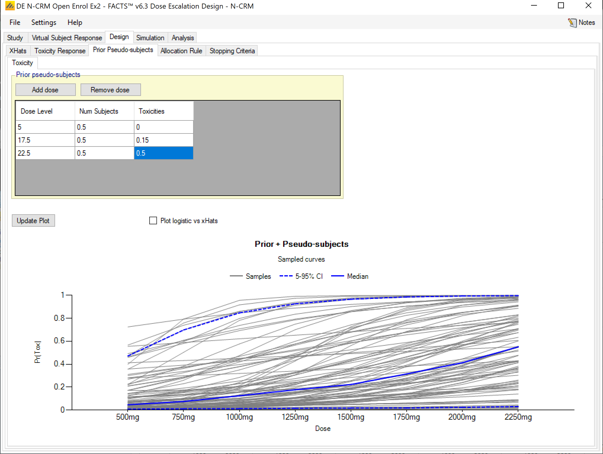

The plot shows the result of 100 draws from the posterior distribution after the fitting the model with the prior to the pseudo data. This posterior is the new prior for analyzing the actual data in the trial.

## Simulation Results

Running 100 simulations with this modified design, we can compare it to the first design using the "Across Scenario" graphs, in particular the selected MTD graph.

First design

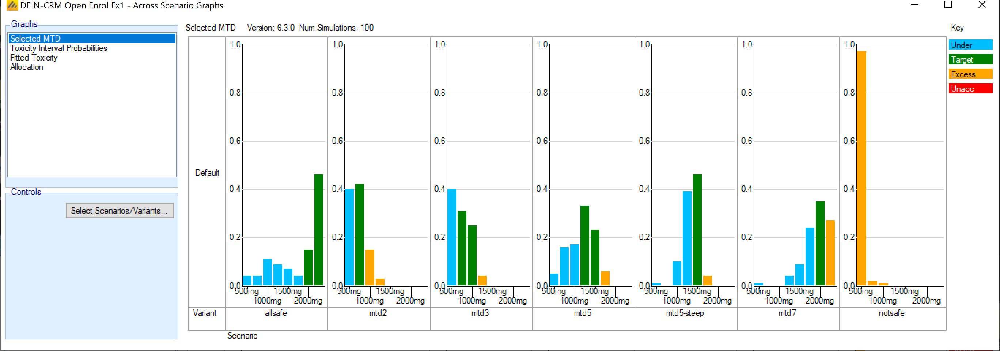

With pseudo subject data added to the prior

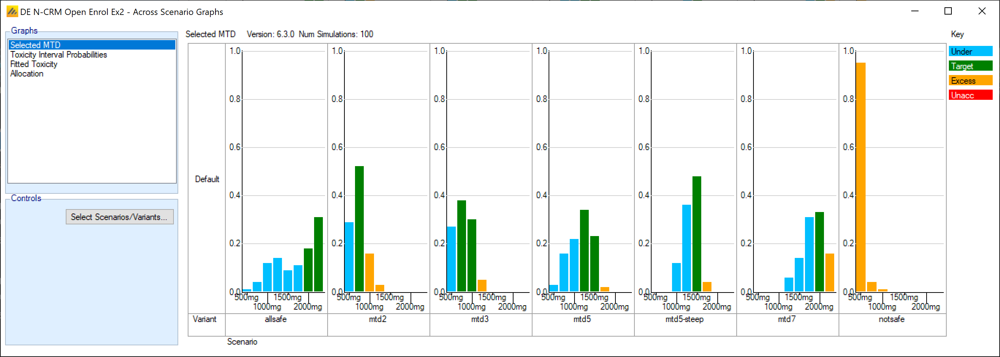

It has improved the MTD selection in the mtd2 & 3 scenarios, remained broadly the same in the mtd5 scenarios, and become a little more cautious in the mtd7 and "allsafe" scenarios.

# Continuous Enrollment Design

We will now explore continuous enrollment into this trial. For continuous enrollment we must specify the enrollment rate and the number of patients allowed into the trial with unknown DLT information. We expect to enroll 3 patients per month, or 0.75 patients per week. We will allow a maximum of 3 patients into the trial with unknown final DLT status when allocating to an "uncleared" dose, and a maximum of 6 when allocating to a "cleared" dose -- i.e. after 3 subjects have completed the decision is to remain allocating that dose because it is the MTD.

We also enable "backfilling" and allow up to 20 subjects to be allocated when backfilling, and 40 when escalating, so the total allocation could be 60 subjects.

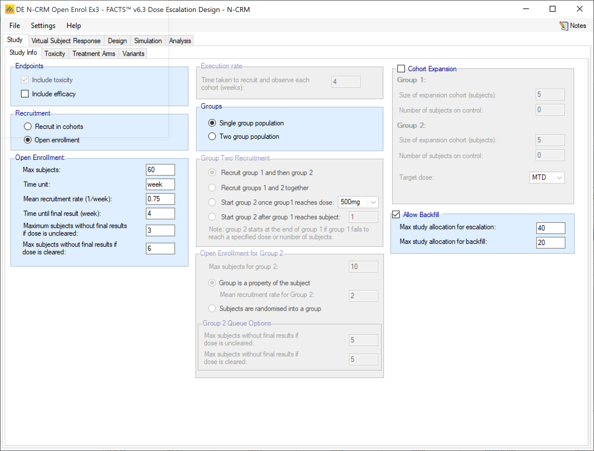

We need to modify the allocation and stopping rules, as these had number of "cohorts" targets that now need to be expressed in number of subjects, and we need to enter the parameters for backfilling.

## Open Enrolment Allocation Rules

Here we simply change the "Minimum cohorts on near/dose before cleared" from 1 to "Minimum subjects on/near dose before cleared" to 3 (the equivalent of 1 cohort in our previous design.

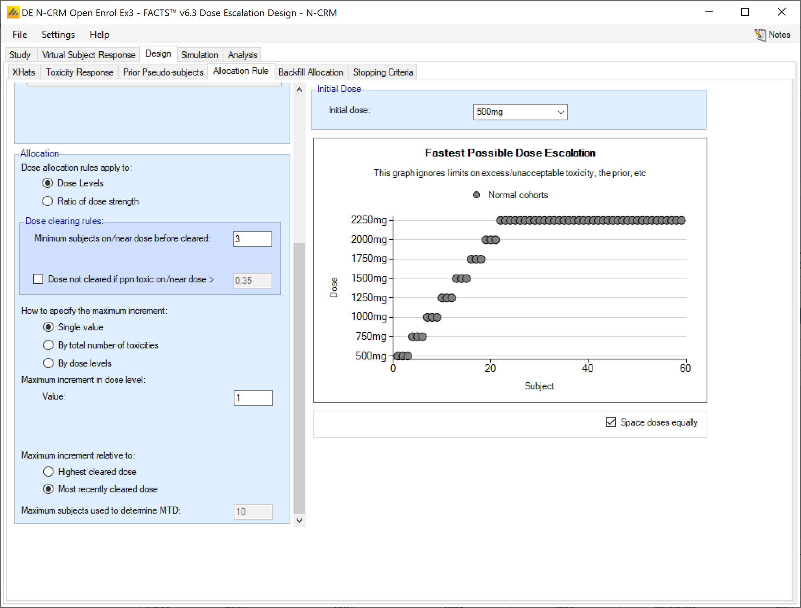

## Open Enrolment Backfill Allocation Parameters

We specify that

- the maximum number of subjects on a dose to be 9 (we don't want to allocate any more than the maximum required for stopping)

- the maximum allocation to any dose by backfill to be 6.

- That we don't want backfill to allocate more than 2 dose levels below the current dose

- That we don't want to backfill allocate below the 750mg dose

## 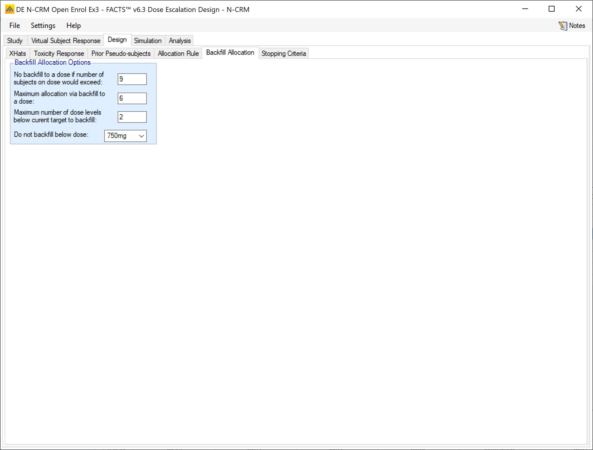

## Open Enrolment Stopping Rules

Here we simply change the "Required number of cohorts on MTD" from 3 to "Required number of subjects on MTD" to 9 (the equivalent of 3 cohorts in our previous design. We also specify that should the stopping rule be met, we only want ot pause recruitment until all subjects complete with the option to resume recruitment if when all the data is in the stopping condition is no longer met (e.g. the estimate of the MTD has shifted to dose with insufficient data).

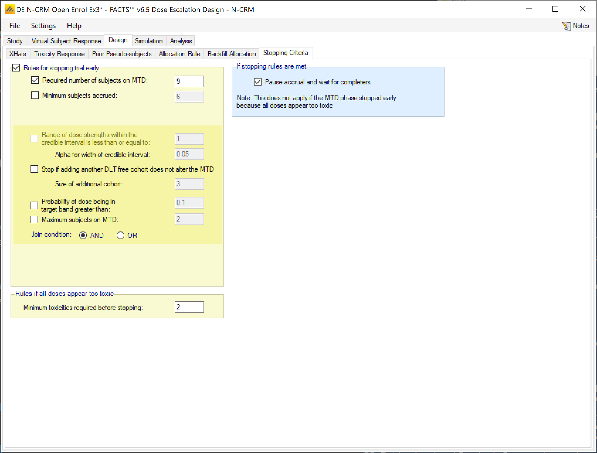

## Simulation Results

Running 100 simulations with this modified design, we can compare it to the first design using the "Across Scenario" graphs, in particular the selected MTD graph.

First design

Open Enrolment and Prior Pseudo data design:

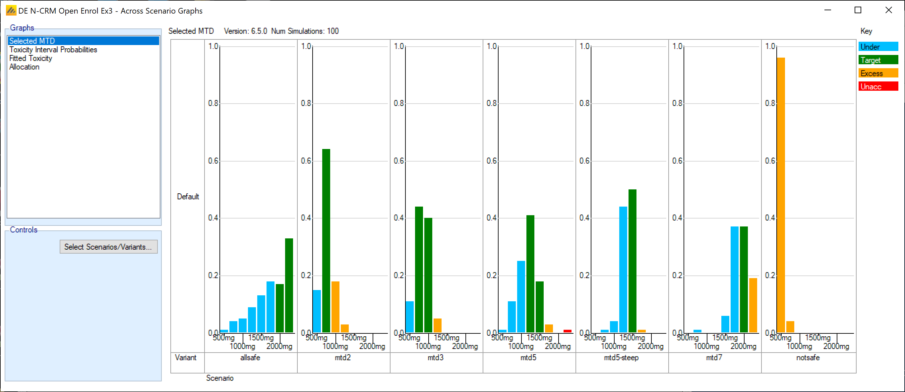

This has improved the MTD selection significantly in all scenarios except "allsafe", where the selection has picked high but still underdosing doses more.

It is interesting to compare sample sizes and duration:

+-------------+--------------+------------------+-------------------------------------------------+------------------+
| Scenario    | First Design |                  | Open Enrolment and Prior Pseudo Subjects design |                  |
+:===========:+:============:+:================:+:===============================================:+:================:+
|             | Mean Subj    | Duration (weeks) | Mean Subj                                       | Duration (weeks) |
+-------------+--------------+------------------+-------------------------------------------------+------------------+
| allsafe     | 29.4         | 78.5             | 45.1                                            | 74.6             |
+-------------+--------------+------------------+-------------------------------------------------+------------------+
| mtd2        | 17.2         | 45.8             | 22.0                                            | 41.5             |
+-------------+--------------+------------------+-------------------------------------------------+------------------+
| mtd3        | 16.7         | 44.6             | 22.2                                            | 41.6             |
+-------------+--------------+------------------+-------------------------------------------------+------------------+
| mtd5        | 24.5         | 65.2             | 31.3                                            | 54.5             |
+-------------+--------------+------------------+-------------------------------------------------+------------------+
| mtd5-steep  | 26.3         | 70.2             | 37.0                                            | 62.2             |
+-------------+--------------+------------------+-------------------------------------------------+------------------+
| mtd7        | 32.3         | 86.2             | 48.6                                            | 78.3             |
+-------------+--------------+------------------+-------------------------------------------------+------------------+
| notsafe     | 6.4          | 17.1             | 8.5                                             | 17.8             |
+-------------+--------------+------------------+-------------------------------------------------+------------------+

The open enrolment and backfill has allowed us to test a larger sample size (which is probably the cause of the improved MTD selection) but in shorter time. Because the allocation under backfill is to lower doses, the overall proportion of subjects experiencing a DTL is slightly less. The average number of subjects allocated at or around the MTD is slightly higher, the selection of MTD is better.

## Per Sim Open Enrolment Allocation History

When we look at the dose escalation behavior within a single simulated trial, FACTS now shows the assignment of each patient entering the trial as an 'interim". This allows us to see the current status of trial as each patient is enrolled in the continuous enrollment setting. In the example below, the dose has escalated to the 4^th^ dose level then de-escalated to the 3^rd^ dose. Early in the trial while waiting for subjects to complete, patient that becomes available is marked as "lost" with a yellow x at the bottom. Once the trial is allocating at 1000mg or above, backfill first at 750mg then 1000mg becomes possible and no patients are lost. The backfill patients are informative -- one on 750 experiences a DLT, the subjects on 10000mg eventually contribute to the number of subjects on the MTD and allow the trial to stop earlier.

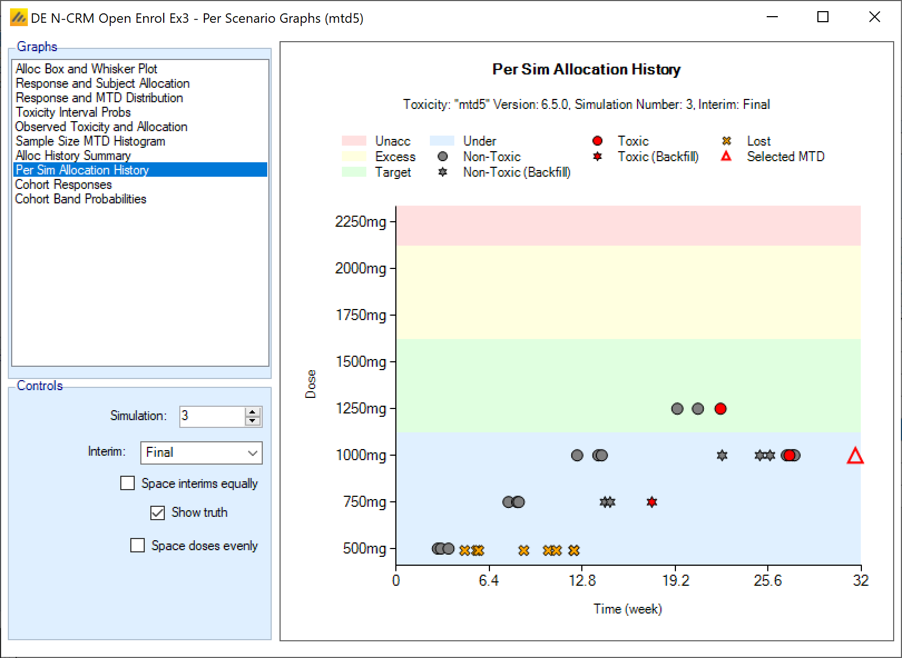
