# Introduction

This tutorial describes the Alzheimer's example trial design using the FACTS Enrichment Design Engine for a Continuous Endpoint. For this version of the document, the screenshots are from the 6.3 release of FACTS.

The screenshots provided are approximate and may not reflect the exact layout of the information. The contents of each tab, however, will be consistent with the software.

The designs presented are examples and may not be optimally calibrated.

# Design Features

This tutorial describes a single enrichment design with 3 groups using:

- Longitudinal modelling

- Hierarchical model for control

- Hierarchical model for treatment arms

- Early stopping for futility using the posterior probability of beating control by a futility CSD

- Early stopping for success using the predicted probability of success in phase 3 and Across Groups analysis.

# Case Study: Alzheimer's

A new treatment for Alzheimer's will be assessed in 3 patient groups defined by their severity of disease -- Mild, Moderate, and Severe. Because of lack of available treatments for Alzheimer's, we want to be very conservative about declaring futility in this trial.

The primary endpoint will be change in cognitive function at 12 months. If the difference between treatment and control is 0.5 or less, this treatment will be considered futile. If there is a high probability that this treatment could be found superior to control in a future randomized phase III study, this treatment will be of interest for further study.

# Entering the design

Start FACTS. Double Click: Enrichment Design - Continuous.

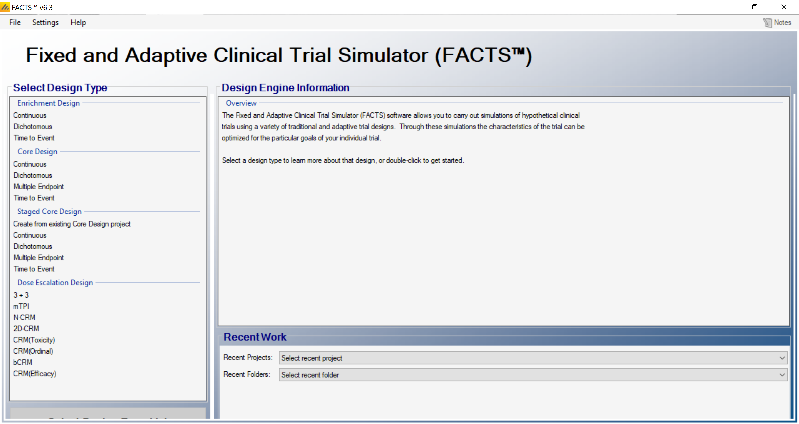

Using the menu option File \> Save As, save this design as ED-Alzheimers in a convenient location (e.g. in a folder called FACTS\\ED-cts-example in your 'My Documents' folder).

## Study

Under the study tab we define the basic properties of the trial we are simulating

### Study Info

Under the study info tab we define

- Whether comparison will be against a control arm, or an Objective Control (or "Historical") level of response.

- Whether increase or decreasing scores indicate a subject is improving.

- The design options we wish to use:

  - An adaptive or non-adaptive design

  - Frequentist Analysis (or only Bayesian)

  - Longitudinal modelling (and hence subject intermediate visits)

  - Simulation of subject baseline scores

- How many groups there are in the analysis and whether we wish to cap enrolment into any group.

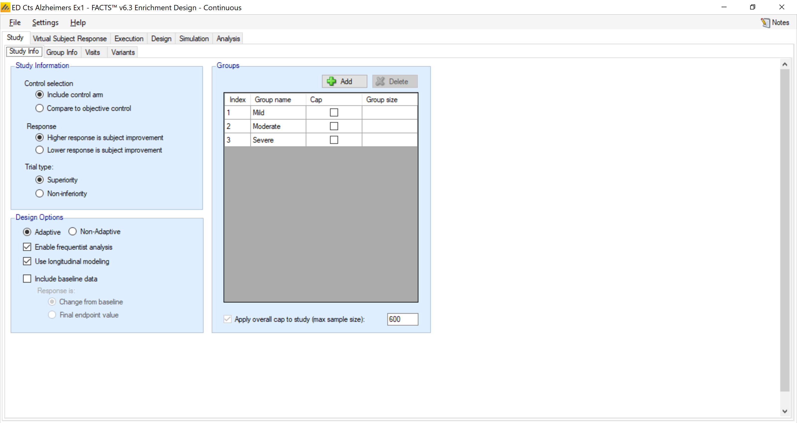

In this design we don't apply group caps, just an overall study cap of 600 patients. We will use a longitudinal model for this study because of the relatively long lag (12 months) to observing the primary endpoint. We won't be simulating baseline scores or a baseline related response.

### Group Info

On the group info tab we can specify targets for the group response.

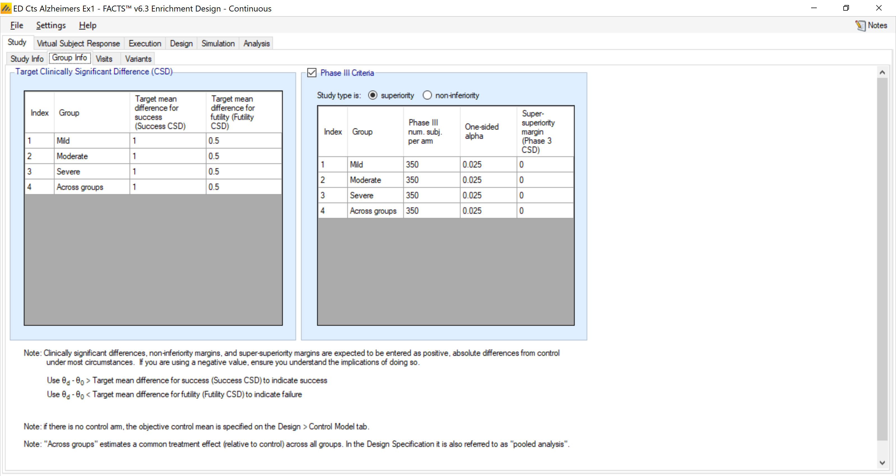

Here we set our target clinically significant difference for futility at 0.5 and set up the criteria for a future phase III trial. For predicting success in a future phase III trial, we assume a phase III trial with 350 patients per arm with the objective of declaring superiority versus control. The target clinically significant difference for success is not used in this trial, though at least a 1 point difference between treatment and control would be considered very good.

### Visits

On this tab we define the number and timing of subject visits.

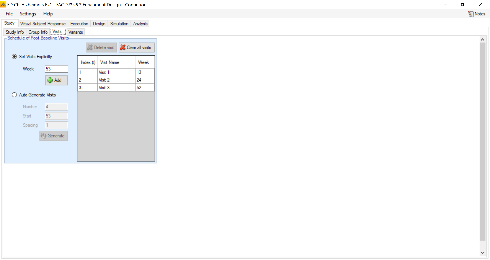

We assume three visits at 3, 6, and 12 months.

## Virtual Subject Response

On these tabs we define profiles of how the subjects might respond during the trials.

### Group Response

Here we specify the mean change from baseline and the SD ("sigma") of the endpoint for each arm in each group. This will form a group response "profile" that will form part of a simulation "scenario". (Somewhat like a frequentist "hypothesis" but with more details).

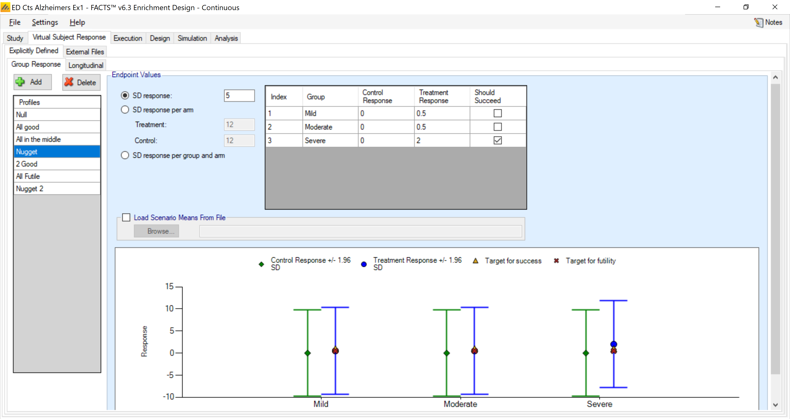

We specify the treatment effects to simulate as a number of possible "truths". The control group is always zero. The profiles are:

+---------------------------+-----------+---------------+-------------+
| Profiles                  | Mild      | Moderate      | Severe      |
+===========================+:=========:+:=============:+:===========:+
| Null                      | 0         | 0             | 0           |
+---------------------------+-----------+---------------+-------------+
| All Good                  | 2         | 2             | 2           |
+---------------------------+-----------+---------------+-------------+
| All in the Middle         | 0.75      | 0.85          | 0.95        |
+---------------------------+-----------+---------------+-------------+
| Nugget                    | 0.5       | 0.5           | 2           |
+---------------------------+-----------+---------------+-------------+
| Two Good                  | 0.5       | 1             | 2           |
+---------------------------+-----------+---------------+-------------+
| All Futile                | 0         | 0.1           | 0.2         |
+---------------------------+-----------+---------------+-------------+
| Nugget2                   | 1.5       | 0             | 0           |
+---------------------------+-----------+---------------+-------------+

These profiles range from ineffective to optimistically effective.

In the "Null" profile, the drug is completely ineffective in all three groups and in the "All Futile" profile, the drug is only slightly effective and the effect is less than the futility target in all groups.

In the "All in the Middle" case, the drug has an effect just above the futility target, but is only moderately effective. In the "Two Good" profile, the drug is at the futility target in one group, but effective in the other two groups. In the "All Good" profile, the drug has a strong effect in all groups.

There are two pathological cases "Nugget" and "Nugget2" where the drug is effective in only one group

The final true sigma in each profile is 5

### Longitudinal response

In the longitudinal response

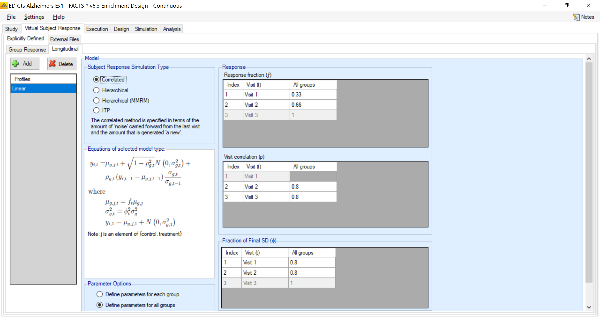

We must also specify a longitudinal profile for the change at each visit. We assume that 1/3 of the full treatment effect is observed at 3 months, and 2/3 at 12 months. The correlation between visits is 0.8 and 0.8 of the final sigma (5) is observed at the earlier two visits.

## Execution

Under the execution we specify how to simulate key logistical aspects of the trial -- how fast subjects are accrued and their probability of dropping out.

### Accrual

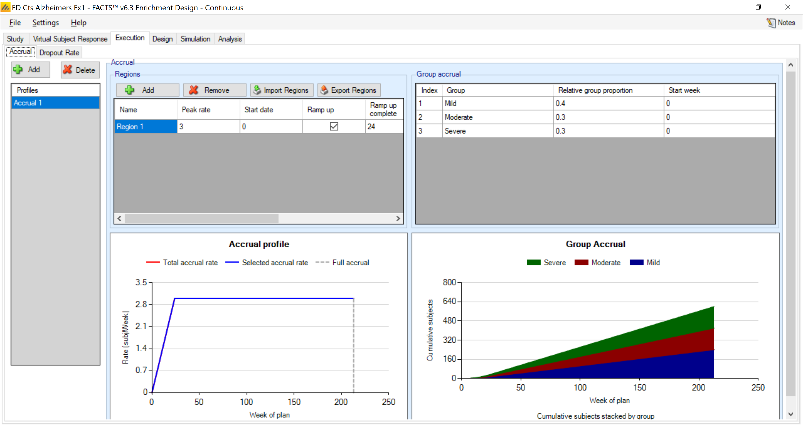

The groups are expected to be relatively similar in size -- 40% of the population will be mild, 30% will be moderate, and 30% will be severe. There are no group maximum sample sizes, just an overall study maximum sample size, so the total numbers in each group will depend on their relative accrual.

All groups open accrual at the start of the study

We assume an accrual profile of 12 patients per month

### Dropout

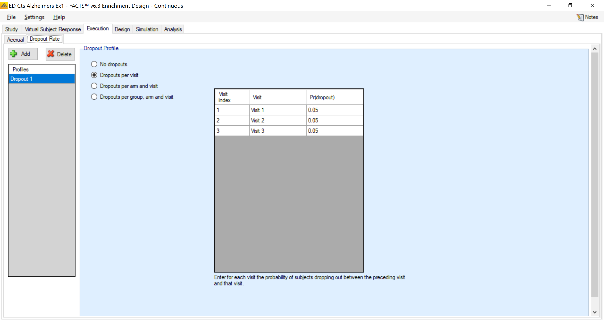

We assume 5% drop-out at each visit for this example

## Design

### Control Model

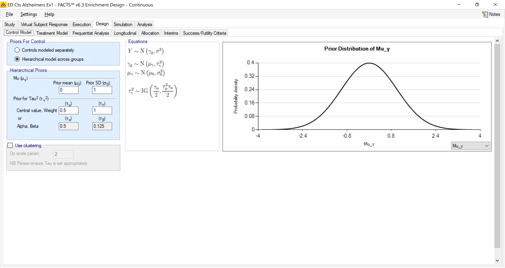

We place a hierarchical model on the control groups with a weak prior of N(0, 1^2^) for the mean of the hierarchical distribution (0 is the expected response on control and a 2 point difference is our best expected response) and a weak prior inverse gamma distribution with mean 0.5 and "weight" 1 on the variance of the hierarchical distribution. We expect this to lead to a modest shrinkage in the estimates of the response on the control arms when the means of the different groups are within 0.25-0.5 of each other.

### Treatment Model

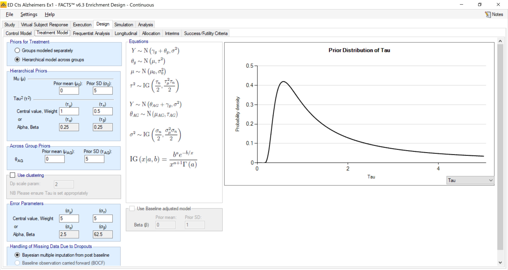

And we place a hierarchical model on the treatment arms. With a weak prior of N(0, 5^2^) for the mean of the hierarchical distribution (0 is the expected response on control and a 2 point difference is our best expected response) and a weak prior inverse gamma distribution with mean 1 and "weight" 0.5 on the variance of the hierarchical distribution. We expect this to lead to a modest shrinkage in the estimates of the response on the treatment arms, but the effect should be weaker than the effect of the hierarchical model on the control arms.

### Frequentist Analysis

Here we can set the alpha levels for the different p-values that will be calculated. We use a two-sided alpha of 0.05 for them all.

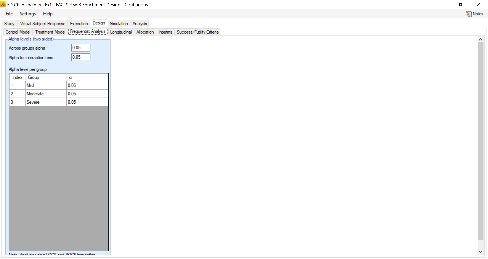

### Longitudinal Model

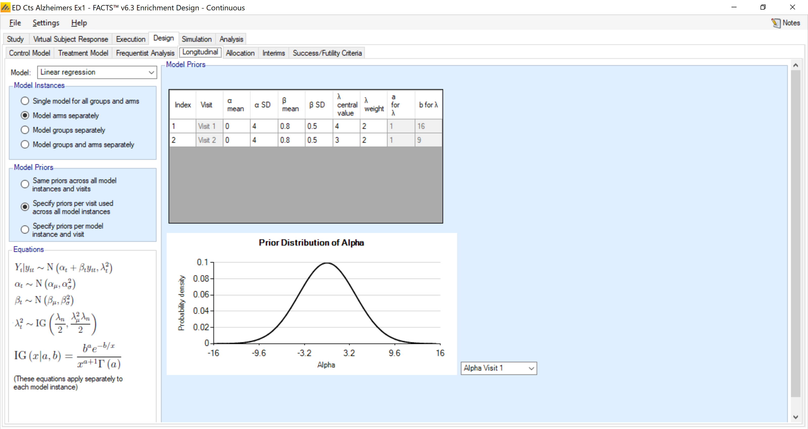

For the longitudinal model, we use linear regression and specify a slightly different prior for each visit.

We model each arm (control & treatment) separately -- but have common models for control and treatment across all the groups.

### Allocation

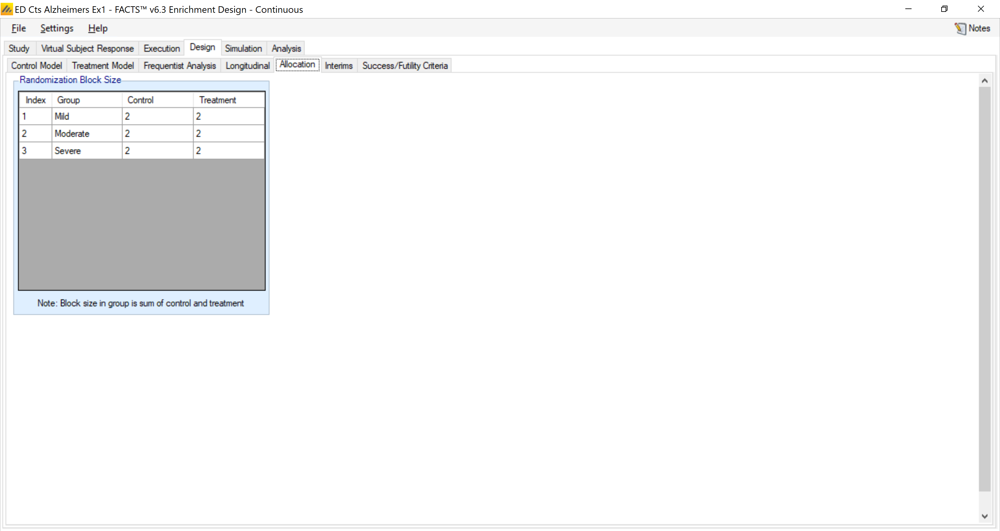

We will allocate patients evenly between the control and treatment arms in each group, in blocks of 4.

### Interims

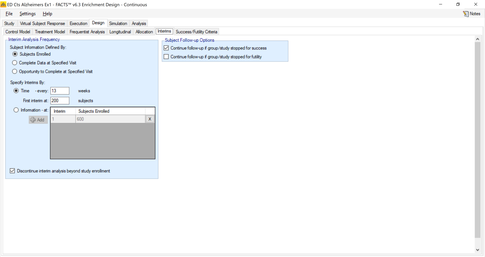

Here we specify that interim looks will be begin when 200 patients have been enrolled and will be repeated every 3 months (13 weeks).

We will continue to follow groups stopped for success, but not those stopped for futility. If a group is stopped for success, they will continue treatment, but if a group is stopped for futility, they will stop treatment.

### Stopping Criteria

Here we specify the criteria for stopping groups and the overall study early for futility or success.

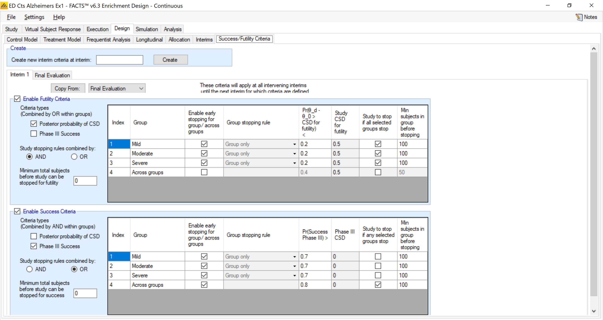

We based early stopping for futility on the posterior probability that within each group the response on the treatment arm is better than the control arm by the CSD for futility (which was 0.5). We monitor each group for futility. If there is a less than 20% probability the group beats the futility target of 0.5, the group is stopped for futility. If all groups are stopped, the study will stop. We don't allow a group to stop for futility until it has enrolled at least 100 subjects.

We base early stopping for success on the predictive probability of phase III success. We monitor each group and across all groups for early success. For a single group, if the predictive probability of phase III success is at least 70%, it will stop early for success. If, across all groups, there is at least an 80% predictive probability of phase III success, then the study will stop early for success. We don't allow a group to stop for success until it has enrolled at lest 100 subjects, and we don't allow the study to stop for success using the "across groups" analysis until the study has enrolled at least 100 subjects (but the first interim is not until 200 subjects have been enrolled, so that restriction is currently unnecessary).

### Final Evaluation Criteria

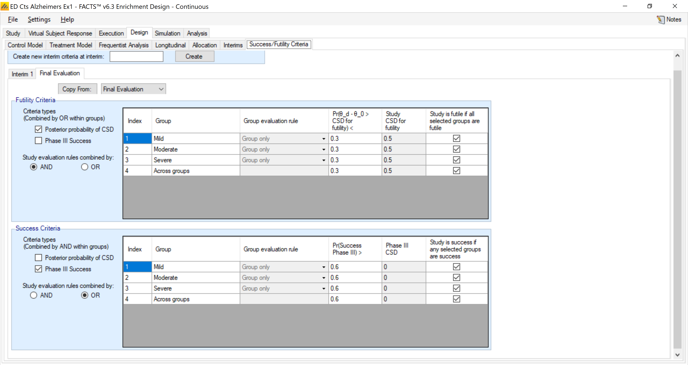

Evaluation criteria at the end of the study are similar, but less stringent. Furthermore, all groups must meet the futility criteria for the study to be declared futile whereas only one group, or across groups, need be successful for the study to be declared a success.

## Simulation Results

We simulate each scenario 1000 times:

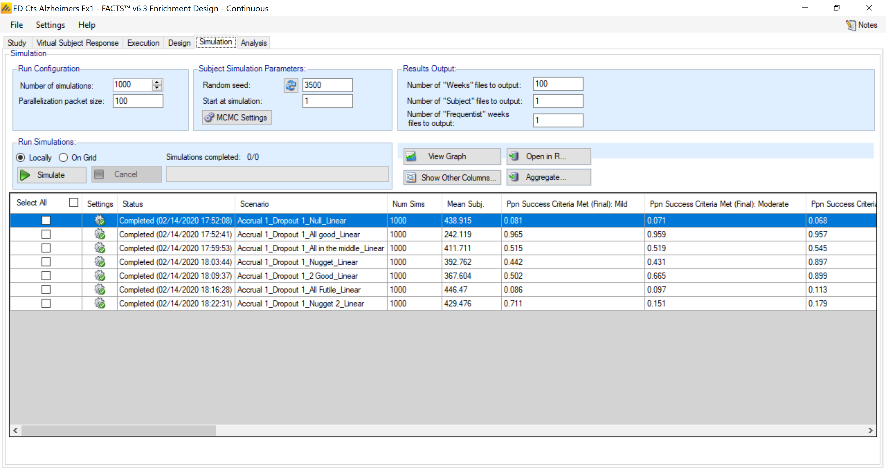

In each case we have used the same seeds.

The study level results are:

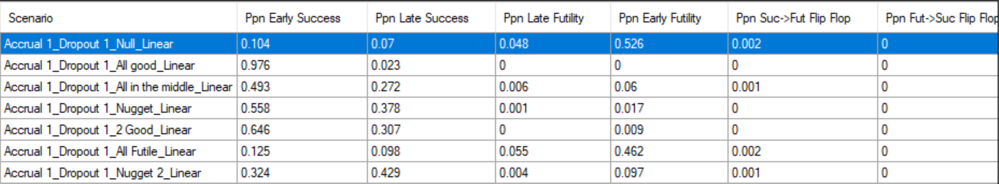

This reports the trial probability of success and futility overall. In the Null case, 52.6% of trials stop early for futility. In the All Futile case, 46.2% stop early for futility. All groups must be futile in order for the trial to be declared futile. With a futility target of 0.5, and a true effect of 0 with a standard deviation of 5, it is a conservative definition of futility

On the other hand, for success, only one group must meet the success criteria for a trial to be declared a success. In the All Good case, 97.6% stop early for success. With the moderate treatment effects in "All in the Middle", early success is less likely, but 76.5% of trials overall (early or late) are successful. In the Nugget cases, one strong group means the probabilities of trial success (early or late) are fairly high.

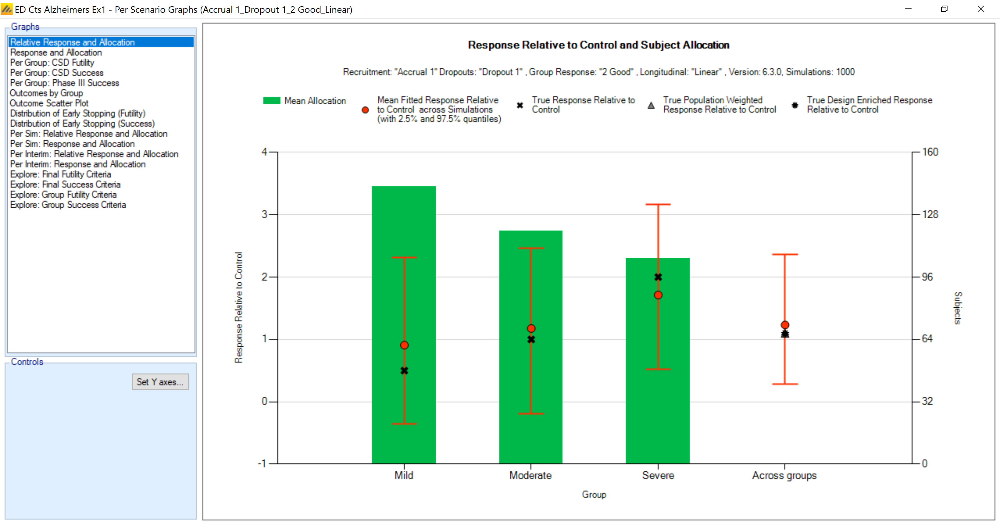

This is a graph from the "2 Good" profile. This shows the shrinkage of the treatment effects between the groups. The group with the lower treatment effect is pulled up, and the group with the strongest treatment effect is pulled down. This also illustrates that the group with the strongest treatment effect has the smallest sample size, a result of this group stopping earlier for success.

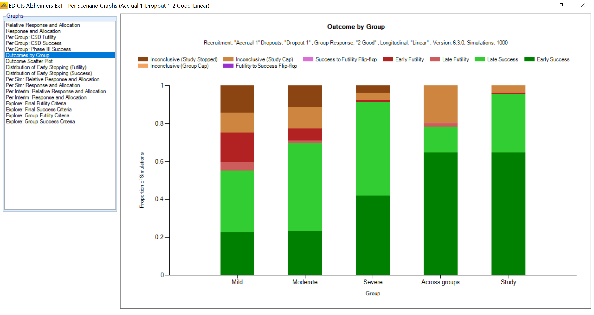

Early stopping for each group is shown in this graph. We see the severe group stops early for success in 76% of the simulations. The mild group stopped early for success in 43% of simulations and stopped early for futility in 23% of simulations. Again, the mild group has true response of 0.5, which is right at the futility CSD. So the effect is not necessarily poor enough to stop for futility with high probability or strong enough to stop for success with high probability. Thus, this group continues to enroll additional patients.

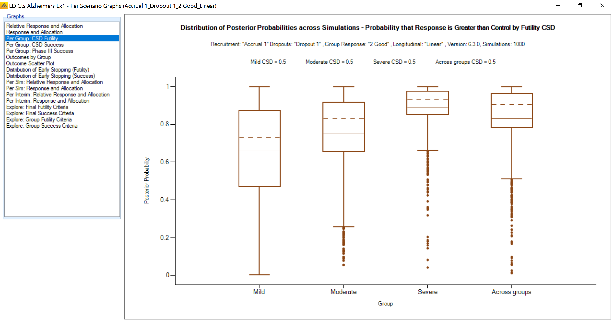

This boxplot of the probability of being better than the control group by the futility CSD shows that the mild group has a mean of approximately 60% probability of being better than control by the futility CSD. The other two groups have quite a good probability of being better than the futility CSD.
