# Introduction

This tutorial describes the Cancer example trial design using the FACTS Enrichment Design Engine for a Dichotomous Endpoint. For this version of the document, the screenshots are from the 6.3 release of FACTS.

The screenshots provided are approximate and may not reflect the exact layout of the information. The contents of each tab, however, will be consistent with the software.

The designs presented are examples and may not be optimally calibrated.

# Design Features

This tutorial demonstrates the impact of borrowing across groups, it describes 2 versions of a simple fixed design with 5 groups, comparing a treatment effect against an objective control rate:

1.  The first design uses simple posterior probability of being better than the control rate using a CSD.

2.  The second design adds a hierarchical to the analysis of the treatment rates

3.  Finally there is some discussion and analysis of the difference the hierarchical model made.

# Case Study: Cancer

A new compound for cancer will be explored in 5 patient subgroups. Think NHL subtypes, or 5 tumor types, or 5 genetic subgroups. In a case like this we are thinking about the drug as not being "targeted" to a specific subgroup -- or in FACTS "group."

We will measure response in subjects. The historical rate is assumed to be 15% in each group. If the response rate is 20% or less we will consider this a failed drug in that group. Likewise if the rate of response is 30% or higher in a group we will consider that a success.

For the first trial design we will ignore all time-to-information aspects of the trial and consider a fixed design.

# Design #1: 

In this first design we will explore a fixed single arm trial design with a 'standard' independent analysis model. We will assume a fixed sample size of 40 in each group.

Start FACTS. Double Click: Enrichment Design - Dichotomous.

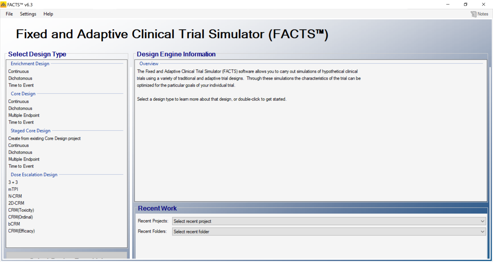

Using the menu option File \> Save As, save this design as ED-Cancer in a convenient location (e.g. in a folder called FACTS\\ED-dich-example in your 'My Documents' folder).

## Study

Under the study tab we define the basic properties of the trial we are simulating

### Study Info

Under the study info tab we define

- Whether comparison will be against a control arm, or an Objective Control (or "Historical") level of response.

- Whether a response indicates a subject is improving or deteriorating.

- The design options we wish to use:

  - An adaptive or non-adaptive design

  - Frequentist Analysis (or only Bayesian)

  - Longitudinal modelling (and hence subject intermediate visits)

  - Whether longitudinal data should be modelled as following a restricted Markov.

- How many groups there are in the analysis and whether we wish to cap enrolment into any group.

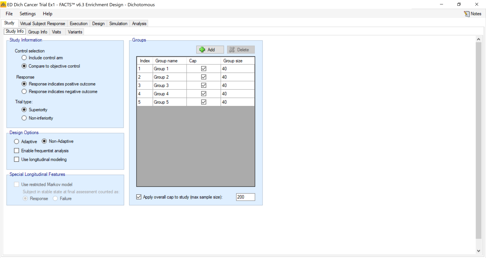

By saying a historical control we will later (Design \> Control Model) specify the historical control rate.

### Group Info

On the group info tab we can specify targets for the group response.

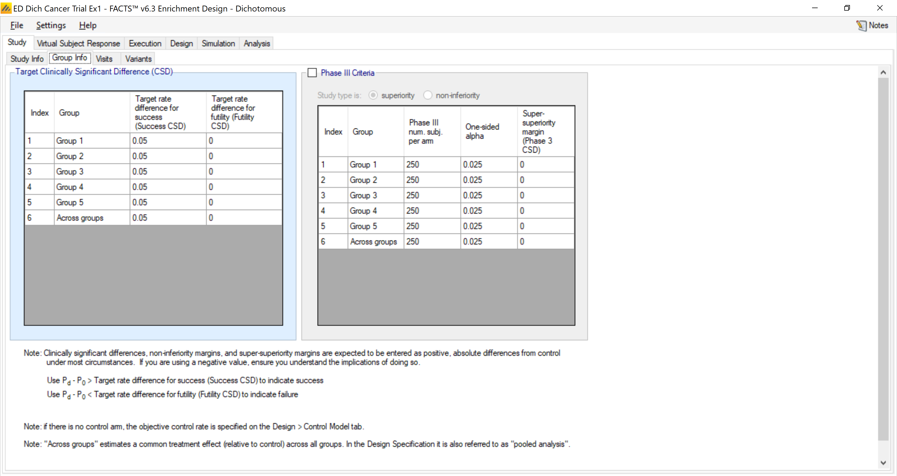

In the group info tab we get to select the values we are declaring for success and futility. These are "differences" from the historical rate of 15% that we are assuming. So, when we say that the *target* rate difference for success is 0.05 this means:

$$\Pr\left(P_d - P_0 > \text{Target}\right) = \Pr\left(P_d - 0.15 > 0.05\right)$$

Likewise for the futility threshold of 0 this means that the *P~d~* is greater than the historical rate (0.15) plus the futility target rate (0) or 0.15.

### Visits

On this tab we define the number and timing of subject visits.

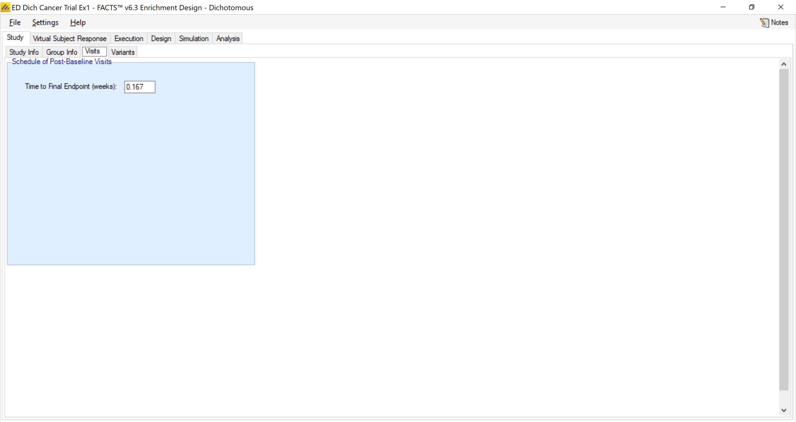

We assume the time-to-response in this example is 0.167 (a little over 1 day -- remember all times in FACTS are weeks). Since this first trial has no adaptations the time-to-response will not matter.

## Virtual Subject Response

On these tabs we define profiles of how the subjects might respond during the trials.

### Group response

Here we specify the 'true' rates of success in each group. You can see on the left we have created 9 different true profiles. These range over null hypotheses (everything the same as the historical rate), to a range with equal probabilities, to a set of mixed profiles, to a pathological case (widly different rates of success) to a scenario with only 1 successful group -- which we refer to as the *nugget*.

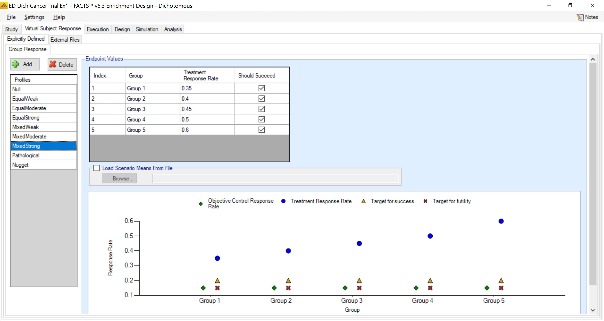

The profiles are:

+-----------------+-------------+-------------+-------------+-------------+-------------+
| **Profiles**    | **Group 1** | **Group 2** | **Group 3** | **Group 4** | **Group 5** |
+=================+:===========:+:===========:+:===========:+:===========:+:===========:+
| Null            | 0.15        | 0.15        | 0.15        | 0.15        | 0.15        |
+-----------------+-------------+-------------+-------------+-------------+-------------+
| EqualWeak       | 0.20        | 0.20        | 0.20        | 0.20        | 0.20        |
+-----------------+-------------+-------------+-------------+-------------+-------------+
| EqualModerate   | 0.30        | 0.30        | 0.30        | 0.30        | 0.30        |
+-----------------+-------------+-------------+-------------+-------------+-------------+
| EqualStrong     | 0.40        | 0.40        | 0.40        | 0.40        | 0.40        |
+-----------------+-------------+-------------+-------------+-------------+-------------+
| MixedWeak       | 0.10        | 0.15        | 0.20        | 0.20        | 0.15        |
+-----------------+-------------+-------------+-------------+-------------+-------------+
| MixedModerate   | 0.20        | 0.25        | 0.30        | 0.35        | 0.30        |
+-----------------+-------------+-------------+-------------+-------------+-------------+
| MixedStrong     | 0.35        | 0.40        | 0.45        | 0.50        | 0.60        |
+-----------------+-------------+-------------+-------------+-------------+-------------+
| Pathological    | 0.01        | 0.25        | 0.50        | 0.75        | 0.99        |
+-----------------+-------------+-------------+-------------+-------------+-------------+
| Nugget          | 0.15        | 0.15        | 0.15        | 0.15        | 0.50        |
+-----------------+-------------+-------------+-------------+-------------+-------------+

## Trial Execution

Under the execution we specify how to simulate key logistical aspects of the trial -- how fast subjects are accrued and their probability of dropping out.

### Accrual

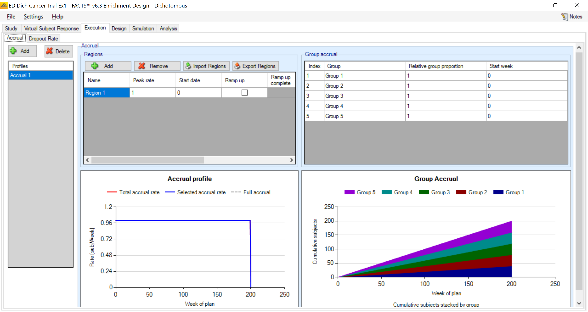

The accrual rate and dropout rates don't affect this design as they are non-adaptive.

### Dropouts

No drop-outs are assumed in these examples.

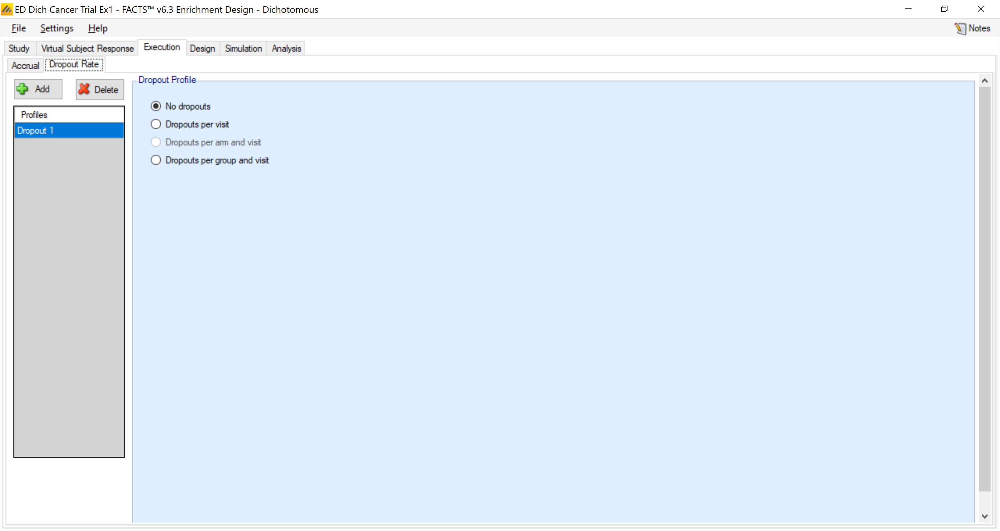

## Design

### Control Model

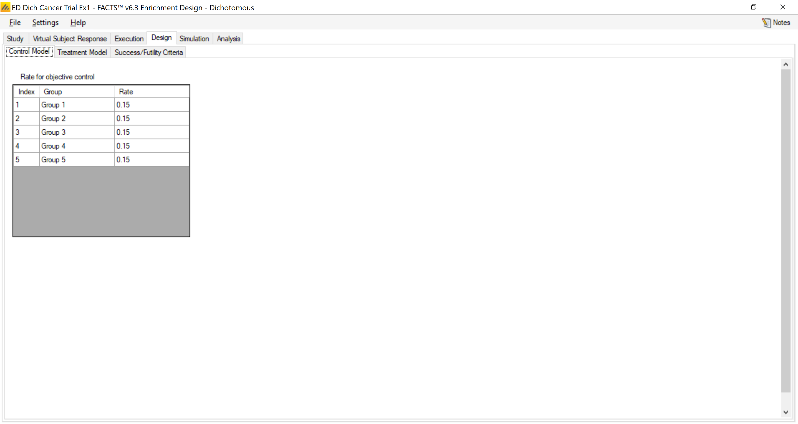

This is the section in which we place the historical rate for each group, and in this example we assume it is 15% (0.15). We are also modeling these as independent in this example. When we later allow borrowing this historical rate will come in to play as a *centering* aspect in the borrowing.

### Treatment Model

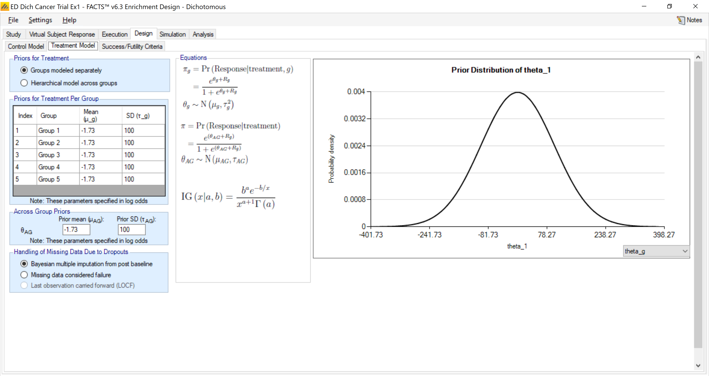

We model the log-odds rate in each arm independently with a prior distribution that is extremely diffuse:

$$\theta_d \sim N\left(-1.73, 100^2\right).$$

This distribution is essentially no prior weight (mean at 0.15) because the standard deviation is so large. The model here is a standard logistic model:

$$\theta_d = \log\left(\frac{P_d}{1 - P_d}\right)$$

The *across groups* box refers to a model that ignores the groups. This is essentially pooling all the groups together in to one group and analyzing that common group. We have selected the same model for this group -- essentially a weak prior.

### Evaluation Criteria

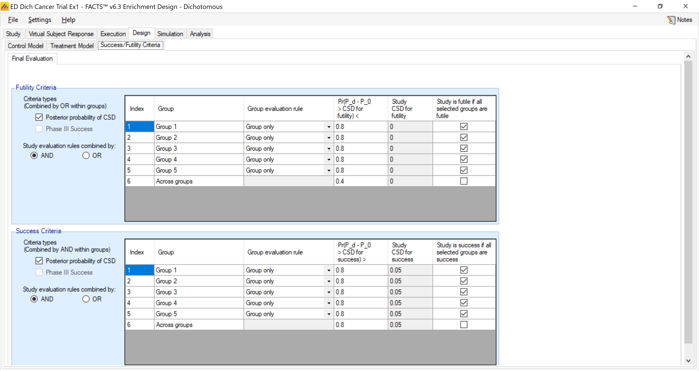

The evaluation tab is quite complex!!! This is good and bad. There is a great deal of flexibility and power to this flexibility, but it is also fairly complex.

- First, you are allowed to use posterior probabilities or predictive probabilities for phase III. Back on the Study:Group Info tab you can create the phase III criteria. We are not using that option in this simulation.

- In this example I want to evaluate each group individually as to whether it is successful or not. Therefore in the "Group evaluation rule" I have specified "Group only". You can have group success depend on what happens in other groups.

- A note on the "Study CSD for success" or "Study CSD for futility": these are the values of "Target rate difference" specified on the "Study:Group Info" tab. Thus they cannot be adjusted here. The probability threshold to label the individual group a success or futility are listed and are editable.

- Lastly you get to determine an overall study conclusion. So, how do you label the study overall (success/inconclusive/futility) when a collection of the groups are labeled in possibly mixed ways? You can select a subset of these by clicking (or not) the very last column. In this example above we have selected each of the group to classify the study as a success or futility -- and on the far left clicked "AND" on how to combine these. So, in the specs above all must be success to label the study as a success and ALL must be a futility in order to label the study thusly.

- We will worry about "success" in this example and not futility. We'll address that in other examples.

## Simulation

For the [results]{.underline} of this design we have simulated 1000 trials:

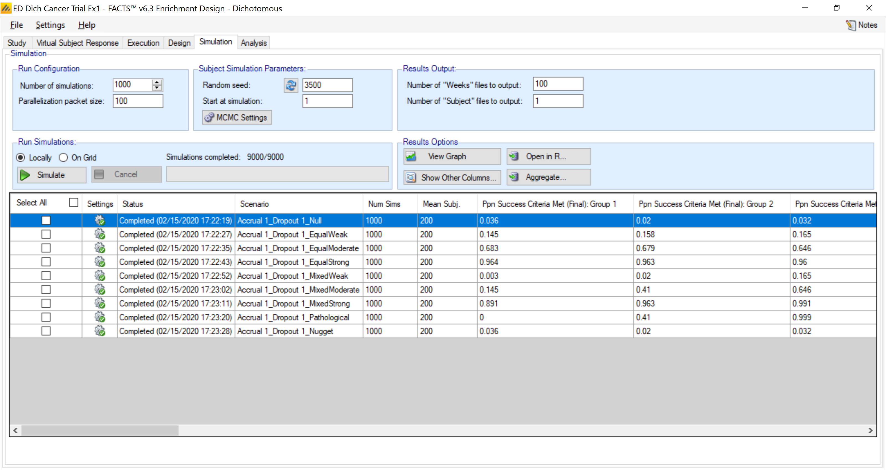

In each case we have used the same seeds.

Recall we defined the trial success to depend on ***all*** the groups being a success (or futility). These probabilities are:

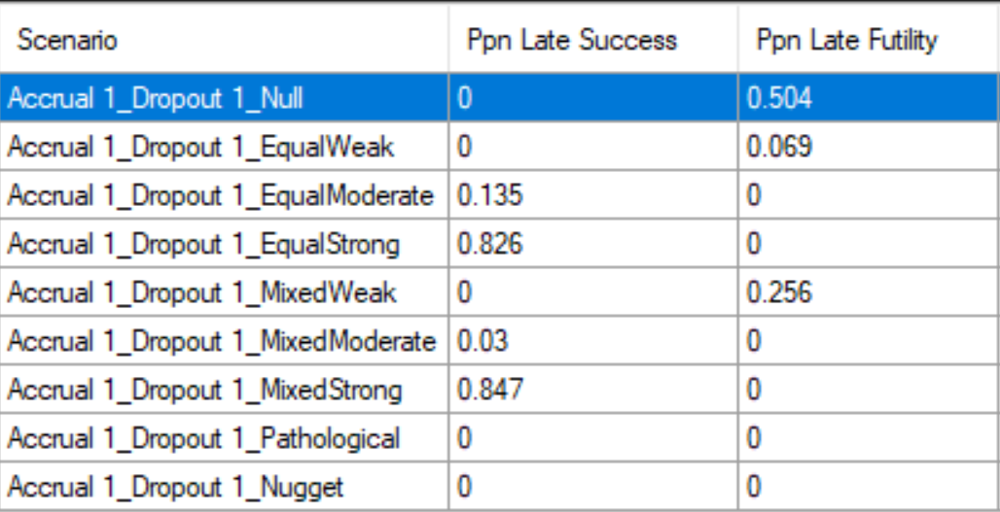

And the probability of success for each group is:

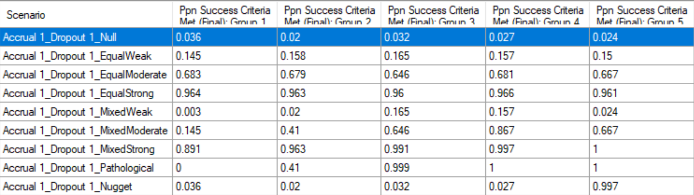

From this table above we have about a 3% type I error rate (for this null that is 5% below the cut-off). For the mathematical null -- which is the "Equal Weak" profile, the type I error is about 16%. Recall there is no borrowing at all between the groups and thus the results are independent for each of the 5 groups. Notice the power for the Equal Moderate profile is about 66%. The results for Group #3 in Mixed Moderate is the exact same 0.646 (true rate of 30%, same as Equal Moderate). Even though the other groups have different rates, the results for this Group 3 are identical in Equal Moderate and Mixed Moderate.

We will later enhance this design by exploring borrowing in the next design.

### Graphs

Here is a look at the graph for the "Mixed Moderate" example. This shows a boxplot of the final probability of being greater than the success CSD of 0.15 + 0.05 = 0.20. The mean of each group is shown by the 'dot' -- which is the value in the table on the top of the previous page.

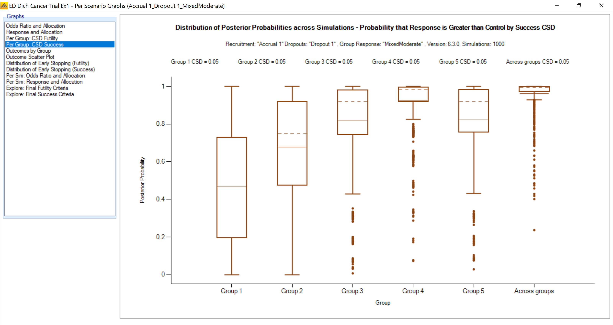\
The following graph presents a bar chart for the final outcome per group:

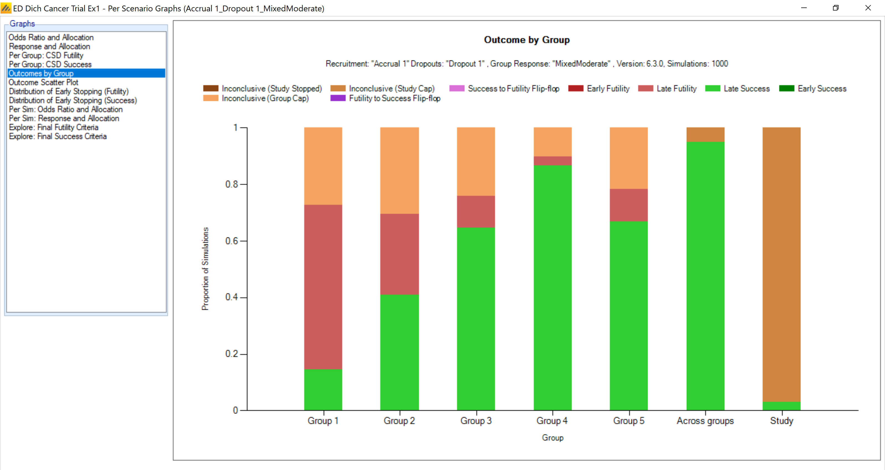

# Design 2

Within the same example we will add in Borrowing. We will label this design Ex1-WithBorrow.

We keep everything the same; just add in a hierarchical model for the estimation of the efficacy across the different groups. This is one change in the screens:

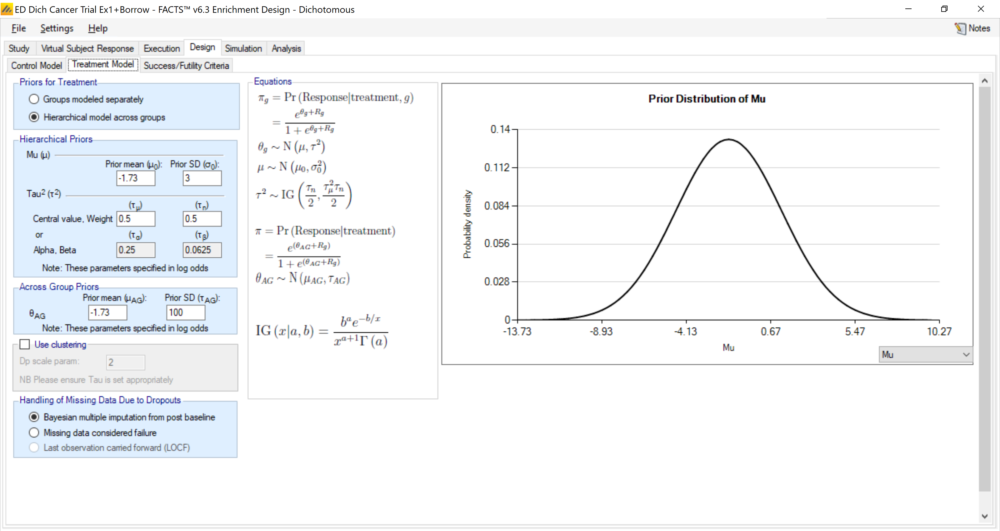

All evaluation criteria remain the same.

The prior on the mean, *μ*, does not have a big impact. The prior selected:

$$\mu \sim N\left(-1.73, 3^2\right)$$

Has a prior mean of the log-odds being --1.73 (15% probability) with a large standard deviation. A change of +3 to the log-odds results in a probability jump from 15% to 78%. Hence this prior carries little weight. The important prior is the one on *τ*. To see this think about the extremes. A value of infinity for *τ* means that there is no borrowing -- the previous example. A value of 0 for *τ* means there is no variability in the log-odds and thus the same estimated log-odds (probability) in each group. [Therefore the value of *τ* is extremely important]{.underline}. The information about *τ* is limited to the number of groups. In this example there are 'only' 5 groups, and thus the prior can be important in the results. In many examples stronger priors for *τ* are used to enforce a certain amount of borrowing.

Here are the results (**with borrowing**)-- read-in through R for the probability of 'success'.

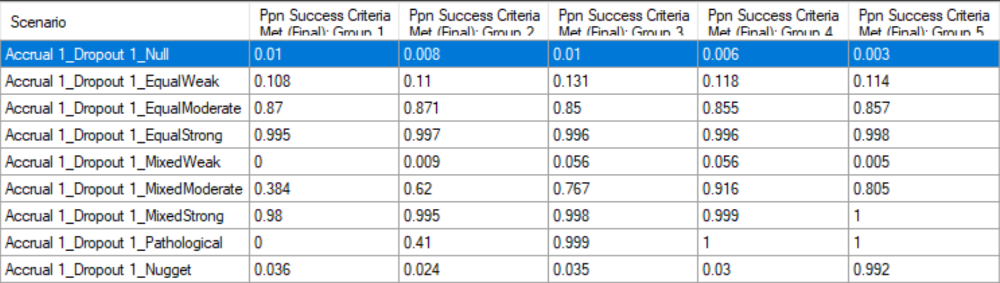

For ease of comparison, here again are the previous results for independent groups (**no borrowing**):

In the 'Null' profile the type I error goes from approximately 3% down to below 1%. In the Equal Weak profile (which is also type I error for the superiority test we are conducting) the probability of an error is cut from approximately 16% down to about 12.5%. Therefore the borrowing has a very strong impact positively on type I error.

In the Equal Moderate profile the power to determine success is approximately 68% for the no borrowing trial and approximately 85% in the borrowing case. Therefore this trial analysis (the design is the same) can result in huge reductions in type I error and significant increases in power.

These mixed cases also present advantages -- [the group rates do not have to be equal]{.underline} for this design to perform well. Notice the Mixed Moderate example. In the no borrowing case for Group 3 -- where the true response rate is 30% \-- the power is 64.6%. In the borrowing example the same Group #3 jumps to a power of 76.7%. The ability to borrow from the additional groups boosts the power for this more than 10%! Interestingly, the rate when all the groups are identical at a response rate of 30% (Equal Moderate) resulted in a power of 85% for Group #3. The case where the Mixed Moderate results is a smaller 'advantage' to borrowing is because there is less borrowing. The variability of the results creates a larger estimate of τ---and thus less borrowing. This is an absolutely critical aspect of the borrowing to understand -- [the amount of borrowing depends on the similarity in the rates across the groups]{.underline}. Not only is there borrowing, but the *amount* of borrowing depends on the heterogeneity present.

Even in the Nugget scenario, the power for the 'nugget'---Group 5---is 0.992 in the borrowing case and 0.997 with no borrowing, barely any loss in power.

Thus the hierarchical model can perform extremely well when the results across group are similar (like the pooling model00 which is correct), perform really well when the results are similar across groups, and perform only slightly worse when there is a nugget treatment arm.

*[Imagine in personalized medicine if we can decrease type I error more than 50% while INCREASING power 15%!]{.underline}*

To understand borrowing more we should look at the results of a single trial result from the Equal Moderate scenario.

From first simulation in the Simulation Results, Observed columns:

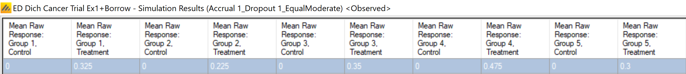

We can see the data that generated the results for the first trial:

+--------------------+---------+----------+----------+---------+----------+
|                    | Group 1 | Group 2  | Group 3  | Group 4 | Group 5  |
+:==================:+:=======:+:========:+:========:+:=======:+:========:+
| Raw Response Rate  | 0.325   | 0.225    | 0.35     | 0.475   | 0.3      |
+--------------------+---------+----------+----------+---------+----------+
| Observed responses | 13/40   | 9/40     | 14/40    | 19/40   | 12/40    |
+--------------------+---------+----------+----------+---------+----------+

The resulting posterior means and standard deviations are shown for the borrowing model:

The following are from the Simulation Results, Response columns. The first figure shows the posterior means and the second the standard deviations.

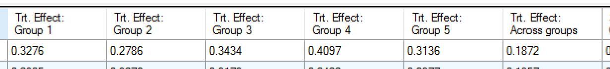

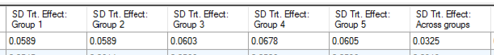

The results for the weeks file from the no borrowing case (because of the same seeds the first trial has exactly the same data). The observed data is the same:

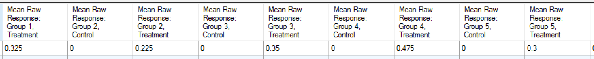

The mean estimated response rates and SDs with no borrowing are:

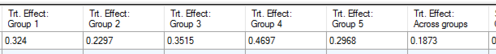

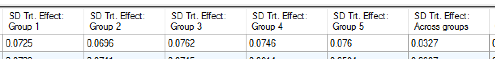

The relevant row is the second one -- which has the result of the final data analysis (the row before is at the end of accrual---so the data is very similar). The posteriors are summarized in the following table:

+--------------+--------------------+---------+---------+---------+---------+---------+
|              |                    | Group 1 | Group 2 | Group 3 | Group 4 | Group 5 |
+:============:+:==================:+:=======:+:=======:+:=======:+:=======:+:=======:+
| Raw Data     | Raw Response Rate  | 0.325   | 0.225   | 0.35    | 0.475   | 0.3     |
+--------------+--------------------+---------+---------+---------+---------+---------+
|              | Observed responses | 13/40   | 9/40    | 14/40   | 19/40   | 12/40   |
+--------------+--------------------+---------+---------+---------+---------+---------+
| Borrowing    | Posterior Mean     | 0.33    | 0.28    | 0.34    | 0.41    | 0.31    |
|              +--------------------+---------+---------+---------+---------+---------+
|              | Posterior SD       | 0.059   | 0.059   | 0.060   | 0.068   | 0.061   |
+--------------+--------------------+---------+---------+---------+---------+---------+
| No Borrowing | Posterior Mean     | 0.32    | 0.23    | 0.35    | 0.47    | 0.30    |
|              +--------------------+---------+---------+---------+---------+---------+
|              | Posterior SD       | 0.073   | 0.070   | 0.076   | 0.075   | 0.076   |
+--------------+--------------------+---------+---------+---------+---------+---------+

Notice the 'regression' or 'shrinkage' that occurs in the borrowing model. Two important aspects. First is the mean value of each moving towards the "middle." The second is the reduced standard deviation. The biggest mover in terms of shrinkage is the Group 2 mean. The mean is increased from 23% to 28%. In each case the probability that the response rate is larger than 0.20 is increased. These probabilities for the **[borrowing]{.underline}** model are:

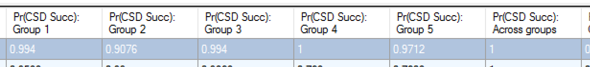

And for no borrowing:

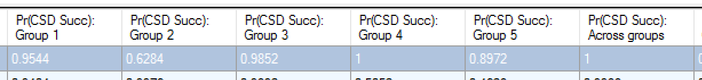

Showing a marked increase in the posterior probability of success for Group 2, and Group 5.
