# Introduction

This tutorial describes an Enrichment trial design where there is one very large subgroup and a number of lesser subgroups, using the FACTS Enrichment Design Engine for a Dichotomous Endpoint. For this version of the document, the screenshots are from the 6.3 release of FACTS.

The screenshots provided are approximate and may not reflect the exact layout of the information. The contents of each tab, however, will be consistent with the software.

The designs presented are examples and may not be optimally calibrated.

# Design Features

This tutorial demonstrates how to manage differences in group sizes in an enrichment design.

# ED Dichotomous Example with a Dominant Group

In this example we explore a design with 4 groups where one of the groups is "dominant" and contains half of the population. We need the drug to be successful in this dominant group or the drug will be declared a failure, regardless of the outcomes in the smaller groups.

To this end, we intend to stagger enrollment. For the first year we will only enroll patients in the dominant group 1. When we have acquired 200 patients (we expect this to occur near the end of the first year) we conduct an interim analysis. If the drug appears successful in group 1 at this interim analysis, we will continue the trial, opening up the other groups at one year, and enrolling to 500 patients. If the interim analysis shows that group 1 is not successful, we will discontinue the trial as futile.

To avoid group 1 completely dominating the results, we place restrictions that group 1 can enroll no more than 300 patients, while groups 2-4 may enroll no more than 67 patients.

The endpoint here is dichotomous and observed at 13 weeks, with events being beneficial (higher rates are desired)

# The Design

In this first design we will explore a fixed single arm trial design with a 'standard' independent analysis model. We will assume a fixed sample size of 40 in each group.

Start FACTS. Double Click: Enrichment Design - Dichotomous.

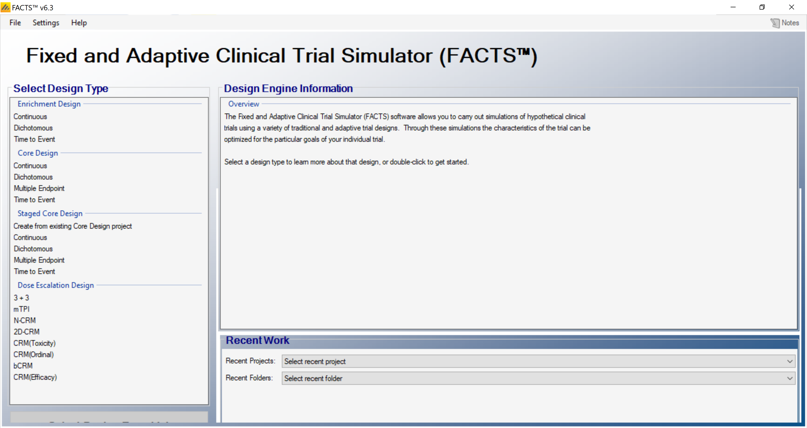

Using the menu option File \> Save As, save this design as ED-Dominant-Group in a convenient location (e.g. in a folder called FACTS\\ED-dich-example in your 'My Documents' folder).

## Study

### Study info

Under the study info tab we define

- Whether comparison will be against a control arm, or an Objective Control (or "Historical") level of response.

- Whether a response rate indicates a subject is improving or deteriorating.

- The design options we wish to use:

  - An adaptive or non-adaptive design

  - Frequentist Analysis (or only Bayesian)

  - Longitudinal modelling (and hence subject intermediate visits)

  - Whether longitudinal data should be modelled as following a restricted Markov.

- How many groups there are in the analysis and whether we wish to cap enrolment into any group.

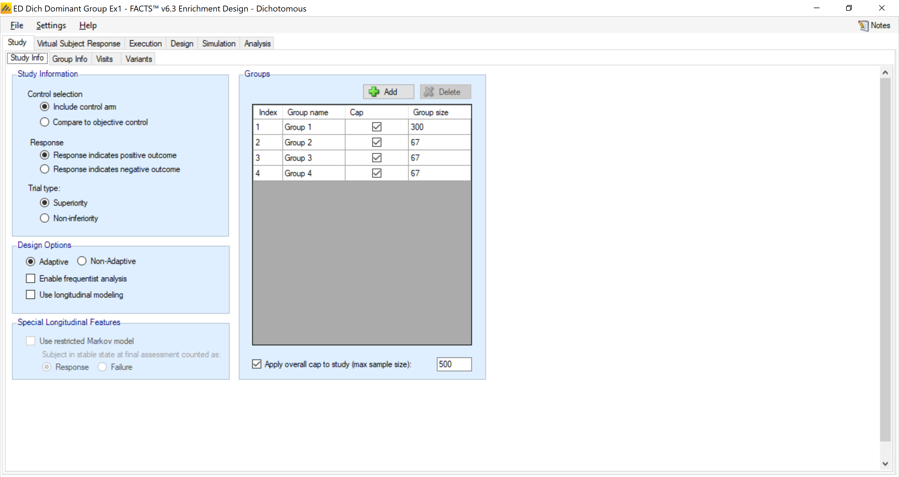

In this example we include a control arm for each group and place the appropriate group caps on enrollment. This trial is also adaptive because of the interim analysis at 200 subjects. We will not be using longitudinal modeling or frequentist analysis so we ensure this are not checked.

### Group Info

In the Group Info tab the target differences for success and futility are both 0 (we are interested in a straight superiority trial) and we do not utilize phase III criteria.

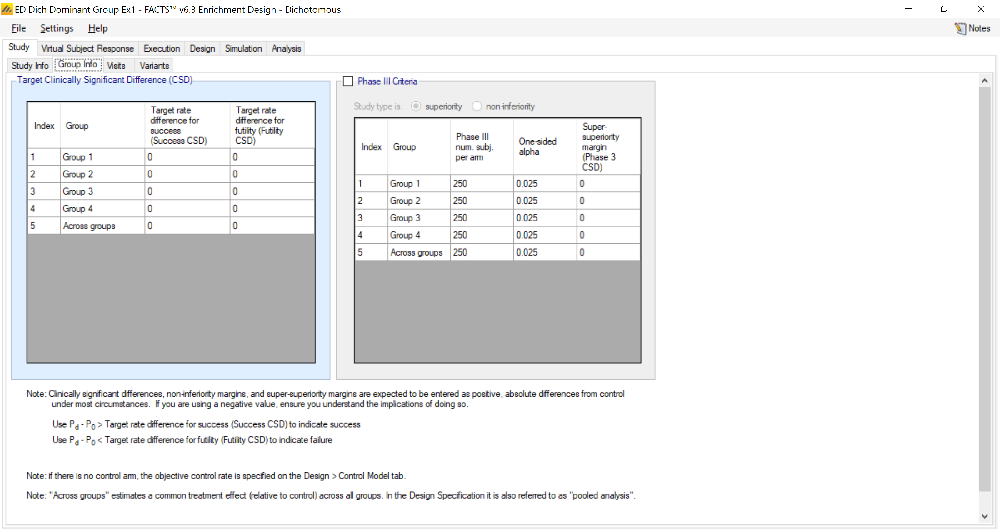

Under the visits tab, we note the endpoint is observed at 13 weeks.

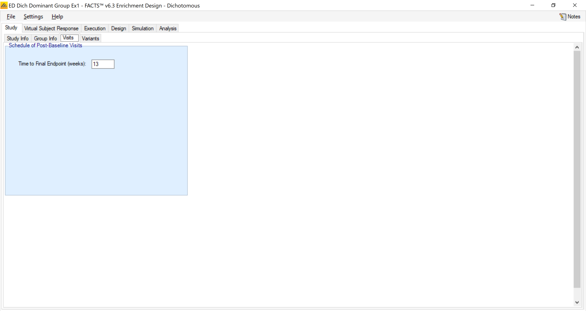

## Virtual Subject Response

### Group Response

We create 5 response profiles of how subjects might respond to treatment in order to test and calibrate our design.

In all control groups we assume a control rate of 25%. The treatment response will vary according to the profile. For example, the "all null" scenario results in no change in any group, while the "all groups good" scenario results in treatment rates of 40% in every group.

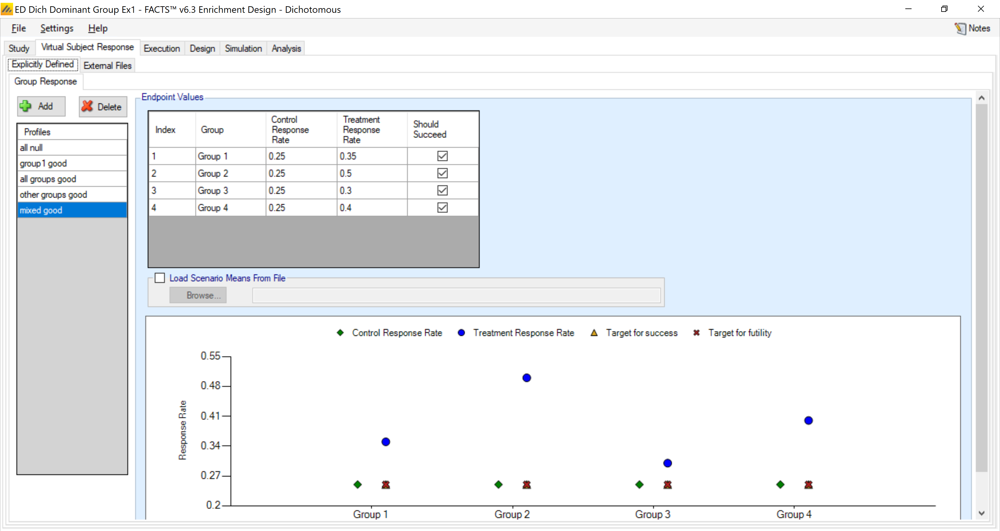

All the VSR profiles are shown in the table below.

+----------+----------+--------------+-----------------+-------------------+------------+
| Scenario | All Null | Group 1 Good | All Groups Good | Other Groups Good | Mixed Good |
+==========+==========+==============+=================+===================+============+
| Group 1  | 0.25     | 0.40         | 0.40            | 0.25              | 0.35       |
+----------+----------+--------------+-----------------+-------------------+------------+
| Group 2  | 0.25     | 0.25         | 0.40            | 0.40              | 0.50       |
+----------+----------+--------------+-----------------+-------------------+------------+
| Group 3  | 0.25     | 0.25         | 0.40            | 0.40              | 0.30       |
+----------+----------+--------------+-----------------+-------------------+------------+
| Group 4  | 0.25     | 0.25         | 0.40            | 0.40              | 0.40       |
+----------+----------+--------------+-----------------+-------------------+------------+

The design does not include intermediate observations of patients so there is no longitudinal response to simulate

## Trial Execution

Under the execution we specify how to simulate key logistical aspects of the trial -- how fast subjects are accrued and their probability of dropping out.

### Subject Accrual

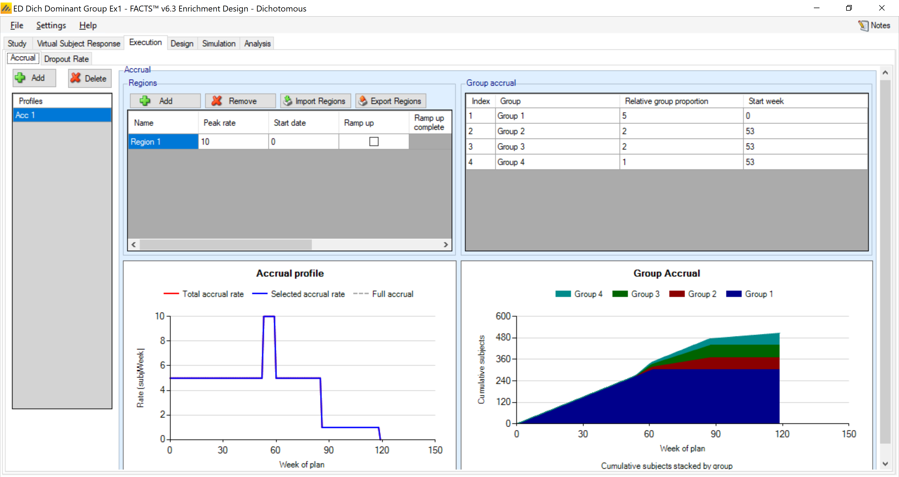

We have the potential to accrue 10 patients per week, with 50% from group 1, 20% from each of groups 2-3, and 10% from group 4. However, we are only opening the trial to group 1 for the first year, so groups 2-4 do not start until week 53.

Note when graphing accrual, FACTS accounts for group percentages and caps. Thus, the cap of N=300 produces an expected stopping time around week 60 for group 1, after which we are only enrolling groups 2-4. This reduces the accrual rate in the trial as we can no longer enroll the group 1 subjects. Purely on the basis of expected value, we expect the last weeks of the trial to only enroll group 4, the rarest group in the population and thus the slowest to reach cap.

### Dropouts

On the dropout tab, we assume no dropouts.

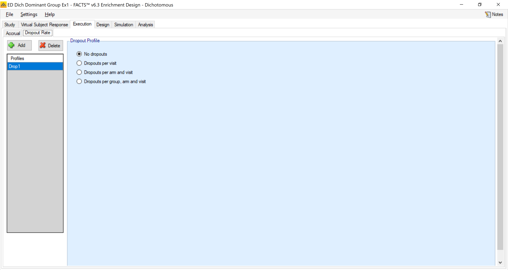

## Design

### Control Model

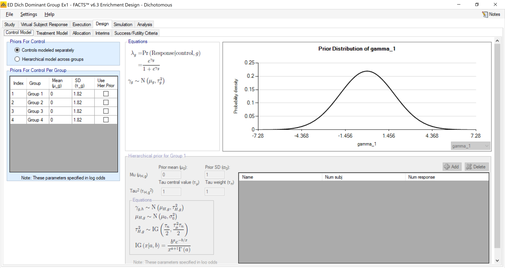

Within each treatment group we place a N(0,1.82) prior on the logit of the control rate. This is roughly equivalent to a uniform distribution on the control rate.

### Treatment Model

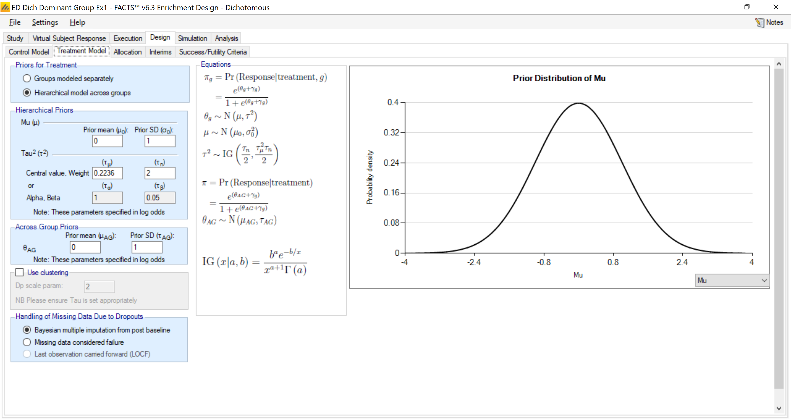

For the treatment model we use moderate borrowing, placing a weak N(0,1) prior on μ and a moderately strong IGamma(1,0.05) prior on τ^2^. Note the prior on τ^2^ needs to be calibrated on the basis of the scale of the data.

### Allocation

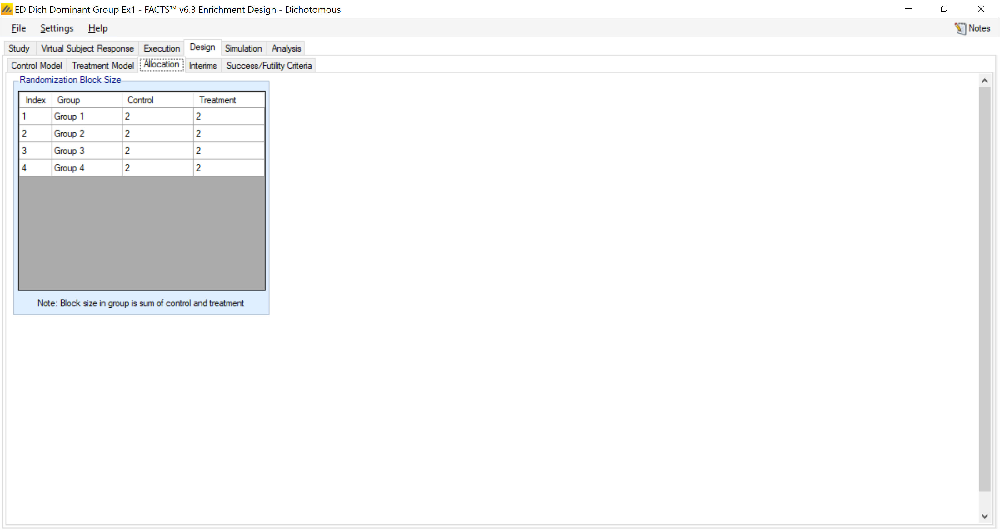

We allocate subjects equally within block of 4 subjects (this is done separately within each group).

### Interims

We conduct one interim analysis at N=200 enrolled, and there will be a final analysis at the study cap specified on the Study Info tab, (N=500 complete).

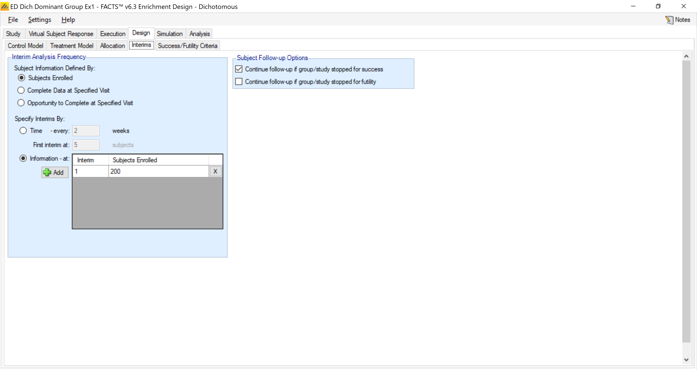

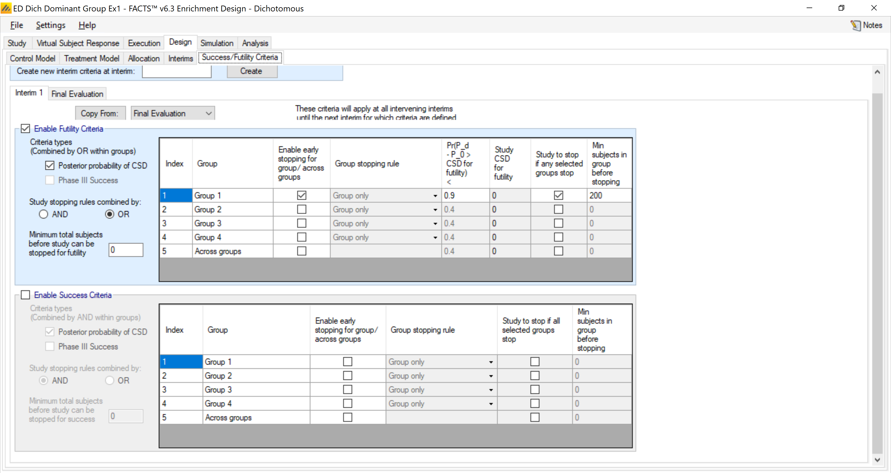

Recall we have timed the interim analysis (based on the accrual pattern) to occur when N=200 subjects in group 1 are accrued. At that interim we enable early stopping solely on the basis of group 1. The trial (both the group and the trial) is declared futile if the probability treatment is superior to control is less than 90%. We have selected "Study stopping rules combined by: OR" to give "study to stop if any selected groups stop" in order to give group 1 "control" over the study.

### Final Evaluation Criteria

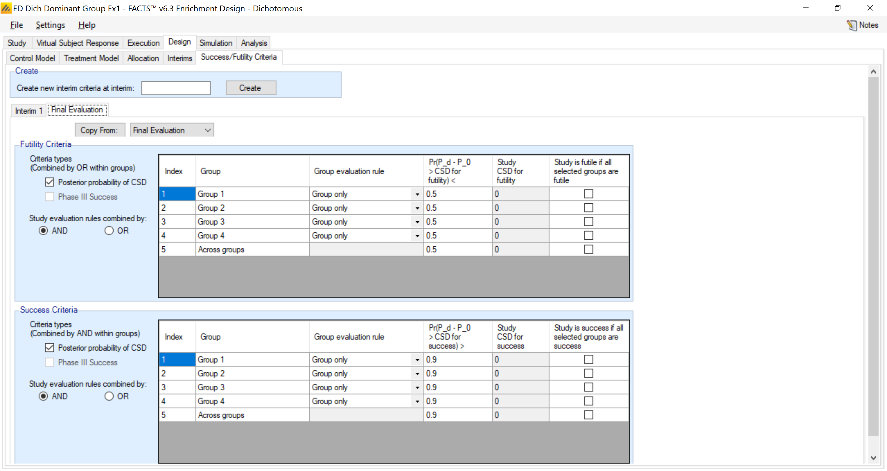

If the futility criteria is not met at the interim, the trial continues to full enrollment at N=500, where we have a more nuanced view of success. Here we will measure success within each group (all 4 groups will have patients at that point). Thus there are four separate decisions, one of success or failure within each group. Each group is declared a success if the probability treatment is better than control is greater than 90%, while the group is declared a failure if the probability treatment is better than control is less than 50%. Values between 50% and 90% are listed as inconclusive.

Note that we have not defined "study" success or futility criteria, only group criteria. To specify study success or futility criteria we would have to specify which groups' success or futility (including "Across Groups") determine study success or futility, but have left them all unchecked.

## Simulation

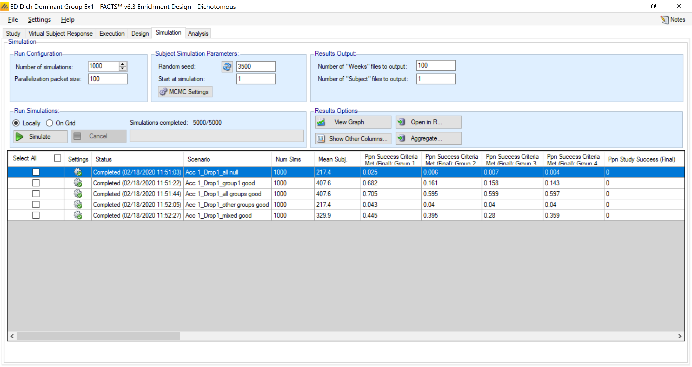

We run 1000 simulations. Note the only two possible sample sizes are 200 or 500, so the expected sample size gives us a glimpse at how often the trial continues to full enrollment.

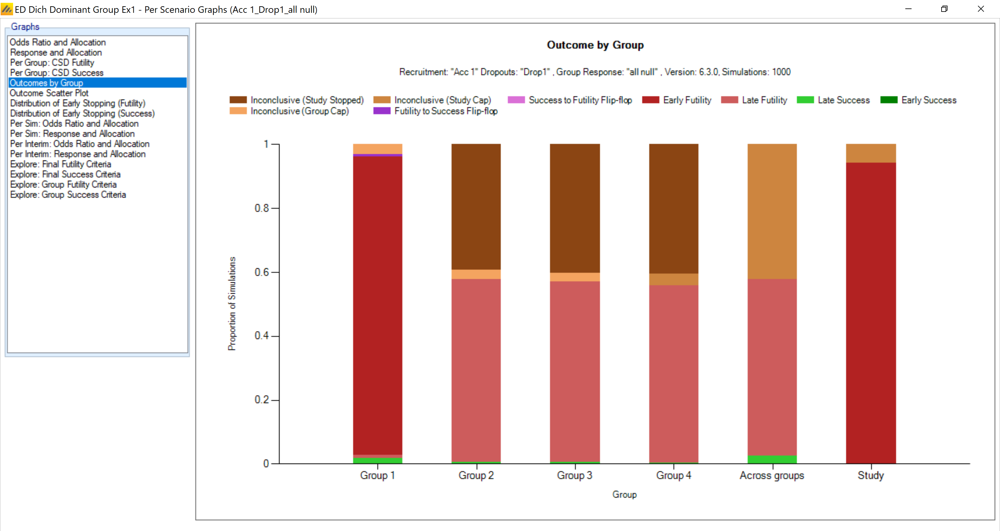

In the null case, we can see that most trials are declared futile early, with a small number continuing to full enrollment. Of those, none are declared successful. The labels on the remaining groups 2-4 are somewhat uninformative given that in most cases no data is observed in those groups by design.

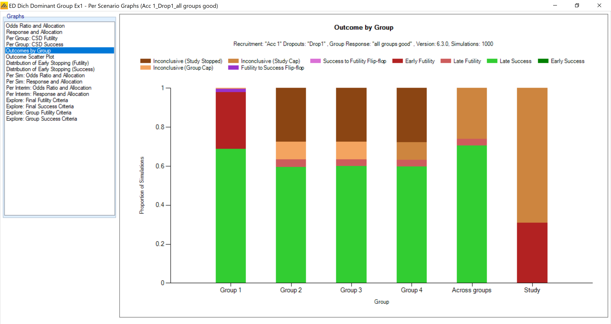

When all the groups are good (treatment rate 40%) it is still difficult to achieve the fairly high bar at N=200, and thus we have a fair amount of early futility in the trial. However, trials that continue are largely successful, and the borrowing results in reasonably high powers for the minimal sample of N=75 in the other three groups.

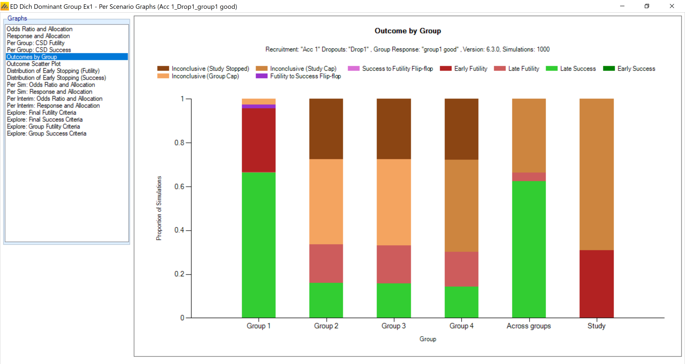

When group 1 is good but the other groups are ineffective, the borrowing does not overwhelm the results. Groups 2-4 are still rarely incorrectly declared successful. While the type I error for these groups is slightly increased from the 10% one might expect with the posterior probability cutoff of 90%, this comes with the benefit of greatly increased power.
