# Introduction

This tutorial describes the biomarker example trial design using the FACTS Enrichment Design Engine for a Time-to-Event Endpoint. For this version of the document, the screenshots are from the 6.3 release of FACTS.

The screenshots provided are approximate and may not reflect the exact layout of the information. The contents of each tab, however, will be consistent with the software.

The designs presented are examples and may not be optimally calibrated.

# Design Features

This tutorial demonstrates the impact of groups of different size and different prevalence in the population.

It uses simple hierarchical models across groups for both the control hazard rate and the treatment hazard ratios, showing the benefits of these approaches.

It uses a single interim for futility to stop the trial if the largest subgroup is ineffective.

# Enrichment Design (ED) Time-to-Event Example

This example illustrates the use of FACTS ED to design a trial with a time to event endpoint in which the subgroups are defined by the presence or absence of a set of genetic mutations. For concreteness, you can think of this example in the context of treatment for aggressive metastatic colorectal cancer (which is the setting this example is based on) with the endpoint referring to overall survival time. We will consider 8 patient subgroups formed by the presence or absence of mutation on 3 genes (e.g., KRAS, BRAF, etc.). We will generically refer to the genetic markers as G1, G2, G3 each of which can be Mutated (X), or not (W, for Wildtype). So the {G1,G2,G3} status collectively define 8 subgroups which we denote by WWW, WWX, WXW, WXX, XWW, XWX, XXW, XXX. (Which is to say, for instance, that a patient with G1=X, G2=W, G3=W would be in the XWW group.)

In this setting the treatment is considered to very likely be effective in subgroups with one or more genetic signatures, and possibly ineffective in the others. The objective of the trial is to efficiently identify the subgroup(s) in which the treatment has a clear benefit and discontinue those that respond poorly. The focus of this example will be to demonstrate the ability to simulate trials of this kind (and to also illustrate the functionality available in the FACTS-ED with a TTE endpoint).

We expect that if the treatment works well in some subgroup, it will work very well. Hence we will consider a design that conducts several interim analyses of the accruing data and stops (for futility) subgroups that do not appear to respond well. We will demonstrate how one can use FACTS to explore the operating characteristics of such a trial strategy.

We will assume here that the baseline (control) hazard is constant and the same across all subgroups and corresponds to a median survival time of 8 weeks.

We also take the expected prevalence in the enrolled population of the genetic signatures defining the subgroups to be as follows:

+-----------------------------------+----------------------------------+
| Subgroup                          | Prevalence                       |
+:=================================:+:================================:+
| WWW                               | 30%                              |
+-----------------------------------+----------------------------------+
| WWX                               | 20%                              |
+-----------------------------------+----------------------------------+
| WXW                               | 10%                              |
+-----------------------------------+----------------------------------+
| WXX                               | 5%                               |
+-----------------------------------+----------------------------------+
| XWW                               | 15%                              |
+-----------------------------------+----------------------------------+
| XWX                               | 10%                              |
+-----------------------------------+----------------------------------+
| XXW                               | 5%                               |
+-----------------------------------+----------------------------------+
| XXX                               | 5%                               |
+-----------------------------------+----------------------------------+

Since we are looking for strong subgroup effects here, we will consider a treatment hazard ratio relative to control of 0.80 or greater as unsatisfactory and will be considered a failure in the subgroup.

# The Design

In this first design we will explore a fixed single arm trial design with a 'standard' independent analysis model. We will assume a fixed sample size of 40 in each group.

Start FACTS. Double Click: Enrichment Design -- Time to Event.

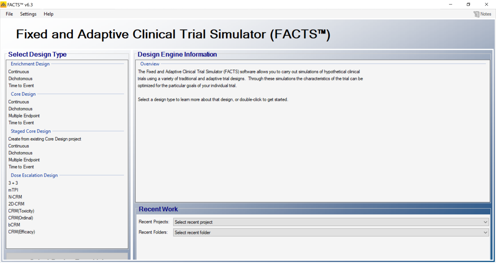

Using the menu option File \> Save As, save this design as ED-Biomarker in a convenient location (e.g. in a folder called FACTS\\ED-TTE-example in your 'My Documents' folder).

## Study

### Study Info

Under the study info tab we define

- Whether comparison will be against a control arm, or an Objective Control (or "Historical") level of response.

- Whether events indicate a subject is improving or deteriorating.

- The design options we wish to use:

  - An adaptive or non-adaptive design

  - Frequentist Analysis (or only Bayesian)

  - Whether subjects are all followed up for the same length of time (per-subject follow up) or there is a cap on follow-up beyond the end of full accrual -- so subjects accrued earlier are followed up for longer.

- How many groups there are in the analysis and whether we wish to cap enrolment into any group.

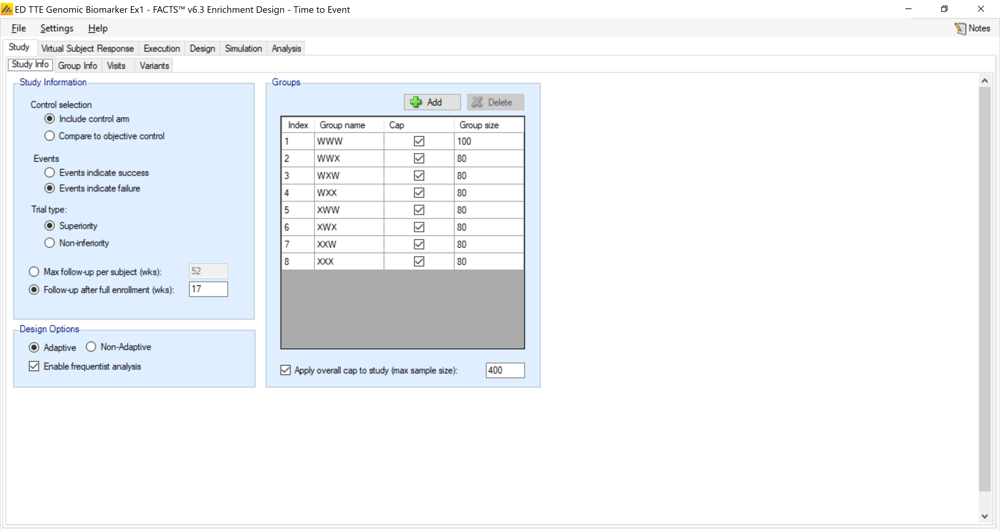

- TTE requires that you specify either the maximum time that each subject is followed up, or how long you will follow up subjects after the final subject has enrolled. Here we limit follow up to 17 weeks after full enrolment.

- The trial is intended to run with a maximum of 400 patients. Groups caps are specified to allow every group to have as many subjects as possible. Here we limit most to 80 subjects -- in part to help prevent any one group from dominating.

- 

### Group Info

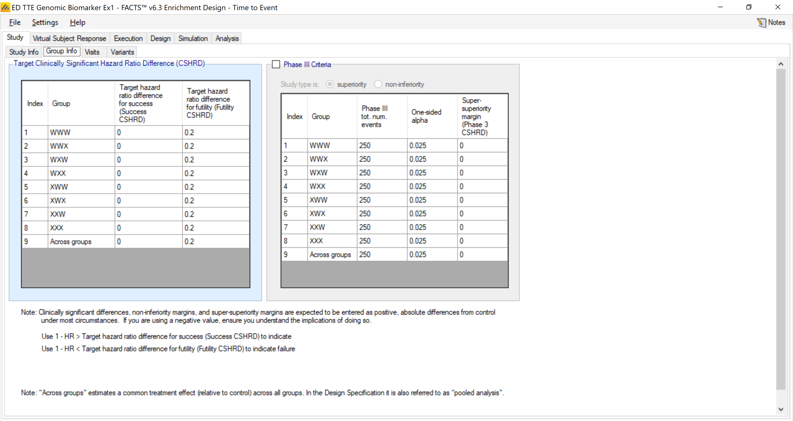

- As in the other engines, prediction of Phase3 success may also be used for decision making, but we will not be using it here.

- The clinically significant target HRs to determine success and futility can again be specified separately. The target HR is expressed as a 'margin' -- a difference from 1. So here we have a target HR of 0.80 for futility stopping and so specify a target Clinically Significant Hazard Ratio Difference of 0.2 to be used in the futility criteria.

### Visits

In this trial event's the timing of events will be known, we will not be restricted to subject's interim visits to observe them.

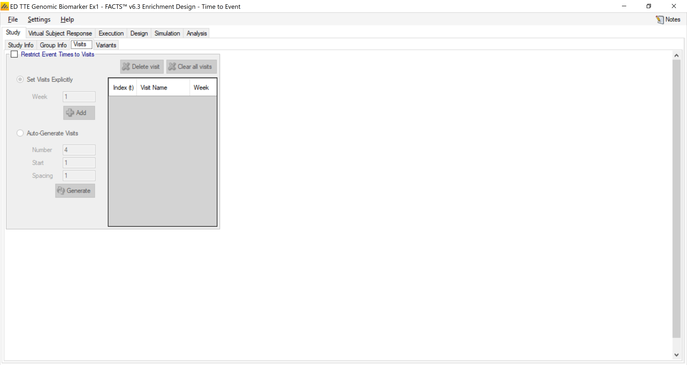

## Virtual Subject Response

On these tabs we define profiles of how the subjects might respond during the trials.

### Control Hazard Rates

Unlike other endpoints, in Time-to-Event we specify the simulation of the response on the control arm separately. This is because we are going to specify the response on the treatment arms as simply Hazard Ratios.

We assume a constant hazard rate so only have one time segment for the simulation of the control hazard rate.

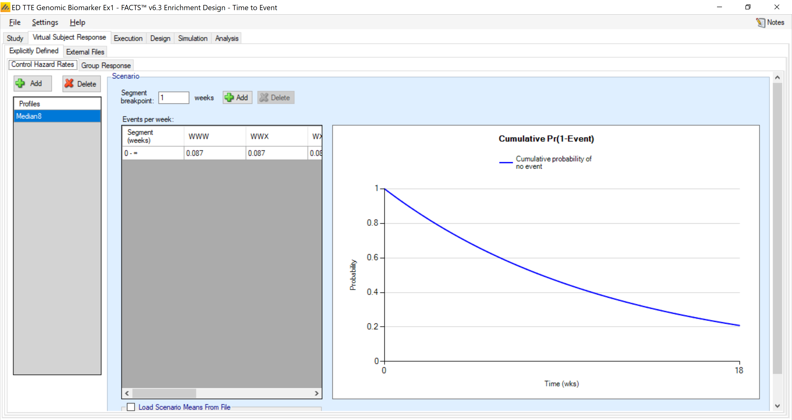

For each group we specify the same control hazard rate of 0.087 (corresponding to a median survival time of 8 weeks).

### Group Response

Here we specify the 'true' Hazard Ratios compared to control in each group. You can see on the left we have created 5 different true profiles. These range over null hypotheses (everything the same as the historical rate), to a range with equal probabilities, to a set of mixed profiles where there is a treatment effect in different subgroups.

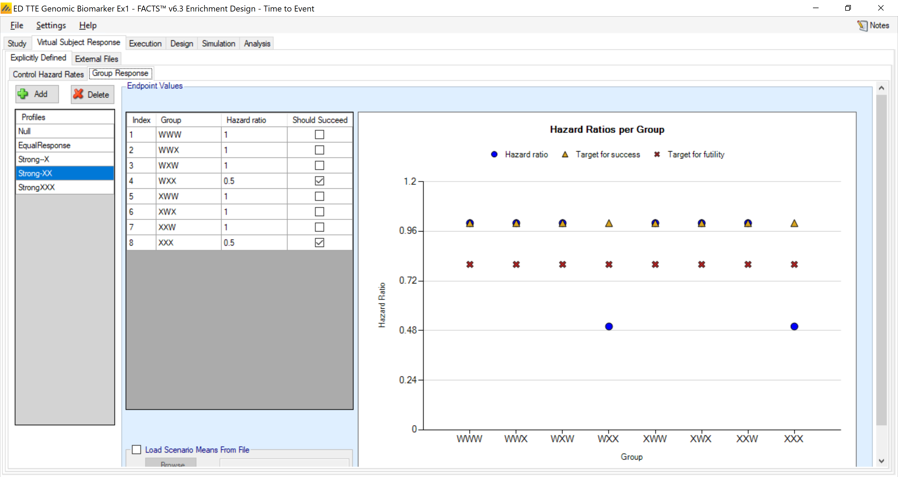

The profiles are:

+---------------+---------+---------+---------+---------+---------+---------+---------+---------+
| **Profiles**  | **WWW** | **WWX** | **WXW** | **WXX** | **XWW** | **XWX** | **XXW** | **XXX** |
+===============+:=======:+:=======:+:=======:+:=======:+:=======:+:=======:+:=======:+:=======:+
| Null          | 1       | 1       | 1       | 1       | 1       | 1       | 1       | 1       |
+---------------+---------+---------+---------+---------+---------+---------+---------+---------+
| EqualResponse | 0.5     | 0.5     | 0.5     | 0.5     | 0.5     | 0.5     | 0.5     | 0.5     |
+---------------+---------+---------+---------+---------+---------+---------+---------+---------+
| Strong\--X    | 1       | 0.5     | 1       | 0.5     | 1       | 0.5     | 1       | 0.5     |
+---------------+---------+---------+---------+---------+---------+---------+---------+---------+
| Strong-XX     | 1       | 1       | 1       | 0.5     | 1       | 1       | 1       | 0.5     |
+---------------+---------+---------+---------+---------+---------+---------+---------+---------+
| StrongXXX     | 1       | 1       | 1       | 1       | 1       | 1       | 1       | 0.5     |
+---------------+---------+---------+---------+---------+---------+---------+---------+---------+

We simulate a Null case and, as a reference (this might not actually be expected) we simulate the case where there is a strong and equal effect in all groups.

Strong---X represents the case when the patients with G3 mutation have a have a strong treatment effect (irrespective of their G1 and G2 status). And there is no treatment effect for the others.

Strong-XX represents the case when the patients with G2=X and G3=X signature have a have a strong treatment effect (irrespective of their G1status). And there is no treatment effect for the others.

The final profile, StrongXXX, represents the case when the patients with {G1=X, G2=X and G3=X} signature have a have a strong treatment effect. And there is no treatment effect for the others.

## Trial Execution

### Accrual

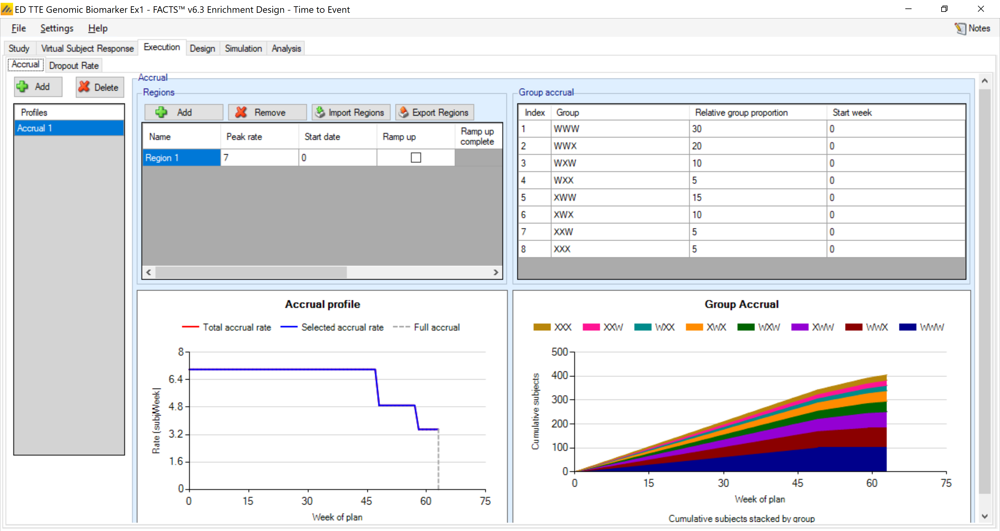

Here we specify the accrual rate of 7 patients per week. This is also the tab in which we input the group enrolment start times (here all subgroups start enrolling at week 0) and the relative prevalence of the subgroups. Note that the accrual rate of 7/week is for all subgroups enrolling. If one or more subgroups are stopped early then the accrual rate will drop depending on how rare the remaining subgroups are.

### Dropout Rate

We do not simulate dropouts for this example.

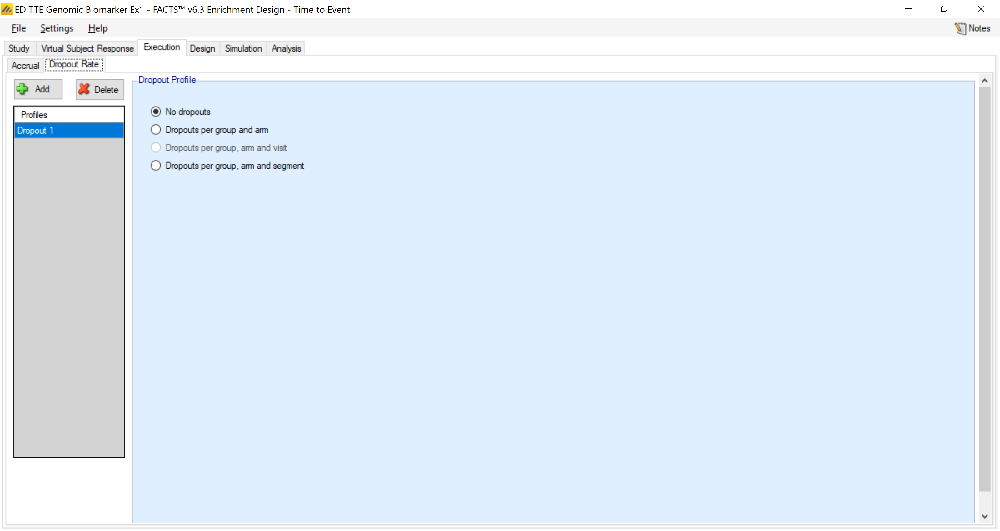

## Design

### Hazard Model

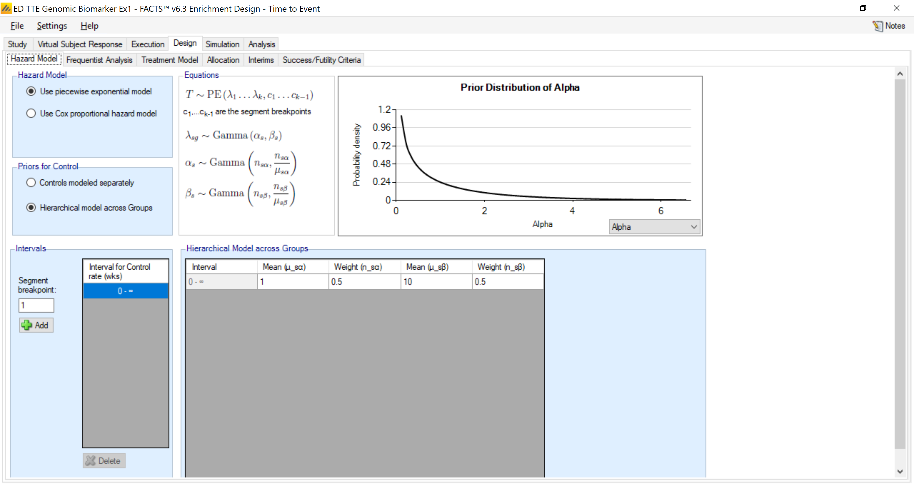

For the analysis model, we can use a piecewise exponential model for the baseline hazard function for each group. We specify a single segment which corresponds to a constant hazard rate (simple exponential model). Here we also specify a hierarchical model to borrow across groups for the estimation of the group-wise hazard rates. The gamma-based hierarchical model for *γ*'s is as shown in the equation tab. We use a setting here that uses mild borrowing. But we do not discuss much of that here since it isn't the major objective of this example.

### Frequentist Analysis

The frequentist analysis tab allows us to specify the Alpha values to use for the various p-value tests. Here we leave them all at 0.05 two-sided.

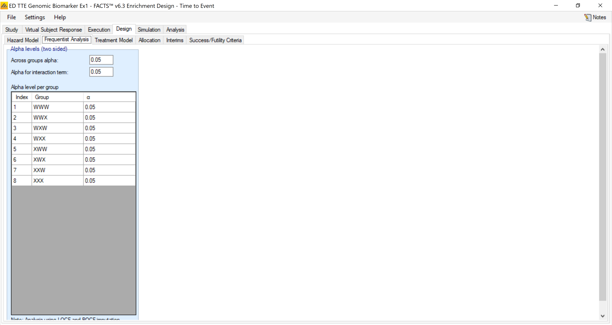

### Treatment Model

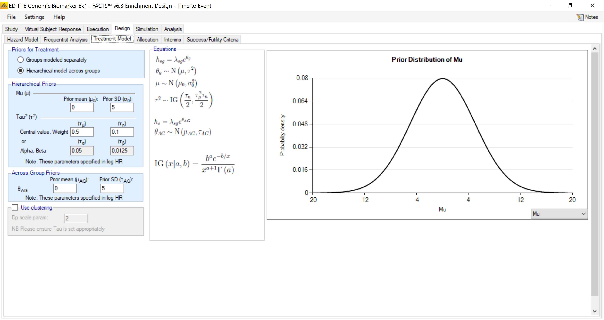

The analysis model for the treatment effects in each group, is again formulated as a piecewise exponential -- the baseline hazard is proportionally multiplied by a factor (the hazard ratio, HR, of the treatment relative to control) as shown in the first equation in the equation panel.

Borrowing across groups is done using a hierarchical normal model on the log(HR) for each group. Again, we have set it up here for some mild borrowing.

### Allocation

We use 1:1 allocation Control:Treatment in each group in blocks of 6 subjects.

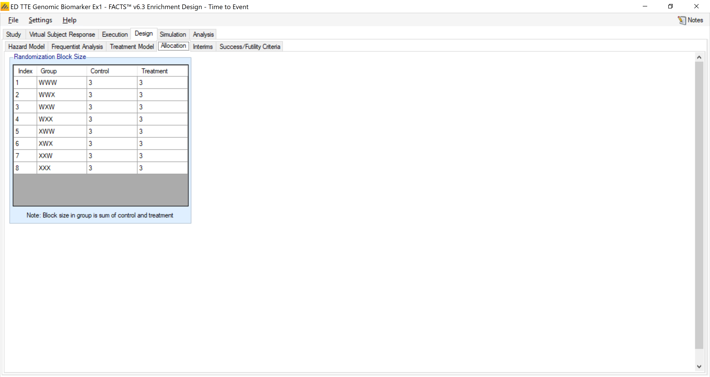

### Interims

We will also conduct interim analysis every 6 weeks (after the first 100 patients have accrued) to determine if any subgroup should be discontinued for futility. We indicate here that we will discontinue follow-up for subjects on a subgroup that is stopped for futility, and also discontinue interims after full accrual. (We will not be using early stopping for success here, so the "continue follow-up" option for success is irrelevant in our case.)

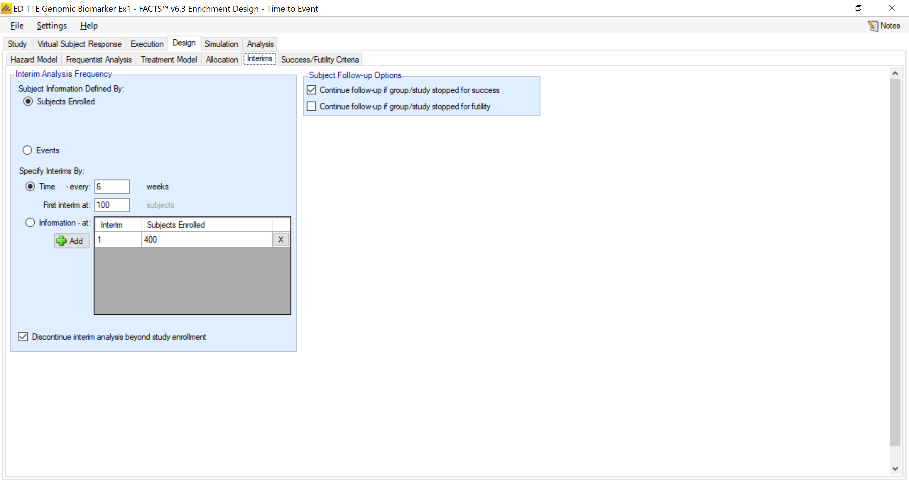

### Stopping Criteria

In this example, we use early futility stopping as the primary adaptation. We will focus on the individual group stopping behavior here. In the upper half of the tab, we indicate that any group should stop for futility if Pr(1-HR \> CSHRD of 0.2) \< 0.15.

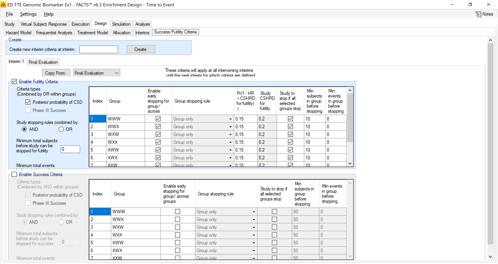

### Final Evaluation Criteria

We also set the criteria for evaluating group success at the end of the trial. We set that as success if Pr(1-HR \> 0) \> 0.90. whereas end of study futility will be if Pr(1-HR \> 0.2) \< 0.2. The study will be futile if all groups are futile and the study will be a success if any group is a success.

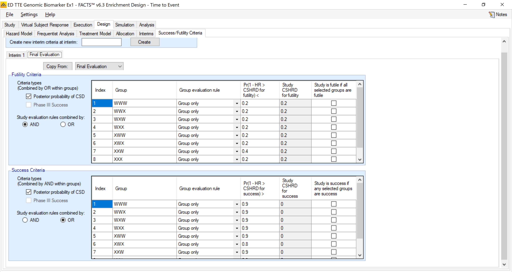

##  Simulation

We simulated 1000 trials in each profile. These are longer simulations as analyses are being done every 6 weeks. It took approximately 20 minutes per profile for 1000 simulations.

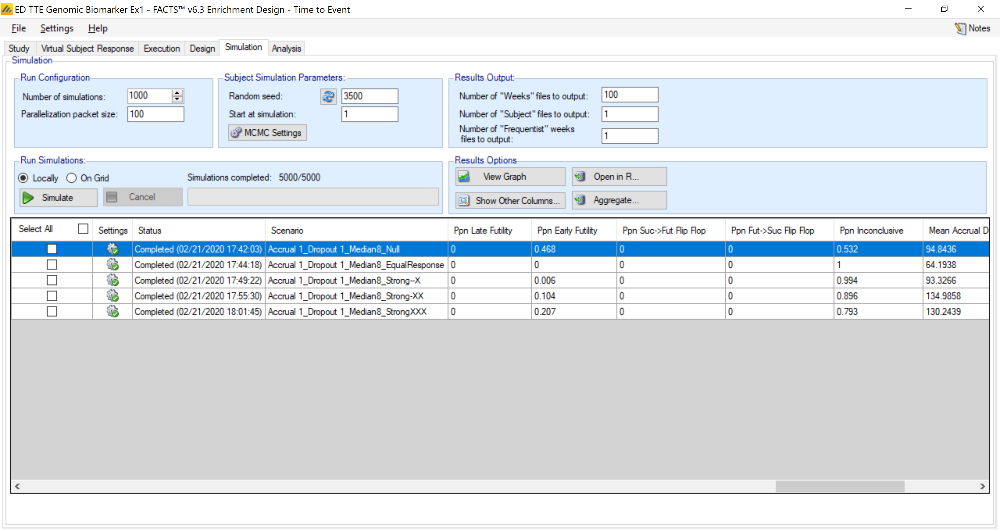

In the null hypothesis the design is able to stop for futility \~50% of the time, with a mean sample size of \~290.

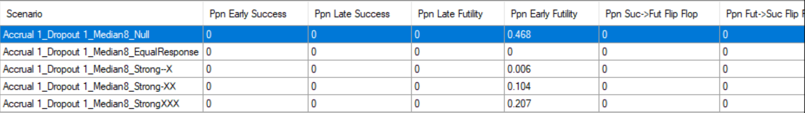

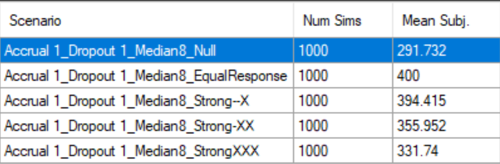

Looking at each of the individual group responses, we see that each group is dropped for futility about 80% of the time (with all together being dropped 46.8% of the time). Late success is about 5% for each of the individual groups.

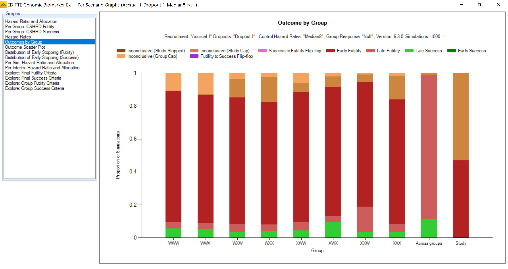

For the scenario where all the arms work, and work well (Equal Response) the overall conclusions by group are very good. Almost every trial continues with ALL arms and results in success in each of the arms:

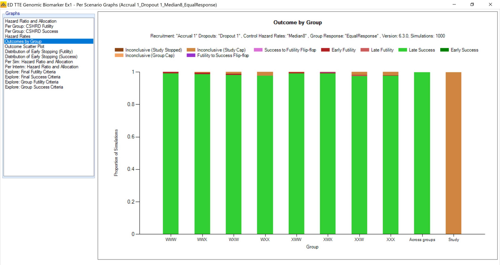

When the effect is isolated to the mutation on the 3^rd^ gene (\*\*X) the results are

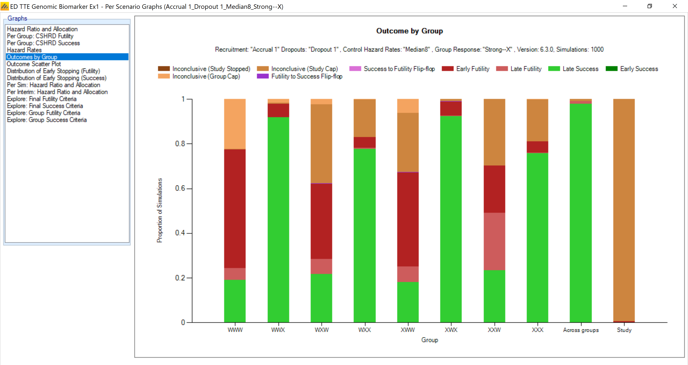

The arms with a mutation (X) on the third gene have a 80-95% chance of success. The arms that have 0 effect have about a 20% chance of success. The design does pretty well at distinguishing the groups that have an effect. The sample size on the arms with the positive effects are also elevated compared to the design with all equal positive effects:

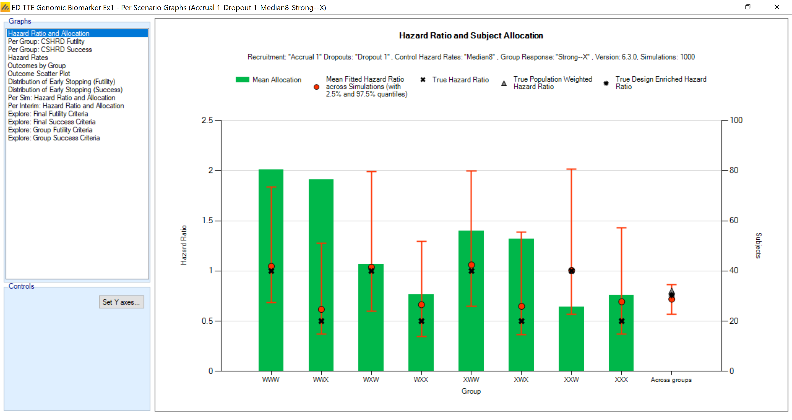

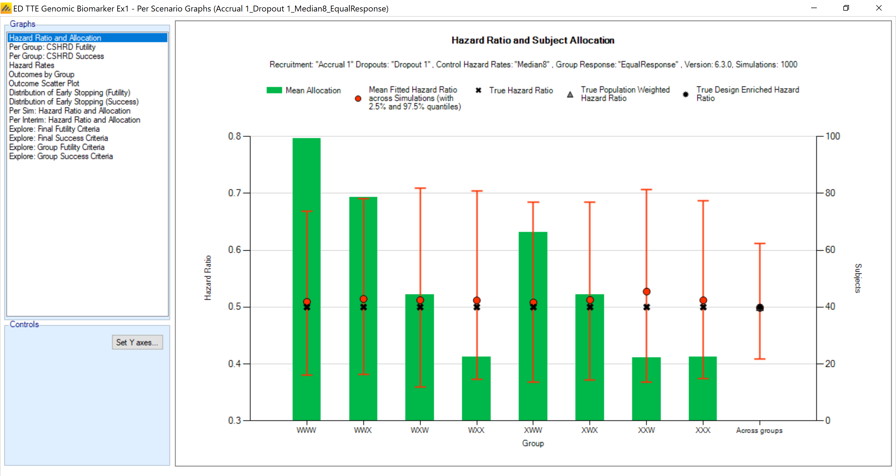

The mean allocations are

+----------------+---------------+---------------+---------------+---------------+---------------+---------------+---------------+---------------+
| Scenario       | WWW           | WWX           | WXW           | WXX           | XWW           | XWX           | XXW           | XXX           |
+================+==============:+==============:+==============:+==============:+==============:+==============:+==============:+==============:+
| Null           | 66.1          | 49.0          | 33.9          | 22.4          | 42.4          | 33.0          | 22.5          | 22.4          |
+----------------+---------------+---------------+---------------+---------------+---------------+---------------+---------------+---------------+
| Equal Response | [99.4]{.mark} | [78.6]{.mark} | [44.5]{.mark} | [22.4]{.mark} | [66.2]{.mark} | [44.3]{.mark} | [22.3]{.mark} | [22.3]{.mark} |
+----------------+---------------+---------------+---------------+---------------+---------------+---------------+---------------+---------------+
| Strong \*\*X   | 80.4          | [76.4]{.mark} | 42.6          | [30.5]{.mark} | 55.9          | [52.7]{.mark} | 25.6          | [30.2]{.mark} |
+----------------+---------------+---------------+---------------+---------------+---------------+---------------+---------------+---------------+
| Strong\*XX     | 70.6          | 54.6          | 37.8          | [40.7]{.mark} | 47.3          | 37.8          | 26.2          | [40.9]{.mark} |
+----------------+---------------+---------------+---------------+---------------+---------------+---------------+---------------+---------------+
| Strong XXX     | 68.9          | 52.6          | 36.1          | 24.9          | 45.2          | 36.7          | 25.3          | [41.9]{.mark} |
+----------------+---------------+---------------+---------------+---------------+---------------+---------------+---------------+---------------+

The mean sample size in each group for each profile is presented in the table above. The yellow highlights refer to those cells where there is a strong treatment effect. The sample sizes for these are increased greatly based on the enrichment aspects of the adaptive design.

When the treatment effect is limited to the second and third genes being mutations the sample sizes are increased even more, while the probabilities of each outcome for each group are shown in the graph below:

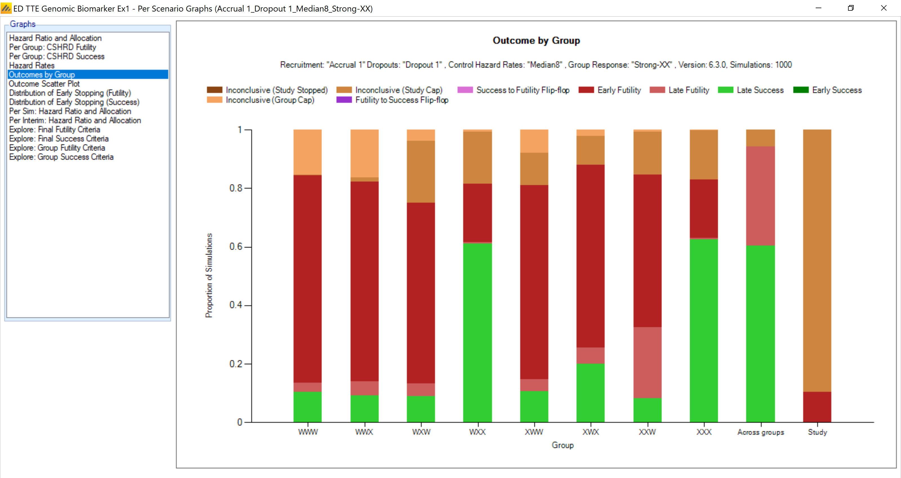

The design does very well at recognizing success within only those gene patterns that have a real effect.

In the last scenario (XXX) there is only one of the 8 cells with a positive effect. This is recognized by the design, but is more difficult because of the borrowing:

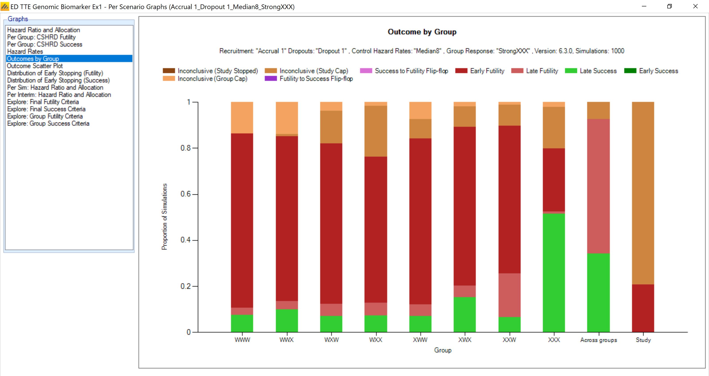
