# Introduction

In this example, we demonstrate the use of the FACTS Platform Continuous engine to simulate a platform trial for the exploration of treatment options for post-traumatic stress disorder (PTSD) patients. This example is loosely based on a real platform trial design for PTSD.

The primary endpoint is a 12-week change from baseline on a CAPS-V assessment. A higher score on CAPS-V indicates a greater degree of PTSD symptoms, so we would like to find treatments that lead to a negative change from baseline. The CAPS-V score is evaluated as an integer value from 0 to 85. For the purposes of our simulations, we will treat this score as continuous, and we will simulate the change from baseline directly. (FACTS does allow direct simulation of the baseline score, as well as the change, but the direct simulation is sufficient for demonstration purposes here.)

The trial is being operated by a patient advocacy organization, and as such, the goal of the simulation study is to find a trial design that can assess many potential treatments, and rapidly find promising treatments to pursue. Thus, we are not interested in the performance of any particular treatment but only of the design as a whole. While the trial design type might be used as a confirmatory design, some further strict assessments of false positive rates might be necessary, so we will treat this trial as a Phase 2 trial, with the notion that treatments that are successful will enrol a follow-up confirmatory study.

The primary operating characteristics of interest are: the rate of false positives, the rate of false negatives, the rate of true positives, and the time and cost required to find good treatments, not necessarily in that order. The entities that are considering bringing a treatment into the trial are certainly interested in the rates of true/false negative/positives, since those quantities represent their risk. The patient advocacy organization may, however, be more interested in the time to find a good treatment. There may be trade-offs between, in particular, the false negative rate and the time to success, as aggressive futility stopping might increase false negatives, but lower time to first success by assessing more treatments quickly.

A fundamental assumption of this platform design is that there are many existing treatments readily available for testing in PTSD. These treatments are, for the most part, used in therapies for other diseases/disorders, with ample existing safety data that the treatments can be deployed quickly. The owners of these treatments may not have the resources to run a trial on their own, but if they can deploy their treatment in an existing trial with lower overhead costs, they are likely to make them available.

The following sections will walk through setting up a FACTS Platform design with accompanying screenshots. Different design options are demonstrated to explore their effect on operating characteristics of interest.

# Design 1: Non-Adaptive Design

We start with a non-adaptive design, meaning that each treatment arm enrols to its participant maximum and is then evaluated upon reaching full follow-up of all participants.

## Trial tab -- trial info

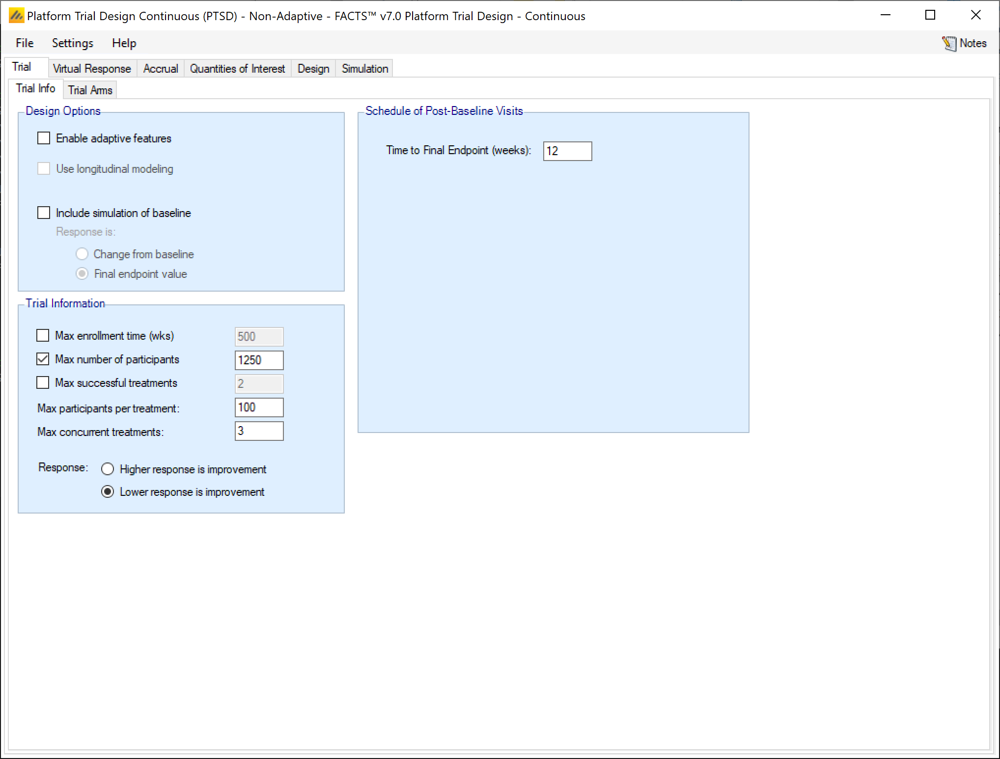

Trial \> Trial Info: The trial design is intended as an ongoing trial, with no definitive end. However, the simulation must be limited in some manner. For the purposes we are exploring here, we will restrict the simulations of the trial to the first 1250 participants. The maximum number of participants for any *treatment* arm is 100. The trial will allow at most 3 concurrent treatment arms to be enrolling. The final endpoint is observed 12 weeks from baseline.

## Trial tab -- Trial Arms - Definition

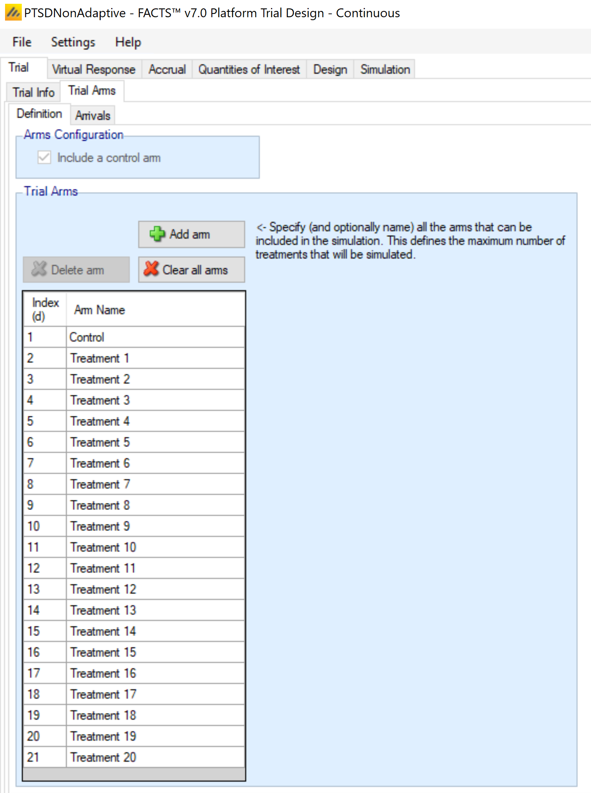

Trial \> Trial Arms \> Definition: Here, we could name the actual treatment arms, but since we are agnostic about the actual treatment arms, we leave the generic name. We have added 20 treatment arms to the trial (in addition to the control arm). Though we do not expect to enrol 20 arms (and in fact cannot in the non-adaptive case), this high number of treatments is included to ensure that the trial enrols all the way to 1250 participants without running out of treatments (even in the adaptive trials coming up).

## Trial tab -- Trial Arms - Arrivals

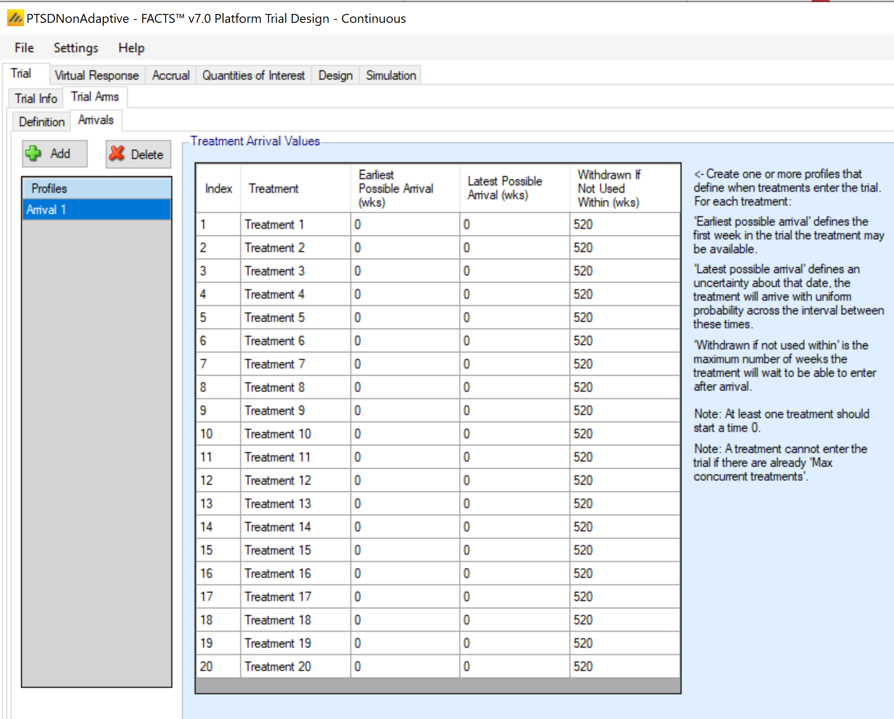

Trial \> Trial Arms \> Arrivals: For a platform trial simulation, it is required to establish when a treatment becomes available to enter the trial. In many platform trials, the limited availability of treatments over time can be a critical factor in operating characteristics. However, for this PTSD example, there are notionally more treatments available than can be handled by the trial. As such, we establish a simple arrival pattern. In this case, all treatments become available at exactly time 0 \[by putting 0 in the earliest and latest possible arrival columns\] and remain available for 520 weeks, which should be longer than the duration of the trial. Just because it is available to the trial does not mean that it is available to participants. On the Trial \> Trial Info tab, the maximum number of concurrent treatments was set to 3. So the first 3 treatments will enter the trial while the others wait. As soon as a treatment arm stops enrolling, the next one on the waitlist will enter the trial. With this setup, we should always have exactly 3 treatments available in the trial (unless we run out of treatments).

## Virtual Response tab -- Treatment classification

For assessing operating characteristics, we need to classify treatment effects. Here, we will consider any average effect of ‑8 or lower compared to control to be a "good" effect, where we would expect to achieve success. Any treatment effect of 0 or higher compared to control is an "unacceptable" treatment effect that should be declared futile. There is a gray area in-between where the treatment is effective but perhaps not at a level that we expect to be detectable, so treatments with effects between 0 and -8 are considered "mediocre." These effect-level classifications are used in FACTS summary output.

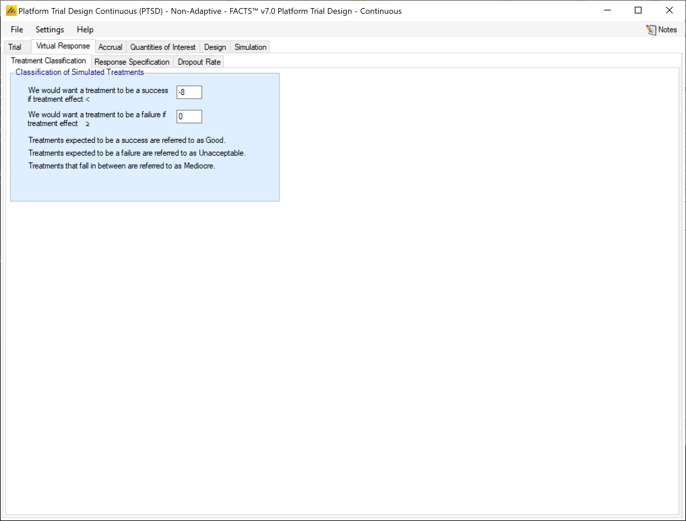

## Virtual Response tab -- Arm Responses

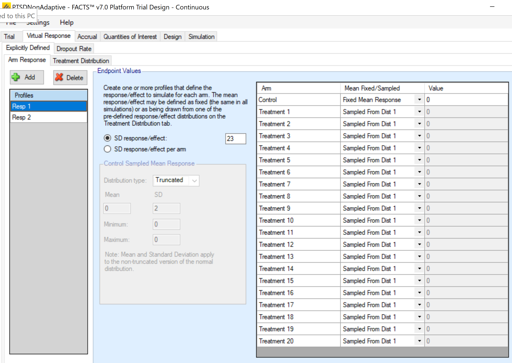

Virtual Response \> Explicitly Defined \> Arm Response: For this simulation, we simulate the control participants as having a mean change from baseline of 0, implying no placebo effect. Since we are treating all of the treatment arms as exchangeable, all other treatment arms have a mean change from baseline that is simulated, and each uses the same distribution (as established on the next tab). The treatment effect will be constant within each simulation but can vary from simulation to simulation. The standard deviation in the change from baseline score for a simulated participant (conditional on their mean) is 23.

For the purposes of this tutorial, we are only exploring two virtual response scenarios. In practice, we would generally set up many more scenarios to explore a wide range of possibilities (possibly including a control with a placebo effect or putting a distribution on the placebo effect).

Here, we use the same set-up for both scenarios, where all treatment arm effect sizes are drawn from the same distribution for the scenario. The two scenarios are constructed by using two different effect distributions. The "Rare but Good" scenario samples from "Dist 1", while the "Rarer less Good" scenario samples from "Dist 2", as described below.

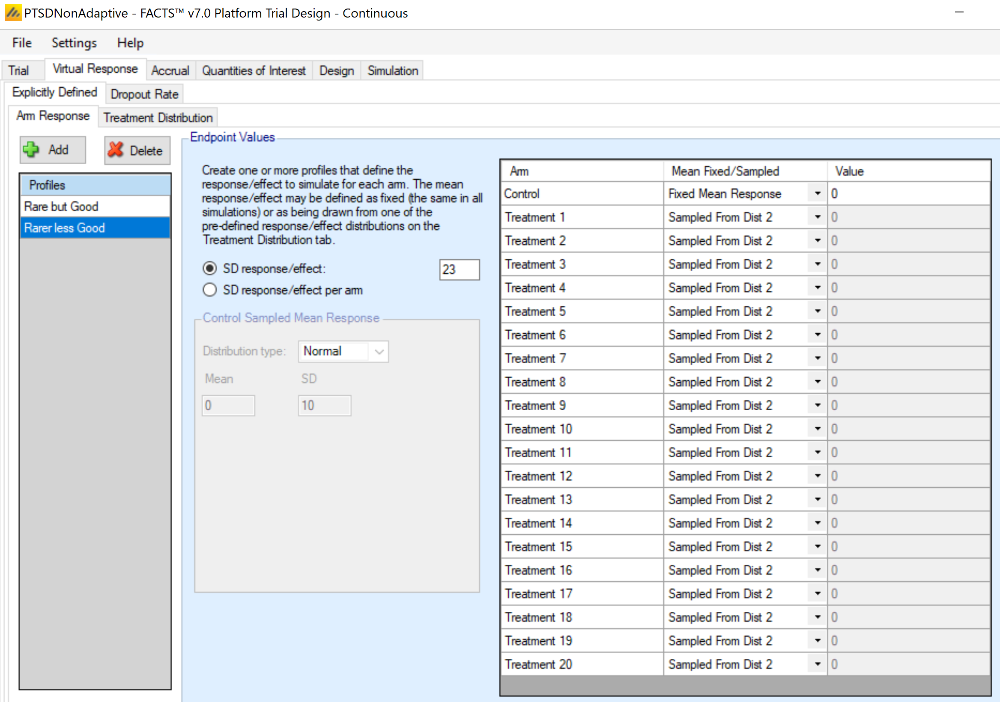

## Virtual Response tab -- Treatment Distribution

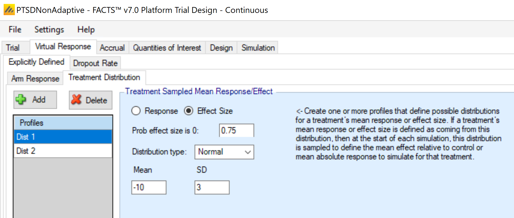

Virtual Response \> Explicitly Defined \> Treatment Distribution: On this tab, we establish the distribution that will be used to simulate the true treatment responses. We are choosing to define the distribution in terms of an effect size (a difference from the control) rather than a response. \[Since we are using a control mean of 0, the two would be equivalent. However, should we choose later to explore a non-zero placebo effect, we would likely prefer to have this distribution set up as an effect, to be an "above and beyond" placebo effect.\]

For "Dist 1", used in the "Rare but Good" scenario, the probability that a treatment is completely ineffective (equivalent to control) is set to 0.75. If it is not equivalent to control, the mean effect size is drawn from a normal distribution with mean -10 and standard deviation of 3. Under this distribution, about 75% of non-equivalent-to-control treatments will have a treatment effect in the "good" range (less than ­‑8), but 25% will be in the mediocre range (‑8 to 0). This distribution also gives a modest chance of effect sizes well into the "good" range.

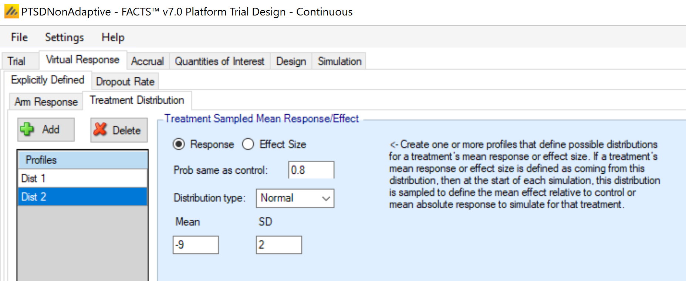

For "Dist 2", used in the "Rarer less Good" scenario, there is a higher probability of no effect: 0.8, and when it is effective, the effect size is more modest than the "Rare but Good" scenario, with a mean of -9 and a standard deviation of 2.

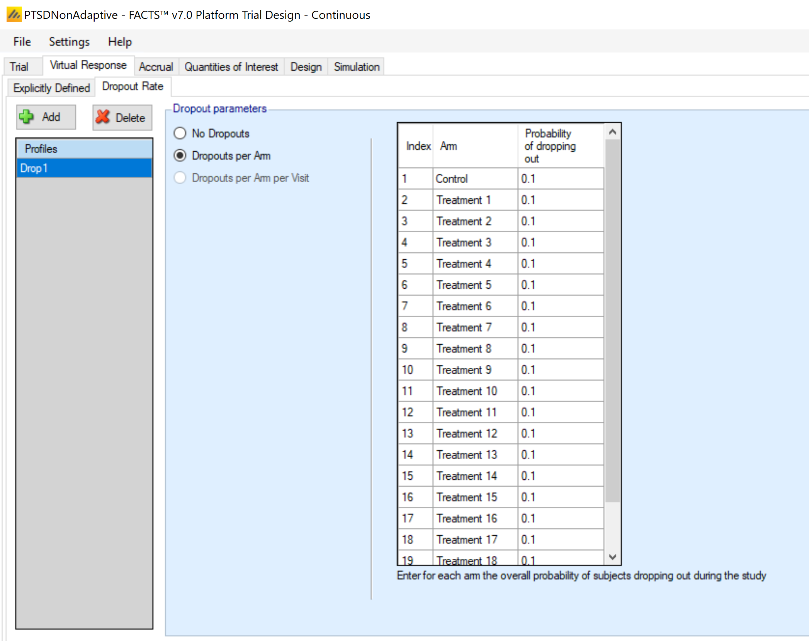

Virtual Response \> Dropout Rate: A dropout rate of 10% is expected to be the same for all arms.

## Accrual tab

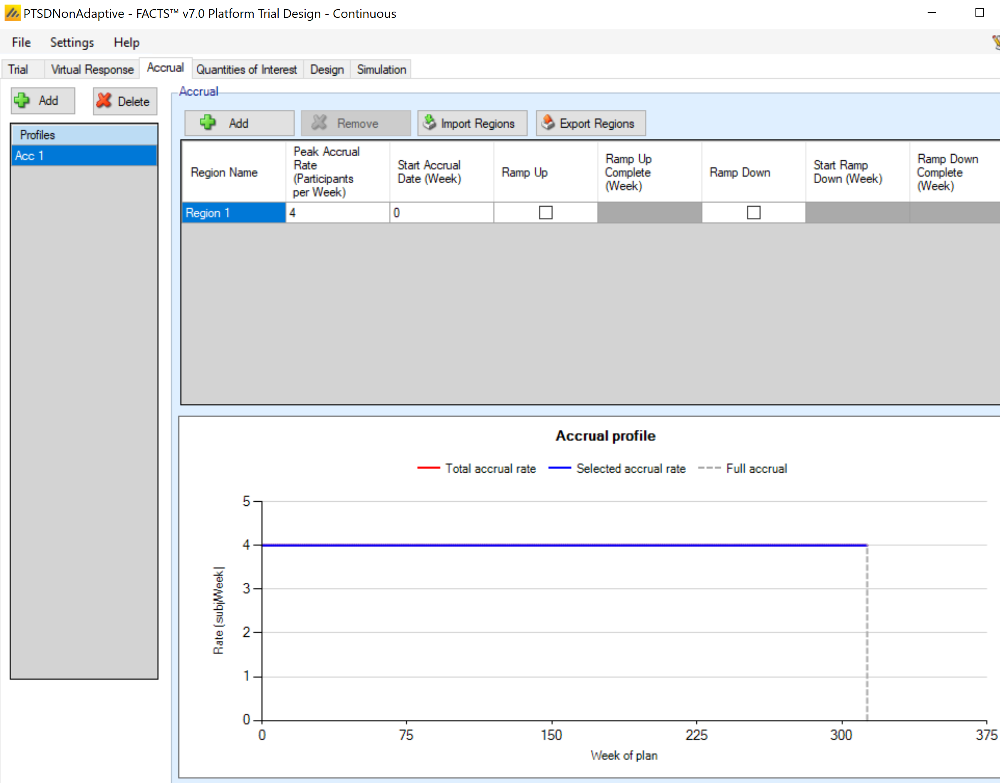

Accrual: A constant enrolment rate of 4 participants/week is used for this simulation.

## Quantities of Interest tab

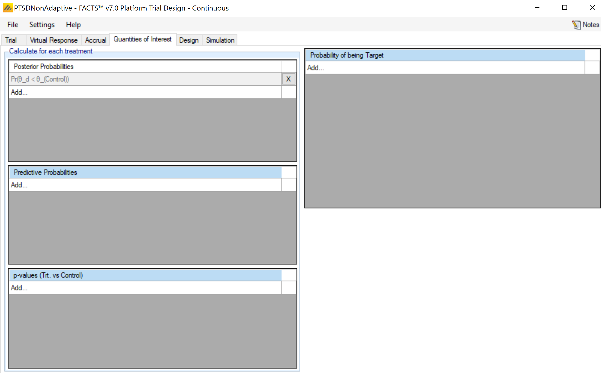

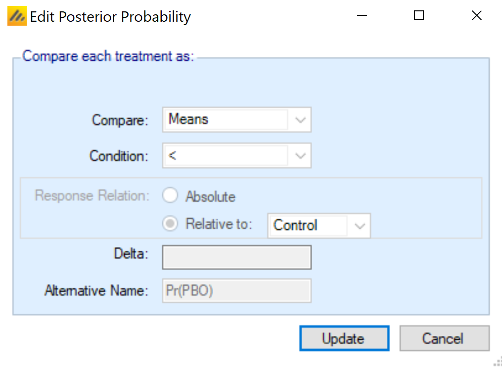

Quantities of Interest: For the non-adaptive design, a single quantity of interest is established for inference, the posterior probability of superiority over control. In this case, since a lower score is better, a mean less than the control indicates superiority.

## Design tab -- Control Response

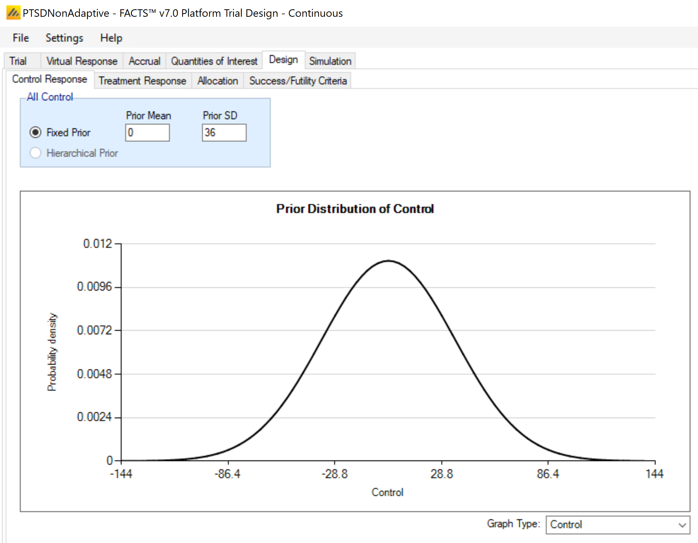

Design \> Control Response: A relatively low-information prior -- N(0, 36^2^) -- is used for the control mean.

## Design tab -- Treatment Response

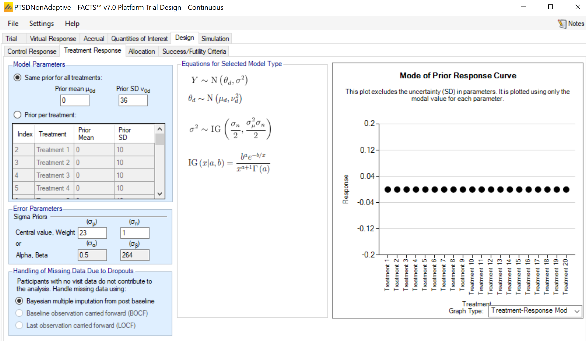

Design \> Treatment Response: The same, relatively low-information prior -- N(0, 36^2^) -- is used for each treatment mean. The prior for the observation standard deviation is set to have a central value of 23 with a weight of 1 (equivalent of one observation). While there are dropouts in this design, there is no longitudinal information being simulated, and thus there is no need to set the way that dropouts are handled. The selection of "Bayesian multiple imputation from post baseline" will be ignored since there are no post-baseline visits for dropouts.

## Design tab - Allocation

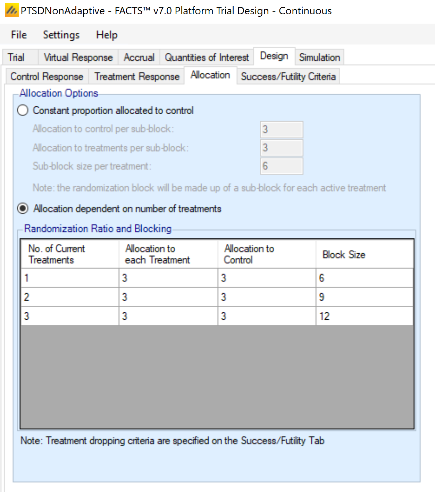

Design \> Allocation: A fixed allocation scheme is used of 1:1:1:1 for treatment:treatment:treatment:control, in block sizes of 12. The treatment arrivals for this design are set up so that there will always be exactly three treatments in the trial. However, under the circumstance (that could possibly appear in the adaptive versions of this design) that the trial runs out of treatment arms, it is possible to have fewer than 3 for a short period of time. Allocation is 1:1 treatment:control in blocks of 6 if only a single treatment arm is available, and 1:1:1 treatment:treatment:control in blocks of 9 if only two treatment arms are available.

## Design tab -- Success/Futility Criteria

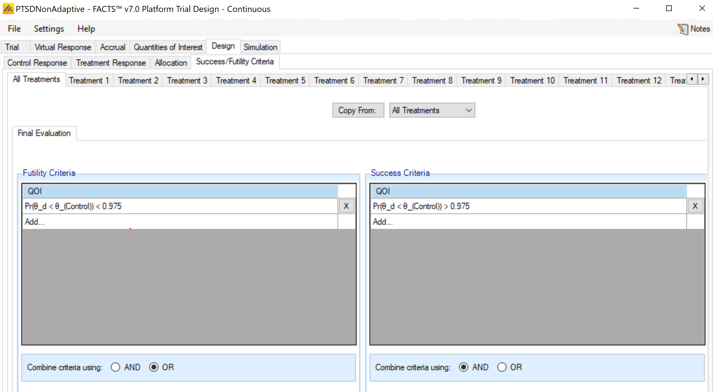

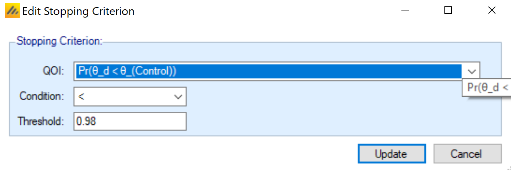 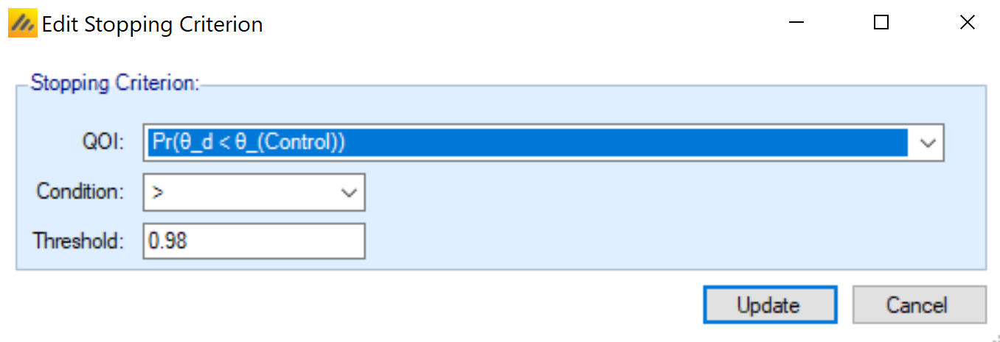

Design \> Success/Futility Criteria \> All Treatments: For the non-adaptive version of the trial, only final evaluations of futility and success are established. Success is declared if the probability of superiority is greater than 0.975, and futility if it is below 0.975. \[It is possible though rare to achieve exactly 0.975, since this quantity is computed as a proportion of MCMC samples, in which case the result would be inconclusive.\] This rule applies to all treatment arms.

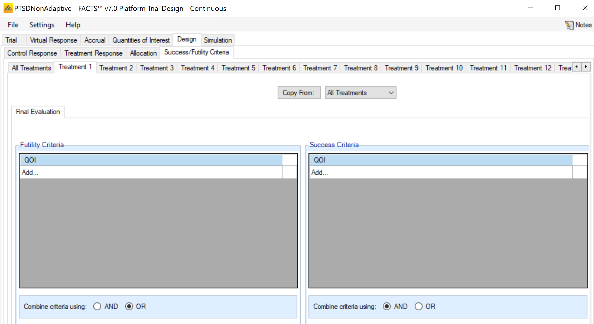

Design \> Success/Futility Criteria \> Treatment X: In this trial, we are specifying no additional criteria for any of the individual arms.

## Simulation tab

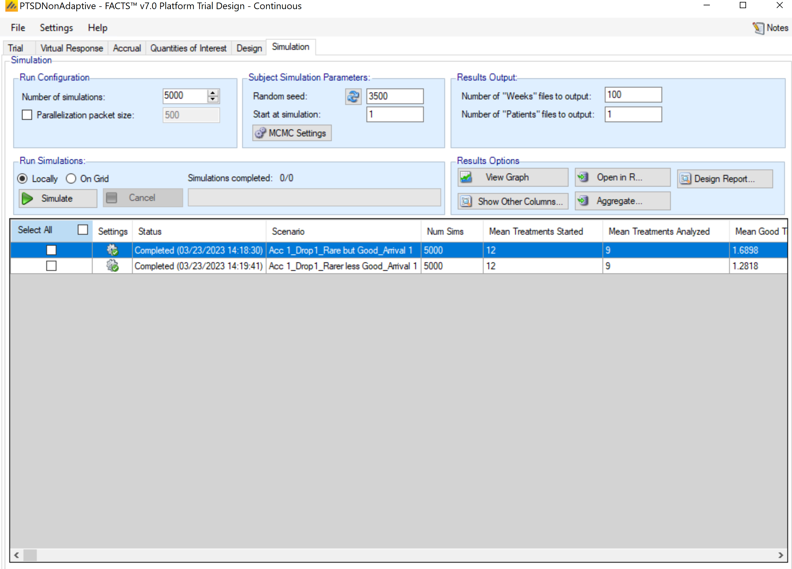

Simulation: Here, we ran 5000 simulations in order to keep sampling error low for operating characteristics. Once complete, the primary operating characteristics of interest can be found by scrolling across the columns shown (or by viewing in the Show Other Columns ... Highlights window).

Note: Platform simulations can be relatively time-consuming, so you may wish to run a smaller number of simulations for quicker comparisons (say 500 or 1000).

## Operating Characteristics and Exploration

Tables 1 and 2 show operating characteristics for the two simulated scenarios. For the purposes of this simulation, we are primarily interested in characteristics of the trial rather than the characteristics of individual treatment arms. For this non-adaptive scenario, the same number of treatments are analyzed each time, since the set-up slightly over-enrols in order to guarantee exactly 9 analyses. (In practice, if the non-adaptive design were of essential interest, we would have restricted the number of treatment arms to 9, but for the purposes of comparing to other designs, we are stopping the simulation at 1250 patients in each case.) This design provides good true positive rates -- 92.6% and 88.1% of "good" treatment arms are being declared successful, while a 2.5% rate of false positives is observed -- "unacceptable arms" being declared successful. As expected, the "Rarer less Good" scenario has a lower true positive rate, as the effect sizes being simulated tend to be closer to the "good" effect size threshold of -8.

+-----------------------------------------------------------+-----------+
| **Operating Characteristic**                              |           |
+===========================================================+:=========:+
| Mean Treatments Started                                   | 12        |
+-----------------------------------------------------------+-----------+
| Mean Treatments Analyzed                                  | 9         |
+-----------------------------------------------------------+-----------+
| Mean Good Treatments Analyzed                             | 1.69      |
+-----------------------------------------------------------+-----------+
| Mean Unacceptable Treatments Analyzed                     | 6.73      |
+-----------------------------------------------------------+-----------+
| Mean Mediocre Treatments Analyzed                         | 0.58      |
+-----------------------------------------------------------+-----------+
| Mean Successes                                            | 2.05      |
+-----------------------------------------------------------+-----------+
| Mean Good Treatment Successes                             | 1.56      |
+-----------------------------------------------------------+-----------+
| Mean Unacceptable Treatment Successes                     | 0.17      |
+-----------------------------------------------------------+-----------+
| Mean Futilities                                           | 6.95      |
+-----------------------------------------------------------+-----------+
| Mean Good Treatment Futilities                            | 0.13      |
+-----------------------------------------------------------+-----------+
| Mean Unacceptable Treatment Futilities                    | 6.56      |
+-----------------------------------------------------------+-----------+
| Ppn Successes \| Treatment Good                           | 0.926     |
+-----------------------------------------------------------+-----------+
| Ppn Successes \| Treatment Unacceptable                   | 0.025     |
+-----------------------------------------------------------+-----------+
| Ppn 1+ Successes                                          | 0.89      |
+-----------------------------------------------------------+-----------+
| Mean First Success Time (weeks)                           | 170.1     |
+-----------------------------------------------------------+-----------+

: "Rare but Good" scenario

+-----------------------------------------------------------+-----------+
| **Operating Characteristic**                              |           |
+===========================================================+:=========:+
| Mean Treatments Started                                   | 12        |
+-----------------------------------------------------------+-----------+
| Mean Treatments Analyzed                                  | 9         |
+-----------------------------------------------------------+-----------+
| Mean Good Treatments Analyzed                             | 1.28      |
+-----------------------------------------------------------+-----------+
| Mean Unacceptable Treatments Analyzed                     | 7.16      |
+-----------------------------------------------------------+-----------+
| Mean Mediocre Treatments Analyzed                         | 0.56      |
+-----------------------------------------------------------+-----------+
| Mean Successes                                            | 1.64      |
+-----------------------------------------------------------+-----------+
| Mean Good Treatment Successes                             | 1.13      |
+-----------------------------------------------------------+-----------+
| Mean Unacceptable Treatment Successes                     | 0.18      |
+-----------------------------------------------------------+-----------+
| Mean Futilities                                           | 7.36      |
+-----------------------------------------------------------+-----------+
| Mean Good Treatment Futilities                            | 0.15      |
+-----------------------------------------------------------+-----------+
| Mean Unacceptable Treatment Futilities                    | 6.97      |
+-----------------------------------------------------------+-----------+
| Ppn Successes \| Treatment Good                           | 0.881     |
+-----------------------------------------------------------+-----------+
| Ppn Successes \| Treatment Unacceptable                   | 0.025     |
+-----------------------------------------------------------+-----------+
| Ppn 1+ Successes                                          | 0.81      |
+-----------------------------------------------------------+-----------+
| Mean First Success Time (weeks)                           | 179.5     |
+-----------------------------------------------------------+-----------+

: "Rarer less Good" scenario

Some characteristics of the trial can be explored in the graphs available within FACTS. These are accessible through the View Graphs button on the Simulations tab. Several of the graphs are oriented toward looking at the behavior of a particular arm. Since this design considers all arms exchangeable, these by treatment arm graphs may be of little interest. However, a generally useful graph for checking that the overall platform design is operating as expected, in terms of treatments entering and leaving the trial, is the "Per Sim: Arm and Participant Arrival" graph.

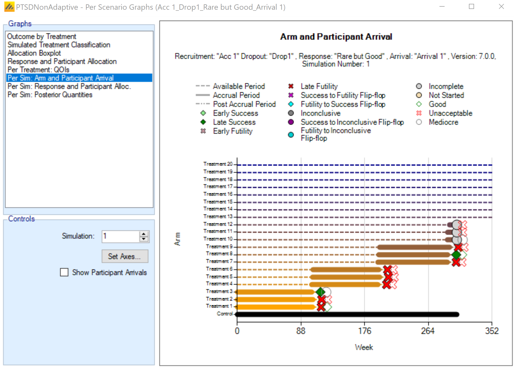

In this graph, we can see that there are always 3 treatment arms enrolling at any given time (the thick lines). And that all treatments are ready and waiting to enter the trial from the start (the dashed line). Outcomes and associated desired outcomes (based on effect size) are also displayed if the user is interested in seeing the detailed result of any particular simulation.

FACTS provides a plot of Outcome by Treatment, shown here for the Good but Rare scenario.

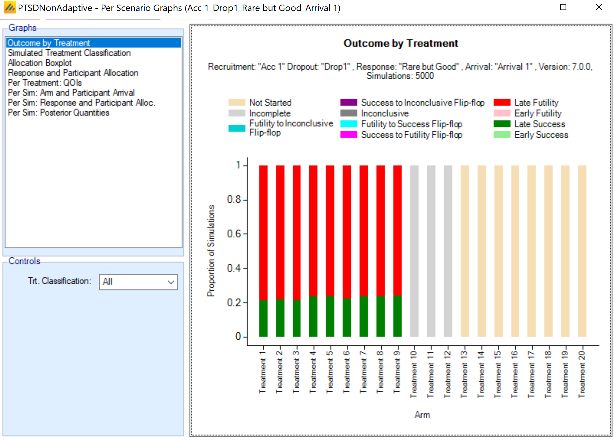

This plot primarily demonstrates the scenario set-up. Since the treatment arms are exchangeable, this plot is effectively showing the proportion of simulations that an arm was simulated as a zero treatment effect. More interesting for this scenario is to restrict attention to treatment arms with a simulated "good" treatment effect, by selecting "Good" from the Controls \> Trt. Classification drop-down menu.

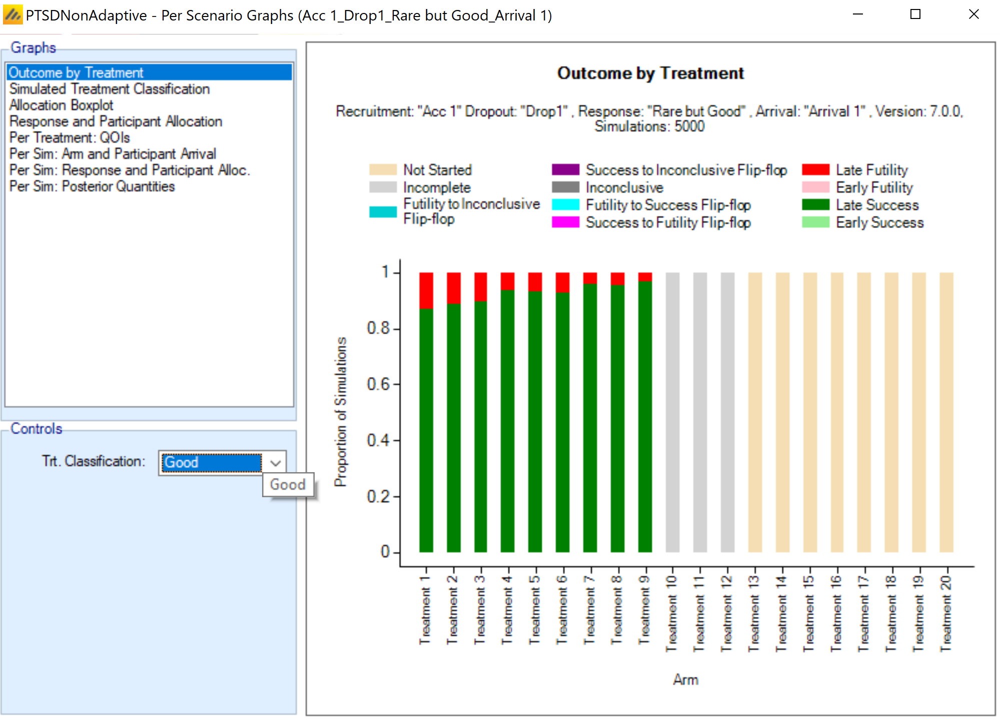

Here, we can see that the early arms in the trial have reduced power, due to the smaller number of controls available for comparison. This behavior is expected and is a reason that platform trials sometimes consider different sample sizes or stopping rules for early arms.

# Adding Futility Stopping

Because there are (expected to be) a high proportion of ineffective treatments coming into the trial, the design might benefit from stopping poorly performing treatments early. By stopping enrolment early on ineffective arms, the trial can cycle in new treatments more quickly and possibly find the good treatments more quickly.

Screen shots for the only tabs that have changed are shown below.

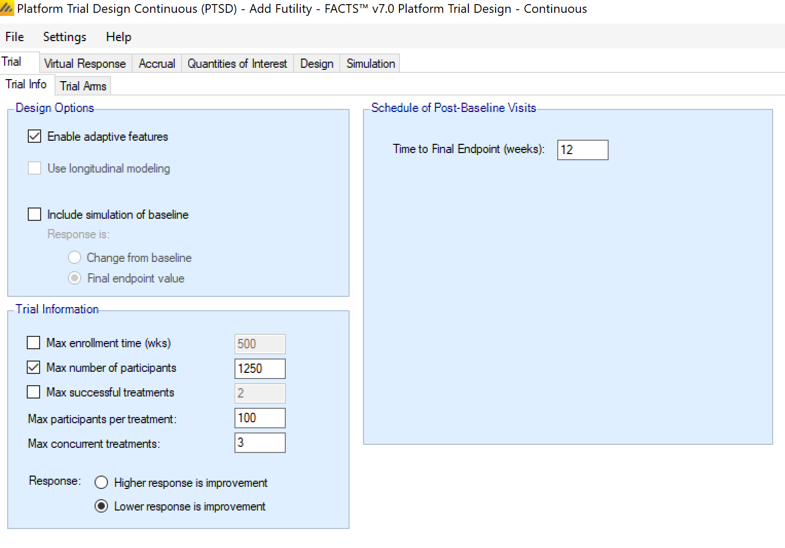

On the Trial \> Trial Info tab, the "Enable adaptive features" box has been checked.

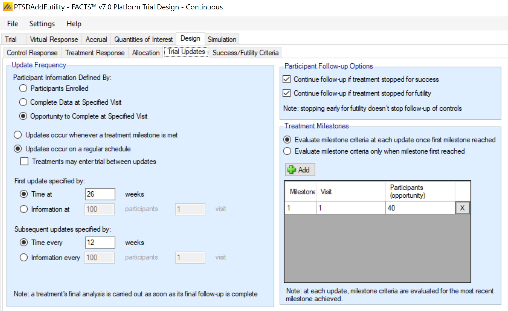

The Design \> Trial Updates tab has appeared. On the left side of this tab, we establish when updates will occur and when treatments are evaluated. Updates will occur on a regular schedule (generally easiest for operational purposes) starting with the first update at 26 weeks, then performing regular analyses every 12 weeks.

On the right side of this tab, we establish milestones for the treatment arms. These milestones apply to all treatment arms (though the decisions made at those milestones are allowed to vary by treatment arm) and are based on a number of participants to reach a certain level of information. In this case, we establish information as the opportunity to complete the final (and only) visit. Only one milestone is used in this example, when 40 participants have had the opportunity to complete. Since we have selected "evaluate milestone criteria at each update once first milestone reached," the decisions associated with this milestone will be evaluated at every trial update after the milestone has been reached. In this case, as established below, we will be evaluating futility at every update past the milestone.

\[The other option: "Evaluate milestone criteria only when milestone first reached" would be a go/no-go decision evaluated only at the first update after hitting the milestone, but since our goal is to eliminate treatment arms that are not promising as soon as we can, we prefer the option that keeps evaluating.\]

Note that we have *not* checked the box for "Treatments may enter trial between updates." This means that if a treatment arm reaches its maximum allocation between analyses, a new arm will not be added to the trial until the next trial update. This is an operational consideration and may be less than optimal in terms of statistical design.

Note: performing trial updates on a regular schedule will lead to a larger number of analyses and longer run times than the non-adaptive simulation.

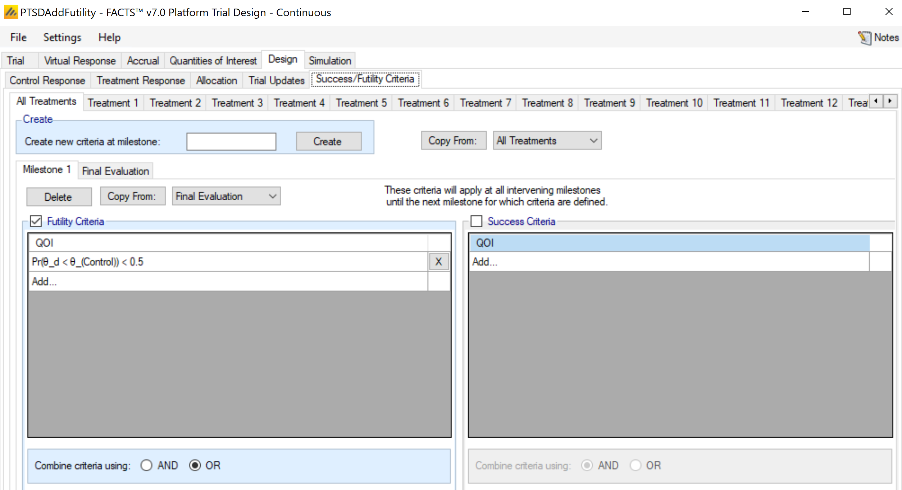

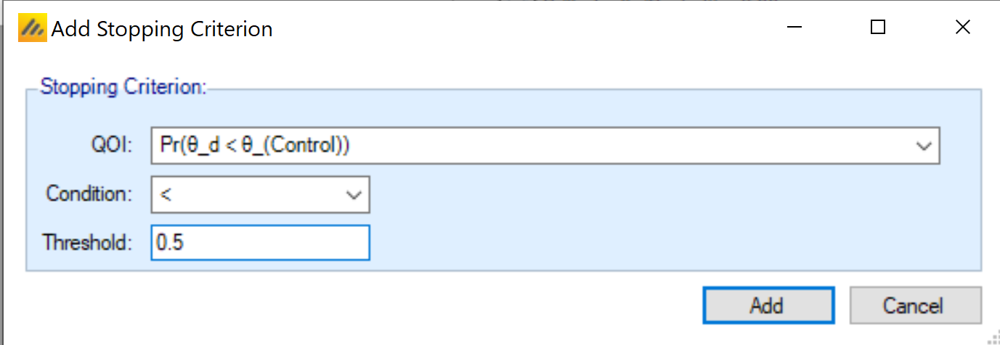

On the Design \> Success/Futility tab, we entered a 1 in the "Create new criteria at milestone" box and hit the "Create" button. This caused a Milestone 1 sub-tab to appear. This allows us to set up early stopping criteria for treatments that have reached the first milestone. Here we click the checkbox for "Futility Criteria" to allow us to set up a rule for early stopping for futility. Clicking "Add..." under Futility Criteria to establish an early stopping rule if the posterior probability of superiority $\left( \theta_{trt} < \theta_{ctl} \right)$ is less that 0.5. Given the relatively non-informative prior distributions being used here, this criteria is nearly equivalent to the observed average for treatment is worse than the observed average for control.

Some operating characteristics of this design are placed side by side with the non-adaptive design as a comparison. Of note is that the number of treatments analyzed has increased, with a somewhat reduced average time to finding the first successful treatment.

+------------------------------------------------+------------------+---------------------------+
| **Operating Characteristic**                   | **Non-Adaptive** | **Add Futility Stopping** |
+================================================+:================:+:=========================:+
| Mean Treatments Started                        | 12               | 12.73                     |
+------------------------------------------------+------------------+---------------------------+
| Mean Treatments Analyzed                       | 9                | [10.16]{.mark}            |
+------------------------------------------------+------------------+---------------------------+
| Mean Good Treatments Analyzed                  | 1.69             | 1.76                      |
+------------------------------------------------+------------------+---------------------------+
| Mean Unacceptable Treatments Analyzed          | 6.73             | 7.78                      |
+------------------------------------------------+------------------+---------------------------+
| Mean Mediocre Treatments Analyzed              | 0.58             | 0.62                      |
+------------------------------------------------+------------------+---------------------------+
| Mean Successes                                 | 2.05             | 2.07                      |
+------------------------------------------------+------------------+---------------------------+
| Mean Good Treatment Successes                  | 1.56             | 1.60                      |
+------------------------------------------------+------------------+---------------------------+
| Mean Unacceptable Treatment Successes          | 0.17             | 0.15                      |
+------------------------------------------------+------------------+---------------------------+
| Mean Futilities                                | 6.95             | 8.09                      |
+------------------------------------------------+------------------+---------------------------+
| Mean Good Treatment Futilities                 | 0.13             | 0.16                      |
+------------------------------------------------+------------------+---------------------------+
| Mean Unacceptable Treatment Futilities         | 6.56             | 7.63                      |
+------------------------------------------------+------------------+---------------------------+
| Ppn Successes \| Treatment Good                | 0.926            | 0.910                     |
+------------------------------------------------+------------------+---------------------------+
| Ppn Successes \| Treatment Unacceptable        | 0.025            | 0.020                     |
+------------------------------------------------+------------------+---------------------------+
| Ppn 1+ Successes                               | 0.89             | 0.90                      |
+------------------------------------------------+------------------+---------------------------+
| Mean First Success Time (weeks)                | 170.1            | [158.3]{.mark}            |
+------------------------------------------------+------------------+---------------------------+

: "Rare but Good" scenario

+------------------------------------------------+------------------+---------------------------+
| **Operating Characteristic**                   | **Non-Adaptive** | **Add Futility Stopping** |
+================================================+:================:+:=========================:+
| Mean Treatments Started                        | 12               | 12.91                     |
+------------------------------------------------+------------------+---------------------------+
| Mean Treatments Analyzed                       | 9                | [10.32]{.mark}            |
+------------------------------------------------+------------------+---------------------------+
| Mean Good Treatments Analyzed                  | 1.28             | 1.35                      |
+------------------------------------------------+------------------+---------------------------+
| Mean Unacceptable Treatments Analyzed          | 7.16             | 8.37                      |
+------------------------------------------------+------------------+---------------------------+
| Mean Mediocre Treatments Analyzed              | 0.56             | 0.60                      |
+------------------------------------------------+------------------+---------------------------+
| Mean Successes                                 | 1.64             | 1.67                      |
+------------------------------------------------+------------------+---------------------------+
| Mean Good Treatment Successes                  | 1.13             | 1.15                      |
+------------------------------------------------+------------------+---------------------------+
| Mean Unacceptable Treatment Successes          | 0.18             | 0.17                      |
+------------------------------------------------+------------------+---------------------------+
| Mean Futilities                                | 7.36             | 8.65                      |
+------------------------------------------------+------------------+---------------------------+
| Mean Good Treatment Futilities                 | 0.15             | 0.19                      |
+------------------------------------------------+------------------+---------------------------+
| Mean Unacceptable Treatment Futilities         | 6.97             | 8.20                      |
+------------------------------------------------+------------------+---------------------------+
| Ppn Successes \| Treatment Good                | 0.881            | 0.857                     |
+------------------------------------------------+------------------+---------------------------+
| Ppn Successes \| Treatment Unacceptable        | 0.025            | 0.021                     |
+------------------------------------------------+------------------+---------------------------+
| Ppn 1+ Successes                               | 0.81             | 0.83                      |
+------------------------------------------------+------------------+---------------------------+
| Mean First Success Time (weeks)                | 179.5            | [167.9]{.mark}            |
+------------------------------------------------+------------------+---------------------------+

: "Rarer less Good" scenario

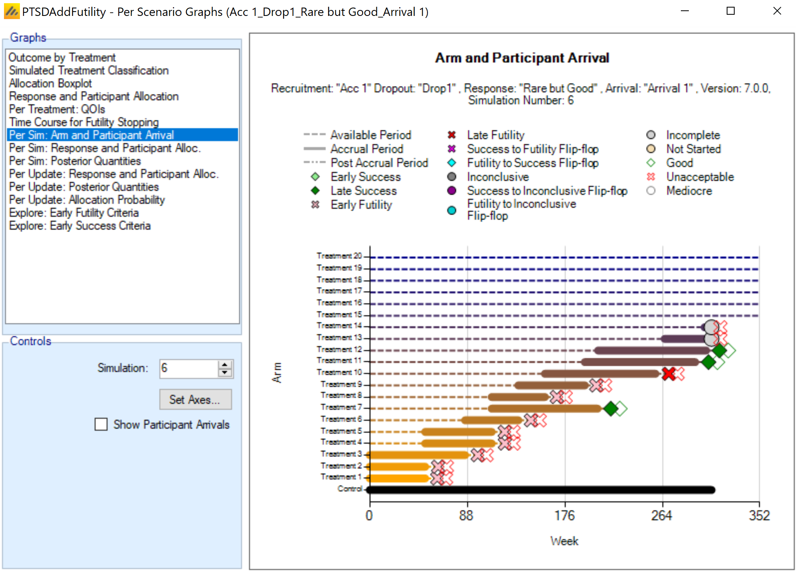

The "Per Sim: Arm and Participant Arrival" graph can be a little more interesting with early stopping in place, as some treatment arms are in the trial only a short time, with new treatment replacing poorly-performing treatments.

Looking at the outcomes by treatment for the "good" treatment effects and separately for "unacceptable" treatment effects (for the Good but Rare scenario), we can see that early futility has a minor impact for good arms but is stopping unacceptable arms nearly 70% of the time. We can also see that a 10^th^ treatment arm reaches a final analysis in about 70% of simulations, with smaller proportions getting an 11^th^, 12^th^, or 13^th^ arm.

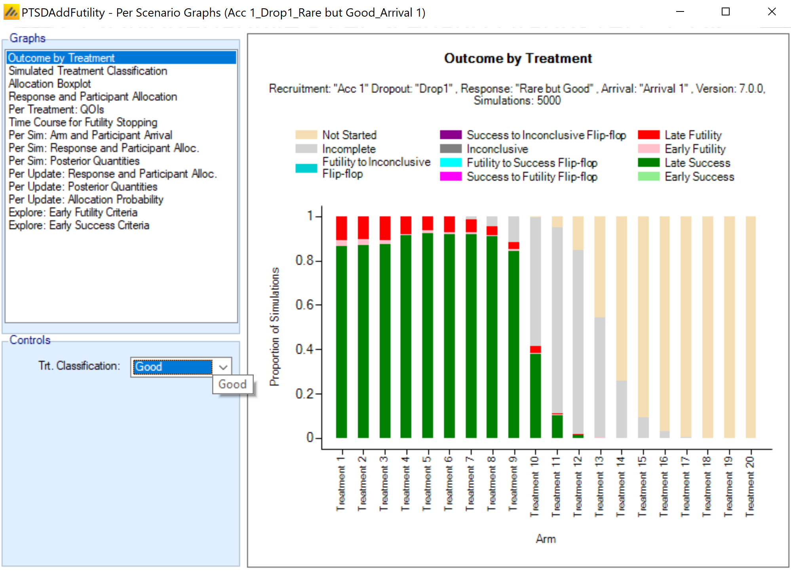

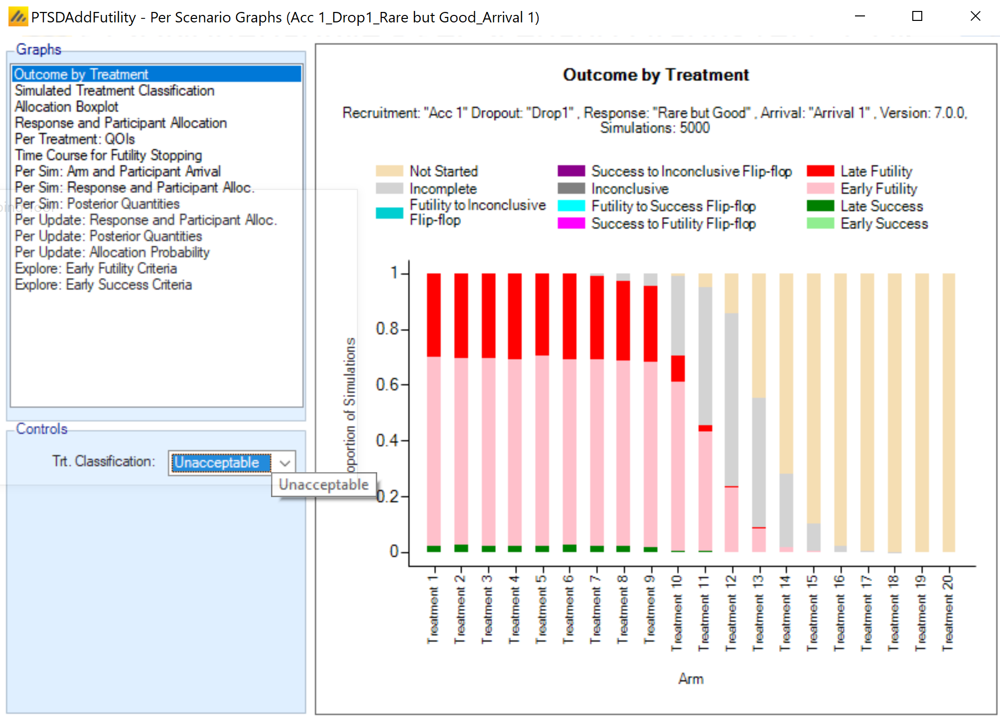

# Aggressive Futility Stopping

Adding early stopping for futility was helpful for cycling out poorly-performing treatments, but perhaps the futility stopping could be made even more aggressive without much harm to the true positive rate. In this design, we allow for both earlier stopping, and require increasingly good data as the treatment arm accrues participants.

The tabs that are adjusted from the previous design are given below.

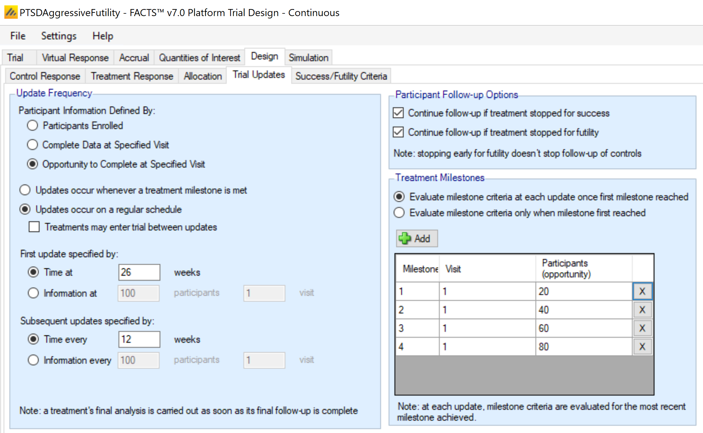

On the Design \> Trial Updates tab, we have added 3 new milestones. Milestones will now begin to be evaluated as early as 20 participants with the opportunity to complete, and the milestone evaluation criteria will be allowed to change at 40, 60, and 80 participants.

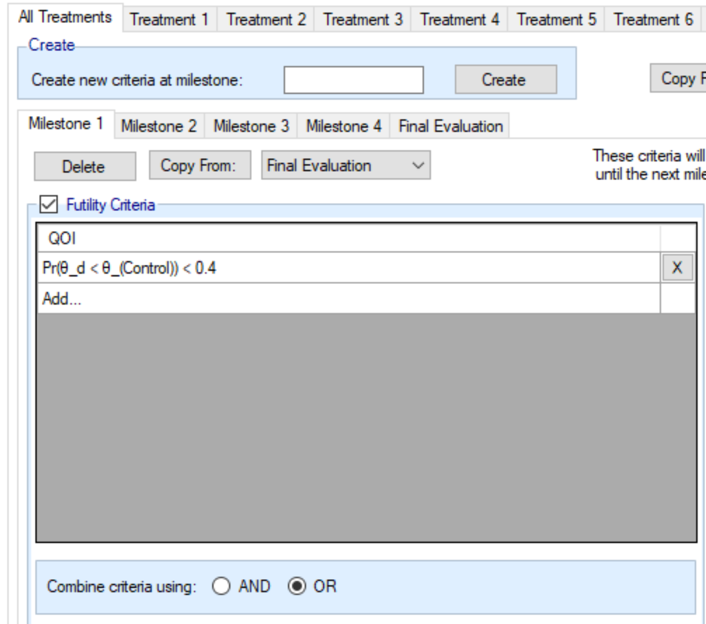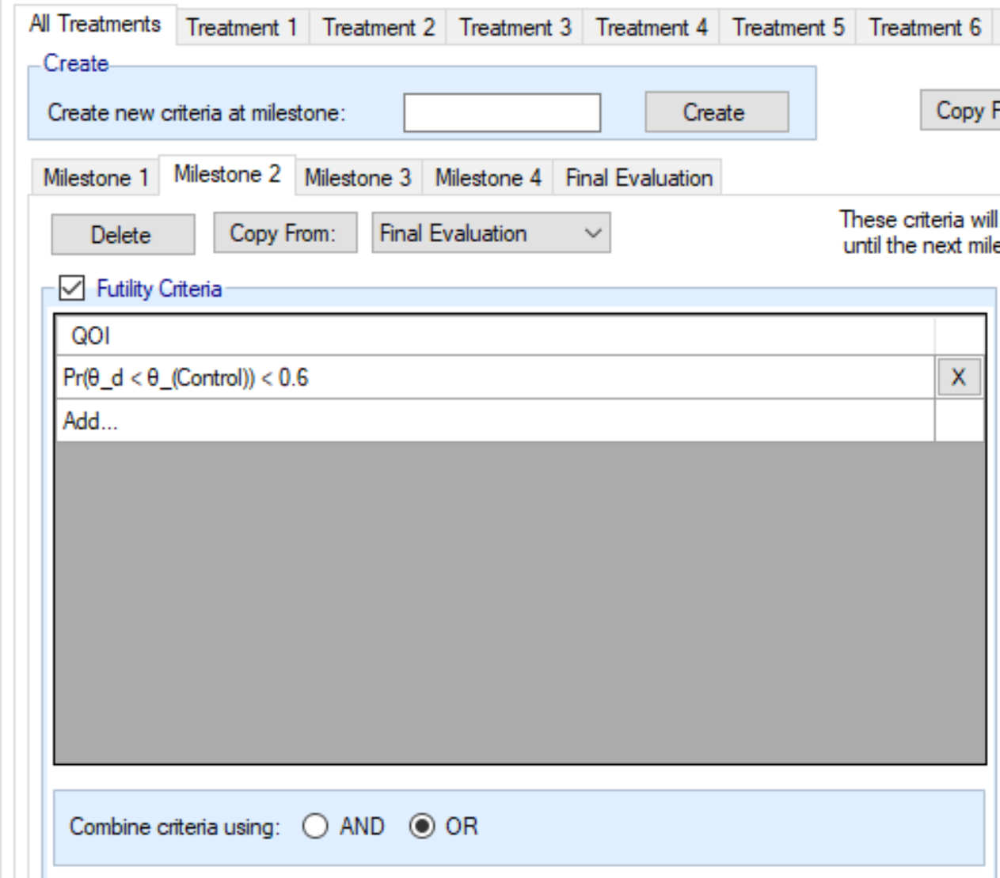

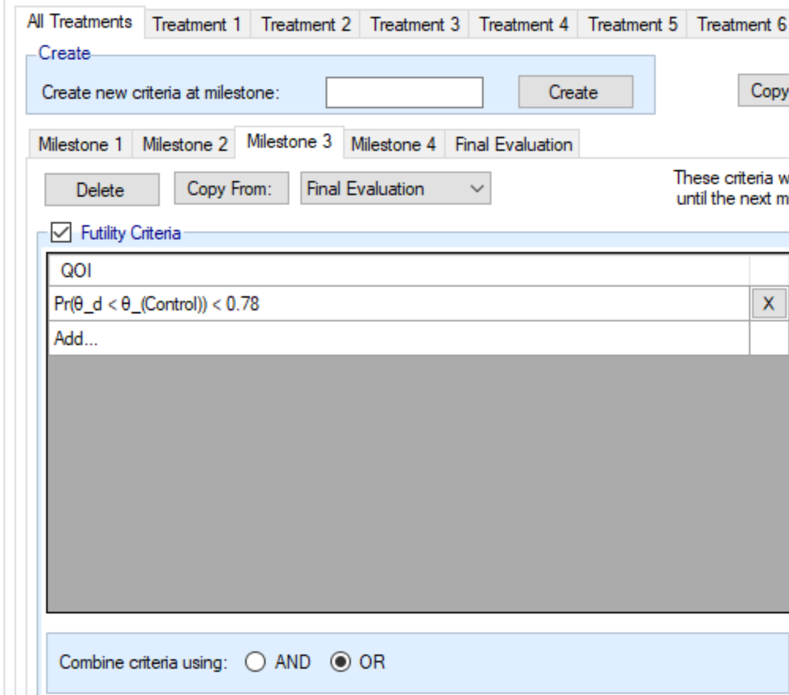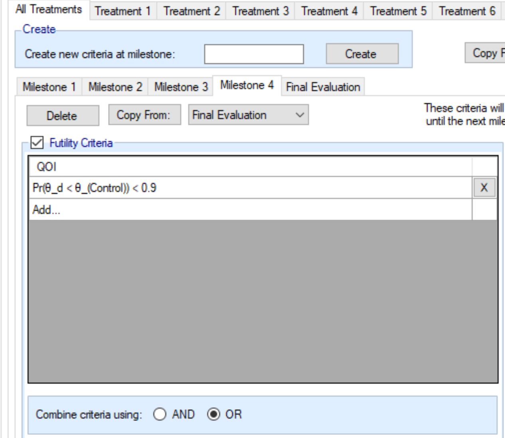

On the Design \> Success/Futility tab, there are now futility stopping rules established for each of the four milestones. At milestone 1 (20 participants), the treatment is declared futile if the probability of superiority is less than 0.4. This threshold increases as further milestones are hit: 0.6 at milestone 2 (40 participants), 0.78 at milestone 3 (60 participants), and 0.9 at milestone 4 (80 participants). This increasing threshold reflects the fact that, when the treatment arms is nearly fully enrolled, there is decreased chance for the data to "turn around," since most of the data is in. Increasing the threshold on a posterior probability as data accumulates gives an approximation to using a predictive probability of success. \[Predictive probabilities are limited in the current implementation of FACTS Platform but are planned to be expanded.

Some operating characteristics of this design are placed side by side with the previous two designs for comparison. Of note is that the number of treatments analyzed has increased and thus the number of *good* treatments analyzed. By eliminating more treatment arms early, more treatments are cycling through the trial, giving a better chance to find the good treatments. 95% of simulations now result in at least one successful treatment.

+-----------------------------------------+------------------+---------------------------+-------------------------+
| **Operating Characteristic**            | **Non-Adaptive** | **Add Futility Stopping** | **Aggressive Futility** |
+=========================================+:================:+:=========================:+:=======================:+
| Mean Treatments Started                 | 12               | 12.73                     | 15.36                   |
+-----------------------------------------+------------------+---------------------------+-------------------------+
| Mean Treatments Analyzed                | 9                | [10.16]{.mark}            | [12.88]{.mark}          |
+-----------------------------------------+------------------+---------------------------+-------------------------+
| Mean Good Treatments Analyzed           | 1.69             | 1.76                      | [2.12]{.mark}           |
+-----------------------------------------+------------------+---------------------------+-------------------------+
| Mean Unacceptable Treatments Analyzed   | 6.73             | 7.78                      | 10.00                   |
+-----------------------------------------+------------------+---------------------------+-------------------------+
| Mean Mediocre Treatments Analyzed       | 0.58             | 0.62                      | 0.76                    |
+-----------------------------------------+------------------+---------------------------+-------------------------+
| Mean Successes                          | 2.05             | 2.07                      | 2.44                    |
+-----------------------------------------+------------------+---------------------------+-------------------------+
| Mean Good Treatment Successes           | 1.56             | 1.60                      | 1.91                    |
+-----------------------------------------+------------------+---------------------------+-------------------------+
| Mean Unacceptable Treatment Successes   | 0.17             | 0.15                      | 0.17                    |
+-----------------------------------------+------------------+---------------------------+-------------------------+
| Mean Futilities                         | 6.95             | 8.09                      | 10.44                   |
+-----------------------------------------+------------------+---------------------------+-------------------------+
| Mean Good Treatment Futilities          | 0.13             | 0.16                      | 0.21                    |
+-----------------------------------------+------------------+---------------------------+-------------------------+
| Mean Unacceptable Treatment Futilities  | 6.56             | 7.63                      | 9.83                    |
+-----------------------------------------+------------------+---------------------------+-------------------------+
| Ppn Successes \| Treatment Good         | 0.926            | 0.910                     | 0.900                   |
+-----------------------------------------+------------------+---------------------------+-------------------------+
| Ppn Successes \| Treatment Unacceptable | 0.025            | 0.020                     | 0.017                   |
+-----------------------------------------+------------------+---------------------------+-------------------------+
| Ppn 1+ Successes                        | 0.89             | 0.90                      | [0.95]{.mark}           |
+-----------------------------------------+------------------+---------------------------+-------------------------+
| Mean First Success Time (weeks)         | 170.1            | [158.3]{.mark}            | 155.0                   |
+-----------------------------------------+------------------+---------------------------+-------------------------+

: \"Rare but Good\" scenario

+-----------------------------------------+------------------+---------------------------+-------------------------+
| **Operating Characteristic**            | **Non-Adaptive** | **Add Futility Stopping** | **Aggressive Futility** |
+=========================================+:================:+:=========================:+:=======================:+
| Mean Treatments Started                 | 12               | 12.91                     | 15.81                   |
+-----------------------------------------+------------------+---------------------------+-------------------------+
| Mean Treatments Analyzed                | 9                | [10.32]{.mark}            | [13.37]{.mark}          |
+-----------------------------------------+------------------+---------------------------+-------------------------+
| Mean Good Treatments Analyzed           | 1.28             | 1.35                      | [1.65]{.mark}           |
+-----------------------------------------+------------------+---------------------------+-------------------------+
| Mean Unacceptable Treatments Analyzed   | 7.16             | 8.37                      | 10.97                   |
+-----------------------------------------+------------------+---------------------------+-------------------------+
| Mean Mediocre Treatments Analyzed       | 0.56             | 0.60                      | 0.75                    |
+-----------------------------------------+------------------+---------------------------+-------------------------+
| Mean Successes                          | 1.64             | 1.67                      | 1.97                    |
+-----------------------------------------+------------------+---------------------------+-------------------------+
| Mean Good Treatment Successes           | 1.13             | 1.15                      | 1.39                    |
+-----------------------------------------+------------------+---------------------------+-------------------------+
| Mean Unacceptable Treatment Successes   | 0.18             | 0.17                      | 0.19                    |
+-----------------------------------------+------------------+---------------------------+-------------------------+
| Mean Futilities                         | 7.36             | 8.65                      | 11.40                   |
+-----------------------------------------+------------------+---------------------------+-------------------------+
| Mean Good Treatment Futilities          | 0.15             | 0.19                      | 0.27                    |
+-----------------------------------------+------------------+---------------------------+-------------------------+
| Mean Unacceptable Treatment Futilities  | 6.97             | 8.20                      | 10.78                   |
+-----------------------------------------+------------------+---------------------------+-------------------------+
| Ppn Successes \| Treatment Good         | 0.881            | 0.857                     | 0.839                   |
+-----------------------------------------+------------------+---------------------------+-------------------------+
| Ppn Successes \| Treatment Unacceptable | 0.025            | 0.021                     | 0.017                   |
+-----------------------------------------+------------------+---------------------------+-------------------------+
| Ppn 1+ Successes                        | 0.81             | 0.83                      | [0.89]{.mark}           |
+-----------------------------------------+------------------+---------------------------+-------------------------+
| Mean First Success Time (weeks)         | 179.5            | [167.9]{.mark}            | 166.8                   |
+-----------------------------------------+------------------+---------------------------+-------------------------+

: \"Rarer less Good\" scenario

The Outcome by Treatment plots are again informative about the behavior of the stopping rules. With the more aggressive futility rules, over 90% of unacceptable arms are stopping early for futility. There is a bit more early stopping for good arms as well, primarily with the early arms. A large proportion of trails now analyze at least 12 treatment arms, with a few even reaching a final analysis for a 19^th^ arm.

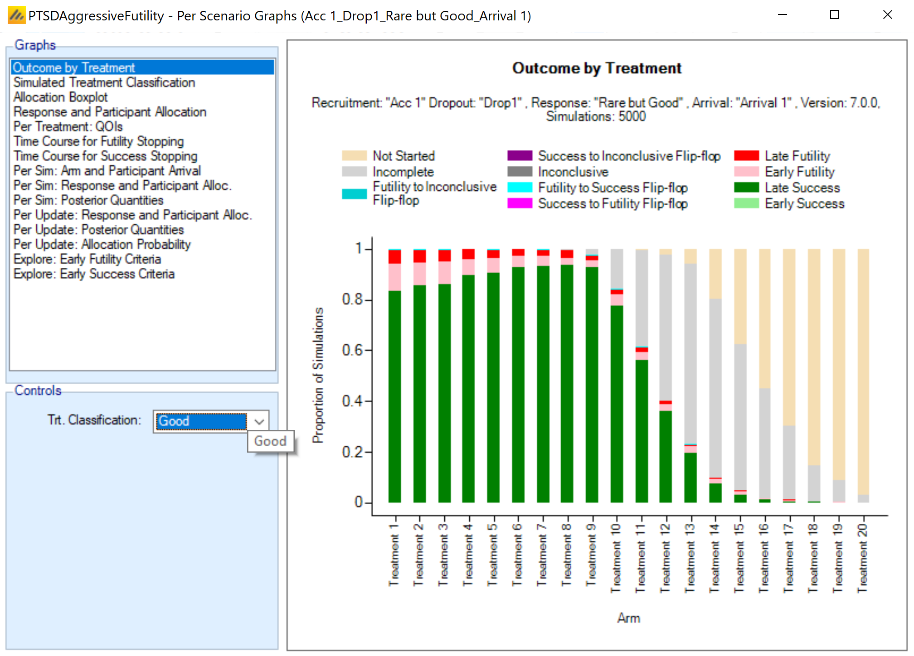

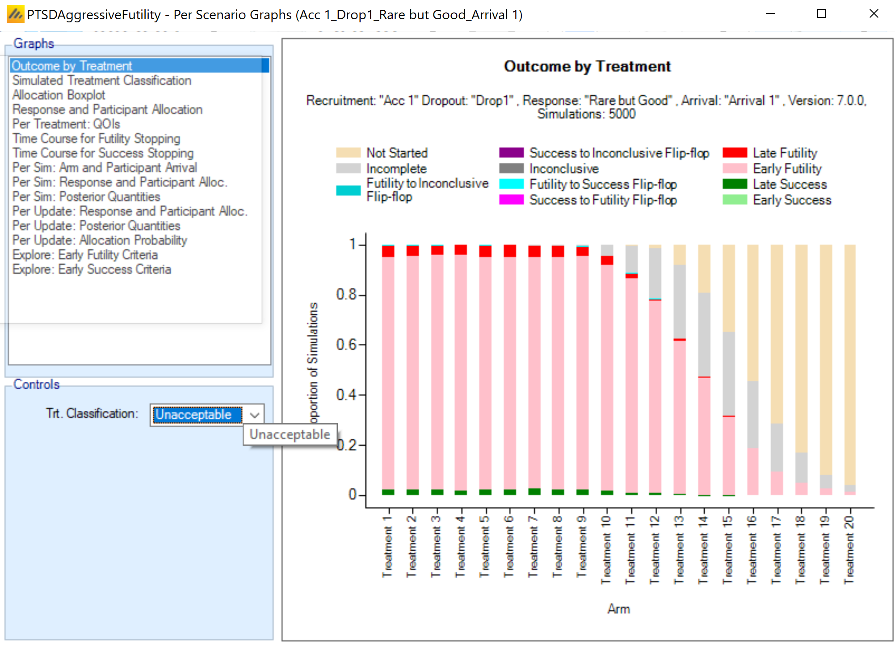

# Adding Early Success Stopping

Early futility stopping can be good for eliminating hopeless treatment arms. There may also be benefit to using early success stopping to prevent over-enrolment on a treatment that is clearly superior as well. The maximum number of participants of 100 is over-powered for very large treatment effects. This design follows uses all of the early futility stopping of the previous design but adds early success stopping as well, using the same rule for all milestones: probability of superiority \> 0.99.

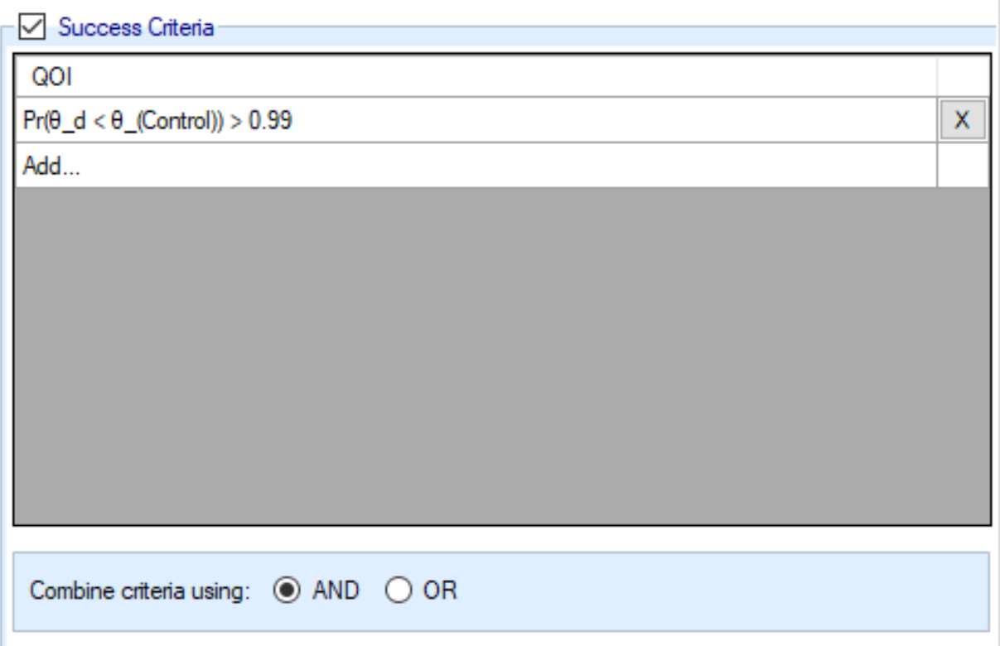

Because early stopping for success can lead to an increased false positive rate, the *final* success threshold is increased to 0.98 (from 0.975) to bring the false positive rate back down.

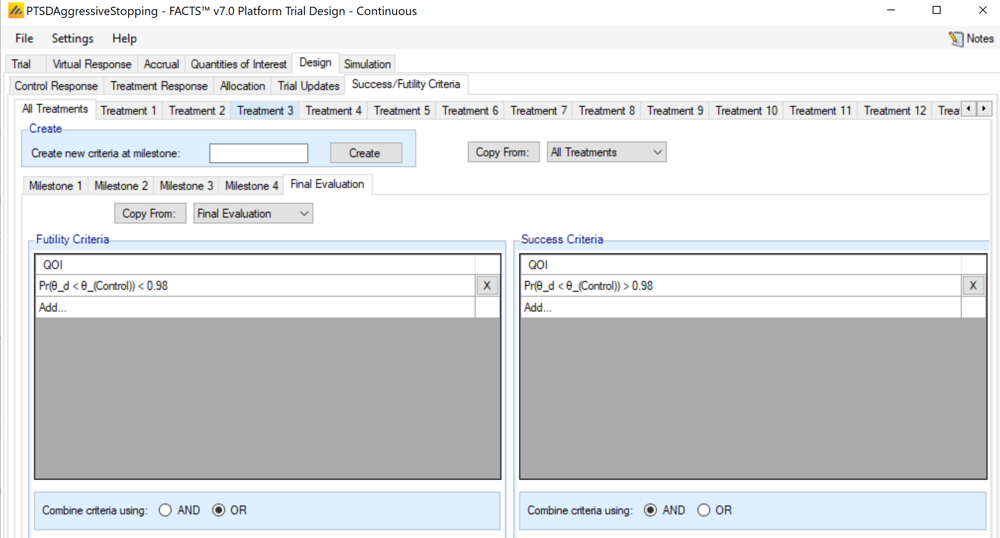

Some operating characteristics of this design are placed side by side with the previous three designs for comparison. This design cycles through treatments even faster, achieving 15.37 analyzed treatments on average and 2.94 "good" treatments on average, nearly double the number of the original design. The average time to first success has been reduced by nearly a year compared to the original design.

+-----------------------------------------+------------------+---------------------------+-------------------------+--------------------------------+
| **Operating Characteristic**            | **Non-Adaptive** | **Add Futility Stopping** | **Aggressive Futility** | **Early Success + Aggressive** |
+=========================================+:================:+:=========================:+:=======================:+:==============================:+
| Mean Treatments Started                 | 12               | 12.73                     | 15.36                   | 17.60                          |
+-----------------------------------------+------------------+---------------------------+-------------------------+--------------------------------+
| Mean Treatments Analyzed                | 9                | [10.16]{.mark}            | [12.88]{.mark}          | [15.37]{.mark}                 |
+-----------------------------------------+------------------+---------------------------+-------------------------+--------------------------------+
| Mean Good Treatments Analyzed           | 1.69             | 1.76                      | [2.12]{.mark}           | [2.94]{.mark}                  |
+-----------------------------------------+------------------+---------------------------+-------------------------+--------------------------------+
| Mean Unacceptable Treatments Analyzed   | 6.73             | 7.78                      | 10.00                   | 11.48                          |
+-----------------------------------------+------------------+---------------------------+-------------------------+--------------------------------+
| Mean Mediocre Treatments Analyzed       | 0.58             | 0.62                      | 0.76                    | 0.95                           |
+-----------------------------------------+------------------+---------------------------+-------------------------+--------------------------------+
| Mean Successes                          | 2.05             | 2.07                      | 2.44                    | 3.35                           |
+-----------------------------------------+------------------+---------------------------+-------------------------+--------------------------------+
| Mean Good Treatment Successes           | 1.56             | 1.60                      | 1.91                    | 2.61                           |
+-----------------------------------------+------------------+---------------------------+-------------------------+--------------------------------+
| Mean Unacceptable Treatment Successes   | 0.17             | 0.15                      | 0.17                    | 0.28                           |
+-----------------------------------------+------------------+---------------------------+-------------------------+--------------------------------+
| Mean Futilities                         | 6.95             | 8.09                      | 10.44                   | 12.00                          |
+-----------------------------------------+------------------+---------------------------+-------------------------+--------------------------------+
| Mean Good Treatment Futilities          | 0.13             | 0.16                      | 0.21                    | 0.33                           |
+-----------------------------------------+------------------+---------------------------+-------------------------+--------------------------------+
| Mean Unacceptable Treatment Futilities  | 6.56             | 7.63                      | 9.83                    | 11.20                          |
+-----------------------------------------+------------------+---------------------------+-------------------------+--------------------------------+
| Ppn Successes \| Treatment Good         | 0.926            | 0.910                     | 0.900                   | 0.886                          |
+-----------------------------------------+------------------+---------------------------+-------------------------+--------------------------------+
| Ppn Successes \| Treatment Unacceptable | 0.025            | 0.020                     | 0.017                   | 0.024                          |
+-----------------------------------------+------------------+---------------------------+-------------------------+--------------------------------+
| Ppn 1+ Successes                        | 0.89             | 0.90                      | [0.95]{.mark}           | [0.97]{.mark}                  |
+-----------------------------------------+------------------+---------------------------+-------------------------+--------------------------------+
| Mean First Success Time (weeks)         | 170.1            | [158.3]{.mark}            | 155.0                   | [120.9]{.mark}                 |
+-----------------------------------------+------------------+---------------------------+-------------------------+--------------------------------+

: \"Rare but Good\" scenario

+-----------------------------------------+------------------+---------------------------+-------------------------+--------------------------------+
| **Operating Characteristic**            | **Non-Adaptive** | **Add Futility Stopping** | **Aggressive Futility** | **Early Success + Aggressive** |
+=========================================+:================:+:=========================:+:=======================:+:==============================:+
| Mean Treatments Started                 | 12               | 12.91                     | 15.81                   | 17.49                          |
+-----------------------------------------+------------------+---------------------------+-------------------------+--------------------------------+
| Mean Treatments Analyzed                | 9                | [10.32]{.mark}            | [13.37]{.mark}          | [15.25]{.mark}                 |
+-----------------------------------------+------------------+---------------------------+-------------------------+--------------------------------+
| Mean Good Treatments Analyzed           | 1.28             | 1.35                      | [1.65]{.mark}           | [2.16]{.mark}                  |
+-----------------------------------------+------------------+---------------------------+-------------------------+--------------------------------+
| Mean Unacceptable Treatments Analyzed   | 7.16             | 8.37                      | 10.97                   | 12.18                          |
+-----------------------------------------+------------------+---------------------------+-------------------------+--------------------------------+
| Mean Mediocre Treatments Analyzed       | 0.56             | 0.60                      | 0.75                    | 0.92                           |
+-----------------------------------------+------------------+---------------------------+-------------------------+--------------------------------+
| Mean Successes                          | 1.64             | 1.67                      | 1.97                    | 2.58                           |
+-----------------------------------------+------------------+---------------------------+-------------------------+--------------------------------+
| Mean Good Treatment Successes           | 1.13             | 1.15                      | 1.39                    | 1.80                           |
+-----------------------------------------+------------------+---------------------------+-------------------------+--------------------------------+
| Mean Unacceptable Treatment Successes   | 0.18             | 0.17                      | 0.19                    | 0.28                           |
+-----------------------------------------+------------------+---------------------------+-------------------------+--------------------------------+
| Mean Futilities                         | 7.36             | 8.65                      | 11.40                   | 12.66                          |
+-----------------------------------------+------------------+---------------------------+-------------------------+--------------------------------+
| Mean Good Treatment Futilities          | 0.15             | 0.19                      | 0.27                    | 0.35                           |
+-----------------------------------------+------------------+---------------------------+-------------------------+--------------------------------+
| Mean Unacceptable Treatment Futilities  | 6.97             | 8.20                      | 10.78                   | 11.89                          |
+-----------------------------------------+------------------+---------------------------+-------------------------+--------------------------------+
| Ppn Successes \| Treatment Good         | 0.881            | 0.857                     | 0.839                   | 0.835                          |
+-----------------------------------------+------------------+---------------------------+-------------------------+--------------------------------+
| Ppn Successes \| Treatment Unacceptable | 0.025            | 0.021                     | 0.017                   | 0.023                          |
+-----------------------------------------+------------------+---------------------------+-------------------------+--------------------------------+
| Ppn 1+ Successes                        | 0.81             | 0.83                      | [0.89]{.mark}           | [0.93]{.mark}                  |
+-----------------------------------------+------------------+---------------------------+-------------------------+--------------------------------+
| Mean First Success Time (weeks)         | 179.5            | [167.9]{.mark}            | 166.8                   | [138.4]{.mark}                 |
+-----------------------------------------+------------------+---------------------------+-------------------------+--------------------------------+

: \"Rarer less Good\" scenario

The Outcome by Treatment graph shows that the early success stopping is occurring for a large majority of the good treatment arms (in the Good but Rare scenario), indicating that 100 may be over-powered for many of the effect sizes being simulated.

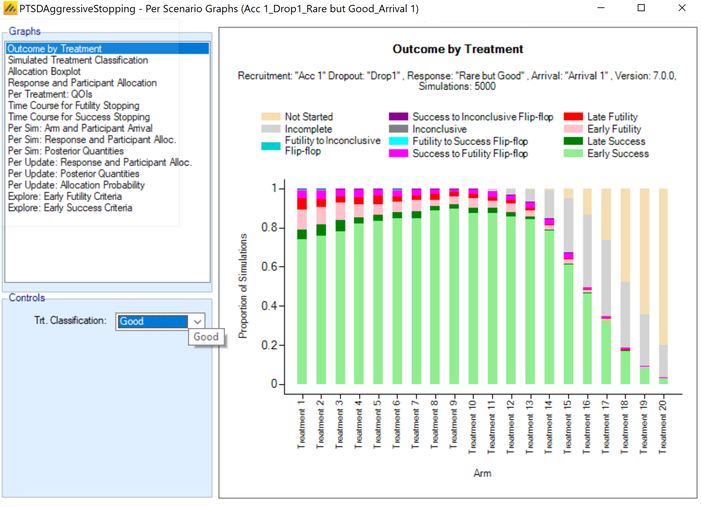

The impact of early stopping may be hard to assess without a more detailed look at *how* early. The graph below is constructed in R using the detailed output available in the simulations.csv file produced by FACTS. It shows boxplots of the number of participants enrolled when an arm is stopped, broken out by true effect size and outcome, for the Rare but Good scenario. We can see that early stopping for success is having a great impact on lowering the number of participants (and thus time) for the most effective arms. The false negatives are not dominated by low numbers, indicating that the early futility looks are not a major source of problems. When the effect size is 0, the median enrolment is approximately 50, cutting enrolment in half for the majority of treatments in the trial.

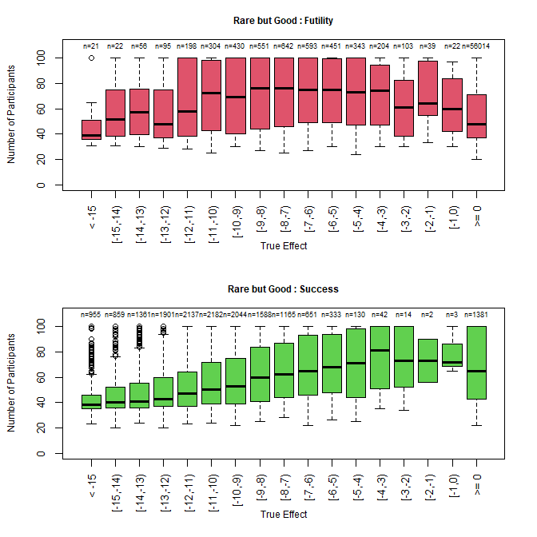

# Add RAR

Another potential tool for improving time to success is response adaptive randomization (RAR). RAR provides increased allocation to arms whose data appear promising, potentially leading to decreased time to achieve success on the arm, with the trade-off that allocation to other arms must be lowered simultaneously.

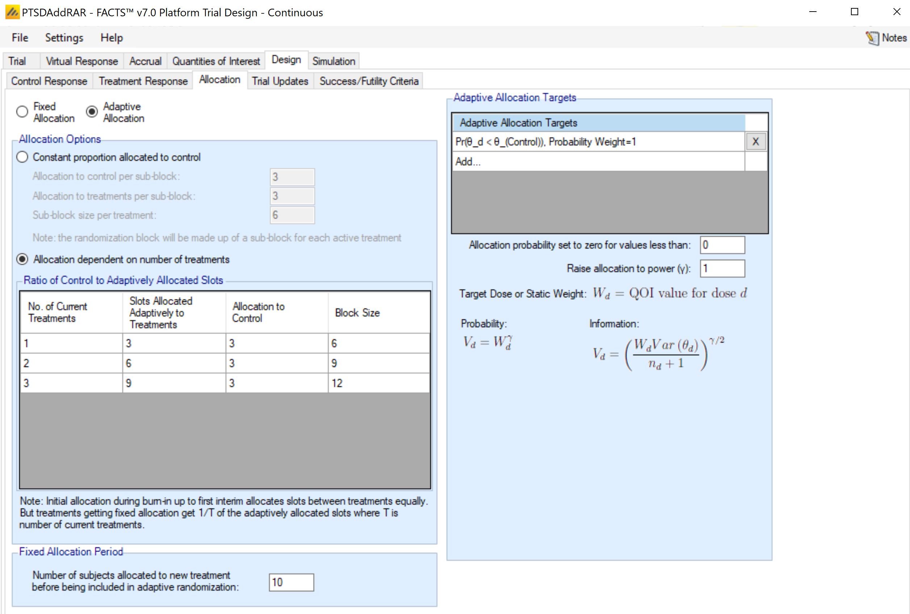

This design mimics the Aggressive Stopping design, except as changed on the Design \> Allocation tab. Here, we select Adaptive Allocation, and it is important to note that the second column in the Ratio of Control to Adaptively Allocated Slots table is different than in Fixed Allocation. For adaptive allocation, the second column gives the total number of slots allocated to non-control arms within each block (not number to each arm as in fixed). Setting a 9:3 allocation in adaptive allocation is our analog to 3:3:3:3 allocation in the fixed allocation designs. The 9 slots allotted to treatment will be proportional to the probability of superiority, as specified in the Adaptive Allocation Targets table. E.g., if an arm has a 90% probability of superiority while the other two are 50%, the arms will be allocated at 47%, 26%, and 26% among the 9 slots allocated to treatments.

The issue of a burn-in period for RAR is a bit more complicated than in a non-platform design. When an arm first enters the trial, the allocation target will be based purely on the prior distribution, which may have been set up to be non-informative and thus not particularly useful for RAR. The user is thus allowed to select a burn-in period for each treatment arm. Any arm within the burn-in period will be allocated 1/T of the treatment arm allocation slots, where T is the number of treatment arms currently enrolling. This can help to guarantee a modest amount of information to be collected on the arm before it is subject to RAR shifts in allocation. Here, we have set the burn-in period to be 10 participants.

Some operating characteristics of this design are placed side by side with the four previous designs for comparison. In this case, there is negligible improvement by adding the feature aimed at achieving earlier successes. Some detailed review of the trial simulations will show that between the burn-in period of 10 participants for RAR and the aggressive stopping as early as 20 participants, there is a fairly narrow window where RAR can make much difference. Also, for these scenarios, futility stopping is a driving consideration (since most treatments are ineffective), and RAR can slow recruitment to poorly-performing arms, possibly leading to slower futility stopping. For these scenarios, the RAR appears to offer a relatively minimal improvement in speed over fixed allocation and thus may not be worth the operational cost of implementing RAR.

+-----------------------------------------+------------------+---------------------------+-------------------------+--------------------------------+--------------------------------------+
| **Operating Characteristic**            | **Non-Adaptive** | **Add Futility Stopping** | **Aggressive Futility** | **Early Success + Aggressive** | **Early Success + Aggressive + RAR** |
+=========================================+:================:+:=========================:+:=======================:+:==============================:+:====================================:+
| Mean Treatments Started                 | 12               | 12.73                     | 15.36                   | 17.60                          | 17.70                                |
+-----------------------------------------+------------------+---------------------------+-------------------------+--------------------------------+--------------------------------------+
| Mean Treatments Analyzed                | 9                | [10.16]{.mark}            | [12.88]{.mark}          | [15.37]{.mark}                 | 15.50                                |
+-----------------------------------------+------------------+---------------------------+-------------------------+--------------------------------+--------------------------------------+
| Mean Good Treatments Analyzed           | 1.69             | 1.76                      | [2.12]{.mark}           | [2.94]{.mark}                  | 2.96                                 |
+-----------------------------------------+------------------+---------------------------+-------------------------+--------------------------------+--------------------------------------+
| Mean Unacceptable Treatments Analyzed   | 6.73             | 7.78                      | 10.00                   | 11.48                          | 11.57                                |
+-----------------------------------------+------------------+---------------------------+-------------------------+--------------------------------+--------------------------------------+
| Mean Mediocre Treatments Analyzed       | 0.58             | 0.62                      | 0.76                    | 0.95                           | 0.97                                 |
+-----------------------------------------+------------------+---------------------------+-------------------------+--------------------------------+--------------------------------------+
| Mean Successes                          | 2.05             | 2.07                      | 2.44                    | 3.35                           | 3.34                                 |
+-----------------------------------------+------------------+---------------------------+-------------------------+--------------------------------+--------------------------------------+
| Mean Good Treatment Successes           | 1.56             | 1.60                      | 1.91                    | 2.61                           | 2.62                                 |
+-----------------------------------------+------------------+---------------------------+-------------------------+--------------------------------+--------------------------------------+
| Mean Unacceptable Treatment Successes   | 0.17             | 0.15                      | 0.17                    | 0.28                           | 0.26                                 |
+-----------------------------------------+------------------+---------------------------+-------------------------+--------------------------------+--------------------------------------+
| Mean Futilities                         | 6.95             | 8.09                      | 10.44                   | 12.00                          | 12.15                                |
+-----------------------------------------+------------------+---------------------------+-------------------------+--------------------------------+--------------------------------------+
| Mean Good Treatment Futilities          | 0.13             | 0.16                      | 0.21                    | 0.33                           | 0.34                                 |
+-----------------------------------------+------------------+---------------------------+-------------------------+--------------------------------+--------------------------------------+
| Mean Unacceptable Treatment Futilities  | 6.56             | 7.63                      | 9.83                    | 11.20                          | 11.31                                |
+-----------------------------------------+------------------+---------------------------+-------------------------+--------------------------------+--------------------------------------+
| Ppn Successes \| Treatment Good         | 0.926            | 0.910                     | 0.900                   | 0.886                          | 0.885                                |
+-----------------------------------------+------------------+---------------------------+-------------------------+--------------------------------+--------------------------------------+
| Ppn Successes \| Treatment Unacceptable | 0.025            | 0.020                     | 0.017                   | 0.024                          | 0.022                                |
+-----------------------------------------+------------------+---------------------------+-------------------------+--------------------------------+--------------------------------------+
| Ppn 1+ Successes                        | 0.89             | 0.90                      | [0.95]{.mark}           | [0.97]{.mark}                  | 0.97                                 |
+-----------------------------------------+------------------+---------------------------+-------------------------+--------------------------------+--------------------------------------+
| Mean First Success Time (weeks)         | 170.1            | [158.3]{.mark}            | 155.0                   | [120.9]{.mark}                 | 119.9                                |
+-----------------------------------------+------------------+---------------------------+-------------------------+--------------------------------+--------------------------------------+

: \"Rare but Good\" scenario

+-----------------------------------------+------------------+---------------------------+-------------------------+--------------------------------+--------------------------------------+
| **Operating Characteristic**            | **Non-Adaptive** | **Add Futility Stopping** | **Aggressive Futility** | **Early Success + Aggressive** | **Early Success + Aggressive + RAR** |
+=========================================+:================:+:=========================:+:=======================:+:==============================:+:====================================:+
| Mean Treatments Started                 | 12               | 12.91                     | 15.81                   | 17.49                          | 17.57                                |
+-----------------------------------------+------------------+---------------------------+-------------------------+--------------------------------+--------------------------------------+
| Mean Treatments Analyzed                | 9                | [10.32]{.mark}            | [13.37]{.mark}          | [15.25]{.mark}                 | 15.37                                |
+-----------------------------------------+------------------+---------------------------+-------------------------+--------------------------------+--------------------------------------+
| Mean Good Treatments Analyzed           | 1.28             | 1.35                      | [1.65]{.mark}           | [2.16]{.mark}                  | 2.19                                 |
+-----------------------------------------+------------------+---------------------------+-------------------------+--------------------------------+--------------------------------------+
| Mean Unacceptable Treatments Analyzed   | 7.16             | 8.37                      | 10.97                   | 12.18                          | 12.25                                |
+-----------------------------------------+------------------+---------------------------+-------------------------+--------------------------------+--------------------------------------+
| Mean Mediocre Treatments Analyzed       | 0.56             | 0.60                      | 0.75                    | 0.92                           | 0.93                                 |
+-----------------------------------------+------------------+---------------------------+-------------------------+--------------------------------+--------------------------------------+
| Mean Successes                          | 1.64             | 1.67                      | 1.97                    | 2.58                           | 2.56                                 |
+-----------------------------------------+------------------+---------------------------+-------------------------+--------------------------------+--------------------------------------+
| Mean Good Treatment Successes           | 1.13             | 1.15                      | 1.39                    | 1.80                           | 1.80                                 |
+-----------------------------------------+------------------+---------------------------+-------------------------+--------------------------------+--------------------------------------+
| Mean Unacceptable Treatment Successes   | 0.18             | 0.17                      | 0.19                    | 0.28                           | 0.26                                 |
+-----------------------------------------+------------------+---------------------------+-------------------------+--------------------------------+--------------------------------------+
| Mean Futilities                         | 7.36             | 8.65                      | 11.40                   | 12.66                          | 12.79                                |
+-----------------------------------------+------------------+---------------------------+-------------------------+--------------------------------+--------------------------------------+
| Mean Good Treatment Futilities          | 0.15             | 0.19                      | 0.27                    | 0.35                           | 0.38                                 |
+-----------------------------------------+------------------+---------------------------+-------------------------+--------------------------------+--------------------------------------+
| Mean Unacceptable Treatment Futilities  | 6.97             | 8.20                      | 10.78                   | 11.89                          | 11.98                                |
+-----------------------------------------+------------------+---------------------------+-------------------------+--------------------------------+--------------------------------------+
| Ppn Successes \| Treatment Good         | 0.881            | 0.857                     | 0.839                   | .835                           | 0.825                                |
+-----------------------------------------+------------------+---------------------------+-------------------------+--------------------------------+--------------------------------------+
| Ppn Successes \| Treatment Unacceptable | 0.025            | 0.021                     | 0.017                   | 0.023                          | 0.022                                |
+-----------------------------------------+------------------+---------------------------+-------------------------+--------------------------------+--------------------------------------+
| Ppn 1+ Successes                        | 0.81             | 0.83                      | [0.89]{.mark}           | [0.93]{.mark}                  | 0.93                                 |
+-----------------------------------------+------------------+---------------------------+-------------------------+--------------------------------+--------------------------------------+
| Mean First Success Time (weeks)         | 179.5            | [167.9]{.mark}            | 166.8                   | [138.4]{.mark}                 | 136.7                                |
+-----------------------------------------+------------------+---------------------------+-------------------------+--------------------------------+--------------------------------------+

: \"Rarer less Good\" scenario

# Homework Problems

- This tutorial explored just two scenarios of primary interest to the trial designers. Is the design robust to other scenarios?

  - Construct a scenario with a higher proportion of good treatments. Are the operating characteristics still adequate for this scenario, in particular the false positive and true positive rates?

  - Construct a scenario with fewer highly-effective treatments with a distribution that is spread out more evenly across the "mediocre" range (of 0 to -8). Are the operating characteristics still adequate for this scenario?

- Suppose we decide that operationally, we can allow treatment arms to enter the trial between trial updates. Check the "Treatment arms may enter trial between updates" option on the Design \> Trial Updates tab. Is there a noticeable effect on operating characteristics, in particular time to first success?

- The Aggressive Futility design utilizes a changing threshold on the posterior probability of superiority. A similar effect can be achieved by using a predictive probability with a constant threshold. Consider setting up a predictive probability Quantity of Interest to predict the outcome of a future trial with 200 participants per arm, and set up a single milestone at 20 participants with opportunity to complete. (This is most easily achieved by modifying the "AddFutility" design.) Predictive probabilities generally require lower thresholds than posterior probabilities. Consider a futility threshold in the range of 0.4 to 0.6. How does this design compare to the AggressiveFutility design?
