#  Introduction

This tutorial uses the new FACTS Platform engine to simulate a pharmaceutical company's internal Phase II trial of six treatments that enter and leave the trial at different times over a period of two years.

The approach is to first present a design whose operating characteristics fall short in several ways, then to improve the design in response, but not necessarily to resolve all concerns, some of which may require more resources.

# Designs Featured

In this tutorial we create the following designs:

- Design 1

  - Platform trial for 6 treatments with dichotomous data, up to 50 participants per experimental treatment.

- Design 2

  - Like Design 1, but improved based on what we learn from simulating Design 1.

# Design 1: First attempt

The primary endpoint is dichotomous and available one week after randomization. Events represent positive outcomes, such as complete resolution of symptoms after one week, with the standard of care typically achieving a 30% success rate. There is no predictor of the primary endpoint.

The company has two experimental treatments available immediately and expects four additional treatments to become available six to twelve months later, as safety and dosing studies reach completion, but there is uncertainty about these timelines.

The company intends for the trial to run for two years and is willing to randomize up to 50 participants to each of the six experimental treatments, while also randomizing to the standard of care throughout. A treatment whose success rate is more than 10% higher than the standard of care would be desirable and should achieve success in this trial, after which it can potentially proceed to Phase III.

Since there is expected to be a pipeline of six treatments, we want to be able to stop treatments for futility based on fewer than 50 participants. However, we do not wish to stop a promising treatment early for success or expected success because we want to have secondary endpoint data for 50 participants for treatments that continue development after this trial. (The secondary outcomes will not be simulated in FACTS however).

We will not be using response-adaptive randomization.

## Trial

Start FACTS 7.0 or later, double click on: Platform Trial Design -- Dichotomous.

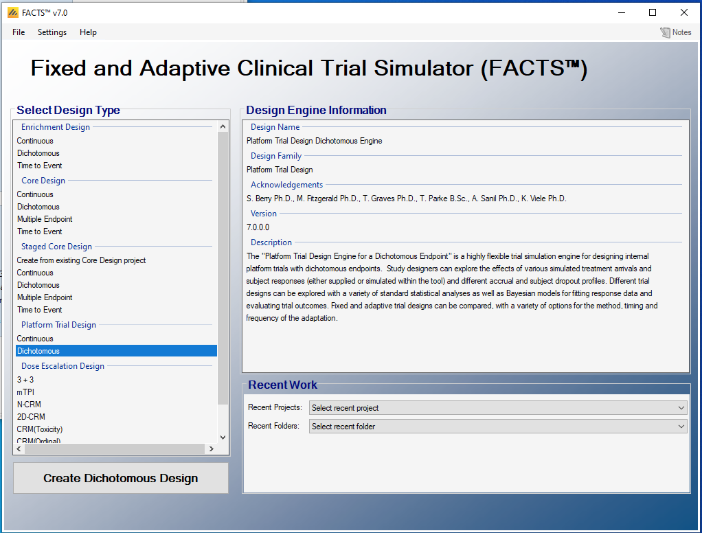

Using the menu option "File \> Save As", save this design as "PlatformTutorial2" in a convenient location.

### Trial $\rightarrow$ Trial Info

On the Trial $\rightarrow$ Trial Info tab, select the following options:

- Under Design Options, select **Enable adaptive features**

- Uncheck Use longitudinal modeling

- Under Trial information, check Max enrollment time (wks) and enter **104**

- Set the Max number of participants per treatment to be **50**

- Set the Max concurrent treatments to be **3**

- Check "Response indicates positive outcome"

- Under Schedule of Post-Baseline Visits, Time to Final Endpoint should be 1 week

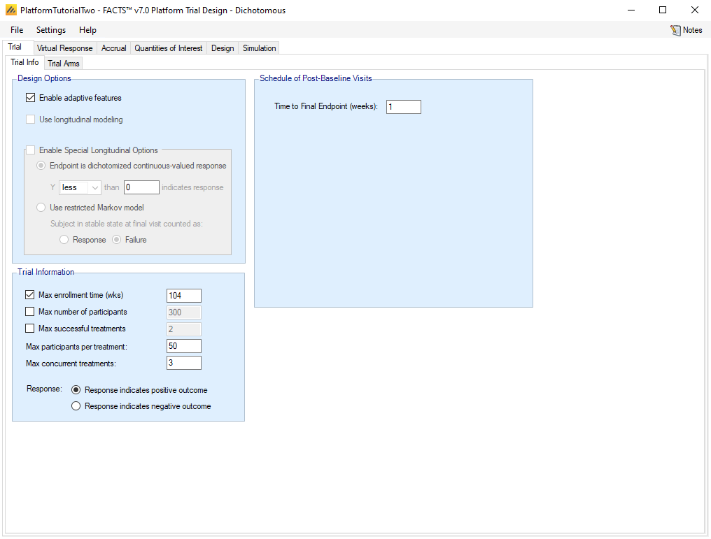

### Trial $\rightarrow$ Trial Arms

#### Trial $\rightarrow \ $ Trial Arms $\rightarrow$ Definition

- Include a control treatment arm. (As of FACTS 7.0, including a control arm is required.)

- Click "Add arm" six times so that Treatment 1 through Treatment 6 are added.

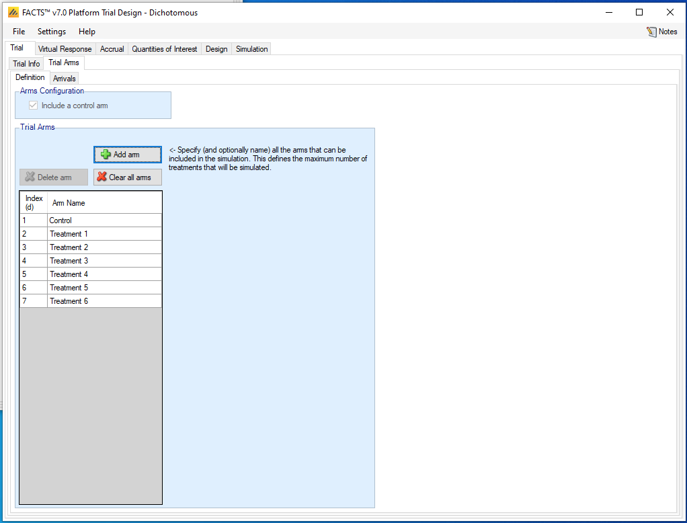

####  Trial $\rightarrow \ $ Trial Arms $\rightarrow$ Arrivals

First we will define a deterministic schedule for when treatments become available. Then we will define arrival schedules to allow for the possibility that treatments take longer than intended to join the trial.

Click "Add" and rename the Profile to "Fixed Arrival". Then set the Latest Possible Arrival times for the six treatments to be 0, 0, 26, 26, 39, and 52 weeks. Set the Earliest Possible Arrival times to be the same as the Latest times, and set all the "Withdrawn if Not Used Within" values to be 52.

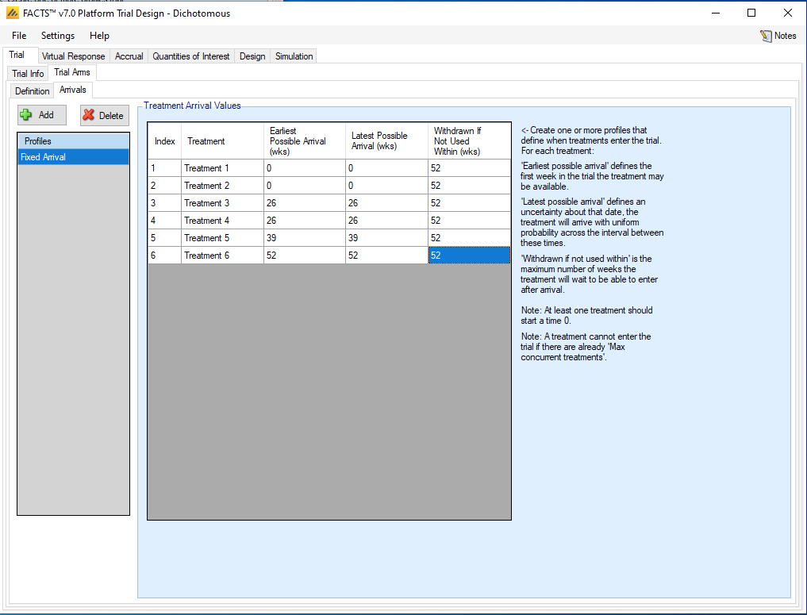

Then Click +Add again, rename the new Profile to be "Uncertain Arrival", and use the same values in the table, except for adding 13 weeks to the Latest Possible Arrival times for Treatments 3 through 6.

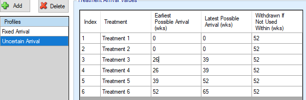

Finally, to capture the risks of a more unpredictable drug development process where each treatment's arrival time is more uncertain than the last, click on Add again, rename the profile to "V Uncertain Arrival", and set the Latest arrival times to be 39, 52, 78, and 91, with the other table entries the same as for previous arrival schedules.

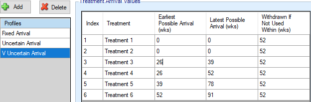

## Virtual Response

### Virtual Response $\rightarrow$ Treatment Classification 

In the Platform Trial engine, a specific treatment may be defined to have a random treatment effect which is sometimes highly efficacious and sometimes not. We want FACTS to keep track of outcomes for arms based on their simulated treatment effects, and the "Classification of Simulated Treatments" dialogue facilitates this.

- Enter 0.1 in the "We would want a treatment to be a success if treatment effect \>" box

- Enter 0 in the "We would want a treatment to be a failure if treatment effect $\leq$" box

- Check the "Rates" box to the right of "Specify treatment classification thresholds in:".

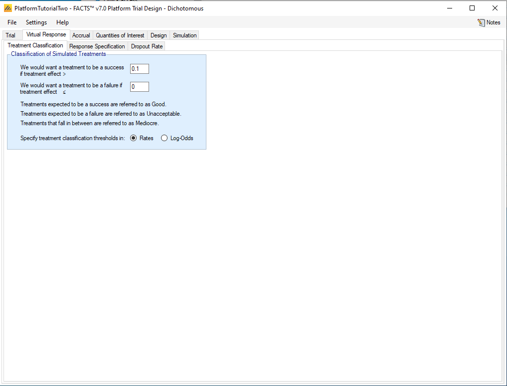

### Virtual Response $\rightarrow$ Response Specification

We will define seven treatment effect scenarios. In the first five of these, control has a 30% probability of a good outcome.

- a Null scenario, where all six treatments are equivalent to control

- a Small Effects scenario where all six treatments have the same 5% benefit over control

- a Fixed Improving scenario where all experimental treatments are better than control by amounts 5%, 5%, 10%, 10%, 15%, and 20%

- Good 4, where Treatment 4 has a 20% benefit and all the others have 5% benefits

- Good 6, which is like Good 4 except that it is Treatment 6 that has a 20% benefit

- Random Control, which is similar to the Fixed Improving scenario except that the control arm success rate is random. The treatment effects are defined in terms of fixed benefits on the log-odds scale, which would be equivalent to 5%, 10%, 15%, and 20% benefits if the control had a 30% success rate.

- Uncertain, where the control has a random distribution as in Random Control, and all six treatments have random treatment effects that are zero with probability 2/3, and otherwise range from 0% to 20%.

To add the null scenario, select the Virtual Response, Explicitly Defined tab and click the "+ Add" button. Rename the Profile from "Resp 1" to "Null" by clicking and then typing "Null" in the Profiles dialog. Then select "Fixed Response Rate" for all the treatments using the menus in the Response Rate Fixed/Sampled column, and enter 0.3 in all the cells in the Value column.

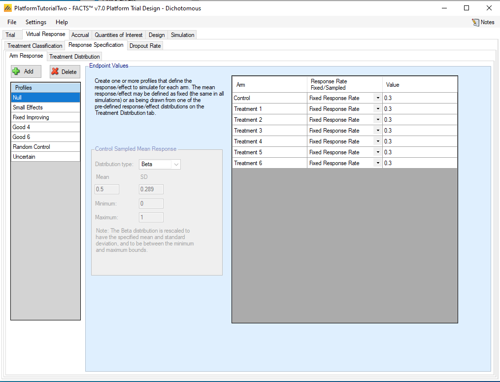

Create the Small Effects, Fixed Improving, Good 4, and Good 6 scenarios using the values in this table. Remember to select "Fixed Response Rate" in the "Response Rate Fixed/Sampled" for all of these.

+-------------+--------+---------------+-----------------+--------+-----------------+
| Arm         | Null   | Small Effects | Fixed Improving | Good 4 | Good 6          |
+=============+========+===============+=================+========+=================+
| Control     | 0.3    | 0.3           | 0.3             | 0.3    | 0.3             |
+-------------+--------+---------------+-----------------+--------+-----------------+
| Treatment 1 | 0.3    | 0.35          | 0.35            | 0.35   | 0.35            |
+-------------+--------+---------------+-----------------+--------+-----------------+
| Treatment 2 | 0.3    | 0.35          | 0.35            | 0.35   | 0.35            |
+-------------+--------+---------------+-----------------+--------+-----------------+
| Treatment 3 | 0.3    | 0.35          | 0.40            | 0.35   | 0.35            |
+-------------+--------+---------------+-----------------+--------+-----------------+
| Treatment 4 | 0.3    | 0.35          | 0.40            | 0.50   | 0.35            |
+-------------+--------+---------------+-----------------+--------+-----------------+
| Treatment 5 | 0.3    | 0.35          | 0.45            | 0.35   | 0.35            |
+-------------+--------+---------------+-----------------+--------+-----------------+
| Treatment 6 | 0.3    | 0.35          | 0.50            | 0.35   | 0.50            |
+-------------+--------+---------------+-----------------+--------+-----------------+

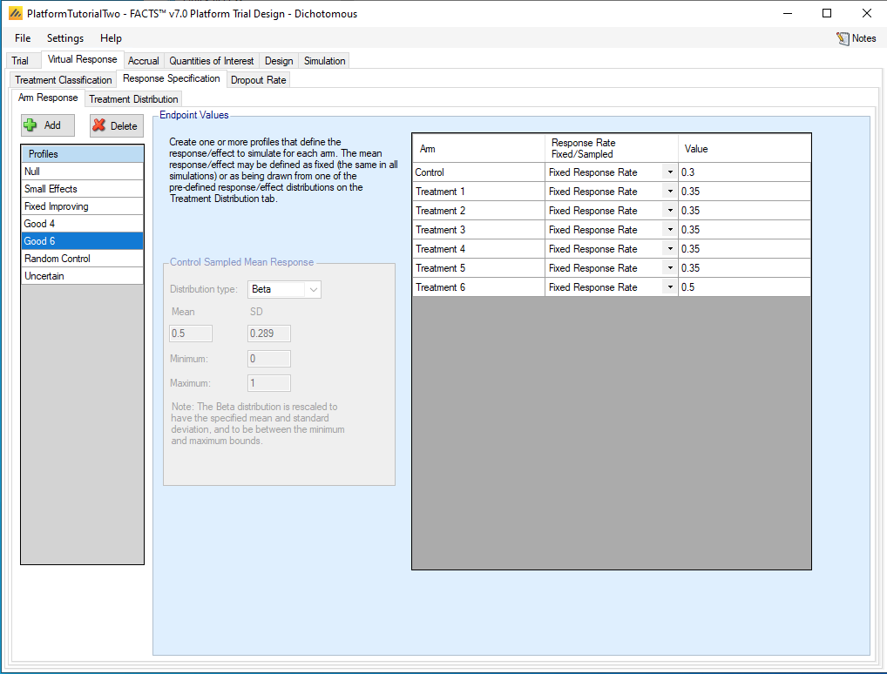

Now we define the Random Control scenario. Click +Add again and name the scenario accordingly. Select Sampled for the Control arm and Fixed Effect (Log-Odds) for all of the Treatments. Enter 0.23, 0.23, 0.44, 0.44, 0.65, and 0.85 for the Values for the treatment effects; these values correspond to response rates of 0.35, 0.35, 0.40, 0.40, 0.45, and 0.50 when the control rate is 0.30, e.g. $0.23 = \log{\left\{ 0.35/(1 - 0.35) \right\} -}\log\left\{ 0.30/(1 - 0.30) \right\}$. In the Control Sampled Mean Response dialogue, select Beta for the distribution type, a Mean of 0.3, a Minimum of 0, and a Maximum of 0.6. Select 0.173 for the SD; this is the standard deviation for a uniform distribution between 0 and 0.6.

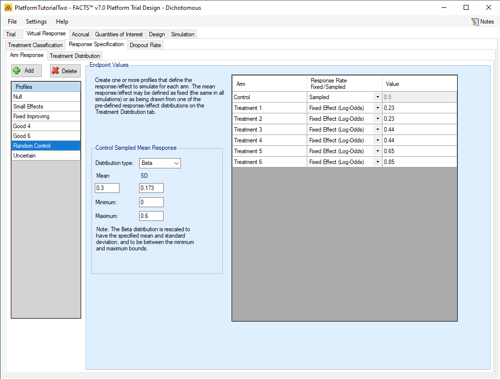

Finally we define the Uncertain scenario, where all the treatment arms have random treatment effects. Click +Add again, and change the name of the Profile to Uncertain. Choose "Sampled" for the Control arm, and "Sampled from Dist 1" for all the Treatment arms. For the Control Sampled Mean Response, select the Beta distribution, a Mean of 0.3, an SD of 0.0289, and a minimum and maximum of 0.25 and 0.35. Again, this SD defines a uniform distribution.

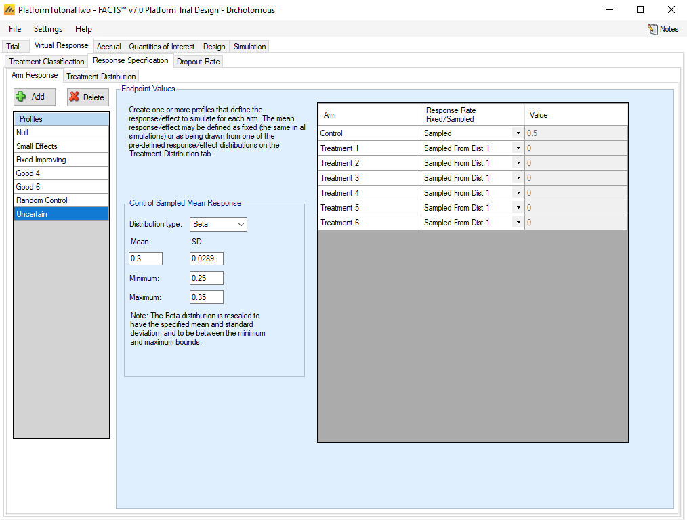

Now we will define the Treatment effect distribution on the "Treatment Distribution" tab. We choose the Effect (Response Rate) selector and enter 0.667 for the Prob effect size is zero, so that 2/3 of treatment arms have no effect and, on the average, only two of the treatment arms in a given simulation will have an effect. Enter 0.1 for the Mean, 0.05 for the SD, and 0 and 0.2 for the minimum and maximum. This time, we have chosen the SD to give a distribution peaked at 0.1 and with less probability near 0 and 0.2. Of the one-third of treatments with nonzero effects, all are beneficial to some extent and their effects range from 0 to 0.2.

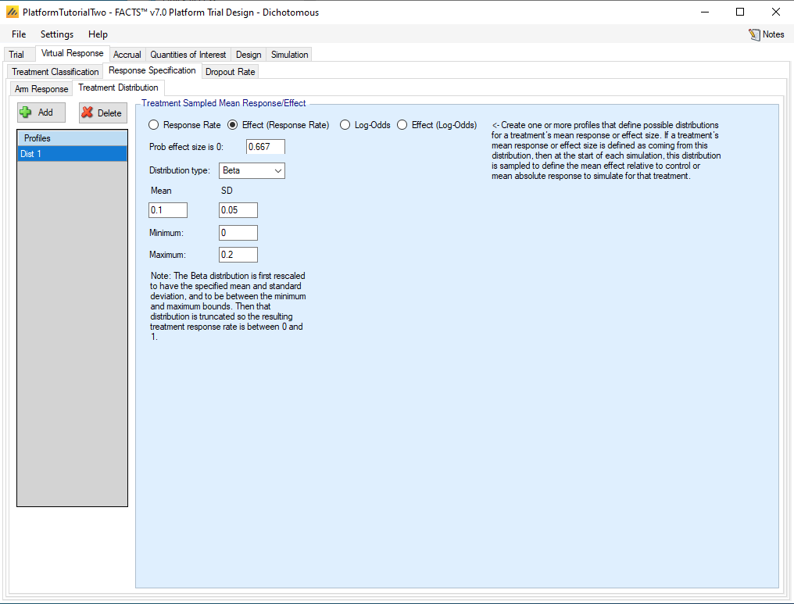

Before leaving the Virtual Response tab, we will check the Dropout Rate tab. We will leave it in the default state, with one dropout Profile defined with no dropouts.

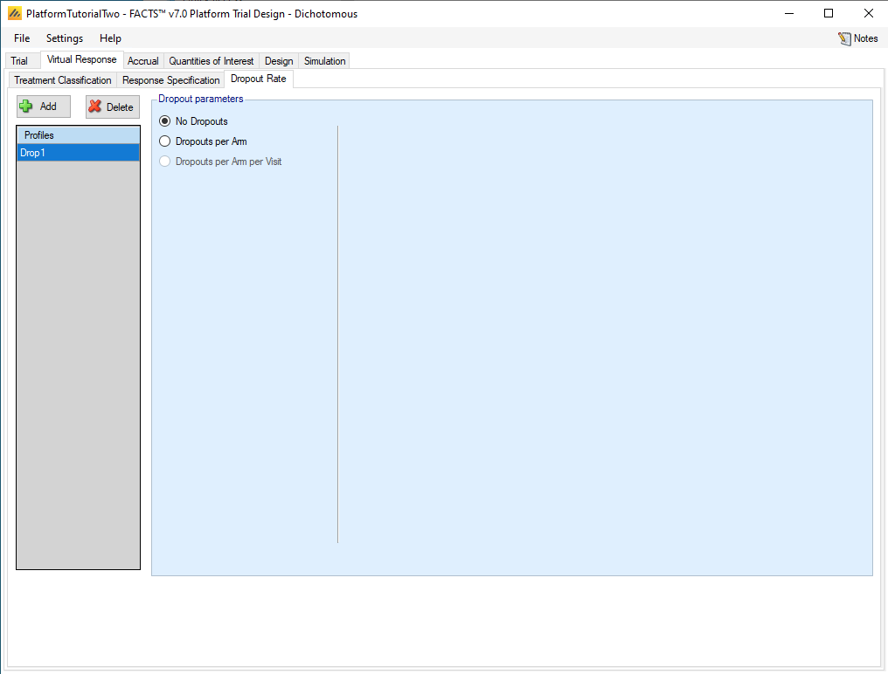

## Accrual

Add an accrual scenario by clicking the Add button on the far left. Set the peak accrual rate to 4 participants per week. We have scheduled the trial to last for 104 weeks, so an average of 416 participants can be accrued, enough for 50 participants for each experimental treatment and over 100 for control.

The names of the accrual profile and the region may be renamed by double-clicking on them.

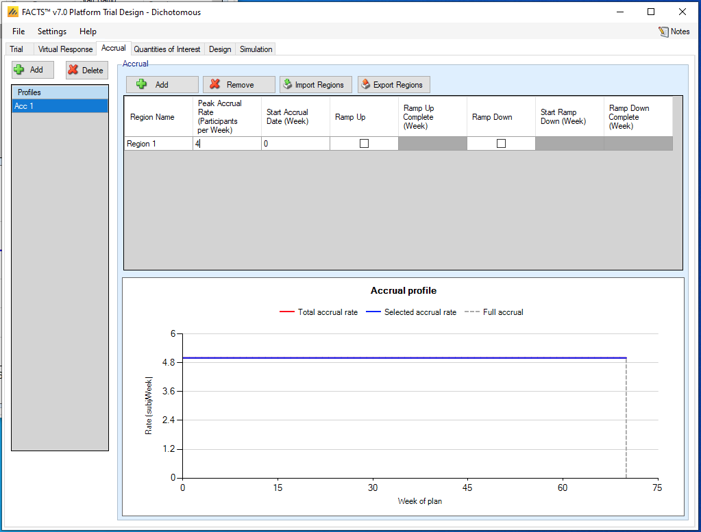

## Quantities of Interest 

FACTS has considerable flexibility in allowing the user to define Quantities of Interest (QOIs) to drive adaptations in the trial and decisions at the end of the trial. A basic set of QOIs is provided by default. Additional QOIs may be added by clicking the Add row in the table. A QOI can be removed by clicking the X on the right side of the cell. Each QOI may be edited by clicking on it, which opens a pop-up box.

In this trial we intend to stop a treatment for futility if it would have insufficiently large probability of a successful result in a future Phase III trial with 250 participants on each of control and the experimental treatment. This is one of the default QOIs; if we wanted to tweak the details of the notional future Phase III trial we could click on the definition of the QOI in the Predictive Probability section.

We also intend for the design to label a treatment to be a success if it has a high posterior probability of being superior to control. This is also a default QOI, so again no changes are required here.

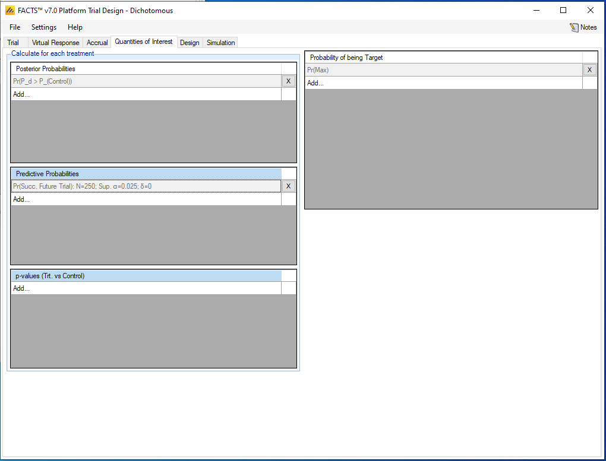

## Design

### Control Response

We will use a prior distribution for the control response centered around the expected rate of 0.3 and that is fairly noninformative. The logit of 0.3 is -0.85, so we use that for the mean of the log odds, and use 0.85 as the Prior SD.

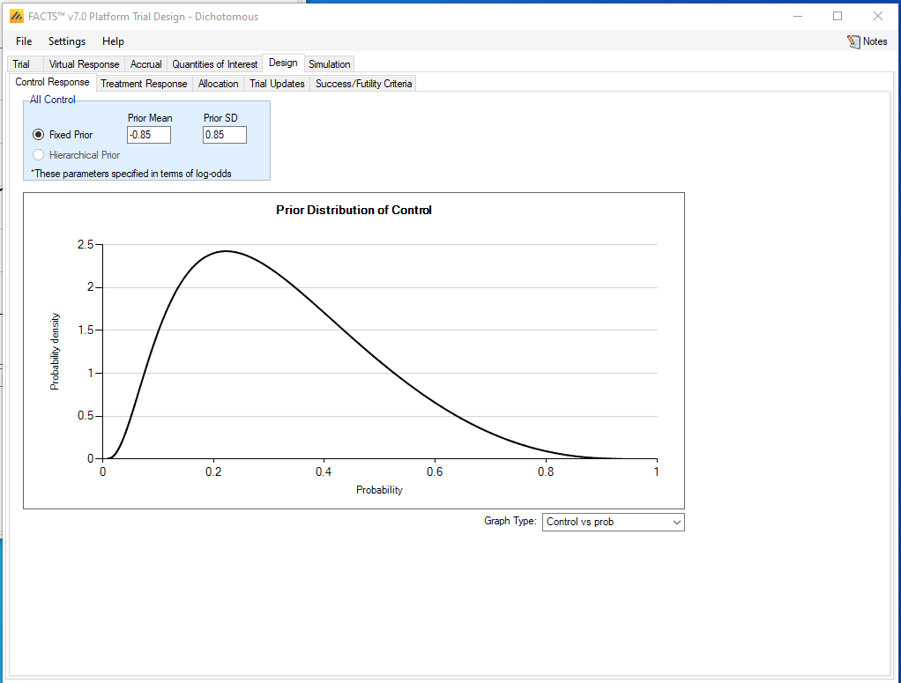

### Treatment Response

We will use the default prior distribution for the treatment response rates; it is highly non-informative with a prior mean of 0 for the treatment effect on the logit scale and a prior SD of 2. To see samples from this distribution, select "Treatment-Response Samples" from the menu under Graph Type.

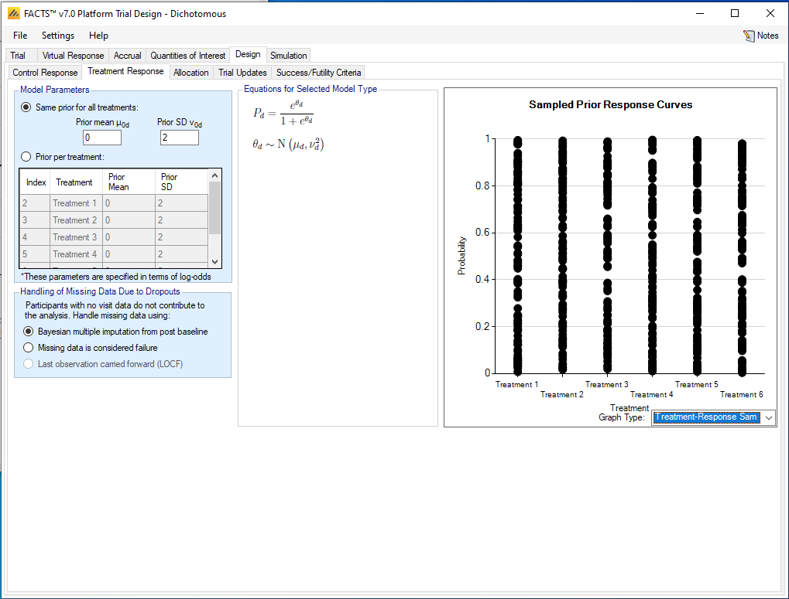

### Allocation

We are going to use fixed allocation, with the randomization probability for control and every experimental treatment arm in the trial always being equal. FACTS allows other options, such as fixing the control allocation regardless of the number of treatments in the trial.

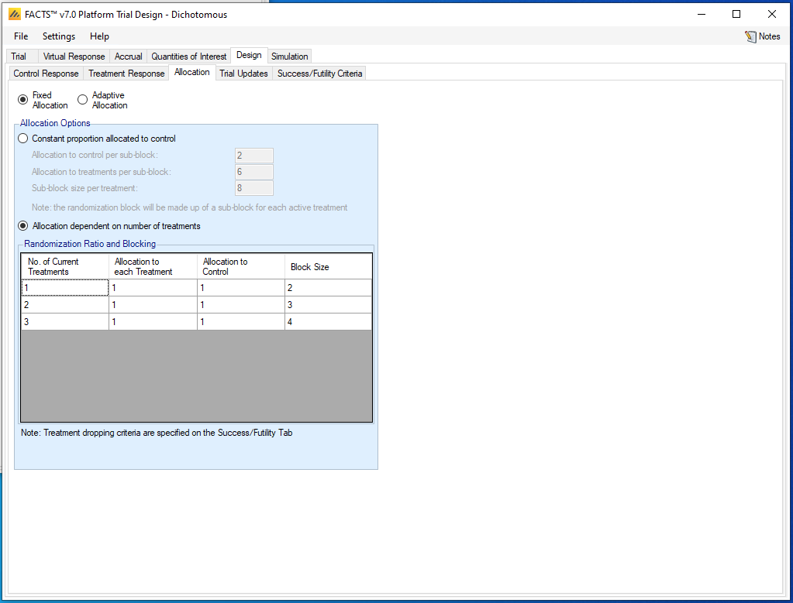

### Trial Updates

FACTS allows considerable flexibility in the choice of how to schedule trial updates. They can be conducted on a fixed calendar schedule; it is often appropriate that the data analysts and reviewers have a predictable schedule for reviewing data. In this internal pharma trial, we will conduct an analysis whenever any experimental treatment reaches a milestone that requires a decision. In particular, we will give each treatment an opportunity to stop for futility when it randomizes its 20^th^, 30^th^, and 40^th^ participants.

Select "Participants Enrolled" to define the measure of Participant Information: i.e. we will conduct a treatment's first analysis when it reaches 20 participants enrolled, regardless of how many of them have complete data. Information can also be defined based on participants with Complete Data. (Opportunity to Complete is another option that can apply, and be different from Complete Data, when there are dropouts.) Select "Updates occur whenever a treatment milestone is met". Uncheck both boxes under "Participant Follow-Up Options": if a treatment stops for futility, it cannot be a success after further follow-up, while the success box does not apply in this trial because we are not allowing early stopping for success.

Now under Treatment Milestones, click the +Add button three times to add three milestones, and enter 20, 30, and 40 in the Participants Enrolled column.

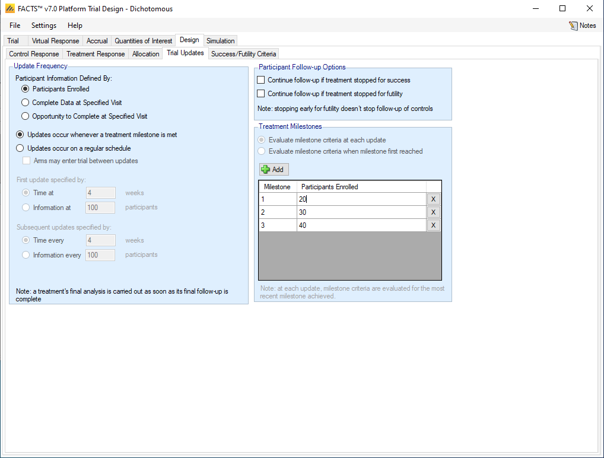

### Success/Futility Criteria

We will define one futility rule that is used at each of the three milestones, and one success rule that is used at the Final Evaluation for each treatment. To define a set of criteria for the milestones, from the "All Treatments" tab under "Design" and "Success/Futility Criteria", enter "1" for "Create new criteria at milestone" and hit the Create button. This allows us to create a set of criteria that begins applying at the first milestone (20 enrolled participants) and continues applying for subsequent milestones (unless we create new criteria that begin applying at a later milestone). Under the newly created Milestone 1 tab, check the Futility Criteria box, and click on Add... to bring up the Add Stopping Criterion dialogue box. Select the Pr(Succ. Future Trial) QOI, select \< and enter 0.25 for the threshold, so that a treatment will stop for futility if its predictive probability of success in a future Phase III trial is less than 0.25.

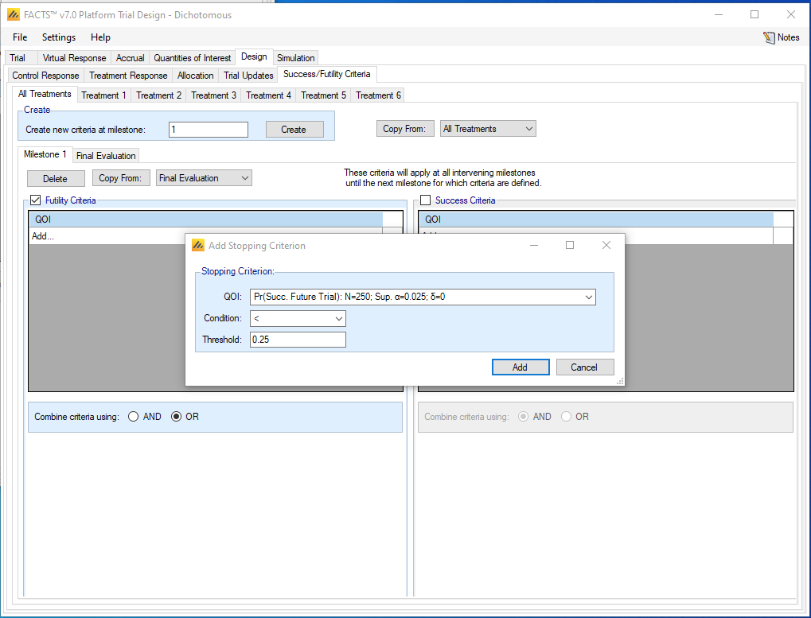

A treatment will be judged a success if it reaches 50 participants and if the data at the end of its follow-up yields a 97.5% posterior probability of having a higher response rate than control. To define this success rule, first click on the Final Evaluation tab while still under "All Treatments". On the "Success Criteria" side of the tab, click on "Add..." under QOI. Select the $Pr(P_{d} > P_{Control})$ option from the QOI drop-down menu, select "\>", and enter 0.975 as shown in the figure below. We will not enter any futility criteria. The trial will be declared inconclusive if it reaches its final sample size and falls short of a 97.5% probability of superiority to control. We reserve futility for treatments that stop before reaching 50 participants.

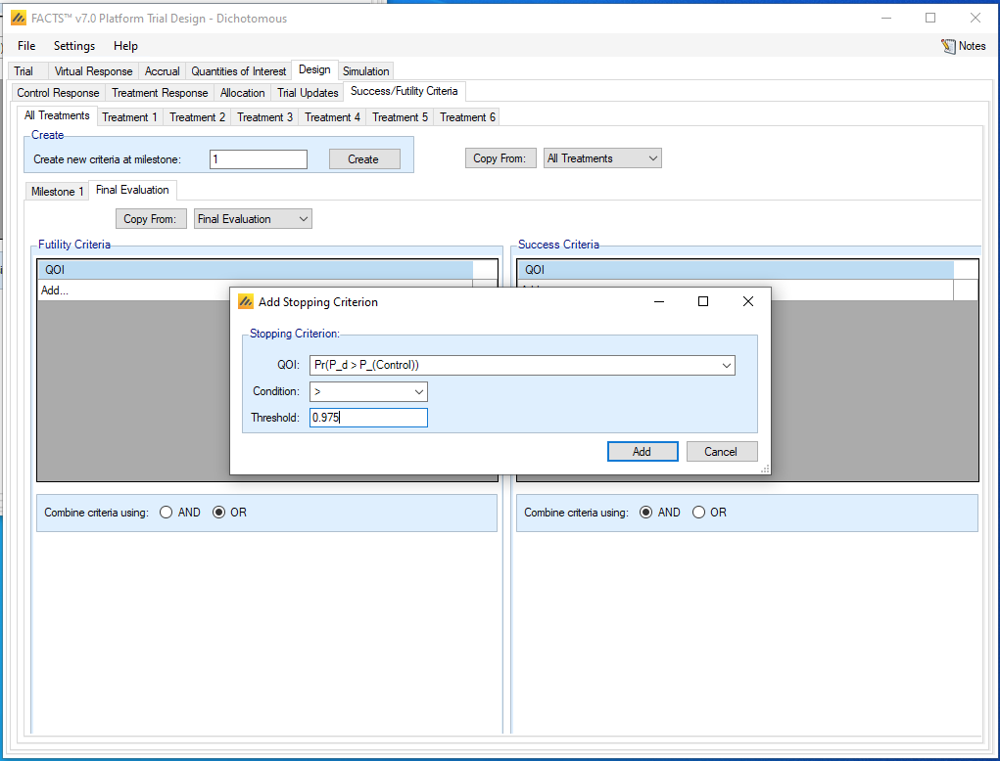

## Simulation

We are now ready to begin simulating the trial. Normally we recommend running a small number of simulations per scenario first to get fast feedback. Set the number of simulations to 10, click "Select All" then press Simulate. This allows us to make a quick assessment of whether the design is behaving as expected.

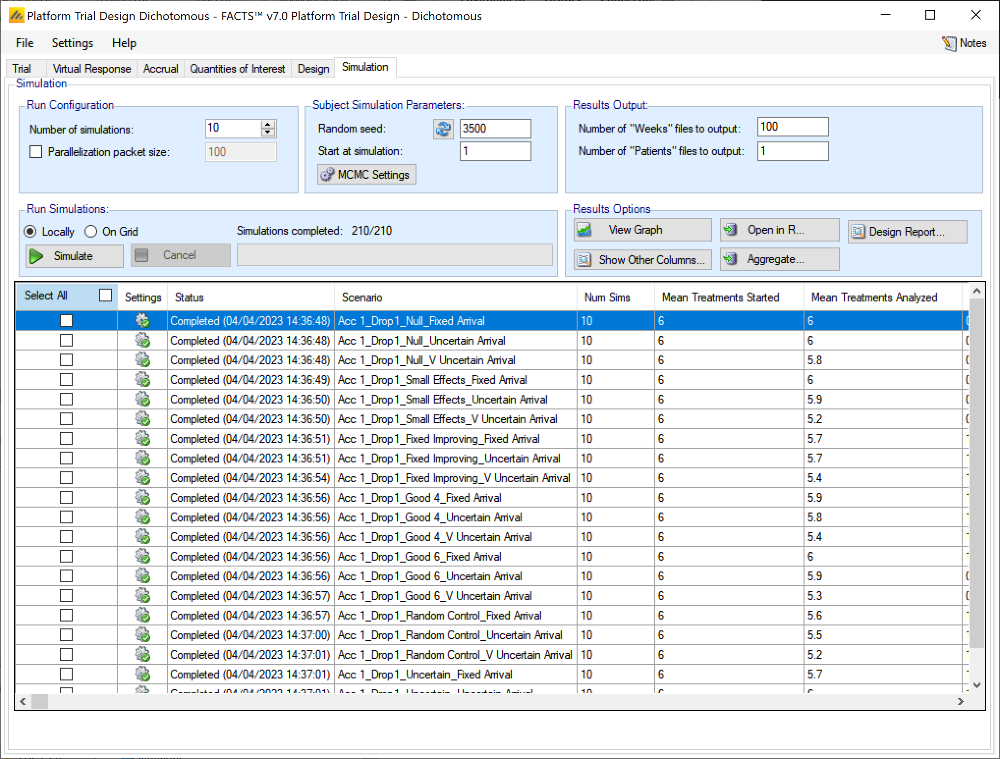

All scenarios have Mean Treatments Enrolled of 6, so we are not stopping the trial before the sixth treatment even begins. However, some scenarios have Mean Treatments Analyzed smaller than 6, so the trial sometimes stops at 104 weeks before reaching final analysis for all treatments.

Use the scroll bar at the bottom to scroll to the right until reaching "Mean Successes". We see that in the Null scenarios, the numbers of successes are smaller than for the other scenarios, which matches our expectations.

If the results look reasonable, increase the number of simulations to run to 1000, re-check all the scenario combinations with Select All and then press Simulate again. Platform trials can be slow to simulate; this run of 1000 simulations will still serve as a rough guide to whether we have done anything badly wrong. If you have access to a computer grid, and your FACTS installation has been correctly configured to use it, you may use the grid's parallel computing capabilities to improve computation speed. To do so, select "on Grid."

## Results

We will now investigate the operating characteristics.

In the Platform Trial Design engine, treatments are categorized into three types: Good, Mediocre, and Unacceptable. Recall that we defined a Good treatment to be one with a treatment effect of larger than 0.1, an Unacceptable treatment to be one with zero or negative treatment effect, and a Mediocre treatment to be one with a treatment effect larger than zero but no larger than 0.1.

### Type I Error (Unacceptable Treatment Successes)

Registration is not a goal of this trial, so we don't necessarily need to control Type I error carefully at the 0.025 level. It is still unsatisfactory if treatments with no treatment effect are too likely to be successful, especially since we are investigating six treatments and would prefer not to proceed to Phase III with any unacceptable treatment. The fraction of unacceptable treatments that succeed is an analogue of Type I error in a simpler trial, although note that if many unacceptable treatments are harmful, the probability of success will generally be smaller than if they are all equivalent to control.

We will primarily investigate Type I error using the Null efficacy scenario, in which all the treatments have the same response rate as control, 0.3. In the Simulations output table, click in the row for the Acc 1_Drop 1_Null_Fixed scenario, and then click on View Graph, selecting the Show Per Scenario Graphs option. The Outcome by Treatment graphs will appear.

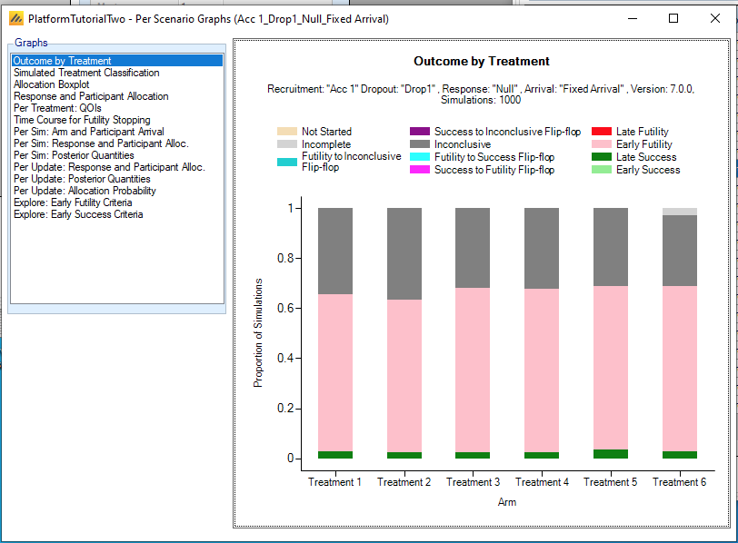

The Late Success probabilities are all small, visibly less than 0.05, and the most likely outcome is Early Futility. Treatment 6 has a small probability of being Incomplete. To get the precise simulation results, go back to the table and scroll to the right until you reach the "Ppn Successes \| Treatment Unacceptable" column. For the three Null scenarios with the different arrival schedules, this column has values of 0.0268, 0.024, 0.0225. These values are not surprising: since we did not allow early success and since we defined success to be a posterior probability of at least 0.975 of a benefit, we expect the success probability to be close to 0.025 for null treatments. The Uncertain scenarios at the bottom of the table also have Unacceptable treatments, and their success probabilities are similar. The other scenarios do not feature any Unacceptable treatments.

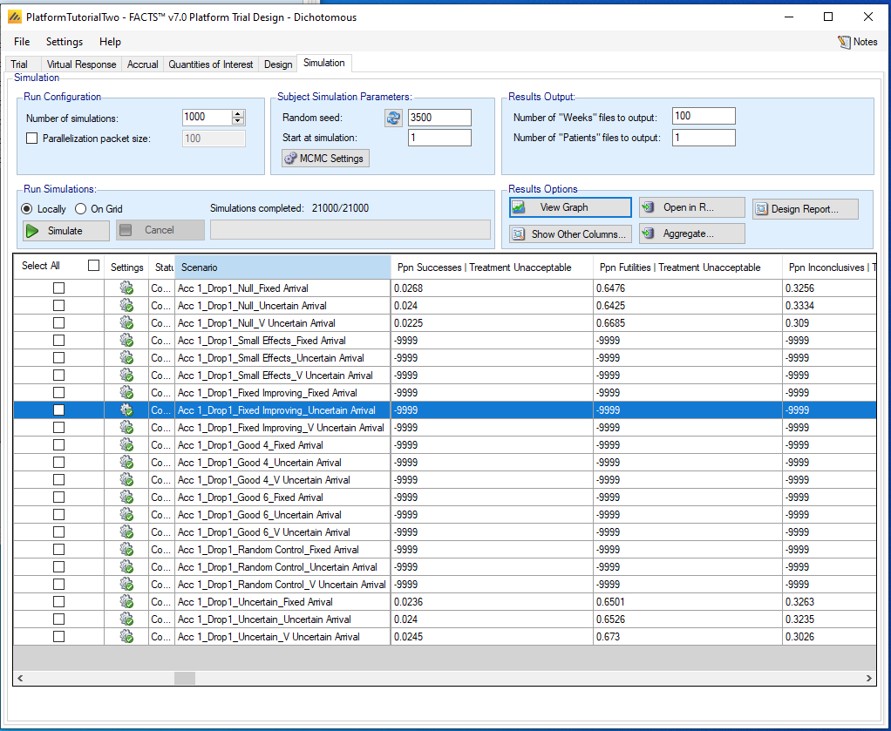

We can also consult the "Mean Unacceptable Treatment Successes" column for results summed over all unacceptable treatments. These values range from 0.13 to 0.16 in the null scenarios and are less than 0.10 in the Uncertain scenarios. All treatments are Unacceptable in the null scenarios, compared to only two-thirds of treatments in the Uncertain scenarios.

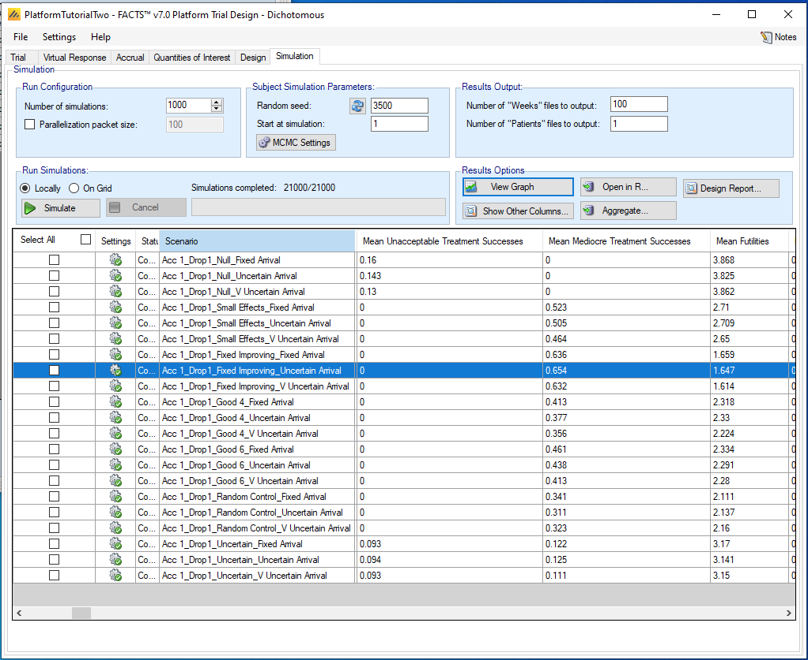

We consider the Type I error probabilities and average number of treatments that succeed in the null scenarios to be satisfactory, so we don't decide on any design changes at this point. We make a note that we might want to consider making the final success rule less stringent to increase power if we are comfortable with slightly higher Type I error probabilities in this Phase II trial.

### Futility for Unacceptable Treatments

It is also desirable if Unacceptable treatments stop for futility before reaching the maximum sample size. Referring back to the graphic showing "Ppn Successes \| Treatment Unacceptable", the column to its right is "Ppn Futilities \| Treatment Unacceptable" and we see that 64% to 67% of Unacceptable treatments stopped early for futility. This seems satisfactory as well.

### Power (Good Treatment Successes)

An analogue of power in a simpler trial is the proportion of Good treatments that achieve trial success. Scroll to the "Ppn Successes \| Treatment Good" column. We have run a variety of scenarios with Good treatments and we get a wide array of success probabilities. The "Good 4" scenarios are relatively simple: Treatment 4 is a Good treatment with a 20% benefit, and all other treatments are Mediocre with 5% benefits. So the Good treatment operating characteristics are about Treatment 4 in this scenario. (FACTS also provides treatment-specific success, futility, and inconclusive probabilities, and sometimes it is more convenient to consult them). We see that the proportion of successes ranges from 0.6884 to 0.7295 in the Good 4 scenarios. We would like these probabilities to be higher.

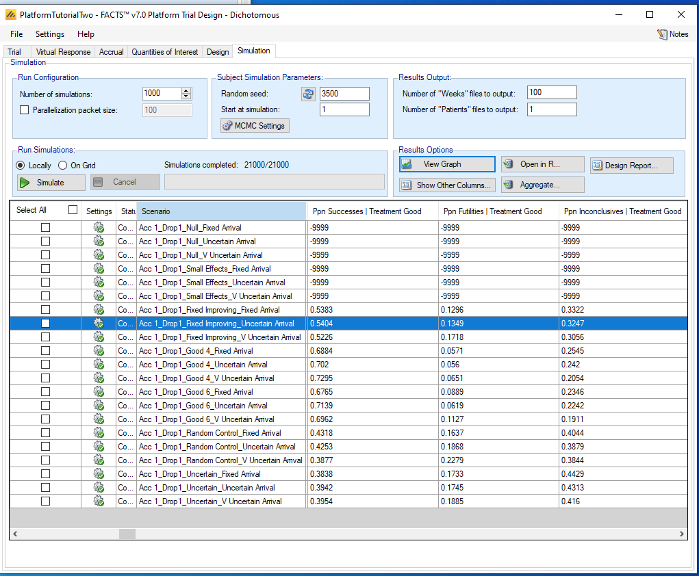

The "Good 6" scenarios are not very different from the "Good 4" scenarios: if a Good treatment does not appear until the sixth treatment, it still appears that the design can give that treatment a fair shot compared to if it entered earlier. There is a suggestion that power may drop by 3% from Treatment 4 to Treatment 6 if the arrivals are Very Uncertain, but this could be an artifact of only 1000 simulations. Note, however, that the denominator in this column is the number of times that the treatment reached its final analysis, so if results are incomplete too often, we will not see that here.

We also see that the futility probabilities in the Good 4 scenarios range from 5.6% to 6.5%. These futility probabilities are probably too high for Good treatments. And the futility probabilities for Good treatments are higher for other scenarios, which we will discuss further later.

We discuss these numbers with the team, and they decide to consider increasing the maximum sample size from 50 to 60, while simultaneously rescheduling the futility milestones to 30, 40, and 50 participants. It is very common that the culprit when futility numbers are too high for good treatments is that most of the problem is due to the earlier futility look (here, the 20 participant look). To confirm that this is the case here, click on the Good 4 row in the Table, click "View Graph $\rightarrow$ Show Per Scenario Graphs", select "Time Course for Futility Stopping", select "Treatment 4" for the "Arm" menu, and select "Cumulative over sample size". The 20-participant update is the largest contributor to futility; the reader can confirm that this is dramatic in other efficacy scenarios. 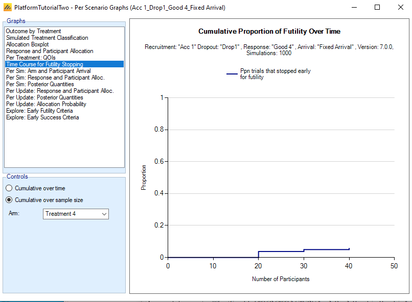

The team also believes that faster accrual rates can be achieved, so we will increase the accrual rate in the simulations by 20% to compensate for the larger sample sizes. The team is also comfortable with a proportional increase in the number of participants to be randomized to control.

### Power in Random Control Scenarios

Referring back to the previous figure, the probability of success for good treatments is much lower, uncomfortably low, in the Random Control scenarios. A reason for this is that our random response rates for control arms allow too much randomness. We defined the response rate for controls to have the Uniform distribution on \[0, 0.6\]. In particular, we are allowing small response rates that require larger sample sizes to accurately estimate, and that are most likely unrealistic given what we know about the control treatment.

One way to see the problem is using the "Per Sim: Response and Participant Allocation" graphs provided by FACTS. Select the "Acc 1_Drop 1_Random Control_Fixed Arrival" scenario in the simulations table, click on "View Graph $\rightarrow$ Show Per Scenario Graphs", and then select "Per Sim: Response and Participant Allocation" from the Graphs menu on the resulting window. To make it easier to see what's going on, we click the "Set Y axes..." button and tell FACTS to always use the \[0,1\] range for response rates.

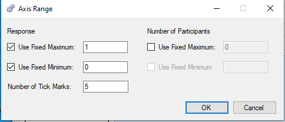

We can then flip through the Simulations, until Simulation 6 provides a great example of a simulated trial that wasn't what we intended.

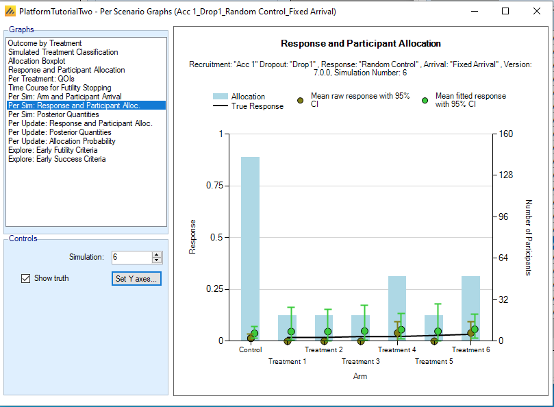

It looks like several of the treatments never got any responses at all, with the "Mean raw response" symbols pegged at zero.

The team is comfortable with a much tighter distribution on control treatment response rates, for example uniform on \[0.2, 0.4\]. If we observed a response rate outside that range in the trial, the team would be concerned that the population recruited in the trial is too different from the target population for the treatment.

### Good Treatments: Comparing Apples to Oranges

The proportion of Good treatments that succeed is also too low in the Uncertain scenario and the Fixed Improving scenario. In the Uncertain scenario, the control response rate is random, but we were more careful about specifying a reasonable distribution, uniform on \[0.25,0.35\]. The Fixed Improving scenario more clearly illustrates the issue. Recall that in the Good 4 and Good 6 scenarios, the only Good treatment had a 20% benefit relative to control. In the Fixed Improving scenario, Treatment 5 has a 15% benefit and Treatment 6 has a 20% benefit. Therefore, the operating characteristics for this scenario are a mixture of treatments as good as the Good 4 scenario and treatments not quite so good, so power numbers are inevitably less impressive.

The effect is more dramatic in other scenarios. For example in Random Control, two Treatments have a fixed log-odds effect of 0.44, which will translate into an effect (slightly) larger than 10% if the control response rate exceeds 0.3. So these two treatments will be counted as Good treatments roughly half the time, even though they barely qualify.

In the Uncertain scenario, treatments with nonzero effects have benefits uniformly distributed on \[0, 0.2\], so all treatments have benefits less than in the Good 4 and Good 6 scenarios and we should certainly expect reduced power. Many treatments will barely qualify for being Good treatments. We can confirm that Treatments 3 and 4 are often being scored as Good treatments by consulting the graphs. Select the "Acc 1_Drop 1_Random Control_Fixed Arrival" scenario in the simulations table, click on "View Graph $\rightarrow$ Show Per Scenario Graphs", and select "Simulated Treatment Classification". 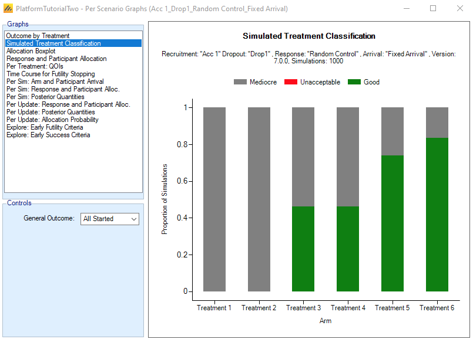Not only are Treatments 3 and 4 often Good, Treatments 5 and 6 are often falling into Mediocre territory, as will happen with log-odds effects of 0.65 and 0.85 when the control response rate is too small.

For this scenario, we decide to modify the treatment effect assumption so that benefits can be as large as 0.3. It seems consistent with the idea of an uncertain scenario to allow for the possibility of effects larger than in our standard fixed effect scenario. With this modification, effect sizes for Good treatments will range from 0.1 to 0.3, and should be more comparable to the Good 4 and 6 scenarios.

We consider changing the definition of Good treatments to only include treatments with benefits larger than 15%. This isn't completely satisfactory, we are still interested in the operating characteristics for treatments with 12% benefits for example. In the end we decide to make a smaller change to the definition, where Good treatments have to exceed 11% benefits. Note that in the Random Control scenario, if the Control arm has its highest response rate of 40%, Treatments 3 and 4 with effect sizes of 0.44 on the logit scale will have response rates of 50.8%, falling just short of the 11% requirement, so these two treatments will not be included in the Good treatment population.

A further issue appears in the Outcome by Treatment graphs for the Fixed Improving scenario. Note that Treatment 6's success probability is not much larger than Treatment 5's, and the culprit appears to be that Treatment 6's outcome is Incomplete close to 30% of the time. We did not see such a large Incomplete rate for Treatment 6 in the Good 6 scenario: in that scenario, Treatment 6 was competing for participants with treatments whose response rate was only slightly larger than control and were likely to stop for futility. In the Fixed Improving scenario, other treatments remain in the trial and as a result, Treatment 6 often fails to randomize its 50^th^ participant by the scheduled end of the trial. In practice, if we reached 104 weeks and at least one Treatment remained short of 50 participants and was outperforming the futility rule, we would want to keep the trial open and collect the full complement of participants on the remaining experimental treatment(s).

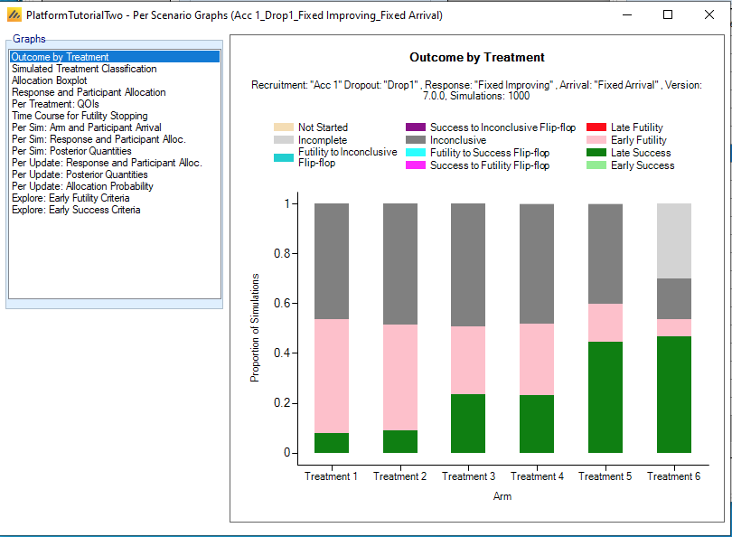

We decide to respond to this finding with a further increase in the accrual rate for the trial, which we think is realistic. Recall that we decided to increase the accrual rate from 4 to 4.8 participants a week because of the increase in sample size from 50 to 60. We decide to double this increase to 5.6 participants per week.

# Revising the Simulation Assumptions

Next we describe our revisions to the simulation assumptions inspired by our investigations of our original assumptions. Begin by saving the design under a new name, File $\rightarrow$ Save As $\rightarrow$.

## Trial $\mathbf{\rightarrow}$ Trial Info

Increase the Max number of participants per treatment to 60.

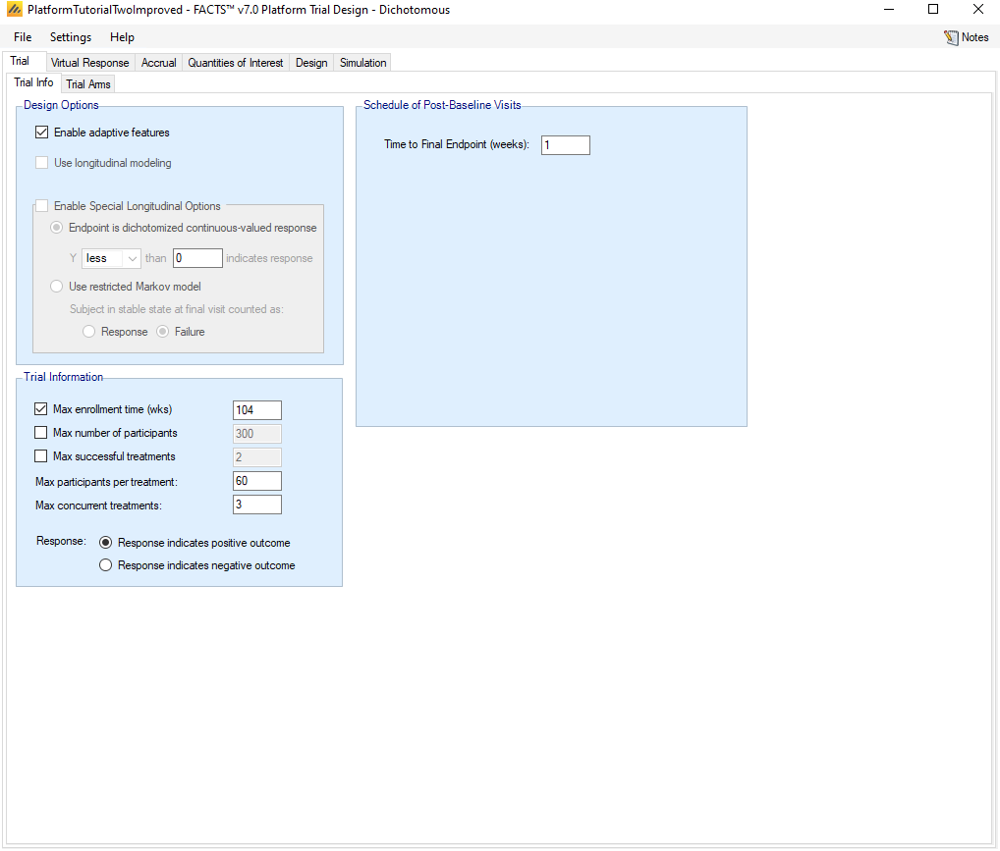

## Treatment Classification

Redefine Good treatments to require a benefit of 0.11 using the "We would want a treatment to be a success if treatment effect \>" box.

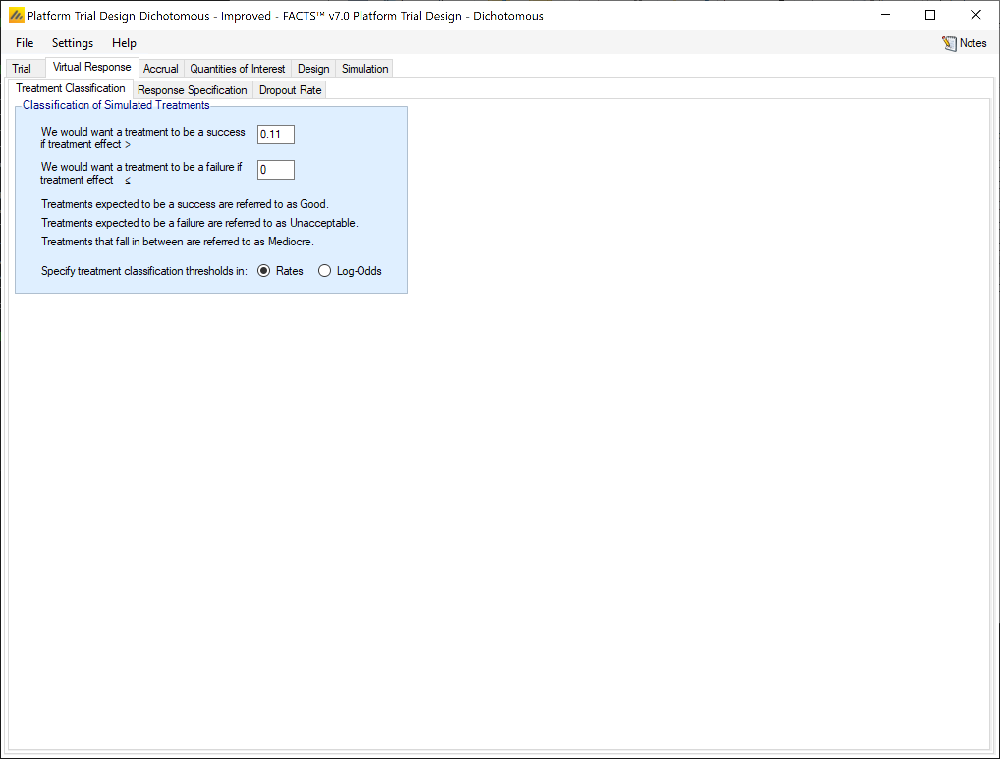

## Control Arm Assumption in Random Control Scenario

Go to Virtual Response $\rightarrow$ Explicitly Defined $\rightarrow$ Arm Response and select the Random Control scenario. Modify the Minimum to 0.2, Maximum to 0.4, and SD to 0.0577 (the standard deviation of the uniform distribution on \[0.2,0.4\]).

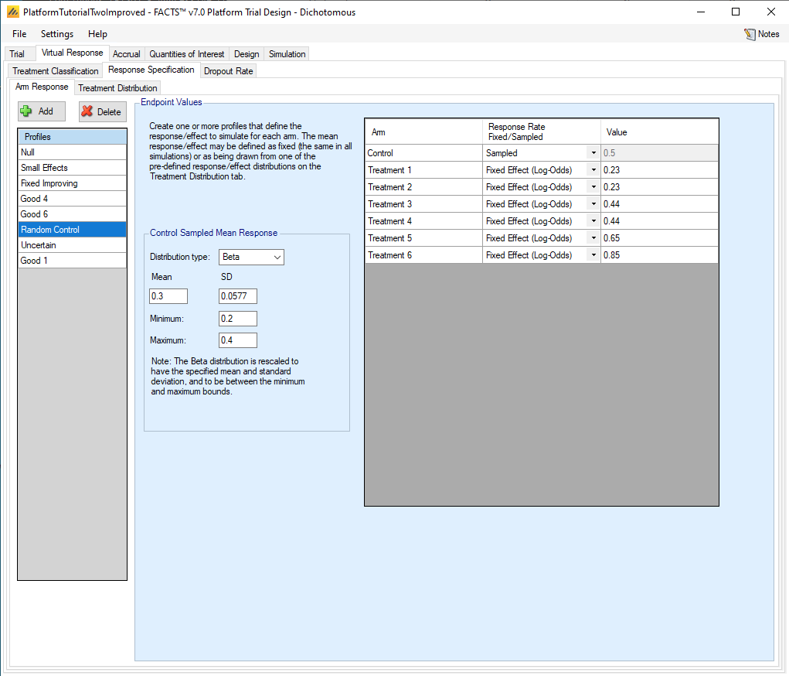

## Effect Size Distribution in Uncertain Scenario

Go to Virtual Response $\rightarrow$ Explicitly Defined $\rightarrow$ Treatment Distribution. (We defined a profile Dist 1, which in principle could be part of any scenario, but we only used it in the Uncertain scenario). Increase the Mean to 0.15, the Maximum to 0.3 and the SD to 0.0866 (the SD of the uniform distribution from 0 to 0.3).

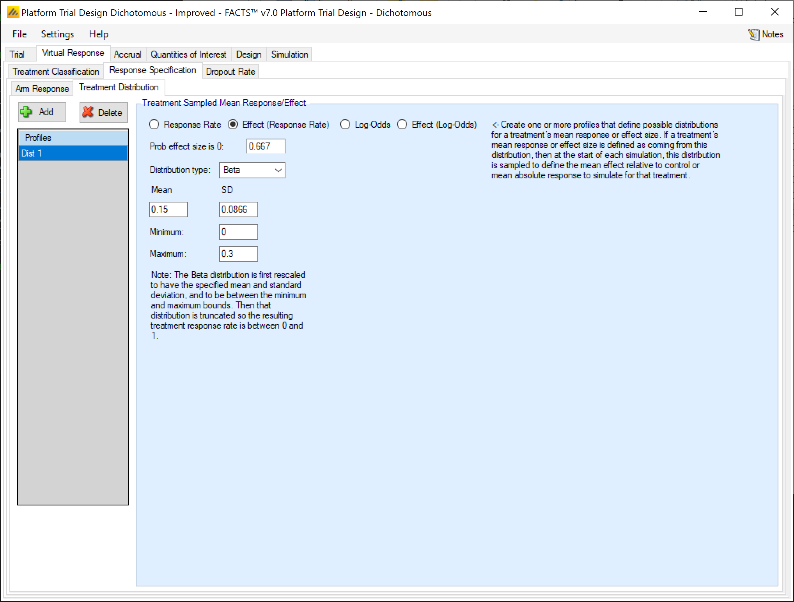

## New Good 1 Scenario

Add a new scenario, where the best treatment is Treatment 1 as opposed to the Good 4 and Good 6 scenarios. In platform trials, treatments that join early can be at a disadvantage because there is no bank of data on participants randomized to the Control arm. Go to Virtual Response $\rightarrow$ Explicitly Defined $\rightarrow$ Arm Response, click +Add, rename the new Profile to "Good 1", change all the "Response Rate Fixed/Sampled" menu choices to "Fixed Response Rate," and enter 0.3 for Control, 0.5 for Treatment 1, and 0.35 for Treatments 2 through 6.

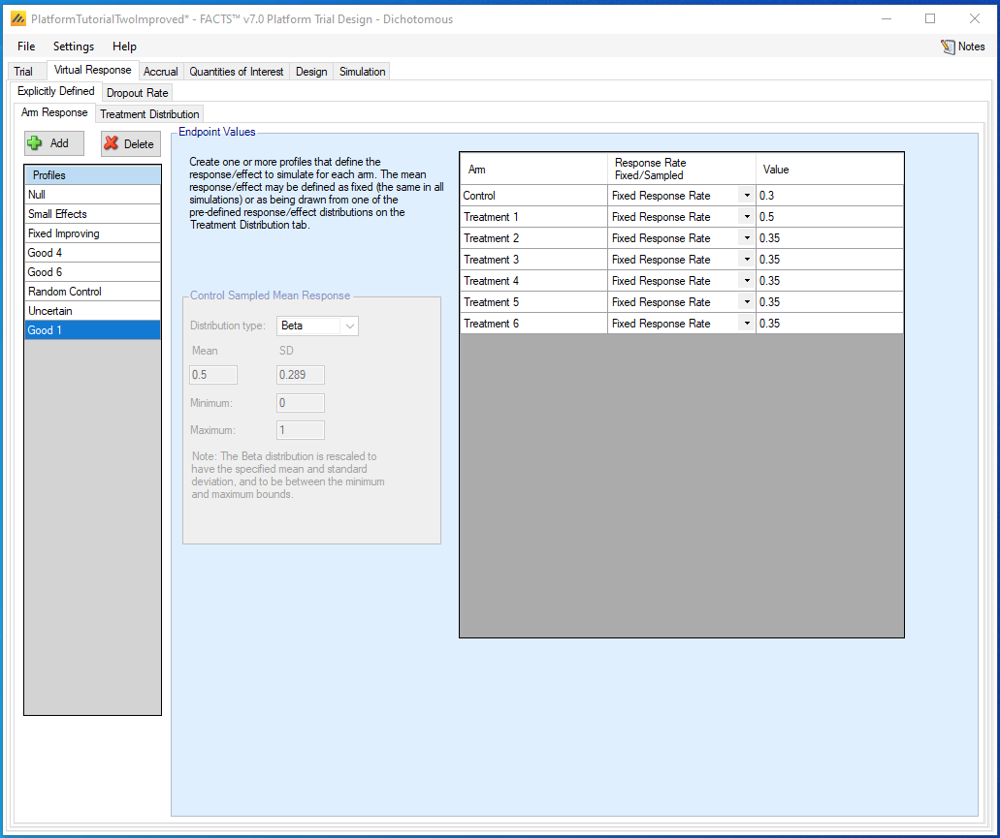

## Accrual Rate

Increase the accrual rate to 5.6 participants per week.

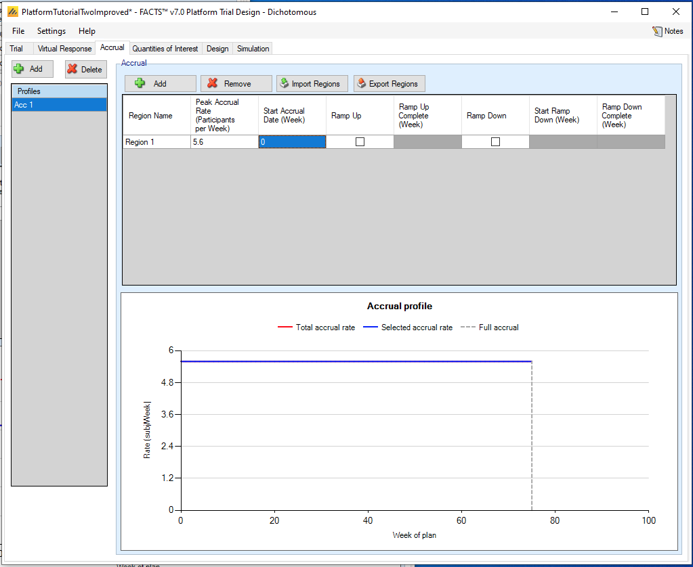

## Reschedule Trial Updates

Along with increasing the maximum sample sizes to 60, we will reschedule the futility looks to 30, 40, and 50 participants, where we had previously used 20, 30, and 40. Go to Design $\rightarrow$ Trial Updates, and enter 30, 40, and 50 in the Participants Enrolled column.

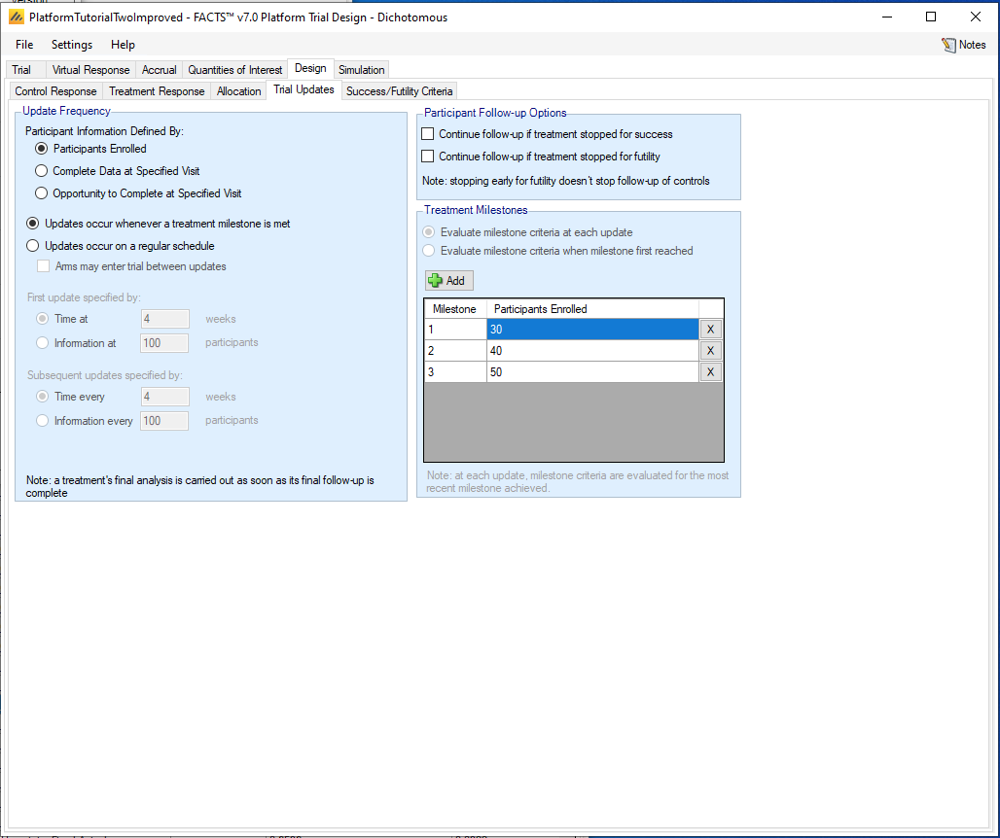

## Revised Success Criteria

To improve the power of the trial we decide to tolerate a higher (per treatment) type-1 error rate of 5%. On the Design \> Success/Futility Criteria tab we modify the "Final Evaluation" success criteria, reducing the required threshold for success from 0.975 to 0.95.

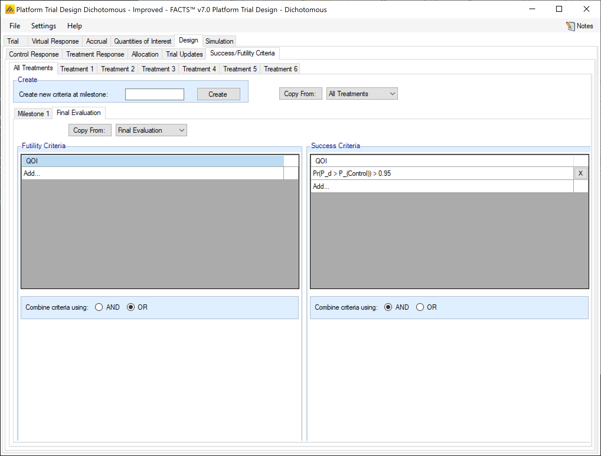

# New Simulation Results

With those changes implemented, we can investigate their effects. First, the power numbers in the "Ppn Successes \| Treatment Good" column are larger and more uniform, ranging from 74% to 88%, and many of our changes were targeted at improving these numbers.

The new Good 1 scenario has inferior power compared to the analogous scenarios where the good treatment enters later. This is a good thing to know; potentially one may want to increase the maximum sample size for Treatments 1 and 2, but this is not straightforward to simulate in FACTS 7.0.

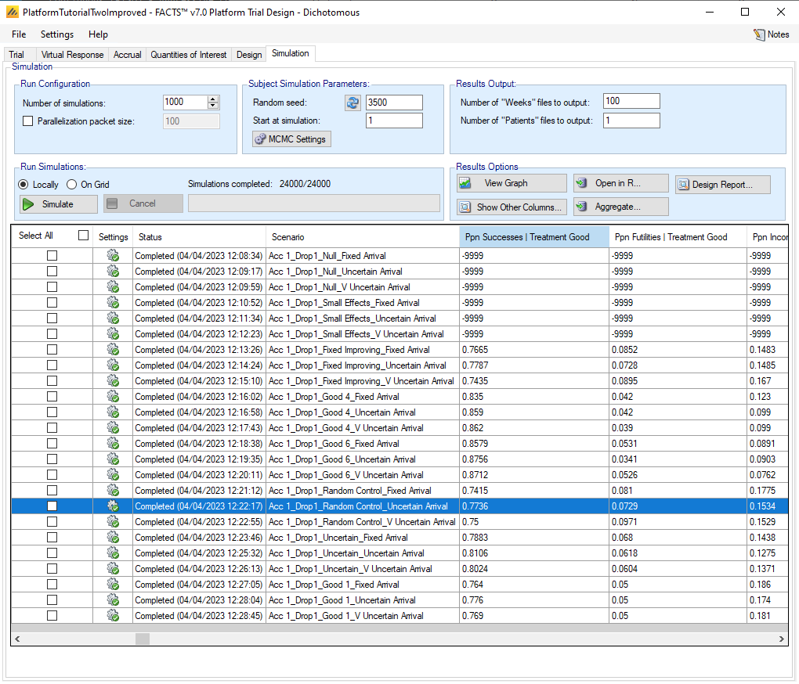

We also check the Type I error numbers in the "Ppn Successes \| Treatment Unacceptable" column and find, as expected and intended, that they are now around 5%. We recommend increasing the number of simulations and running again to get more accurate numbers, but we will not show that here.

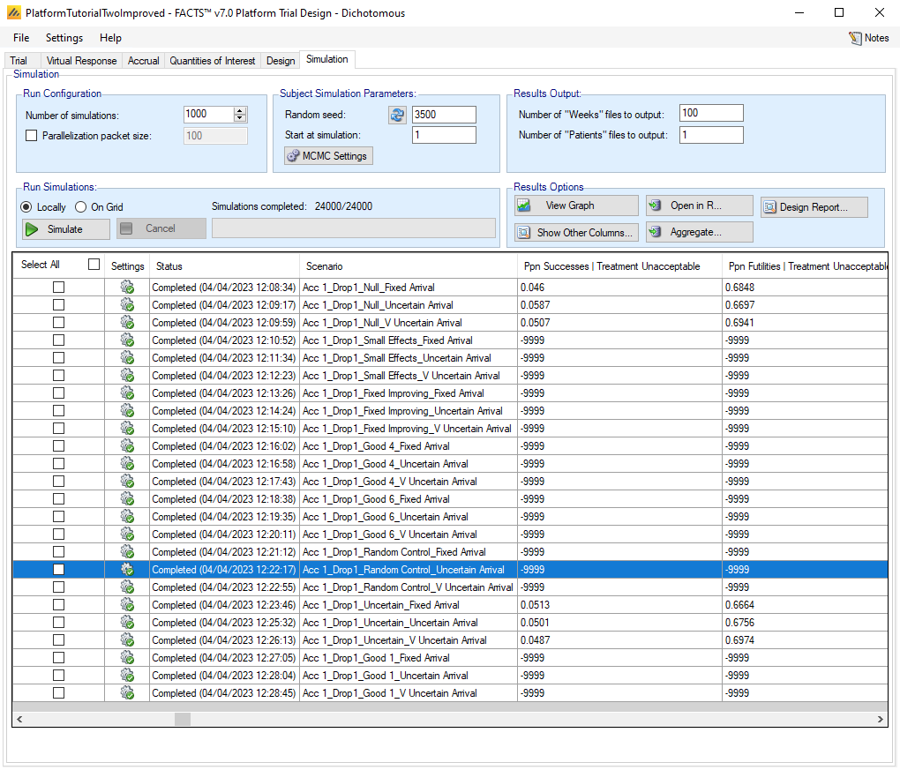

We did not completely solve the issue of Treatment 6 failing to complete in some scenarios. After selecting the "Acc 1_Drop 1_Fixed Improving_V Uncertain Arrival" row in the table, then clicking on "View Graph $\rightarrow$ Show Per Scenario Graphs", we get the Outcome by Treatment graph and see that "Incomplete" is still a sizable piece of the Treatment 6 bar. Since this appears to be a property of the Very Uncertain Arrival schedule, where Treatment 6 may not become available until Week 91 out of the total 104 weeks for the trial, we will address this issue by redoubling our efforts to speed Treatment 6 to availability, rather than by changing the design.

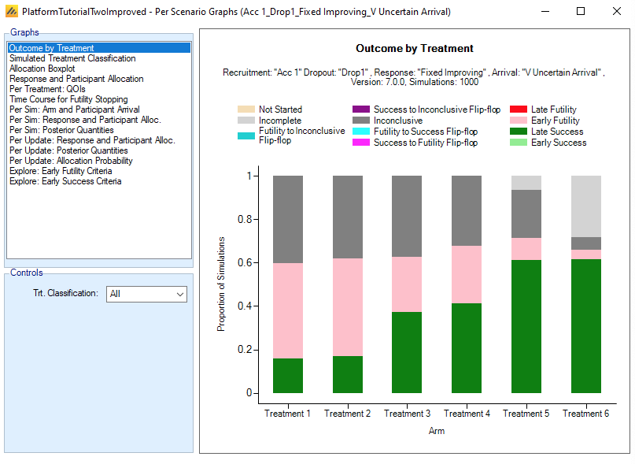

# Discussion

In this tutorial we have illustrated how the FACTS Platform engine can be used to simulate an internal pharmaceutical company trial some existing treatments and some that are expected to become available later. We included some examples of things that can go wrong in platform trial design and illustrated how they can be diagnosed with FACTS output and graphical tools. We hope that you have found this tutorial useful.
