#  Introduction

This tutorial describes a simple example trial design using the FACTS Staged Core Design Engine for a Continuous Endpoint.

For this version of the document, the screenshots are from the 6.1 release of FACTS.

The screenshots provided are approximate and may not reflect the exact layout of the information. The contents of each tab, however, will be consistent with the software.

The designs presented are examples and may not be optimally calibrated.

# Design Features

In this tutorial we create a relatively simple staged design:

- Adaptive stage 1

- Non-adaptive stage 2 using a single treatment arm

- Include 4 doses and a control arm

- Dose response modelled using an NDLM in stage 1 and using an independent dose model in stage 2

- Early and late stopping and graduation in stage 1.

We will then look at how the variants tab can be used to explore the effect of increasing the sample size.

# Case Study: The Treatment

The endpoint is a simple example: a continuous endpoint, observed after 4 weeks, in which higher responses are better, with a minimum clinically significant difference (CSD) of 2 and a standard deviation of 10.

The goal of the study is to find the best dose and to establish whether it beats the CSD.

# The Design

Start FACTS. Double Click: Staged Core Design: Continuous on the opening screen:

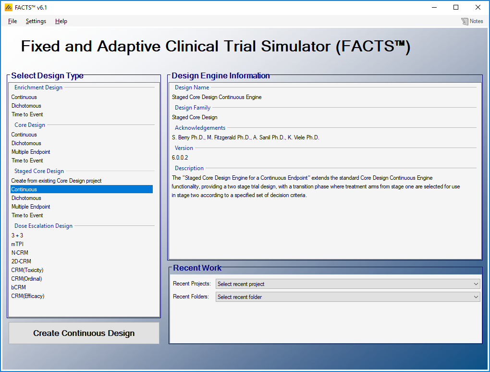

Using the menu option File \> Save As, save this design as SD-Cont-Simple in a convenient location (e.g. in a folder called FACTS\\SD-Cont-Simple in your 'My Documents' folder).

## Study

### Study Info

The Study tab captures basic information about the trial. Set the following parameters:

- Select the Adaptive option for Stage 1, but leave the checkbox unchecked for Stage 2

- For simplicity, clear the "Use longitudinal model" check box.

- Set the time to final endpoint to 4 weeks.

- Set the maximum number of subjects to 300 and the maximum number in Stage 1 to 200, but leave the maximum for Stage 2 blank so that Stage 2 can continue until the overall maximum is reached.

- Higher response is subject improvement, indicating that higher change from baseline values are good.

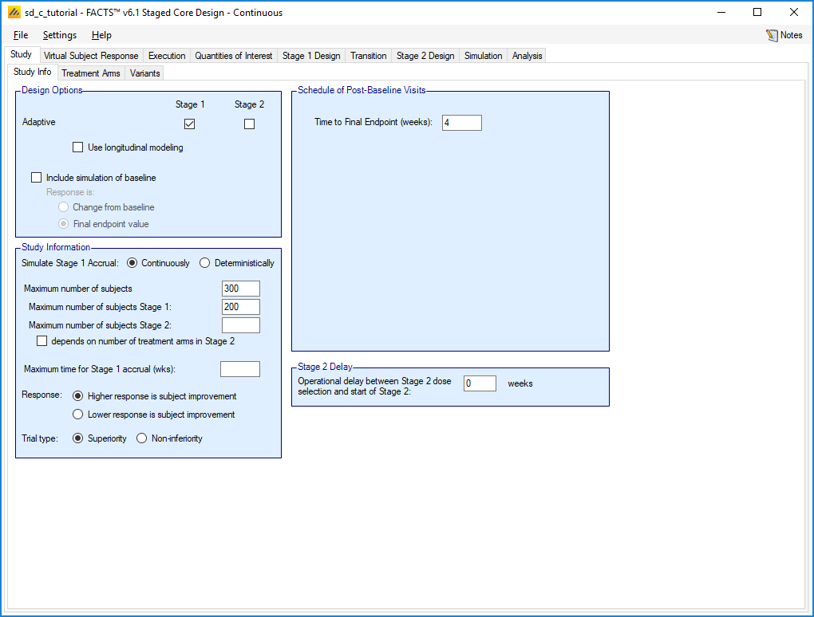

### Treatment Arms

Set the following parameters:

- Select the box to include a control arm

- Set 4 doses, 25mg, 50mg, 75mg and 100mg

The Dose Name may be changed by double-clicking on the relevant cell in the table. While these names are simply labels for the treatment arms, the Effective Dose Strength (v~d~) is the dose value that will be used in dose-response modeling.

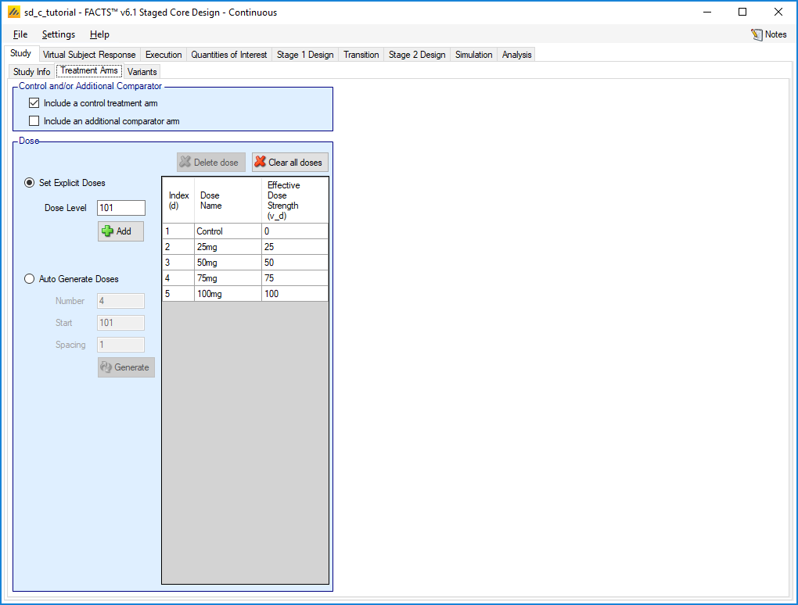

### Variants

The variants tab allows us to easily generate and compare multiple variants of our design which differ by the maximum number of subjects. We will not use variants yet, but it also allows us to set a target dose QOI which will be used by various summary columns and graphs. We are interested in the arm with maximum response so:

Set "Selected dose defined by:" to Pr(Max).

## Virtual Subject Response -- Explicitly Defined

### Dose Response

The Virtual Subject Response tab describes how subject-level data will be generated for the simulations. Add five response scenarios by clicking the Add button. For each scenario, set the underlying mean response for each dose from the corresponding row in the following table:

- Add the following 5 profiles:

+--------------+:-----:+:--------:+:--------:+:--------:+:----------:+
|              | Dose  |          |          |          |            |
+--------------+-------+----------+----------+----------+------------+
| \#           | Ctrl  | 25mg     | 50mg     | 75mg     | 100mg      |
+--------------+-------+----------+----------+----------+------------+
| Null         | 0     | 0        | 0        | 0        | 0          |
+--------------+-------+----------+----------+----------+------------+
| Late         | 0     | 0        | 0        | 1        | 3          |
+--------------+-------+----------+----------+----------+------------+
| Middle       | 0     | 1        | 2        | 3        | 4          |
+--------------+-------+----------+----------+----------+------------+
| Early        | 0     | 2        | 4        | 5        | 5          |
+--------------+-------+----------+----------+----------+------------+
| UpDown       | 0     | 2        | 4        | 4        | 2          |
+--------------+-------+----------+----------+----------+------------+

- Leave the SD response at 10 for all scenarios

- The "Should succeed" boxes should be checked where the response is greater than 2. These values are used only to help fill in some summary graphs and columns, but they provide a quick way to assess how well a design is performing.

The Profiles can be named by double clicking on the default name, e.g. "Response 1" and renaming. A wide range of profiles should be chosen so that you can examine the strengths and weakness of a design.

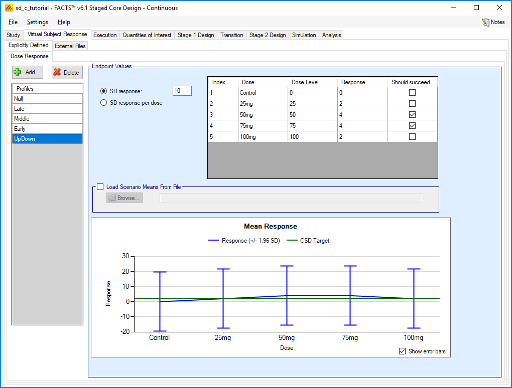

## External Files

There are no externally generated data for this example.

## Execution

### Accrual

Add an accrual scenario by clicking the Add button on the far left. Add a region to this profile by clicking the Add button above the table, and leave the rate at the default value of 5 per week.

### Dropout Rate

No drop-outs were specified, select "No Dropouts".

## Quantities of Interest

The Quantities of Interest (QOIs) are the criteria on which decisions, interim or final analyses, will be made. Numerous QOIs are available and you may select multiple quantities for evaluation. A basic set of QOIs is provided by default. Additional QOIs may be added by clicking the Add row in the table. A QOI can be removed by clicking the X on the right side of the cell. Each QOI may be edited by clicking on it, which opens a pop-up box.

In this case a trial will be judged a success if at the end of the trial:

- the dose most likely to be Maximum has a greater than 80% posterior probability that its mean improvement is better than Control by at least 2 (the clinically significant difference).

We begin by specifying the Posterior Probabilities to be calculated comparing each dose to both the control. Since each of these probabilities are calculated per dose, they are considered vector quantities. We can create the required Posterior Probability QOI either by clicking Add... and entering its properties, or by changing the CSD value at the bottom right, which will set one of the default QOIs to what we require. If using CSD, ensure the Trial type is set to Superiority.

To make decisions in the trial, we must specify which dose will be evaluated, thus reducing the vector quantity above to a scalar quantity.

This information is captured in the Decision Quantities (Scalars) window at the bottom right. Here we require one QOI:

- QOI (Vector Quantity): Pr(θ_d- θ\_(Control) \> 2)

  - Evaluation Dose: Greatest Pr(Max)

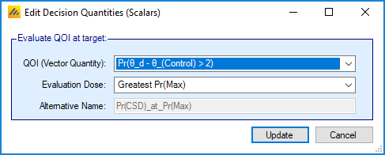

Giving:

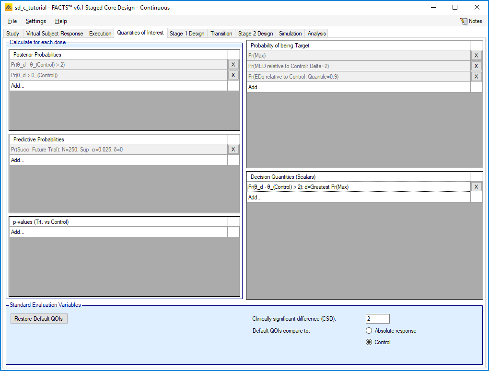

Since we are not using them, we could reduce clutter in the results by deleting the other QOIs.

## Stage 1 Design

### On Setting Priors

On setting priors -- as a rule it is recommended that the user specifies weakly informative priors rather than non-informative ones. There are a number of reasons for this:

1.  In a few circumstances non-informative priors can end up being informative.

2.  What values make a prior non-informative vary depending on the range of the value being estimated, a measure with a SD of 1000 requires quite a different value for a prior to be non-informative than one with an SD of 1.

3.  Measures that are log-odds or log hazard ratios can have parameters that are then exponentiated and used as parameters to other distributions as a maximum these values should have range of (-10,10) and (-5,5). Greater than this and numeric overflows can occur.

4.  Using a "non-informative" prior can sometimes be used as an excuse for not thinking about the prior. Not thinking about a prior is never a good idea.

5.  There are some priors, particularly for the variance parameters of hierarchical models where (as we use inverse Gamma distributions for the priors, weakly informative priors are preferred to uninformative ones \[Gelman 2006, "Prior distributions for variance parameters in hierarchical models" *Bayesian Analysis Vol 1 Number 3*\]

6.  When simulating clinical trial designs there is a balance to be struck between the MCMC sample length used in the within-trial analyses and the number of simulations run. Weakly informative priors can help the MCMC to converge and allow us to use shorter sample lengths.

For many priors the weakly informative is easily judged where the priors directly correspond to values that we are simulating. Others are not so easily judged, for these we used "non-informative" priors ran some simulations and looked at the means and SDs of the posterior estimates of the parameters over all the scenarios and then based a weakly informative prior on these. You will see these priors below being described as having an "initial un-informative" prior and then a weakly informative one. Care must be taken with this approach to not over specify a prior based on the selection of scenarios, and it must be borne in mind that the scenarios may not capture the full potential variability in what the "true value in nature" might actually be.

### Dose Response

For Stage 1 we will use an NDLM, which is the default.

The prior for the initial dose is by default 0 with a standard deviation of 10. This is broader than the actual range of our VSRs, but we will leave the standard deviation at 10.

The prior on tau expresses how much variability in response we expect per unit of drug. Since our doses are 25 apart, the default mean of 10 is too wide. We will reduce it to 1, leaving the weight as 1 (dose).

(To see the effect of tau, we can change selection on the prior graph to "Dose-Response Samples", however with a prior weight of 1, the distribution of tau is heavy tailed so the graph tends to be dominated by one or two wild curves. Increasing the weight to 10 gives a more informative graph, but the variability is then dominated by the initial dose. Setting the standard deviation on the initial dose to 1 finally gives a good illustration of what tau=1 looks like,

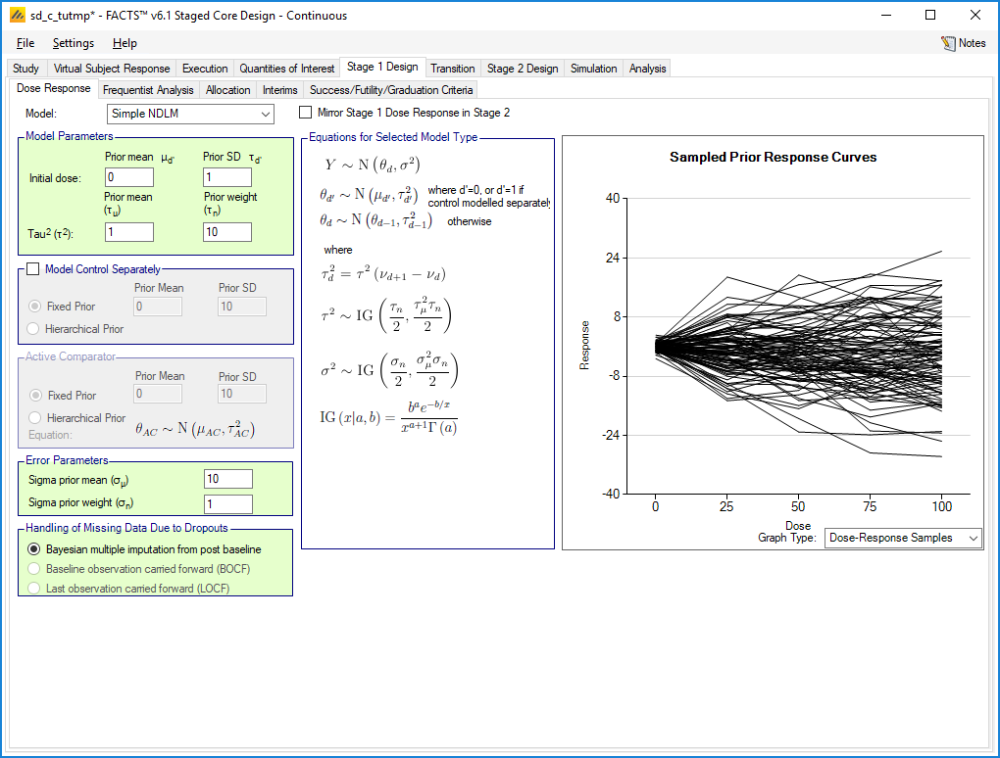

These curves vary more than our scenarios so there may be a case for further reducing the mean tau.

Of course the changes made to visualize tau need to be undone before proceeding!)

Given our endpoint we can leave the prior mean for sigma at 10 (the expected SD of the response) and the number of observations weight for the prior to 1 (so the prior is weak, equivalent to a single subject's responses and the impact of the prior on the final posterior will be negligible). Note that the inverse-gamma distribution is parameterized in terms of mean and weight. If you prefer to see the standard alpha and beta parameters, click the Settings menu at the top of the screen. Select Options and a pop-up window appears. Navigate to the tab for Gamma Distribution Parameters, and toggle the radio button to Show Alpha and Beta.

Thus the Stage 1 Dose Response is:

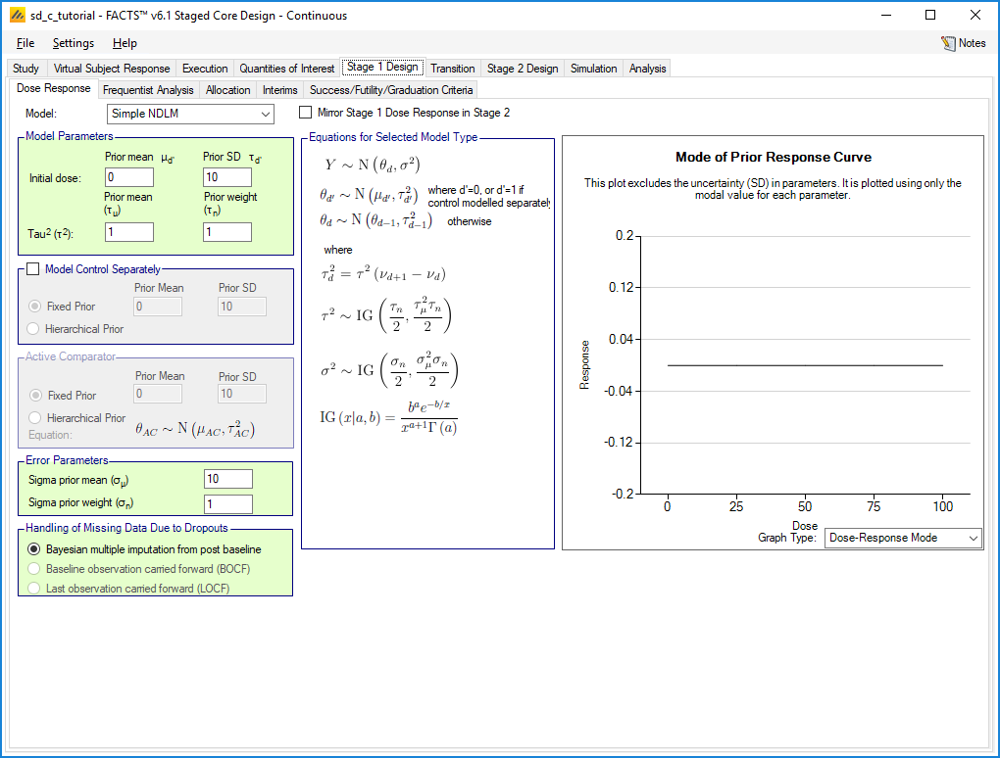

### Frequentist Analysis

We are not interested performing any frequentist analysis, so we can uncheck the LOCF checkbox, which will reduce simulation time and the number of files that are output.

### Allocation

To try to steer allocation toward successful doses we will use adaptive allocation, weighting allocation according to the probability that the response is 2 greater than control. Thus:

- select the "Adaptive Allocation" radio button

- click Add... under "Adaptive Allocation Targets",

- select the Pr(theta_d -- theta\_(Control) \> 2) QOI

- set the "Relative Weight" to 1. (Since this is the only target, the value is unimportant)

- Click Update

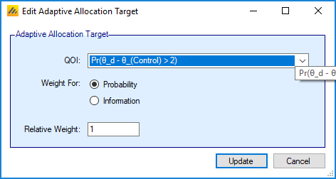

The default is to allocate equally up until the first interim and we leave this unchanged.

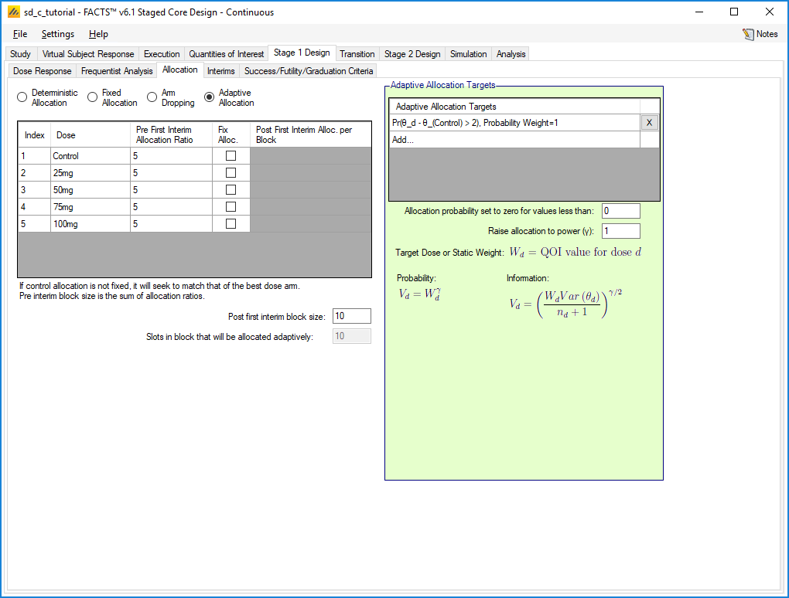

### Interims

Stage 1 can run to a maximum of 200 subjects, so we will try two interims at 100 and 150 enrolled subjects.

We leave the follow-up options at their defaults, so subjects are followed up if the study stops for success, but not if it stops for futility. If the study graduates to Stage 2, stage 1 subjects will be followed up as part of Stage 2. (Note that disabling the follow-up after graduation will prevent Stage 1 subjects from being used in Stage 2)

If the study graduates, we can specify a delay before selecting the arms to use in Stage 2. The choices are:

- Wait until all Stage 1 enrollees complete

- Wait a fixed time

- No delay

If there were a long gap between enrolling a subject and their final response, it might be useful to use this delay to improve our chances of selected the correct dose(s), but in this case the final response comes after 4 weeks, so we will stick with default of No delay.

Finally, since, if we go to Stage 2, we are not interested in analyzing the final results of Stage 1, we can uncheck "Perform Stage 1 complete data analysis," which removes an unwanted output file.

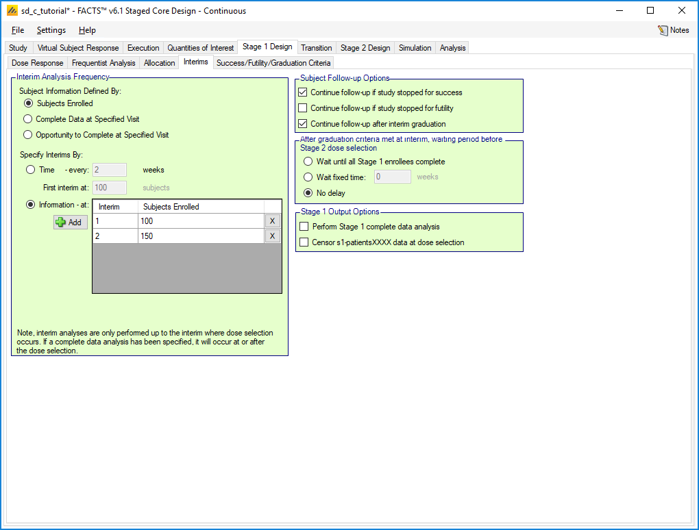

### Success/Futility/Graduation Criteria

In Stage 1 we can set a range of rules for when the stage ends and what happens next.

Initially we have two tabs, Interim 1 and Final Evaluation. The Create box would let us create more tabs, so we could create one for Interim 2, Otherwise the rules on a tab remain in force until the next tab is reached, so in this case interim 2 will use the same rules as interim 1.

On the Interim 1 tab we will set up two rules, for early futility and early graduation:

If early results are so unpromising that the early futility rule is met, the trial will stop for early futility without going to Stage 2.

If the early graduation rule is met, the trial will graduate to Stage 2.

We could also set a rule to stop early for success without going to Stage 2.

To set up the rules:

- Check the "Futility Criteria" checkbox

- Click on Add,,,

- Select the decision QOI (we have only one), set the condition to "\<", the threshold to 0.1.

> 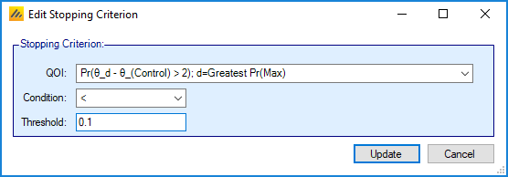

- Press Update

- Check the "Graduate to Stage 2 Criteria" checkbox

- Click on Add,,,

- Select the decision QOI, set the condition to "\>", the threshold to 0.9.

- Press Update

We could also set minimum numbers of subjects required before these rules can apply. Since our rules use the Greatest Pr(Max) dose, setting a minimum number of subjects on that dose might be a way to reduce incorrect decisions if that is a problem.

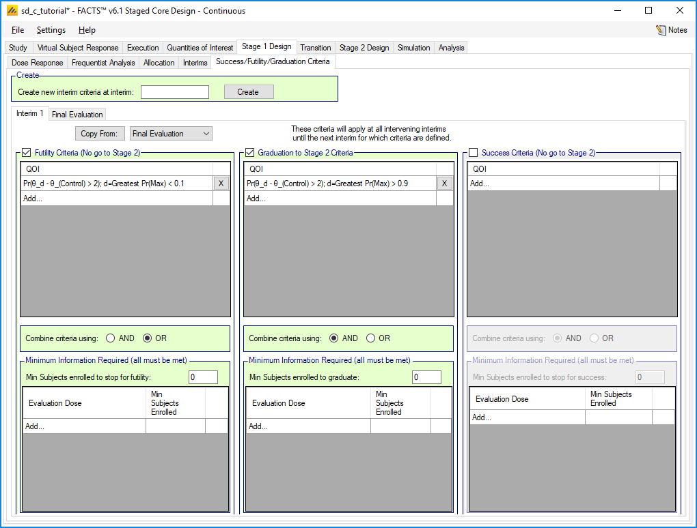

At final evaluation, we get to set rules for futility and success, but not for graduation because that is the default. Any trial which reaches the end of Stage 1 and does not meet either the success or futility criteria will graduate to Stage 2.

We will set a rule for futility similar to that above, but with a higher threshold of 0.2. We will also set a success criterion with a condition of "\>" and a threshold of 0.95.

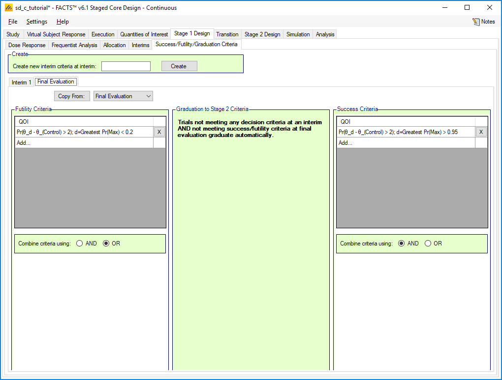

## Transition

### Dose Selection

This is where we decide which arm(s) are taken into Stage 2. There are a large number of options, but what we want in this case is the default.

We use Standard Selection Logic, so decisions are made arm by arm rather than treating arms in groups.

The Control checkbox should be checked, so that we can continue to allocate to control in Stage 2.

Because what we want is simple, we can leave the Individual Dose Decisions and Target Dose Decisions empty and just use the All Dose Decisions tab.

We want to have a single treatment arm in Stage 2, so we can leave Keep selected and the minimum and maximum set to 1.

The sort criterion should be Pr(theta_d -- theta\_(Control) \> 2) and the Sort Priority "keep highest" which means that we will keep the arm with the highest value for the QOI and drop the rest.

Since we are taking a fixed number of arms, we do not need to add any QOIs.

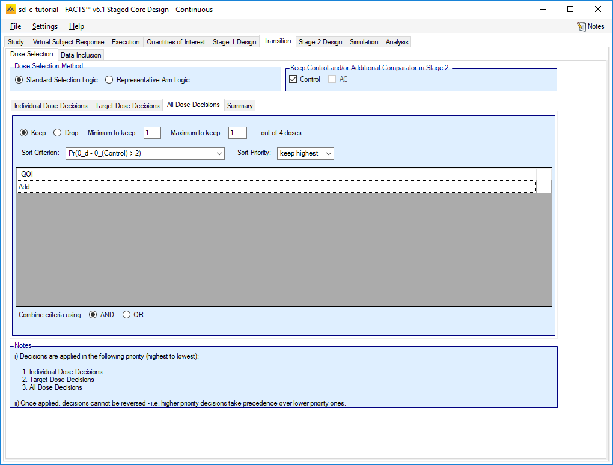

(Note that we could achieve the same thing by selecting Drop, specifying to drop a minimum and maximum of 3 arms and selecting "drop lowest", so we drop all arms except the one we want)

(If 2 arms are doing well, we could allow two to be kept by setting the maximum number of arms to 2 and adding a condition, e.g. Pr(theta_d -- theta\_(Control) \> 2) greater than some threshold. Then if two arms meet the condition, they will both go into Stage 2. If no arm meets the condition, because the minimum is 1 rather than 0, the best arm will still go through.)

### Data Inclusion

This tab selects what Stage 1 data is included in the Stage 2 analysis.

The options are:

- Not used -- which would make the two stages two separate trials

- Included in full -- here we could use this option and use the NDLM (or another model) in Stage 2, so that subjects on the arms that were not selected still contribute.

- Included where the subjects are on arms that are kept in Stage 2 -- we will select this option to give us a simple two arm Stage 2 that we can analyze with the independent dose model.

- Included in full and pooled with the one Stage 2 treatment arm -- this option is only available if we are keeping exactly one arm. Since we expect the different arms to have different responses, this is would dilute our treatment effect.

- Restricted to only those subjects that did not complete... - If the two stages are two separate trials, this option allows us to use in Stage 2 those subjects which were recruited for Stage 1, but which did not get chance to contribute to the results of Stage 1.

This tab also lets us select whether arms which were not selected for Stage 2 can be picked as the target dose in Stage 2. We will leave this as "only arms selected for Stage 2"

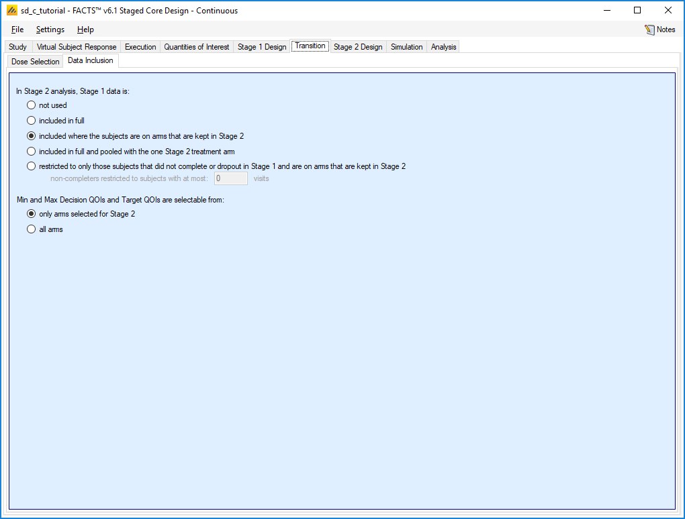

## Stage 2 Design

This tab contains sub-tabs that define the various aspects of Stage 2.

### Stage 2 Response

For Stage 2 we do not want a dose response model; that is, we model each arm independently. Select the 'Independent Dose Model' option, this option does not do dose response modeling.

For this case the default priors will do -- the same prior for all doses with a mean of 0 and a standard deviation of 10, which encompasses the range of responses we are simulating.

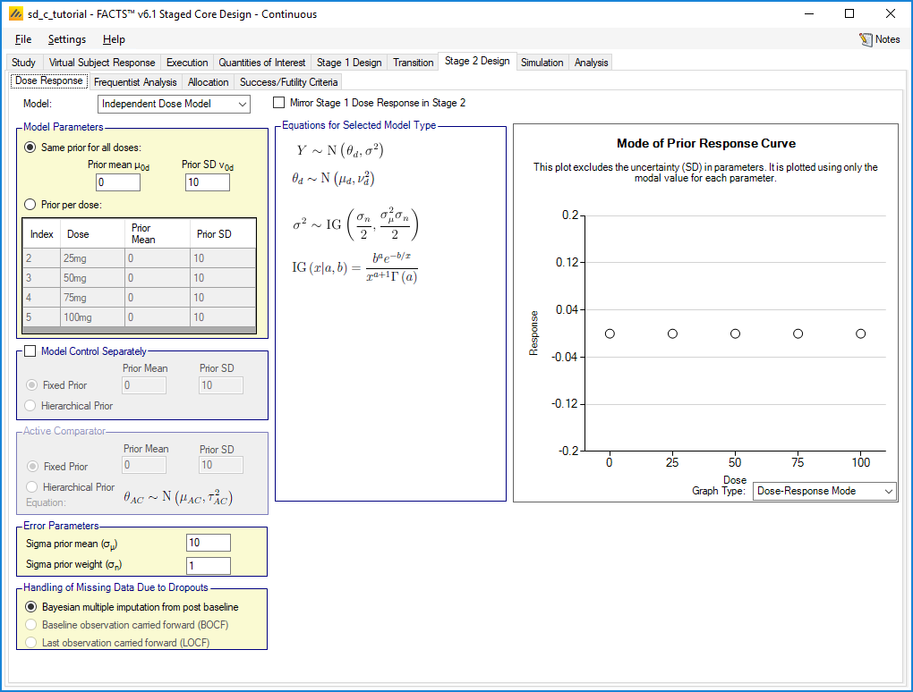

### Frequentist Analysis

Again we will uncheck the boxes since we are not using frequentist results

### Allocation

Because Stage 2 is non-adaptive and we always have two arms in Stage 2, the only thing to set is the allocation ratio. We will leave it as 1 to 1 with a block size of 2.

### Success/Futility Criteria

Because Stage 2 is non-adaptive, we can only set the final futility and success criteria.

These are similar to those in Stage 1, but with bounds that are closer together, so the futility criterion is Pr(theta_d -- theta\_(Control) \> 2) \< 0.5 and the success criterion is Pr(theta_d -- theta\_(Control) \> 2) \> 0.8.

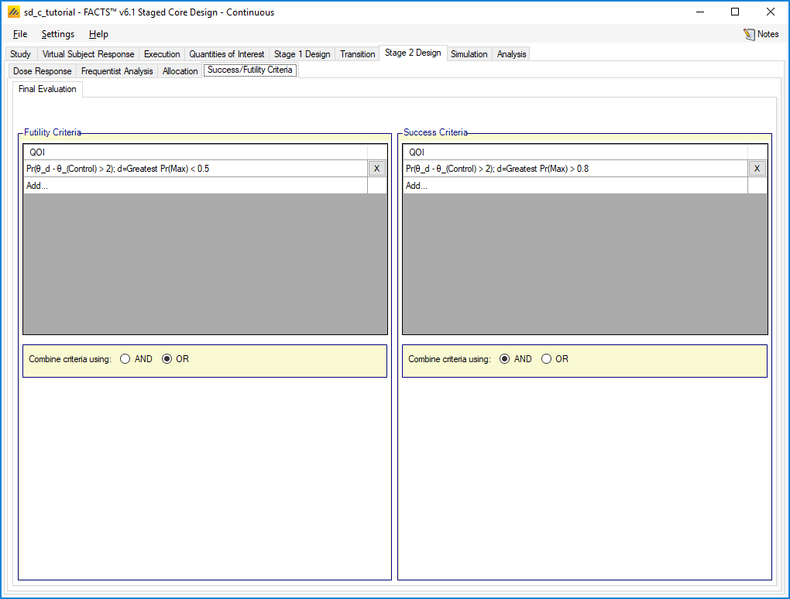

## Simulation

Because we have only a small number of interims, no longitudinal modelling or frequentist analysis, simulations are quick to run, so to get an initial check on the design set up, set the number of simulations to run to 100, Select All, the press Simulate.

To achieve more precise estimates of the operating characteristics, you may need to run 1,000 or 10,000 (or more) simulations of a scenario. By default, FACTS simulations run locally on your computer, which can take a significant time for large numbers of simulations. If you have access to a computer grid and your FACTS installation has been correctly configured to use it, you may use the grid's parallel computing capabilities to improve computation speed. To do so, select "on Grid."

## Results

Staged designs generate a lot results, but there are several ways to get a quick overview of what happened.

### Summary Table Columns

The summary table contains two columns, "Ppn Overall Success" and "Ppn Overall Futility" which combine all the different forms (early/late, Stage 1/2) into single numbers. The table also contains "Ppn Correct Arm" and "Ppn Incorrect Arm" which, for successful simulations, show how often the selected arm was one that should succeed. The selected arm is determined by the QOI that we set on the Variants tab and we set "should succeed" for each dose and scenario on the VSR tabs.

+----------+---------------------+----------------------+-----------------+-------------------+
| Scenario | Ppn Overall Success | Ppn Overall Futility | Ppn Correct Arm | Ppn Incorrect Arm |
+==========+====================:+=====================:+================:+==================:+
| Null     | 0.07                | 0.83                 | 0               | 0.07              |
+----------+---------------------+----------------------+-----------------+-------------------+
| Late     | 0.35                | 0.3                  | 0.3             | 0.02              |
+----------+---------------------+----------------------+-----------------+-------------------+
| Middle   | 0.67                | 0.04                 | 0.59            | 0.04              |
+----------+---------------------+----------------------+-----------------+-------------------+
| Early    | 0.96                | 0                    | 0.86            | 0                 |
+----------+---------------------+----------------------+-----------------+-------------------+
| UpDown   | 0.76                | 0.05                 | 0.61            | 0.08              |
+----------+---------------------+----------------------+-----------------+-------------------+

From only 100 simulation we cannot drawn any definitive conclusions but the false positive rate (0.07 for overall success on the Null scenario) is in the right area. The power achieved on the Late scenario is only 0.35, but the maximum response is only 3 for this scenario compare to 4 or 5 for the others, so this may not be something that can be fixed.

The value of 0.07 for "Ppn Incorrect Arm" on the Null scenario reflects the fact that for this scenario all arms are incorrect. For the other scenarios the number of incorrect arms is reassuringly low.

### Across Scenario Graphs

The same information can be view graphically. Clicking on the "View Graph" button reveals a small menu:

- Show Stage 1 Graphs -- results from Stage 1

- Show Stage 1 DS Graphs -- results from those Stage 1 trials that went to Stage 2.

- Show Stage 2 Graphs -- results from Stage 2

- Show Overall Graphs -- results for the two stages together

- Show Across Scenario Graphs -- graphs comparing the different scenarios.

Select "Show Across Scenario Graphs"

### Selected Arms (Stage 1)

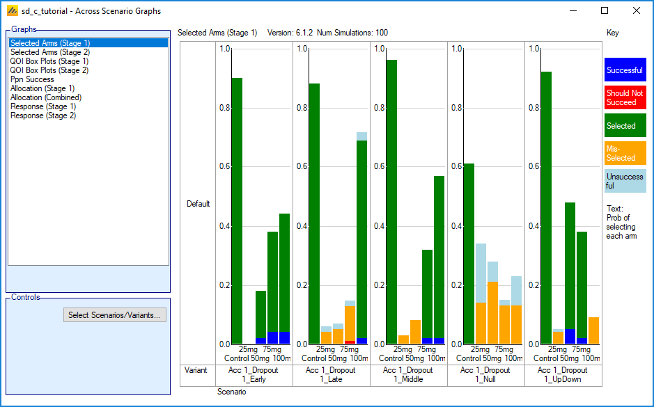

We get one small bar chart for each scenario. The colors are:

- Green -- Selected -- the dose was selected for Stage 2 and should succeed.

- Yellow -- Mis-Selected -- the dose was selected for Stage 2 but it was not flagged as one that should succeed.

- Blue -- Successful -- the dose should succeed and was selected (i.e. had the maximum Pr(Max)) in a simulation that succeeded in Stage 1 (and so did not go to Stage 2)

- Red -- Should not Succeed -- as Blue, but the dose was not flagged as one that should succeed. These could be viewed as a form of type I error.

- Light Blue -- Unsuccessful - the dose was selected (i.e. had the maximum Pr(Max)) in a simulation that stopped for futility without going to Stage 2.

The yellow bars for the Null scenario show that it is often graduating to Stage 2, while the other show where Stage 2 has been run with the wrong arm.

### Selected Arms (Stage 2)

This is similar to the previous graph, but for Stage 2. Therefore there are no colors for arm (mis-)selection.

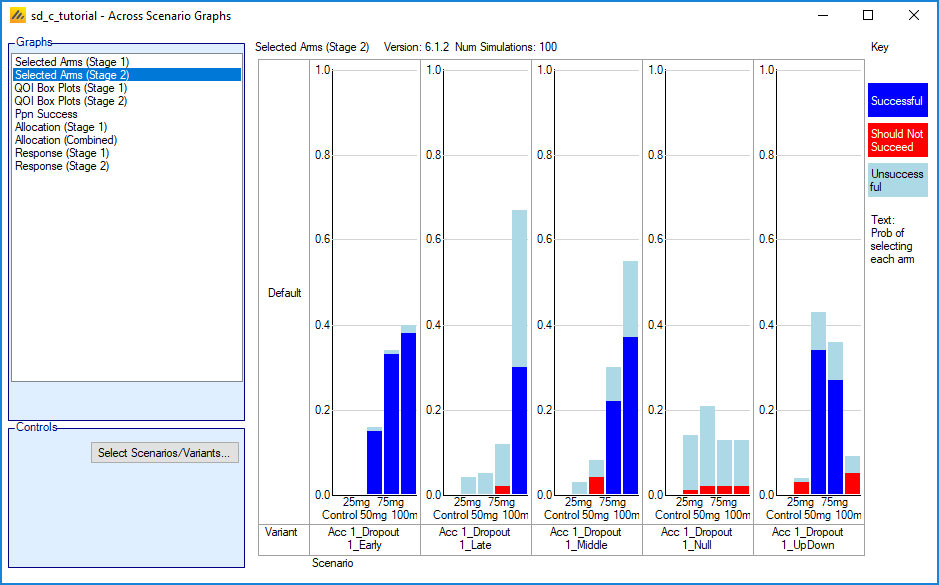

We can see that the Null scenario is seldom succeeding. We can also see that while the Late scenario is usually taking the correct arm into Stage 2, it is beating the success threshold less than half the time.

### QOI Box Plots

We can view box plots of the QOIs for Stage 1 or 2:

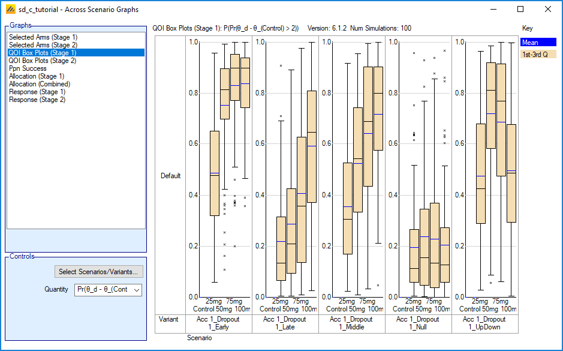

### Allocation

We can compare the allocation between scenarios either for Stage 1 alone or for the entire study. For Stage 1 we get:

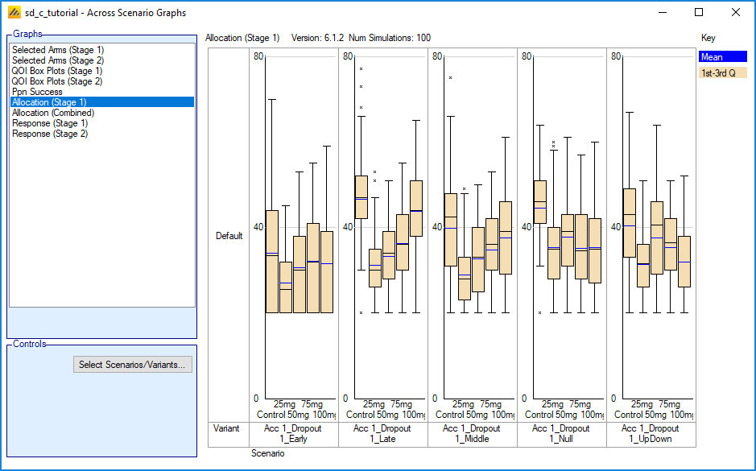

Which shows that adaptive allocation has put some extra subjects onto the successful arms, though it would be interesting to rerun with fixed allocation to see whether the adaptive allocation actually improved power or the false positive rate.

# Improving the Design

There are many things that could be improved in this example.

## Variants -- Would increasing the sample size help?

What is the effect on our design of the maximum sample size and the maximum sizes of Stage 1 and 2? This can be explored using the Variants tab.

On the Variants tab, select "Multiple Variants" and set the number to 5. (It may be necessary to tab away from the "Number of variants" spinner to get the table to update.)

Enter the following:

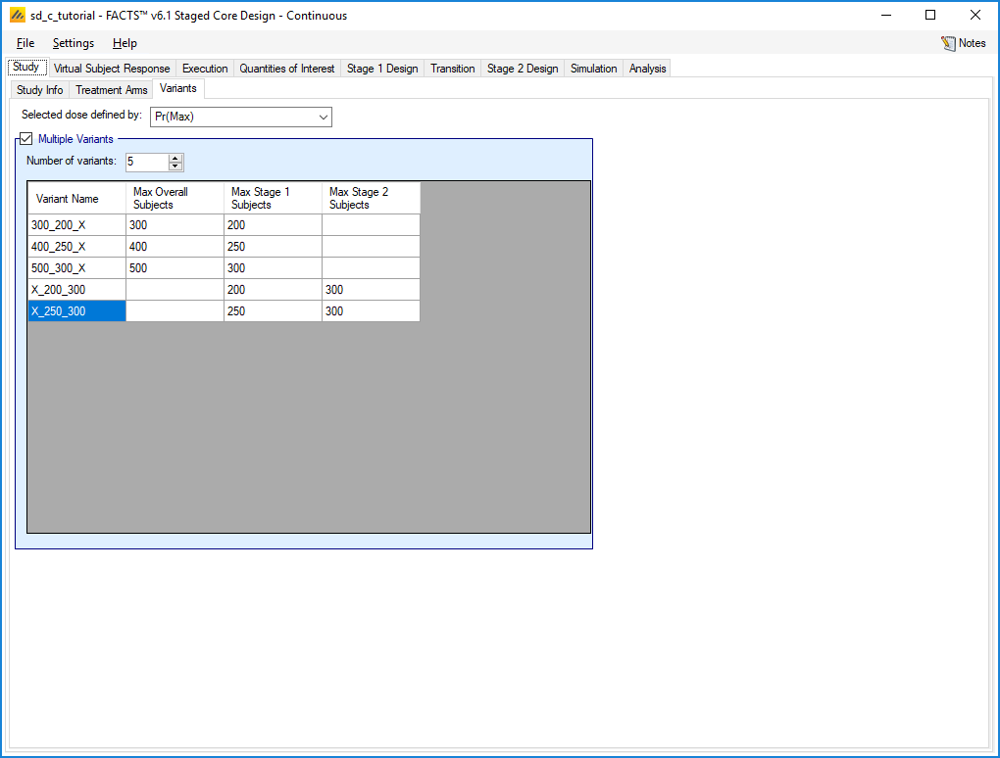

The first variant, 300_200_X corresponds to what we have already tried. The others are different ways to increase the number of subjects. The last pair stipulate that the number of subjects recruited in Stage 2 will always be 300 irrespective of how many were used in Stage 1.

Now that Stage 1 can go up to 300 subjects, we need more interims, so on the Stage 1 Design, Interims tab, add interims at 200 and 250 subjects. In variants that have a maximum of 200 Stage 1 subjects these will have no effect.

On the Simulation tab we now have not 5 scenarios, but 25 as each has been replicated for each variant.

Run 100 simulations of each.

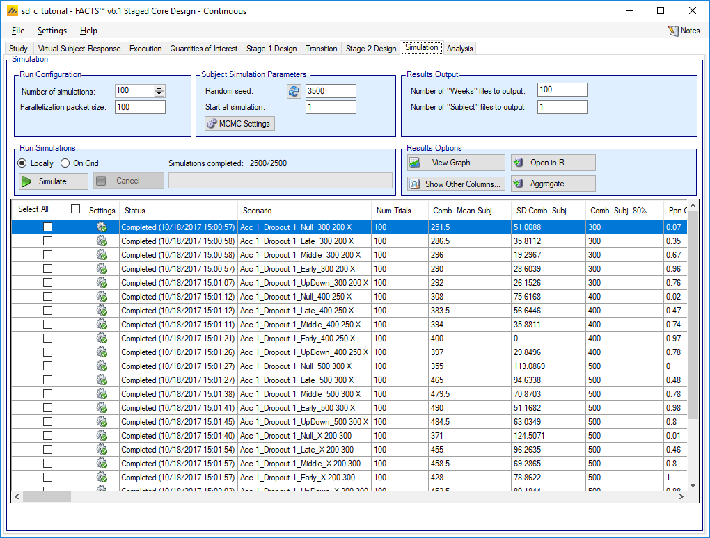

With this many scenarios to view, the across scenario graphs come into their own.

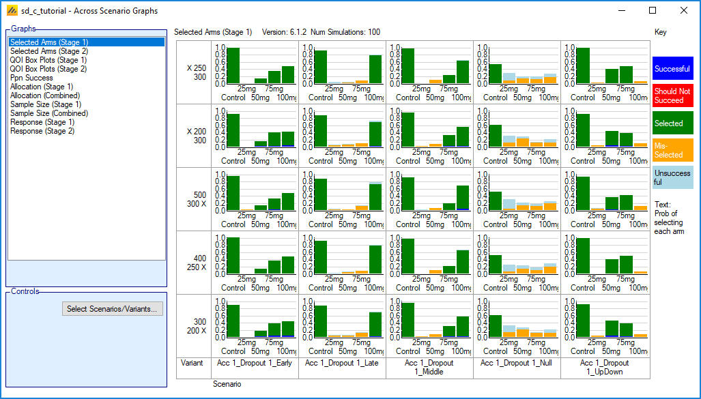

On the lattice plots, scenarios are shown across and variants down. The scenarios and variants that are displayed can be filtered using the "Select Scenarios/Variants..." button.

With multiple variants, the "Ppn Success" graph becomes a useful summary:

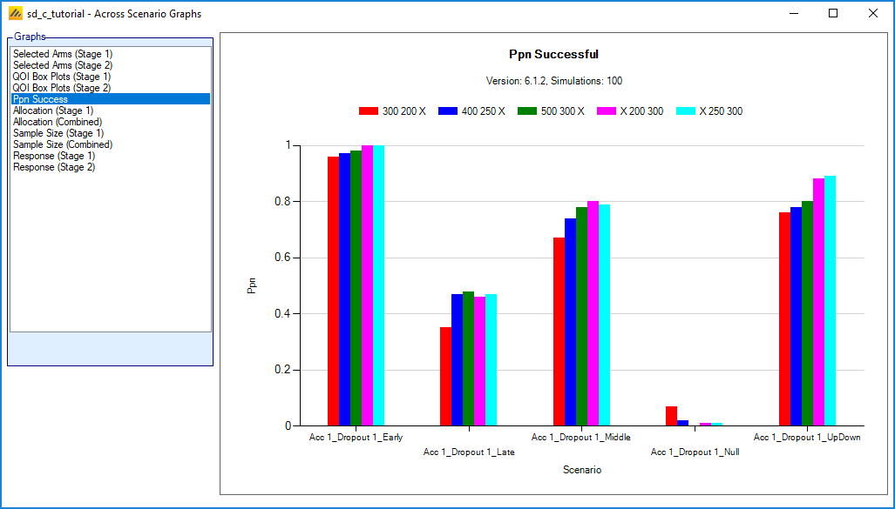

As can be seen, increasing the maximum sample size, whichever way it is done, has reduced the false positive rate. Likewise the power for the Late scenario is improved with greater sample size, though it remains poor.

Otherwise there seems little to choose between the different variants. X_200_300 may be the best, but we would need to run more simulations to see what differences are real.

## Optimizing the thresholds

Most of the simulations are using the maximum number of subjects, so it would be interesting to see whether more aggressive rules for futility would reduce the numbers of subjects without having a significant effect on power.

Running more simulations would reveal the true false positive rate and therefore whether there is scope for being more aggressive about stopping early for success.

Running simulations without early stopping in Stage 1 would allow us to use the Explore graphs for Stage 1 to explore the effects of different thresholds without rerunning simulations.

## Other things that might be improved

Is the Late scenario telling us something useful about how the design behaves given a marginally effective drug, or should we increase the response on the highest dose to 4 to match the other scenarios?

Given that we seem to be picking the correct arms, is there scope for a shorter Stage 1 and longer Stage 2?

If a short Stage 1 results in incorrect arm selection, would taking 2 treatment arms into Stage 2 mitigate the problem, or would delaying dose selection until all Stage 1 subjects have complete help?

Would early stopping in Stage 2 be a good idea?

Thus Staged Core Design offers a great many possibilities for optimizing a design.
