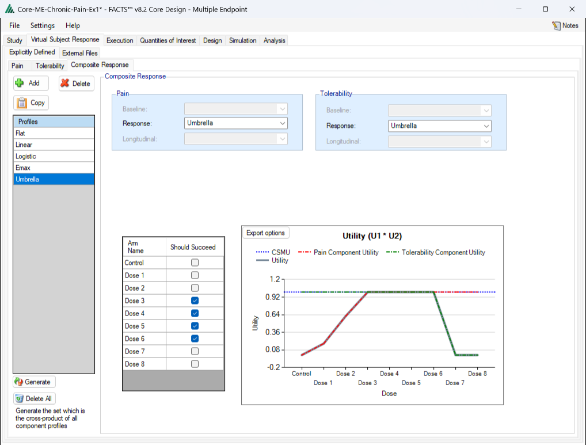
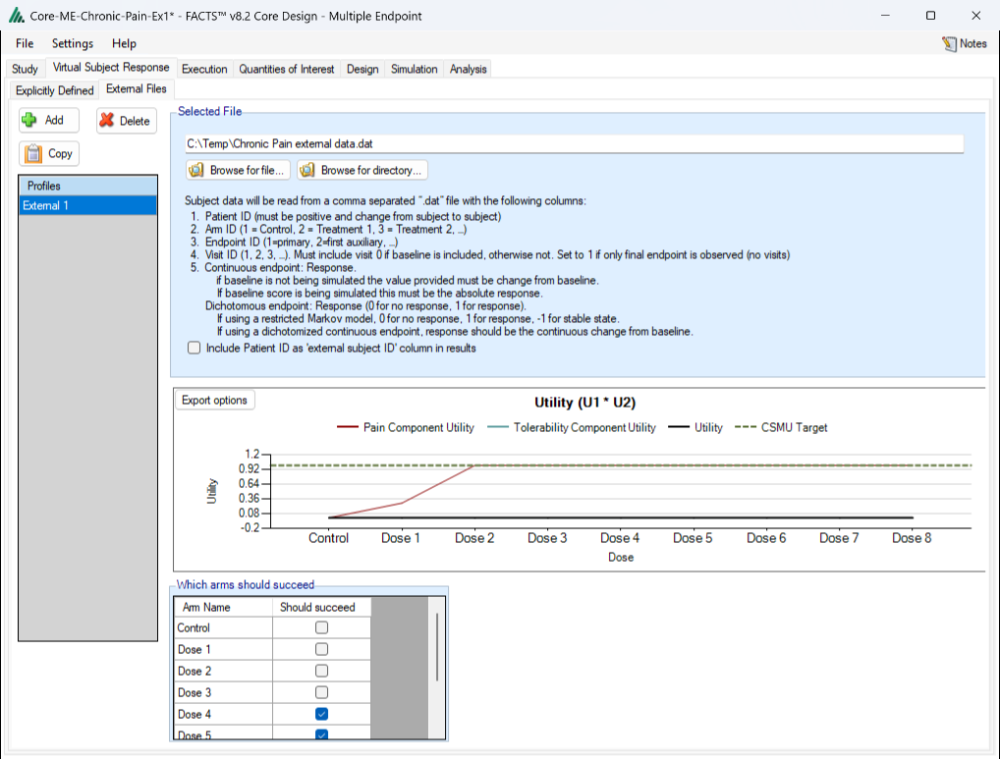

# Explicitly Defined VSR

When simulating multiple endpoints, each endpoint will have its own set of
explicitly defined VSR tabs for specifying their response profiles. See the
[continuous](./continuous.qmd) or [dichotomous](./dichotomous.qmd)
VSR pages for descriptions on these tabs.

FACTS simulates each endpoint independently of the other endpoints, using
that endpoint's own VSR. There is no within-subject correlation between
the endpoints. The only thing a subject's endpoints share is the dropout
time, which is simulated once per subject. To simulate correlated
endpoints, generate the subjects outside FACTS and supply them with the
[External File VSR](#external-file-vsr).

## Composite Response

In addition to the standard VSR
tabs that all endpoints have, the multiple endpoint engine also has a Composite
VSR tab that allows for the creation of a set of VSR scenarios that are made
up of one response VSR for each endpoint and one longitudinal VSR for each endpoint
that uses a longitudinal model.

The number of different profiles that need to be combined to
fully define the responses to be simulated in FACTS Core Multiple
Endpoint grows rapidly with the number of endpoints, and the number of different combinations quickly becomes far
greater than in the single endpoint design engines. The Composite Response tab has been
added to the FACTS GUI to help the user manage which combinations of
profiles they would like to include in the simulations.

{#fig-compresponseme}

There essentially are two approaches available to the user to specify
the combinations of response profiles:

-   Clicking on the 'Generate' button to generate all possible
    combinations and then deleting the combinations that are not of
    interest

-   By adding composite profiles and manually selecting the individual
    response profiles that go together to comprise the composite
    profile.

The tab is divided into three areas:

1.  The list of profiles on the left hand side, with controls at the top
    to add another profile or delete the currently selected profile, and
    controls at the bottom to delete the current profiles generate all
    possible profiles, or simple delete all current profile. The
    properties of the currently highlighted profile are shown on the
    right of the screen.

2.  On the right, for each of the endpoints there are controls to show
    which baseline, dose response and longitudinal profile for that
    endpoint are used in the currently selected composite profile. The
    profile names are shown in 'drop down' lists that the user can use
    to show the list of all the profiles of that type defined for that
    endpoint and to select an alternative for the currently selected
    composite profile.

3.  On the right below the controls, a table of the treatment arms with
    a check box per arm is displayed along with a graph that shows the
    individual and combined utilities of each endpoint for the currently
    selected dose response profiles. The check boxes allow the user to
    specify whether a specific arm "should succeed" in that scenario: so
    that FACTS can report on the proportion of simulations that were
    both successful **and** where a 'good' treatment arm selected. The
    arm section uses the target QOI specified on the Variants tab
    (whether or not Variants are being used).

# External File VSR

If specifying the VSR through External files, the file inputs are the same
as the single endpoint files, except for the inclusion of a column that
indicates which endpoint the row is providing a value for.

The External File VSR is the way to simulate subjects whose endpoints are
correlated. Explicitly defined VSRs simulate each endpoint independently
(see [Explicitly Defined VSR](#explicitly-defined-vsr)), but a resampled
subject keeps all of their supplied endpoint values together, so any
correlation in the supplied data is carried into the simulations.

{#fig-extvsrme}

## Required Format of Externally Simulated File

The supplied data should be in the following format: an ascii file with
data in comma separated value format with the following columns:

1)  Patient id, these must be positive integers and unique

2)  Arm Index (1 = Control, 2 = Treatment1, 3 = Treatment2, ...)

3)  Endpoint Index (1 = primary, 2 = first auxiliary, ...)

4)  Visit Index (1 = first visit, 2 = second visit, ...), if baseline is
    included, then baseline is visit 0. The visit index refers to the
    overall schedule of visits on the Study \> Study Info tab, not to the
    endpoint's own visits. For example, if the overall schedule has
    visits at weeks 4, 8, 12 and 16 and an endpoint is observed only at
    weeks 8 and 16, that endpoint's rows use visit indexes 2 and 4. Rows
    for a visit at which the endpoint is not observed are ignored.

5)  Response

    a.  Continuous:

        i.  If **no** baseline is included, then the response provided
            must be change from baseline

        ii. If baseline is included, then the response provided must be
            the absolute response (and the design engine will compute
            change from baseline or analyze the absolute response as
            specified by the user on the Study tab).

    b.  Dichotomous: 0 for no response, 1 for response, -1 for stable
        (restricted Markov)

Subjects need to have unique, positive integer IDs, all records for each
subject should be contiguous and all records for a particular endpoint
for each subject should be contiguous.

The supplied subjects are used as follows:

-   Each time a subject is randomized to an arm, FACTS picks one of the
    supplied subjects on that arm at random, with replacement, and uses
    all of that subject's endpoint values (and baselines). If a subject
    is allocated to an arm that has no subjects in the file, the
    simulation stops with an error.

-   FACTS applies the dropout rates specified on the Execution \>
    Dropout Rate tab to the resampled subjects, so the supplied subjects
    should have complete data with no dropouts. If a supplied subject is
    missing a visit and dropouts are being simulated, the subject is
    treated as having dropped out before the first missing visit on any
    endpoint.

-   There is no "true" response specified for a supplied population, so
    the true response of each arm that FACTS reports in the simulation
    results is estimated from the supplied data. For each endpoint it is
    the mean response (continuous) or the response rate (dichotomous) of
    the supplied subjects on that arm at the endpoint's final visit.

The GUI requires that the file name has a ".dat" suffix.

The following shows values from an example file with a continuous
primary endpoint and dichotomous secondary endpoint.

```
#subj id, Arm ID, Endpoint ID, Visit ID, Response
1,1,1,1,-0.4233
1,1,1,2,-0.8466
1,1,1,3,-1.6933
1,1,1,4,-2.1166
1,1,2,1,0
1,1,2,2,0
1,1,2,3,0
1,1,2,4,0
2,1,1,1,0.4710
2,1,1,2,0.9421
2,1,1,3,1.8843
2,1,1,4,2.3554
2,1,2,1,0
2,1,2,2,1
2,1,2,3,0
2,1,2,4,1
```
