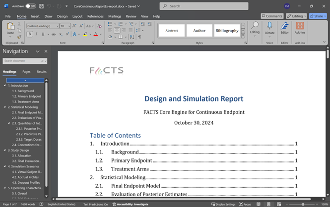

#  Introduction

## Purpose and Scope of this document

This document describes how to use the Design Report Generator, an automated report generation tool included with FACTS. It is intended for anyone concerned with using the automated report generation facility.

The Design Report Generator creates a Microsoft Word document describing the design and its simulated operating characteristics. It is built into FACTS: from FACTS 8.2 onwards, no additional software (such as R, RStudio, R packages or pandoc) needs to be installed or configured to generate a design report.

## Supported design types

A design report can be generated for the following design types:

- Phase 2 and Phase 3 (Core) designs with continuous, dichotomous, ordinal, time-to-event and multiple endpoints.
- Enrichment designs with continuous, dichotomous and time-to-event endpoints.
- Platform Trial designs with continuous and dichotomous endpoints.
- N-CRM dose escalation designs.

For other design types (e.g. Staged designs and the other dose escalation designs), the "Design Report" button is not displayed.

# Using the Design Report Generator from FACTS

## Software prerequisites

To view and edit the generated report you will need Microsoft Word, or another application able to open Word (".docx") documents. No other software is required.

## Steps for generating a design report

To generate a design report from FACTS, you will need to do the
following sequence of steps:

1.	Simulate your design in FACTS. The report describes the simulation results, so it can only be generated once at least one scenario has been simulated.

::: {.callout-note}
In case you have previously generated a report for your design, you will need to make sure that the previous version of the report is not open in Word when you generate a new report, as it will be overwritten.
:::

2.	Go to the "Simulation" tab and click on the "Design Report" button (in the "Results Options" area), or right-click on a row of simulation results and select "Design Report". The report is generated within FACTS, usually within a few seconds.

3.	Once generated, the Word document will be automatically opened. Word may ask whether to update the fields in the document; click "Yes" so that the Table of Contents is built. If the Table of Contents is not shown, right-click on it and choose "Update Field".

{#fig-fig4}

## Usage Notes

### Contents of the report

The report contains the following sections:

- **Introduction**
- **Statistical Modeling**: the dose response, longitudinal and other statistical models used in the design, including their priors. All equations are inserted as native Word equations, so they can be edited directly in Word.
- **Study Design**: the study information, allocation, interims and decision criteria of the design.
- **Simulation Scenarios**: the virtual subject response, accrual and dropout profiles that make up the simulated scenarios.
- **Operating Characteristics**: the overall operating characteristics and trial outcomes of each simulated scenario.
- **Computational Details**: the date and time of the simulations, the MCMC settings and the random number seeds used.

All scenarios that have been simulated are included in the report. If the design uses design variants, the report describes the variant of the selected row of simulation results.

The report does not contain any graphs; these can be added from the FACTS GUI as described [below](#suggested-steps-after-generating-the-report).

### Location of the generated Word file

The generated report document is stored in the “results” folder of your FACTS simulation (e.g., if your FACTS project is saved as
*CoreDesign.facts*, the folder named *CoreDesign_results* is the
corresponding ‘results’ folder), and is named after the FACTS project (e.g. *CoreDesign-report.docx*).

### Suggested steps after generating the report

A typical workflow after initially generating the report is as follows:

1.  Review the generated report for correctness, and fix minor
    typographical and formatting errors if any.
2.  If you would like to use a predefined Word template, you could apply the template to your report.
3.  Modify the default table style and add table cross-references as
    needed.
4.  Add additional text and figures as needed. For example, you can copy graphs displayed in the FACTS GUI by clicking on the “Export options” button next to the graph, selecting “Copy image to clipboard” and pasting it in the generated report.

## Generating a design report from the command line

A design report can also be generated when running FACTS from the command line:

- With the FACTS command line on Windows, use the "-report" option.
- With the FACTS Linux command line (see the [FLFLL User Guide](flfll.qmd)), use the "-report" flag together with the "-endToEndRun" flag, so that the design is simulated before the report is generated.

The report is written to the design's results folder, as when generating the report from the FACTS GUI.
