The Design Tab allows the user to specify how control responses,
treatment responses and longitudinal responses are modeled, how subjects
are allocation, the timing of interims, and the criteria for stopping
groups or the study for early success or futility, and the criteria for
judging final success or futility of each group and the study. Wherever applicable, this user guide is separated by type of endpoint used (continuous/dichotomous or time-to-event).

At each interim and at the final analysis, FACTS fits the Bayesian model
(the control and treatment models below and, for a continuous or
dichotomous endpoint, the longitudinal model) to the data available at
that time. The posterior is evaluated by MCMC, with each parameter
updated by Gibbs sampling where possible and by Metropolis-Hastings
otherwise. This is the same approach as in FACTS Core, see
[Evaluation of Bayesian Posterior Estimates](../core/design/index.qmd#evaluation-of-bayesian-posterior-estimates).

# Control Model / Hazard Model

:::{.panel-tabset}

## Continuous/Dichotomous

If no control arm is present then comparison is with historical mean
responses.

If control arms are present they can be modeled either:

- Separately with a simple Normal prior for the response (continuous endpoint) or the log odds of the rate of response (dichotomous endpoint) on the control arm,

- separately with the use of a ‘Hierarchical Prior’, where data from
  prior studies is incorporated via a hierarchical model,

- or jointly in a hierarchical model.

### Model

The final endpoint $Y$ of a subject in group $g$ is modeled in terms of
a control parameter $\gamma_{g}$ and a treatment effect $\theta_{g}$:

- Continuous endpoint:

  $$
  Y\sim N\left( \gamma_{g},\ \sigma^{2} \right)\ \text{on control},\qquad Y\sim N\left( \gamma_{g} + \theta_{g},\ \sigma^{2} \right)\ \text{on treatment}
  $$

  where $\gamma_{g}$ is the mean response on control, $\theta_{g}$ is
  the difference in mean response between treatment and control, and
  $\sigma^{2}$ is a single variance common to all groups and arms. If
  the model is baseline adjusted a term $\beta Z$ is added to the mean
  (see Baseline adjustment under Treatment Model).

- Dichotomous endpoint: the number of responders on control and on
  treatment in group $g$ are Binomial with response rates $\lambda_{g}$
  and $\pi_{g}$, where

  $$
  \text{logit}\left( \lambda_{g} \right) = \gamma_{g},\qquad \text{logit}\left( \pi_{g} \right) = \gamma_{g} + \theta_{g}
  $$

  so $\theta_{g}$ is the log-odds ratio of response on treatment
  relative to control. The model is fitted on the log-odds scale, but
  the treatment effect used in the stopping and evaluation criteria is
  the difference in response rates
  $\text{logit}^{-1}\left( \gamma_{g} + \theta_{g} \right) - \text{logit}^{-1}\left( \gamma_{g} \right)$.

The prior for $\gamma_{g}$ depends on the control model selected:

- Historical control: $\gamma_{g}$ is fixed at the historical control
  response $R_{g}$ entered for the group: $\gamma_{g} = R_{g}$
  (continuous) or $\gamma_{g} = \text{logit}\left( R_{g} \right)$
  (dichotomous).

- Controls modeled separately: independent priors
  $\gamma_{g}\sim N\left( \mu_{g},s_{g}^{2} \right)$, with the prior
  mean $\mu_{g}$ and SD $s_{g}$ entered for each group.

- Hierarchical Prior (BAC) for group $g$: this replaces the Normal prior
  for that group. $\gamma_{g}$ and the control parameters
  $\gamma_{gk}$ of the historic studies $k = 1,\ldots,K_{g}$ share a
  hierarchical model:
  $\gamma_{g},\gamma_{gk}\sim N\left( \mu,\tau^{2} \right)$, with
  $\mu\sim N\left( \mu_{0},\tau_{0}^{2} \right)$ and
  $\tau^{2}\sim IG\left( \alpha_{0},\beta_{0} \right)$. The data of
  historic study $k$, with $n_{k}$ subjects, enter the likelihood as
  $\bar{y}_{k}\sim N\left( \gamma_{gk},\sigma^{2}/n_{k} \right)$
  (continuous; the SD of the historic study also contributes to the
  estimate of $\sigma^{2}$) or as a Binomial number of responders out
  of $n_{k}$ with log-odds $\gamma_{gk}$ (dichotomous).

- Hierarchical model across groups:
  $\gamma_{g}\sim N\left( \mu,\tau^{2} \right)$, with
  $\mu\sim N\left( \mu_{0},\tau_{0}^{2} \right)$ and
  $\tau^{2}\sim IG\left( \alpha_{0},\beta_{0} \right)$.

- Hierarchical model plus clustering: see below.

In each case $\mu_{0}$, $\tau_{0}$, $\alpha_{0}$ and $\beta_{0}$ are the
user-specified hyper-parameters (the prior mean and SD of Mu and the
prior for tau). The priors for $\theta_{g}$ and $\sigma^{2}$ are set on
the Treatment Model tab.

### Historical Control

If on the Study \> Study Info tab, ‘include historical control’ has been
selected then the control model is simply the specified fixed mean
response on control in each group.

:::{.panel-tabset}

### Continuous

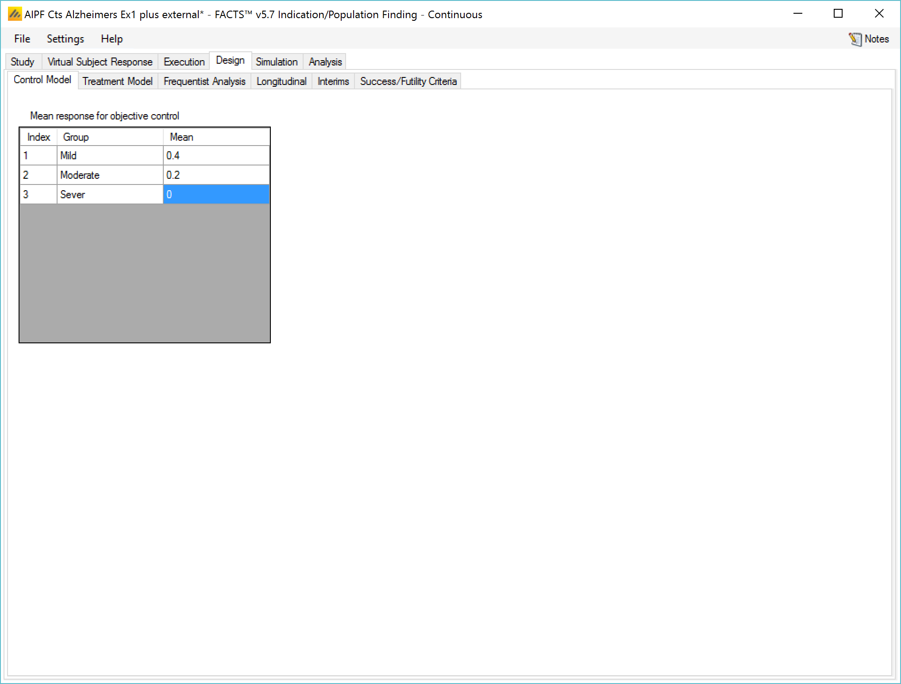{#fig-fig34cont}

### Dichotomous

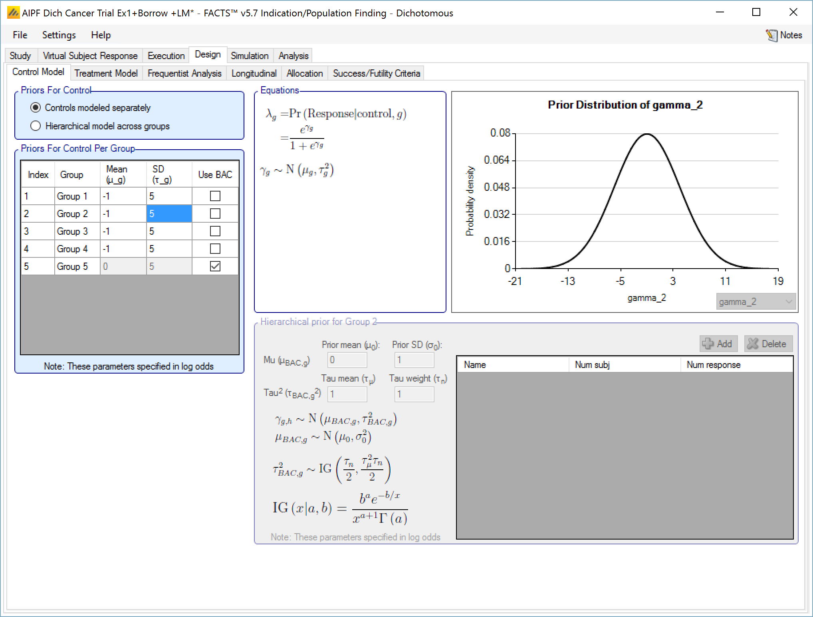{#fig-fig31dich}

:::

### Controls modeled separately

If on the Study \> Study Info tab, ‘include control treatment arm’ has
been selected then the control model can be separate models or a
hierarchical model across the groups.

If controls are modeled separately then the control arm in each group
has its own prior, which can be either:

- A mean and standard deviation for a Normally distributed prior for the
  response (continuous endpoint) or the log-odds response (dichotomous endpoint) on the control 

- A Hierarchical Prior (BAC).

:::{.panel-tabset}

### Continuous

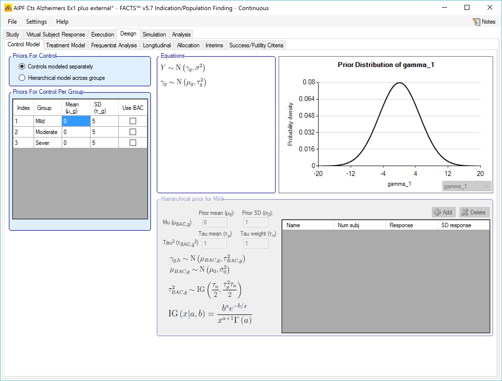{#fig-fig35cont}

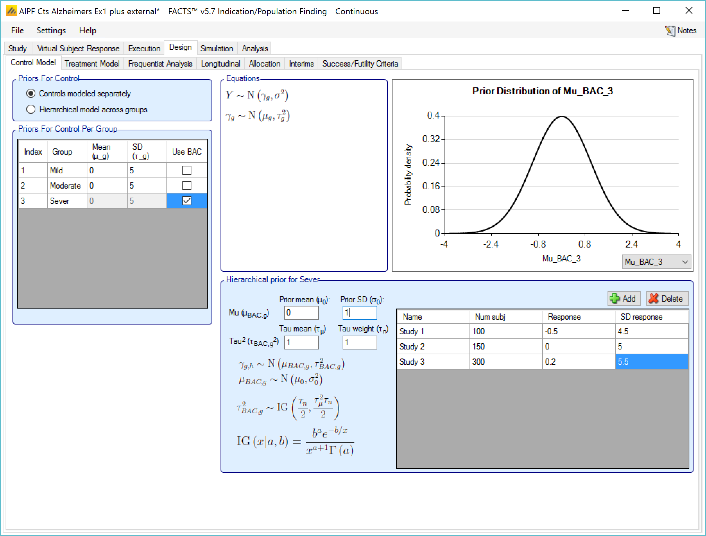{#fig-fig36cont}

### Dichotomous

{#fig-fig32dich}

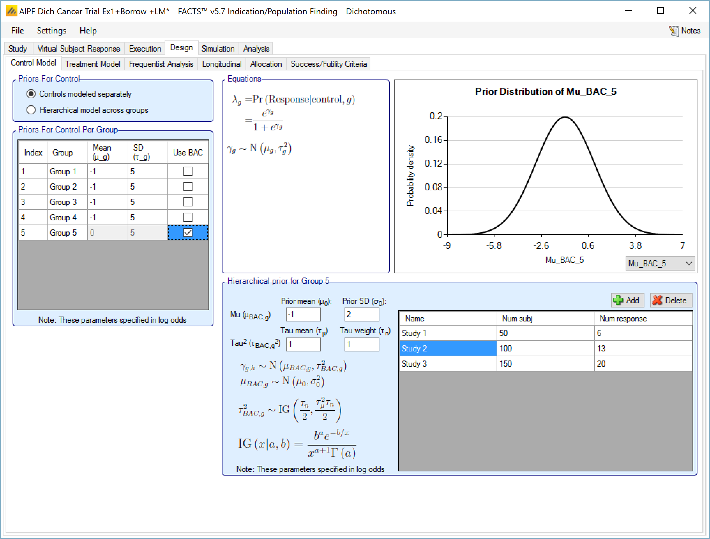{#fig-fig33dich}

:::

If a Hierarchical Prior for a control arm (Bayesian Augmented Control)
is specified for the control arm in a group then the user specifies:

- The sufficient statistics for each historic study to be included.
  For a continuous endpoint these are: the observed mean response of the
  control group, the number of subjects in the control group and the SD
  of the responses across the group. For a dichotomous endpoint they are
  the number of subjects in the control group and the number of those
  subjects who responded. This data can be ‘down-weighted’ by reducing
  the number of subjects (and, for a dichotomous endpoint, the number of
  responders pro-rata) entered relative to the number in the actual
  study.

- The hyper-parameters for the hierarchical model. These are the mean
  and standard deviation for a Normally distributed prior for the mean
  of the hierarchical model and the parameters for an Inverse-Gamma
  distributed prior for the variance of the hierarchical model. As with
  all Inverse-Gamma priors these can be specified as a mean and a weight
  or more conventional Alpha and Beta parameters.

::: {.callout-tip collapse="true"}
### Setting the priors for Hierarchical model hyper parameters

Unless the intent is to add information that is not included in the historic studies, the hyper parameters can and should be set so that they are ‘weak’ priors, centered on the expected values.  

In this case the following would be reasonable:

- Set the prior mean value for Mu as the unweighted mean of the means (continuous endpoint) or log-odds (dichotomous endpoint) of the historic studies  
- Set the prior SD for Mu equal to at least the largest difference between the mean (continuous endpoint) or log-odds (dichotomous endpoint) for any historic study and the unweighted mean (continuous endpoint) or log-odds (dichotomous endpoint) of all the historic studies.  
- Set the mean for tau to the same value as the prior SD for Mu.  
- Set the weight for tau to be < 1.  

One can traverse the spectrum from ‘complete pooling of data’ to ‘completely separate analyses’ through the prior for tau. If the weight of the prior for tau is small (relative to the number of studies), then (unless set to a very extreme value) the mean of the prior for tau will have little impact and the degree of borrowing will depend on the observed data.

To give some prior preference towards either pooling or separate analysis the *weight* for tau has to be significant > the number of historic studies. Then to have a design that is like pooling all the historic studies the *mean* for tau needs to be small (say 10% or less of the value suggested above). Alternatively, to have a design that is like separate analyses with no borrowing from the historic studies, the value for tau needs to be large (say 10x or more the value suggested above).

The best way to understand the impact of the priors is to try different values and run simulations. The advantage of a Hierarchical Prior is that it can, through the pooling effect, improve the precision of the estimate of the response on control – possibly allowing a reduced sample size allocated to the control arm. The disadvantage is that if the observed response on control is different from that in the historic studies, a degree of bias towards the rate in the historic studies will be observed in the posterior estimate. The art of using a Hierarchical Prior is to determine the degree of bias that would be acceptable and find the degree of pooling that corresponds to that.

:::

### Hierarchical model across groups

This is similar to a Hierarchical prior except that there is only one
hierarchical model (with Hierarchical Priors there is one per group) and
instead of modeling the results from the current study and past studies
it models the results from the different groups in the current study
only. This borrows information across the results of the control arms in
the different groups – borrowing more the more the results look similar,
borrowing less the more they diverge.

:::{.panel-tabset}

### Continuous

{#fig-fig37cont}

### Dichotomous

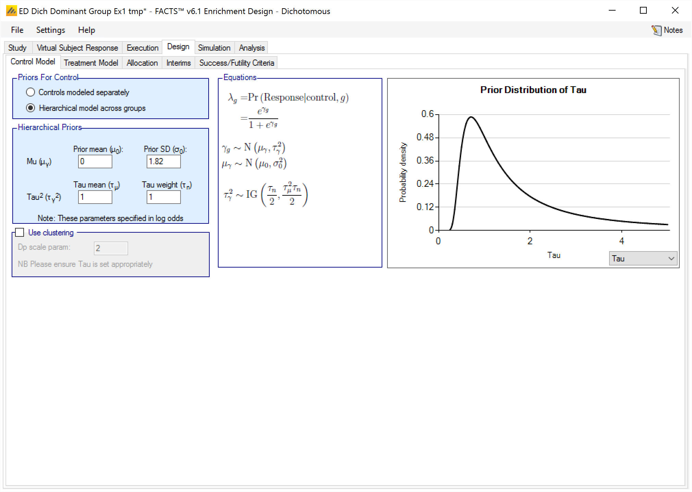{#fig-fig33dich}

:::

The hierarchical model is a normal distribution of the mean responses (continuous endpoint) or log-odds of the rates (dichotomous endpoint) on the control arms in all the groups. The user enters the priors for the
hyper-parameters of the hierarchical model. These are the mean and
standard deviation of a Normally distributed prior for the mean of the
hierarchical model and the parameters for an Inverse-Gamma distributed
prior for the variance of the hierarchical model. As with all
Inverse-Gamma priors these can be specified as a mean and a weight or
more conventional Alpha and Beta parameters.

::: {.callout-tip collapse="true"}
### Setting the priors for Hierarchical model hyper parameters

Unless the intent is to add information that is not observed in the study, the hyper parameters can and should be set so that they are ‘weak’ priors, centered on the expected values.

In this case the following would be reasonable:

- Set the prior mean value for Mu as the expected mean control response (continuous endpoint) or log-odds of the response (dichotomous endpoint) 
- Set the prior SD for Mu equal to at least the largest reasonably expected difference in mean response (continuous endpoint) or log-odds of the response (dichotomous endpoint) of the control arms across the groups.  
- Set the mean for tau to the same value as the prior SD for Mu.  
- Set the weight for tau to be < 1.  

To force borrowing (near pooling of data) between the groups, set a small prior mean of tau and a weight greater than the number of groups, combined with a weakly informative prior for mu; the group means will come together near the sample weighted average of the sample means.

To limit the borrowing between the groups, set a large tau and a weight equal to the number of groups or more. This can be used if, with a weak prior for tau, the borrowing across groups seems too great. However, achieving the desired balance will require simulation of a number of scenarios and trial and error.

If some borrowing can be accepted, this can result in greater precision in the estimates for the control – reducing the error in the estimate of the treatment difference and allowing the option of unbalancing the allocation between control and treatment.

If it’s required that there be no borrowing of data across the groups in the estimation of the response on the control arms then the best option is to model controls separately.

To use hierarchical modeling and include a prior expectation for the response on control, set the mean for Mu to the prior expectation, set small values for the SD of Mu **and** the mean of tau, and give the prior for tau a weight equal to the number of groups or more. Again, achieving the desired balance will require simulation of a number of scenarios and trial and error. 

:::

### Hierarchical Model plus Clustering

After selecting “Hierarchical model across groups”, if “Use Clustering”
is also checked then the specified prior is a prior for an arbitrary
number of distributions each providing a hierarchical prior to an
arbitrary selection of the groups. As with the hierarchical model, the
smaller and stronger the prior is on tau the greater the borrowing,
(closer to pooling) and the larger and stronger the prior is on tau the
weaker the borrowing (closer to separate analysis). The weaker the prior
on tau, the more the posterior value of tau is determined by the spread
of the control means in that cluster.

The “Dp scale parameter” is the Dirichlet Process parameter ‘α’.
The larger the value of ‘α’ the more process tends to place
groups in new clusters – so there is less borrowing, in experiments
using values of ‘α’ from 1 to twice the number of groups, this was a
much smaller effect than varying tau from 25% of the expected treatment
difference to 200% of the expected treatment difference.

We are still learning about how best to specify priors for this model
and will supply more guidance once we have a better understanding. In
the meantime like us you have the ability to run simulations with
different priors and explore the impact on the operating characteristics
in the setting of interest.

## Time-to-Event

If no control arm is present then comparison is with historical rates.

If control arms are present they can be modeled either:

- Separately using a piecewise exponential model, specifying the
  junctions of the different model segments and the parameters for the
  Gamma prior for the hazard rate in each segment.

- Separately with the use of ‘Bayesian Augmented Control’ (BAC) where
  data from prior studies is incorporated via a hierarchical model,

- Jointly in a hierarchical model,

- or using the Cox proportional hazard model.

### Model

Except with the Cox proportional hazard model, the time to event is
modeled with a piecewise exponential model. The time axis is divided
into segments $s = 1,\ldots,S$ at the user-specified segment starts. In
segment $s$ the hazard rate on the control arm of group $g$ is
$\lambda_{sg}$ and the hazard rate on the treatment arm is
$\lambda_{sg}\exp\left( \theta_{g} \right)$, so $\exp\left( \theta_{g} \right)$
is the hazard ratio of treatment to control in group $g$, constant over
time. Each subject contributes their events and their exposure time in
each segment to a piecewise exponential likelihood.

The prior for $\lambda_{sg}$ depends on the control model selected:

- Historical control: $\lambda_{sg}$ is fixed at the historical hazard
  rate $R_{sg}$ entered for the segment and group.

- Controls modeled separately: independent priors
  $\lambda_{sg}\sim \text{Gamma}\left( \alpha_{sg},\beta_{sg} \right)$,
  entered as a mean $\alpha_{sg}/\beta_{sg}$ and a weight
  $\alpha_{sg}$ for each group and segment.

- Hierarchical Prior (BAC) for group $g$: in addition to the Gamma
  prior above, the events and exposure of each historic study
  $k = 1,\ldots,K_{g}$ enter the likelihood with hazard rate
  $\lambda_{sg}\exp\left( \gamma_{gk} \right)$ in segment $s$. The log
  hazard ratios $\gamma_{gk}$ of the historic studies relative to the
  current study, together with the current study's own log hazard
  ratio (fixed at 0), are modeled as draws from
  $N\left( \mu,\tau^{2} \right)$, with
  $\mu\sim N\left( \mu_{0},\tau_{0}^{2} \right)$ and
  $\tau^{2}\sim IG\left( \alpha_{0},\beta_{0} \right)$.

- Hierarchical model across groups: in each segment
  $\lambda_{sg}\sim \text{Gamma}\left( \alpha_{s},\beta_{s} \right)$
  across the groups, and $\alpha_{s}$ and $\beta_{s}$ each have a Gamma
  prior, entered as a mean and a weight for each segment.

- Cox proportional hazard model: the control hazard is not modeled, see
  below.

The priors for $\theta_{g}$ are set on the Treatment Model tab.

### Historical Control

If on the Study \> Study Info tab, ‘include historical control’ has been
selected then the control model is simply the hazard rate on control in
each group. Different time segments can be specified for the hazard
rates independently from time segments used elsewhere such as on the
Virtual Subject Response \> Control Hazard Rates, Dropout or Treatment
Model tabs. And then the hazard rate must be specified for each time
segment for each group.

\[Note that currently, unlike the Virtual Subject Response \> Control
Hazard tab, the time units used for the rates on this tab cannot be
specified, they must be entered as rate per week\].

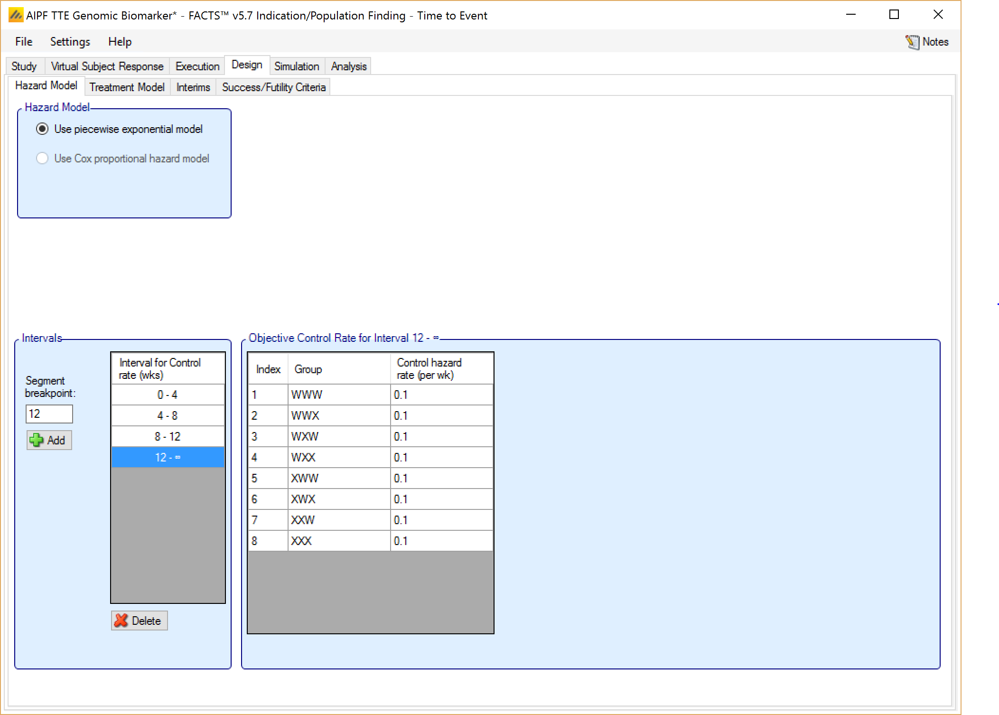{#fig-fig29tte}

### Controls modeled separately

If on the Study \> Study Info tab, ‘include control treatment arm’ has
been selected then the control model can be separate models or a
hierarchical model across the groups.

If controls are modeled separately then the control arm in each group
has its own prior which is a gamma distribution for the hazard rate for
each time segment. The user specifies:

- The segment intervals for the control model (across all groups)

- A mean (in events per weeks) and weight (in subjects) for the prior
  gamma distribution for the control hazard rate for each group and
  segment.

- Optionally supplemented by a Hierarchical Prior (BAC)

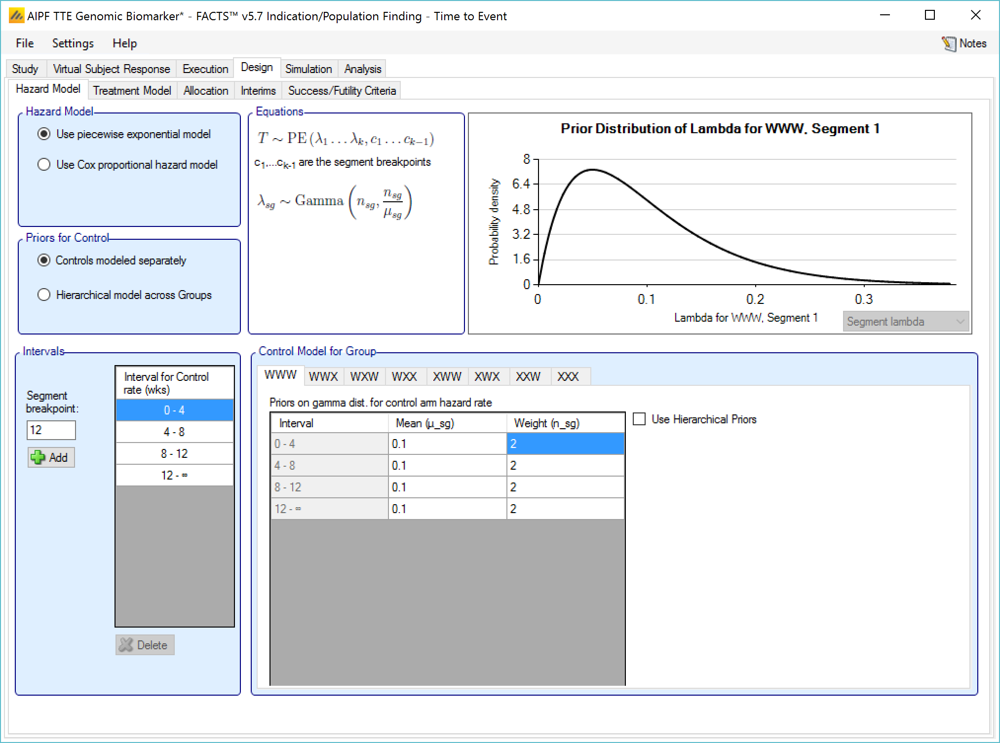{#fig-fig30tte} 

If Hierarchical Prior for Control is specified for the control arm in a
group, then in addition to the segment intervals (common across all
groups) and the parameters of the Gamma prior distribution, then on a
separate “Hierarchical Prior” tab the user specifies:

- The sufficient statistics to be included from each historic study for
  each segment, these are: the observed number of events in the control
  group and the exposure time in subject weeks. The information from the
  prior study can be ‘down-weighted’ by reducing, pro-rata, the number
  of events and exposure time.

- The hyper-parameters for the hierarchical model. These are the mean
  and standard deviation for a Normally distributed prior for the log
  hazard ratios of the event rates of the historical studies. The prior
  for the mean is the mean and standard deviation of a Normal
  distribution and prior for the standard deviation is an Inverse-Gamma
  distributed prior for the variance of the hierarchical model. As with
  all Inverse-Gamma priors these can be specified as a mean and a weight
  or more conventional Alpha and Beta parameters.

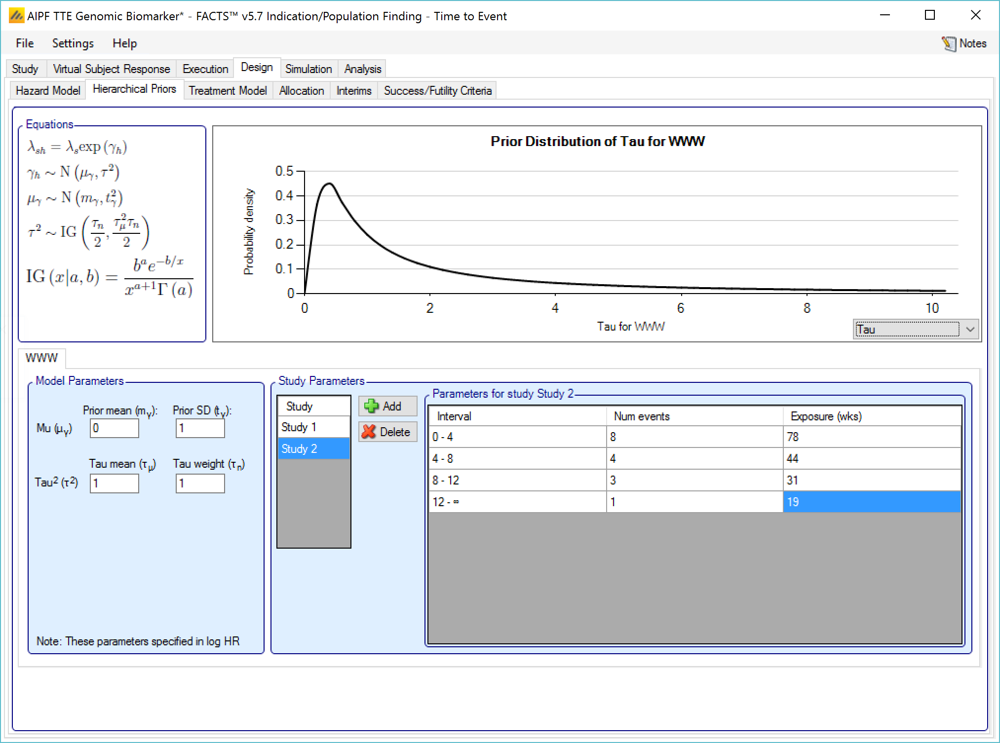{#fig-fig31tte} 

::: {.callout-tip collapse="true"}
### Setting the priors for Hierarchical model hyper parameters

Unless the intent is to add information that is not included in the historic studies, the hyper parameters can and should be set so that they are ‘weak’ priors, centered on the expected values.

In this case the following would be reasonable: 

- Set the prior mean value for Mu as the mean of the log-hazard ratios of the event rates of the control arm and the historic studies (usually this will be 0)  
- Set the prior SD for Mu equal to at least the largest log hazard ratio of the event rates for the historic studies.  
- Set the mean for tau to the same value as the prior SD for Mu.  
- Set the weight for tau to be < 1.  

One can traverse the spectrum from ‘complete pooling of data’ to ‘completely separate analyses’ through the prior for tau. If the weight of the prior for tau is small (relative to the number of studies), then (unless set to a very extreme value) the mean of the prior for tau will have little impact and the degree of borrowing will depend on the observed data.  

To give some prior preference towards pooling or separate analysis the **weight** for tau has to be large (relative to the number of historic studies) – to have a design that is like pooling all the historic studies the **mean** for tau needs to be small (say 10% or less of the value suggested above). For there to be no borrowing from the historic studies the value for tau needs to be large (say 10x or more the value suggested above).  

The best way to understand the impact of the priors is to try different values and run simulations. The advantage of a Hierarchical Prior is that it can, through the pooling effect, improve the precision of the estimate of the response on control – possibly allowing a reduced sample size allocated to the control arm. The disadvantage is that if the observed response on control is different from that in the historic studies a degree of bias towards the rate in the historic studies will be observed in the posterior estimate. The art of using a Hierarchical Prior is to determine the degree of bias that would be acceptable and find the degree of pooling that corresponds to that. 

:::

### Hierarchical model across groups

This is similar to a Hierarchical Prior except that there is only one
hierarchical model (with Hierarchical Priors there is one per group) and
instead of modeling the results from the current study and past studies,
it models the results from the different groups in the current study.
This borrows information across the results of the control arms in the
different groups – borrowing more the more the results look similar,
borrowing less the more they diverge.

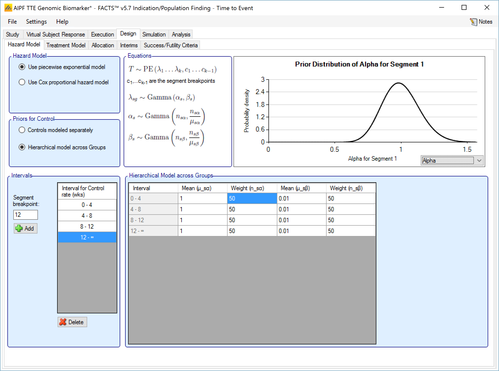{#fig-fig32tte}

The hierarchical model is a gamma distribution for the event rate on the
control arms in each time segment. The priors are in turn gamma
distributions for each parameter of the gamma distribution. The user
enters the hyper-parameters for the hierarchical model.

::: {.callout-tip collapse="true"}
### Setting the priors for Hierarchical model hyper parameters

Unless the intent is to add information that is not observed in the study, the hyper parameters can and should be set so that they are ‘weak’ priors, centered on the expected values.

In this case the following would be reasonable:

- For each segment decide the appropriate Gamma distribution for the event rates on the control arms across the groups. This gives the prior values for α and β in each segment. Note that this model is always parameterized with “Alpha and Beta” parameters, while the Gamma distributions that serve as priors for each of Alpha and Beta are always defined in terms of the mean and weight. This presentation does not vary (unlike many specifications of Gamma distribution priors) regardless of the Gamma Distribution Parameters setting in the Options tab under the Settings menu.  
- Setting the parameters for the priors for each α and β:  
  - Set the mean to be the value of the parameter decided above  
  - Set the weight—relative to the number of groups—depending on how much the prior 

Gamma distribution for the event rates should be updated to follow the observed rates during the trial. A small value (<1) for the weight will result in the hierarchical Gamma distribution being estimated largely based on the observed data, whereas a large value (> the number of groups) will result in the hierarchical distribution being driven primarily by the prior.  

For example: a weakly informative prior for an expected rate of 0.025 could be Gamma(5, 200). When considering how different that distribution (mean of 0.025, effective weight of 5) is from Gamma(6, 150) or Gamma(4, 250)—which have means of 0.04 and 0.016 respectively—it can be seen that the priors for the *hyper* parameters could be set with weights of about 50 so that the hierarchical prior is not overly strong.

**Nested Table 1: Gamma Distributions**

| Gamma(α=4, β=250)               | Gamma(α=5, β=200)               | Gamma(α=6, β=150)               |
|---------------------------------|---------------------------------|---------------------------------|
| 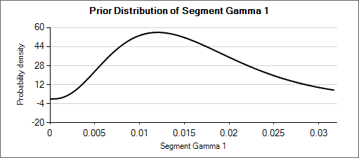{#fig-fig336tte}  | 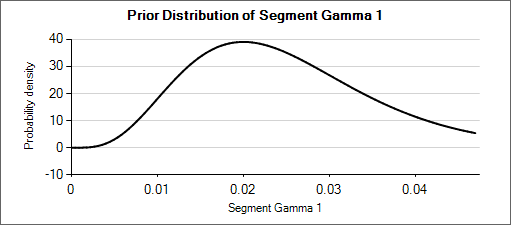{#fig-fig34tte}  | 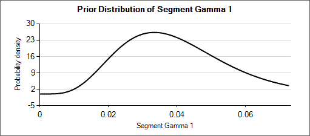{#fig-fig35tte}  |

**Nested Table 2: Priors for α and β**

| Prior for α = Gamma(μ=5, wt=50)   | Prior for β = Gamma(μ=200, wt=50)   |
|----------------------------------|-------------------------------------|
| 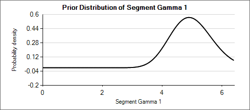{#fig-fig36tte}   | 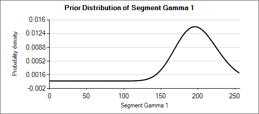{#fig-fig37tte}      | |

:::

### Cox proportional hazard model

When using the Cox proportional hazard mode the control hazard rate is
not modeled but instead cancels from the calculation, so there are no
parameters to enter.

The Cox model is only available if the study includes a control arm.
The hazard of a subject in group $g$ at time $t$ is

$$
h(t) = h_{0g}(t)\exp\left( \theta_{g}x \right)
$$

where $x = 1$ on the treatment arm and $x = 0$ on the control arm and
$h_{0g}(t)$ is an unspecified baseline hazard. The analysis is a
Bayesian Cox model that uses the Cox partial likelihood as the
likelihood for $\theta_{g}$, as justified by
[Sinha, Ibrahim and Chen (2003)](#sinha "Sinha D, Ibrahim JG, Chen M-H. A Bayesian justification of Cox's partial likelihood. Biometrika. 2003; 90(3): 629-641."),
so $h_{0g}(t)$ cancels. The partial likelihood is calculated within each
group, so the baseline hazard can differ between groups. Tied event
times are handled with the Breslow approximation. The priors for
$\theta_{g}$ are the same as with the piecewise exponential model (see
Treatment Model).

The across groups analysis does not use the partial likelihood. It uses
an exponential likelihood (a single segment) in which the control hazard
rate of each group is held fixed at a constant rate estimated from that
group's control arm in the current study:
$\left( d_{g} + 0.1 \right)/\left( E_{g} + 0.1 \right)$, where $d_{g}$
is the number of events and $E_{g}$ the total exposure time on the
control arm.

The predicted probability of success in a phase 3 trial depends only on
the hazard ratio and the phase 3 number of events, so it is calculated
in the same way as with the piecewise exponential model.

:::

# Treatment Model

:::{.panel-tabset}

## Continuous/Dichotomous

### Priors for the treatment effects

The treatment effects $\theta_{g}$ (the difference in mean response for
a continuous endpoint, the log-odds ratio of response for a dichotomous
endpoint) are defined in the model given under Control Model. Their
prior depends on the treatment model selected:

- Groups modeled separately: independent priors
  $\theta_{g}\sim N\left( \mu_{g},s_{g}^{2} \right)$, with the prior
  mean $\mu_{g}$ and SD $s_{g}$ entered for each group.

- Hierarchical model across groups:
  $\theta_{g}\sim N\left( \mu,\tau^{2} \right)$, with
  $\mu\sim N\left( \mu_{0},\tau_{0}^{2} \right)$ and
  $\tau^{2}\sim IG\left( \alpha_{0},\beta_{0} \right)$, where
  $\mu_{0}$, $\tau_{0}$, $\alpha_{0}$ and $\beta_{0}$ are the
  user-specified hyper-parameters.

- Hierarchical model plus clustering: see below.

For a continuous endpoint the common variance has the prior
$\sigma^{2}\sim IG\left( \alpha_{\sigma},\beta_{\sigma} \right)$,
entered as the ‘sigma prior mean’ and weight described below.

The across groups analysis is a second, pooled model fitted alongside
the main model. In it all groups have a common treatment effect,
$\theta_{g} = \theta$ for all $g$, with prior
$\theta\sim N\left( \mu_{p},s_{p}^{2} \right)$ from the across groups
prior mean and SD. The control model and its priors are the same as in
the main model. For a dichotomous endpoint the across groups difference
in response rates is calculated at the average of the $\gamma_{g}$
across the groups.

### Groups modeled separately

If the treatment arms in different groups are to be modeled separately,
then the treatment arm in each group has its own prior which is
specified as a mean and standard deviation for a Normally distributed
prior for the difference in mean response (continuous endpoint) or in log-odds between the response rate (dichotomous endpoint) between the treatment arm and
the control (whether a historic mean or from a control arm).

In addition the user specifies

- A prior mean and standard deviation for a Normally distributed prior
  for the across groups analysis: the estimate of an common treatment
  difference from control (whether historic means or observed means)
  across all groups.

- A prior mean for the estimate of sigma, the SD of the subject
  responses (across all arms and groups) and the weight of that prior in
  terms of equivalent number of observations. This prior is an inverse
  gamma distribution for sigma squared. Thus what the user enters is
  only approximately a prior expectation for sigma; it is actually an
  expectation for the precision:
  $E\left( \frac{1}{\sigma^{2}} \right) = \frac{1}{{\acute{\sigma}}^{2}}$
  where $\acute{\sigma}$ is the ‘sigma prior mean’.

:::{.panel-tabset}

### Continuous

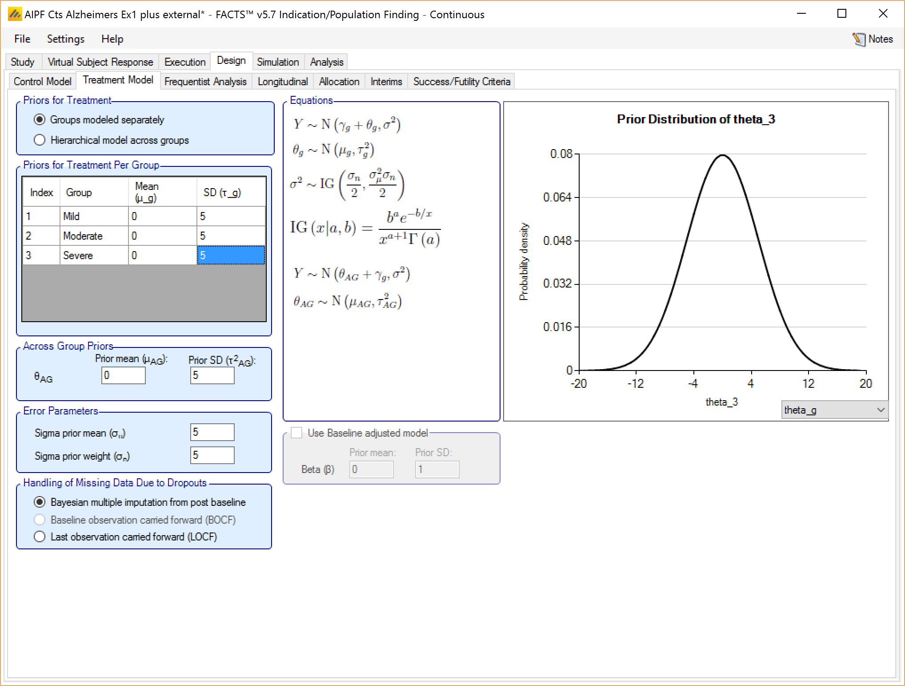{#fig-fig38cont}

### Dichotomous

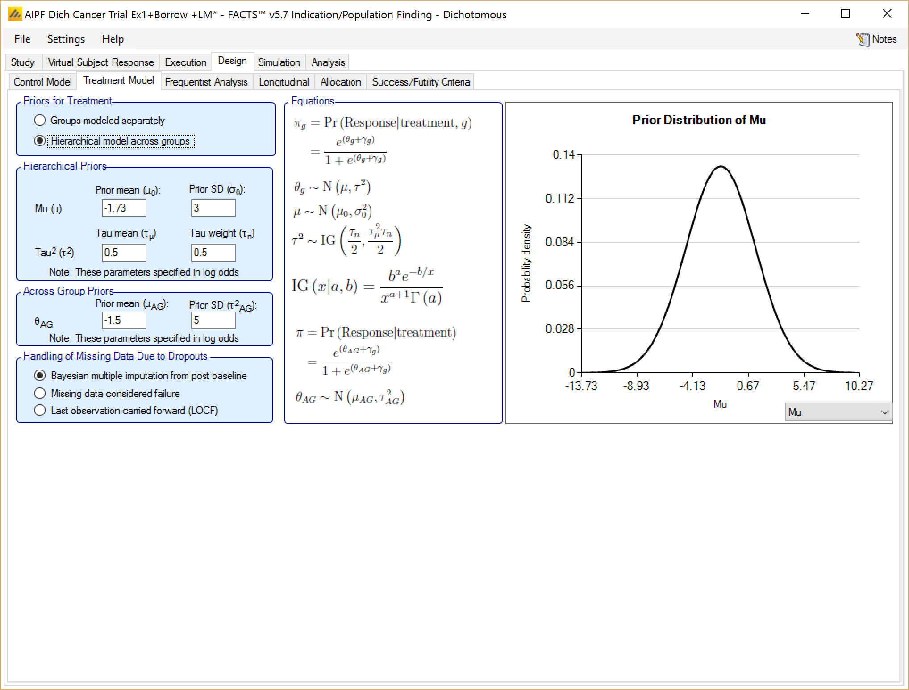{#fig-fig35dich}

:::

### Hierarchical model across groups

If the treatment arms in different groups are to be modeled with a
hierarchical structure, then the user enters the hyper-parameters for
the hierarchical model (similar to the hierarchical model for the
control arms – see section 0 above). These are

- the mean and standard deviation for a Normally distributed prior for
  the mean of the hierarchical model

- and the parameters for an Inverse-Gamma distributed prior for the
  variance of the hierarchical model. As with all Inverse-Gamma priors
  these can be specified as a mean and a weight or more conventional
  Alpha and Beta parameters.

In addition the user specifies

- A prior mean and standard deviation for a Normally distributed prior
  for the across groups analysis – this is a pooled analysis of an
  overall difference from control (whether historic means or observed
  means). In this analysis, all groups are assumed to have the same
  treatment effect. This analysis is conducted separately, reported
  separately, and is used only as an OPTION in stopping. Filling in
  these priors does NOT constitute assuming equal treatment effects.

:::{.panel-tabset}

### Continuous

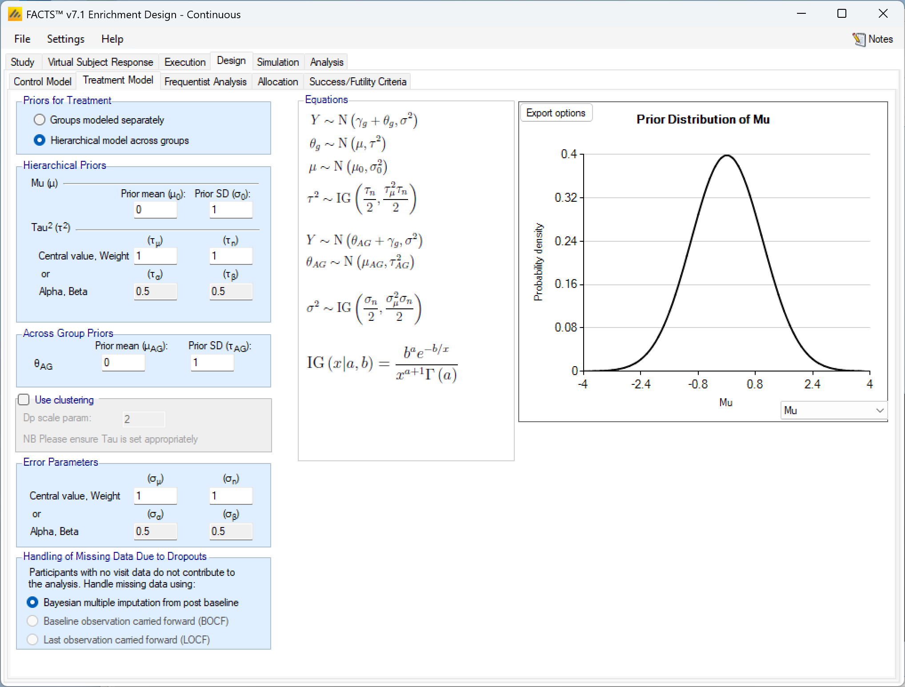{#fig-fig95cont}

### Dichotomous

{#fig-fig35dich}

:::

::: {.callout-tip collapse="true"}
### Setting the priors for Hierarchical model hyper parameters

Unless the intent is to add information that is not observed in the study, the hyper parameters can and should be set so that they are ‘weak’ priors, centered on the expected values.

In this case the following would be reasonable:

- Set the prior mean value for Mu as the expected mean control response (continuous endpoint) or log odds of the treatment difference from control (dichotomous endpoint)
- Set the prior SD for Mu equal to at least the largest reasonably expected difference from the across groups mean for a one control arm in any group (contiuous endpoint) or the largest reasonably expected difference between the log odds of the treatment differences across the groups (dichotomous endpoint).  
- Set the mean for tau to the same value as the prior SD for Mu.  
- Set the weight for tau to be < 1.  

To force borrowing (near pooling of data) between the groups, set a small prior mean of tau and a weight greater than the number of groups, combined with a weakly informative prior for mu; the group means (contiuous endpoint) or log odds (dichotomous endpoint) will come together near the sample weighted average of the sample means (continuous endpoint) or log odds (dichotomous endpoint).

To limit the borrowing between the groups, set a large tau and a weight equal to the number of groups or more. This can be used if, with a weak prior for tau, the borrowing across groups when there is some variation seems too great. However, achieving the desired balance will require simulation of a number of scenarios and trial and error.

To use hierarchical modeling and include a prior expectation for the treatment difference (continuous endpoint) or log odds of the treatment difference (dichotomous endpoint), set the mean for Mu to the expected mean treatment difference (continuous endpoint) or expected log odds of the treatment difference (dichotomous endpoint), set small values for the SD of Mu **and** mean of tau, and give the prior for tau a weight equal to the number of groups or more. Again, achieving the desired balance will require simulation of a number of scenarios and trial and error.

:::

### Hierarchical Model plus Clustering

After selecting “Hierarchical model across groups”, if “Use Clustering”
is also checked then the specified prior is a prior for an arbitrary
number of distributions each providing a hierarchical prior to an
arbitrary selection of the groups. As with the hierarchical model, the
smaller and stronger the prior is on tau the greater the borrowing,
(closer to pooling) and the larger and stronger the prior is on tau the
weaker the borrowing (closer to separate analysis). The weaker the prior
on tau, the more the posterior value of tau is determined by the spread
of the control means in that cluster.

The “Dp scale parameter” is the Dirichlet Process parameter ‘α’.
The larger the value of ‘α’ the more process tends to place
groups in new clusters – so there is less borrowing, in experiments
using values of ‘α’ from 1 to twice the number of groups, this was a
much smaller effect than varying tau from 25% of the expected treatment
difference to 200% of the expected treatment difference.

We are still learning about how best to specify priors for this model
and will supply more guidance once we have a better understanding. In
the meantime like us you have the ability to run simulations with
different priors and explore the impact on the operating characteristics
in the setting of interest.

:::{.panel-tabset}

### Continuous

{#fig-fig39cont}

### Dichotomous

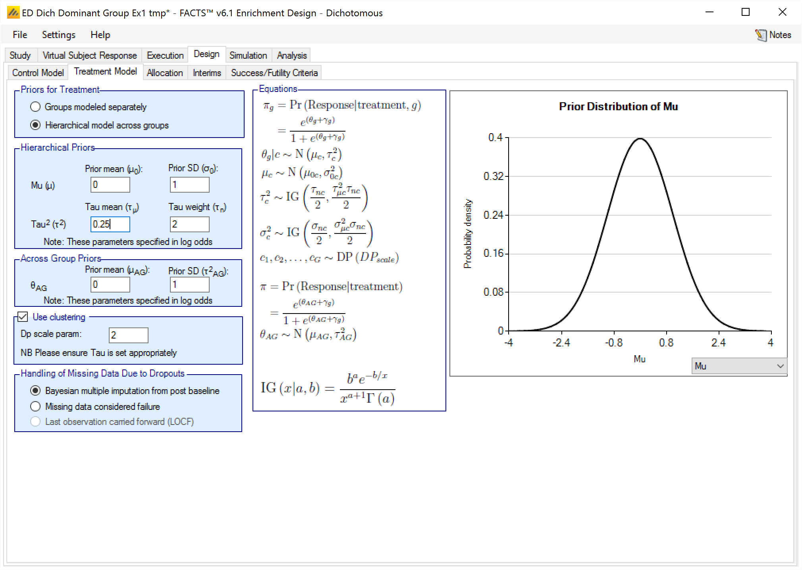{#fig-fig36dich}

:::

### Baseline adjustment

If baseline is included, the model may be baseline adjusted. This means
that the baseline is treated as a covariate and an extra term is added
to the response model so it becomes:

$$
Y\sim N\left( \gamma_{g} + \theta_{g} + \beta Z,\ \sigma^{2} \right)
$$

Where $\gamma_{g}$ is the mean response on control in group g,
$\theta_{g}$ is the mean difference in response of the treatment arm
compared to the control arm in group g and $\beta Z$ is the adjustment
for baseline, where Z is standardized baseline score and $\beta$ the
estimated parameter. The prior for $\beta$ is a Normal distribution
with user specified mean and standard deviation.

The baseline score $x$ is standardized as $Z = (x - \bar{x})/s_{x}$,
where $\bar{x}$ and $s_{x}$ are the observed mean and SD of the baseline
scores of all the subjects recruited so far, pooled over groups and
arms, and recalculated at each analysis. There is a single $\beta$, common to
all groups and arms.

If the subject responses are simulated with a baseline adjustment
$\beta_{VSR}(x - c)/s$ (see Virtual Subject Response \> Baseline), the
estimate of $\beta$ need not equal $\beta_{VSR}$. Writing
$x = \bar{x} + s_{x}Z$, the simulated adjustment is
$\beta_{VSR}(\bar{x} - c)/s + \beta_{VSR}(s_{x}/s)Z$, so the fitted
$\beta$ estimates $\beta_{VSR}s_{x}/s$, and the shift
$\beta_{VSR}(\bar{x} - c)/s$ (zero only if $c$ equals the mean
baseline) is absorbed into the estimated group means.
The simulation allows a different $\beta_{VSR}$, $c$ and $s$ in each
group, but the design model fits only one $\beta$, so if
$\beta_{VSR}/s$ differs across groups the model cannot reproduce it and
the estimate of $\sigma$ will be larger than the simulated SD.

### Handling of Missing Data Due to Dropouts

The options are:

- Bayesian multiple imputation from post baseline – This is the default
  and treats dropouts in exactly the same way as subjects which have not
  yet completed. The option is labeled “Bayesian multiple imputation”
  if no baseline is included, and “Missing data is ignored” if subjects
  have no intermediate visits in the design (“Use longitudinal
  modeling” is unchecked on the Study \> Study Info tab). In that case
  it has the effect that a subject that drops out is included in
  subject randomization counts but excluded from the frequentist
  analysis and makes no net contribution to the Bayesian modelling.

- BOCF (continuous endpoint only, available if baseline is included) –
  This treats each subject who drops out as having a final response
  which is the same as their baseline value (i.e. final response is
  zero if response is change from baseline).

- Missing data is considered failure (dichotomous endpoint only) – This
  treats each subject who drops out as having a final outcome that is a
  failure: a non-response if a response is a good outcome, a response
  if a response is a bad outcome.

- LOCF (available if “Use longitudinal modeling” is checked) – This sets
  the final response equal to the last observed post-baseline visit
  value.

Subjects with at least one observed post-baseline visit are always
included in the Bayesian analysis. A subject who drops out before their
first post-baseline visit is included only with BOCF or “Missing data is
considered failure”, as these give the subject a known final endpoint.
With Bayesian multiple imputation or LOCF such a subject is excluded
from the Bayesian analysis, even if they have a baseline value (with
LOCF the observed mean responses reported in the simulation output do
use the baseline value for such a subject).

NB Setting BOCF, LOCF or “Missing data is considered failure” here does
not affect the longitudinal model used for incomplete subjects. The
final values these options give to dropouts are not used to estimate
the parameters of the longitudinal model.

## Time-to-Event

### Priors for the treatment effects

The treatment effects $\theta_{g}$ are the log hazard ratios of
treatment to control defined in the model given under Control Model /
Hazard Model.
Their prior depends on the treatment model selected:

- Groups modeled separately: independent priors
  $\theta_{g}\sim N\left( \mu_{g},s_{g}^{2} \right)$, with the prior
  mean $\mu_{g}$ and SD $s_{g}$ entered for each group.

- Hierarchical model across groups:
  $\theta_{g}\sim N\left( \mu,\tau^{2} \right)$, with
  $\mu\sim N\left( \mu_{0},\tau_{0}^{2} \right)$ and
  $\tau^{2}\sim IG\left( \alpha_{0},\beta_{0} \right)$, where
  $\mu_{0}$, $\tau_{0}$, $\alpha_{0}$ and $\beta_{0}$ are the
  user-specified hyper-parameters.

- Hierarchical model plus clustering: see below.

The across groups analysis is a second, pooled model fitted alongside
the main model. In it all groups have a common log hazard ratio,
$\theta_{g} = \theta$ for all $g$, with prior
$\theta\sim N\left( \mu_{p},s_{p}^{2} \right)$ from the across groups
prior mean and SD. The hazard model and its priors are the same as in
the main model (for the Cox model see Cox proportional hazard model
under Control Model / Hazard Model).

### Groups modeled separately

If the treatment arms in different groups are to be modeled separately,
then the treatment arm in each group has its own prior which specified
as:

- If control arms are present, a mean and standard deviation for a
  Normally distributed prior for the log hazard ratio of the event rate
  on the study treatment arm compared to the estimated event rate on the
  control arm.

- If comparing with historical control response values, a mean and
  standard deviation for a Normally distributed prior for the log hazard
  ratio of the event rate on the study treatment arm compared to the
  historic event rate for control.

In addition the user specifies

- A prior mean and standard deviation for a Normally distributed prior
  for a common hazard ratio (but still relative to the control rate
  within each group) across all groups.

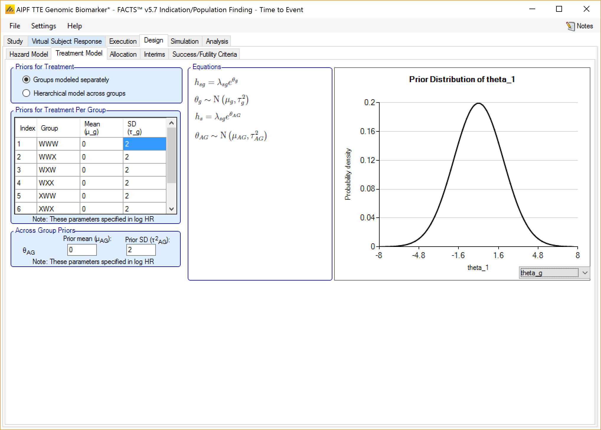{#fig-fig39tte}

### Hierarchical model across groups

If the event rates on the study treatment arms in the different groups
are to be modeled with a hierarchical structure, then the user enters
the hyper-parameters for the hierarchical model. The hierarchical model
is a Normal distribution for the log hazard ratios for the different
study treatment arms. The user specifies the hyper priors for this
model - the prior distributions for each of the parameters of the
hierarchical model:

- the mean and standard deviation for a Normally distributed prior for
  the mean of the hierarchical model,

- and the parameters for an Inverse-Gamma distributed prior for the
  variance of the hierarchical model. As with all Inverse-Gamma priors
  these can be specified as a mean and a weight or more conventional
  Alpha and Beta parameters.

In addition the user specifies

- A prior mean and standard deviation for a Normally distributed prior
  for the across groups analysis – this is a pooled analysis of an
  overall log hazard ratio relative to control (whether historic or
  observed control event rates). In this analysis, all groups are
  assumed to have the hazard ratio. This analysis is conducted
  separately, reported separately, and is used only as an OPTION in
  stopping. Filling in these priors does NOT constitute assuming equal
  treatment effects.

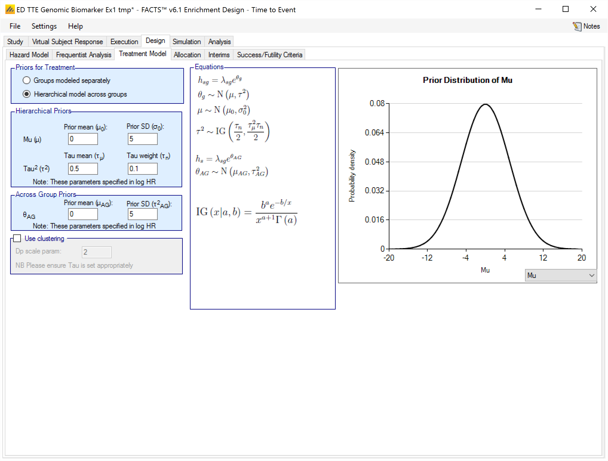{#fig-fig40tte}

::: {.callout-tip collapse="true"}
### Setting the priors for Hierarchical model hyper parameters

Unless the intent is to add information that is not observed in the study, the hyper parameters can and should be set so that they are ‘weak’ priors, centered on the expected values.

In this case the following would be reasonable:

- Set the prior mean value for Mu as the expected log hazard ratio of the response on the treatment arms.  
- Set the prior SD for Mu equal to at least the largest reasonably expected difference between the log hazard ratios across the groups.  
- Set the mean for tau to the same value as the prior SD for Mu.  
- Set the weight for tau to be < 1.  

To force borrowing (near pooling of data) between the groups, set a smaller prior mean of tau and a weight greater than the number of groups, combined with a weakly informative prior for Mu; the group log hazard ratios will come together near the sample weighted average of the sample log hazard ratios.

To limit the borrowing between the groups, set a larger tau and a weight equal to the number of groups or more. This can be used if, with a weak prior for tau, the borrowing across groups when there is some variation seems too great. However, achieving the desired balance will require simulation of a number of scenarios and trial and error.

To use hierarchical modeling and include a prior expectation for the log hazard ratio, set the mean for Mu to the expected log hazard ratio, set small values for the SD of Mu **and** the mean of tau, and give the prior for tau a weight equal to the number of groups or more. Again, achieving the desired balance will require simulation of a number of scenarios and trial and error.

:::

### Hierarchical Model plus Clustering

After selecting “Hierarchical model across groups”, if “Use Clustering”
is also checked then the specified prior is a prior for an arbitrary
number of distributions each providing a hierarchical prior to an
arbitrary selection of the groups. As with the hierarchical model, the
smaller and stronger the prior is on tau the greater the borrowing,
(closer to pooling) and the larger and stronger the prior is on tau the
weaker the borrowing (closer to separate analysis). The weaker the prior
on tau, the more the posterior value of tau is determined by the spread
of the control means in that cluster.

The “Dp scale parameter” is the Dirichlet Process parameter ‘α’.
The larger the value of ‘α’ the more process tends to place
groups in new clusters – so there is less borrowing, in experiments
using values of ‘α’ from 1 to twice the number of groups, this was a
much smaller effect than varying tau from 25% of the expected treatment
difference to 200% of the expected treatment difference.

We are still learning about how best to specify priors for this model
and will supply more guidance once we have a better understanding. In
the meantime like us you have the ability to run simulations with
different priors and explore the impact on the operating characteristics
in the setting of interest.

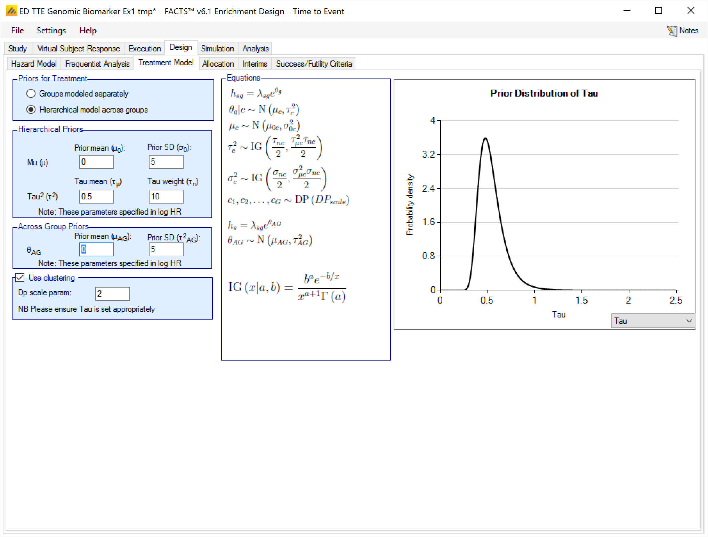{#fig-fig41tte}

:::

# Frequentist Analysis

If frequentist analysis is enabled on this tab, the alpha levels can be
set for the various end-of-trial frequentist analyses. These are output
in separate results files, and are not available for use within the
simulations (e.g. for early stopping decisions). Frequentist analysis is
disabled by default; enabling it increases the computational overhead of
simulations only slightly.

These tests are performed as two-sided tests for all endpoints and all p-value calculations.
The exceptions are the within-group p-values for a continuous endpoint
and the Fisher exact p-values for a dichotomous endpoint, which are
one-sided p-values for an improvement on treatment (over control, or
over the historical control response if there is no control arm). In the summary of
the simulations a group is counted as significant by these tests if the
p-value is below half the group alpha, which is the same as a two-sided
test in the direction of benefit.

The overall alpha is used for the tests across groups and the group
alphas for the tests within each group.

:::{.callout-note collapse="true"}

### Note this differs from FACTS Core

This differs from FACTS Core, where the frequentist tests are one-sided, testing for superiority of treatment over control. For identical data (with an observed effect in the direction of benefit), the one-sided p-value reported by FACTS Core is exactly half the two-sided p-value reported here. Consequently, at the same significance level both implementations have approximately the same overall type-1 error rate under the null (the two-sided test allocates α/2 to each direction, the one-sided test α to the benefit direction) but the two-sided test has noticeably lower power when the treatment is effective. To match FACTS Core's one-sided test at level α, set the significance level to 2α here (e.g. 0.05 to match a one-sided 0.025). Because the test is two-sided, a significant result can in principle also arise from an effect in the direction of harm.

:::

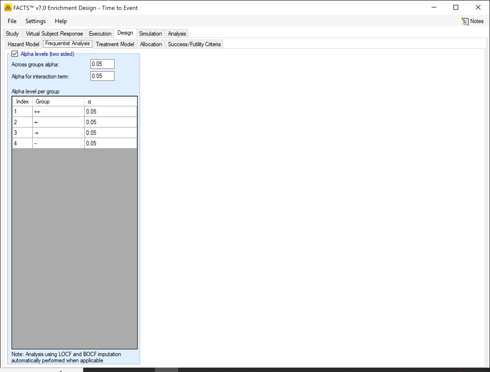{#fig-fig38tte}

## Analyses performed

:::{.panel-tabset}

### Continuous

Subjects without a final response are included using their last
observed visit response (LOCF). Subjects who drop out before their
first post-baseline visit are excluded. If baseline is included, a
second analysis is also run in which every subject without a final
response is included using their baseline value (BOCF); its results are
in the files with "bocf" in their name. Neither analysis depends on the
dropout option selected for the Bayesian analysis on the Treatment Model
tab.

The analysis is an ANCOVA, a linear model fitted by least squares with
F tests:

- With a control arm the model is Response = Group + Treatment +
  Group × Treatment, plus Baseline as a covariate if baseline is
  included. The output gives F test p-values for the group effect, the
  treatment effect and the group by treatment interaction, the
  treatment difference in each group with its confidence interval and
  p-value, and an overall treatment difference (the average of the
  group differences, weighted by the number of subjects in each group).

- Without a control arm the model is Response = Group, plus Baseline if
  baseline is included. The output gives the F test p-value for the
  group effect and, for each group, the difference between the group
  mean and the group's historical control response, with its confidence
  interval and p-value.

The baseline covariate is included whenever baseline is included in the
study, whether or not the Bayesian model is baseline adjusted.

### Dichotomous

Subjects without a final response are included using their last
observed visit response (LOCF), or as a failure if “Missing data is
considered failure” is selected on the Treatment Model tab. With LOCF,
subjects who drop out before their first post-baseline visit are
excluded.

With a control arm the tests are:

- Across groups: a chi-squared test (with continuity correction)
  comparing treatment with control, ignoring groups; the Agresti score
  confidence interval for the difference in response rates, ignoring
  groups; the Cochran-Mantel-Haenszel test, with groups as strata; the
  Mantel-Haenszel common odds ratio; a test of whether the odds ratio
  differs between groups (reported as Breslow-Day); and chi-squared
  tests of whether the response rate differs between groups, separately
  within the treatment arms and within the control arms.

- Within each group: chi-squared (with continuity correction), Fisher
  exact and two-sample binomial (Normal approximation) tests comparing
  treatment with control, and the difference in response rates with its
  confidence interval.

Without a control arm the tests are a chi-squared test of whether the
response rate differs between groups and, within each group, a binomial
(Normal approximation) test of the response rate against the group's
historical control rate.

### Time-to-Event

With a control arm the analyses are:

- Across groups: Cox proportional hazards models with group, treatment
  and group by treatment interaction terms, with likelihood ratio tests
  for the group effect, the treatment effect and the interaction; an
  overall hazard ratio (the group hazard ratios averaged on the log
  scale, weighted by the number of subjects in each group); and a
  log-rank test stratified by group.

- Within each group: a Cox model of treatment (hazard ratio, confidence
  interval and Wald p-value) and a log-rank test.

Without a control arm the analyses are a Cox model of group, with a
likelihood ratio test for the group effect, and, within each group, a
one-sample log-rank test against the group's historical control hazard
rates and a test of the ratio of the observed number of events to the
number expected at the historical rates.

:::

# Longitudinal model

This section is only relevant for the continuous and dichotomous endpoint engines. 

With all the longitudinal models available, it is possible to specify
how many separate longitudinal models to use.

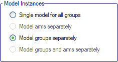{#fig-fig41cont}

- Single model for all groups – there is a single model; longitudinal
  data is pooled across all arms and groups to estimate the parameters
  of the model.

- Model arms separately – there are two models; one for all subjects in
  control arms and one for all subjects in treatment arms and the
  parameters for each model are estimated independently.

- Model groups separately – there are separate models for each group;
  longitudinal data within the group is pooled for the subjects in
  either the control or treatment arm in that group.

- Model groups and arms separately - there are separate models for each
  treatment arm in each group.

The use of the longitudinal models is to impute final endpoint response
for subjects who at that point in time have not reached their final
endpoint (and if “Bayesian multiple imputation from post baseline” has
been selected on the Design \> Treatment model tab, also for those
subjects who have dropped out and who’s final endpoint response will
never be observed).

The multiple imputation process means that during the MCMC sampling, the
subjects who’s final endpoints are to be imputed have them sampled from
the distribution of their predicted endpoint given the subjects’
observed intermediate responses and the parameters of the longitudinal
model. Imputed endpoints thus have a distribution unlike an observed
endpoint which will have the same value in each MCMC sample. A
distribution estimated in this way captures both the uncertainty in the
estimate of the parameters of the longitudinal model and the uncertainty
of the prediction of the endpoint given particular parameter values.

:::{.panel-tabset}

## Continuous

There are five options for handling longitudinal modeling with a continuous endpoint:

1.  Last Observation carried Forward (LOCF)

2.  Linear Regression

3.  Time course hierarchical

4.  Kernel Density

5.  ITP

These models are described in more detail in
[Longitudinal Models for Continuous Endpoints](../core/longitudinalmodels/continuous.qmd)
in the FACTS Core user guide.

### Last Observation Carried Forward (LOCF)

This is not a model. For each subject their final endpoint is assumed to
be the same as the last observation of that patient at an interim visit.

### Linear Regression

This uses simple linear regression to model the relationship between
endpoint values at each visit and the final endpoint value. The user
specifies:

- A prior mean and standard deviation for a Normally distributed prior
  for alpha, the intercept or fixed expected response.

- A prior mean and standard deviation for a Normally distributed prior
  for beta, the slope or the coefficient of further improvement as a
  multiple of the response observed at the visit.

- A prior mean for the estimate of lambda, the SD of the error in the
  forecast of the final endpoint and the weight of that prior in terms
  of equivalent number of operations. This prior is an inverse gamma
  distribution for lambda squared. (thus
  $E\left( \frac{1}{\lambda^{2}} \right) = \frac{1}{{\acute{\lambda}}^{2}}$
  where $\acute{\lambda\ }$ is the lambda prior mean)

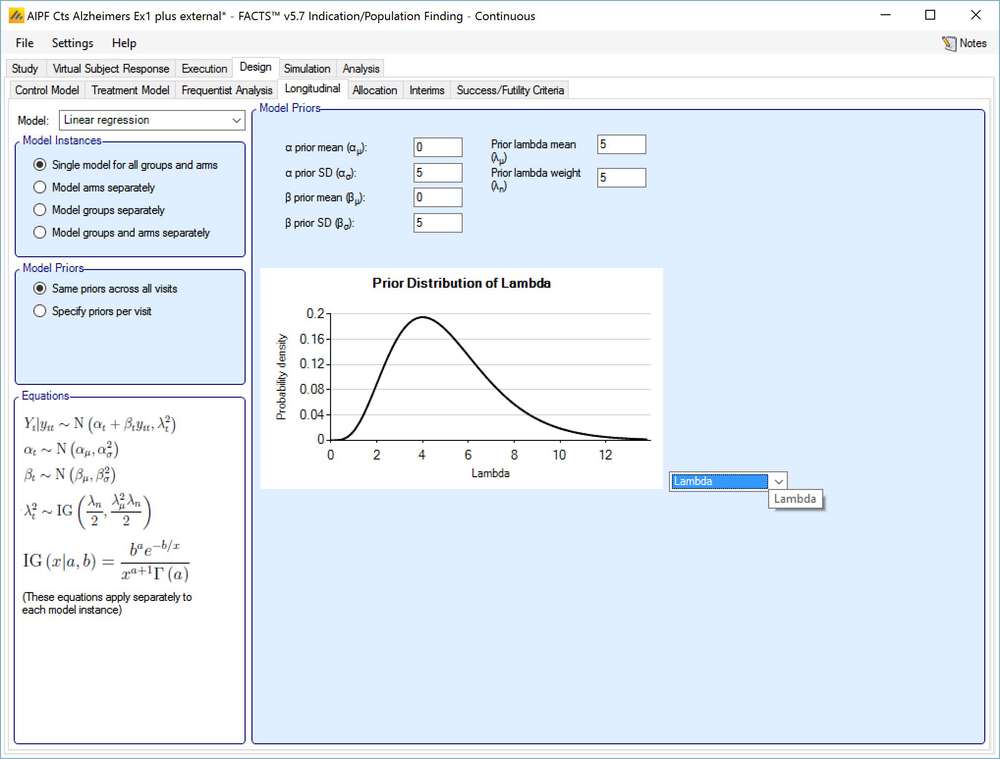{#fig-fig42cont}

If “Specify priors per visit” is selected then the priors are entered as
a grid:

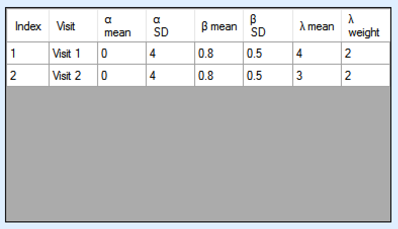{#fig-fig43cont}

If “Specify priors per model instance and visit is specified then there
is an additional control to select the model whose priors are currently
displayed in the grid. To set the priors the user must ensure that they
are set for each model in turn.

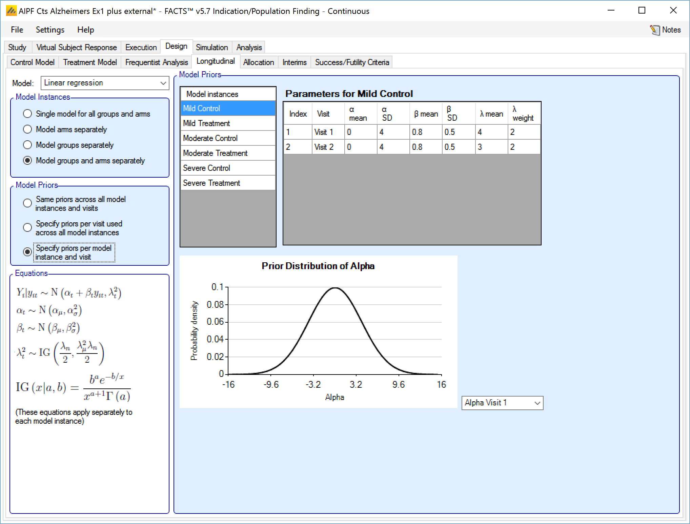{#fig-fig44cont}

###  Time Course Hierarchical

This model models the relationship between all the subject’s
intermediate endpoints and their final endpoint value. The model has a
per-subject random effect (delta), and an exponential coefficient
(alpha), relating the final mean response and per-subject variation to
the observed response at a visit.

The user specifies:

- A prior mean and standard deviation for a Normally distributed prior
  for alpha the exponential coefficient (optionally distinct priors for
  each visit),

- A prior mean and weight for the estimate of tau, the SD for delta, the
  inter-subject variability. This prior is an inverse gamma distribution
  for tau squared (thus
  $E\left( \frac{1}{\tau^{2}} \right) = \frac{1}{{\acute{\tau}}^{2}}$
  where $\acute{\tau\ }$ is the tau prior mean).

- A prior mean for the estimate of lambda, the SD of the error in the
  forecast of the final endpoint and the weight of that prior in terms
  of equivalent number of operations. This prior is an inverse gamma
  distribution for lambda squared (thus
  $E\left( \frac{1}{\lambda^{2}} \right) = \frac{1}{{\acute{\lambda}}^{2}}$
  where $\acute{\lambda\ }$ is the lambda prior mean).

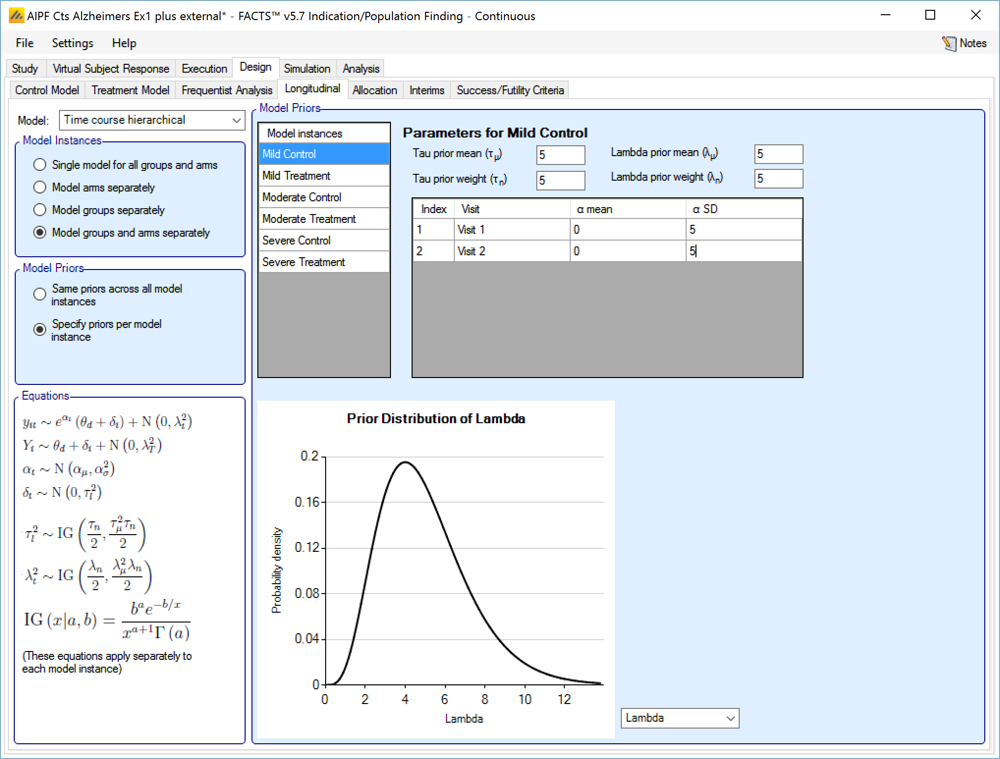{#fig-fig45cont}

If “Same priors across all model instances” is selected the screen is
simpler as there is no group selector list.

### Kernel Density

This method is a non-parametric re-sampling approach that is ideal for
circumstances where the relationship between the interim time and the
final endpoint is not known or not canonical.

In this method existing subjects with known final endpoint data are
sampled to provide an estimate of the final endpoint for a subject for
whose final endpoint value has not been observed. The probability of
selecting a subject when sampling is determined using a Normal
probability density centered on the observed interim endpoint value of
the subject whose final endpoint we wish to impute. This Normal
probability density has SD: hx. The value imputed for the
subject is sampled from a Normal distribution centered on the selected
subject’s final endpoint value with SD: hy. Weak initial
values for hx and hy would be the expected SD of
the observations at the visit and the expected final SD of the endpoint
observations. Smaller hx would more strongly select values of
X close to the observed interim for which a final value is being
imputed; smaller hy would reflect an expected conditional
variance of the final visit given the interim value.

The parameters are the

- Initial value for hy, the ‘noise’ added to the sampled
  endpoint value

- Kernel minimum number of subjects – the minimum number of subjects in
  the model who must have final endpoint data before the hx
  and hy are updated based on the observed variances and
  correlation.

- Initial value for hx, the ‘width’ of the normal kernel used
  for sampling

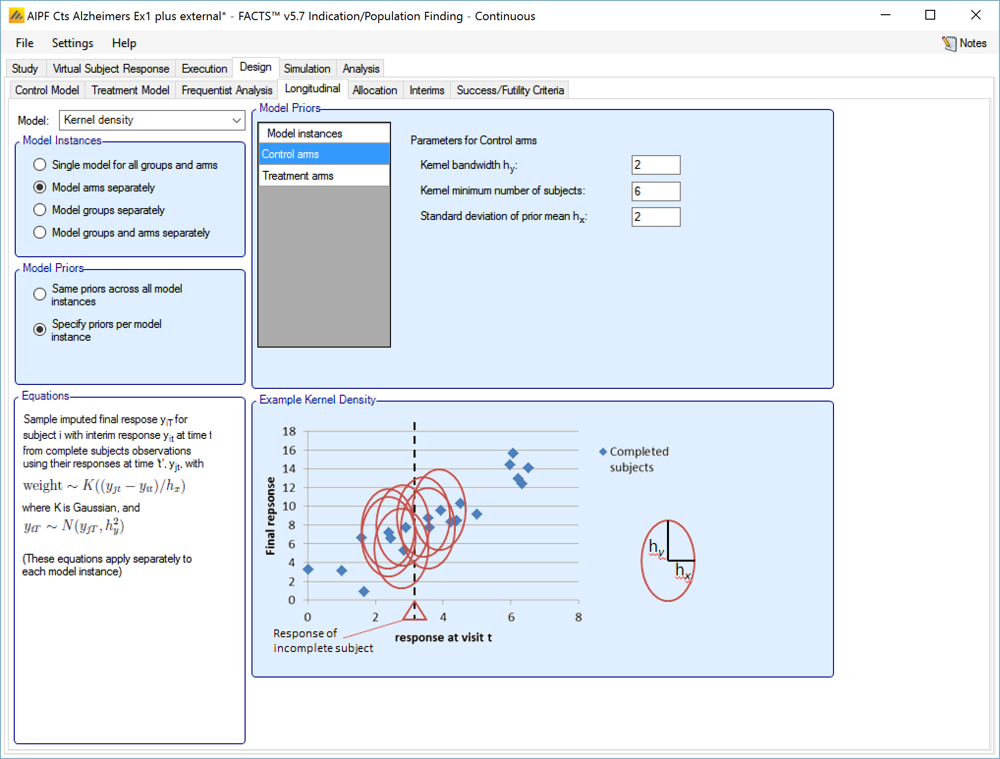{#fig-fig46cont}

If “Same priors across all model instances” is selected the screen is
simpler as there is no group selector list.

### ITP

This model fits the responses at all the visits with a curve whose shape
is controlled by a single parameter *k*. It also has per subject and per
visit random effect variables which are scaled by the same curve, so
they are smaller at earlier visits.

The user specifies:

- A prior mean and standard deviation for a Normally distributed prior
  for *k*.

- A prior mean and weight for the estimate of tau, the SD for *s*, the
  inter-subject variability. This prior is an inverse gamma distribution
  for tau squared (thus
  $E\left( \frac{1}{\tau^{2}} \right) = \frac{1}{{\acute{\tau}}^{2}}$
  where $\acute{\tau\ }$ is the tau prior mean).

- A prior mean for the estimate of lambda, the SD of the error in the
  forecast of the final endpoint and the weight of that prior in terms
  of equivalent number of operations. This prior is an inverse gamma
  distribution for lambda squared (thus
  $E\left( \frac{1}{\lambda^{2}} \right) = \frac{1}{{\acute{\lambda}}^{2}}$
  where $\acute{\lambda\ }$ is the lambda prior mean).

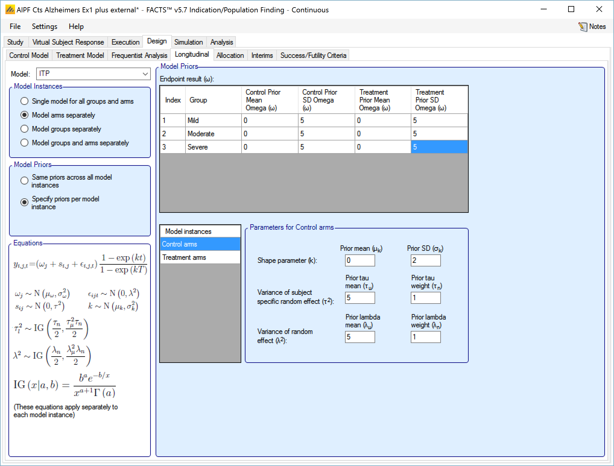{#fig-fig47cont}

If “Same priors across all model instances” is selected the screen is
simpler as there is no group selector list.

## Dichotomous

There are three options for handling longitudinal modeling with a
dichotomous endpoint:

1.  Last Observation carried Forward (LOCF)

2.  Beta binomial

3.  Logistic Regression

These models, and the Restricted Markov model below, are described in
more detail in
[Longitudinal Models for Dichotomous Endpoints](../core/longitudinalmodels/dichotomous.qmd)
in the FACTS Core user guide.

If the special Restricted Markov model is being used then this has its
own longitudinal model.

### Last Observation Carried Forward (LOCF)

This is not a model. For each subject their final endpoint is assumed to
be the same as the last observation of that patient at an interim visit.

### Beta binomial

This uses simple a beta binomial to model the probability that subjects
will ultimately have a response at the final endpoint. The user
specifies:

- Beta binomial parameters
  $\left( \alpha_{\mu 1},\beta_{\mu 1} \right)$ for the probability
  that a subject observed as a responder at the last visit will finish
  as a responder and beta binomial parameters
  $\left( \alpha_{\mu 0},\beta_{\mu 0} \right)$ for the probability
  that a subject observed as a non-responder at their last visit will
  finish as a responder.

9‑9: Longitudinal model - beta binomial

The prior values for the beta binomial can be thought of in terms of
‘prior observations’ of interim values and final outcomes.

αµ1 observations of a response at the visit, where the final
endpoint result was a response

βµ1 observations of a response at the visit, where the final
endpoint result was **not** a response

αµ0 observations of **no** response at the visit, where the
final endpoint result was a response

βµ0 observations of **no** response at the visit, where the
final endpoint result was **not** a response

If “Specify priors per visit” is selected then the priors are entered as
a grid:

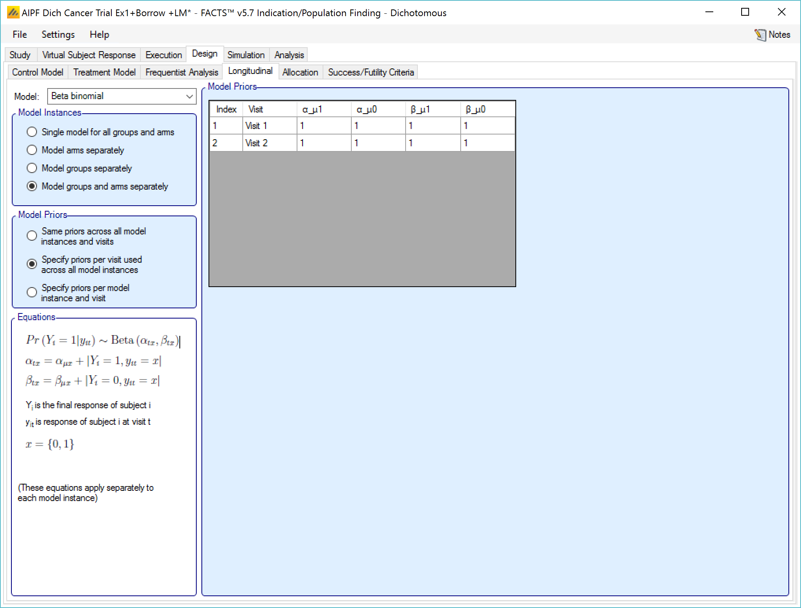{#fig-fig40dich}

If “Specify priors per model instance and visit is specified then there
is an additional control to select the model whose priors are currently
displayed in the grid. To set the priors the user must ensure that they
are set for each model in turn.

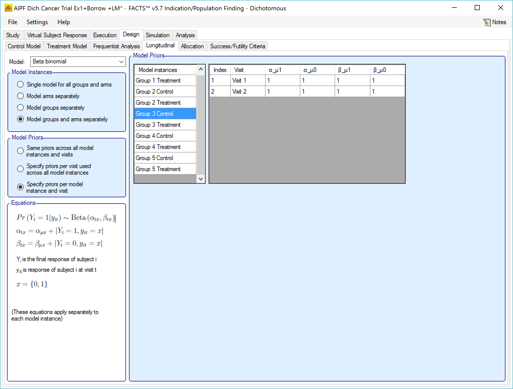{#fig-fig41dich}

### Logistic Regression

This model models the relationship between all the subject’s
intermediate endpoints and their final endpoint value as the log-odds of
the probability of being a final responder based on the current
response. The prior for the logit is specified as normally distributed.

The user specifies:

- The mean and SD of the log-odds probability that a subject will be a
  final responder given that they are currently: a non-responder
  $\left( \mu_{0},\sigma_{0} \right)$, or a responder
  $\left( \mu_{1},\sigma_{1} \right)$.

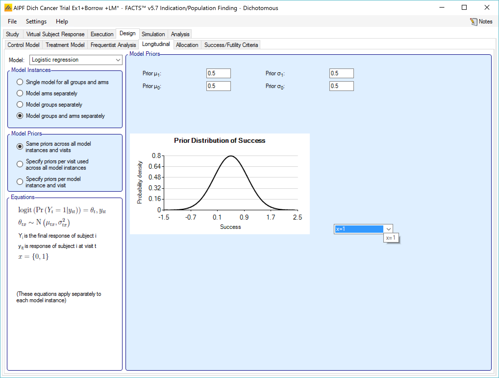{#fig-fig42dich}

If “Same priors across all model instances” is selected the screen is
simpler as there is no group selector list.

### Restricted Markov {#sec-restricted-markov}

If on the “Study \> Study Info” tab the special longitudinal feature of
a “Restricted Markov” model has been selected, then a “Restricted
Markov” longitudinal model must be used in the design to analyse subject
data. The Restricted Markov model is similar to the Beta Binomial model
except it uses a Dirichlet prior that models the probability of one of a
number of outcomes for each subject at each visit – in this case three:
Success, Stable and Failure.

Like the other models, the user can select how many distinct instances
of the model are fitted, and whether there is a common set of values for
the priors for each instance or individually specified priors for each
instance.

The priors for the model are the equivalent number of prior observations
for each outcomes at each visit.

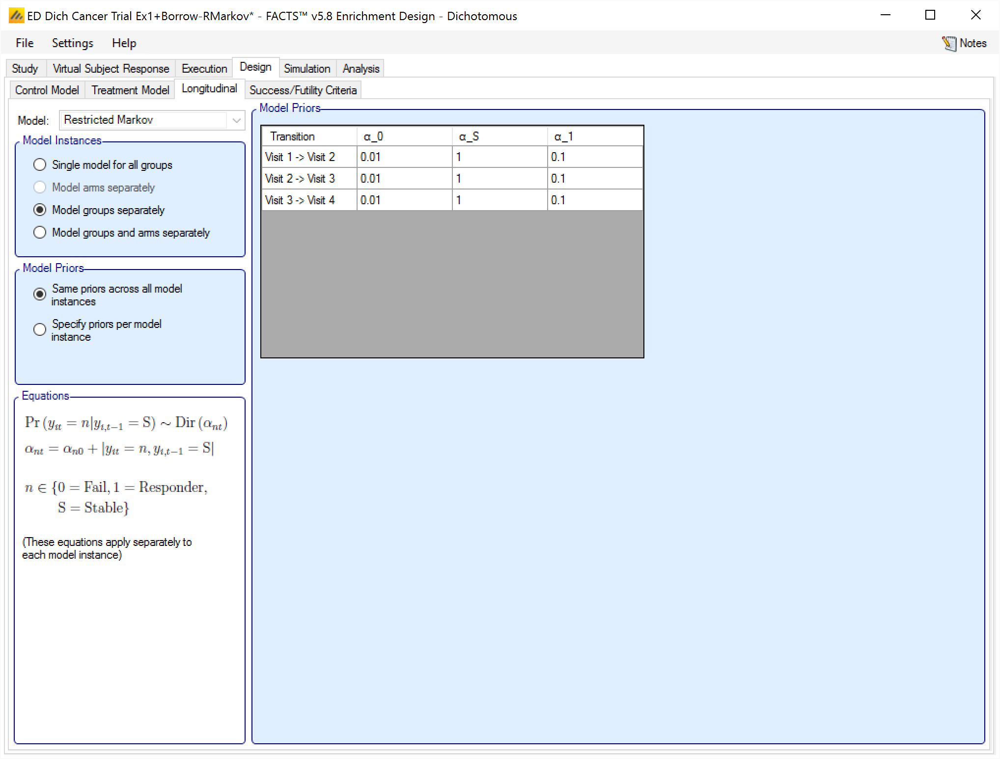{#fig-fig43dich}

:::

## Allocation

On the allocation tab:

- If there are control arms included in the trial - the user specifies
  the relative proportion of subjects allocated to each arm in each
  group. The proportions are only relative within a group, not across
  groups. The relative proportion of subjects between groups depends on
  the relative accrual rates into the different groups and the points at
  which each group stops accruing.

- If no Control Arm is included in the trial this tab is not displayed.

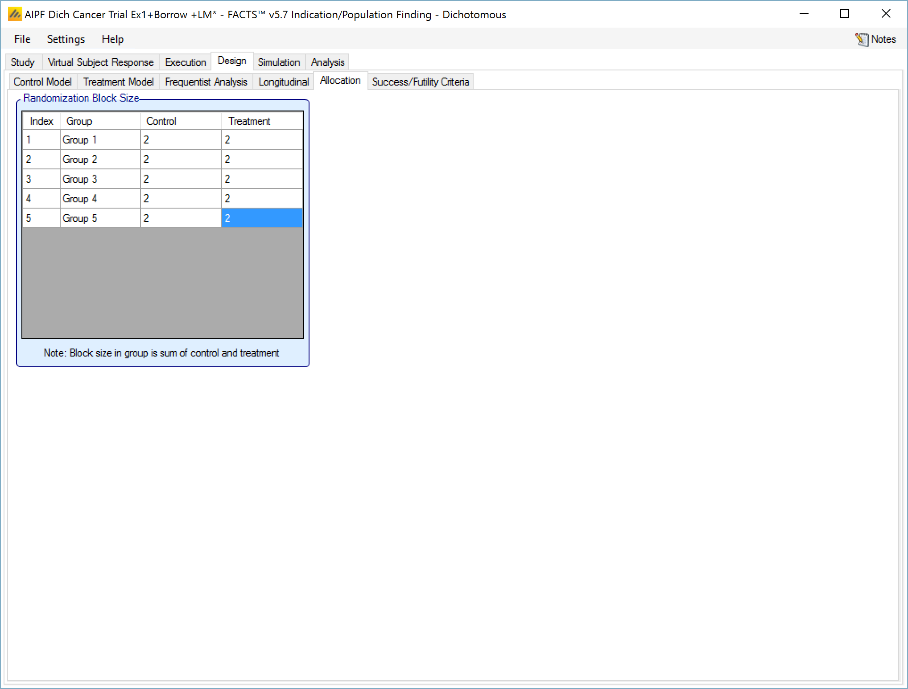{#fig-fig44dich}

In the example screenshot above, 2:2 randomizations has been specified
for all groups, giving them 1:1 allocation with a block size of 4.

Each group is randomized separately, in blocks. The block size in a
group is the sum of the numbers entered for control and treatment, and
each block contains exactly those numbers of control and treatment
allocations, in a random order.

# Interims

If the trial is adaptive, there is an Interims tab, where the user
specifies when interims occur. Interims can either be specified with
calendar frequency, occurring every specified number of weeks, or
specified to occur after a specified amount of information has been
collected.

:::{.panel-tabset}

## Continuous/Dichotomous

Information can be defined in terms of:

- number of subjects that have been recruited

- the number of subjects who have had the opportunity to complete a
  specified visit (that is subjects who have completed the visit and
  subjects that dropped-out before the visit but who would have
  completed the visit if they hadn’t dropped out)

- the number of subjects who have actually completed a specified visit

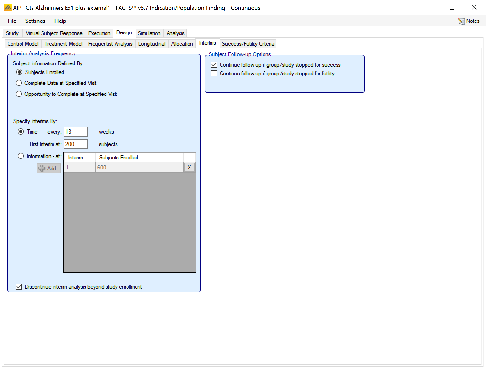{#fig-fig49cont}

If defining interims by time, these are defined by frequency (number of
weeks between interim) – fractions of weeks can be used for very
frequent interims! The first interim is defined in terms of an
information threshold, with the type of information selected above.

If the accrual completes before the first interim threshold is reached,
and the first interim was defined in terms of the number of subjects
enrolled, then the interims by time start at full accrual. If the first
interim is defined in any other terms (subjects complete or subjects
with opportunity to complete) then interims only start when this is
reached (which might be never).

If defining interims by information, then each interim is defined
individually, by number of patients/observations and if information is
interms of completers, then the week of the visit that is being used to
define “complete”. Successive interims must be in terms of the same or
more observations at the same or later visit, and either the visit or
the number of observations needs to be greater than the previous
interim.

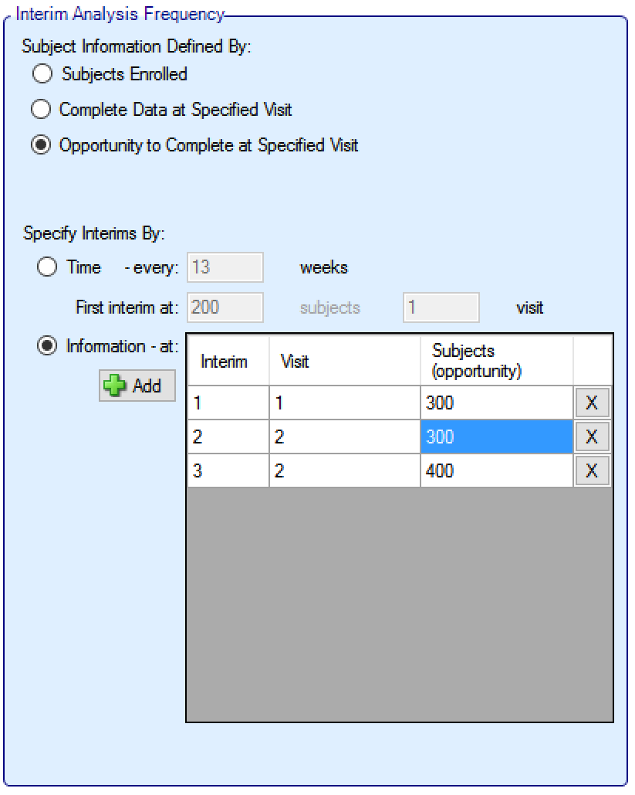{#fig-fig50cont}

In addition in this section there are options that allow user to specify
whether to continue to follow-up subjects if a group or the whole study
stops early (see [Follow-up after a group or the study stops](#sec-ed-followup)),
and (if interims are defined by time) whether interims should continue
after full accrual. By default they do; checking “Discontinue interim
analysis beyond study enrollment” stops them. Interims defined by information, in terms of
subjects who have completed, or had the opportunity to complete, a
visit, take place when their thresholds are reached, whether or not
accrual is complete. Interims defined by the number of subjects
recruited cannot take place after full accrual.

In ED adaptation is limited to stopping groups and stopping the whole
trial, thus while it is sensible to ensure that first interims decisions
are not taken until sufficient early subjects have completed, there are
conditions that can be specified (minimum number of subjects recruited
in the trial and minimum number subjects recruited in a group) on the
‘Design \> Stopping Criteria’ tab that can be used to prevent interims
being acted on too early within specific groups.

## Time-to-Event

Information can be defined in terms of:

- number of subjects that have been recruited,

- the number of events.

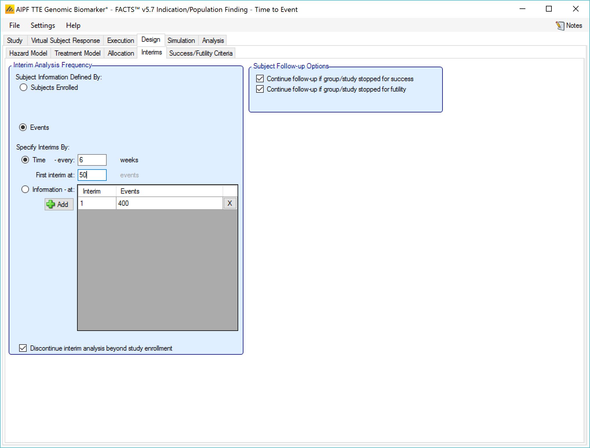{#fig-fig43tte}

If defining interims by time, these are defined by frequency (number of
weeks between interim) – fractions of weeks can be used for very
frequent interims! The first interim is defined in terms of an
information threshold, with the type of information selected above.

If the accrual completes before the first interim threshold is reached,
and the first interim was defined in terms of the number of subjects
enrolled, then the interims by time start at full accrual. If the first
interim is defined in by events, then interims only start when this is
reached (which might be never).

If defining interims by information, then each interim is defined
individually, by number of patients/observations and if information is
interms of completers, then the week of the visit that is being used to
define “complete”. Successive interims must be in terms of the same or
more observations at the same or later visit, and either the visit or
the number of observations needs to be greater than the previous
interim.

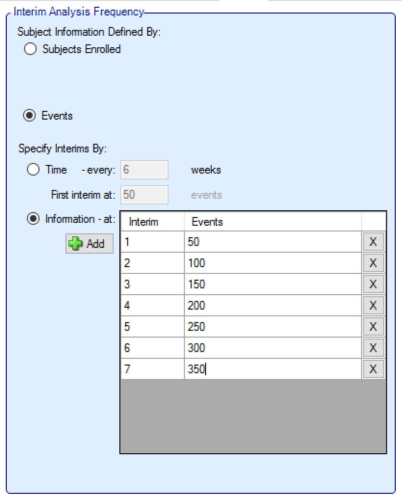{#fig-fig44tte}

In addition in this section there are options that allow user to specify
whether to continue to follow-up subjects if a group or the whole study
stops early, and (if interims are governed by time, completers or
events) whether interims should continue after full accrual.

In ED adaptation is limited to stopping groups and stopping the whole
trial, thus while it is sensible to ensure that first interim decisions
are not taken until sufficient early subjects have completed, there are
conditions that can be specified (minimum number of subjects recruited
in the trial and minimum number subjects recruited in a group) on the
‘Design \> Stopping Criteria’ tab that can be used to prevent interims
being acted on too early within specific groups.

:::

## Follow-up after a group or the study stops {#sec-ed-followup}

Two options on the Interims tab control whether subjects already
recruited continue to be followed up after an early stop:

- “Continue follow-up if group/study stops for early success.” This is
  checked by default.

- “Continue follow-up if group/study stops for early futility.” This is
  not checked by default.

The option that applies is the one for the reason of the stop, for
group stops and study stops alike. A group and the study can stop for
different reasons, for example a group stops for futility and later the
study stops for success. For a group that stopped before the study:

- If follow-up is discontinued for the group's reason for stopping, its
  subjects are no longer followed up from the group stop, whatever the
  study does later.

- Otherwise its subjects are followed up until the study stops, and
  after that only if follow-up continues for the study's reason for
  stopping.

The analyses use only the data collected up to the time follow-up was
discontinued.

# Success/Futility Criteria

On the success/futility criteria page the user can specify rules for
judging the study for futility or success at an interim and at the final
evaluation. If the trial has no interims there will be just a tab for
the Final Evaluation criteria. If the trial has interims then there can
be tabs that define different early success/futility criteria at the
different interims.

At the top of the main tab is a control to allow tabs to be created for
different interims. In a newly created adaptive design, FACTS will
create a tab for interim 1 as well as Final Evaluation.

If early success/futility criteria are specified for an interim, then
they will be taken to apply to all subsequent interims until the next
one for which criteria are supplied, then those criteria will apply
until the next interim for which criteria are applied and so on.

The stopping criteria available are:

- For each group:

  - Early success or futility can be decided based on the posterior
    probability of the treatment effect being better than control by the
    Success CSD or worse than control by the Futility CSD.

  - In addition there can be a required minimum information on the group
    before it can stop where information is the number of subjects
    enrolled or events observed. (If interim timing is defined by
    events, then minimum information can only be by events).

  - For each group stopping can be decided only on that group’s results
    or (if Across Groups is enabled for early stopping) the Across
    Groups analysis can also be taken in to account – and the user can
    select that either the group criteria AND the Across Groups criteria
    must be met for a group to stop, or the group criteria OR the Across
    Groups criteria must be met for the group to stop.

- It is also possible to specify criteria to stop the whole study based
  on

  - Which groups have stopped – the Study stopping rule can be defined
    using “AND”, meaning all the specified groups have to have stopped
    for the whole study to stop, or “OR”, meaning that if any one of the
    specified groups has stopped then the whole study stops. For the
    purpose of this rule the “Across Groups” criteria can be included as
    a “group”.

  - A minimum information across the whole study can be specified and
    the study will not stop until that amount of information has been
    collected.

Note:

1.  Early stopping of accrual into individual groups or of the whole
    study for success/futility only occurs at interims.

2.  There will be no stopping for success or futility until the first
    interim for which early stopping criteria have been defined.

3.  It is left to the user to ensure that the early stopping criteria at
    any interim are mutually exclusive and it is not possible for groups
    or the study stop for both success and futility at the same time.
    If both are met at the same interim, FACTS evaluates success first
    and records the stop as a success: a group or study that has stopped
    for success is not then stopped for futility. It is still not
    considered good practice to have success and futility rules that
    could both be true at the same time.

4.  In the output files there are columns labeled “CSD/Ph3 Success” and
    “CSD/Ph3 Futile” for each group indicating whether any decision
    criteria became true, and “Success Criteria Met” and “Futility
    Criteria Met” for each group indicating if all the criteria for a
    success or futility determination have been met. If both sets of
    criteria are met simultaneously, FACTS will only flag one of
    “Success Combined” and “Futile Combined” as being met, corresponding
    to how the outcome of the trial has been flagged.

5.  Once a group has stopped for success or futility it keeps that
    status, and its stopping criteria are not evaluated again. Its
    treatment effect is still estimated at later interims, and its stop
    still counts towards the study stopping rules. A group that stopped
    recruiting only because it reached its cap, or because the study
    stopped, can still stop for success or futility at a later interim.

6.  Once the study has stopped for success or futility, the study
    stopping rules are not evaluated again. If subjects are still being
    followed up and further interims take place, the stopping rules are
    still evaluated for the groups that have not stopped for success or
    futility.

7.  A group's outcome is classed as early success or early futility only
    if it met its stopping criteria before all of its subjects' data
    were complete. If it first meets them at an interim when all of its
    data are already available (possible when interims continue after
    full accrual), its outcome is decided by the final evaluation, as
    for a group that recruited to its cap.

:::{.panel-tabset}

### Continuous

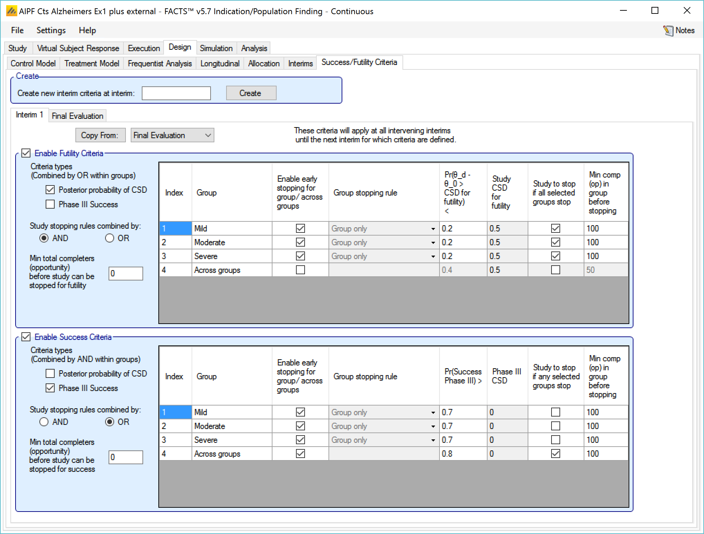{#fig-fig51cont}

### Dichotomous

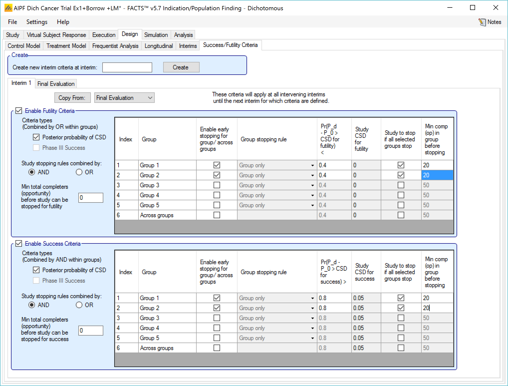{#fig-fig47dich}

### Time-to-Event

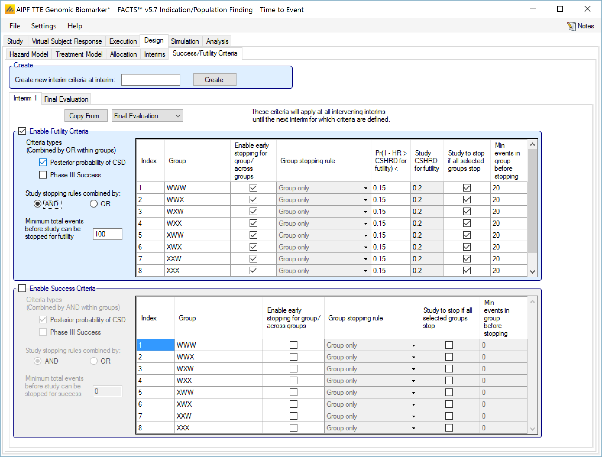{#fig-fig45tte}

:::

- Enable Futility/Success Criteria, these check boxes allow early
  stopping for either success and/or futility to be easily disabled.

- Futility Criteria

  - “Criteria types”: the evaluation criteria available are the
    posterior probability of being better than control by the futility
    CSD/CSHRD, and/or by the posterior probability of success in a
    subsequent phase 3 trial. Whether one, the other or both criteria
    are to be used is specified using the two check boxes on the left of
    the tab. If both are selected then for futility, the results of
    testing the criteria are OR’d together.

  - “Study stopping rules combined by”: Study early stopping is
    determined by whether user specified groups stop. If AND is
    specified the study will stop for futility if **all** the selected
    groups stop for futility, if OR is specified the study will stop for
    futility if **any** of the selected groups stop for futility. To
    select a group to be one of those that determines study stopping the
    user must first select “Enable early stopping..” for that group and
    then select “Study to stop if …” for it using the respective check
    boxes in the row in the table for that group..

  - “Minimum total subjects”: allows the user to specify an overall
    minimum number of subjects that must be accrued before the study can
    stop for futility (only available if information is defined by
    subjects enrolled on the Interim tab).

  - “Minimum total events”: allows the user to specify an overall
    minimum number of events that must be observed before the study can
    stop for futility.

  - The group table has a row per group, plus a row for across groups.
    The columns included / enabled in the table depend on the selections
    made in the first two parameters above.

  - Table columns:

    - “Enable early stopping”: If checked the stopping rules for this
      group are to be evaluated, if not checked the group will not stop
      early. It will only stop when it reaches its group cap, the study
      reaches the study cap, or the study stops early.

    - “Pr()\> CSD/CSHRD for futility \<” or “Pr() \< NIM/NIHRM for futility \<”: If “Posterior probability” has been set as a criteria type and
      “Early stopping” enabled for the group, then the threshold for
      early stopping by this criteria must be set. The criteria will be
      met if

      - For superiority: the posterior probability of the response on
        the treatment arm being better than the control response plus
        the futility CSD is below this threshold (continuous or dichotomous endpoint)         or the posterior probability that the treatment
        arm hazard ratio is better than the futility CSHRD, is below
        this threshold (time-to-event endpoint).

      - For non-inferiority: the posterior probability of the response
        on the treatment arm being better than the control response less
        the NIM for futility is below this threshold (continuous or dichotomous       endpoint) or the posterior probability that the
        treatment arm hazard ratio is better than the NIHRM for futility
        is below this threshold (time-to-event endpoint).

    - “Pr(Success Phase III) \<”: This column is only displayed if
      ‘Phase 3 Criteria’ has been enabled on the ‘Study \> Group Info’
      tab and if “Phase III CSD” has been set as a criteria type. If
      “Early stopping” is enabled for the group, then the threshold for
      early stopping by this criteria must be set. This criterion will
      be met if the posterior probability of success in the specified
      phase 3 trial is below this threshold.

    - “Group Stopping Rule”: If “Early stopping” has been enabled for
      this group and for “Across groups”, and “Across groups” is not
      selected to stop the study, then the group stopping rule can take
      the across group criteria into account. The group stopping can
      depend on

      - solely on the group’s stopping criteria being met,

      - or on either the group or the across group criteria being met

      - or on both the group and the across group criteria being met.

    - “Study to stop if …“: By default the study stops only when the
      constituent groups stop or reach their maximum sample size or the
      whole study reaches its maximum sample size, this setting allows
      the study to be stopped if any one of the selected groups stops
      for futility (“Study stopping rules combined by OR”) or if all of
      the selected groups stop for futility (“Study stopping rules
      combined by AND”). One of these groups can be the ‘across groups’
      analysis.

    - “Min subj in group before stopping”: The minimum number of
      subjects that must have been accrued in the group before the
      stopping criteria for that group are evaluated. (Only available if
      information on the Interim tab is defined by subjects enrolled.)

    - “Min events in group before stopping”: The minimum number of
      events that must have been observed in the group before the
      stopping criteria for that group are evaluated.

- The Success Criteria parameters are all similar to their futility
  criteria counterparts. There are three differences:

  - If both “Posterior probability” and “Phase III CSD” criteria are
    selected for stopping for success then both must be met for the
    group to stop for success.

  - For the “Pr()\> CSD/CSHRD for success \<” and “Pr(Success Phase III) \<”
    criteria, the posterior probability must exceed the specified
    thresholds for the group’s stopping for success criteria to be met.

  - The CSD/CSHRD is the CSD/CSHRD for success or the NIM/NIHRM is the NIM/NIHRM for
    success, rather than for futility.

### Stopping Criteria at subsequent interims

The stopping criteria can be changed at subsequent interims, but only in
terms of the threshold to test against, the selection of the stopping
logic and the minimum information requirements cannot be changed.

:::{.panel-tabset}

### Continuous

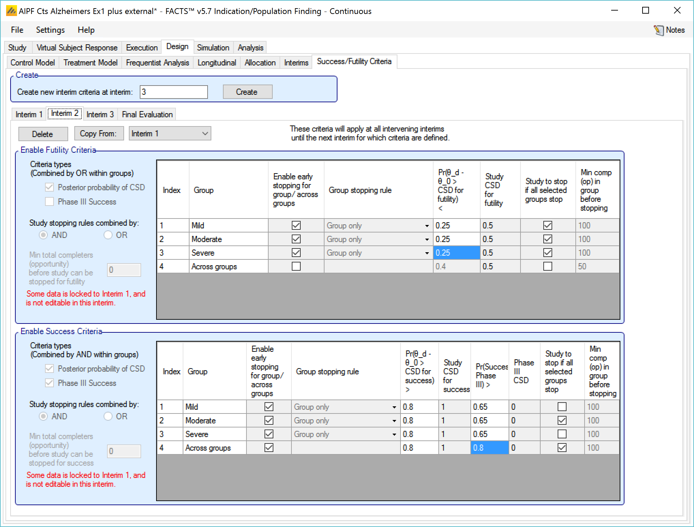{#fig-fig52cont}

### Dichotomous

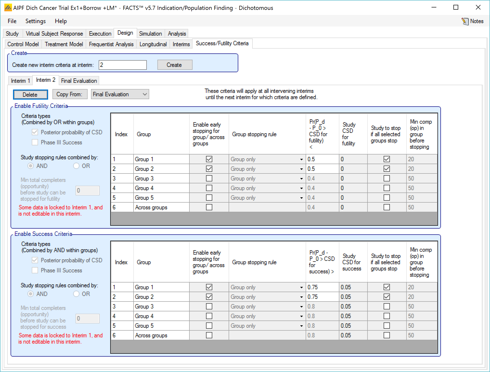{#fig-fig48dich}

### Time-to-Event

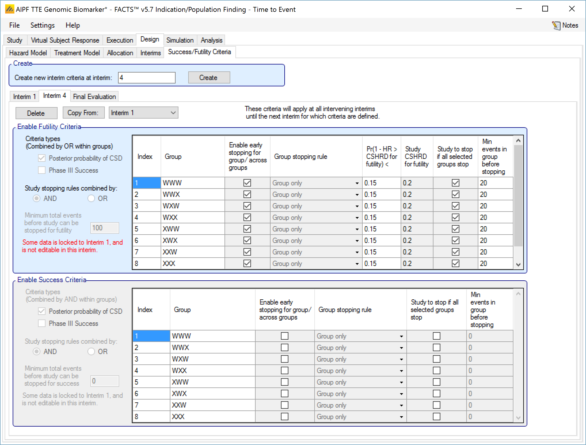{#fig-fig46tte}

:::

### Examples of stopping criteria

The stopping rules in ED are flexible and potentially quite complex. It
is not expected that complex conditions will be required very often,
what is expected is that there will be ED trials with quite different
goals and the flexibility in the stopping conditions are there to allow
stopping rules appropriate to these different goals to be entered.

For example:

- To identify in which sub-groups the treatment is sufficiently
  effective to justify a further development and further development to
  proceed if any of the groups are successful and the development will
  use the ‘signature’ of the combined successful groups to define the
  target population:

  - Testing the posterior probability of better response compared to
    control (possibly with CSD delta’s specified)

  - Enabling early stopping for futility for all groups (not across
    groups), for each group setting the required minimum number of
    subjects and futility stopping threshold

  - Stopping the whole study for futility combining decisions with
    “AND”, selecting every group so the study stops early for futility
    only if all groups stop

  - Similarly for success

- To only perform further development if there is broad efficacy across
  the whole population tested, but to drop any groups where efficacy is
  poor

  - Testing the posterior probability of better response compared to
    control (possibly with CSD delta’s specified) for stopping groups
    and testing “Phase 3 CSD” for across groups

  - Enabling early stopping for futility for all groups and across
    groups. For each group setting the required minimum number of
    subjects and CSD futility stopping threshold for dropping that group
    (the “Pr(Success in Phase 3)” thresholds being set very low so that
    they don’t trigger). For “across groups” setting the minimum number
    of subjects and “Pr(Success in phase 3)” futility stopping threshold
    for stopping the whole trial for futility (with the “Posterior
    probability” threshold set very low so that it doesn’t trigger).

  - Stopping the whole study for futility combining decisions with
    “AND”, marking only “across groups” so the study stops early for
    futility only if “across groups” stops.

  - For success early stopping, this is only enabled for “across groups”
    and only uses Phase 3 CSD. For “across groups” the minimum number of
    subjects and Pr(Success in phase 3) success stopping threshold are
    set for stopping the whole trial for success.

- To only perform further development if there is efficacy in both of
  two specific subgroups (probably the largest in proportion of overall
  population) and determine which other groups to also include in the
  ‘signature’ of the target population going forward.

  - Testing the posterior probability of better response compared to
    control (possibly with CSD delta’s specified).

  - Enabling early stopping for futility for all groups (not across
    groups), for each group setting the required minimum number of
    subjects and CSD futility stopping threshold for dropping that
    group.

  - Stopping the whole study for futility combining decisions with “OR”,
    marking only the two critical groups so if either stops for futility
    then the study stops early for futility.

  - For success early stopping, only mark the two critical groups for
    early stopping, for each group setting the required minimum number
    of subjects and CSD futility stopping threshold for dropping that
    group.

  - Stopping the whole study for success combining decisions with “AND”,
    marking both critical groups so that if both stop for success then
    the study stops early for success.

### Final Evaluation Criteria

On the Final Evaluation tab of the Success/Futility Criteria tab page
the user specifies the rules for judging whether individual groups and
the overall study were futile or a success should they not stop early.

This tab is similar to the Success/Futility Criteria bad for interims,
except that there is no option to specify the minimum information
requirements – these rules are evaluated when all information has been
gathered.

:::{.panel-tabset}

### Continuous

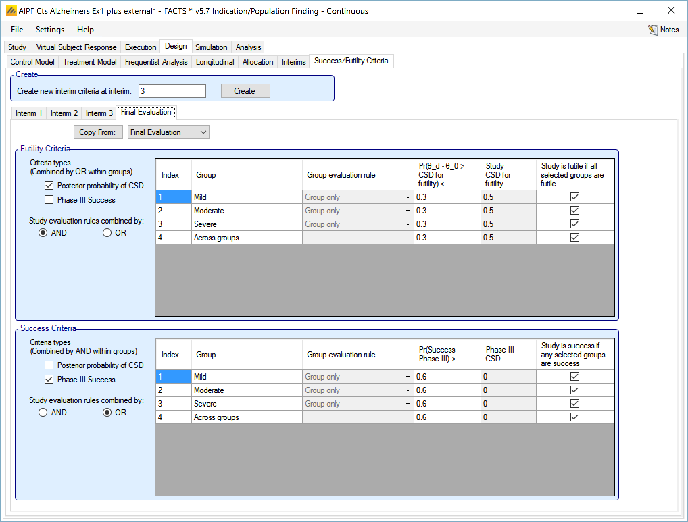{#fig-fig53cont}

### Dichotomous

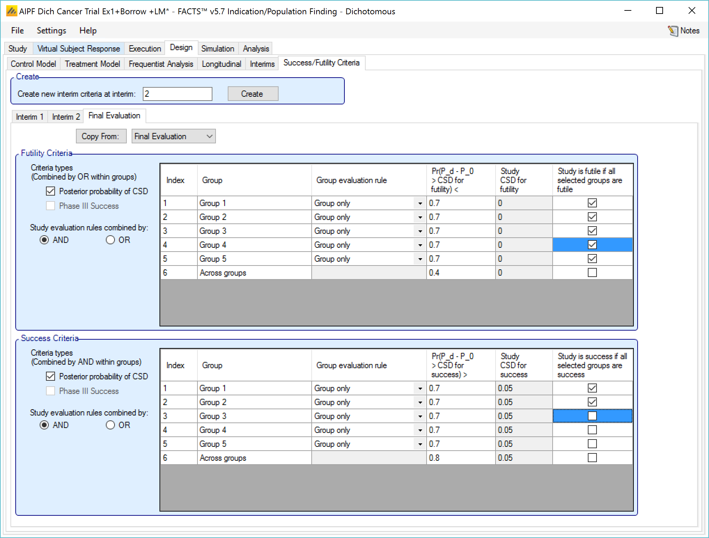{#fig-fig49dich}

### Time-to-Event

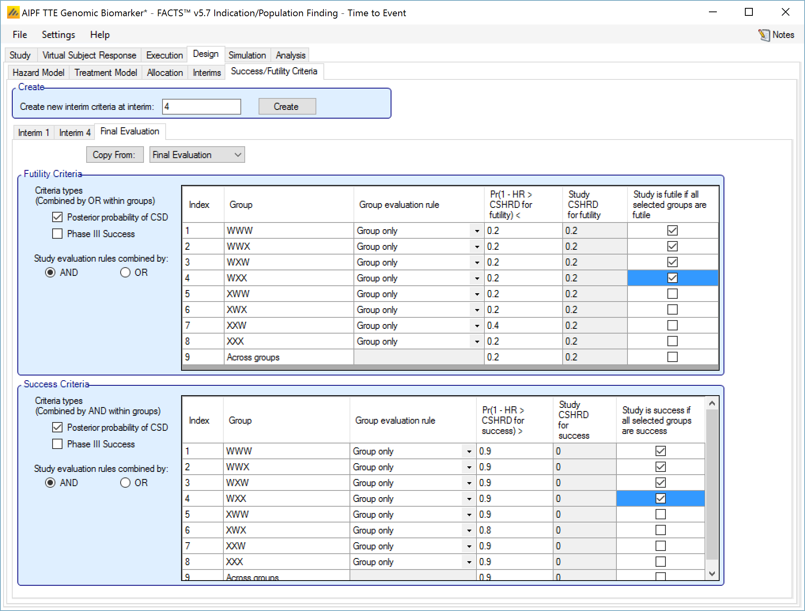{#fig-fig47tte}

:::
